# Esercizi · Il branch-and-bound basato sulla programmazione lineare

**Esercizi · Capitolo 7** · ogni soluzione si apre con un clic · [:material-book-open-variant: Capitolo 7: Branch-and-bound](../metodi-esatti/bb.md) · [:material-file-pdf-box: Eserciziario, volume 2 (PDF)](../pdf/esercizi-2-metodi-esatti.pdf)

## Algoritmo di branch-and-bound

!!! esercizio "Esercizio 7.1: Algoritmo di branch-and-bound (P1)"

    !!! nota ""

        Consideriamo il seguente problema PLI in forma canonica di massimo con $n=2$ variabili intere e $m=1$ vincolo:

        $$
        \begin{array}{rrrrrrr}
        {\max} & {x_1} & {+} & {8}\, {x_2} \\[2ex]
        & {3}\, {x_1} & {+} & {6}\, {x_2} & {\le} & {16} \\[2ex]
        & {x_1,} &  & {x_2} & {\in} & {\Z_{\ge 0}}
        \end{array}
        $$

        e un dizionario ottimo del suo rilassamento lineare in forma standard:

        \begin{equation*}
        \begin{cases}
        \begin{array}{rrrrrrr}
        {x_2} & {=} & {\dfrac{8}{3}} & {-} & {\dfrac{1}{2}}\, {x_1} & {-} & {\dfrac{1}{6}}\, {x_3} \\[2ex]
        {z} & {=} & {\dfrac{64}{3}} & {-} & {3}\, {x_1} & {-} & {\dfrac{4}{3}}\, {x_3}
        \end{array}
        \end{cases}
        \end{equation*}

    **Domande**

    1. Eseguire l'algoritmo di branch-and-bound utilizzando:

        1. la regola dell'indice minimo come strategia di selezione della variabile di branching;

        2. la regola LIFO come strategia di selezione del nodo di branching;

        3. risolvere prima il nodo di branching verso il basso e poi il nodo di branching verso l'alto;

        4. porre il lower bound $\LB$ a $-\infty$ (non viene eseguito alcun algoritmo euristico).

        Risolvere i problemi LP dei nodi di branching con l'algoritmo del simplesso duale. Nell'algoritmo del simplesso duale, la variabile uscente è la variabile in base con valore negativo e indice minimo, e i pareggi nel test dei rapporti si risolvono con l'indice minimo. Mostrare graficamente la soluzione ottima dei problemi LP associati ai nodi di branching.

    2. Determinare e commentare l'albero di branch-and-bound, mostrando il motivo per cui ciascun nodo di branching viene potato.

??? soluzione "Soluzione"

    1. Esecuzione dell'algoritmo di branch-and-bound per risolvere il problema $\ILP$.

        - <strong>Inizializzazione</strong>

            Consideriamo il problema $\LP_{1}$ in forma standard:

            $$
            \begin{array}{rrrrrrrrr}
            {\max} & {x_1} & {+} & {8}\, {x_2} &  &  \\[2ex]
            & {3}\, {x_1} & {+} & {6}\, {x_2} & {+} & {x_3} & {=} & {16} \\[2ex]
            & {x_1,} &  & {x_2,} &  & {x_3} & {\ge} & {0}
            \end{array}
            $$

            e il suo dizionario ottimo:

            \begin{equation*}
            \begin{cases}
            \begin{array}{rrrrrrr}
            {x_2} & {=} & {\dfrac{8}{3}} & {-} & {\dfrac{1}{2}}\, {x_1} & {-} & {\dfrac{1}{6}}\, {x_3} \\[2ex]
            {z} & {=} & {\dfrac{64}{3}} & {-} & {3}\, {x_1} & {-} & {\dfrac{4}{3}}\, {x_3}
            \end{array}
            \end{cases}
            \end{equation*}

            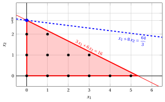{ .fig .ovale loading=lazy  }

            <em>Nodo 1: regione ammissibile di $\LP_{1}$ (in rosso), punti ammissibili del problema PLI (in nero) e soluzione ottima di $\LP_{1}$ (in blu) con la retta della funzione obiettivo che vi passa.</em>

            Una soluzione ottima ${\tilde{\boldsymbol x}}(\LP_{1})$ è:

            $$
            \tilde{x}_1=0,~~\tilde{x}_2=\dfrac{8}{3}
            $$

            il valore ottimo è:

            $$
            z(\LP_{1}) = \dfrac{64}{3}
            $$

            La soluzione ottima ${\tilde{\boldsymbol x}}(\LP_{1})$ è <strong>frazionaria</strong> e il problema $\LP_{1}$ è <strong>ammissibile</strong>, quindi il problema $\LP_{1}$ viene inserito nella lista dei problemi $L$ e il lower bound $\LB$ viene posto a $-\infty$.

            Con il lower bound $\LB$ e l'upper bound $\UB$ correnti, abbiamo:

            $$
            -\infty ~~\le~~ z(\ILP) ~~\le~~ \underbrace{\left\lfloor \dfrac{64}{3} \right\rfloor}_{=21}
            $$

        - <strong>Iterazione 1</strong>

            Il problema $\LP_{1}$ viene estratto e cancellato dalla lista dei problemi $L$.

            La variabile di branching è $x_{2}$. I vincoli di branching sono:

            $$
            x_2 \le \underbrace{\left\lfloor \dfrac{8}{3} \right\rfloor}_{ = 2} \mathrm{~~~e~~~} x_2 \ge \underbrace{\left\lfloor \dfrac{8}{3} \right\rfloor +1}_{= 3}
            $$

            Con questi vincoli di branching si creano i due problemi $\LP_{2}$ e $\LP_{3}$.

            1. Soluzione del problema $\LP_{2}$

                Consideriamo il problema $\LP_{2}$ in forma standard:

                $$
                \begin{array}{rrrrrrrrrrr}
                {\max} & {x_1} & {+} & {8}\, {x_2} &  &  &  &  \\[2ex]
                & {3}\, {x_1} & {+} & {6}\, {x_2} & {+} & {x_3} &  &  & {=} & {16} \\[2ex]
                &  &  & {x_2} &  &  & {+} & {x_4} & {=} & {2} \\[2ex]
                & {x_1,} &  & {x_2,} &  & {x_3,} &  & {x_4} & {\ge} & {0}
                \end{array}
                $$

                Per il vincolo di branching abbiamo:

                $$
                x_2 + x_4 = 2 \quad \quad \Rightarrow \quad x_4 = 2 - x_2
                $$

                Usando le equazioni del dizionario ottimo possiamo esprimere questo vincolo di branching in funzione delle variabili fuori base. Sostituendo, otteniamo

                $$
                x_4 = 2 - \left(\dfrac{8}{3} - \dfrac{1}{2} \; x_1 - \dfrac{1}{6} \; x_3 \right)
                \quad \quad \Rightarrow \quad
                x_4 = -\dfrac{2}{3} + \dfrac{1}{2} \, x_1 + \dfrac{1}{6} \, x_3
                $$

                Aggiungiamo quindi questa equazione al dizionario ottimo precedente e otteniamo il seguente dizionario:

                \begin{equation*}
                \begin{cases}
                \begin{array}{rrrrrrr}
                {x_2} & {=} & {\dfrac{8}{3}} & {-} & {\dfrac{1}{2}}\, {x_1} & {-} & {\dfrac{1}{6}}\, {x_3} \\[2ex]
                {x_4} & {=} & {-\dfrac{2}{3}} & {+} & {\dfrac{1}{2}}\, {x_1} & {+} & {\dfrac{1}{6}}\, {x_3} \\[2ex]
                {z} & {=} & {\dfrac{64}{3}} & {-} & {3}\, {x_1} & {-} & {\dfrac{4}{3}}\, {x_3}
                \end{array}
                \end{cases}
                \end{equation*}

                dove $\pazocal{B}=\{2,4\}$ e $\pazocal{N}=\{1,3\}$ e

                - la soluzione di base primale non ammissibile è:

                    $$
                    \bar x_2=\dfrac{8}{3},~~
                    \bar x_4=-\dfrac{2}{3},~~~~~~
                    \bar x_1=0,~~
                    \bar x_3=0~~
                    \mathrm{~~di~valore~~~} \dfrac{64}{3}
                    $$

                - la soluzione di base duale ammissibile è:

                    $$
                    \bar \pi_2=0,~~
                    \bar \pi_4=0,~~~~~~
                    \bar \pi_1=3,~~
                    \bar \pi_3=\dfrac{4}{3}~~
                    \mathrm{~~di~valore~~~} \dfrac{64}{3}
                    $$

                Se aumentiamo il valore di $\pi_{4}$, possiamo ottenere una soluzione duale migliore. Abbiamo:

                $$
                \begin{cases}
                \pi_1 &= 3 - \dfrac{1}{2}\,\pi_4 \\[2ex]
                \pi_3 &= \dfrac{4}{3} - \dfrac{1}{6}\,\pi_4
                \end{cases}
                \qquad
                \qquad
                \begin{cases}
                \underbrace{ 3 - \dfrac{1}{2}\,\pi_4 \ge 0}_{\pi_1 \ge 0} \\[2ex]
                \underbrace{ \dfrac{4}{3} - \dfrac{1}{6}\,\pi_4 \ge 0}_{\pi_3 \ge 0}
                \end{cases}
                \qquad
                \qquad
                \begin{cases}
                \pi_4 &\le 6 \\[2ex]
                \pi_4 &\le 8
                \end{cases}
                $$

                Aumentando il valore di $\pi_{4}$ fino a $\min \left\{6, 8\right\}=6$, il valore di $\pi_{1}$ scende a $0$. Abbiamo quindi che:

                - $\pi_{4}$ entra nella base duale e, di conseguenza, $x_{4}$ esce dalla base primale.

                - $\pi_{1}$ esce dalla base duale e, di conseguenza, $x_{1}$ entra nella base primale.

                Abbiamo:

                $$
                x_4 = -\dfrac{2}{3} + \dfrac{1}{2} \, x_1 + \dfrac{1}{6} \, x_3
                \quad \Rightarrow \quad
                x_1 = \dfrac{4}{3} - \dfrac{1}{3} \, x_3 + 2 \, x_4
                $$

                Sostituendo nelle altre equazioni del dizionario primale, otteniamo:

                $$
                x_2
                = \dfrac{8}{3} - \dfrac{1}{2} \left( \dfrac{4}{3} - \dfrac{1}{3} \, x_3 + 2 \, x_4 \right) - \dfrac{1}{6} \; x_3
                = 2 - x_4
                $$

                $$
                z
                = \dfrac{64}{3} - 3 \left( \dfrac{4}{3} - \dfrac{1}{3} \, x_3 + 2 \, x_4 \right) - \dfrac{4}{3} \; x_3
                = \dfrac{52}{3} - \dfrac{1}{3} \, x_3 - 6 \, x_4
                $$

                Di conseguenza, abbiamo ora il seguente dizionario primale aggiornato:

                \begin{equation*}
                \begin{cases}
                \begin{array}{rrrrrrr}
                {x_1} & {=} & {\dfrac{4}{3}} & {-} & {\dfrac{1}{3}}\, {x_3} & {+} & {2}\, {x_4} \\[2ex]
                {x_2} & {=} & {2} &  &  & {-} & {x_4} \\[2ex]
                {z} & {=} & {\dfrac{52}{3}} & {-} & {\dfrac{1}{3}}\, {x_3} & {-} & {6}\, {x_4}
                \end{array}
                \end{cases}
                \end{equation*}

                dove $\pazocal{B}=\{1,2\}$ e $\pazocal{N}=\{3,4\}$ e

                - la soluzione di base primale ottima è:

                    $$
                    \tilde x_1=\dfrac{4}{3},~~
                    \tilde x_2=2,~~~~~~
                    \tilde x_3=0,~~
                    \tilde x_4=0~~
                    \mathrm{~~di~valore~~~} \dfrac{52}{3}
                    $$

                - la soluzione di base duale ottima è:

                    $$
                    \tilde \pi_1=0,~~
                    \tilde \pi_2=0,~~~~~~
                    \tilde \pi_3=\dfrac{1}{3},~~
                    \tilde \pi_4=6~~
                    \mathrm{~~di~valore~~~} \dfrac{52}{3}
                    $$

                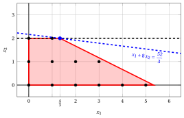{ .fig .ovale loading=lazy  }

                <em>Nodo 2: regione ammissibile di $\LP_{2}$ (in rosso), con il vincolo di branching $x_2 \le 2$ (tratteggiato), e la sua soluzione ottima (in blu).</em>

                Una soluzione ottima ${\tilde{\boldsymbol x}}(\LP_{2})$ è:

                $$
                \tilde{x}_1=\dfrac{4}{3},~~\tilde{x}_2=2
                $$

                il valore ottimo è:

                $$
                z(\LP_{2}) = \dfrac{52}{3}
                $$

                Il problema $\LP_{2}$ è <strong>ammissibile</strong> e abbiamo

                $$
                \left\lfloor z(\LP_{2}) \right\rfloor > \LB
                \qquad \text{poiché} \qquad
                \underbrace{\left\lfloor \dfrac{52}{3} \right\rfloor}_{=17} > -\infty
                $$

                La soluzione ottima ${\tilde{\boldsymbol x}}(\LP_{2})$ è <strong>frazionaria</strong>; di conseguenza, il problema $\LP_{2}$ viene <strong>inserito nella lista dei problemi</strong> $L$.

            2. Soluzione del problema $\LP_{3}$

                Consideriamo il problema $\LP_{3}$ in forma standard:

                $$
                \begin{array}{rrrrrrrrrrr}
                {\max} & {x_1} & {+} & {8}\, {x_2} &  &  &  &  \\[2ex]
                & {3}\, {x_1} & {+} & {6}\, {x_2} & {+} & {x_3} &  &  & {=} & {16} \\[2ex]
                &  &  & {x_2} &  &  & {-} & {x_4} & {=} & {3} \\[2ex]
                & {x_1,} &  & {x_2,} &  & {x_3,} &  & {x_4} & {\ge} & {0}
                \end{array}
                $$

                Per il vincolo di branching abbiamo:

                $$
                x_2 - x_4 = 3 \quad \quad \Rightarrow \quad x_4 = -3 + x_2
                $$

                Usando le equazioni del dizionario ottimo possiamo esprimere questo vincolo di branching in funzione delle variabili fuori base. Sostituendo, otteniamo

                $$
                x_4 = -3 + \left(\dfrac{8}{3} - \dfrac{1}{2} \; x_1 - \dfrac{1}{6} \; x_3 \right)
                \quad \quad \Rightarrow \quad
                x_4 = -\dfrac{1}{3} - \dfrac{1}{2} \, x_1 - \dfrac{1}{6} \, x_3
                $$

                Aggiungiamo quindi questa equazione al dizionario ottimo precedente e otteniamo il seguente dizionario:

                \begin{equation*}
                \begin{cases}
                \begin{array}{rrrrrrr}
                {x_2} & {=} & {\dfrac{8}{3}} & {-} & {\dfrac{1}{2}}\, {x_1} & {-} & {\dfrac{1}{6}}\, {x_3} \\[2ex]
                {x_4} & {=} & {-\dfrac{1}{3}} & {-} & {\dfrac{1}{2}}\, {x_1} & {-} & {\dfrac{1}{6}}\, {x_3} \\[2ex]
                {z} & {=} & {\dfrac{64}{3}} & {-} & {3}\, {x_1} & {-} & {\dfrac{4}{3}}\, {x_3}
                \end{array}
                \end{cases}
                \end{equation*}

                dove $\pazocal{B}=\{2,4\}$ e $\pazocal{N}=\{1,3\}$ e

                - la soluzione di base primale non ammissibile è:

                    $$
                    \bar x_2=\dfrac{8}{3},~~
                    \bar x_4=-\dfrac{1}{3},~~~~~~
                    \bar x_1=0,~~
                    \bar x_3=0~~
                    \mathrm{~~di~valore~~~} \dfrac{64}{3}
                    $$

                - la soluzione di base duale ammissibile è:

                    $$
                    \bar \pi_2=0,~~
                    \bar \pi_4=0,~~~~~~
                    \bar \pi_1=3,~~
                    \bar \pi_3=\dfrac{4}{3}~~
                    \mathrm{~~di~valore~~~} \dfrac{64}{3}
                    $$

                Se aumentiamo il valore di $\pi_{4}$, possiamo ottenere una soluzione duale migliore. Abbiamo:

                $$
                \begin{cases}
                \pi_1 &= 3 + \dfrac{1}{2}\,\pi_4 \\[2ex]
                \pi_3 &= \dfrac{4}{3} + \dfrac{1}{6}\,\pi_4
                \end{cases}
                \qquad
                \qquad
                \begin{cases}
                \underbrace{ 3 + \dfrac{1}{2}\,\pi_4 \ge 0}_{\pi_1 \ge 0} \\[2ex]
                \underbrace{ \dfrac{4}{3} + \dfrac{1}{6}\,\pi_4 \ge 0}_{\pi_3 \ge 0}
                \end{cases}
                \qquad
                \qquad
                \begin{cases}
                \pi_4 &\ge -6 \\[2ex]
                \pi_4 &\ge -8
                \end{cases}
                $$

                Di conseguenza, possiamo aumentare il valore di $\pi_{4}$ senza violare l'ammissibilità duale: il problema duale è <strong>illimitato</strong>. Ne segue che il problema primale $\LP_{3}$ è <strong>inammissibile</strong> e il nodo di branching corrispondente è <u>potato per inammissibilità</u>.

            Alla fine della prima iterazione, il branching su $x_{2}$ dal Nodo 1 ha generato il nodo di branching verso il basso, Nodo 2, e il nodo di branching verso l'alto, Nodo 3. Il Nodo 2 è inserito nella lista $L$, mentre il Nodo 3 è potato per inammissibilità. L'albero di branch-and-bound corrispondente è:

            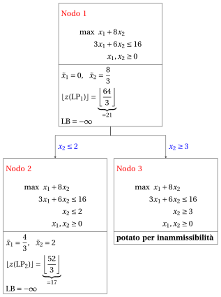{ .fig loading=lazy  }

            Con il lower bound $\LB$ e l'upper bound $\UB$ correnti, abbiamo:

            $$
            -\infty ~~\le~~ z(\ILP) ~~\le~~ \underbrace{\left\lfloor \dfrac{52}{3} \right\rfloor}_{=17}
            $$

        - <strong>Iterazione 2</strong>

            Il problema $\LP_{2}$ viene estratto e cancellato dalla lista dei problemi $L$.

            La variabile di branching è $x_{1}$. I vincoli di branching sono:

            $$
            x_1 \le \underbrace{\left\lfloor \dfrac{4}{3} \right\rfloor}_{ = 1} \mathrm{~~~e~~~} x_1 \ge \underbrace{\left\lfloor \dfrac{4}{3} \right\rfloor +1}_{= 2}
            $$

            Con il primo vincolo di branching si crea il problema $\LP_{4}$ (il secondo figlio si risolve solo se necessario).

            1. Soluzione del problema $\LP_{4}$

                Consideriamo il problema $\LP_{4}$ in forma standard:

                $$
                \begin{array}{rrrrrrrrrrrrr}
                {\max} & {x_1} & {+} & {8}\, {x_2} &  &  &  &  &  &  \\[2ex]
                & {3}\, {x_1} & {+} & {6}\, {x_2} & {+} & {x_3} &  &  &  &  & {=} & {16} \\[2ex]
                &  &  & {x_2} &  &  & {+} & {x_4} &  &  & {=} & {2} \\[2ex]
                & {x_1} &  &  &  &  &  &  & {+} & {x_5} & {=} & {1} \\[2ex]
                & {x_1,} &  & {x_2,} &  & {x_3,} &  & {x_4,} &  & {x_5} & {\ge} & {0}
                \end{array}
                $$

                Per il vincolo di branching abbiamo:

                $$
                x_1 + x_5 = 1 \quad \quad \Rightarrow \quad x_5 = 1 - x_1
                $$

                Usando le equazioni del dizionario ottimo possiamo esprimere questo vincolo di branching in funzione delle variabili fuori base. Sostituendo, otteniamo

                $$
                x_5 = 1 - \left(\dfrac{4}{3} - \dfrac{1}{3} \; x_3 + 2 \; x_4 \right)
                \quad \quad \Rightarrow \quad
                x_5 = -\dfrac{1}{3} + \dfrac{1}{3} \, x_3 - 2 \, x_4
                $$

                Aggiungiamo quindi questa equazione al dizionario ottimo precedente e otteniamo il seguente dizionario:

                \begin{equation*}
                \begin{cases}
                \begin{array}{rrrrrrr}
                {x_1} & {=} & {\dfrac{4}{3}} & {-} & {\dfrac{1}{3}}\, {x_3} & {+} & {2}\, {x_4} \\[2ex]
                {x_2} & {=} & {2} &  &  & {-} & {x_4} \\[2ex]
                {x_5} & {=} & {-\dfrac{1}{3}} & {+} & {\dfrac{1}{3}}\, {x_3} & {-} & {2}\, {x_4} \\[2ex]
                {z} & {=} & {\dfrac{52}{3}} & {-} & {\dfrac{1}{3}}\, {x_3} & {-} & {6}\, {x_4}
                \end{array}
                \end{cases}
                \end{equation*}

                dove $\pazocal{B}=\{1,2,5\}$ e $\pazocal{N}=\{3,4\}$ e

                - la soluzione di base primale non ammissibile è:

                    $$
                    \bar x_1=\dfrac{4}{3},~~
                    \bar x_2=2,~~
                    \bar x_5=-\dfrac{1}{3},~~~~~~
                    \bar x_3=0,~~
                    \bar x_4=0~~
                    \mathrm{~~di~valore~~~} \dfrac{52}{3}
                    $$

                - la soluzione di base duale ammissibile è:

                    $$
                    \bar \pi_1=0,~~
                    \bar \pi_2=0,~~
                    \bar \pi_5=0,~~~~~~
                    \bar \pi_3=\dfrac{1}{3},~~
                    \bar \pi_4=6~~
                    \mathrm{~~di~valore~~~} \dfrac{52}{3}
                    $$

                Se aumentiamo il valore di $\pi_{5}$, possiamo ottenere una soluzione duale migliore. Abbiamo:

                $$
                \begin{cases}
                \pi_3 &= \dfrac{1}{3} - \dfrac{1}{3}\,\pi_5 \\[2ex]
                \pi_4 &= 6 + 2\,\pi_5
                \end{cases}
                \qquad
                \qquad
                \begin{cases}
                \underbrace{ \dfrac{1}{3} - \dfrac{1}{3}\,\pi_5 \ge 0}_{\pi_3 \ge 0} \\[2ex]
                \underbrace{ 6 + 2\,\pi_5 \ge 0}_{\pi_4 \ge 0}
                \end{cases}
                \qquad
                \qquad
                \begin{cases}
                \pi_5 &\le 1 \\[2ex]
                \pi_5 &\ge -3
                \end{cases}
                $$

                Aumentando il valore di $\pi_{5}$ fino a $1$, il valore di $\pi_{3}$ scende a $0$. Abbiamo quindi che:

                - $\pi_{5}$ entra nella base duale e, di conseguenza, $x_{5}$ esce dalla base primale.

                - $\pi_{3}$ esce dalla base duale e, di conseguenza, $x_{3}$ entra nella base primale.

                Abbiamo:

                $$
                x_5 = -\dfrac{1}{3} + \dfrac{1}{3} \, x_3 - 2 \, x_4
                \quad \Rightarrow \quad
                x_3 = 1 + 6 \, x_4 + 3 \, x_5
                $$

                Sostituendo nelle altre equazioni del dizionario primale, otteniamo:

                $$
                x_1
                = \dfrac{4}{3} - \dfrac{1}{3} \left( 1 + 6 \, x_4 + 3 \, x_5 \right) + 2 \; x_4
                = 1 - x_5
                $$

                $$
                z
                = \dfrac{52}{3} - \dfrac{1}{3} \left( 1 + 6 \, x_4 + 3 \, x_5 \right) - 6 \; x_4
                = 17 - 8 \, x_4 - x_5
                $$

                Di conseguenza, abbiamo ora il seguente dizionario primale aggiornato:

                \begin{equation*}
                \begin{cases}
                \begin{array}{rrrrrrr}
                {x_1} & {=} & {1} &  &  & {-} & {x_5} \\[2ex]
                {x_2} & {=} & {2} & {-} & {x_4} &  &  \\[2ex]
                {x_3} & {=} & {1} & {+} & {6}\, {x_4} & {+} & {3}\, {x_5} \\[2ex]
                {z} & {=} & {17} & {-} & {8}\, {x_4} & {-} & {x_5}
                \end{array}
                \end{cases}
                \end{equation*}

                dove $\pazocal{B}=\{1,2,3\}$ e $\pazocal{N}=\{4,5\}$ e

                - la soluzione di base primale ottima è:

                    $$
                    \tilde x_1=1,~~
                    \tilde x_2=2,~~
                    \tilde x_3=1,~~~~~~
                    \tilde x_4=0,~~
                    \tilde x_5=0~~
                    \mathrm{~~di~valore~~~} 17
                    $$

                - la soluzione di base duale ottima è:

                    $$
                    \tilde \pi_1=0,~~
                    \tilde \pi_2=0,~~
                    \tilde \pi_3=0,~~~~~~
                    \tilde \pi_4=8,~~
                    \tilde \pi_5=1~~
                    \mathrm{~~di~valore~~~} 17
                    $$

                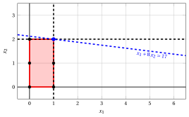{ .fig .ovale loading=lazy  }

                <em>Nodo 4: regione ammissibile di $\LP_{4}$ (in rosso), con il vincolo di branching $x_1 \le 1$ (tratteggiato), e la sua soluzione ottima (in blu).</em>

                Una soluzione ottima ${\tilde{\boldsymbol x}}(\LP_{4})$ è:

                $$
                \tilde{x}_1=1,~~\tilde{x}_2=2
                $$

                il valore ottimo è:

                $$
                z(\LP_{4}) = 17
                $$

                Il problema $\LP_{4}$ è <strong>ammissibile</strong> e abbiamo

                $$
                \left\lfloor z(\LP_{4}) \right\rfloor > \LB
                \qquad \text{poiché} \qquad
                17 > -\infty
                $$

                La soluzione ottima ${\tilde{\boldsymbol x}}(\LP_{4})$ è <strong>intera</strong>; di conseguenza, il lower bound $\LB$ diventa $17$ e la soluzione incumbent ${\bar{\boldsymbol x}}(\ILP)$ diventa $\bar{x}_1=1,\bar{x}_2=2$.

                Di conseguenza, il nodo di branching è <u>potato per integralità</u>.

            Alla fine della seconda iterazione, il branching su $x_{1}$ dal Nodo 2 ha generato il nodo di branching verso il basso, Nodo 4. Questo nodo è potato per integralità. Il nodo di branching verso l'alto non viene risolto, poiché dopo il Nodo 4 il lower bound soddisfa

            $$
            \left\lfloor z(\LP_{2}) \right\rfloor \le \LB.
            $$

            Questa è la parte dell'albero di branch-and-bound che mostra i problemi LP dei nodi di branching risolti:

            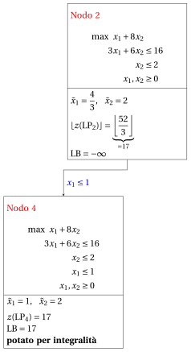{ .fig loading=lazy  }

            Con il lower bound $\LB$ e l'upper bound $\UB$ correnti, abbiamo:

            $$
            17 ~~\le~~ z(\ILP) ~~\le~~ 17
            $$

        - <strong>Terminazione</strong>

            Poiché la lista $L$ è vuota, il lower bound $\LB$ è uguale all'upper bound $\UB$ e il problema $\ILP$ è risolto all'ottimo.

            Il valore ottimo è $z(\ILP)=17$ (il valore del lower bound $\LB$) e una soluzione ottima ${\tilde{\boldsymbol x}}(\ILP)$ è $\tilde x_1=1,\tilde x_2=2$ (la soluzione incumbent ${\bar{\boldsymbol x}}(\ILP)$).

    2. L'albero di branch-and-bound finale è:

        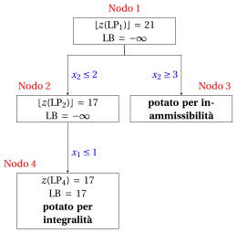{ .fig loading=lazy  }

        I motivi per cui i nodi di branching vengono potati sono i seguenti.

        - Il Nodo 1 ha una soluzione ottima frazionaria con $\lfloor z(\LP_{1})\rfloor = 21$: si effettua il branching su $x_2$.

        - Il Nodo 2 ha una soluzione ottima frazionaria con $\lfloor z(\LP_{2})\rfloor = 17$: si effettua il branching su $x_1$.

        - Il nodo di branching verso l'alto del Nodo 2 non viene risolto né disegnato, poiché $\lfloor z(\LP_{2})\rfloor = 17$ $\le \LB = 17$ dopo il suo primo figlio.

        - Il Nodo 3 è potato per inammissibilità: il problema $\LP_{3}$ non ha soluzioni ammissibili.

        - Il Nodo 4 è potato per integralità: $\tilde{\boldsymbol x}(\LP_{4}) = (1, 2)$ è intera, con valore $17$, e diventa la soluzione incumbent.

        Il valore ottimo è $z(\ILP) = 17$ e l'algoritmo di branch-and-bound restituisce la soluzione ottima $\tilde{\boldsymbol x}(\ILP) = (1, 2)$.

!!! esercizio "Esercizio 7.2: Algoritmo di branch-and-bound (P2)"

    !!! nota ""

        Consideriamo il seguente problema PLI in forma canonica di massimo con $n=2$ variabili intere e $m=2$ vincoli:

        $$
        \begin{array}{rrrrrrr}
        {\max} & {x_1} & {+} & {3}\, {x_2} \\[2ex]
        & {-}{4}\, {x_1} & {+} & {10}\, {x_2} & {\le} & {35} \\[2ex]
        & {3}\, {x_1} & {+} & {x_2} & {\le} & {12} \\[2ex]
        & {x_1,} &  & {x_2} & {\in} & {\Z_{\ge 0}}
        \end{array}
        $$

        e un dizionario ottimo del suo rilassamento lineare in forma standard:

        \begin{equation*}
        \begin{cases}
        \begin{array}{rrrrrrr}
        {x_1} & {=} & {\dfrac{5}{2}} & {+} & {\dfrac{1}{34}}\, {x_3} & {-} & {\dfrac{5}{17}}\, {x_4} \\[2ex]
        {x_2} & {=} & {\dfrac{9}{2}} & {-} & {\dfrac{3}{34}}\, {x_3} & {-} & {\dfrac{2}{17}}\, {x_4} \\[2ex]
        {z} & {=} & {16} & {-} & {\dfrac{4}{17}}\, {x_3} & {-} & {\dfrac{11}{17}}\, {x_4}
        \end{array}
        \end{cases}
        \end{equation*}

    **Domande**

    1. Eseguire l'algoritmo di branch-and-bound utilizzando:

        1. la regola dell'indice minimo come strategia di selezione della variabile di branching;

        2. la regola FIFO come strategia di selezione del nodo di branching;

        3. risolvere prima il nodo di branching verso il basso e poi il nodo di branching verso l'alto;

        4. porre il lower bound $\LB$ a $-\infty$ (non viene eseguito alcun algoritmo euristico).

        Risolvere i problemi LP dei nodi di branching con l'algoritmo del simplesso duale. Nell'algoritmo del simplesso duale, la variabile uscente è la variabile in base con valore negativo e indice minimo, e i pareggi nel test dei rapporti si risolvono con l'indice minimo. Mostrare graficamente la soluzione ottima dei problemi LP associati ai nodi di branching.

    2. Determinare e commentare l'albero di branch-and-bound, mostrando il motivo per cui ciascun nodo di branching viene potato.

??? soluzione "Soluzione"

    1. Esecuzione dell'algoritmo di branch-and-bound per risolvere il problema $\ILP$.

        - <strong>Inizializzazione</strong>

            Consideriamo il problema $\LP_{1}$ in forma standard:

            $$
            \begin{array}{rrrrrrrrrrr}
            {\max} & {x_1} & {+} & {3}\, {x_2} &  &  &  &  \\[2ex]
            & {-}{4}\, {x_1} & {+} & {10}\, {x_2} & {+} & {x_3} &  &  & {=} & {35} \\[2ex]
            & {3}\, {x_1} & {+} & {x_2} &  &  & {+} & {x_4} & {=} & {12} \\[2ex]
            & {x_1,} &  & {x_2,} &  & {x_3,} &  & {x_4} & {\ge} & {0}
            \end{array}
            $$

            e il suo dizionario ottimo:

            \begin{equation*}
            \begin{cases}
            \begin{array}{rrrrrrr}
            {x_1} & {=} & {\dfrac{5}{2}} & {+} & {\dfrac{1}{34}}\, {x_3} & {-} & {\dfrac{5}{17}}\, {x_4} \\[2ex]
            {x_2} & {=} & {\dfrac{9}{2}} & {-} & {\dfrac{3}{34}}\, {x_3} & {-} & {\dfrac{2}{17}}\, {x_4} \\[2ex]
            {z} & {=} & {16} & {-} & {\dfrac{4}{17}}\, {x_3} & {-} & {\dfrac{11}{17}}\, {x_4}
            \end{array}
            \end{cases}
            \end{equation*}

            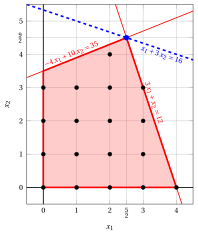{ .fig .ovale loading=lazy  }

            <em>Nodo 1: regione ammissibile di $\LP_{1}$ (in rosso), punti ammissibili del problema PLI (in nero) e soluzione ottima di $\LP_{1}$ (in blu) con la retta della funzione obiettivo che vi passa.</em>

            Una soluzione ottima ${\tilde{\boldsymbol x}}(\LP_{1})$ è:

            $$
            \tilde{x}_1=\dfrac{5}{2},~~\tilde{x}_2=\dfrac{9}{2}
            $$

            il valore ottimo è:

            $$
            z(\LP_{1}) = 16
            $$

            La soluzione ottima ${\tilde{\boldsymbol x}}(\LP_{1})$ è <strong>frazionaria</strong> e il problema $\LP_{1}$ è <strong>ammissibile</strong>, quindi il problema $\LP_{1}$ viene inserito nella lista dei problemi $L$ e il lower bound $\LB$ viene posto a $-\infty$.

            Con il lower bound $\LB$ e l'upper bound $\UB$ correnti, abbiamo:

            $$
            -\infty ~~\le~~ z(\ILP) ~~\le~~ 16
            $$

        - <strong>Iterazione 1</strong>

            Il problema $\LP_{1}$ viene estratto e cancellato dalla lista dei problemi $L$.

            La variabile di branching è $x_{1}$. I vincoli di branching sono:

            $$
            x_1 \le \underbrace{\left\lfloor \dfrac{5}{2} \right\rfloor}_{ = 2} \mathrm{~~~e~~~} x_1 \ge \underbrace{\left\lfloor \dfrac{5}{2} \right\rfloor +1}_{= 3}
            $$

            Con questi vincoli di branching si creano i due problemi $\LP_{2}$ e $\LP_{3}$.

            1. Soluzione del problema $\LP_{2}$

                Consideriamo il problema $\LP_{2}$ in forma standard:

                $$
                \begin{array}{rrrrrrrrrrrrr}
                {\max} & {x_1} & {+} & {3}\, {x_2} &  &  &  &  &  &  \\[2ex]
                & {-}{4}\, {x_1} & {+} & {10}\, {x_2} & {+} & {x_3} &  &  &  &  & {=} & {35} \\[2ex]
                & {3}\, {x_1} & {+} & {x_2} &  &  & {+} & {x_4} &  &  & {=} & {12} \\[2ex]
                & {x_1} &  &  &  &  &  &  & {+} & {x_5} & {=} & {2} \\[2ex]
                & {x_1,} &  & {x_2,} &  & {x_3,} &  & {x_4,} &  & {x_5} & {\ge} & {0}
                \end{array}
                $$

                Per il vincolo di branching abbiamo:

                $$
                x_1 + x_5 = 2 \quad \quad \Rightarrow \quad x_5 = 2 - x_1
                $$

                Usando le equazioni del dizionario ottimo possiamo esprimere questo vincolo di branching in funzione delle variabili fuori base. Sostituendo, otteniamo

                $$
                x_5 = 2 - \left(\dfrac{5}{2} + \dfrac{1}{34} \; x_3 - \dfrac{5}{17} \; x_4 \right)
                \quad \quad \Rightarrow \quad
                x_5 = -\dfrac{1}{2} - \dfrac{1}{34} \, x_3 + \dfrac{5}{17} \, x_4
                $$

                Aggiungiamo quindi questa equazione al dizionario ottimo precedente e otteniamo il seguente dizionario:

                \begin{equation*}
                \begin{cases}
                \begin{array}{rrrrrrr}
                {x_1} & {=} & {\dfrac{5}{2}} & {+} & {\dfrac{1}{34}}\, {x_3} & {-} & {\dfrac{5}{17}}\, {x_4} \\[2ex]
                {x_2} & {=} & {\dfrac{9}{2}} & {-} & {\dfrac{3}{34}}\, {x_3} & {-} & {\dfrac{2}{17}}\, {x_4} \\[2ex]
                {x_5} & {=} & {-\dfrac{1}{2}} & {-} & {\dfrac{1}{34}}\, {x_3} & {+} & {\dfrac{5}{17}}\, {x_4} \\[2ex]
                {z} & {=} & {16} & {-} & {\dfrac{4}{17}}\, {x_3} & {-} & {\dfrac{11}{17}}\, {x_4}
                \end{array}
                \end{cases}
                \end{equation*}

                dove $\pazocal{B}=\{1,2,5\}$ e $\pazocal{N}=\{3,4\}$ e

                - la soluzione di base primale non ammissibile è:

                    $$
                    \bar x_1=\dfrac{5}{2},~~
                    \bar x_2=\dfrac{9}{2},~~
                    \bar x_5=-\dfrac{1}{2},~~~~~~
                    \bar x_3=0,~~
                    \bar x_4=0~~
                    \mathrm{~~di~valore~~~} 16
                    $$

                - la soluzione di base duale ammissibile è:

                    $$
                    \bar \pi_1=0,~~
                    \bar \pi_2=0,~~
                    \bar \pi_5=0,~~~~~~
                    \bar \pi_3=\dfrac{4}{17},~~
                    \bar \pi_4=\dfrac{11}{17}~~
                    \mathrm{~~di~valore~~~} 16
                    $$

                Se aumentiamo il valore di $\pi_{5}$, possiamo ottenere una soluzione duale migliore. Abbiamo:

                $$
                \begin{cases}
                \pi_3 &= \dfrac{4}{17} + \dfrac{1}{34}\,\pi_5 \\[2ex]
                \pi_4 &= \dfrac{11}{17} - \dfrac{5}{17}\,\pi_5
                \end{cases}
                \qquad
                \qquad
                \begin{cases}
                \underbrace{ \dfrac{4}{17} + \dfrac{1}{34}\,\pi_5 \ge 0}_{\pi_3 \ge 0} \\[2ex]
                \underbrace{ \dfrac{11}{17} - \dfrac{5}{17}\,\pi_5 \ge 0}_{\pi_4 \ge 0}
                \end{cases}
                \qquad
                \qquad
                \begin{cases}
                \pi_5 &\ge -8 \\[2ex]
                \pi_5 &\le \dfrac{11}{5}
                \end{cases}
                $$

                Aumentando il valore di $\pi_{5}$ fino a $\dfrac{11}{5}$, il valore di $\pi_{4}$ scende a $0$. Abbiamo quindi che:

                - $\pi_{5}$ entra nella base duale e, di conseguenza, $x_{5}$ esce dalla base primale.

                - $\pi_{4}$ esce dalla base duale e, di conseguenza, $x_{4}$ entra nella base primale.

                Abbiamo:

                $$
                x_5 = -\dfrac{1}{2} - \dfrac{1}{34} \, x_3 + \dfrac{5}{17} \, x_4
                \quad \Rightarrow \quad
                x_4 = \dfrac{17}{10} + \dfrac{1}{10} \, x_3 + \dfrac{17}{5} \, x_5
                $$

                Sostituendo nelle altre equazioni del dizionario primale, otteniamo:

                $$
                x_1
                = \dfrac{5}{2} + \dfrac{1}{34} \; x_3 - \dfrac{5}{17} \left( \dfrac{17}{10} + \dfrac{1}{10} \, x_3 + \dfrac{17}{5} \, x_5 \right)
                = 2 - x_5
                $$

                $$
                x_2
                = \dfrac{9}{2} - \dfrac{3}{34} \; x_3 - \dfrac{2}{17} \left( \dfrac{17}{10} + \dfrac{1}{10} \, x_3 + \dfrac{17}{5} \, x_5 \right)
                = \dfrac{43}{10} - \dfrac{1}{10} \, x_3 - \dfrac{2}{5} \, x_5
                $$

                $$
                z
                = 16 - \dfrac{4}{17} \; x_3 - \dfrac{11}{17} \left( \dfrac{17}{10} + \dfrac{1}{10} \, x_3 + \dfrac{17}{5} \, x_5 \right)
                = \dfrac{149}{10} - \dfrac{3}{10} \, x_3 - \dfrac{11}{5} \, x_5
                $$

                Di conseguenza, abbiamo ora il seguente dizionario primale aggiornato:

                \begin{equation*}
                \begin{cases}
                \begin{array}{rrrrrrr}
                {x_1} & {=} & {2} &  &  & {-} & {x_5} \\[2ex]
                {x_2} & {=} & {\dfrac{43}{10}} & {-} & {\dfrac{1}{10}}\, {x_3} & {-} & {\dfrac{2}{5}}\, {x_5} \\[2ex]
                {x_4} & {=} & {\dfrac{17}{10}} & {+} & {\dfrac{1}{10}}\, {x_3} & {+} & {\dfrac{17}{5}}\, {x_5} \\[2ex]
                {z} & {=} & {\dfrac{149}{10}} & {-} & {\dfrac{3}{10}}\, {x_3} & {-} & {\dfrac{11}{5}}\, {x_5}
                \end{array}
                \end{cases}
                \end{equation*}

                dove $\pazocal{B}=\{1,2,4\}$ e $\pazocal{N}=\{3,5\}$ e

                - la soluzione di base primale ottima è:

                    $$
                    \tilde x_1=2,~~
                    \tilde x_2=\dfrac{43}{10},~~
                    \tilde x_4=\dfrac{17}{10},~~~~~~
                    \tilde x_3=0,~~
                    \tilde x_5=0~~
                    \mathrm{~~di~valore~~~} \dfrac{149}{10}
                    $$

                - la soluzione di base duale ottima è:

                    $$
                    \tilde \pi_1=0,~~
                    \tilde \pi_2=0,~~
                    \tilde \pi_4=0,~~~~~~
                    \tilde \pi_3=\dfrac{3}{10},~~
                    \tilde \pi_5=\dfrac{11}{5}~~
                    \mathrm{~~di~valore~~~} \dfrac{149}{10}
                    $$

                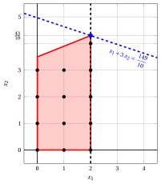{ .fig .ovale loading=lazy  }

                <em>Nodo 2: regione ammissibile di $\LP_{2}$ (in rosso), con il vincolo di branching $x_1 \le 2$ (tratteggiato), e la sua soluzione ottima (in blu).</em>

                Una soluzione ottima ${\tilde{\boldsymbol x}}(\LP_{2})$ è:

                $$
                \tilde{x}_1=2,~~\tilde{x}_2=\dfrac{43}{10}
                $$

                il valore ottimo è:

                $$
                z(\LP_{2}) = \dfrac{149}{10}
                $$

                Il problema $\LP_{2}$ è <strong>ammissibile</strong> e abbiamo

                $$
                \left\lfloor z(\LP_{2}) \right\rfloor > \LB
                \qquad \text{poiché} \qquad
                \underbrace{\left\lfloor \dfrac{149}{10} \right\rfloor}_{=14} > -\infty
                $$

                La soluzione ottima ${\tilde{\boldsymbol x}}(\LP_{2})$ è <strong>frazionaria</strong>; di conseguenza, il problema $\LP_{2}$ viene <strong>inserito nella lista dei problemi</strong> $L$.

            2. Soluzione del problema $\LP_{3}$

                Consideriamo il problema $\LP_{3}$ in forma standard:

                $$
                \begin{array}{rrrrrrrrrrrrr}
                {\max} & {x_1} & {+} & {3}\, {x_2} &  &  &  &  &  &  \\[2ex]
                & {-}{4}\, {x_1} & {+} & {10}\, {x_2} & {+} & {x_3} &  &  &  &  & {=} & {35} \\[2ex]
                & {3}\, {x_1} & {+} & {x_2} &  &  & {+} & {x_4} &  &  & {=} & {12} \\[2ex]
                & {x_1} &  &  &  &  &  &  & {-} & {x_5} & {=} & {3} \\[2ex]
                & {x_1,} &  & {x_2,} &  & {x_3,} &  & {x_4,} &  & {x_5} & {\ge} & {0}
                \end{array}
                $$

                Per il vincolo di branching abbiamo:

                $$
                x_1 - x_5 = 3 \quad \quad \Rightarrow \quad x_5 = -3 + x_1
                $$

                Usando le equazioni del dizionario ottimo possiamo esprimere questo vincolo di branching in funzione delle variabili fuori base. Sostituendo, otteniamo

                $$
                x_5 = -3 + \left(\dfrac{5}{2} + \dfrac{1}{34} \; x_3 - \dfrac{5}{17} \; x_4 \right)
                \quad \quad \Rightarrow \quad
                x_5 = -\dfrac{1}{2} + \dfrac{1}{34} \, x_3 - \dfrac{5}{17} \, x_4
                $$

                Aggiungiamo quindi questa equazione al dizionario ottimo precedente e otteniamo il seguente dizionario:

                \begin{equation*}
                \begin{cases}
                \begin{array}{rrrrrrr}
                {x_1} & {=} & {\dfrac{5}{2}} & {+} & {\dfrac{1}{34}}\, {x_3} & {-} & {\dfrac{5}{17}}\, {x_4} \\[2ex]
                {x_2} & {=} & {\dfrac{9}{2}} & {-} & {\dfrac{3}{34}}\, {x_3} & {-} & {\dfrac{2}{17}}\, {x_4} \\[2ex]
                {x_5} & {=} & {-\dfrac{1}{2}} & {+} & {\dfrac{1}{34}}\, {x_3} & {-} & {\dfrac{5}{17}}\, {x_4} \\[2ex]
                {z} & {=} & {16} & {-} & {\dfrac{4}{17}}\, {x_3} & {-} & {\dfrac{11}{17}}\, {x_4}
                \end{array}
                \end{cases}
                \end{equation*}

                dove $\pazocal{B}=\{1,2,5\}$ e $\pazocal{N}=\{3,4\}$ e

                - la soluzione di base primale non ammissibile è:

                    $$
                    \bar x_1=\dfrac{5}{2},~~
                    \bar x_2=\dfrac{9}{2},~~
                    \bar x_5=-\dfrac{1}{2},~~~~~~
                    \bar x_3=0,~~
                    \bar x_4=0~~
                    \mathrm{~~di~valore~~~} 16
                    $$

                - la soluzione di base duale ammissibile è:

                    $$
                    \bar \pi_1=0,~~
                    \bar \pi_2=0,~~
                    \bar \pi_5=0,~~~~~~
                    \bar \pi_3=\dfrac{4}{17},~~
                    \bar \pi_4=\dfrac{11}{17}~~
                    \mathrm{~~di~valore~~~} 16
                    $$

                Se aumentiamo il valore di $\pi_{5}$, possiamo ottenere una soluzione duale migliore. Abbiamo:

                $$
                \begin{cases}
                \pi_3 &= \dfrac{4}{17} - \dfrac{1}{34}\,\pi_5 \\[2ex]
                \pi_4 &= \dfrac{11}{17} + \dfrac{5}{17}\,\pi_5
                \end{cases}
                \qquad
                \qquad
                \begin{cases}
                \underbrace{ \dfrac{4}{17} - \dfrac{1}{34}\,\pi_5 \ge 0}_{\pi_3 \ge 0} \\[2ex]
                \underbrace{ \dfrac{11}{17} + \dfrac{5}{17}\,\pi_5 \ge 0}_{\pi_4 \ge 0}
                \end{cases}
                \qquad
                \qquad
                \begin{cases}
                \pi_5 &\le 8 \\[2ex]
                \pi_5 &\ge -\dfrac{11}{5}
                \end{cases}
                $$

                Aumentando il valore di $\pi_{5}$ fino a $8$, il valore di $\pi_{3}$ scende a $0$. Abbiamo quindi che:

                - $\pi_{5}$ entra nella base duale e, di conseguenza, $x_{5}$ esce dalla base primale.

                - $\pi_{3}$ esce dalla base duale e, di conseguenza, $x_{3}$ entra nella base primale.

                Abbiamo:

                $$
                x_5 = -\dfrac{1}{2} + \dfrac{1}{34} \, x_3 - \dfrac{5}{17} \, x_4
                \quad \Rightarrow \quad
                x_3 = 17 + 10 \, x_4 + 34 \, x_5
                $$

                Sostituendo nelle altre equazioni del dizionario primale, otteniamo:

                $$
                x_1
                = \dfrac{5}{2} + \dfrac{1}{34} \left( 17 + 10 \, x_4 + 34 \, x_5 \right) - \dfrac{5}{17} \; x_4
                = 3 + x_5
                $$

                $$
                x_2
                = \dfrac{9}{2} - \dfrac{3}{34} \left( 17 + 10 \, x_4 + 34 \, x_5 \right) - \dfrac{2}{17} \; x_4
                = 3 - x_4 - 3 \, x_5
                $$

                $$
                z
                = 16 - \dfrac{4}{17} \left( 17 + 10 \, x_4 + 34 \, x_5 \right) - \dfrac{11}{17} \; x_4
                = 12 - 3 \, x_4 - 8 \, x_5
                $$

                Di conseguenza, abbiamo ora il seguente dizionario primale aggiornato:

                \begin{equation*}
                \begin{cases}
                \begin{array}{rrrrrrr}
                {x_1} & {=} & {3} &  &  & {+} & {x_5} \\[2ex]
                {x_2} & {=} & {3} & {-} & {x_4} & {-} & {3}\, {x_5} \\[2ex]
                {x_3} & {=} & {17} & {+} & {10}\, {x_4} & {+} & {34}\, {x_5} \\[2ex]
                {z} & {=} & {12} & {-} & {3}\, {x_4} & {-} & {8}\, {x_5}
                \end{array}
                \end{cases}
                \end{equation*}

                dove $\pazocal{B}=\{1,2,3\}$ e $\pazocal{N}=\{4,5\}$ e

                - la soluzione di base primale ottima è:

                    $$
                    \tilde x_1=3,~~
                    \tilde x_2=3,~~
                    \tilde x_3=17,~~~~~~
                    \tilde x_4=0,~~
                    \tilde x_5=0~~
                    \mathrm{~~di~valore~~~} 12
                    $$

                - la soluzione di base duale ottima è:

                    $$
                    \tilde \pi_1=0,~~
                    \tilde \pi_2=0,~~
                    \tilde \pi_3=0,~~~~~~
                    \tilde \pi_4=3,~~
                    \tilde \pi_5=8~~
                    \mathrm{~~di~valore~~~} 12
                    $$

                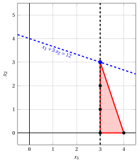{ .fig .ovale loading=lazy  }

                <em>Nodo 3: regione ammissibile di $\LP_{3}$ (in rosso), con il vincolo di branching $x_1 \ge 3$ (tratteggiato), e la sua soluzione ottima (in blu).</em>

                Una soluzione ottima ${\tilde{\boldsymbol x}}(\LP_{3})$ è:

                $$
                \tilde{x}_1=3,~~\tilde{x}_2=3
                $$

                il valore ottimo è:

                $$
                z(\LP_{3}) = 12
                $$

                Il problema $\LP_{3}$ è <strong>ammissibile</strong> e abbiamo

                $$
                \left\lfloor z(\LP_{3}) \right\rfloor > \LB
                \qquad \text{poiché} \qquad
                12 > -\infty
                $$

                La soluzione ottima ${\tilde{\boldsymbol x}}(\LP_{3})$ è <strong>intera</strong>; di conseguenza, il lower bound $\LB$ diventa $12$ e la soluzione incumbent ${\bar{\boldsymbol x}}(\ILP)$ diventa $\bar{x}_1=3,\bar{x}_2=3$.

                Di conseguenza, il nodo di branching è <u>potato per integralità</u>.

            Alla fine della prima iterazione, il branching su $x_{1}$ dal Nodo 1 ha generato il nodo di branching verso il basso, Nodo 2, e il nodo di branching verso l'alto, Nodo 3. Il Nodo 2 è inserito nella lista $L$, mentre il Nodo 3 è potato per integralità. L'albero di branch-and-bound corrispondente è:

            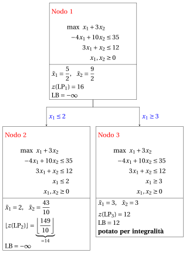{ .fig loading=lazy  }

            Con il lower bound $\LB$ e l'upper bound $\UB$ correnti, abbiamo:

            $$
            12 ~~\le~~ z(\ILP) ~~\le~~ \underbrace{\left\lfloor \dfrac{149}{10} \right\rfloor}_{=14}
            $$

        - <strong>Iterazione 2</strong>

            Il problema $\LP_{2}$ viene estratto e cancellato dalla lista dei problemi $L$.

            La variabile di branching è $x_{2}$. I vincoli di branching sono:

            $$
            x_2 \le \underbrace{\left\lfloor \dfrac{43}{10} \right\rfloor}_{ = 4} \mathrm{~~~e~~~} x_2 \ge \underbrace{\left\lfloor \dfrac{43}{10} \right\rfloor +1}_{= 5}
            $$

            Con il primo vincolo di branching si crea il problema $\LP_{4}$ (il secondo figlio si risolve solo se necessario).

            1. Soluzione del problema $\LP_{4}$

                Consideriamo il problema $\LP_{4}$ in forma standard:

                $$
                \begin{array}{rrrrrrrrrrrrrrr}
                {\max} & {x_1} & {+} & {3}\, {x_2} &  &  &  &  &  &  &  &  \\[2ex]
                & {-}{4}\, {x_1} & {+} & {10}\, {x_2} & {+} & {x_3} &  &  &  &  &  &  & {=} & {35} \\[2ex]
                & {3}\, {x_1} & {+} & {x_2} &  &  & {+} & {x_4} &  &  &  &  & {=} & {12} \\[2ex]
                & {x_1} &  &  &  &  &  &  & {+} & {x_5} &  &  & {=} & {2} \\[2ex]
                &  &  & {x_2} &  &  &  &  &  &  & {+} & {x_6} & {=} & {4} \\[2ex]
                & {x_1,} &  & {x_2,} &  & {x_3,} &  & {x_4,} &  & {x_5,} &  & {x_6} & {\ge} & {0}
                \end{array}
                $$

                Per il vincolo di branching abbiamo:

                $$
                x_2 + x_6 = 4 \quad \quad \Rightarrow \quad x_6 = 4 - x_2
                $$

                Usando le equazioni del dizionario ottimo possiamo esprimere questo vincolo di branching in funzione delle variabili fuori base. Sostituendo, otteniamo

                $$
                x_6 = 4 - \left(\dfrac{43}{10} - \dfrac{1}{10} \; x_3 - \dfrac{2}{5} \; x_5 \right)
                \quad \quad \Rightarrow \quad
                x_6 = -\dfrac{3}{10} + \dfrac{1}{10} \, x_3 + \dfrac{2}{5} \, x_5
                $$

                Aggiungiamo quindi questa equazione al dizionario ottimo precedente e otteniamo il seguente dizionario:

                \begin{equation*}
                \begin{cases}
                \begin{array}{rrrrrrr}
                {x_1} & {=} & {2} &  &  & {-} & {x_5} \\[2ex]
                {x_2} & {=} & {\dfrac{43}{10}} & {-} & {\dfrac{1}{10}}\, {x_3} & {-} & {\dfrac{2}{5}}\, {x_5} \\[2ex]
                {x_4} & {=} & {\dfrac{17}{10}} & {+} & {\dfrac{1}{10}}\, {x_3} & {+} & {\dfrac{17}{5}}\, {x_5} \\[2ex]
                {x_6} & {=} & {-\dfrac{3}{10}} & {+} & {\dfrac{1}{10}}\, {x_3} & {+} & {\dfrac{2}{5}}\, {x_5} \\[2ex]
                {z} & {=} & {\dfrac{149}{10}} & {-} & {\dfrac{3}{10}}\, {x_3} & {-} & {\dfrac{11}{5}}\, {x_5}
                \end{array}
                \end{cases}
                \end{equation*}

                dove $\pazocal{B}=\{1,2,4,6\}$ e $\pazocal{N}=\{3,5\}$ e

                - la soluzione di base primale non ammissibile è:

                    $$
                    \begin{gathered}
                    \bar x_1=2,~~
                    \bar x_2=\dfrac{43}{10},~~
                    \bar x_4=\dfrac{17}{10},~~
                    \bar x_6=-\dfrac{3}{10},\\
                    \bar x_3=0,~~
                    \bar x_5=0~~
                    \mathrm{~~di~valore~~~} \dfrac{149}{10}
                    \end{gathered}
                    $$

                - la soluzione di base duale ammissibile è:

                    $$
                    \begin{gathered}
                    \bar \pi_1=0,~~
                    \bar \pi_2=0,~~
                    \bar \pi_4=0,~~
                    \bar \pi_6=0,\\
                    \bar \pi_3=\dfrac{3}{10},~~
                    \bar \pi_5=\dfrac{11}{5}~~
                    \mathrm{~~di~valore~~~} \dfrac{149}{10}
                    \end{gathered}
                    $$

                Se aumentiamo il valore di $\pi_{6}$, possiamo ottenere una soluzione duale migliore. Abbiamo:

                $$
                \begin{cases}
                \pi_3 &= \dfrac{3}{10} - \dfrac{1}{10}\,\pi_6 \\[2ex]
                \pi_5 &= \dfrac{11}{5} - \dfrac{2}{5}\,\pi_6
                \end{cases}
                \qquad
                \qquad
                \begin{cases}
                \underbrace{ \dfrac{3}{10} - \dfrac{1}{10}\,\pi_6 \ge 0}_{\pi_3 \ge 0} \\[2ex]
                \underbrace{ \dfrac{11}{5} - \dfrac{2}{5}\,\pi_6 \ge 0}_{\pi_5 \ge 0}
                \end{cases}
                \qquad
                \qquad
                \begin{cases}
                \pi_6 &\le 3 \\[2ex]
                \pi_6 &\le \dfrac{11}{2}
                \end{cases}
                $$

                Aumentando il valore di $\pi_{6}$ fino a $\min \left\{3, \dfrac{11}{2}\right\}=3$, il valore di $\pi_{3}$ scende a $0$. Abbiamo quindi che:

                - $\pi_{6}$ entra nella base duale e, di conseguenza, $x_{6}$ esce dalla base primale.

                - $\pi_{3}$ esce dalla base duale e, di conseguenza, $x_{3}$ entra nella base primale.

                Abbiamo:

                $$
                x_6 = -\dfrac{3}{10} + \dfrac{1}{10} \, x_3 + \dfrac{2}{5} \, x_5
                \quad \Rightarrow \quad
                x_3 = 3 - 4 \, x_5 + 10 \, x_6
                $$

                Sostituendo nelle altre equazioni del dizionario primale, otteniamo:

                $$
                x_2
                = \dfrac{43}{10} - \dfrac{1}{10} \left( 3 - 4 \, x_5 + 10 \, x_6 \right) - \dfrac{2}{5} \; x_5
                = 4 - x_6
                $$

                $$
                x_4
                = \dfrac{17}{10} + \dfrac{1}{10} \left( 3 - 4 \, x_5 + 10 \, x_6 \right) + \dfrac{17}{5} \; x_5
                = 2 + 3 \, x_5 + x_6
                $$

                $$
                z
                = \dfrac{149}{10} - \dfrac{3}{10} \left( 3 - 4 \, x_5 + 10 \, x_6 \right) - \dfrac{11}{5} \; x_5
                = 14 - x_5 - 3 \, x_6
                $$

                Di conseguenza, abbiamo ora il seguente dizionario primale aggiornato:

                \begin{equation*}
                \begin{cases}
                \begin{array}{rrrrrrr}
                {x_1} & {=} & {2} & {-} & {x_5} &  &  \\[2ex]
                {x_2} & {=} & {4} &  &  & {-} & {x_6} \\[2ex]
                {x_3} & {=} & {3} & {-} & {4}\, {x_5} & {+} & {10}\, {x_6} \\[2ex]
                {x_4} & {=} & {2} & {+} & {3}\, {x_5} & {+} & {x_6} \\[2ex]
                {z} & {=} & {14} & {-} & {x_5} & {-} & {3}\, {x_6}
                \end{array}
                \end{cases}
                \end{equation*}

                dove $\pazocal{B}=\{1,2,3,4\}$ e $\pazocal{N}=\{5,6\}$ e

                - la soluzione di base primale ottima è:

                    $$
                    \begin{gathered}
                    \tilde x_1=2,~~
                    \tilde x_2=4,~~
                    \tilde x_3=3,~~
                    \tilde x_4=2,\\
                    \tilde x_5=0,~~
                    \tilde x_6=0~~
                    \mathrm{~~di~valore~~~} 14
                    \end{gathered}
                    $$

                - la soluzione di base duale ottima è:

                    $$
                    \begin{gathered}
                    \tilde \pi_1=0,~~
                    \tilde \pi_2=0,~~
                    \tilde \pi_3=0,~~
                    \tilde \pi_4=0,\\
                    \tilde \pi_5=1,~~
                    \tilde \pi_6=3~~
                    \mathrm{~~di~valore~~~} 14
                    \end{gathered}
                    $$

                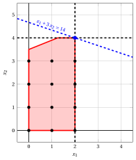{ .fig .ovale loading=lazy  }

                <em>Nodo 4: regione ammissibile di $\LP_{4}$ (in rosso), con il vincolo di branching $x_2 \le 4$ (tratteggiato), e la sua soluzione ottima (in blu).</em>

                Una soluzione ottima ${\tilde{\boldsymbol x}}(\LP_{4})$ è:

                $$
                \tilde{x}_1=2,~~\tilde{x}_2=4
                $$

                il valore ottimo è:

                $$
                z(\LP_{4}) = 14
                $$

                Il problema $\LP_{4}$ è <strong>ammissibile</strong> e abbiamo

                $$
                \left\lfloor z(\LP_{4}) \right\rfloor > \LB
                \qquad \text{poiché} \qquad
                14 > 12
                $$

                La soluzione ottima ${\tilde{\boldsymbol x}}(\LP_{4})$ è <strong>intera</strong>; di conseguenza, il lower bound $\LB$ diventa $14$ e la soluzione incumbent ${\bar{\boldsymbol x}}(\ILP)$ diventa $\bar{x}_1=2,\bar{x}_2=4$.

                Di conseguenza, il nodo di branching è <u>potato per integralità</u>.

            Alla fine della seconda iterazione, il branching su $x_{2}$ dal Nodo 2 ha generato il nodo di branching verso il basso, Nodo 4. Questo nodo è potato per integralità. Il nodo di branching verso l'alto non viene risolto, poiché dopo il Nodo 4 il lower bound soddisfa

            $$
            \left\lfloor z(\LP_{2}) \right\rfloor \le \LB.
            $$

            Questa è la parte dell'albero di branch-and-bound che mostra i problemi LP dei nodi di branching risolti:

            { .fig loading=lazy  }

            Con il lower bound $\LB$ e l'upper bound $\UB$ correnti, abbiamo:

            $$
            14 ~~\le~~ z(\ILP) ~~\le~~ 14
            $$

        - <strong>Terminazione</strong>

            Poiché la lista $L$ è vuota, il lower bound $\LB$ è uguale all'upper bound $\UB$ e il problema $\ILP$ è risolto all'ottimo.

            Il valore ottimo è $z(\ILP)=14$ (il valore del lower bound $\LB$) e una soluzione ottima ${\tilde{\boldsymbol x}}(\ILP)$ è $\tilde x_1=2,\tilde x_2=4$ (la soluzione incumbent ${\bar{\boldsymbol x}}(\ILP)$).

    2. L'albero di branch-and-bound finale è:

        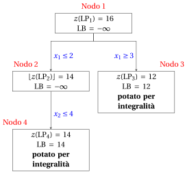{ .fig loading=lazy  }

        I motivi per cui i nodi di branching vengono potati sono i seguenti.

        - Il Nodo 1 ha una soluzione ottima frazionaria con $z(\LP_{1}) = 16$: si effettua il branching su $x_1$.

        - Il Nodo 2 ha una soluzione ottima frazionaria con $\lfloor z(\LP_{2})\rfloor = 14$: si effettua il branching su $x_2$.

        - Il nodo di branching verso l'alto del Nodo 2 non viene risolto né disegnato, poiché $\lfloor z(\LP_{2})\rfloor = 14$ $\le \LB = 14$ dopo il suo primo figlio.

        - Il Nodo 3 è potato per integralità: $\tilde{\boldsymbol x}(\LP_{3}) = (3, 3)$ è intera, con valore $12$, e diventa la soluzione incumbent.

        - Il Nodo 4 è potato per integralità: $\tilde{\boldsymbol x}(\LP_{4}) = (2, 4)$ è intera, con valore $14$, e diventa la soluzione incumbent.

        Il valore ottimo è $z(\ILP) = 14$ e l'algoritmo di branch-and-bound restituisce la soluzione ottima $\tilde{\boldsymbol x}(\ILP) = (2, 4)$.

!!! esercizio "Esercizio 7.3: Algoritmo di branch-and-bound (P3)"

    !!! nota ""

        Consideriamo il seguente problema PLI in forma canonica di massimo con $n=2$ variabili intere e $m=2$ vincoli:

        $$
        \begin{array}{rrrrrrr}
        {\max} & {2}\, {x_1} & {+} & {4}\, {x_2} \\[2ex]
        & {-}{x_1} & {+} & {x_2} & {\le} & {2} \\[2ex]
        & {8}\, {x_1} & {+} & {2}\, {x_2} & {\le} & {19} \\[2ex]
        & {x_1,} &  & {x_2} & {\in} & {\Z_{\ge 0}}
        \end{array}
        $$

        e un dizionario ottimo del suo rilassamento lineare in forma standard:

        \begin{equation*}
        \begin{cases}
        \begin{array}{rrrrrrr}
        {x_1} & {=} & {\dfrac{3}{2}} & {+} & {\dfrac{1}{5}}\, {x_3} & {-} & {\dfrac{1}{10}}\, {x_4} \\[2ex]
        {x_2} & {=} & {\dfrac{7}{2}} & {-} & {\dfrac{4}{5}}\, {x_3} & {-} & {\dfrac{1}{10}}\, {x_4} \\[2ex]
        {z} & {=} & {17} & {-} & {\dfrac{14}{5}}\, {x_3} & {-} & {\dfrac{3}{5}}\, {x_4}
        \end{array}
        \end{cases}
        \end{equation*}

    **Domande**

    1. Eseguire l'algoritmo di branch-and-bound utilizzando:

        1. la regola dell'indice massimo come strategia di selezione della variabile di branching;

        2. la regola LIFO come strategia di selezione del nodo di branching;

        3. risolvere prima il nodo di branching verso il basso e poi il nodo di branching verso l'alto;

        4. porre il lower bound $\LB$ a $-\infty$ (non viene eseguito alcun algoritmo euristico).

        Risolvere i problemi LP dei nodi di branching con l'algoritmo del simplesso duale. Nell'algoritmo del simplesso duale, la variabile uscente è la variabile in base con valore negativo e indice minimo, e i pareggi nel test dei rapporti si risolvono con l'indice minimo. Mostrare graficamente la soluzione ottima dei problemi LP associati ai nodi di branching.

    2. Determinare e commentare l'albero di branch-and-bound, mostrando il motivo per cui ciascun nodo di branching viene potato.

??? soluzione "Soluzione"

    1. Esecuzione dell'algoritmo di branch-and-bound per risolvere il problema $\ILP$.

        - <strong>Inizializzazione</strong>

            Consideriamo il problema $\LP_{1}$ in forma standard:

            $$
            \begin{array}{rrrrrrrrrrr}
            {\max} & {2}\, {x_1} & {+} & {4}\, {x_2} &  &  &  &  \\[2ex]
            & {-}{x_1} & {+} & {x_2} & {+} & {x_3} &  &  & {=} & {2} \\[2ex]
            & {8}\, {x_1} & {+} & {2}\, {x_2} &  &  & {+} & {x_4} & {=} & {19} \\[2ex]
            & {x_1,} &  & {x_2,} &  & {x_3,} &  & {x_4} & {\ge} & {0}
            \end{array}
            $$

            e il suo dizionario ottimo:

            \begin{equation*}
            \begin{cases}
            \begin{array}{rrrrrrr}
            {x_1} & {=} & {\dfrac{3}{2}} & {+} & {\dfrac{1}{5}}\, {x_3} & {-} & {\dfrac{1}{10}}\, {x_4} \\[2ex]
            {x_2} & {=} & {\dfrac{7}{2}} & {-} & {\dfrac{4}{5}}\, {x_3} & {-} & {\dfrac{1}{10}}\, {x_4} \\[2ex]
            {z} & {=} & {17} & {-} & {\dfrac{14}{5}}\, {x_3} & {-} & {\dfrac{3}{5}}\, {x_4}
            \end{array}
            \end{cases}
            \end{equation*}

            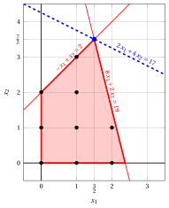{ .fig .ovale loading=lazy  }

            <em>Nodo 1: regione ammissibile di $\LP_{1}$ (in rosso), punti ammissibili del problema PLI (in nero) e soluzione ottima di $\LP_{1}$ (in blu) con la retta della funzione obiettivo che vi passa.</em>

            Una soluzione ottima ${\tilde{\boldsymbol x}}(\LP_{1})$ è:

            $$
            \tilde{x}_1=\dfrac{3}{2},~~\tilde{x}_2=\dfrac{7}{2}
            $$

            il valore ottimo è:

            $$
            z(\LP_{1}) = 17
            $$

            La soluzione ottima ${\tilde{\boldsymbol x}}(\LP_{1})$ è <strong>frazionaria</strong> e il problema $\LP_{1}$ è <strong>ammissibile</strong>, quindi il problema $\LP_{1}$ viene inserito nella lista dei problemi $L$ e il lower bound $\LB$ viene posto a $-\infty$.

            Con il lower bound $\LB$ e l'upper bound $\UB$ correnti, abbiamo:

            $$
            -\infty ~~\le~~ z(\ILP) ~~\le~~ 17
            $$

        - <strong>Iterazione 1</strong>

            Il problema $\LP_{1}$ viene estratto e cancellato dalla lista dei problemi $L$.

            La variabile di branching è $x_{2}$. I vincoli di branching sono:

            $$
            x_2 \le \underbrace{\left\lfloor \dfrac{7}{2} \right\rfloor}_{ = 3} \mathrm{~~~e~~~} x_2 \ge \underbrace{\left\lfloor \dfrac{7}{2} \right\rfloor +1}_{= 4}
            $$

            Con questi vincoli di branching si creano i due problemi $\LP_{2}$ e $\LP_{3}$.

            1. Soluzione del problema $\LP_{2}$

                Consideriamo il problema $\LP_{2}$ in forma standard:

                $$
                \begin{array}{rrrrrrrrrrrrr}
                {\max} & {2}\, {x_1} & {+} & {4}\, {x_2} &  &  &  &  &  &  \\[2ex]
                & {-}{x_1} & {+} & {x_2} & {+} & {x_3} &  &  &  &  & {=} & {2} \\[2ex]
                & {8}\, {x_1} & {+} & {2}\, {x_2} &  &  & {+} & {x_4} &  &  & {=} & {19} \\[2ex]
                &  &  & {x_2} &  &  &  &  & {+} & {x_5} & {=} & {3} \\[2ex]
                & {x_1,} &  & {x_2,} &  & {x_3,} &  & {x_4,} &  & {x_5} & {\ge} & {0}
                \end{array}
                $$

                Per il vincolo di branching abbiamo:

                $$
                x_2 + x_5 = 3 \quad \quad \Rightarrow \quad x_5 = 3 - x_2
                $$

                Usando le equazioni del dizionario ottimo possiamo esprimere questo vincolo di branching in funzione delle variabili fuori base. Sostituendo, otteniamo

                $$
                x_5 = 3 - \left(\dfrac{7}{2} - \dfrac{4}{5} \; x_3 - \dfrac{1}{10} \; x_4 \right)
                \quad \quad \Rightarrow \quad
                x_5 = -\dfrac{1}{2} + \dfrac{4}{5} \, x_3 + \dfrac{1}{10} \, x_4
                $$

                Aggiungiamo quindi questa equazione al dizionario ottimo precedente e otteniamo il seguente dizionario:

                \begin{equation*}
                \begin{cases}
                \begin{array}{rrrrrrr}
                {x_1} & {=} & {\dfrac{3}{2}} & {+} & {\dfrac{1}{5}}\, {x_3} & {-} & {\dfrac{1}{10}}\, {x_4} \\[2ex]
                {x_2} & {=} & {\dfrac{7}{2}} & {-} & {\dfrac{4}{5}}\, {x_3} & {-} & {\dfrac{1}{10}}\, {x_4} \\[2ex]
                {x_5} & {=} & {-\dfrac{1}{2}} & {+} & {\dfrac{4}{5}}\, {x_3} & {+} & {\dfrac{1}{10}}\, {x_4} \\[2ex]
                {z} & {=} & {17} & {-} & {\dfrac{14}{5}}\, {x_3} & {-} & {\dfrac{3}{5}}\, {x_4}
                \end{array}
                \end{cases}
                \end{equation*}

                dove $\pazocal{B}=\{1,2,5\}$ e $\pazocal{N}=\{3,4\}$ e

                - la soluzione di base primale non ammissibile è:

                    $$
                    \bar x_1=\dfrac{3}{2},~~
                    \bar x_2=\dfrac{7}{2},~~
                    \bar x_5=-\dfrac{1}{2},~~~~~~
                    \bar x_3=0,~~
                    \bar x_4=0~~
                    \mathrm{~~di~valore~~~} 17
                    $$

                - la soluzione di base duale ammissibile è:

                    $$
                    \bar \pi_1=0,~~
                    \bar \pi_2=0,~~
                    \bar \pi_5=0,~~~~~~
                    \bar \pi_3=\dfrac{14}{5},~~
                    \bar \pi_4=\dfrac{3}{5}~~
                    \mathrm{~~di~valore~~~} 17
                    $$

                Se aumentiamo il valore di $\pi_{5}$, possiamo ottenere una soluzione duale migliore. Abbiamo:

                $$
                \begin{cases}
                \pi_3 &= \dfrac{14}{5} - \dfrac{4}{5}\,\pi_5 \\[2ex]
                \pi_4 &= \dfrac{3}{5} - \dfrac{1}{10}\,\pi_5
                \end{cases}
                \qquad
                \qquad
                \begin{cases}
                \underbrace{ \dfrac{14}{5} - \dfrac{4}{5}\,\pi_5 \ge 0}_{\pi_3 \ge 0} \\[2ex]
                \underbrace{ \dfrac{3}{5} - \dfrac{1}{10}\,\pi_5 \ge 0}_{\pi_4 \ge 0}
                \end{cases}
                \qquad
                \qquad
                \begin{cases}
                \pi_5 &\le \dfrac{7}{2} \\[2ex]
                \pi_5 &\le 6
                \end{cases}
                $$

                Aumentando il valore di $\pi_{5}$ fino a $\min \left\{\dfrac{7}{2}, 6\right\}=\dfrac{7}{2}$, il valore di $\pi_{3}$ scende a $0$. Abbiamo quindi che:

                - $\pi_{5}$ entra nella base duale e, di conseguenza, $x_{5}$ esce dalla base primale.

                - $\pi_{3}$ esce dalla base duale e, di conseguenza, $x_{3}$ entra nella base primale.

                Abbiamo:

                $$
                x_5 = -\dfrac{1}{2} + \dfrac{4}{5} \, x_3 + \dfrac{1}{10} \, x_4
                \quad \Rightarrow \quad
                x_3 = \dfrac{5}{8} - \dfrac{1}{8} \, x_4 + \dfrac{5}{4} \, x_5
                $$

                Sostituendo nelle altre equazioni del dizionario primale, otteniamo:

                $$
                x_1
                = \dfrac{3}{2} + \dfrac{1}{5} \left( \dfrac{5}{8} - \dfrac{1}{8} \, x_4 + \dfrac{5}{4} \, x_5 \right) - \dfrac{1}{10} \; x_4
                = \dfrac{13}{8} - \dfrac{1}{8} \, x_4 + \dfrac{1}{4} \, x_5
                $$

                $$
                x_2
                = \dfrac{7}{2} - \dfrac{4}{5} \left( \dfrac{5}{8} - \dfrac{1}{8} \, x_4 + \dfrac{5}{4} \, x_5 \right) - \dfrac{1}{10} \; x_4
                = 3 - x_5
                $$

                $$
                z
                = 17 - \dfrac{14}{5} \left( \dfrac{5}{8} - \dfrac{1}{8} \, x_4 + \dfrac{5}{4} \, x_5 \right) - \dfrac{3}{5} \; x_4
                = \dfrac{61}{4} - \dfrac{1}{4} \, x_4 - \dfrac{7}{2} \, x_5
                $$

                Di conseguenza, abbiamo ora il seguente dizionario primale aggiornato:

                \begin{equation*}
                \begin{cases}
                \begin{array}{rrrrrrr}
                {x_1} & {=} & {\dfrac{13}{8}} & {-} & {\dfrac{1}{8}}\, {x_4} & {+} & {\dfrac{1}{4}}\, {x_5} \\[2ex]
                {x_2} & {=} & {3} &  &  & {-} & {x_5} \\[2ex]
                {x_3} & {=} & {\dfrac{5}{8}} & {-} & {\dfrac{1}{8}}\, {x_4} & {+} & {\dfrac{5}{4}}\, {x_5} \\[2ex]
                {z} & {=} & {\dfrac{61}{4}} & {-} & {\dfrac{1}{4}}\, {x_4} & {-} & {\dfrac{7}{2}}\, {x_5}
                \end{array}
                \end{cases}
                \end{equation*}

                dove $\pazocal{B}=\{1,2,3\}$ e $\pazocal{N}=\{4,5\}$ e

                - la soluzione di base primale ottima è:

                    $$
                    \tilde x_1=\dfrac{13}{8},~~
                    \tilde x_2=3,~~
                    \tilde x_3=\dfrac{5}{8},~~~~~~
                    \tilde x_4=0,~~
                    \tilde x_5=0~~
                    \mathrm{~~di~valore~~~} \dfrac{61}{4}
                    $$

                - la soluzione di base duale ottima è:

                    $$
                    \tilde \pi_1=0,~~
                    \tilde \pi_2=0,~~
                    \tilde \pi_3=0,~~~~~~
                    \tilde \pi_4=\dfrac{1}{4},~~
                    \tilde \pi_5=\dfrac{7}{2}~~
                    \mathrm{~~di~valore~~~} \dfrac{61}{4}
                    $$

                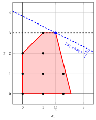{ .fig .ovale loading=lazy  }

                <em>Nodo 2: regione ammissibile di $\LP_{2}$ (in rosso), con il vincolo di branching $x_2 \le 3$ (tratteggiato), e la sua soluzione ottima (in blu).</em>

                Una soluzione ottima ${\tilde{\boldsymbol x}}(\LP_{2})$ è:

                $$
                \tilde{x}_1=\dfrac{13}{8},~~\tilde{x}_2=3
                $$

                il valore ottimo è:

                $$
                z(\LP_{2}) = \dfrac{61}{4}
                $$

                Il problema $\LP_{2}$ è <strong>ammissibile</strong> e abbiamo

                $$
                \left\lfloor z(\LP_{2}) \right\rfloor > \LB
                \qquad \text{poiché} \qquad
                \underbrace{\left\lfloor \dfrac{61}{4} \right\rfloor}_{=15} > -\infty
                $$

                La soluzione ottima ${\tilde{\boldsymbol x}}(\LP_{2})$ è <strong>frazionaria</strong>; di conseguenza, il problema $\LP_{2}$ viene <strong>inserito nella lista dei problemi</strong> $L$.

            2. Soluzione del problema $\LP_{3}$

                Consideriamo il problema $\LP_{3}$ in forma standard:

                $$
                \begin{array}{rrrrrrrrrrrrr}
                {\max} & {2}\, {x_1} & {+} & {4}\, {x_2} &  &  &  &  &  &  \\[2ex]
                & {-}{x_1} & {+} & {x_2} & {+} & {x_3} &  &  &  &  & {=} & {2} \\[2ex]
                & {8}\, {x_1} & {+} & {2}\, {x_2} &  &  & {+} & {x_4} &  &  & {=} & {19} \\[2ex]
                &  &  & {x_2} &  &  &  &  & {-} & {x_5} & {=} & {4} \\[2ex]
                & {x_1,} &  & {x_2,} &  & {x_3,} &  & {x_4,} &  & {x_5} & {\ge} & {0}
                \end{array}
                $$

                Per il vincolo di branching abbiamo:

                $$
                x_2 - x_5 = 4 \quad \quad \Rightarrow \quad x_5 = -4 + x_2
                $$

                Usando le equazioni del dizionario ottimo possiamo esprimere questo vincolo di branching in funzione delle variabili fuori base. Sostituendo, otteniamo

                $$
                x_5 = -4 + \left(\dfrac{7}{2} - \dfrac{4}{5} \; x_3 - \dfrac{1}{10} \; x_4 \right)
                \quad \quad \Rightarrow \quad
                x_5 = -\dfrac{1}{2} - \dfrac{4}{5} \, x_3 - \dfrac{1}{10} \, x_4
                $$

                Aggiungiamo quindi questa equazione al dizionario ottimo precedente e otteniamo il seguente dizionario:

                \begin{equation*}
                \begin{cases}
                \begin{array}{rrrrrrr}
                {x_1} & {=} & {\dfrac{3}{2}} & {+} & {\dfrac{1}{5}}\, {x_3} & {-} & {\dfrac{1}{10}}\, {x_4} \\[2ex]
                {x_2} & {=} & {\dfrac{7}{2}} & {-} & {\dfrac{4}{5}}\, {x_3} & {-} & {\dfrac{1}{10}}\, {x_4} \\[2ex]
                {x_5} & {=} & {-\dfrac{1}{2}} & {-} & {\dfrac{4}{5}}\, {x_3} & {-} & {\dfrac{1}{10}}\, {x_4} \\[2ex]
                {z} & {=} & {17} & {-} & {\dfrac{14}{5}}\, {x_3} & {-} & {\dfrac{3}{5}}\, {x_4}
                \end{array}
                \end{cases}
                \end{equation*}

                dove $\pazocal{B}=\{1,2,5\}$ e $\pazocal{N}=\{3,4\}$ e

                - la soluzione di base primale non ammissibile è:

                    $$
                    \bar x_1=\dfrac{3}{2},~~
                    \bar x_2=\dfrac{7}{2},~~
                    \bar x_5=-\dfrac{1}{2},~~~~~~
                    \bar x_3=0,~~
                    \bar x_4=0~~
                    \mathrm{~~di~valore~~~} 17
                    $$

                - la soluzione di base duale ammissibile è:

                    $$
                    \bar \pi_1=0,~~
                    \bar \pi_2=0,~~
                    \bar \pi_5=0,~~~~~~
                    \bar \pi_3=\dfrac{14}{5},~~
                    \bar \pi_4=\dfrac{3}{5}~~
                    \mathrm{~~di~valore~~~} 17
                    $$

                Se aumentiamo il valore di $\pi_{5}$, possiamo ottenere una soluzione duale migliore. Abbiamo:

                $$
                \begin{cases}
                \pi_3 &= \dfrac{14}{5} + \dfrac{4}{5}\,\pi_5 \\[2ex]
                \pi_4 &= \dfrac{3}{5} + \dfrac{1}{10}\,\pi_5
                \end{cases}
                \qquad
                \qquad
                \begin{cases}
                \underbrace{ \dfrac{14}{5} + \dfrac{4}{5}\,\pi_5 \ge 0}_{\pi_3 \ge 0} \\[2ex]
                \underbrace{ \dfrac{3}{5} + \dfrac{1}{10}\,\pi_5 \ge 0}_{\pi_4 \ge 0}
                \end{cases}
                \qquad
                \qquad
                \begin{cases}
                \pi_5 &\ge -\dfrac{7}{2} \\[2ex]
                \pi_5 &\ge -6
                \end{cases}
                $$

                Di conseguenza, possiamo aumentare il valore di $\pi_{5}$ senza violare l'ammissibilità duale: il problema duale è <strong>illimitato</strong>. Ne segue che il problema primale $\LP_{3}$ è <strong>inammissibile</strong> e il nodo di branching corrispondente è <u>potato per inammissibilità</u>.

            Alla fine della prima iterazione, il branching su $x_{2}$ dal Nodo 1 ha generato il nodo di branching verso il basso, Nodo 2, e il nodo di branching verso l'alto, Nodo 3. Il Nodo 2 è inserito nella lista $L$, mentre il Nodo 3 è potato per inammissibilità. L'albero di branch-and-bound corrispondente è:

            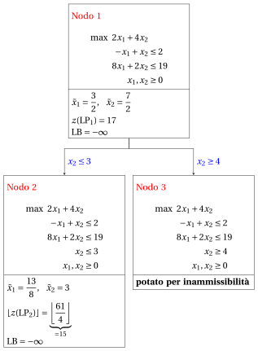{ .fig loading=lazy  }

            Con il lower bound $\LB$ e l'upper bound $\UB$ correnti, abbiamo:

            $$
            -\infty ~~\le~~ z(\ILP) ~~\le~~ \underbrace{\left\lfloor \dfrac{61}{4} \right\rfloor}_{=15}
            $$

        - <strong>Iterazione 2</strong>

            Il problema $\LP_{2}$ viene estratto e cancellato dalla lista dei problemi $L$.

            La variabile di branching è $x_{1}$. I vincoli di branching sono:

            $$
            x_1 \le \underbrace{\left\lfloor \dfrac{13}{8} \right\rfloor}_{ = 1} \mathrm{~~~e~~~} x_1 \ge \underbrace{\left\lfloor \dfrac{13}{8} \right\rfloor +1}_{= 2}
            $$

            Con questi vincoli di branching si creano i due problemi $\LP_{4}$ e $\LP_{5}$.

            1. Soluzione del problema $\LP_{4}$

                Consideriamo il problema $\LP_{4}$ in forma standard:

                $$
                \begin{array}{rrrrrrrrrrrrrrr}
                {\max} & {2}\, {x_1} & {+} & {4}\, {x_2} &  &  &  &  &  &  &  &  \\[2ex]
                & {-}{x_1} & {+} & {x_2} & {+} & {x_3} &  &  &  &  &  &  & {=} & {2} \\[2ex]
                & {8}\, {x_1} & {+} & {2}\, {x_2} &  &  & {+} & {x_4} &  &  &  &  & {=} & {19} \\[2ex]
                &  &  & {x_2} &  &  &  &  & {+} & {x_5} &  &  & {=} & {3} \\[2ex]
                & {x_1} &  &  &  &  &  &  &  &  & {+} & {x_6} & {=} & {1} \\[2ex]
                & {x_1,} &  & {x_2,} &  & {x_3,} &  & {x_4,} &  & {x_5,} &  & {x_6} & {\ge} & {0}
                \end{array}
                $$

                Per il vincolo di branching abbiamo:

                $$
                x_1 + x_6 = 1 \quad \quad \Rightarrow \quad x_6 = 1 - x_1
                $$

                Usando le equazioni del dizionario ottimo possiamo esprimere questo vincolo di branching in funzione delle variabili fuori base. Sostituendo, otteniamo

                $$
                x_6 = 1 - \left(\dfrac{13}{8} - \dfrac{1}{8} \; x_4 + \dfrac{1}{4} \; x_5 \right)
                \quad \quad \Rightarrow \quad
                x_6 = -\dfrac{5}{8} + \dfrac{1}{8} \, x_4 - \dfrac{1}{4} \, x_5
                $$

                Aggiungiamo quindi questa equazione al dizionario ottimo precedente e otteniamo il seguente dizionario:

                \begin{equation*}
                \begin{cases}
                \begin{array}{rrrrrrr}
                {x_1} & {=} & {\dfrac{13}{8}} & {-} & {\dfrac{1}{8}}\, {x_4} & {+} & {\dfrac{1}{4}}\, {x_5} \\[2ex]
                {x_2} & {=} & {3} &  &  & {-} & {x_5} \\[2ex]
                {x_3} & {=} & {\dfrac{5}{8}} & {-} & {\dfrac{1}{8}}\, {x_4} & {+} & {\dfrac{5}{4}}\, {x_5} \\[2ex]
                {x_6} & {=} & {-\dfrac{5}{8}} & {+} & {\dfrac{1}{8}}\, {x_4} & {-} & {\dfrac{1}{4}}\, {x_5} \\[2ex]
                {z} & {=} & {\dfrac{61}{4}} & {-} & {\dfrac{1}{4}}\, {x_4} & {-} & {\dfrac{7}{2}}\, {x_5}
                \end{array}
                \end{cases}
                \end{equation*}

                dove $\pazocal{B}=\{1,2,3,6\}$ e $\pazocal{N}=\{4,5\}$ e

                - la soluzione di base primale non ammissibile è:

                    $$
                    \begin{gathered}
                    \bar x_1=\dfrac{13}{8},~~
                    \bar x_2=3,~~
                    \bar x_3=\dfrac{5}{8},~~
                    \bar x_6=-\dfrac{5}{8},\\
                    \bar x_4=0,~~
                    \bar x_5=0~~
                    \mathrm{~~di~valore~~~} \dfrac{61}{4}
                    \end{gathered}
                    $$

                - la soluzione di base duale ammissibile è:

                    $$
                    \begin{gathered}
                    \bar \pi_1=0,~~
                    \bar \pi_2=0,~~
                    \bar \pi_3=0,~~
                    \bar \pi_6=0,\\
                    \bar \pi_4=\dfrac{1}{4},~~
                    \bar \pi_5=\dfrac{7}{2}~~
                    \mathrm{~~di~valore~~~} \dfrac{61}{4}
                    \end{gathered}
                    $$

                Se aumentiamo il valore di $\pi_{6}$, possiamo ottenere una soluzione duale migliore. Abbiamo:

                $$
                \begin{cases}
                \pi_4 &= \dfrac{1}{4} - \dfrac{1}{8}\,\pi_6 \\[2ex]
                \pi_5 &= \dfrac{7}{2} + \dfrac{1}{4}\,\pi_6
                \end{cases}
                \qquad
                \qquad
                \begin{cases}
                \underbrace{ \dfrac{1}{4} - \dfrac{1}{8}\,\pi_6 \ge 0}_{\pi_4 \ge 0} \\[2ex]
                \underbrace{ \dfrac{7}{2} + \dfrac{1}{4}\,\pi_6 \ge 0}_{\pi_5 \ge 0}
                \end{cases}
                \qquad
                \qquad
                \begin{cases}
                \pi_6 &\le 2 \\[2ex]
                \pi_6 &\ge -14
                \end{cases}
                $$

                Aumentando il valore di $\pi_{6}$ fino a $2$, il valore di $\pi_{4}$ scende a $0$. Abbiamo quindi che:

                - $\pi_{6}$ entra nella base duale e, di conseguenza, $x_{6}$ esce dalla base primale.

                - $\pi_{4}$ esce dalla base duale e, di conseguenza, $x_{4}$ entra nella base primale.

                Abbiamo:

                $$
                x_6 = -\dfrac{5}{8} + \dfrac{1}{8} \, x_4 - \dfrac{1}{4} \, x_5
                \quad \Rightarrow \quad
                x_4 = 5 + 2 \, x_5 + 8 \, x_6
                $$

                Sostituendo nelle altre equazioni del dizionario primale, otteniamo:

                $$
                x_1
                = \dfrac{13}{8} - \dfrac{1}{8} \left( 5 + 2 \, x_5 + 8 \, x_6 \right) + \dfrac{1}{4} \; x_5
                = 1 - x_6
                $$

                $$
                x_3
                = \dfrac{5}{8} - \dfrac{1}{8} \left( 5 + 2 \, x_5 + 8 \, x_6 \right) + \dfrac{5}{4} \; x_5
                = 0 + x_5 - x_6
                $$

                $$
                z
                = \dfrac{61}{4} - \dfrac{1}{4} \left( 5 + 2 \, x_5 + 8 \, x_6 \right) - \dfrac{7}{2} \; x_5
                = 14 - 4 \, x_5 - 2 \, x_6
                $$

                Di conseguenza, abbiamo ora il seguente dizionario primale aggiornato:

                \begin{equation*}
                \begin{cases}
                \begin{array}{rrrrrrr}
                {x_1} & {=} & {1} &  &  & {-} & {x_6} \\[2ex]
                {x_2} & {=} & {3} & {-} & {x_5} &  &  \\[2ex]
                {x_3} & {=} & {0} & {+} & {x_5} & {-} & {x_6} \\[2ex]
                {x_4} & {=} & {5} & {+} & {2}\, {x_5} & {+} & {8}\, {x_6} \\[2ex]
                {z} & {=} & {14} & {-} & {4}\, {x_5} & {-} & {2}\, {x_6}
                \end{array}
                \end{cases}
                \end{equation*}

                dove $\pazocal{B}=\{1,2,3,4\}$ e $\pazocal{N}=\{5,6\}$ e

                - la soluzione di base primale ottima è:

                    $$
                    \begin{gathered}
                    \tilde x_1=1,~~
                    \tilde x_2=3,~~
                    \tilde x_3=0,~~
                    \tilde x_4=5,\\
                    \tilde x_5=0,~~
                    \tilde x_6=0~~
                    \mathrm{~~di~valore~~~} 14
                    \end{gathered}
                    $$

                - la soluzione di base duale ottima è:

                    $$
                    \begin{gathered}
                    \tilde \pi_1=0,~~
                    \tilde \pi_2=0,~~
                    \tilde \pi_3=0,~~
                    \tilde \pi_4=0,\\
                    \tilde \pi_5=4,~~
                    \tilde \pi_6=2~~
                    \mathrm{~~di~valore~~~} 14
                    \end{gathered}
                    $$

                { .fig .ovale loading=lazy  }

                <em>Nodo 4: regione ammissibile di $\LP_{4}$ (in rosso), con il vincolo di branching $x_1 \le 1$ (tratteggiato), e la sua soluzione ottima (in blu).</em>

                Una soluzione ottima ${\tilde{\boldsymbol x}}(\LP_{4})$ è:

                $$
                \tilde{x}_1=1,~~\tilde{x}_2=3
                $$

                il valore ottimo è:

                $$
                z(\LP_{4}) = 14
                $$

                Il problema $\LP_{4}$ è <strong>ammissibile</strong> e abbiamo

                $$
                \left\lfloor z(\LP_{4}) \right\rfloor > \LB
                \qquad \text{poiché} \qquad
                14 > -\infty
                $$

                La soluzione ottima ${\tilde{\boldsymbol x}}(\LP_{4})$ è <strong>intera</strong>; di conseguenza, il lower bound $\LB$ diventa $14$ e la soluzione incumbent ${\bar{\boldsymbol x}}(\ILP)$ diventa $\bar{x}_1=1,\bar{x}_2=3$.

                Di conseguenza, il nodo di branching è <u>potato per integralità</u>.

            2. Soluzione del problema $\LP_{5}$

                Consideriamo il problema $\LP_{5}$ in forma standard:

                $$
                \begin{array}{rrrrrrrrrrrrrrr}
                {\max} & {2}\, {x_1} & {+} & {4}\, {x_2} &  &  &  &  &  &  &  &  \\[2ex]
                & {-}{x_1} & {+} & {x_2} & {+} & {x_3} &  &  &  &  &  &  & {=} & {2} \\[2ex]
                & {8}\, {x_1} & {+} & {2}\, {x_2} &  &  & {+} & {x_4} &  &  &  &  & {=} & {19} \\[2ex]
                &  &  & {x_2} &  &  &  &  & {+} & {x_5} &  &  & {=} & {3} \\[2ex]
                & {x_1} &  &  &  &  &  &  &  &  & {-} & {x_6} & {=} & {2} \\[2ex]
                & {x_1,} &  & {x_2,} &  & {x_3,} &  & {x_4,} &  & {x_5,} &  & {x_6} & {\ge} & {0}
                \end{array}
                $$

                Per il vincolo di branching abbiamo:

                $$
                x_1 - x_6 = 2 \quad \quad \Rightarrow \quad x_6 = -2 + x_1
                $$

                Usando le equazioni del dizionario ottimo possiamo esprimere questo vincolo di branching in funzione delle variabili fuori base. Sostituendo, otteniamo

                $$
                x_6 = -2 + \left(\dfrac{13}{8} - \dfrac{1}{8} \; x_4 + \dfrac{1}{4} \; x_5 \right)
                \quad \quad \Rightarrow \quad
                x_6 = -\dfrac{3}{8} - \dfrac{1}{8} \, x_4 + \dfrac{1}{4} \, x_5
                $$

                Aggiungiamo quindi questa equazione al dizionario ottimo precedente e otteniamo il seguente dizionario:

                \begin{equation*}
                \begin{cases}
                \begin{array}{rrrrrrr}
                {x_1} & {=} & {\dfrac{13}{8}} & {-} & {\dfrac{1}{8}}\, {x_4} & {+} & {\dfrac{1}{4}}\, {x_5} \\[2ex]
                {x_2} & {=} & {3} &  &  & {-} & {x_5} \\[2ex]
                {x_3} & {=} & {\dfrac{5}{8}} & {-} & {\dfrac{1}{8}}\, {x_4} & {+} & {\dfrac{5}{4}}\, {x_5} \\[2ex]
                {x_6} & {=} & {-\dfrac{3}{8}} & {-} & {\dfrac{1}{8}}\, {x_4} & {+} & {\dfrac{1}{4}}\, {x_5} \\[2ex]
                {z} & {=} & {\dfrac{61}{4}} & {-} & {\dfrac{1}{4}}\, {x_4} & {-} & {\dfrac{7}{2}}\, {x_5}
                \end{array}
                \end{cases}
                \end{equation*}

                dove $\pazocal{B}=\{1,2,3,6\}$ e $\pazocal{N}=\{4,5\}$ e

                - la soluzione di base primale non ammissibile è:

                    $$
                    \begin{gathered}
                    \bar x_1=\dfrac{13}{8},~~
                    \bar x_2=3,~~
                    \bar x_3=\dfrac{5}{8},~~
                    \bar x_6=-\dfrac{3}{8},\\
                    \bar x_4=0,~~
                    \bar x_5=0~~
                    \mathrm{~~di~valore~~~} \dfrac{61}{4}
                    \end{gathered}
                    $$

                - la soluzione di base duale ammissibile è:

                    $$
                    \begin{gathered}
                    \bar \pi_1=0,~~
                    \bar \pi_2=0,~~
                    \bar \pi_3=0,~~
                    \bar \pi_6=0,\\
                    \bar \pi_4=\dfrac{1}{4},~~
                    \bar \pi_5=\dfrac{7}{2}~~
                    \mathrm{~~di~valore~~~} \dfrac{61}{4}
                    \end{gathered}
                    $$

                Se aumentiamo il valore di $\pi_{6}$, possiamo ottenere una soluzione duale migliore. Abbiamo:

                $$
                \begin{cases}
                \pi_4 &= \dfrac{1}{4} + \dfrac{1}{8}\,\pi_6 \\[2ex]
                \pi_5 &= \dfrac{7}{2} - \dfrac{1}{4}\,\pi_6
                \end{cases}
                \qquad
                \qquad
                \begin{cases}
                \underbrace{ \dfrac{1}{4} + \dfrac{1}{8}\,\pi_6 \ge 0}_{\pi_4 \ge 0} \\[2ex]
                \underbrace{ \dfrac{7}{2} - \dfrac{1}{4}\,\pi_6 \ge 0}_{\pi_5 \ge 0}
                \end{cases}
                \qquad
                \qquad
                \begin{cases}
                \pi_6 &\ge -2 \\[2ex]
                \pi_6 &\le 14
                \end{cases}
                $$

                Aumentando il valore di $\pi_{6}$ fino a $14$, il valore di $\pi_{5}$ scende a $0$. Abbiamo quindi che:

                - $\pi_{6}$ entra nella base duale e, di conseguenza, $x_{6}$ esce dalla base primale.

                - $\pi_{5}$ esce dalla base duale e, di conseguenza, $x_{5}$ entra nella base primale.

                Abbiamo:

                $$
                x_6 = -\dfrac{3}{8} - \dfrac{1}{8} \, x_4 + \dfrac{1}{4} \, x_5
                \quad \Rightarrow \quad
                x_5 = \dfrac{3}{2} + \dfrac{1}{2} \, x_4 + 4 \, x_6
                $$

                Sostituendo nelle altre equazioni del dizionario primale, otteniamo:

                $$
                x_1
                = \dfrac{13}{8} - \dfrac{1}{8} \; x_4 + \dfrac{1}{4} \left( \dfrac{3}{2} + \dfrac{1}{2} \, x_4 + 4 \, x_6 \right)
                = 2 + x_6
                $$

                $$
                x_2
                = 3 - \left( \dfrac{3}{2} + \dfrac{1}{2} \, x_4 + 4 \, x_6 \right)
                = \dfrac{3}{2} - \dfrac{1}{2} \, x_4 - 4 \, x_6
                $$

                $$
                x_3
                = \dfrac{5}{8} - \dfrac{1}{8} \; x_4 + \dfrac{5}{4} \left( \dfrac{3}{2} + \dfrac{1}{2} \, x_4 + 4 \, x_6 \right)
                = \dfrac{5}{2} + \dfrac{1}{2} \, x_4 + 5 \, x_6
                $$

                $$
                z
                = \dfrac{61}{4} - \dfrac{1}{4} \; x_4 - \dfrac{7}{2} \left( \dfrac{3}{2} + \dfrac{1}{2} \, x_4 + 4 \, x_6 \right)
                = 10 - 2 \, x_4 - 14 \, x_6
                $$

                Di conseguenza, abbiamo ora il seguente dizionario primale aggiornato:

                \begin{equation*}
                \begin{cases}
                \begin{array}{rrrrrrr}
                {x_1} & {=} & {2} &  &  & {+} & {x_6} \\[2ex]
                {x_2} & {=} & {\dfrac{3}{2}} & {-} & {\dfrac{1}{2}}\, {x_4} & {-} & {4}\, {x_6} \\[2ex]
                {x_3} & {=} & {\dfrac{5}{2}} & {+} & {\dfrac{1}{2}}\, {x_4} & {+} & {5}\, {x_6} \\[2ex]
                {x_5} & {=} & {\dfrac{3}{2}} & {+} & {\dfrac{1}{2}}\, {x_4} & {+} & {4}\, {x_6} \\[2ex]
                {z} & {=} & {10} & {-} & {2}\, {x_4} & {-} & {14}\, {x_6}
                \end{array}
                \end{cases}
                \end{equation*}

                dove $\pazocal{B}=\{1,2,3,5\}$ e $\pazocal{N}=\{4,6\}$ e

                - la soluzione di base primale ottima è:

                    $$
                    \begin{gathered}
                    \tilde x_1=2,~~
                    \tilde x_2=\dfrac{3}{2},~~
                    \tilde x_3=\dfrac{5}{2},~~
                    \tilde x_5=\dfrac{3}{2},\\
                    \tilde x_4=0,~~
                    \tilde x_6=0~~
                    \mathrm{~~di~valore~~~} 10
                    \end{gathered}
                    $$

                - la soluzione di base duale ottima è:

                    $$
                    \begin{gathered}
                    \tilde \pi_1=0,~~
                    \tilde \pi_2=0,~~
                    \tilde \pi_3=0,~~
                    \tilde \pi_5=0,\\
                    \tilde \pi_4=2,~~
                    \tilde \pi_6=14~~
                    \mathrm{~~di~valore~~~} 10
                    \end{gathered}
                    $$

                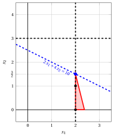{ .fig .ovale loading=lazy  }

                <em>Nodo 5: regione ammissibile di $\LP_{5}$ (in rosso), con il vincolo di branching $x_1 \ge 2$ (tratteggiato), e la sua soluzione ottima (in blu).</em>

                Una soluzione ottima ${\tilde{\boldsymbol x}}(\LP_{5})$ è:

                $$
                \tilde{x}_1=2,~~\tilde{x}_2=\dfrac{3}{2}
                $$

                il valore ottimo è:

                $$
                z(\LP_{5}) = 10
                $$

                Il problema $\LP_{5}$ è <strong>ammissibile</strong> e abbiamo

                $$
                \left\lfloor z(\LP_{5}) \right\rfloor \le \LB
                \qquad \text{poiché} \qquad
                10 \le 14
                $$

                Di conseguenza, il nodo di branching è <u>potato per bound</u>.

            Alla fine della seconda iterazione, il branching su $x_{1}$ dal Nodo 2 ha generato il nodo di branching verso il basso, Nodo 4, e il nodo di branching verso l'alto, Nodo 5. Il Nodo 4 è potato per integralità, mentre il Nodo 5 è potato per bound. L'albero di branch-and-bound corrispondente è:

            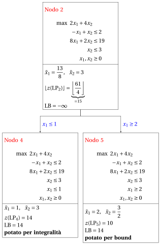{ .fig loading=lazy  }

            Con il lower bound $\LB$ e l'upper bound $\UB$ correnti, abbiamo:

            $$
            14 ~~\le~~ z(\ILP) ~~\le~~ 14
            $$

        - <strong>Terminazione</strong>

            Poiché la lista $L$ è vuota, il lower bound $\LB$ è uguale all'upper bound $\UB$ e il problema $\ILP$ è risolto all'ottimo.

            Il valore ottimo è $z(\ILP)=14$ (il valore del lower bound $\LB$) e una soluzione ottima ${\tilde{\boldsymbol x}}(\ILP)$ è $\tilde x_1=1,\tilde x_2=3$ (la soluzione incumbent ${\bar{\boldsymbol x}}(\ILP)$).

    2. L'albero di branch-and-bound finale è:

        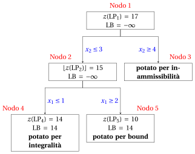{ .fig loading=lazy  }

        I motivi per cui i nodi di branching vengono potati sono i seguenti.

        - Il Nodo 1 ha una soluzione ottima frazionaria con $z(\LP_{1}) = 17$: si effettua il branching su $x_2$.

        - Il Nodo 2 ha una soluzione ottima frazionaria con $\lfloor z(\LP_{2})\rfloor = 15$: si effettua il branching su $x_1$.

        - Il Nodo 3 è potato per inammissibilità: il problema $\LP_{3}$ non ha soluzioni ammissibili.

        - Il Nodo 4 è potato per integralità: $\tilde{\boldsymbol x}(\LP_{4}) = (1, 3)$ è intera, con valore $14$, e diventa la soluzione incumbent.

        - Il Nodo 5 è potato per bound: $z(\LP_{5}) = 10$ $\le \LB = 14$.

        Il valore ottimo è $z(\ILP) = 14$ e l'algoritmo di branch-and-bound restituisce la soluzione ottima $\tilde{\boldsymbol x}(\ILP) = (1, 3)$.

!!! esercizio "Esercizio 7.4: Algoritmo di branch-and-bound (P4)"

    !!! nota ""

        Consideriamo il seguente problema PLI in forma canonica di massimo con $n=2$ variabili intere e $m=2$ vincoli:

        $$
        \begin{array}{rrrrrrr}
        {\max} & {5}\, {x_1} & {+} & {3}\, {x_2} \\[2ex]
        & {2}\, {x_1} & {+} & {x_2} & {\le} & {14} \\[2ex]
        & {x_1} & {+} & {8}\, {x_2} & {\le} & {32} \\[2ex]
        & {x_1,} &  & {x_2} & {\in} & {\Z_{\ge 0}}
        \end{array}
        $$

        e un dizionario ottimo del suo rilassamento lineare in forma standard:

        \begin{equation*}
        \begin{cases}
        \begin{array}{rrrrrrr}
        {x_1} & {=} & {\dfrac{16}{3}} & {-} & {\dfrac{8}{15}}\, {x_3} & {+} & {\dfrac{1}{15}}\, {x_4} \\[2ex]
        {x_2} & {=} & {\dfrac{10}{3}} & {+} & {\dfrac{1}{15}}\, {x_3} & {-} & {\dfrac{2}{15}}\, {x_4} \\[2ex]
        {z} & {=} & {\dfrac{110}{3}} & {-} & {\dfrac{37}{15}}\, {x_3} & {-} & {\dfrac{1}{15}}\, {x_4}
        \end{array}
        \end{cases}
        \end{equation*}

    **Domande**

    1. Eseguire l'algoritmo di branch-and-bound utilizzando:

        1. la regola dell'indice massimo come strategia di selezione della variabile di branching;

        2. la regola LIFO come strategia di selezione del nodo di branching;

        3. risolvere prima il nodo di branching verso il basso e poi il nodo di branching verso l'alto;

        4. porre il lower bound $\LB$ a $-\infty$ (non viene eseguito alcun algoritmo euristico).

        Risolvere i problemi LP dei nodi di branching con l'algoritmo del simplesso duale. Nell'algoritmo del simplesso duale, la variabile uscente è la variabile in base con valore negativo e indice minimo, e i pareggi nel test dei rapporti si risolvono con l'indice minimo. Mostrare graficamente la soluzione ottima dei problemi LP associati ai nodi di branching.

    2. Determinare e commentare l'albero di branch-and-bound, mostrando il motivo per cui ciascun nodo di branching viene potato.

??? soluzione "Soluzione"

    1. Esecuzione dell'algoritmo di branch-and-bound per risolvere il problema $\ILP$.

        - <strong>Inizializzazione</strong>

            Consideriamo il problema $\LP_{1}$ in forma standard:

            $$
            \begin{array}{rrrrrrrrrrr}
            {\max} & {5}\, {x_1} & {+} & {3}\, {x_2} &  &  &  &  \\[2ex]
            & {2}\, {x_1} & {+} & {x_2} & {+} & {x_3} &  &  & {=} & {14} \\[2ex]
            & {x_1} & {+} & {8}\, {x_2} &  &  & {+} & {x_4} & {=} & {32} \\[2ex]
            & {x_1,} &  & {x_2,} &  & {x_3,} &  & {x_4} & {\ge} & {0}
            \end{array}
            $$

            e il suo dizionario ottimo:

            \begin{equation*}
            \begin{cases}
            \begin{array}{rrrrrrr}
            {x_1} & {=} & {\dfrac{16}{3}} & {-} & {\dfrac{8}{15}}\, {x_3} & {+} & {\dfrac{1}{15}}\, {x_4} \\[2ex]
            {x_2} & {=} & {\dfrac{10}{3}} & {+} & {\dfrac{1}{15}}\, {x_3} & {-} & {\dfrac{2}{15}}\, {x_4} \\[2ex]
            {z} & {=} & {\dfrac{110}{3}} & {-} & {\dfrac{37}{15}}\, {x_3} & {-} & {\dfrac{1}{15}}\, {x_4}
            \end{array}
            \end{cases}
            \end{equation*}

            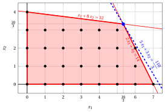{ .fig .ovale loading=lazy  }

            <em>Nodo 1: regione ammissibile di $\LP_{1}$ (in rosso), punti ammissibili del problema PLI (in nero) e soluzione ottima di $\LP_{1}$ (in blu) con la retta della funzione obiettivo che vi passa.</em>

            Una soluzione ottima ${\tilde{\boldsymbol x}}(\LP_{1})$ è:

            $$
            \tilde{x}_1=\dfrac{16}{3},~~\tilde{x}_2=\dfrac{10}{3}
            $$

            il valore ottimo è:

            $$
            z(\LP_{1}) = \dfrac{110}{3}
            $$

            La soluzione ottima ${\tilde{\boldsymbol x}}(\LP_{1})$ è <strong>frazionaria</strong> e il problema $\LP_{1}$ è <strong>ammissibile</strong>, quindi il problema $\LP_{1}$ viene inserito nella lista dei problemi $L$ e il lower bound $\LB$ viene posto a $-\infty$.

            Con il lower bound $\LB$ e l'upper bound $\UB$ correnti, abbiamo:

            $$
            -\infty ~~\le~~ z(\ILP) ~~\le~~ \underbrace{\left\lfloor \dfrac{110}{3} \right\rfloor}_{=36}
            $$

        - <strong>Iterazione 1</strong>

            Il problema $\LP_{1}$ viene estratto e cancellato dalla lista dei problemi $L$.

            La variabile di branching è $x_{2}$. I vincoli di branching sono:

            $$
            x_2 \le \underbrace{\left\lfloor \dfrac{10}{3} \right\rfloor}_{ = 3} \mathrm{~~~e~~~} x_2 \ge \underbrace{\left\lfloor \dfrac{10}{3} \right\rfloor +1}_{= 4}
            $$

            Con questi vincoli di branching si creano i due problemi $\LP_{2}$ e $\LP_{3}$.

            1. Soluzione del problema $\LP_{2}$

                Consideriamo il problema $\LP_{2}$ in forma standard:

                $$
                \begin{array}{rrrrrrrrrrrrr}
                {\max} & {5}\, {x_1} & {+} & {3}\, {x_2} &  &  &  &  &  &  \\[2ex]
                & {2}\, {x_1} & {+} & {x_2} & {+} & {x_3} &  &  &  &  & {=} & {14} \\[2ex]
                & {x_1} & {+} & {8}\, {x_2} &  &  & {+} & {x_4} &  &  & {=} & {32} \\[2ex]
                &  &  & {x_2} &  &  &  &  & {+} & {x_5} & {=} & {3} \\[2ex]
                & {x_1,} &  & {x_2,} &  & {x_3,} &  & {x_4,} &  & {x_5} & {\ge} & {0}
                \end{array}
                $$

                Per il vincolo di branching abbiamo:

                $$
                x_2 + x_5 = 3 \quad \quad \Rightarrow \quad x_5 = 3 - x_2
                $$

                Usando le equazioni del dizionario ottimo possiamo esprimere questo vincolo di branching in funzione delle variabili fuori base. Sostituendo, otteniamo

                $$
                x_5 = 3 - \left(\dfrac{10}{3} + \dfrac{1}{15} \; x_3 - \dfrac{2}{15} \; x_4 \right)
                \quad \quad \Rightarrow \quad
                x_5 = -\dfrac{1}{3} - \dfrac{1}{15} \, x_3 + \dfrac{2}{15} \, x_4
                $$

                Aggiungiamo quindi questa equazione al dizionario ottimo precedente e otteniamo il seguente dizionario:

                \begin{equation*}
                \begin{cases}
                \begin{array}{rrrrrrr}
                {x_1} & {=} & {\dfrac{16}{3}} & {-} & {\dfrac{8}{15}}\, {x_3} & {+} & {\dfrac{1}{15}}\, {x_4} \\[2ex]
                {x_2} & {=} & {\dfrac{10}{3}} & {+} & {\dfrac{1}{15}}\, {x_3} & {-} & {\dfrac{2}{15}}\, {x_4} \\[2ex]
                {x_5} & {=} & {-\dfrac{1}{3}} & {-} & {\dfrac{1}{15}}\, {x_3} & {+} & {\dfrac{2}{15}}\, {x_4} \\[2ex]
                {z} & {=} & {\dfrac{110}{3}} & {-} & {\dfrac{37}{15}}\, {x_3} & {-} & {\dfrac{1}{15}}\, {x_4}
                \end{array}
                \end{cases}
                \end{equation*}

                dove $\pazocal{B}=\{1,2,5\}$ e $\pazocal{N}=\{3,4\}$ e

                - la soluzione di base primale non ammissibile è:

                    $$
                    \bar x_1=\dfrac{16}{3},~~
                    \bar x_2=\dfrac{10}{3},~~
                    \bar x_5=-\dfrac{1}{3},~~~~~~
                    \bar x_3=0,~~
                    \bar x_4=0~~
                    \mathrm{~~di~valore~~~} \dfrac{110}{3}
                    $$

                - la soluzione di base duale ammissibile è:

                    $$
                    \bar \pi_1=0,~~
                    \bar \pi_2=0,~~
                    \bar \pi_5=0,~~~~~~
                    \bar \pi_3=\dfrac{37}{15},~~
                    \bar \pi_4=\dfrac{1}{15}~~
                    \mathrm{~~di~valore~~~} \dfrac{110}{3}
                    $$

                Se aumentiamo il valore di $\pi_{5}$, possiamo ottenere una soluzione duale migliore. Abbiamo:

                $$
                \begin{cases}
                \pi_3 &= \dfrac{37}{15} + \dfrac{1}{15}\,\pi_5 \\[2ex]
                \pi_4 &= \dfrac{1}{15} - \dfrac{2}{15}\,\pi_5
                \end{cases}
                \qquad
                \qquad
                \begin{cases}
                \underbrace{ \dfrac{37}{15} + \dfrac{1}{15}\,\pi_5 \ge 0}_{\pi_3 \ge 0} \\[2ex]
                \underbrace{ \dfrac{1}{15} - \dfrac{2}{15}\,\pi_5 \ge 0}_{\pi_4 \ge 0}
                \end{cases}
                \qquad
                \qquad
                \begin{cases}
                \pi_5 &\ge -37 \\[2ex]
                \pi_5 &\le \dfrac{1}{2}
                \end{cases}
                $$

                Aumentando il valore di $\pi_{5}$ fino a $\dfrac{1}{2}$, il valore di $\pi_{4}$ scende a $0$. Abbiamo quindi che:

                - $\pi_{5}$ entra nella base duale e, di conseguenza, $x_{5}$ esce dalla base primale.

                - $\pi_{4}$ esce dalla base duale e, di conseguenza, $x_{4}$ entra nella base primale.

                Abbiamo:

                $$
                x_5 = -\dfrac{1}{3} - \dfrac{1}{15} \, x_3 + \dfrac{2}{15} \, x_4
                \quad \Rightarrow \quad
                x_4 = \dfrac{5}{2} + \dfrac{1}{2} \, x_3 + \dfrac{15}{2} \, x_5
                $$

                Sostituendo nelle altre equazioni del dizionario primale, otteniamo:

                $$
                x_1
                = \dfrac{16}{3} - \dfrac{8}{15} \; x_3 + \dfrac{1}{15} \left( \dfrac{5}{2} + \dfrac{1}{2} \, x_3 + \dfrac{15}{2} \, x_5 \right)
                = \dfrac{11}{2} - \dfrac{1}{2} \, x_3 + \dfrac{1}{2} \, x_5
                $$

                $$
                x_2
                = \dfrac{10}{3} + \dfrac{1}{15} \; x_3 - \dfrac{2}{15} \left( \dfrac{5}{2} + \dfrac{1}{2} \, x_3 + \dfrac{15}{2} \, x_5 \right)
                = 3 - x_5
                $$

                $$
                z
                = \dfrac{110}{3} - \dfrac{37}{15} \; x_3 - \dfrac{1}{15} \left( \dfrac{5}{2} + \dfrac{1}{2} \, x_3 + \dfrac{15}{2} \, x_5 \right)
                = \dfrac{73}{2} - \dfrac{5}{2} \, x_3 - \dfrac{1}{2} \, x_5
                $$

                Di conseguenza, abbiamo ora il seguente dizionario primale aggiornato:

                \begin{equation*}
                \begin{cases}
                \begin{array}{rrrrrrr}
                {x_1} & {=} & {\dfrac{11}{2}} & {-} & {\dfrac{1}{2}}\, {x_3} & {+} & {\dfrac{1}{2}}\, {x_5} \\[2ex]
                {x_2} & {=} & {3} &  &  & {-} & {x_5} \\[2ex]
                {x_4} & {=} & {\dfrac{5}{2}} & {+} & {\dfrac{1}{2}}\, {x_3} & {+} & {\dfrac{15}{2}}\, {x_5} \\[2ex]
                {z} & {=} & {\dfrac{73}{2}} & {-} & {\dfrac{5}{2}}\, {x_3} & {-} & {\dfrac{1}{2}}\, {x_5}
                \end{array}
                \end{cases}
                \end{equation*}

                dove $\pazocal{B}=\{1,2,4\}$ e $\pazocal{N}=\{3,5\}$ e

                - la soluzione di base primale ottima è:

                    $$
                    \tilde x_1=\dfrac{11}{2},~~
                    \tilde x_2=3,~~
                    \tilde x_4=\dfrac{5}{2},~~~~~~
                    \tilde x_3=0,~~
                    \tilde x_5=0~~
                    \mathrm{~~di~valore~~~} \dfrac{73}{2}
                    $$

                - la soluzione di base duale ottima è:

                    $$
                    \tilde \pi_1=0,~~
                    \tilde \pi_2=0,~~
                    \tilde \pi_4=0,~~~~~~
                    \tilde \pi_3=\dfrac{5}{2},~~
                    \tilde \pi_5=\dfrac{1}{2}~~
                    \mathrm{~~di~valore~~~} \dfrac{73}{2}
                    $$

                { .fig .ovale loading=lazy  }

                <em>Nodo 2: regione ammissibile di $\LP_{2}$ (in rosso), con il vincolo di branching $x_2 \le 3$ (tratteggiato), e la sua soluzione ottima (in blu).</em>

                Una soluzione ottima ${\tilde{\boldsymbol x}}(\LP_{2})$ è:

                $$
                \tilde{x}_1=\dfrac{11}{2},~~\tilde{x}_2=3
                $$

                il valore ottimo è:

                $$
                z(\LP_{2}) = \dfrac{73}{2}
                $$

                Il problema $\LP_{2}$ è <strong>ammissibile</strong> e abbiamo

                $$
                \left\lfloor z(\LP_{2}) \right\rfloor > \LB
                \qquad \text{poiché} \qquad
                \underbrace{\left\lfloor \dfrac{73}{2} \right\rfloor}_{=36} > -\infty
                $$

                La soluzione ottima ${\tilde{\boldsymbol x}}(\LP_{2})$ è <strong>frazionaria</strong>; di conseguenza, il problema $\LP_{2}$ viene <strong>inserito nella lista dei problemi</strong> $L$.

            2. Soluzione del problema $\LP_{3}$

                Consideriamo il problema $\LP_{3}$ in forma standard:

                $$
                \begin{array}{rrrrrrrrrrrrr}
                {\max} & {5}\, {x_1} & {+} & {3}\, {x_2} &  &  &  &  &  &  \\[2ex]
                & {2}\, {x_1} & {+} & {x_2} & {+} & {x_3} &  &  &  &  & {=} & {14} \\[2ex]
                & {x_1} & {+} & {8}\, {x_2} &  &  & {+} & {x_4} &  &  & {=} & {32} \\[2ex]
                &  &  & {x_2} &  &  &  &  & {-} & {x_5} & {=} & {4} \\[2ex]
                & {x_1,} &  & {x_2,} &  & {x_3,} &  & {x_4,} &  & {x_5} & {\ge} & {0}
                \end{array}
                $$

                Per il vincolo di branching abbiamo:

                $$
                x_2 - x_5 = 4 \quad \quad \Rightarrow \quad x_5 = -4 + x_2
                $$

                Usando le equazioni del dizionario ottimo possiamo esprimere questo vincolo di branching in funzione delle variabili fuori base. Sostituendo, otteniamo

                $$
                x_5 = -4 + \left(\dfrac{10}{3} + \dfrac{1}{15} \; x_3 - \dfrac{2}{15} \; x_4 \right)
                \quad \quad \Rightarrow \quad
                x_5 = -\dfrac{2}{3} + \dfrac{1}{15} \, x_3 - \dfrac{2}{15} \, x_4
                $$

                Aggiungiamo quindi questa equazione al dizionario ottimo precedente e otteniamo il seguente dizionario:

                \begin{equation*}
                \begin{cases}
                \begin{array}{rrrrrrr}
                {x_1} & {=} & {\dfrac{16}{3}} & {-} & {\dfrac{8}{15}}\, {x_3} & {+} & {\dfrac{1}{15}}\, {x_4} \\[2ex]
                {x_2} & {=} & {\dfrac{10}{3}} & {+} & {\dfrac{1}{15}}\, {x_3} & {-} & {\dfrac{2}{15}}\, {x_4} \\[2ex]
                {x_5} & {=} & {-\dfrac{2}{3}} & {+} & {\dfrac{1}{15}}\, {x_3} & {-} & {\dfrac{2}{15}}\, {x_4} \\[2ex]
                {z} & {=} & {\dfrac{110}{3}} & {-} & {\dfrac{37}{15}}\, {x_3} & {-} & {\dfrac{1}{15}}\, {x_4}
                \end{array}
                \end{cases}
                \end{equation*}

                dove $\pazocal{B}=\{1,2,5\}$ e $\pazocal{N}=\{3,4\}$ e

                - la soluzione di base primale non ammissibile è:

                    $$
                    \bar x_1=\dfrac{16}{3},~~
                    \bar x_2=\dfrac{10}{3},~~
                    \bar x_5=-\dfrac{2}{3},~~~~~~
                    \bar x_3=0,~~
                    \bar x_4=0~~
                    \mathrm{~~di~valore~~~} \dfrac{110}{3}
                    $$

                - la soluzione di base duale ammissibile è:

                    $$
                    \bar \pi_1=0,~~
                    \bar \pi_2=0,~~
                    \bar \pi_5=0,~~~~~~
                    \bar \pi_3=\dfrac{37}{15},~~
                    \bar \pi_4=\dfrac{1}{15}~~
                    \mathrm{~~di~valore~~~} \dfrac{110}{3}
                    $$

                Se aumentiamo il valore di $\pi_{5}$, possiamo ottenere una soluzione duale migliore. Abbiamo:

                $$
                \begin{cases}
                \pi_3 &= \dfrac{37}{15} - \dfrac{1}{15}\,\pi_5 \\[2ex]
                \pi_4 &= \dfrac{1}{15} + \dfrac{2}{15}\,\pi_5
                \end{cases}
                \qquad
                \qquad
                \begin{cases}
                \underbrace{ \dfrac{37}{15} - \dfrac{1}{15}\,\pi_5 \ge 0}_{\pi_3 \ge 0} \\[2ex]
                \underbrace{ \dfrac{1}{15} + \dfrac{2}{15}\,\pi_5 \ge 0}_{\pi_4 \ge 0}
                \end{cases}
                \qquad
                \qquad
                \begin{cases}
                \pi_5 &\le 37 \\[2ex]
                \pi_5 &\ge -\dfrac{1}{2}
                \end{cases}
                $$

                Aumentando il valore di $\pi_{5}$ fino a $37$, il valore di $\pi_{3}$ scende a $0$. Abbiamo quindi che:

                - $\pi_{5}$ entra nella base duale e, di conseguenza, $x_{5}$ esce dalla base primale.

                - $\pi_{3}$ esce dalla base duale e, di conseguenza, $x_{3}$ entra nella base primale.

                Abbiamo:

                $$
                x_5 = -\dfrac{2}{3} + \dfrac{1}{15} \, x_3 - \dfrac{2}{15} \, x_4
                \quad \Rightarrow \quad
                x_3 = 10 + 2 \, x_4 + 15 \, x_5
                $$

                Sostituendo nelle altre equazioni del dizionario primale, otteniamo:

                $$
                x_1
                = \dfrac{16}{3} - \dfrac{8}{15} \left( 10 + 2 \, x_4 + 15 \, x_5 \right) + \dfrac{1}{15} \; x_4
                = 0 - x_4 - 8 \, x_5
                $$

                $$
                x_2
                = \dfrac{10}{3} + \dfrac{1}{15} \left( 10 + 2 \, x_4 + 15 \, x_5 \right) - \dfrac{2}{15} \; x_4
                = 4 + x_5
                $$

                $$
                z
                = \dfrac{110}{3} - \dfrac{37}{15} \left( 10 + 2 \, x_4 + 15 \, x_5 \right) - \dfrac{1}{15} \; x_4
                = 12 - 5 \, x_4 - 37 \, x_5
                $$

                Di conseguenza, abbiamo ora il seguente dizionario primale aggiornato:

                \begin{equation*}
                \begin{cases}
                \begin{array}{rrrrrrr}
                {x_1} & {=} & {0} & {-} & {x_4} & {-} & {8}\, {x_5} \\[2ex]
                {x_2} & {=} & {4} &  &  & {+} & {x_5} \\[2ex]
                {x_3} & {=} & {10} & {+} & {2}\, {x_4} & {+} & {15}\, {x_5} \\[2ex]
                {z} & {=} & {12} & {-} & {5}\, {x_4} & {-} & {37}\, {x_5}
                \end{array}
                \end{cases}
                \end{equation*}

                dove $\pazocal{B}=\{1,2,3\}$ e $\pazocal{N}=\{4,5\}$ e

                - la soluzione di base primale ottima è:

                    $$
                    \tilde x_1=0,~~
                    \tilde x_2=4,~~
                    \tilde x_3=10,~~~~~~
                    \tilde x_4=0,~~
                    \tilde x_5=0~~
                    \mathrm{~~di~valore~~~} 12
                    $$

                - la soluzione di base duale ottima è:

                    $$
                    \tilde \pi_1=0,~~
                    \tilde \pi_2=0,~~
                    \tilde \pi_3=0,~~~~~~
                    \tilde \pi_4=5,~~
                    \tilde \pi_5=37~~
                    \mathrm{~~di~valore~~~} 12
                    $$

                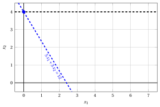{ .fig .ovale loading=lazy  }

                <em>Nodo 3: regione ammissibile di $\LP_{3}$ (in rosso), con il vincolo di branching $x_2 \ge 4$ (tratteggiato), e la sua soluzione ottima (in blu).</em>

                Una soluzione ottima ${\tilde{\boldsymbol x}}(\LP_{3})$ è:

                $$
                \tilde{x}_1=0,~~\tilde{x}_2=4
                $$

                il valore ottimo è:

                $$
                z(\LP_{3}) = 12
                $$

                Il problema $\LP_{3}$ è <strong>ammissibile</strong> e abbiamo

                $$
                \left\lfloor z(\LP_{3}) \right\rfloor > \LB
                \qquad \text{poiché} \qquad
                12 > -\infty
                $$

                La soluzione ottima ${\tilde{\boldsymbol x}}(\LP_{3})$ è <strong>intera</strong>; di conseguenza, il lower bound $\LB$ diventa $12$ e la soluzione incumbent ${\bar{\boldsymbol x}}(\ILP)$ diventa $\bar{x}_1=0,\bar{x}_2=4$.

                Di conseguenza, il nodo di branching è <u>potato per integralità</u>.

            Alla fine della prima iterazione, il branching su $x_{2}$ dal Nodo 1 ha generato il nodo di branching verso il basso, Nodo 2, e il nodo di branching verso l'alto, Nodo 3. Il Nodo 2 è inserito nella lista $L$, mentre il Nodo 3 è potato per integralità. L'albero di branch-and-bound corrispondente è:

            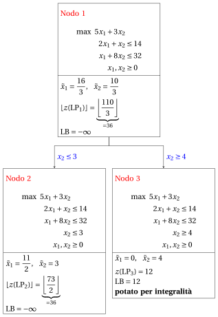{ .fig loading=lazy  }

            Con il lower bound $\LB$ e l'upper bound $\UB$ correnti, abbiamo:

            $$
            12 ~~\le~~ z(\ILP) ~~\le~~ \underbrace{\left\lfloor \dfrac{73}{2} \right\rfloor}_{=36}
            $$

        - <strong>Iterazione 2</strong>

            Il problema $\LP_{2}$ viene estratto e cancellato dalla lista dei problemi $L$.

            La variabile di branching è $x_{1}$. I vincoli di branching sono:

            $$
            x_1 \le \underbrace{\left\lfloor \dfrac{11}{2} \right\rfloor}_{ = 5} \mathrm{~~~e~~~} x_1 \ge \underbrace{\left\lfloor \dfrac{11}{2} \right\rfloor +1}_{= 6}
            $$

            Con questi vincoli di branching si creano i due problemi $\LP_{4}$ e $\LP_{5}$.

            1. Soluzione del problema $\LP_{4}$

                Consideriamo il problema $\LP_{4}$ in forma standard:

                $$
                \begin{array}{rrrrrrrrrrrrrrr}
                {\max} & {5}\, {x_1} & {+} & {3}\, {x_2} &  &  &  &  &  &  &  &  \\[2ex]
                & {2}\, {x_1} & {+} & {x_2} & {+} & {x_3} &  &  &  &  &  &  & {=} & {14} \\[2ex]
                & {x_1} & {+} & {8}\, {x_2} &  &  & {+} & {x_4} &  &  &  &  & {=} & {32} \\[2ex]
                &  &  & {x_2} &  &  &  &  & {+} & {x_5} &  &  & {=} & {3} \\[2ex]
                & {x_1} &  &  &  &  &  &  &  &  & {+} & {x_6} & {=} & {5} \\[2ex]
                & {x_1,} &  & {x_2,} &  & {x_3,} &  & {x_4,} &  & {x_5,} &  & {x_6} & {\ge} & {0}
                \end{array}
                $$

                Per il vincolo di branching abbiamo:

                $$
                x_1 + x_6 = 5 \quad \quad \Rightarrow \quad x_6 = 5 - x_1
                $$

                Usando le equazioni del dizionario ottimo possiamo esprimere questo vincolo di branching in funzione delle variabili fuori base. Sostituendo, otteniamo

                $$
                x_6 = 5 - \left(\dfrac{11}{2} - \dfrac{1}{2} \; x_3 + \dfrac{1}{2} \; x_5 \right)
                \quad \quad \Rightarrow \quad
                x_6 = -\dfrac{1}{2} + \dfrac{1}{2} \, x_3 - \dfrac{1}{2} \, x_5
                $$

                Aggiungiamo quindi questa equazione al dizionario ottimo precedente e otteniamo il seguente dizionario:

                \begin{equation*}
                \begin{cases}
                \begin{array}{rrrrrrr}
                {x_1} & {=} & {\dfrac{11}{2}} & {-} & {\dfrac{1}{2}}\, {x_3} & {+} & {\dfrac{1}{2}}\, {x_5} \\[2ex]
                {x_2} & {=} & {3} &  &  & {-} & {x_5} \\[2ex]
                {x_4} & {=} & {\dfrac{5}{2}} & {+} & {\dfrac{1}{2}}\, {x_3} & {+} & {\dfrac{15}{2}}\, {x_5} \\[2ex]
                {x_6} & {=} & {-\dfrac{1}{2}} & {+} & {\dfrac{1}{2}}\, {x_3} & {-} & {\dfrac{1}{2}}\, {x_5} \\[2ex]
                {z} & {=} & {\dfrac{73}{2}} & {-} & {\dfrac{5}{2}}\, {x_3} & {-} & {\dfrac{1}{2}}\, {x_5}
                \end{array}
                \end{cases}
                \end{equation*}

                dove $\pazocal{B}=\{1,2,4,6\}$ e $\pazocal{N}=\{3,5\}$ e

                - la soluzione di base primale non ammissibile è:

                    $$
                    \begin{gathered}
                    \bar x_1=\dfrac{11}{2},~~
                    \bar x_2=3,~~
                    \bar x_4=\dfrac{5}{2},~~
                    \bar x_6=-\dfrac{1}{2},\\
                    \bar x_3=0,~~
                    \bar x_5=0~~
                    \mathrm{~~di~valore~~~} \dfrac{73}{2}
                    \end{gathered}
                    $$

                - la soluzione di base duale ammissibile è:

                    $$
                    \begin{gathered}
                    \bar \pi_1=0,~~
                    \bar \pi_2=0,~~
                    \bar \pi_4=0,~~
                    \bar \pi_6=0,\\
                    \bar \pi_3=\dfrac{5}{2},~~
                    \bar \pi_5=\dfrac{1}{2}~~
                    \mathrm{~~di~valore~~~} \dfrac{73}{2}
                    \end{gathered}
                    $$

                Se aumentiamo il valore di $\pi_{6}$, possiamo ottenere una soluzione duale migliore. Abbiamo:

                $$
                \begin{cases}
                \pi_3 &= \dfrac{5}{2} - \dfrac{1}{2}\,\pi_6 \\[2ex]
                \pi_5 &= \dfrac{1}{2} + \dfrac{1}{2}\,\pi_6
                \end{cases}
                \qquad
                \qquad
                \begin{cases}
                \underbrace{ \dfrac{5}{2} - \dfrac{1}{2}\,\pi_6 \ge 0}_{\pi_3 \ge 0} \\[2ex]
                \underbrace{ \dfrac{1}{2} + \dfrac{1}{2}\,\pi_6 \ge 0}_{\pi_5 \ge 0}
                \end{cases}
                \qquad
                \qquad
                \begin{cases}
                \pi_6 &\le 5 \\[2ex]
                \pi_6 &\ge -1
                \end{cases}
                $$

                Aumentando il valore di $\pi_{6}$ fino a $5$, il valore di $\pi_{3}$ scende a $0$. Abbiamo quindi che:

                - $\pi_{6}$ entra nella base duale e, di conseguenza, $x_{6}$ esce dalla base primale.

                - $\pi_{3}$ esce dalla base duale e, di conseguenza, $x_{3}$ entra nella base primale.

                Abbiamo:

                $$
                x_6 = -\dfrac{1}{2} + \dfrac{1}{2} \, x_3 - \dfrac{1}{2} \, x_5
                \quad \Rightarrow \quad
                x_3 = 1 + x_5 + 2 \, x_6
                $$

                Sostituendo nelle altre equazioni del dizionario primale, otteniamo:

                $$
                x_1
                = \dfrac{11}{2} - \dfrac{1}{2} \left( 1 + x_5 + 2 \, x_6 \right) + \dfrac{1}{2} \; x_5
                = 5 - x_6
                $$

                $$
                x_4
                = \dfrac{5}{2} + \dfrac{1}{2} \left( 1 + x_5 + 2 \, x_6 \right) + \dfrac{15}{2} \; x_5
                = 3 + 8 \, x_5 + x_6
                $$

                $$
                z
                = \dfrac{73}{2} - \dfrac{5}{2} \left( 1 + x_5 + 2 \, x_6 \right) - \dfrac{1}{2} \; x_5
                = 34 - 3 \, x_5 - 5 \, x_6
                $$

                Di conseguenza, abbiamo ora il seguente dizionario primale aggiornato:

                \begin{equation*}
                \begin{cases}
                \begin{array}{rrrrrrr}
                {x_1} & {=} & {5} &  &  & {-} & {x_6} \\[2ex]
                {x_2} & {=} & {3} & {-} & {x_5} &  &  \\[2ex]
                {x_3} & {=} & {1} & {+} & {x_5} & {+} & {2}\, {x_6} \\[2ex]
                {x_4} & {=} & {3} & {+} & {8}\, {x_5} & {+} & {x_6} \\[2ex]
                {z} & {=} & {34} & {-} & {3}\, {x_5} & {-} & {5}\, {x_6}
                \end{array}
                \end{cases}
                \end{equation*}

                dove $\pazocal{B}=\{1,2,3,4\}$ e $\pazocal{N}=\{5,6\}$ e

                - la soluzione di base primale ottima è:

                    $$
                    \begin{gathered}
                    \tilde x_1=5,~~
                    \tilde x_2=3,~~
                    \tilde x_3=1,~~
                    \tilde x_4=3,\\
                    \tilde x_5=0,~~
                    \tilde x_6=0~~
                    \mathrm{~~di~valore~~~} 34
                    \end{gathered}
                    $$

                - la soluzione di base duale ottima è:

                    $$
                    \begin{gathered}
                    \tilde \pi_1=0,~~
                    \tilde \pi_2=0,~~
                    \tilde \pi_3=0,~~
                    \tilde \pi_4=0,\\
                    \tilde \pi_5=3,~~
                    \tilde \pi_6=5~~
                    \mathrm{~~di~valore~~~} 34
                    \end{gathered}
                    $$

                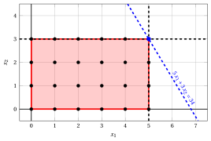{ .fig .ovale loading=lazy  }

                <em>Nodo 4: regione ammissibile di $\LP_{4}$ (in rosso), con il vincolo di branching $x_1 \le 5$ (tratteggiato), e la sua soluzione ottima (in blu).</em>

                Una soluzione ottima ${\tilde{\boldsymbol x}}(\LP_{4})$ è:

                $$
                \tilde{x}_1=5,~~\tilde{x}_2=3
                $$

                il valore ottimo è:

                $$
                z(\LP_{4}) = 34
                $$

                Il problema $\LP_{4}$ è <strong>ammissibile</strong> e abbiamo

                $$
                \left\lfloor z(\LP_{4}) \right\rfloor > \LB
                \qquad \text{poiché} \qquad
                34 > 12
                $$

                La soluzione ottima ${\tilde{\boldsymbol x}}(\LP_{4})$ è <strong>intera</strong>; di conseguenza, il lower bound $\LB$ diventa $34$ e la soluzione incumbent ${\bar{\boldsymbol x}}(\ILP)$ diventa $\bar{x}_1=5,\bar{x}_2=3$.

                Di conseguenza, il nodo di branching è <u>potato per integralità</u>.

            2. Soluzione del problema $\LP_{5}$

                Consideriamo il problema $\LP_{5}$ in forma standard:

                $$
                \begin{array}{rrrrrrrrrrrrrrr}
                {\max} & {5}\, {x_1} & {+} & {3}\, {x_2} &  &  &  &  &  &  &  &  \\[2ex]
                & {2}\, {x_1} & {+} & {x_2} & {+} & {x_3} &  &  &  &  &  &  & {=} & {14} \\[2ex]
                & {x_1} & {+} & {8}\, {x_2} &  &  & {+} & {x_4} &  &  &  &  & {=} & {32} \\[2ex]
                &  &  & {x_2} &  &  &  &  & {+} & {x_5} &  &  & {=} & {3} \\[2ex]
                & {x_1} &  &  &  &  &  &  &  &  & {-} & {x_6} & {=} & {6} \\[2ex]
                & {x_1,} &  & {x_2,} &  & {x_3,} &  & {x_4,} &  & {x_5,} &  & {x_6} & {\ge} & {0}
                \end{array}
                $$

                Per il vincolo di branching abbiamo:

                $$
                x_1 - x_6 = 6 \quad \quad \Rightarrow \quad x_6 = -6 + x_1
                $$

                Usando le equazioni del dizionario ottimo possiamo esprimere questo vincolo di branching in funzione delle variabili fuori base. Sostituendo, otteniamo

                $$
                x_6 = -6 + \left(\dfrac{11}{2} - \dfrac{1}{2} \; x_3 + \dfrac{1}{2} \; x_5 \right)
                \quad \quad \Rightarrow \quad
                x_6 = -\dfrac{1}{2} - \dfrac{1}{2} \, x_3 + \dfrac{1}{2} \, x_5
                $$

                Aggiungiamo quindi questa equazione al dizionario ottimo precedente e otteniamo il seguente dizionario:

                \begin{equation*}
                \begin{cases}
                \begin{array}{rrrrrrr}
                {x_1} & {=} & {\dfrac{11}{2}} & {-} & {\dfrac{1}{2}}\, {x_3} & {+} & {\dfrac{1}{2}}\, {x_5} \\[2ex]
                {x_2} & {=} & {3} &  &  & {-} & {x_5} \\[2ex]
                {x_4} & {=} & {\dfrac{5}{2}} & {+} & {\dfrac{1}{2}}\, {x_3} & {+} & {\dfrac{15}{2}}\, {x_5} \\[2ex]
                {x_6} & {=} & {-\dfrac{1}{2}} & {-} & {\dfrac{1}{2}}\, {x_3} & {+} & {\dfrac{1}{2}}\, {x_5} \\[2ex]
                {z} & {=} & {\dfrac{73}{2}} & {-} & {\dfrac{5}{2}}\, {x_3} & {-} & {\dfrac{1}{2}}\, {x_5}
                \end{array}
                \end{cases}
                \end{equation*}

                dove $\pazocal{B}=\{1,2,4,6\}$ e $\pazocal{N}=\{3,5\}$ e

                - la soluzione di base primale non ammissibile è:

                    $$
                    \begin{gathered}
                    \bar x_1=\dfrac{11}{2},~~
                    \bar x_2=3,~~
                    \bar x_4=\dfrac{5}{2},~~
                    \bar x_6=-\dfrac{1}{2},\\
                    \bar x_3=0,~~
                    \bar x_5=0~~
                    \mathrm{~~di~valore~~~} \dfrac{73}{2}
                    \end{gathered}
                    $$

                - la soluzione di base duale ammissibile è:

                    $$
                    \begin{gathered}
                    \bar \pi_1=0,~~
                    \bar \pi_2=0,~~
                    \bar \pi_4=0,~~
                    \bar \pi_6=0,\\
                    \bar \pi_3=\dfrac{5}{2},~~
                    \bar \pi_5=\dfrac{1}{2}~~
                    \mathrm{~~di~valore~~~} \dfrac{73}{2}
                    \end{gathered}
                    $$

                Se aumentiamo il valore di $\pi_{6}$, possiamo ottenere una soluzione duale migliore. Abbiamo:

                $$
                \begin{cases}
                \pi_3 &= \dfrac{5}{2} + \dfrac{1}{2}\,\pi_6 \\[2ex]
                \pi_5 &= \dfrac{1}{2} - \dfrac{1}{2}\,\pi_6
                \end{cases}
                \qquad
                \qquad
                \begin{cases}
                \underbrace{ \dfrac{5}{2} + \dfrac{1}{2}\,\pi_6 \ge 0}_{\pi_3 \ge 0} \\[2ex]
                \underbrace{ \dfrac{1}{2} - \dfrac{1}{2}\,\pi_6 \ge 0}_{\pi_5 \ge 0}
                \end{cases}
                \qquad
                \qquad
                \begin{cases}
                \pi_6 &\ge -5 \\[2ex]
                \pi_6 &\le 1
                \end{cases}
                $$

                Aumentando il valore di $\pi_{6}$ fino a $1$, il valore di $\pi_{5}$ scende a $0$. Abbiamo quindi che:

                - $\pi_{6}$ entra nella base duale e, di conseguenza, $x_{6}$ esce dalla base primale.

                - $\pi_{5}$ esce dalla base duale e, di conseguenza, $x_{5}$ entra nella base primale.

                Abbiamo:

                $$
                x_6 = -\dfrac{1}{2} - \dfrac{1}{2} \, x_3 + \dfrac{1}{2} \, x_5
                \quad \Rightarrow \quad
                x_5 = 1 + x_3 + 2 \, x_6
                $$

                Sostituendo nelle altre equazioni del dizionario primale, otteniamo:

                $$
                x_1
                = \dfrac{11}{2} - \dfrac{1}{2} \; x_3 + \dfrac{1}{2} \left( 1 + x_3 + 2 \, x_6 \right)
                = 6 + x_6
                $$

                $$
                x_2
                = 3 - \left( 1 + x_3 + 2 \, x_6 \right)
                = 2 - x_3 - 2 \, x_6
                $$

                $$
                x_4
                = \dfrac{5}{2} + \dfrac{1}{2} \; x_3 + \dfrac{15}{2} \left( 1 + x_3 + 2 \, x_6 \right)
                = 10 + 8 \, x_3 + 15 \, x_6
                $$

                $$
                z
                = \dfrac{73}{2} - \dfrac{5}{2} \; x_3 - \dfrac{1}{2} \left( 1 + x_3 + 2 \, x_6 \right)
                = 36 - 3 \, x_3 - x_6
                $$

                Di conseguenza, abbiamo ora il seguente dizionario primale aggiornato:

                \begin{equation*}
                \begin{cases}
                \begin{array}{rrrrrrr}
                {x_1} & {=} & {6} &  &  & {+} & {x_6} \\[2ex]
                {x_2} & {=} & {2} & {-} & {x_3} & {-} & {2}\, {x_6} \\[2ex]
                {x_4} & {=} & {10} & {+} & {8}\, {x_3} & {+} & {15}\, {x_6} \\[2ex]
                {x_5} & {=} & {1} & {+} & {x_3} & {+} & {2}\, {x_6} \\[2ex]
                {z} & {=} & {36} & {-} & {3}\, {x_3} & {-} & {x_6}
                \end{array}
                \end{cases}
                \end{equation*}

                dove $\pazocal{B}=\{1,2,4,5\}$ e $\pazocal{N}=\{3,6\}$ e

                - la soluzione di base primale ottima è:

                    $$
                    \begin{gathered}
                    \tilde x_1=6,~~
                    \tilde x_2=2,~~
                    \tilde x_4=10,~~
                    \tilde x_5=1,\\
                    \tilde x_3=0,~~
                    \tilde x_6=0~~
                    \mathrm{~~di~valore~~~} 36
                    \end{gathered}
                    $$

                - la soluzione di base duale ottima è:

                    $$
                    \begin{gathered}
                    \tilde \pi_1=0,~~
                    \tilde \pi_2=0,~~
                    \tilde \pi_4=0,~~
                    \tilde \pi_5=0,\\
                    \tilde \pi_3=3,~~
                    \tilde \pi_6=1~~
                    \mathrm{~~di~valore~~~} 36
                    \end{gathered}
                    $$

                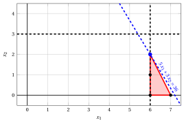{ .fig .ovale loading=lazy  }

                <em>Nodo 5: regione ammissibile di $\LP_{5}$ (in rosso), con il vincolo di branching $x_1 \ge 6$ (tratteggiato), e la sua soluzione ottima (in blu).</em>

                Una soluzione ottima ${\tilde{\boldsymbol x}}(\LP_{5})$ è:

                $$
                \tilde{x}_1=6,~~\tilde{x}_2=2
                $$

                il valore ottimo è:

                $$
                z(\LP_{5}) = 36
                $$

                Il problema $\LP_{5}$ è <strong>ammissibile</strong> e abbiamo

                $$
                \left\lfloor z(\LP_{5}) \right\rfloor > \LB
                \qquad \text{poiché} \qquad
                36 > 34
                $$

                La soluzione ottima ${\tilde{\boldsymbol x}}(\LP_{5})$ è <strong>intera</strong>; di conseguenza, il lower bound $\LB$ diventa $36$ e la soluzione incumbent ${\bar{\boldsymbol x}}(\ILP)$ diventa $\bar{x}_1=6,\bar{x}_2=2$.

                Di conseguenza, il nodo di branching è <u>potato per integralità</u>.

            Alla fine della seconda iterazione, il branching su $x_{1}$ dal Nodo 2 ha generato il nodo di branching verso il basso, Nodo 4, e il nodo di branching verso l'alto, Nodo 5. Entrambi i nodi sono potati per integralità. L'albero di branch-and-bound corrispondente è:

            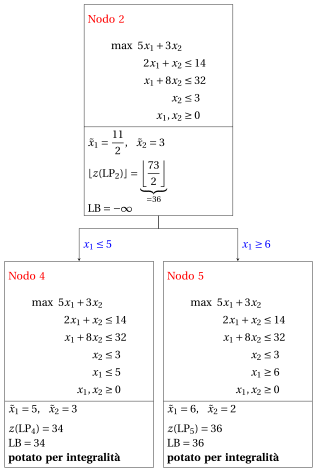{ .fig loading=lazy  }

            Con il lower bound $\LB$ e l'upper bound $\UB$ correnti, abbiamo:

            $$
            36 ~~\le~~ z(\ILP) ~~\le~~ 36
            $$

        - <strong>Terminazione</strong>

            Poiché la lista $L$ è vuota, il lower bound $\LB$ è uguale all'upper bound $\UB$ e il problema $\ILP$ è risolto all'ottimo.

            Il valore ottimo è $z(\ILP)=36$ (il valore del lower bound $\LB$) e una soluzione ottima ${\tilde{\boldsymbol x}}(\ILP)$ è $\tilde x_1=6,\tilde x_2=2$ (la soluzione incumbent ${\bar{\boldsymbol x}}(\ILP)$).

    2. L'albero di branch-and-bound finale è:

        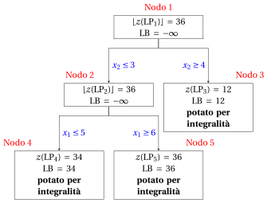{ .fig loading=lazy  }

        I motivi per cui i nodi di branching vengono potati sono i seguenti.

        - Il Nodo 1 ha una soluzione ottima frazionaria con $\lfloor z(\LP_{1})\rfloor = 36$: si effettua il branching su $x_2$.

        - Il Nodo 2 ha una soluzione ottima frazionaria con $\lfloor z(\LP_{2})\rfloor = 36$: si effettua il branching su $x_1$.

        - Il Nodo 3 è potato per integralità: $\tilde{\boldsymbol x}(\LP_{3}) = (0, 4)$ è intera, con valore $12$, e diventa la soluzione incumbent.

        - Il Nodo 4 è potato per integralità: $\tilde{\boldsymbol x}(\LP_{4}) = (5, 3)$ è intera, con valore $34$, e diventa la soluzione incumbent.

        - Il Nodo 5 è potato per integralità: $\tilde{\boldsymbol x}(\LP_{5}) = (6, 2)$ è intera, con valore $36$, e diventa la soluzione incumbent.

        Il valore ottimo è $z(\ILP) = 36$ e l'algoritmo di branch-and-bound restituisce la soluzione ottima $\tilde{\boldsymbol x}(\ILP) = (6, 2)$.

!!! esercizio "Esercizio 7.5: Algoritmo di branch-and-bound (P5)"

    !!! nota ""

        Consideriamo il seguente problema PLI in forma canonica di massimo con $n=2$ variabili intere e $m=2$ vincoli:

        $$
        \begin{array}{rrrrrrr}
        {\max} & {2}\, {x_1} & {+} & {3}\, {x_2} \\[2ex]
        & {6}\, {x_1} & {+} & {21}\, {x_2} & {\le} & {77} \\[2ex]
        & {8}\, {x_1} & {+} & {3}\, {x_2} & {\le} & {36} \\[2ex]
        & {x_1,} &  & {x_2} & {\in} & {\Z_{\ge 0}}
        \end{array}
        $$

        e un dizionario ottimo del suo rilassamento lineare in forma standard:

        \begin{equation*}
        \begin{cases}
        \begin{array}{rrrrrrr}
        {x_1} & {=} & {\dfrac{7}{2}} & {+} & {\dfrac{1}{50}}\, {x_3} & {-} & {\dfrac{7}{50}}\, {x_4} \\[2ex]
        {x_2} & {=} & {\dfrac{8}{3}} & {-} & {\dfrac{4}{75}}\, {x_3} & {+} & {\dfrac{1}{25}}\, {x_4} \\[2ex]
        {z} & {=} & {15} & {-} & {\dfrac{3}{25}}\, {x_3} & {-} & {\dfrac{4}{25}}\, {x_4}
        \end{array}
        \end{cases}
        \end{equation*}

    **Domande**

    1. Eseguire l'algoritmo di branch-and-bound utilizzando:

        1. la regola dell'indice minimo come strategia di selezione della variabile di branching;

        2. la regola LIFO come strategia di selezione del nodo di branching;

        3. risolvere prima il nodo di branching verso il basso e poi il nodo di branching verso l'alto;

        4. porre il lower bound $\LB$ a $-\infty$ (non viene eseguito alcun algoritmo euristico).

        Risolvere i problemi LP dei nodi di branching con l'algoritmo del simplesso duale. Nell'algoritmo del simplesso duale, la variabile uscente è la variabile in base con valore negativo e indice minimo, e i pareggi nel test dei rapporti si risolvono con l'indice minimo. Mostrare graficamente la soluzione ottima dei problemi LP associati ai nodi di branching.

    2. Determinare e commentare l'albero di branch-and-bound, mostrando il motivo per cui ciascun nodo di branching viene potato.

??? soluzione "Soluzione"

    1. Esecuzione dell'algoritmo di branch-and-bound per risolvere il problema $\ILP$.

        - <strong>Inizializzazione</strong>

            Consideriamo il problema $\LP_{1}$ in forma standard:

            $$
            \begin{array}{rrrrrrrrrrr}
            {\max} & {2}\, {x_1} & {+} & {3}\, {x_2} &  &  &  &  \\[2ex]
            & {6}\, {x_1} & {+} & {21}\, {x_2} & {+} & {x_3} &  &  & {=} & {77} \\[2ex]
            & {8}\, {x_1} & {+} & {3}\, {x_2} &  &  & {+} & {x_4} & {=} & {36} \\[2ex]
            & {x_1,} &  & {x_2,} &  & {x_3,} &  & {x_4} & {\ge} & {0}
            \end{array}
            $$

            e il suo dizionario ottimo:

            \begin{equation*}
            \begin{cases}
            \begin{array}{rrrrrrr}
            {x_1} & {=} & {\dfrac{7}{2}} & {+} & {\dfrac{1}{50}}\, {x_3} & {-} & {\dfrac{7}{50}}\, {x_4} \\[2ex]
            {x_2} & {=} & {\dfrac{8}{3}} & {-} & {\dfrac{4}{75}}\, {x_3} & {+} & {\dfrac{1}{25}}\, {x_4} \\[2ex]
            {z} & {=} & {15} & {-} & {\dfrac{3}{25}}\, {x_3} & {-} & {\dfrac{4}{25}}\, {x_4}
            \end{array}
            \end{cases}
            \end{equation*}

            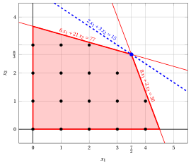{ .fig .ovale loading=lazy  }

            <em>Nodo 1: regione ammissibile di $\LP_{1}$ (in rosso), punti ammissibili del problema PLI (in nero) e soluzione ottima di $\LP_{1}$ (in blu) con la retta della funzione obiettivo che vi passa.</em>

            Una soluzione ottima ${\tilde{\boldsymbol x}}(\LP_{1})$ è:

            $$
            \tilde{x}_1=\dfrac{7}{2},~~\tilde{x}_2=\dfrac{8}{3}
            $$

            il valore ottimo è:

            $$
            z(\LP_{1}) = 15
            $$

            La soluzione ottima ${\tilde{\boldsymbol x}}(\LP_{1})$ è <strong>frazionaria</strong> e il problema $\LP_{1}$ è <strong>ammissibile</strong>, quindi il problema $\LP_{1}$ viene inserito nella lista dei problemi $L$ e il lower bound $\LB$ viene posto a $-\infty$.

            Con il lower bound $\LB$ e l'upper bound $\UB$ correnti, abbiamo:

            $$
            -\infty ~~\le~~ z(\ILP) ~~\le~~ 15
            $$

        - <strong>Iterazione 1</strong>

            Il problema $\LP_{1}$ viene estratto e cancellato dalla lista dei problemi $L$.

            La variabile di branching è $x_{1}$. I vincoli di branching sono:

            $$
            x_1 \le \underbrace{\left\lfloor \dfrac{7}{2} \right\rfloor}_{ = 3} \mathrm{~~~e~~~} x_1 \ge \underbrace{\left\lfloor \dfrac{7}{2} \right\rfloor +1}_{= 4}
            $$

            Con questi vincoli di branching si creano i due problemi $\LP_{2}$ e $\LP_{3}$.

            1. Soluzione del problema $\LP_{2}$

                Consideriamo il problema $\LP_{2}$ in forma standard:

                $$
                \begin{array}{rrrrrrrrrrrrr}
                {\max} & {2}\, {x_1} & {+} & {3}\, {x_2} &  &  &  &  &  &  \\[2ex]
                & {6}\, {x_1} & {+} & {21}\, {x_2} & {+} & {x_3} &  &  &  &  & {=} & {77} \\[2ex]
                & {8}\, {x_1} & {+} & {3}\, {x_2} &  &  & {+} & {x_4} &  &  & {=} & {36} \\[2ex]
                & {x_1} &  &  &  &  &  &  & {+} & {x_5} & {=} & {3} \\[2ex]
                & {x_1,} &  & {x_2,} &  & {x_3,} &  & {x_4,} &  & {x_5} & {\ge} & {0}
                \end{array}
                $$

                Per il vincolo di branching abbiamo:

                $$
                x_1 + x_5 = 3 \quad \quad \Rightarrow \quad x_5 = 3 - x_1
                $$

                Usando le equazioni del dizionario ottimo possiamo esprimere questo vincolo di branching in funzione delle variabili fuori base. Sostituendo, otteniamo

                $$
                x_5 = 3 - \left(\dfrac{7}{2} + \dfrac{1}{50} \; x_3 - \dfrac{7}{50} \; x_4 \right)
                \quad \quad \Rightarrow \quad
                x_5 = -\dfrac{1}{2} - \dfrac{1}{50} \, x_3 + \dfrac{7}{50} \, x_4
                $$

                Aggiungiamo quindi questa equazione al dizionario ottimo precedente e otteniamo il seguente dizionario:

                \begin{equation*}
                \begin{cases}
                \begin{array}{rrrrrrr}
                {x_1} & {=} & {\dfrac{7}{2}} & {+} & {\dfrac{1}{50}}\, {x_3} & {-} & {\dfrac{7}{50}}\, {x_4} \\[2ex]
                {x_2} & {=} & {\dfrac{8}{3}} & {-} & {\dfrac{4}{75}}\, {x_3} & {+} & {\dfrac{1}{25}}\, {x_4} \\[2ex]
                {x_5} & {=} & {-\dfrac{1}{2}} & {-} & {\dfrac{1}{50}}\, {x_3} & {+} & {\dfrac{7}{50}}\, {x_4} \\[2ex]
                {z} & {=} & {15} & {-} & {\dfrac{3}{25}}\, {x_3} & {-} & {\dfrac{4}{25}}\, {x_4}
                \end{array}
                \end{cases}
                \end{equation*}

                dove $\pazocal{B}=\{1,2,5\}$ e $\pazocal{N}=\{3,4\}$ e

                - la soluzione di base primale non ammissibile è:

                    $$
                    \bar x_1=\dfrac{7}{2},~~
                    \bar x_2=\dfrac{8}{3},~~
                    \bar x_5=-\dfrac{1}{2},~~~~~~
                    \bar x_3=0,~~
                    \bar x_4=0~~
                    \mathrm{~~di~valore~~~} 15
                    $$

                - la soluzione di base duale ammissibile è:

                    $$
                    \bar \pi_1=0,~~
                    \bar \pi_2=0,~~
                    \bar \pi_5=0,~~~~~~
                    \bar \pi_3=\dfrac{3}{25},~~
                    \bar \pi_4=\dfrac{4}{25}~~
                    \mathrm{~~di~valore~~~} 15
                    $$

                Se aumentiamo il valore di $\pi_{5}$, possiamo ottenere una soluzione duale migliore. Abbiamo:

                $$
                \begin{cases}
                \pi_3 &= \dfrac{3}{25} + \dfrac{1}{50}\,\pi_5 \\[2ex]
                \pi_4 &= \dfrac{4}{25} - \dfrac{7}{50}\,\pi_5
                \end{cases}
                \qquad
                \qquad
                \begin{cases}
                \underbrace{ \dfrac{3}{25} + \dfrac{1}{50}\,\pi_5 \ge 0}_{\pi_3 \ge 0} \\[2ex]
                \underbrace{ \dfrac{4}{25} - \dfrac{7}{50}\,\pi_5 \ge 0}_{\pi_4 \ge 0}
                \end{cases}
                \qquad
                \qquad
                \begin{cases}
                \pi_5 &\ge -6 \\[2ex]
                \pi_5 &\le \dfrac{8}{7}
                \end{cases}
                $$

                Aumentando il valore di $\pi_{5}$ fino a $\dfrac{8}{7}$, il valore di $\pi_{4}$ scende a $0$. Abbiamo quindi che:

                - $\pi_{5}$ entra nella base duale e, di conseguenza, $x_{5}$ esce dalla base primale.

                - $\pi_{4}$ esce dalla base duale e, di conseguenza, $x_{4}$ entra nella base primale.

                Abbiamo:

                $$
                x_5 = -\dfrac{1}{2} - \dfrac{1}{50} \, x_3 + \dfrac{7}{50} \, x_4
                \quad \Rightarrow \quad
                x_4 = \dfrac{25}{7} + \dfrac{1}{7} \, x_3 + \dfrac{50}{7} \, x_5
                $$

                Sostituendo nelle altre equazioni del dizionario primale, otteniamo:

                $$
                x_1
                = \dfrac{7}{2} + \dfrac{1}{50} \; x_3 - \dfrac{7}{50} \left( \dfrac{25}{7} + \dfrac{1}{7} \, x_3 + \dfrac{50}{7} \, x_5 \right)
                = 3 - x_5
                $$

                $$
                x_2
                = \dfrac{8}{3} - \dfrac{4}{75} \; x_3 + \dfrac{1}{25} \left( \dfrac{25}{7} + \dfrac{1}{7} \, x_3 + \dfrac{50}{7} \, x_5 \right)
                = \dfrac{59}{21} - \dfrac{1}{21} \, x_3 + \dfrac{2}{7} \, x_5
                $$

                $$
                z
                = 15 - \dfrac{3}{25} \; x_3 - \dfrac{4}{25} \left( \dfrac{25}{7} + \dfrac{1}{7} \, x_3 + \dfrac{50}{7} \, x_5 \right)
                = \dfrac{101}{7} - \dfrac{1}{7} \, x_3 - \dfrac{8}{7} \, x_5
                $$

                Di conseguenza, abbiamo ora il seguente dizionario primale aggiornato:

                \begin{equation*}
                \begin{cases}
                \begin{array}{rrrrrrr}
                {x_1} & {=} & {3} &  &  & {-} & {x_5} \\[2ex]
                {x_2} & {=} & {\dfrac{59}{21}} & {-} & {\dfrac{1}{21}}\, {x_3} & {+} & {\dfrac{2}{7}}\, {x_5} \\[2ex]
                {x_4} & {=} & {\dfrac{25}{7}} & {+} & {\dfrac{1}{7}}\, {x_3} & {+} & {\dfrac{50}{7}}\, {x_5} \\[2ex]
                {z} & {=} & {\dfrac{101}{7}} & {-} & {\dfrac{1}{7}}\, {x_3} & {-} & {\dfrac{8}{7}}\, {x_5}
                \end{array}
                \end{cases}
                \end{equation*}

                dove $\pazocal{B}=\{1,2,4\}$ e $\pazocal{N}=\{3,5\}$ e

                - la soluzione di base primale ottima è:

                    $$
                    \tilde x_1=3,~~
                    \tilde x_2=\dfrac{59}{21},~~
                    \tilde x_4=\dfrac{25}{7},~~~~~~
                    \tilde x_3=0,~~
                    \tilde x_5=0~~
                    \mathrm{~~di~valore~~~} \dfrac{101}{7}
                    $$

                - la soluzione di base duale ottima è:

                    $$
                    \tilde \pi_1=0,~~
                    \tilde \pi_2=0,~~
                    \tilde \pi_4=0,~~~~~~
                    \tilde \pi_3=\dfrac{1}{7},~~
                    \tilde \pi_5=\dfrac{8}{7}~~
                    \mathrm{~~di~valore~~~} \dfrac{101}{7}
                    $$

                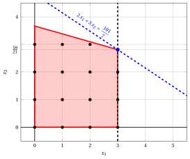{ .fig .ovale loading=lazy  }

                <em>Nodo 2: regione ammissibile di $\LP_{2}$ (in rosso), con il vincolo di branching $x_1 \le 3$ (tratteggiato), e la sua soluzione ottima (in blu).</em>

                Una soluzione ottima ${\tilde{\boldsymbol x}}(\LP_{2})$ è:

                $$
                \tilde{x}_1=3,~~\tilde{x}_2=\dfrac{59}{21}
                $$

                il valore ottimo è:

                $$
                z(\LP_{2}) = \dfrac{101}{7}
                $$

                Il problema $\LP_{2}$ è <strong>ammissibile</strong> e abbiamo

                $$
                \left\lfloor z(\LP_{2}) \right\rfloor > \LB
                \qquad \text{poiché} \qquad
                \underbrace{\left\lfloor \dfrac{101}{7} \right\rfloor}_{=14} > -\infty
                $$

                La soluzione ottima ${\tilde{\boldsymbol x}}(\LP_{2})$ è <strong>frazionaria</strong>; di conseguenza, il problema $\LP_{2}$ viene <strong>inserito nella lista dei problemi</strong> $L$.

            2. Soluzione del problema $\LP_{3}$

                Consideriamo il problema $\LP_{3}$ in forma standard:

                $$
                \begin{array}{rrrrrrrrrrrrr}
                {\max} & {2}\, {x_1} & {+} & {3}\, {x_2} &  &  &  &  &  &  \\[2ex]
                & {6}\, {x_1} & {+} & {21}\, {x_2} & {+} & {x_3} &  &  &  &  & {=} & {77} \\[2ex]
                & {8}\, {x_1} & {+} & {3}\, {x_2} &  &  & {+} & {x_4} &  &  & {=} & {36} \\[2ex]
                & {x_1} &  &  &  &  &  &  & {-} & {x_5} & {=} & {4} \\[2ex]
                & {x_1,} &  & {x_2,} &  & {x_3,} &  & {x_4,} &  & {x_5} & {\ge} & {0}
                \end{array}
                $$

                Per il vincolo di branching abbiamo:

                $$
                x_1 - x_5 = 4 \quad \quad \Rightarrow \quad x_5 = -4 + x_1
                $$

                Usando le equazioni del dizionario ottimo possiamo esprimere questo vincolo di branching in funzione delle variabili fuori base. Sostituendo, otteniamo

                $$
                x_5 = -4 + \left(\dfrac{7}{2} + \dfrac{1}{50} \; x_3 - \dfrac{7}{50} \; x_4 \right)
                \quad \quad \Rightarrow \quad
                x_5 = -\dfrac{1}{2} + \dfrac{1}{50} \, x_3 - \dfrac{7}{50} \, x_4
                $$

                Aggiungiamo quindi questa equazione al dizionario ottimo precedente e otteniamo il seguente dizionario:

                \begin{equation*}
                \begin{cases}
                \begin{array}{rrrrrrr}
                {x_1} & {=} & {\dfrac{7}{2}} & {+} & {\dfrac{1}{50}}\, {x_3} & {-} & {\dfrac{7}{50}}\, {x_4} \\[2ex]
                {x_2} & {=} & {\dfrac{8}{3}} & {-} & {\dfrac{4}{75}}\, {x_3} & {+} & {\dfrac{1}{25}}\, {x_4} \\[2ex]
                {x_5} & {=} & {-\dfrac{1}{2}} & {+} & {\dfrac{1}{50}}\, {x_3} & {-} & {\dfrac{7}{50}}\, {x_4} \\[2ex]
                {z} & {=} & {15} & {-} & {\dfrac{3}{25}}\, {x_3} & {-} & {\dfrac{4}{25}}\, {x_4}
                \end{array}
                \end{cases}
                \end{equation*}

                dove $\pazocal{B}=\{1,2,5\}$ e $\pazocal{N}=\{3,4\}$ e

                - la soluzione di base primale non ammissibile è:

                    $$
                    \bar x_1=\dfrac{7}{2},~~
                    \bar x_2=\dfrac{8}{3},~~
                    \bar x_5=-\dfrac{1}{2},~~~~~~
                    \bar x_3=0,~~
                    \bar x_4=0~~
                    \mathrm{~~di~valore~~~} 15
                    $$

                - la soluzione di base duale ammissibile è:

                    $$
                    \bar \pi_1=0,~~
                    \bar \pi_2=0,~~
                    \bar \pi_5=0,~~~~~~
                    \bar \pi_3=\dfrac{3}{25},~~
                    \bar \pi_4=\dfrac{4}{25}~~
                    \mathrm{~~di~valore~~~} 15
                    $$

                Se aumentiamo il valore di $\pi_{5}$, possiamo ottenere una soluzione duale migliore. Abbiamo:

                $$
                \begin{cases}
                \pi_3 &= \dfrac{3}{25} - \dfrac{1}{50}\,\pi_5 \\[2ex]
                \pi_4 &= \dfrac{4}{25} + \dfrac{7}{50}\,\pi_5
                \end{cases}
                \qquad
                \qquad
                \begin{cases}
                \underbrace{ \dfrac{3}{25} - \dfrac{1}{50}\,\pi_5 \ge 0}_{\pi_3 \ge 0} \\[2ex]
                \underbrace{ \dfrac{4}{25} + \dfrac{7}{50}\,\pi_5 \ge 0}_{\pi_4 \ge 0}
                \end{cases}
                \qquad
                \qquad
                \begin{cases}
                \pi_5 &\le 6 \\[2ex]
                \pi_5 &\ge -\dfrac{8}{7}
                \end{cases}
                $$

                Aumentando il valore di $\pi_{5}$ fino a $6$, il valore di $\pi_{3}$ scende a $0$. Abbiamo quindi che:

                - $\pi_{5}$ entra nella base duale e, di conseguenza, $x_{5}$ esce dalla base primale.

                - $\pi_{3}$ esce dalla base duale e, di conseguenza, $x_{3}$ entra nella base primale.

                Abbiamo:

                $$
                x_5 = -\dfrac{1}{2} + \dfrac{1}{50} \, x_3 - \dfrac{7}{50} \, x_4
                \quad \Rightarrow \quad
                x_3 = 25 + 7 \, x_4 + 50 \, x_5
                $$

                Sostituendo nelle altre equazioni del dizionario primale, otteniamo:

                $$
                x_1
                = \dfrac{7}{2} + \dfrac{1}{50} \left( 25 + 7 \, x_4 + 50 \, x_5 \right) - \dfrac{7}{50} \; x_4
                = 4 + x_5
                $$

                $$
                x_2
                = \dfrac{8}{3} - \dfrac{4}{75} \left( 25 + 7 \, x_4 + 50 \, x_5 \right) + \dfrac{1}{25} \; x_4
                = \dfrac{4}{3} - \dfrac{1}{3} \, x_4 - \dfrac{8}{3} \, x_5
                $$

                $$
                z
                = 15 - \dfrac{3}{25} \left( 25 + 7 \, x_4 + 50 \, x_5 \right) - \dfrac{4}{25} \; x_4
                = 12 - x_4 - 6 \, x_5
                $$

                Di conseguenza, abbiamo ora il seguente dizionario primale aggiornato:

                \begin{equation*}
                \begin{cases}
                \begin{array}{rrrrrrr}
                {x_1} & {=} & {4} &  &  & {+} & {x_5} \\[2ex]
                {x_2} & {=} & {\dfrac{4}{3}} & {-} & {\dfrac{1}{3}}\, {x_4} & {-} & {\dfrac{8}{3}}\, {x_5} \\[2ex]
                {x_3} & {=} & {25} & {+} & {7}\, {x_4} & {+} & {50}\, {x_5} \\[2ex]
                {z} & {=} & {12} & {-} & {x_4} & {-} & {6}\, {x_5}
                \end{array}
                \end{cases}
                \end{equation*}

                dove $\pazocal{B}=\{1,2,3\}$ e $\pazocal{N}=\{4,5\}$ e

                - la soluzione di base primale ottima è:

                    $$
                    \tilde x_1=4,~~
                    \tilde x_2=\dfrac{4}{3},~~
                    \tilde x_3=25,~~~~~~
                    \tilde x_4=0,~~
                    \tilde x_5=0~~
                    \mathrm{~~di~valore~~~} 12
                    $$

                - la soluzione di base duale ottima è:

                    $$
                    \tilde \pi_1=0,~~
                    \tilde \pi_2=0,~~
                    \tilde \pi_3=0,~~~~~~
                    \tilde \pi_4=1,~~
                    \tilde \pi_5=6~~
                    \mathrm{~~di~valore~~~} 12
                    $$

                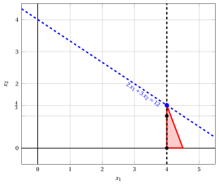{ .fig .ovale loading=lazy  }

                <em>Nodo 3: regione ammissibile di $\LP_{3}$ (in rosso), con il vincolo di branching $x_1 \ge 4$ (tratteggiato), e la sua soluzione ottima (in blu).</em>

                Una soluzione ottima ${\tilde{\boldsymbol x}}(\LP_{3})$ è:

                $$
                \tilde{x}_1=4,~~\tilde{x}_2=\dfrac{4}{3}
                $$

                il valore ottimo è:

                $$
                z(\LP_{3}) = 12
                $$

                Il problema $\LP_{3}$ è <strong>ammissibile</strong> e abbiamo

                $$
                \left\lfloor z(\LP_{3}) \right\rfloor > \LB
                \qquad \text{poiché} \qquad
                12 > -\infty
                $$

                La soluzione ottima ${\tilde{\boldsymbol x}}(\LP_{3})$ è <strong>frazionaria</strong>; di conseguenza, il problema $\LP_{3}$ viene <strong>inserito nella lista dei problemi</strong> $L$.

            Alla fine della prima iterazione, il branching su $x_{1}$ dal Nodo 1 ha generato il nodo di branching verso il basso, Nodo 2, e il nodo di branching verso l'alto, Nodo 3. Entrambi i nodi sono inseriti nella lista $L$. L'albero di branch-and-bound corrispondente è:

            { .fig loading=lazy  }

            Con il lower bound $\LB$ e l'upper bound $\UB$ correnti, abbiamo:

            $$
            -\infty ~~\le~~ z(\ILP) ~~\le~~ \underbrace{\left\lfloor \dfrac{101}{7} \right\rfloor}_{=14}
            $$

        - <strong>Iterazione 2</strong>

            Il problema $\LP_{3}$ viene estratto e cancellato dalla lista dei problemi $L$.

            La variabile di branching è $x_{2}$. I vincoli di branching sono:

            $$
            x_2 \le \underbrace{\left\lfloor \dfrac{4}{3} \right\rfloor}_{ = 1} \mathrm{~~~e~~~} x_2 \ge \underbrace{\left\lfloor \dfrac{4}{3} \right\rfloor +1}_{= 2}
            $$

            Con questi vincoli di branching si creano i due problemi $\LP_{4}$ e $\LP_{5}$.

            1. Soluzione del problema $\LP_{4}$

                Consideriamo il problema $\LP_{4}$ in forma standard:

                $$
                \begin{array}{rrrrrrrrrrrrrrr}
                {\max} & {2}\, {x_1} & {+} & {3}\, {x_2} &  &  &  &  &  &  &  &  \\[2ex]
                & {6}\, {x_1} & {+} & {21}\, {x_2} & {+} & {x_3} &  &  &  &  &  &  & {=} & {77} \\[2ex]
                & {8}\, {x_1} & {+} & {3}\, {x_2} &  &  & {+} & {x_4} &  &  &  &  & {=} & {36} \\[2ex]
                & {x_1} &  &  &  &  &  &  & {-} & {x_5} &  &  & {=} & {4} \\[2ex]
                &  &  & {x_2} &  &  &  &  &  &  & {+} & {x_6} & {=} & {1} \\[2ex]
                & {x_1,} &  & {x_2,} &  & {x_3,} &  & {x_4,} &  & {x_5,} &  & {x_6} & {\ge} & {0}
                \end{array}
                $$

                Per il vincolo di branching abbiamo:

                $$
                x_2 + x_6 = 1 \quad \quad \Rightarrow \quad x_6 = 1 - x_2
                $$

                Usando le equazioni del dizionario ottimo possiamo esprimere questo vincolo di branching in funzione delle variabili fuori base. Sostituendo, otteniamo

                $$
                x_6 = 1 - \left(\dfrac{4}{3} - \dfrac{1}{3} \; x_4 - \dfrac{8}{3} \; x_5 \right)
                \quad \quad \Rightarrow \quad
                x_6 = -\dfrac{1}{3} + \dfrac{1}{3} \, x_4 + \dfrac{8}{3} \, x_5
                $$

                Aggiungiamo quindi questa equazione al dizionario ottimo precedente e otteniamo il seguente dizionario:

                \begin{equation*}
                \begin{cases}
                \begin{array}{rrrrrrr}
                {x_1} & {=} & {4} &  &  & {+} & {x_5} \\[2ex]
                {x_2} & {=} & {\dfrac{4}{3}} & {-} & {\dfrac{1}{3}}\, {x_4} & {-} & {\dfrac{8}{3}}\, {x_5} \\[2ex]
                {x_3} & {=} & {25} & {+} & {7}\, {x_4} & {+} & {50}\, {x_5} \\[2ex]
                {x_6} & {=} & {-\dfrac{1}{3}} & {+} & {\dfrac{1}{3}}\, {x_4} & {+} & {\dfrac{8}{3}}\, {x_5} \\[2ex]
                {z} & {=} & {12} & {-} & {x_4} & {-} & {6}\, {x_5}
                \end{array}
                \end{cases}
                \end{equation*}

                dove $\pazocal{B}=\{1,2,3,6\}$ e $\pazocal{N}=\{4,5\}$ e

                - la soluzione di base primale non ammissibile è:

                    $$
                    \begin{gathered}
                    \bar x_1=4,~~
                    \bar x_2=\dfrac{4}{3},~~
                    \bar x_3=25,~~
                    \bar x_6=-\dfrac{1}{3},\\
                    \bar x_4=0,~~
                    \bar x_5=0~~
                    \mathrm{~~di~valore~~~} 12
                    \end{gathered}
                    $$

                - la soluzione di base duale ammissibile è:

                    $$
                    \begin{gathered}
                    \bar \pi_1=0,~~
                    \bar \pi_2=0,~~
                    \bar \pi_3=0,~~
                    \bar \pi_6=0,\\
                    \bar \pi_4=1,~~
                    \bar \pi_5=6~~
                    \mathrm{~~di~valore~~~} 12
                    \end{gathered}
                    $$

                Se aumentiamo il valore di $\pi_{6}$, possiamo ottenere una soluzione duale migliore. Abbiamo:

                $$
                \begin{cases}
                \pi_4 &= 1 - \dfrac{1}{3}\,\pi_6 \\[2ex]
                \pi_5 &= 6 - \dfrac{8}{3}\,\pi_6
                \end{cases}
                \qquad
                \qquad
                \begin{cases}
                \underbrace{ 1 - \dfrac{1}{3}\,\pi_6 \ge 0}_{\pi_4 \ge 0} \\[2ex]
                \underbrace{ 6 - \dfrac{8}{3}\,\pi_6 \ge 0}_{\pi_5 \ge 0}
                \end{cases}
                \qquad
                \qquad
                \begin{cases}
                \pi_6 &\le 3 \\[2ex]
                \pi_6 &\le \dfrac{9}{4}
                \end{cases}
                $$

                Aumentando il valore di $\pi_{6}$ fino a $\min \left\{3, \dfrac{9}{4}\right\}=\dfrac{9}{4}$, il valore di $\pi_{5}$ scende a $0$. Abbiamo quindi che:

                - $\pi_{6}$ entra nella base duale e, di conseguenza, $x_{6}$ esce dalla base primale.

                - $\pi_{5}$ esce dalla base duale e, di conseguenza, $x_{5}$ entra nella base primale.

                Abbiamo:

                $$
                x_6 = -\dfrac{1}{3} + \dfrac{1}{3} \, x_4 + \dfrac{8}{3} \, x_5
                \quad \Rightarrow \quad
                x_5 = \dfrac{1}{8} - \dfrac{1}{8} \, x_4 + \dfrac{3}{8} \, x_6
                $$

                Sostituendo nelle altre equazioni del dizionario primale, otteniamo:

                $$
                x_1
                = 4 + \left( \dfrac{1}{8} - \dfrac{1}{8} \, x_4 + \dfrac{3}{8} \, x_6 \right)
                = \dfrac{33}{8} - \dfrac{1}{8} \, x_4 + \dfrac{3}{8} \, x_6
                $$

                $$
                x_2
                = \dfrac{4}{3} - \dfrac{1}{3} \; x_4 - \dfrac{8}{3} \left( \dfrac{1}{8} - \dfrac{1}{8} \, x_4 + \dfrac{3}{8} \, x_6 \right)
                = 1 - x_6
                $$

                $$
                x_3
                = 25 + 7 \; x_4 + 50 \left( \dfrac{1}{8} - \dfrac{1}{8} \, x_4 + \dfrac{3}{8} \, x_6 \right)
                = \dfrac{125}{4} + \dfrac{3}{4} \, x_4 + \dfrac{75}{4} \, x_6
                $$

                $$
                z
                = 12 - x_4 - 6 \left( \dfrac{1}{8} - \dfrac{1}{8} \, x_4 + \dfrac{3}{8} \, x_6 \right)
                = \dfrac{45}{4} - \dfrac{1}{4} \, x_4 - \dfrac{9}{4} \, x_6
                $$

                Di conseguenza, abbiamo ora il seguente dizionario primale aggiornato:

                \begin{equation*}
                \begin{cases}
                \begin{array}{rrrrrrr}
                {x_1} & {=} & {\dfrac{33}{8}} & {-} & {\dfrac{1}{8}}\, {x_4} & {+} & {\dfrac{3}{8}}\, {x_6} \\[2ex]
                {x_2} & {=} & {1} &  &  & {-} & {x_6} \\[2ex]
                {x_3} & {=} & {\dfrac{125}{4}} & {+} & {\dfrac{3}{4}}\, {x_4} & {+} & {\dfrac{75}{4}}\, {x_6} \\[2ex]
                {x_5} & {=} & {\dfrac{1}{8}} & {-} & {\dfrac{1}{8}}\, {x_4} & {+} & {\dfrac{3}{8}}\, {x_6} \\[2ex]
                {z} & {=} & {\dfrac{45}{4}} & {-} & {\dfrac{1}{4}}\, {x_4} & {-} & {\dfrac{9}{4}}\, {x_6}
                \end{array}
                \end{cases}
                \end{equation*}

                dove $\pazocal{B}=\{1,2,3,5\}$ e $\pazocal{N}=\{4,6\}$ e

                - la soluzione di base primale ottima è:

                    $$
                    \begin{gathered}
                    \tilde x_1=\dfrac{33}{8},~~
                    \tilde x_2=1,~~
                    \tilde x_3=\dfrac{125}{4},~~
                    \tilde x_5=\dfrac{1}{8},\\
                    \tilde x_4=0,~~
                    \tilde x_6=0~~
                    \mathrm{~~di~valore~~~} \dfrac{45}{4}
                    \end{gathered}
                    $$

                - la soluzione di base duale ottima è:

                    $$
                    \begin{gathered}
                    \tilde \pi_1=0,~~
                    \tilde \pi_2=0,~~
                    \tilde \pi_3=0,~~
                    \tilde \pi_5=0,\\
                    \tilde \pi_4=\dfrac{1}{4},~~
                    \tilde \pi_6=\dfrac{9}{4}~~
                    \mathrm{~~di~valore~~~} \dfrac{45}{4}
                    \end{gathered}
                    $$

                { .fig .ovale loading=lazy  }

                <em>Nodo 4: regione ammissibile di $\LP_{4}$ (in rosso), con il vincolo di branching $x_2 \le 1$ (tratteggiato), e la sua soluzione ottima (in blu).</em>

                Una soluzione ottima ${\tilde{\boldsymbol x}}(\LP_{4})$ è:

                $$
                \tilde{x}_1=\dfrac{33}{8},~~\tilde{x}_2=1
                $$

                il valore ottimo è:

                $$
                z(\LP_{4}) = \dfrac{45}{4}
                $$

                Il problema $\LP_{4}$ è <strong>ammissibile</strong> e abbiamo

                $$
                \left\lfloor z(\LP_{4}) \right\rfloor > \LB
                \qquad \text{poiché} \qquad
                \underbrace{\left\lfloor \dfrac{45}{4} \right\rfloor}_{=11} > -\infty
                $$

                La soluzione ottima ${\tilde{\boldsymbol x}}(\LP_{4})$ è <strong>frazionaria</strong>; di conseguenza, il problema $\LP_{4}$ viene <strong>inserito nella lista dei problemi</strong> $L$.

            2. Soluzione del problema $\LP_{5}$

                Consideriamo il problema $\LP_{5}$ in forma standard:

                $$
                \begin{array}{rrrrrrrrrrrrrrr}
                {\max} & {2}\, {x_1} & {+} & {3}\, {x_2} &  &  &  &  &  &  &  &  \\[2ex]
                & {6}\, {x_1} & {+} & {21}\, {x_2} & {+} & {x_3} &  &  &  &  &  &  & {=} & {77} \\[2ex]
                & {8}\, {x_1} & {+} & {3}\, {x_2} &  &  & {+} & {x_4} &  &  &  &  & {=} & {36} \\[2ex]
                & {x_1} &  &  &  &  &  &  & {-} & {x_5} &  &  & {=} & {4} \\[2ex]
                &  &  & {x_2} &  &  &  &  &  &  & {-} & {x_6} & {=} & {2} \\[2ex]
                & {x_1,} &  & {x_2,} &  & {x_3,} &  & {x_4,} &  & {x_5,} &  & {x_6} & {\ge} & {0}
                \end{array}
                $$

                Per il vincolo di branching abbiamo:

                $$
                x_2 - x_6 = 2 \quad \quad \Rightarrow \quad x_6 = -2 + x_2
                $$

                Usando le equazioni del dizionario ottimo possiamo esprimere questo vincolo di branching in funzione delle variabili fuori base. Sostituendo, otteniamo

                $$
                x_6 = -2 + \left(\dfrac{4}{3} - \dfrac{1}{3} \; x_4 - \dfrac{8}{3} \; x_5 \right)
                \quad \quad \Rightarrow \quad
                x_6 = -\dfrac{2}{3} - \dfrac{1}{3} \, x_4 - \dfrac{8}{3} \, x_5
                $$

                Aggiungiamo quindi questa equazione al dizionario ottimo precedente e otteniamo il seguente dizionario:

                \begin{equation*}
                \begin{cases}
                \begin{array}{rrrrrrr}
                {x_1} & {=} & {4} &  &  & {+} & {x_5} \\[2ex]
                {x_2} & {=} & {\dfrac{4}{3}} & {-} & {\dfrac{1}{3}}\, {x_4} & {-} & {\dfrac{8}{3}}\, {x_5} \\[2ex]
                {x_3} & {=} & {25} & {+} & {7}\, {x_4} & {+} & {50}\, {x_5} \\[2ex]
                {x_6} & {=} & {-\dfrac{2}{3}} & {-} & {\dfrac{1}{3}}\, {x_4} & {-} & {\dfrac{8}{3}}\, {x_5} \\[2ex]
                {z} & {=} & {12} & {-} & {x_4} & {-} & {6}\, {x_5}
                \end{array}
                \end{cases}
                \end{equation*}

                dove $\pazocal{B}=\{1,2,3,6\}$ e $\pazocal{N}=\{4,5\}$ e

                - la soluzione di base primale non ammissibile è:

                    $$
                    \begin{gathered}
                    \bar x_1=4,~~
                    \bar x_2=\dfrac{4}{3},~~
                    \bar x_3=25,~~
                    \bar x_6=-\dfrac{2}{3},\\
                    \bar x_4=0,~~
                    \bar x_5=0~~
                    \mathrm{~~di~valore~~~} 12
                    \end{gathered}
                    $$

                - la soluzione di base duale ammissibile è:

                    $$
                    \begin{gathered}
                    \bar \pi_1=0,~~
                    \bar \pi_2=0,~~
                    \bar \pi_3=0,~~
                    \bar \pi_6=0,\\
                    \bar \pi_4=1,~~
                    \bar \pi_5=6~~
                    \mathrm{~~di~valore~~~} 12
                    \end{gathered}
                    $$

                Se aumentiamo il valore di $\pi_{6}$, possiamo ottenere una soluzione duale migliore. Abbiamo:

                $$
                \begin{cases}
                \pi_4 &= 1 + \dfrac{1}{3}\,\pi_6 \\[2ex]
                \pi_5 &= 6 + \dfrac{8}{3}\,\pi_6
                \end{cases}
                \qquad
                \qquad
                \begin{cases}
                \underbrace{ 1 + \dfrac{1}{3}\,\pi_6 \ge 0}_{\pi_4 \ge 0} \\[2ex]
                \underbrace{ 6 + \dfrac{8}{3}\,\pi_6 \ge 0}_{\pi_5 \ge 0}
                \end{cases}
                \qquad
                \qquad
                \begin{cases}
                \pi_6 &\ge -3 \\[2ex]
                \pi_6 &\ge -\dfrac{9}{4}
                \end{cases}
                $$

                Di conseguenza, possiamo aumentare il valore di $\pi_{6}$ senza violare l'ammissibilità duale: il problema duale è <strong>illimitato</strong>. Ne segue che il problema primale $\LP_{5}$ è <strong>inammissibile</strong> e il nodo di branching corrispondente è <u>potato per inammissibilità</u>.

            Alla fine della seconda iterazione, il branching su $x_{2}$ dal Nodo 3 ha generato il nodo di branching verso il basso, Nodo 4, e il nodo di branching verso l'alto, Nodo 5. Il Nodo 4 è inserito nella lista $L$, mentre il Nodo 5 è potato per inammissibilità. L'albero di branch-and-bound corrispondente è:

            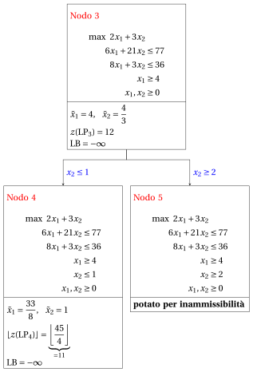{ .fig loading=lazy  }

            Con il lower bound $\LB$ e l'upper bound $\UB$ correnti, abbiamo:

            $$
            -\infty ~~\le~~ z(\ILP) ~~\le~~ \underbrace{\left\lfloor \dfrac{101}{7} \right\rfloor}_{=14}
            $$

        - <strong>Iterazione 3</strong>

            Il problema $\LP_{4}$ viene estratto e cancellato dalla lista dei problemi $L$.

            La variabile di branching è $x_{1}$. I vincoli di branching sono:

            $$
            x_1 \le \underbrace{\left\lfloor \dfrac{33}{8} \right\rfloor}_{ = 4} \mathrm{~~~e~~~} x_1 \ge \underbrace{\left\lfloor \dfrac{33}{8} \right\rfloor +1}_{= 5}
            $$

            Con il primo vincolo di branching si crea il problema $\LP_{6}$ (il secondo figlio si risolve solo se necessario).

            1. Soluzione del problema $\LP_{6}$

                Consideriamo il problema $\LP_{6}$ in forma standard:

                $$
                \begin{array}{rrrrrrrrrrrrrrrrr}
                {\max} & {2}\, {x_1} & {+} & {3}\, {x_2} &  &  &  &  &  &  &  &  &  &  \\[2ex]
                & {6}\, {x_1} & {+} & {21}\, {x_2} & {+} & {x_3} &  &  &  &  &  &  &  &  & {=} & {77} \\[2ex]
                & {8}\, {x_1} & {+} & {3}\, {x_2} &  &  & {+} & {x_4} &  &  &  &  &  &  & {=} & {36} \\[2ex]
                & {x_1} &  &  &  &  &  &  & {-} & {x_5} &  &  &  &  & {=} & {4} \\[2ex]
                &  &  & {x_2} &  &  &  &  &  &  & {+} & {x_6} &  &  & {=} & {1} \\[2ex]
                & {x_1} &  &  &  &  &  &  &  &  &  &  & {+} & {x_7} & {=} & {4} \\[2ex]
                & {x_1,} &  & {x_2,} &  & {x_3,} &  & {x_4,} &  & {x_5,} &  & {x_6,} &  & {x_7} & {\ge} & {0}
                \end{array}
                $$

                Per il vincolo di branching abbiamo:

                $$
                x_1 + x_7 = 4 \quad \quad \Rightarrow \quad x_7 = 4 - x_1
                $$

                Usando le equazioni del dizionario ottimo possiamo esprimere questo vincolo di branching in funzione delle variabili fuori base. Sostituendo, otteniamo

                $$
                x_7 = 4 - \left(\dfrac{33}{8} - \dfrac{1}{8} \; x_4 + \dfrac{3}{8} \; x_6 \right)
                \quad \quad \Rightarrow \quad
                x_7 = -\dfrac{1}{8} + \dfrac{1}{8} \, x_4 - \dfrac{3}{8} \, x_6
                $$

                Aggiungiamo quindi questa equazione al dizionario ottimo precedente e otteniamo il seguente dizionario:

                \begin{equation*}
                \begin{cases}
                \begin{array}{rrrrrrr}
                {x_1} & {=} & {\dfrac{33}{8}} & {-} & {\dfrac{1}{8}}\, {x_4} & {+} & {\dfrac{3}{8}}\, {x_6} \\[2ex]
                {x_2} & {=} & {1} &  &  & {-} & {x_6} \\[2ex]
                {x_3} & {=} & {\dfrac{125}{4}} & {+} & {\dfrac{3}{4}}\, {x_4} & {+} & {\dfrac{75}{4}}\, {x_6} \\[2ex]
                {x_5} & {=} & {\dfrac{1}{8}} & {-} & {\dfrac{1}{8}}\, {x_4} & {+} & {\dfrac{3}{8}}\, {x_6} \\[2ex]
                {x_7} & {=} & {-\dfrac{1}{8}} & {+} & {\dfrac{1}{8}}\, {x_4} & {-} & {\dfrac{3}{8}}\, {x_6} \\[2ex]
                {z} & {=} & {\dfrac{45}{4}} & {-} & {\dfrac{1}{4}}\, {x_4} & {-} & {\dfrac{9}{4}}\, {x_6}
                \end{array}
                \end{cases}
                \end{equation*}

                dove $\pazocal{B}=\{1,2,3,5,7\}$ e $\pazocal{N}=\{4,6\}$ e

                - la soluzione di base primale non ammissibile è:

                    $$
                    \begin{gathered}
                    \bar x_1=\dfrac{33}{8},~~
                    \bar x_2=1,~~
                    \bar x_3=\dfrac{125}{4},~~
                    \bar x_5=\dfrac{1}{8},~~
                    \bar x_7=-\dfrac{1}{8},\\
                    \bar x_4=0,~~
                    \bar x_6=0~~
                    \mathrm{~~di~valore~~~} \dfrac{45}{4}
                    \end{gathered}
                    $$

                - la soluzione di base duale ammissibile è:

                    $$
                    \begin{gathered}
                    \bar \pi_1=0,~~
                    \bar \pi_2=0,~~
                    \bar \pi_3=0,~~
                    \bar \pi_5=0,~~
                    \bar \pi_7=0,\\
                    \bar \pi_4=\dfrac{1}{4},~~
                    \bar \pi_6=\dfrac{9}{4}~~
                    \mathrm{~~di~valore~~~} \dfrac{45}{4}
                    \end{gathered}
                    $$

                Se aumentiamo il valore di $\pi_{7}$, possiamo ottenere una soluzione duale migliore. Abbiamo:

                $$
                \begin{cases}
                \pi_4 &= \dfrac{1}{4} - \dfrac{1}{8}\,\pi_7 \\[2ex]
                \pi_6 &= \dfrac{9}{4} + \dfrac{3}{8}\,\pi_7
                \end{cases}
                \qquad
                \qquad
                \begin{cases}
                \underbrace{ \dfrac{1}{4} - \dfrac{1}{8}\,\pi_7 \ge 0}_{\pi_4 \ge 0} \\[2ex]
                \underbrace{ \dfrac{9}{4} + \dfrac{3}{8}\,\pi_7 \ge 0}_{\pi_6 \ge 0}
                \end{cases}
                \qquad
                \qquad
                \begin{cases}
                \pi_7 &\le 2 \\[2ex]
                \pi_7 &\ge -6
                \end{cases}
                $$

                Aumentando il valore di $\pi_{7}$ fino a $2$, il valore di $\pi_{4}$ scende a $0$. Abbiamo quindi che:

                - $\pi_{7}$ entra nella base duale e, di conseguenza, $x_{7}$ esce dalla base primale.

                - $\pi_{4}$ esce dalla base duale e, di conseguenza, $x_{4}$ entra nella base primale.

                Abbiamo:

                $$
                x_7 = -\dfrac{1}{8} + \dfrac{1}{8} \, x_4 - \dfrac{3}{8} \, x_6
                \quad \Rightarrow \quad
                x_4 = 1 + 3 \, x_6 + 8 \, x_7
                $$

                Sostituendo nelle altre equazioni del dizionario primale, otteniamo:

                $$
                x_1
                = \dfrac{33}{8} - \dfrac{1}{8} \left( 1 + 3 \, x_6 + 8 \, x_7 \right) + \dfrac{3}{8} \; x_6
                = 4 - x_7
                $$

                $$
                x_3
                = \dfrac{125}{4} + \dfrac{3}{4} \left( 1 + 3 \, x_6 + 8 \, x_7 \right) + \dfrac{75}{4} \; x_6
                = 32 + 21 \, x_6 + 6 \, x_7
                $$

                $$
                x_5
                = \dfrac{1}{8} - \dfrac{1}{8} \left( 1 + 3 \, x_6 + 8 \, x_7 \right) + \dfrac{3}{8} \; x_6
                = 0 - x_7
                $$

                $$
                z
                = \dfrac{45}{4} - \dfrac{1}{4} \left( 1 + 3 \, x_6 + 8 \, x_7 \right) - \dfrac{9}{4} \; x_6
                = 11 - 3 \, x_6 - 2 \, x_7
                $$

                Di conseguenza, abbiamo ora il seguente dizionario primale aggiornato:

                \begin{equation*}
                \begin{cases}
                \begin{array}{rrrrrrr}
                {x_1} & {=} & {4} &  &  & {-} & {x_7} \\[2ex]
                {x_2} & {=} & {1} & {-} & {x_6} &  &  \\[2ex]
                {x_3} & {=} & {32} & {+} & {21}\, {x_6} & {+} & {6}\, {x_7} \\[2ex]
                {x_4} & {=} & {1} & {+} & {3}\, {x_6} & {+} & {8}\, {x_7} \\[2ex]
                {x_5} & {=} & {0} &  &  & {-} & {x_7} \\[2ex]
                {z} & {=} & {11} & {-} & {3}\, {x_6} & {-} & {2}\, {x_7}
                \end{array}
                \end{cases}
                \end{equation*}

                dove $\pazocal{B}=\{1,2,3,4,5\}$ e $\pazocal{N}=\{6,7\}$ e

                - la soluzione di base primale ottima è:

                    $$
                    \begin{gathered}
                    \tilde x_1=4,~~
                    \tilde x_2=1,~~
                    \tilde x_3=32,~~
                    \tilde x_4=1,~~
                    \tilde x_5=0,\\
                    \tilde x_6=0,~~
                    \tilde x_7=0~~
                    \mathrm{~~di~valore~~~} 11
                    \end{gathered}
                    $$

                - la soluzione di base duale ottima è:

                    $$
                    \begin{gathered}
                    \tilde \pi_1=0,~~
                    \tilde \pi_2=0,~~
                    \tilde \pi_3=0,~~
                    \tilde \pi_4=0,~~
                    \tilde \pi_5=0,\\
                    \tilde \pi_6=3,~~
                    \tilde \pi_7=2~~
                    \mathrm{~~di~valore~~~} 11
                    \end{gathered}
                    $$

                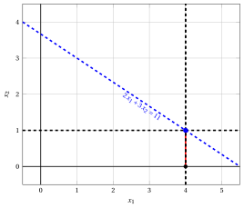{ .fig .ovale loading=lazy  }

                <em>Nodo 6: regione ammissibile di $\LP_{6}$ (in rosso), con il vincolo di branching $x_1 \le 4$ (tratteggiato), e la sua soluzione ottima (in blu).</em>

                Una soluzione ottima ${\tilde{\boldsymbol x}}(\LP_{6})$ è:

                $$
                \tilde{x}_1=4,~~\tilde{x}_2=1
                $$

                il valore ottimo è:

                $$
                z(\LP_{6}) = 11
                $$

                Il problema $\LP_{6}$ è <strong>ammissibile</strong> e abbiamo

                $$
                \left\lfloor z(\LP_{6}) \right\rfloor > \LB
                \qquad \text{poiché} \qquad
                11 > -\infty
                $$

                La soluzione ottima ${\tilde{\boldsymbol x}}(\LP_{6})$ è <strong>intera</strong>; di conseguenza, il lower bound $\LB$ diventa $11$ e la soluzione incumbent ${\bar{\boldsymbol x}}(\ILP)$ diventa $\bar{x}_1=4,\bar{x}_2=1$.

                Di conseguenza, il nodo di branching è <u>potato per integralità</u>.

            Alla fine della terza iterazione, il branching su $x_{1}$ dal Nodo 4 ha generato il nodo di branching verso il basso, Nodo 6. Questo nodo è potato per integralità. Il nodo di branching verso l'alto non viene risolto, poiché dopo il Nodo 6 il lower bound soddisfa

            $$
            \left\lfloor z(\LP_{4}) \right\rfloor \le \LB.
            $$

            Questa è la parte dell'albero di branch-and-bound che mostra i problemi LP dei nodi di branching risolti:

            { .fig loading=lazy  }

            Con il lower bound $\LB$ e l'upper bound $\UB$ correnti, abbiamo:

            $$
            11 ~~\le~~ z(\ILP) ~~\le~~ \underbrace{\left\lfloor \dfrac{101}{7} \right\rfloor}_{=14}
            $$

        - <strong>Iterazione 4</strong>

            Il problema $\LP_{2}$ viene estratto e cancellato dalla lista dei problemi $L$.

            La variabile di branching è $x_{2}$. I vincoli di branching sono:

            $$
            x_2 \le \underbrace{\left\lfloor \dfrac{59}{21} \right\rfloor}_{ = 2} \mathrm{~~~e~~~} x_2 \ge \underbrace{\left\lfloor \dfrac{59}{21} \right\rfloor +1}_{= 3}
            $$

            Con questi vincoli di branching si creano i due problemi $\LP_{7}$ e $\LP_{8}$.

            1. Soluzione del problema $\LP_{7}$

                Consideriamo il problema $\LP_{7}$ in forma standard:

                $$
                \begin{array}{rrrrrrrrrrrrrrr}
                {\max} & {2}\, {x_1} & {+} & {3}\, {x_2} &  &  &  &  &  &  &  &  \\[2ex]
                & {6}\, {x_1} & {+} & {21}\, {x_2} & {+} & {x_3} &  &  &  &  &  &  & {=} & {77} \\[2ex]
                & {8}\, {x_1} & {+} & {3}\, {x_2} &  &  & {+} & {x_4} &  &  &  &  & {=} & {36} \\[2ex]
                & {x_1} &  &  &  &  &  &  & {+} & {x_5} &  &  & {=} & {3} \\[2ex]
                &  &  & {x_2} &  &  &  &  &  &  & {+} & {x_6} & {=} & {2} \\[2ex]
                & {x_1,} &  & {x_2,} &  & {x_3,} &  & {x_4,} &  & {x_5,} &  & {x_6} & {\ge} & {0}
                \end{array}
                $$

                Per il vincolo di branching abbiamo:

                $$
                x_2 + x_6 = 2 \quad \quad \Rightarrow \quad x_6 = 2 - x_2
                $$

                Usando le equazioni del dizionario ottimo possiamo esprimere questo vincolo di branching in funzione delle variabili fuori base. Sostituendo, otteniamo

                $$
                x_6 = 2 - \left(\dfrac{59}{21} - \dfrac{1}{21} \; x_3 + \dfrac{2}{7} \; x_5 \right)
                \quad \quad \Rightarrow \quad
                x_6 = -\dfrac{17}{21} + \dfrac{1}{21} \, x_3 - \dfrac{2}{7} \, x_5
                $$

                Aggiungiamo quindi questa equazione al dizionario ottimo precedente e otteniamo il seguente dizionario:

                \begin{equation*}
                \begin{cases}
                \begin{array}{rrrrrrr}
                {x_1} & {=} & {3} &  &  & {-} & {x_5} \\[2ex]
                {x_2} & {=} & {\dfrac{59}{21}} & {-} & {\dfrac{1}{21}}\, {x_3} & {+} & {\dfrac{2}{7}}\, {x_5} \\[2ex]
                {x_4} & {=} & {\dfrac{25}{7}} & {+} & {\dfrac{1}{7}}\, {x_3} & {+} & {\dfrac{50}{7}}\, {x_5} \\[2ex]
                {x_6} & {=} & {-\dfrac{17}{21}} & {+} & {\dfrac{1}{21}}\, {x_3} & {-} & {\dfrac{2}{7}}\, {x_5} \\[2ex]
                {z} & {=} & {\dfrac{101}{7}} & {-} & {\dfrac{1}{7}}\, {x_3} & {-} & {\dfrac{8}{7}}\, {x_5}
                \end{array}
                \end{cases}
                \end{equation*}

                dove $\pazocal{B}=\{1,2,4,6\}$ e $\pazocal{N}=\{3,5\}$ e

                - la soluzione di base primale non ammissibile è:

                    $$
                    \begin{gathered}
                    \bar x_1=3,~~
                    \bar x_2=\dfrac{59}{21},~~
                    \bar x_4=\dfrac{25}{7},~~
                    \bar x_6=-\dfrac{17}{21},\\
                    \bar x_3=0,~~
                    \bar x_5=0~~
                    \mathrm{~~di~valore~~~} \dfrac{101}{7}
                    \end{gathered}
                    $$

                - la soluzione di base duale ammissibile è:

                    $$
                    \begin{gathered}
                    \bar \pi_1=0,~~
                    \bar \pi_2=0,~~
                    \bar \pi_4=0,~~
                    \bar \pi_6=0,\\
                    \bar \pi_3=\dfrac{1}{7},~~
                    \bar \pi_5=\dfrac{8}{7}~~
                    \mathrm{~~di~valore~~~} \dfrac{101}{7}
                    \end{gathered}
                    $$

                Se aumentiamo il valore di $\pi_{6}$, possiamo ottenere una soluzione duale migliore. Abbiamo:

                $$
                \begin{cases}
                \pi_3 &= \dfrac{1}{7} - \dfrac{1}{21}\,\pi_6 \\[2ex]
                \pi_5 &= \dfrac{8}{7} + \dfrac{2}{7}\,\pi_6
                \end{cases}
                \qquad
                \qquad
                \begin{cases}
                \underbrace{ \dfrac{1}{7} - \dfrac{1}{21}\,\pi_6 \ge 0}_{\pi_3 \ge 0} \\[2ex]
                \underbrace{ \dfrac{8}{7} + \dfrac{2}{7}\,\pi_6 \ge 0}_{\pi_5 \ge 0}
                \end{cases}
                \qquad
                \qquad
                \begin{cases}
                \pi_6 &\le 3 \\[2ex]
                \pi_6 &\ge -4
                \end{cases}
                $$

                Aumentando il valore di $\pi_{6}$ fino a $3$, il valore di $\pi_{3}$ scende a $0$. Abbiamo quindi che:

                - $\pi_{6}$ entra nella base duale e, di conseguenza, $x_{6}$ esce dalla base primale.

                - $\pi_{3}$ esce dalla base duale e, di conseguenza, $x_{3}$ entra nella base primale.

                Abbiamo:

                $$
                x_6 = -\dfrac{17}{21} + \dfrac{1}{21} \, x_3 - \dfrac{2}{7} \, x_5
                \quad \Rightarrow \quad
                x_3 = 17 + 6 \, x_5 + 21 \, x_6
                $$

                Sostituendo nelle altre equazioni del dizionario primale, otteniamo:

                $$
                x_2
                = \dfrac{59}{21} - \dfrac{1}{21} \left( 17 + 6 \, x_5 + 21 \, x_6 \right) + \dfrac{2}{7} \; x_5
                = 2 - x_6
                $$

                $$
                x_4
                = \dfrac{25}{7} + \dfrac{1}{7} \left( 17 + 6 \, x_5 + 21 \, x_6 \right) + \dfrac{50}{7} \; x_5
                = 6 + 8 \, x_5 + 3 \, x_6
                $$

                $$
                z
                = \dfrac{101}{7} - \dfrac{1}{7} \left( 17 + 6 \, x_5 + 21 \, x_6 \right) - \dfrac{8}{7} \; x_5
                = 12 - 2 \, x_5 - 3 \, x_6
                $$

                Di conseguenza, abbiamo ora il seguente dizionario primale aggiornato:

                \begin{equation*}
                \begin{cases}
                \begin{array}{rrrrrrr}
                {x_1} & {=} & {3} & {-} & {x_5} &  &  \\[2ex]
                {x_2} & {=} & {2} &  &  & {-} & {x_6} \\[2ex]
                {x_3} & {=} & {17} & {+} & {6}\, {x_5} & {+} & {21}\, {x_6} \\[2ex]
                {x_4} & {=} & {6} & {+} & {8}\, {x_5} & {+} & {3}\, {x_6} \\[2ex]
                {z} & {=} & {12} & {-} & {2}\, {x_5} & {-} & {3}\, {x_6}
                \end{array}
                \end{cases}
                \end{equation*}

                dove $\pazocal{B}=\{1,2,3,4\}$ e $\pazocal{N}=\{5,6\}$ e

                - la soluzione di base primale ottima è:

                    $$
                    \begin{gathered}
                    \tilde x_1=3,~~
                    \tilde x_2=2,~~
                    \tilde x_3=17,~~
                    \tilde x_4=6,\\
                    \tilde x_5=0,~~
                    \tilde x_6=0~~
                    \mathrm{~~di~valore~~~} 12
                    \end{gathered}
                    $$

                - la soluzione di base duale ottima è:

                    $$
                    \begin{gathered}
                    \tilde \pi_1=0,~~
                    \tilde \pi_2=0,~~
                    \tilde \pi_3=0,~~
                    \tilde \pi_4=0,\\
                    \tilde \pi_5=2,~~
                    \tilde \pi_6=3~~
                    \mathrm{~~di~valore~~~} 12
                    \end{gathered}
                    $$

                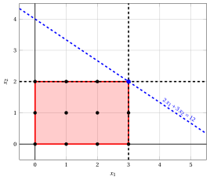{ .fig .ovale loading=lazy  }

                <em>Nodo 7: regione ammissibile di $\LP_{7}$ (in rosso), con il vincolo di branching $x_2 \le 2$ (tratteggiato), e la sua soluzione ottima (in blu).</em>

                Una soluzione ottima ${\tilde{\boldsymbol x}}(\LP_{7})$ è:

                $$
                \tilde{x}_1=3,~~\tilde{x}_2=2
                $$

                il valore ottimo è:

                $$
                z(\LP_{7}) = 12
                $$

                Il problema $\LP_{7}$ è <strong>ammissibile</strong> e abbiamo

                $$
                \left\lfloor z(\LP_{7}) \right\rfloor > \LB
                \qquad \text{poiché} \qquad
                12 > 11
                $$

                La soluzione ottima ${\tilde{\boldsymbol x}}(\LP_{7})$ è <strong>intera</strong>; di conseguenza, il lower bound $\LB$ diventa $12$ e la soluzione incumbent ${\bar{\boldsymbol x}}(\ILP)$ diventa $\bar{x}_1=3,\bar{x}_2=2$.

                Di conseguenza, il nodo di branching è <u>potato per integralità</u>.

            2. Soluzione del problema $\LP_{8}$

                Consideriamo il problema $\LP_{8}$ in forma standard:

                $$
                \begin{array}{rrrrrrrrrrrrrrr}
                {\max} & {2}\, {x_1} & {+} & {3}\, {x_2} &  &  &  &  &  &  &  &  \\[2ex]
                & {6}\, {x_1} & {+} & {21}\, {x_2} & {+} & {x_3} &  &  &  &  &  &  & {=} & {77} \\[2ex]
                & {8}\, {x_1} & {+} & {3}\, {x_2} &  &  & {+} & {x_4} &  &  &  &  & {=} & {36} \\[2ex]
                & {x_1} &  &  &  &  &  &  & {+} & {x_5} &  &  & {=} & {3} \\[2ex]
                &  &  & {x_2} &  &  &  &  &  &  & {-} & {x_6} & {=} & {3} \\[2ex]
                & {x_1,} &  & {x_2,} &  & {x_3,} &  & {x_4,} &  & {x_5,} &  & {x_6} & {\ge} & {0}
                \end{array}
                $$

                Per il vincolo di branching abbiamo:

                $$
                x_2 - x_6 = 3 \quad \quad \Rightarrow \quad x_6 = -3 + x_2
                $$

                Usando le equazioni del dizionario ottimo possiamo esprimere questo vincolo di branching in funzione delle variabili fuori base. Sostituendo, otteniamo

                $$
                x_6 = -3 + \left(\dfrac{59}{21} - \dfrac{1}{21} \; x_3 + \dfrac{2}{7} \; x_5 \right)
                \quad \quad \Rightarrow \quad
                x_6 = -\dfrac{4}{21} - \dfrac{1}{21} \, x_3 + \dfrac{2}{7} \, x_5
                $$

                Aggiungiamo quindi questa equazione al dizionario ottimo precedente e otteniamo il seguente dizionario:

                \begin{equation*}
                \begin{cases}
                \begin{array}{rrrrrrr}
                {x_1} & {=} & {3} &  &  & {-} & {x_5} \\[2ex]
                {x_2} & {=} & {\dfrac{59}{21}} & {-} & {\dfrac{1}{21}}\, {x_3} & {+} & {\dfrac{2}{7}}\, {x_5} \\[2ex]
                {x_4} & {=} & {\dfrac{25}{7}} & {+} & {\dfrac{1}{7}}\, {x_3} & {+} & {\dfrac{50}{7}}\, {x_5} \\[2ex]
                {x_6} & {=} & {-\dfrac{4}{21}} & {-} & {\dfrac{1}{21}}\, {x_3} & {+} & {\dfrac{2}{7}}\, {x_5} \\[2ex]
                {z} & {=} & {\dfrac{101}{7}} & {-} & {\dfrac{1}{7}}\, {x_3} & {-} & {\dfrac{8}{7}}\, {x_5}
                \end{array}
                \end{cases}
                \end{equation*}

                dove $\pazocal{B}=\{1,2,4,6\}$ e $\pazocal{N}=\{3,5\}$ e

                - la soluzione di base primale non ammissibile è:

                    $$
                    \begin{gathered}
                    \bar x_1=3,~~
                    \bar x_2=\dfrac{59}{21},~~
                    \bar x_4=\dfrac{25}{7},~~
                    \bar x_6=-\dfrac{4}{21},\\
                    \bar x_3=0,~~
                    \bar x_5=0~~
                    \mathrm{~~di~valore~~~} \dfrac{101}{7}
                    \end{gathered}
                    $$

                - la soluzione di base duale ammissibile è:

                    $$
                    \begin{gathered}
                    \bar \pi_1=0,~~
                    \bar \pi_2=0,~~
                    \bar \pi_4=0,~~
                    \bar \pi_6=0,\\
                    \bar \pi_3=\dfrac{1}{7},~~
                    \bar \pi_5=\dfrac{8}{7}~~
                    \mathrm{~~di~valore~~~} \dfrac{101}{7}
                    \end{gathered}
                    $$

                Se aumentiamo il valore di $\pi_{6}$, possiamo ottenere una soluzione duale migliore. Abbiamo:

                $$
                \begin{cases}
                \pi_3 &= \dfrac{1}{7} + \dfrac{1}{21}\,\pi_6 \\[2ex]
                \pi_5 &= \dfrac{8}{7} - \dfrac{2}{7}\,\pi_6
                \end{cases}
                \qquad
                \qquad
                \begin{cases}
                \underbrace{ \dfrac{1}{7} + \dfrac{1}{21}\,\pi_6 \ge 0}_{\pi_3 \ge 0} \\[2ex]
                \underbrace{ \dfrac{8}{7} - \dfrac{2}{7}\,\pi_6 \ge 0}_{\pi_5 \ge 0}
                \end{cases}
                \qquad
                \qquad
                \begin{cases}
                \pi_6 &\ge -3 \\[2ex]
                \pi_6 &\le 4
                \end{cases}
                $$

                Aumentando il valore di $\pi_{6}$ fino a $4$, il valore di $\pi_{5}$ scende a $0$. Abbiamo quindi che:

                - $\pi_{6}$ entra nella base duale e, di conseguenza, $x_{6}$ esce dalla base primale.

                - $\pi_{5}$ esce dalla base duale e, di conseguenza, $x_{5}$ entra nella base primale.

                Abbiamo:

                $$
                x_6 = -\dfrac{4}{21} - \dfrac{1}{21} \, x_3 + \dfrac{2}{7} \, x_5
                \quad \Rightarrow \quad
                x_5 = \dfrac{2}{3} + \dfrac{1}{6} \, x_3 + \dfrac{7}{2} \, x_6
                $$

                Sostituendo nelle altre equazioni del dizionario primale, otteniamo:

                $$
                x_1
                = 3 - \left( \dfrac{2}{3} + \dfrac{1}{6} \, x_3 + \dfrac{7}{2} \, x_6 \right)
                = \dfrac{7}{3} - \dfrac{1}{6} \, x_3 - \dfrac{7}{2} \, x_6
                $$

                $$
                x_2
                = \dfrac{59}{21} - \dfrac{1}{21} \; x_3 + \dfrac{2}{7} \left( \dfrac{2}{3} + \dfrac{1}{6} \, x_3 + \dfrac{7}{2} \, x_6 \right)
                = 3 + x_6
                $$

                $$
                x_4
                = \dfrac{25}{7} + \dfrac{1}{7} \; x_3 + \dfrac{50}{7} \left( \dfrac{2}{3} + \dfrac{1}{6} \, x_3 + \dfrac{7}{2} \, x_6 \right)
                = \dfrac{25}{3} + \dfrac{4}{3} \, x_3 + 25 \, x_6
                $$

                $$
                z
                = \dfrac{101}{7} - \dfrac{1}{7} \; x_3 - \dfrac{8}{7} \left( \dfrac{2}{3} + \dfrac{1}{6} \, x_3 + \dfrac{7}{2} \, x_6 \right)
                = \dfrac{41}{3} - \dfrac{1}{3} \, x_3 - 4 \, x_6
                $$

                Di conseguenza, abbiamo ora il seguente dizionario primale aggiornato:

                \begin{equation*}
                \begin{cases}
                \begin{array}{rrrrrrr}
                {x_1} & {=} & {\dfrac{7}{3}} & {-} & {\dfrac{1}{6}}\, {x_3} & {-} & {\dfrac{7}{2}}\, {x_6} \\[2ex]
                {x_2} & {=} & {3} &  &  & {+} & {x_6} \\[2ex]
                {x_4} & {=} & {\dfrac{25}{3}} & {+} & {\dfrac{4}{3}}\, {x_3} & {+} & {25}\, {x_6} \\[2ex]
                {x_5} & {=} & {\dfrac{2}{3}} & {+} & {\dfrac{1}{6}}\, {x_3} & {+} & {\dfrac{7}{2}}\, {x_6} \\[2ex]
                {z} & {=} & {\dfrac{41}{3}} & {-} & {\dfrac{1}{3}}\, {x_3} & {-} & {4}\, {x_6}
                \end{array}
                \end{cases}
                \end{equation*}

                dove $\pazocal{B}=\{1,2,4,5\}$ e $\pazocal{N}=\{3,6\}$ e

                - la soluzione di base primale ottima è:

                    $$
                    \begin{gathered}
                    \tilde x_1=\dfrac{7}{3},~~
                    \tilde x_2=3,~~
                    \tilde x_4=\dfrac{25}{3},~~
                    \tilde x_5=\dfrac{2}{3},\\
                    \tilde x_3=0,~~
                    \tilde x_6=0~~
                    \mathrm{~~di~valore~~~} \dfrac{41}{3}
                    \end{gathered}
                    $$

                - la soluzione di base duale ottima è:

                    $$
                    \begin{gathered}
                    \tilde \pi_1=0,~~
                    \tilde \pi_2=0,~~
                    \tilde \pi_4=0,~~
                    \tilde \pi_5=0,\\
                    \tilde \pi_3=\dfrac{1}{3},~~
                    \tilde \pi_6=4~~
                    \mathrm{~~di~valore~~~} \dfrac{41}{3}
                    \end{gathered}
                    $$

                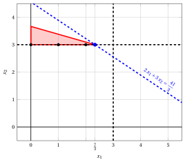{ .fig .ovale loading=lazy  }

                <em>Nodo 8: regione ammissibile di $\LP_{8}$ (in rosso), con il vincolo di branching $x_2 \ge 3$ (tratteggiato), e la sua soluzione ottima (in blu).</em>

                Una soluzione ottima ${\tilde{\boldsymbol x}}(\LP_{8})$ è:

                $$
                \tilde{x}_1=\dfrac{7}{3},~~\tilde{x}_2=3
                $$

                il valore ottimo è:

                $$
                z(\LP_{8}) = \dfrac{41}{3}
                $$

                Il problema $\LP_{8}$ è <strong>ammissibile</strong> e abbiamo

                $$
                \left\lfloor z(\LP_{8}) \right\rfloor > \LB
                \qquad \text{poiché} \qquad
                \underbrace{\left\lfloor \dfrac{41}{3} \right\rfloor}_{=13} > 12
                $$

                La soluzione ottima ${\tilde{\boldsymbol x}}(\LP_{8})$ è <strong>frazionaria</strong>; di conseguenza, il problema $\LP_{8}$ viene <strong>inserito nella lista dei problemi</strong> $L$.

            Alla fine della quarta iterazione, il branching su $x_{2}$ dal Nodo 2 ha generato il nodo di branching verso il basso, Nodo 7, e il nodo di branching verso l'alto, Nodo 8. Il Nodo 7 è potato per integralità, mentre il Nodo 8 è inserito nella lista $L$. L'albero di branch-and-bound corrispondente è:

            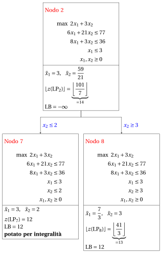{ .fig loading=lazy  }

            Con il lower bound $\LB$ e l'upper bound $\UB$ correnti, abbiamo:

            $$
            12 ~~\le~~ z(\ILP) ~~\le~~ \underbrace{\left\lfloor \dfrac{41}{3} \right\rfloor}_{=13}
            $$

        - <strong>Iterazione 5</strong>

            Il problema $\LP_{8}$ viene estratto e cancellato dalla lista dei problemi $L$.

            La variabile di branching è $x_{1}$. I vincoli di branching sono:

            $$
            x_1 \le \underbrace{\left\lfloor \dfrac{7}{3} \right\rfloor}_{ = 2} \mathrm{~~~e~~~} x_1 \ge \underbrace{\left\lfloor \dfrac{7}{3} \right\rfloor +1}_{= 3}
            $$

            Con questi vincoli di branching si creano i due problemi $\LP_{9}$ e $\LP_{10}$.

            1. Soluzione del problema $\LP_{9}$

                Consideriamo il problema $\LP_{9}$ in forma standard:

                $$
                \begin{array}{rrrrrrrrrrrrrrrrr}
                {\max} & {2}\, {x_1} & {+} & {3}\, {x_2} &  &  &  &  &  &  &  &  &  &  \\[2ex]
                & {6}\, {x_1} & {+} & {21}\, {x_2} & {+} & {x_3} &  &  &  &  &  &  &  &  & {=} & {77} \\[2ex]
                & {8}\, {x_1} & {+} & {3}\, {x_2} &  &  & {+} & {x_4} &  &  &  &  &  &  & {=} & {36} \\[2ex]
                & {x_1} &  &  &  &  &  &  & {+} & {x_5} &  &  &  &  & {=} & {3} \\[2ex]
                &  &  & {x_2} &  &  &  &  &  &  & {-} & {x_6} &  &  & {=} & {3} \\[2ex]
                & {x_1} &  &  &  &  &  &  &  &  &  &  & {+} & {x_7} & {=} & {2} \\[2ex]
                & {x_1,} &  & {x_2,} &  & {x_3,} &  & {x_4,} &  & {x_5,} &  & {x_6,} &  & {x_7} & {\ge} & {0}
                \end{array}
                $$

                Per il vincolo di branching abbiamo:

                $$
                x_1 + x_7 = 2 \quad \quad \Rightarrow \quad x_7 = 2 - x_1
                $$

                Usando le equazioni del dizionario ottimo possiamo esprimere questo vincolo di branching in funzione delle variabili fuori base. Sostituendo, otteniamo

                $$
                x_7 = 2 - \left(\dfrac{7}{3} - \dfrac{1}{6} \; x_3 - \dfrac{7}{2} \; x_6 \right)
                \quad \quad \Rightarrow \quad
                x_7 = -\dfrac{1}{3} + \dfrac{1}{6} \, x_3 + \dfrac{7}{2} \, x_6
                $$

                Aggiungiamo quindi questa equazione al dizionario ottimo precedente e otteniamo il seguente dizionario:

                \begin{equation*}
                \begin{cases}
                \begin{array}{rrrrrrr}
                {x_1} & {=} & {\dfrac{7}{3}} & {-} & {\dfrac{1}{6}}\, {x_3} & {-} & {\dfrac{7}{2}}\, {x_6} \\[2ex]
                {x_2} & {=} & {3} &  &  & {+} & {x_6} \\[2ex]
                {x_4} & {=} & {\dfrac{25}{3}} & {+} & {\dfrac{4}{3}}\, {x_3} & {+} & {25}\, {x_6} \\[2ex]
                {x_5} & {=} & {\dfrac{2}{3}} & {+} & {\dfrac{1}{6}}\, {x_3} & {+} & {\dfrac{7}{2}}\, {x_6} \\[2ex]
                {x_7} & {=} & {-\dfrac{1}{3}} & {+} & {\dfrac{1}{6}}\, {x_3} & {+} & {\dfrac{7}{2}}\, {x_6} \\[2ex]
                {z} & {=} & {\dfrac{41}{3}} & {-} & {\dfrac{1}{3}}\, {x_3} & {-} & {4}\, {x_6}
                \end{array}
                \end{cases}
                \end{equation*}

                dove $\pazocal{B}=\{1,2,4,5,7\}$ e $\pazocal{N}=\{3,6\}$ e

                - la soluzione di base primale non ammissibile è:

                    $$
                    \begin{gathered}
                    \bar x_1=\dfrac{7}{3},~~
                    \bar x_2=3,~~
                    \bar x_4=\dfrac{25}{3},~~
                    \bar x_5=\dfrac{2}{3},~~
                    \bar x_7=-\dfrac{1}{3},\\
                    \bar x_3=0,~~
                    \bar x_6=0~~
                    \mathrm{~~di~valore~~~} \dfrac{41}{3}
                    \end{gathered}
                    $$

                - la soluzione di base duale ammissibile è:

                    $$
                    \begin{gathered}
                    \bar \pi_1=0,~~
                    \bar \pi_2=0,~~
                    \bar \pi_4=0,~~
                    \bar \pi_5=0,~~
                    \bar \pi_7=0,\\
                    \bar \pi_3=\dfrac{1}{3},~~
                    \bar \pi_6=4~~
                    \mathrm{~~di~valore~~~} \dfrac{41}{3}
                    \end{gathered}
                    $$

                Se aumentiamo il valore di $\pi_{7}$, possiamo ottenere una soluzione duale migliore. Abbiamo:

                $$
                \begin{cases}
                \pi_3 &= \dfrac{1}{3} - \dfrac{1}{6}\,\pi_7 \\[2ex]
                \pi_6 &= 4 - \dfrac{7}{2}\,\pi_7
                \end{cases}
                \qquad
                \qquad
                \begin{cases}
                \underbrace{ \dfrac{1}{3} - \dfrac{1}{6}\,\pi_7 \ge 0}_{\pi_3 \ge 0} \\[2ex]
                \underbrace{ 4 - \dfrac{7}{2}\,\pi_7 \ge 0}_{\pi_6 \ge 0}
                \end{cases}
                \qquad
                \qquad
                \begin{cases}
                \pi_7 &\le 2 \\[2ex]
                \pi_7 &\le \dfrac{8}{7}
                \end{cases}
                $$

                Aumentando il valore di $\pi_{7}$ fino a $\min \left\{2, \dfrac{8}{7}\right\}=\dfrac{8}{7}$, il valore di $\pi_{6}$ scende a $0$. Abbiamo quindi che:

                - $\pi_{7}$ entra nella base duale e, di conseguenza, $x_{7}$ esce dalla base primale.

                - $\pi_{6}$ esce dalla base duale e, di conseguenza, $x_{6}$ entra nella base primale.

                Abbiamo:

                $$
                x_7 = -\dfrac{1}{3} + \dfrac{1}{6} \, x_3 + \dfrac{7}{2} \, x_6
                \quad \Rightarrow \quad
                x_6 = \dfrac{2}{21} - \dfrac{1}{21} \, x_3 + \dfrac{2}{7} \, x_7
                $$

                Sostituendo nelle altre equazioni del dizionario primale, otteniamo:

                $$
                x_1
                = \dfrac{7}{3} - \dfrac{1}{6} \; x_3 - \dfrac{7}{2} \left( \dfrac{2}{21} - \dfrac{1}{21} \, x_3 + \dfrac{2}{7} \, x_7 \right)
                = 2 - x_7
                $$

                $$
                x_2
                = 3 + \left( \dfrac{2}{21} - \dfrac{1}{21} \, x_3 + \dfrac{2}{7} \, x_7 \right)
                = \dfrac{65}{21} - \dfrac{1}{21} \, x_3 + \dfrac{2}{7} \, x_7
                $$

                $$
                x_4
                = \dfrac{25}{3} + \dfrac{4}{3} \; x_3 + 25 \left( \dfrac{2}{21} - \dfrac{1}{21} \, x_3 + \dfrac{2}{7} \, x_7 \right)
                = \dfrac{75}{7} + \dfrac{1}{7} \, x_3 + \dfrac{50}{7} \, x_7
                $$

                $$
                x_5
                = \dfrac{2}{3} + \dfrac{1}{6} \; x_3 + \dfrac{7}{2} \left( \dfrac{2}{21} - \dfrac{1}{21} \, x_3 + \dfrac{2}{7} \, x_7 \right)
                = 1 + x_7
                $$

                $$
                z
                = \dfrac{41}{3} - \dfrac{1}{3} \; x_3 - 4 \left( \dfrac{2}{21} - \dfrac{1}{21} \, x_3 + \dfrac{2}{7} \, x_7 \right)
                = \dfrac{93}{7} - \dfrac{1}{7} \, x_3 - \dfrac{8}{7} \, x_7
                $$

                Di conseguenza, abbiamo ora il seguente dizionario primale aggiornato:

                \begin{equation*}
                \begin{cases}
                \begin{array}{rrrrrrr}
                {x_1} & {=} & {2} &  &  & {-} & {x_7} \\[2ex]
                {x_2} & {=} & {\dfrac{65}{21}} & {-} & {\dfrac{1}{21}}\, {x_3} & {+} & {\dfrac{2}{7}}\, {x_7} \\[2ex]
                {x_4} & {=} & {\dfrac{75}{7}} & {+} & {\dfrac{1}{7}}\, {x_3} & {+} & {\dfrac{50}{7}}\, {x_7} \\[2ex]
                {x_5} & {=} & {1} &  &  & {+} & {x_7} \\[2ex]
                {x_6} & {=} & {\dfrac{2}{21}} & {-} & {\dfrac{1}{21}}\, {x_3} & {+} & {\dfrac{2}{7}}\, {x_7} \\[2ex]
                {z} & {=} & {\dfrac{93}{7}} & {-} & {\dfrac{1}{7}}\, {x_3} & {-} & {\dfrac{8}{7}}\, {x_7}
                \end{array}
                \end{cases}
                \end{equation*}

                dove $\pazocal{B}=\{1,2,4,5,6\}$ e $\pazocal{N}=\{3,7\}$ e

                - la soluzione di base primale ottima è:

                    $$
                    \begin{gathered}
                    \tilde x_1=2,~~
                    \tilde x_2=\dfrac{65}{21},~~
                    \tilde x_4=\dfrac{75}{7},~~
                    \tilde x_5=1,~~
                    \tilde x_6=\dfrac{2}{21},\\
                    \tilde x_3=0,~~
                    \tilde x_7=0~~
                    \mathrm{~~di~valore~~~} \dfrac{93}{7}
                    \end{gathered}
                    $$

                - la soluzione di base duale ottima è:

                    $$
                    \begin{gathered}
                    \tilde \pi_1=0,~~
                    \tilde \pi_2=0,~~
                    \tilde \pi_4=0,~~
                    \tilde \pi_5=0,~~
                    \tilde \pi_6=0,\\
                    \tilde \pi_3=\dfrac{1}{7},~~
                    \tilde \pi_7=\dfrac{8}{7}~~
                    \mathrm{~~di~valore~~~} \dfrac{93}{7}
                    \end{gathered}
                    $$

                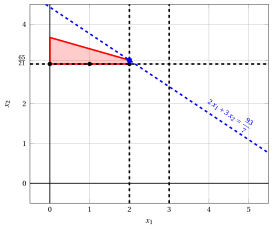{ .fig .ovale loading=lazy  }

                <em>Nodo 9: regione ammissibile di $\LP_{9}$ (in rosso), con il vincolo di branching $x_1 \le 2$ (tratteggiato), e la sua soluzione ottima (in blu).</em>

                Una soluzione ottima ${\tilde{\boldsymbol x}}(\LP_{9})$ è:

                $$
                \tilde{x}_1=2,~~\tilde{x}_2=\dfrac{65}{21}
                $$

                il valore ottimo è:

                $$
                z(\LP_{9}) = \dfrac{93}{7}
                $$

                Il problema $\LP_{9}$ è <strong>ammissibile</strong> e abbiamo

                $$
                \left\lfloor z(\LP_{9}) \right\rfloor > \LB
                \qquad \text{poiché} \qquad
                \underbrace{\left\lfloor \dfrac{93}{7} \right\rfloor}_{=13} > 12
                $$

                La soluzione ottima ${\tilde{\boldsymbol x}}(\LP_{9})$ è <strong>frazionaria</strong>; di conseguenza, il problema $\LP_{9}$ viene <strong>inserito nella lista dei problemi</strong> $L$.

            2. Soluzione del problema $\LP_{10}$

                Consideriamo il problema $\LP_{10}$ in forma standard:

                $$
                \begin{array}{rrrrrrrrrrrrrrrrr}
                {\max} & {2}\, {x_1} & {+} & {3}\, {x_2} &  &  &  &  &  &  &  &  &  &  \\[2ex]
                & {6}\, {x_1} & {+} & {21}\, {x_2} & {+} & {x_3} &  &  &  &  &  &  &  &  & {=} & {77} \\[2ex]
                & {8}\, {x_1} & {+} & {3}\, {x_2} &  &  & {+} & {x_4} &  &  &  &  &  &  & {=} & {36} \\[2ex]
                & {x_1} &  &  &  &  &  &  & {+} & {x_5} &  &  &  &  & {=} & {3} \\[2ex]
                &  &  & {x_2} &  &  &  &  &  &  & {-} & {x_6} &  &  & {=} & {3} \\[2ex]
                & {x_1} &  &  &  &  &  &  &  &  &  &  & {-} & {x_7} & {=} & {3} \\[2ex]
                & {x_1,} &  & {x_2,} &  & {x_3,} &  & {x_4,} &  & {x_5,} &  & {x_6,} &  & {x_7} & {\ge} & {0}
                \end{array}
                $$

                Per il vincolo di branching abbiamo:

                $$
                x_1 - x_7 = 3 \quad \quad \Rightarrow \quad x_7 = -3 + x_1
                $$

                Usando le equazioni del dizionario ottimo possiamo esprimere questo vincolo di branching in funzione delle variabili fuori base. Sostituendo, otteniamo

                $$
                x_7 = -3 + \left(\dfrac{7}{3} - \dfrac{1}{6} \; x_3 - \dfrac{7}{2} \; x_6 \right)
                \quad \quad \Rightarrow \quad
                x_7 = -\dfrac{2}{3} - \dfrac{1}{6} \, x_3 - \dfrac{7}{2} \, x_6
                $$

                Aggiungiamo quindi questa equazione al dizionario ottimo precedente e otteniamo il seguente dizionario:

                \begin{equation*}
                \begin{cases}
                \begin{array}{rrrrrrr}
                {x_1} & {=} & {\dfrac{7}{3}} & {-} & {\dfrac{1}{6}}\, {x_3} & {-} & {\dfrac{7}{2}}\, {x_6} \\[2ex]
                {x_2} & {=} & {3} &  &  & {+} & {x_6} \\[2ex]
                {x_4} & {=} & {\dfrac{25}{3}} & {+} & {\dfrac{4}{3}}\, {x_3} & {+} & {25}\, {x_6} \\[2ex]
                {x_5} & {=} & {\dfrac{2}{3}} & {+} & {\dfrac{1}{6}}\, {x_3} & {+} & {\dfrac{7}{2}}\, {x_6} \\[2ex]
                {x_7} & {=} & {-\dfrac{2}{3}} & {-} & {\dfrac{1}{6}}\, {x_3} & {-} & {\dfrac{7}{2}}\, {x_6} \\[2ex]
                {z} & {=} & {\dfrac{41}{3}} & {-} & {\dfrac{1}{3}}\, {x_3} & {-} & {4}\, {x_6}
                \end{array}
                \end{cases}
                \end{equation*}

                dove $\pazocal{B}=\{1,2,4,5,7\}$ e $\pazocal{N}=\{3,6\}$ e

                - la soluzione di base primale non ammissibile è:

                    $$
                    \begin{gathered}
                    \bar x_1=\dfrac{7}{3},~~
                    \bar x_2=3,~~
                    \bar x_4=\dfrac{25}{3},~~
                    \bar x_5=\dfrac{2}{3},~~
                    \bar x_7=-\dfrac{2}{3},\\
                    \bar x_3=0,~~
                    \bar x_6=0~~
                    \mathrm{~~di~valore~~~} \dfrac{41}{3}
                    \end{gathered}
                    $$

                - la soluzione di base duale ammissibile è:

                    $$
                    \begin{gathered}
                    \bar \pi_1=0,~~
                    \bar \pi_2=0,~~
                    \bar \pi_4=0,~~
                    \bar \pi_5=0,~~
                    \bar \pi_7=0,\\
                    \bar \pi_3=\dfrac{1}{3},~~
                    \bar \pi_6=4~~
                    \mathrm{~~di~valore~~~} \dfrac{41}{3}
                    \end{gathered}
                    $$

                Se aumentiamo il valore di $\pi_{7}$, possiamo ottenere una soluzione duale migliore. Abbiamo:

                $$
                \begin{cases}
                \pi_3 &= \dfrac{1}{3} + \dfrac{1}{6}\,\pi_7 \\[2ex]
                \pi_6 &= 4 + \dfrac{7}{2}\,\pi_7
                \end{cases}
                \qquad
                \qquad
                \begin{cases}
                \underbrace{ \dfrac{1}{3} + \dfrac{1}{6}\,\pi_7 \ge 0}_{\pi_3 \ge 0} \\[2ex]
                \underbrace{ 4 + \dfrac{7}{2}\,\pi_7 \ge 0}_{\pi_6 \ge 0}
                \end{cases}
                \qquad
                \qquad
                \begin{cases}
                \pi_7 &\ge -2 \\[2ex]
                \pi_7 &\ge -\dfrac{8}{7}
                \end{cases}
                $$

                Di conseguenza, possiamo aumentare il valore di $\pi_{7}$ senza violare l'ammissibilità duale: il problema duale è <strong>illimitato</strong>. Ne segue che il problema primale $\LP_{10}$ è <strong>inammissibile</strong> e il nodo di branching corrispondente è <u>potato per inammissibilità</u>.

            Alla fine della quinta iterazione, il branching su $x_{1}$ dal Nodo 8 ha generato il nodo di branching verso il basso, Nodo 9, e il nodo di branching verso l'alto, Nodo 10. Il Nodo 9 è inserito nella lista $L$, mentre il Nodo 10 è potato per inammissibilità. L'albero di branch-and-bound corrispondente è:

            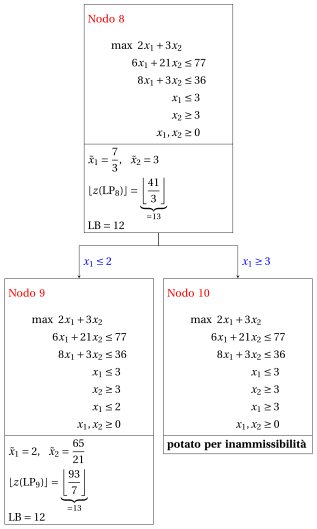{ .fig loading=lazy  }

            Con il lower bound $\LB$ e l'upper bound $\UB$ correnti, abbiamo:

            $$
            12 ~~\le~~ z(\ILP) ~~\le~~ \underbrace{\left\lfloor \dfrac{93}{7} \right\rfloor}_{=13}
            $$

        - <strong>Iterazione 6</strong>

            Il problema $\LP_{9}$ viene estratto e cancellato dalla lista dei problemi $L$.

            La variabile di branching è $x_{2}$. I vincoli di branching sono:

            $$
            x_2 \le \underbrace{\left\lfloor \dfrac{65}{21} \right\rfloor}_{ = 3} \mathrm{~~~e~~~} x_2 \ge \underbrace{\left\lfloor \dfrac{65}{21} \right\rfloor +1}_{= 4}
            $$

            Con il primo vincolo di branching si crea il problema $\LP_{11}$ (il secondo figlio si risolve solo se necessario).

            1. Soluzione del problema $\LP_{11}$

                Consideriamo il problema $\LP_{11}$ in forma standard:

                $$
                \begin{array}{rrrrrrrrrrrrrrrrrrr}
                {\max} & {2}\, {x_1} & {+} & {3}\, {x_2} &  &  &  &  &  &  &  &  &  &  &  &  \\[2ex]
                & {6}\, {x_1} & {+} & {21}\, {x_2} & {+} & {x_3} &  &  &  &  &  &  &  &  &  &  & {=} & {77} \\[2ex]
                & {8}\, {x_1} & {+} & {3}\, {x_2} &  &  & {+} & {x_4} &  &  &  &  &  &  &  &  & {=} & {36} \\[2ex]
                & {x_1} &  &  &  &  &  &  & {+} & {x_5} &  &  &  &  &  &  & {=} & {3} \\[2ex]
                &  &  & {x_2} &  &  &  &  &  &  & {-} & {x_6} &  &  &  &  & {=} & {3} \\[2ex]
                & {x_1} &  &  &  &  &  &  &  &  &  &  & {+} & {x_7} &  &  & {=} & {2} \\[2ex]
                &  &  & {x_2} &  &  &  &  &  &  &  &  &  &  & {+} & {x_8} & {=} & {3} \\[2ex]
                & {x_1,} &  & {x_2,} &  & {x_3,} &  & {x_4,} &  & {x_5,} &  & {x_6,} &  & {x_7,} &  & {x_8} & {\ge} & {0}
                \end{array}
                $$

                Per il vincolo di branching abbiamo:

                $$
                x_2 + x_8 = 3 \quad \quad \Rightarrow \quad x_8 = 3 - x_2
                $$

                Usando le equazioni del dizionario ottimo possiamo esprimere questo vincolo di branching in funzione delle variabili fuori base. Sostituendo, otteniamo

                $$
                x_8 = 3 - \left(\dfrac{65}{21} - \dfrac{1}{21} \; x_3 + \dfrac{2}{7} \; x_7 \right)
                \quad \quad \Rightarrow \quad
                x_8 = -\dfrac{2}{21} + \dfrac{1}{21} \, x_3 - \dfrac{2}{7} \, x_7
                $$

                Aggiungiamo quindi questa equazione al dizionario ottimo precedente e otteniamo il seguente dizionario:

                \begin{equation*}
                \begin{cases}
                \begin{array}{rrrrrrr}
                {x_1} & {=} & {2} &  &  & {-} & {x_7} \\[2ex]
                {x_2} & {=} & {\dfrac{65}{21}} & {-} & {\dfrac{1}{21}}\, {x_3} & {+} & {\dfrac{2}{7}}\, {x_7} \\[2ex]
                {x_4} & {=} & {\dfrac{75}{7}} & {+} & {\dfrac{1}{7}}\, {x_3} & {+} & {\dfrac{50}{7}}\, {x_7} \\[2ex]
                {x_5} & {=} & {1} &  &  & {+} & {x_7} \\[2ex]
                {x_6} & {=} & {\dfrac{2}{21}} & {-} & {\dfrac{1}{21}}\, {x_3} & {+} & {\dfrac{2}{7}}\, {x_7} \\[2ex]
                {x_8} & {=} & {-\dfrac{2}{21}} & {+} & {\dfrac{1}{21}}\, {x_3} & {-} & {\dfrac{2}{7}}\, {x_7} \\[2ex]
                {z} & {=} & {\dfrac{93}{7}} & {-} & {\dfrac{1}{7}}\, {x_3} & {-} & {\dfrac{8}{7}}\, {x_7}
                \end{array}
                \end{cases}
                \end{equation*}

                dove $\pazocal{B}=\{1,2,4,5,6,8\}$ e $\pazocal{N}=\{3,7\}$ e

                - la soluzione di base primale non ammissibile è:

                    $$
                    \begin{gathered}
                    \bar x_1=2,~~
                    \bar x_2=\dfrac{65}{21},~~
                    \bar x_4=\dfrac{75}{7},\\
                    \bar x_5=1,~~
                    \bar x_6=\dfrac{2}{21},~~
                    \bar x_8=-\dfrac{2}{21},\\
                    \bar x_3=0,~~
                    \bar x_7=0~~
                    \mathrm{~~di~valore~~~} \dfrac{93}{7}
                    \end{gathered}
                    $$

                - la soluzione di base duale ammissibile è:

                    $$
                    \begin{gathered}
                    \bar \pi_1=0,~~
                    \bar \pi_2=0,~~
                    \bar \pi_4=0,\\
                    \bar \pi_5=0,~~
                    \bar \pi_6=0,~~
                    \bar \pi_8=0,\\
                    \bar \pi_3=\dfrac{1}{7},~~
                    \bar \pi_7=\dfrac{8}{7}~~
                    \mathrm{~~di~valore~~~} \dfrac{93}{7}
                    \end{gathered}
                    $$

                Se aumentiamo il valore di $\pi_{8}$, possiamo ottenere una soluzione duale migliore. Abbiamo:

                $$
                \begin{cases}
                \pi_3 &= \dfrac{1}{7} - \dfrac{1}{21}\,\pi_8 \\[2ex]
                \pi_7 &= \dfrac{8}{7} + \dfrac{2}{7}\,\pi_8
                \end{cases}
                \qquad
                \qquad
                \begin{cases}
                \underbrace{ \dfrac{1}{7} - \dfrac{1}{21}\,\pi_8 \ge 0}_{\pi_3 \ge 0} \\[2ex]
                \underbrace{ \dfrac{8}{7} + \dfrac{2}{7}\,\pi_8 \ge 0}_{\pi_7 \ge 0}
                \end{cases}
                \qquad
                \qquad
                \begin{cases}
                \pi_8 &\le 3 \\[2ex]
                \pi_8 &\ge -4
                \end{cases}
                $$

                Aumentando il valore di $\pi_{8}$ fino a $3$, il valore di $\pi_{3}$ scende a $0$. Abbiamo quindi che:

                - $\pi_{8}$ entra nella base duale e, di conseguenza, $x_{8}$ esce dalla base primale.

                - $\pi_{3}$ esce dalla base duale e, di conseguenza, $x_{3}$ entra nella base primale.

                Abbiamo:

                $$
                x_8 = -\dfrac{2}{21} + \dfrac{1}{21} \, x_3 - \dfrac{2}{7} \, x_7
                \quad \Rightarrow \quad
                x_3 = 2 + 6 \, x_7 + 21 \, x_8
                $$

                Sostituendo nelle altre equazioni del dizionario primale, otteniamo:

                $$
                x_2
                = \dfrac{65}{21} - \dfrac{1}{21} \left( 2 + 6 \, x_7 + 21 \, x_8 \right) + \dfrac{2}{7} \; x_7
                = 3 - x_8
                $$

                $$
                x_4
                = \dfrac{75}{7} + \dfrac{1}{7} \left( 2 + 6 \, x_7 + 21 \, x_8 \right) + \dfrac{50}{7} \; x_7
                = 11 + 8 \, x_7 + 3 \, x_8
                $$

                $$
                x_6
                = \dfrac{2}{21} - \dfrac{1}{21} \left( 2 + 6 \, x_7 + 21 \, x_8 \right) + \dfrac{2}{7} \; x_7
                = 0 - x_8
                $$

                $$
                z
                = \dfrac{93}{7} - \dfrac{1}{7} \left( 2 + 6 \, x_7 + 21 \, x_8 \right) - \dfrac{8}{7} \; x_7
                = 13 - 2 \, x_7 - 3 \, x_8
                $$

                Di conseguenza, abbiamo ora il seguente dizionario primale aggiornato:

                \begin{equation*}
                \begin{cases}
                \begin{array}{rrrrrrr}
                {x_1} & {=} & {2} & {-} & {x_7} &  &  \\[2ex]
                {x_2} & {=} & {3} &  &  & {-} & {x_8} \\[2ex]
                {x_3} & {=} & {2} & {+} & {6}\, {x_7} & {+} & {21}\, {x_8} \\[2ex]
                {x_4} & {=} & {11} & {+} & {8}\, {x_7} & {+} & {3}\, {x_8} \\[2ex]
                {x_5} & {=} & {1} & {+} & {x_7} &  &  \\[2ex]
                {x_6} & {=} & {0} &  &  & {-} & {x_8} \\[2ex]
                {z} & {=} & {13} & {-} & {2}\, {x_7} & {-} & {3}\, {x_8}
                \end{array}
                \end{cases}
                \end{equation*}

                dove $\pazocal{B}=\{1,2,3,4,5,6\}$ e $\pazocal{N}=\{7,8\}$ e

                - la soluzione di base primale ottima è:

                    $$
                    \begin{gathered}
                    \tilde x_1=2,~~
                    \tilde x_2=3,~~
                    \tilde x_3=2,\\
                    \tilde x_4=11,~~
                    \tilde x_5=1,~~
                    \tilde x_6=0,\\
                    \tilde x_7=0,~~
                    \tilde x_8=0~~
                    \mathrm{~~di~valore~~~} 13
                    \end{gathered}
                    $$

                - la soluzione di base duale ottima è:

                    $$
                    \begin{gathered}
                    \tilde \pi_1=0,~~
                    \tilde \pi_2=0,~~
                    \tilde \pi_3=0,\\
                    \tilde \pi_4=0,~~
                    \tilde \pi_5=0,~~
                    \tilde \pi_6=0,\\
                    \tilde \pi_7=2,~~
                    \tilde \pi_8=3~~
                    \mathrm{~~di~valore~~~} 13
                    \end{gathered}
                    $$

                { .fig .ovale loading=lazy  }

                <em>Nodo 11: regione ammissibile di $\LP_{11}$ (in rosso), con il vincolo di branching $x_2 \le 3$ (tratteggiato), e la sua soluzione ottima (in blu).</em>

                Una soluzione ottima ${\tilde{\boldsymbol x}}(\LP_{11})$ è:

                $$
                \tilde{x}_1=2,~~\tilde{x}_2=3
                $$

                il valore ottimo è:

                $$
                z(\LP_{11}) = 13
                $$

                Il problema $\LP_{11}$ è <strong>ammissibile</strong> e abbiamo

                $$
                \left\lfloor z(\LP_{11}) \right\rfloor > \LB
                \qquad \text{poiché} \qquad
                13 > 12
                $$

                La soluzione ottima ${\tilde{\boldsymbol x}}(\LP_{11})$ è <strong>intera</strong>; di conseguenza, il lower bound $\LB$ diventa $13$ e la soluzione incumbent ${\bar{\boldsymbol x}}(\ILP)$ diventa $\bar{x}_1=2,\bar{x}_2=3$.

                Di conseguenza, il nodo di branching è <u>potato per integralità</u>.

            Alla fine della sesta iterazione, il branching su $x_{2}$ dal Nodo 9 ha generato il nodo di branching verso il basso, Nodo 11. Questo nodo è potato per integralità. Il nodo di branching verso l'alto non viene risolto, poiché dopo il Nodo 11 il lower bound soddisfa

            $$
            \left\lfloor z(\LP_{9}) \right\rfloor \le \LB.
            $$

            Questa è la parte dell'albero di branch-and-bound che mostra i problemi LP dei nodi di branching risolti:

            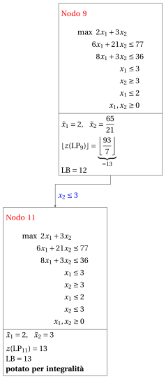{ .fig loading=lazy  }

            Con il lower bound $\LB$ e l'upper bound $\UB$ correnti, abbiamo:

            $$
            13 ~~\le~~ z(\ILP) ~~\le~~ 13
            $$

        - <strong>Terminazione</strong>

            Poiché la lista $L$ è vuota, il lower bound $\LB$ è uguale all'upper bound $\UB$ e il problema $\ILP$ è risolto all'ottimo.

            Il valore ottimo è $z(\ILP)=13$ (il valore del lower bound $\LB$) e una soluzione ottima ${\tilde{\boldsymbol x}}(\ILP)$ è $\tilde x_1=2,\tilde x_2=3$ (la soluzione incumbent ${\bar{\boldsymbol x}}(\ILP)$).

    2. L'albero di branch-and-bound finale è:

        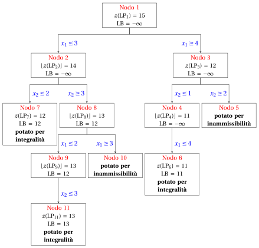{ .fig loading=lazy  }

        I motivi per cui i nodi di branching vengono potati sono i seguenti.

        - Il Nodo 1 ha una soluzione ottima frazionaria con $z(\LP_{1}) = 15$: si effettua il branching su $x_1$.

        - Il Nodo 2 ha una soluzione ottima frazionaria con $\lfloor z(\LP_{2})\rfloor = 14$: si effettua il branching su $x_2$.

        - Il Nodo 3 ha una soluzione ottima frazionaria con $z(\LP_{3}) = 12$: si effettua il branching su $x_2$.

        - Il Nodo 4 ha una soluzione ottima frazionaria con $\lfloor z(\LP_{4})\rfloor = 11$: si effettua il branching su $x_1$.

        - Il nodo di branching verso l'alto del Nodo 4 non viene risolto né disegnato, poiché $\lfloor z(\LP_{4})\rfloor = 11$ $\le \LB = 11$ dopo il suo primo figlio.

        - Il Nodo 5 è potato per inammissibilità: il problema $\LP_{5}$ non ha soluzioni ammissibili.

        - Il Nodo 6 è potato per integralità: $\tilde{\boldsymbol x}(\LP_{6}) = (4, 1)$ è intera, con valore $11$, e diventa la soluzione incumbent.

        - Il Nodo 7 è potato per integralità: $\tilde{\boldsymbol x}(\LP_{7}) = (3, 2)$ è intera, con valore $12$, e diventa la soluzione incumbent.

        - Il Nodo 8 ha una soluzione ottima frazionaria con $\lfloor z(\LP_{8})\rfloor = 13$: si effettua il branching su $x_1$.

        - Il Nodo 9 ha una soluzione ottima frazionaria con $\lfloor z(\LP_{9})\rfloor = 13$: si effettua il branching su $x_2$.

        - Il nodo di branching verso l'alto del Nodo 9 non viene risolto né disegnato, poiché $\lfloor z(\LP_{9})\rfloor = 13$ $\le \LB = 13$ dopo il suo primo figlio.

        - Il Nodo 10 è potato per inammissibilità: il problema $\LP_{10}$ non ha soluzioni ammissibili.

        - Il Nodo 11 è potato per integralità: $\tilde{\boldsymbol x}(\LP_{11}) = (2, 3)$ è intera, con valore $13$, e diventa la soluzione incumbent.

        Il valore ottimo è $z(\ILP) = 13$ e l'algoritmo di branch-and-bound restituisce la soluzione ottima $\tilde{\boldsymbol x}(\ILP) = (2, 3)$.

!!! esercizio "Esercizio 7.6: Algoritmo di branch-and-bound (P6)"

    !!! nota ""

        Consideriamo il seguente problema PLI in forma canonica di massimo con $n=2$ variabili intere e $m=2$ vincoli:

        $$
        \begin{array}{rrrrrrr}
        {\max} & {x_1} & {+} & {x_2} \\[2ex]
        & {4}\, {x_1} & {+} & {15}\, {x_2} & {\le} & {70} \\[2ex]
        & {12}\, {x_1} & {+} & {3}\, {x_2} & {\le} & {52} \\[2ex]
        & {x_1,} &  & {x_2} & {\in} & {\Z_{\ge 0}}
        \end{array}
        $$

        e un dizionario ottimo del suo rilassamento lineare in forma standard:

        \begin{equation*}
        \begin{cases}
        \begin{array}{rrrrrrr}
        {x_1} & {=} & {\dfrac{95}{28}} & {+} & {\dfrac{1}{56}}\, {x_3} & {-} & {\dfrac{5}{56}}\, {x_4} \\[2ex]
        {x_2} & {=} & {\dfrac{79}{21}} & {-} & {\dfrac{1}{14}}\, {x_3} & {+} & {\dfrac{1}{42}}\, {x_4} \\[2ex]
        {z} & {=} & {\dfrac{601}{84}} & {-} & {\dfrac{3}{56}}\, {x_3} & {-} & {\dfrac{11}{168}}\, {x_4}
        \end{array}
        \end{cases}
        \end{equation*}

    **Domande**

    1. Eseguire l'algoritmo di branch-and-bound utilizzando:

        1. la regola dell'indice minimo come strategia di selezione della variabile di branching;

        2. la regola LIFO come strategia di selezione del nodo di branching;

        3. risolvere prima il nodo di branching verso il basso e poi il nodo di branching verso l'alto;

        4. porre il lower bound $\LB$ a $-\infty$ (non viene eseguito alcun algoritmo euristico).

        Risolvere i problemi LP dei nodi di branching con l'algoritmo del simplesso duale. Nell'algoritmo del simplesso duale, la variabile uscente è la variabile in base con valore negativo e indice minimo, e i pareggi nel test dei rapporti si risolvono con l'indice minimo. Mostrare graficamente la soluzione ottima dei problemi LP associati ai nodi di branching.

    2. Determinare e commentare l'albero di branch-and-bound, mostrando il motivo per cui ciascun nodo di branching viene potato.

??? soluzione "Soluzione"

    1. Esecuzione dell'algoritmo di branch-and-bound per risolvere il problema $\ILP$.

        - <strong>Inizializzazione</strong>

            Consideriamo il problema $\LP_{1}$ in forma standard:

            $$
            \begin{array}{rrrrrrrrrrr}
            {\max} & {x_1} & {+} & {x_2} &  &  &  &  \\[2ex]
            & {4}\, {x_1} & {+} & {15}\, {x_2} & {+} & {x_3} &  &  & {=} & {70} \\[2ex]
            & {12}\, {x_1} & {+} & {3}\, {x_2} &  &  & {+} & {x_4} & {=} & {52} \\[2ex]
            & {x_1,} &  & {x_2,} &  & {x_3,} &  & {x_4} & {\ge} & {0}
            \end{array}
            $$

            e il suo dizionario ottimo:

            \begin{equation*}
            \begin{cases}
            \begin{array}{rrrrrrr}
            {x_1} & {=} & {\dfrac{95}{28}} & {+} & {\dfrac{1}{56}}\, {x_3} & {-} & {\dfrac{5}{56}}\, {x_4} \\[2ex]
            {x_2} & {=} & {\dfrac{79}{21}} & {-} & {\dfrac{1}{14}}\, {x_3} & {+} & {\dfrac{1}{42}}\, {x_4} \\[2ex]
            {z} & {=} & {\dfrac{601}{84}} & {-} & {\dfrac{3}{56}}\, {x_3} & {-} & {\dfrac{11}{168}}\, {x_4}
            \end{array}
            \end{cases}
            \end{equation*}

            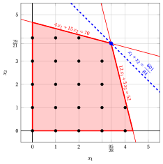{ .fig .ovale loading=lazy  }

            <em>Nodo 1: regione ammissibile di $\LP_{1}$ (in rosso), punti ammissibili del problema PLI (in nero) e soluzione ottima di $\LP_{1}$ (in blu) con la retta della funzione obiettivo che vi passa.</em>

            Una soluzione ottima ${\tilde{\boldsymbol x}}(\LP_{1})$ è:

            $$
            \tilde{x}_1=\dfrac{95}{28},~~\tilde{x}_2=\dfrac{79}{21}
            $$

            il valore ottimo è:

            $$
            z(\LP_{1}) = \dfrac{601}{84}
            $$

            La soluzione ottima ${\tilde{\boldsymbol x}}(\LP_{1})$ è <strong>frazionaria</strong> e il problema $\LP_{1}$ è <strong>ammissibile</strong>, quindi il problema $\LP_{1}$ viene inserito nella lista dei problemi $L$ e il lower bound $\LB$ viene posto a $-\infty$.

            Con il lower bound $\LB$ e l'upper bound $\UB$ correnti, abbiamo:

            $$
            -\infty ~~\le~~ z(\ILP) ~~\le~~ \underbrace{\left\lfloor \dfrac{601}{84} \right\rfloor}_{=7}
            $$

        - <strong>Iterazione 1</strong>

            Il problema $\LP_{1}$ viene estratto e cancellato dalla lista dei problemi $L$.

            La variabile di branching è $x_{1}$. I vincoli di branching sono:

            $$
            x_1 \le \underbrace{\left\lfloor \dfrac{95}{28} \right\rfloor}_{ = 3} \mathrm{~~~e~~~} x_1 \ge \underbrace{\left\lfloor \dfrac{95}{28} \right\rfloor +1}_{= 4}
            $$

            Con questi vincoli di branching si creano i due problemi $\LP_{2}$ e $\LP_{3}$.

            1. Soluzione del problema $\LP_{2}$

                Consideriamo il problema $\LP_{2}$ in forma standard:

                $$
                \begin{array}{rrrrrrrrrrrrr}
                {\max} & {x_1} & {+} & {x_2} &  &  &  &  &  &  \\[2ex]
                & {4}\, {x_1} & {+} & {15}\, {x_2} & {+} & {x_3} &  &  &  &  & {=} & {70} \\[2ex]
                & {12}\, {x_1} & {+} & {3}\, {x_2} &  &  & {+} & {x_4} &  &  & {=} & {52} \\[2ex]
                & {x_1} &  &  &  &  &  &  & {+} & {x_5} & {=} & {3} \\[2ex]
                & {x_1,} &  & {x_2,} &  & {x_3,} &  & {x_4,} &  & {x_5} & {\ge} & {0}
                \end{array}
                $$

                Per il vincolo di branching abbiamo:

                $$
                x_1 + x_5 = 3 \quad \quad \Rightarrow \quad x_5 = 3 - x_1
                $$

                Usando le equazioni del dizionario ottimo possiamo esprimere questo vincolo di branching in funzione delle variabili fuori base. Sostituendo, otteniamo

                $$
                x_5 = 3 - \left(\dfrac{95}{28} + \dfrac{1}{56} \; x_3 - \dfrac{5}{56} \; x_4 \right)
                \quad \quad \Rightarrow \quad
                x_5 = -\dfrac{11}{28} - \dfrac{1}{56} \, x_3 + \dfrac{5}{56} \, x_4
                $$

                Aggiungiamo quindi questa equazione al dizionario ottimo precedente e otteniamo il seguente dizionario:

                \begin{equation*}
                \begin{cases}
                \begin{array}{rrrrrrr}
                {x_1} & {=} & {\dfrac{95}{28}} & {+} & {\dfrac{1}{56}}\, {x_3} & {-} & {\dfrac{5}{56}}\, {x_4} \\[2ex]
                {x_2} & {=} & {\dfrac{79}{21}} & {-} & {\dfrac{1}{14}}\, {x_3} & {+} & {\dfrac{1}{42}}\, {x_4} \\[2ex]
                {x_5} & {=} & {-\dfrac{11}{28}} & {-} & {\dfrac{1}{56}}\, {x_3} & {+} & {\dfrac{5}{56}}\, {x_4} \\[2ex]
                {z} & {=} & {\dfrac{601}{84}} & {-} & {\dfrac{3}{56}}\, {x_3} & {-} & {\dfrac{11}{168}}\, {x_4}
                \end{array}
                \end{cases}
                \end{equation*}

                dove $\pazocal{B}=\{1,2,5\}$ e $\pazocal{N}=\{3,4\}$ e

                - la soluzione di base primale non ammissibile è:

                    $$
                    \bar x_1=\dfrac{95}{28},~~
                    \bar x_2=\dfrac{79}{21},~~
                    \bar x_5=-\dfrac{11}{28},~~~~~~
                    \bar x_3=0,~~
                    \bar x_4=0~~
                    \mathrm{~~di~valore~~~} \dfrac{601}{84}
                    $$

                - la soluzione di base duale ammissibile è:

                    $$
                    \bar \pi_1=0,~~
                    \bar \pi_2=0,~~
                    \bar \pi_5=0,~~~~~~
                    \bar \pi_3=\dfrac{3}{56},~~
                    \bar \pi_4=\dfrac{11}{168}~~
                    \mathrm{~~di~valore~~~} \dfrac{601}{84}
                    $$

                Se aumentiamo il valore di $\pi_{5}$, possiamo ottenere una soluzione duale migliore. Abbiamo:

                $$
                \begin{cases}
                \pi_3 &= \dfrac{3}{56} + \dfrac{1}{56}\,\pi_5 \\[2ex]
                \pi_4 &= \dfrac{11}{168} - \dfrac{5}{56}\,\pi_5
                \end{cases}
                \qquad
                \qquad
                \begin{cases}
                \underbrace{ \dfrac{3}{56} + \dfrac{1}{56}\,\pi_5 \ge 0}_{\pi_3 \ge 0} \\[2ex]
                \underbrace{ \dfrac{11}{168} - \dfrac{5}{56}\,\pi_5 \ge 0}_{\pi_4 \ge 0}
                \end{cases}
                \qquad
                \qquad
                \begin{cases}
                \pi_5 &\ge -3 \\[2ex]
                \pi_5 &\le \dfrac{11}{15}
                \end{cases}
                $$

                Aumentando il valore di $\pi_{5}$ fino a $\dfrac{11}{15}$, il valore di $\pi_{4}$ scende a $0$. Abbiamo quindi che:

                - $\pi_{5}$ entra nella base duale e, di conseguenza, $x_{5}$ esce dalla base primale.

                - $\pi_{4}$ esce dalla base duale e, di conseguenza, $x_{4}$ entra nella base primale.

                Abbiamo:

                $$
                x_5 = -\dfrac{11}{28} - \dfrac{1}{56} \, x_3 + \dfrac{5}{56} \, x_4
                \quad \Rightarrow \quad
                x_4 = \dfrac{22}{5} + \dfrac{1}{5} \, x_3 + \dfrac{56}{5} \, x_5
                $$

                Sostituendo nelle altre equazioni del dizionario primale, otteniamo:

                $$
                x_1
                = \dfrac{95}{28} + \dfrac{1}{56} \; x_3 - \dfrac{5}{56} \left( \dfrac{22}{5} + \dfrac{1}{5} \, x_3 + \dfrac{56}{5} \, x_5 \right)
                = 3 - x_5
                $$

                $$
                x_2
                = \dfrac{79}{21} - \dfrac{1}{14} \; x_3 + \dfrac{1}{42} \left( \dfrac{22}{5} + \dfrac{1}{5} \, x_3 + \dfrac{56}{5} \, x_5 \right)
                = \dfrac{58}{15} - \dfrac{1}{15} \, x_3 + \dfrac{4}{15} \, x_5
                $$

                $$
                z
                = \dfrac{601}{84} - \dfrac{3}{56} \; x_3 - \dfrac{11}{168} \left( \dfrac{22}{5} + \dfrac{1}{5} \, x_3 + \dfrac{56}{5} \, x_5 \right)
                = \dfrac{103}{15} - \dfrac{1}{15} \, x_3 - \dfrac{11}{15} \, x_5
                $$

                Di conseguenza, abbiamo ora il seguente dizionario primale aggiornato:

                \begin{equation*}
                \begin{cases}
                \begin{array}{rrrrrrr}
                {x_1} & {=} & {3} &  &  & {-} & {x_5} \\[2ex]
                {x_2} & {=} & {\dfrac{58}{15}} & {-} & {\dfrac{1}{15}}\, {x_3} & {+} & {\dfrac{4}{15}}\, {x_5} \\[2ex]
                {x_4} & {=} & {\dfrac{22}{5}} & {+} & {\dfrac{1}{5}}\, {x_3} & {+} & {\dfrac{56}{5}}\, {x_5} \\[2ex]
                {z} & {=} & {\dfrac{103}{15}} & {-} & {\dfrac{1}{15}}\, {x_3} & {-} & {\dfrac{11}{15}}\, {x_5}
                \end{array}
                \end{cases}
                \end{equation*}

                dove $\pazocal{B}=\{1,2,4\}$ e $\pazocal{N}=\{3,5\}$ e

                - la soluzione di base primale ottima è:

                    $$
                    \tilde x_1=3,~~
                    \tilde x_2=\dfrac{58}{15},~~
                    \tilde x_4=\dfrac{22}{5},~~~~~~
                    \tilde x_3=0,~~
                    \tilde x_5=0~~
                    \mathrm{~~di~valore~~~} \dfrac{103}{15}
                    $$

                - la soluzione di base duale ottima è:

                    $$
                    \tilde \pi_1=0,~~
                    \tilde \pi_2=0,~~
                    \tilde \pi_4=0,~~~~~~
                    \tilde \pi_3=\dfrac{1}{15},~~
                    \tilde \pi_5=\dfrac{11}{15}~~
                    \mathrm{~~di~valore~~~} \dfrac{103}{15}
                    $$

                { .fig .ovale loading=lazy  }

                <em>Nodo 2: regione ammissibile di $\LP_{2}$ (in rosso), con il vincolo di branching $x_1 \le 3$ (tratteggiato), e la sua soluzione ottima (in blu).</em>

                Una soluzione ottima ${\tilde{\boldsymbol x}}(\LP_{2})$ è:

                $$
                \tilde{x}_1=3,~~\tilde{x}_2=\dfrac{58}{15}
                $$

                il valore ottimo è:

                $$
                z(\LP_{2}) = \dfrac{103}{15}
                $$

                Il problema $\LP_{2}$ è <strong>ammissibile</strong> e abbiamo

                $$
                \left\lfloor z(\LP_{2}) \right\rfloor > \LB
                \qquad \text{poiché} \qquad
                \underbrace{\left\lfloor \dfrac{103}{15} \right\rfloor}_{=6} > -\infty
                $$

                La soluzione ottima ${\tilde{\boldsymbol x}}(\LP_{2})$ è <strong>frazionaria</strong>; di conseguenza, il problema $\LP_{2}$ viene <strong>inserito nella lista dei problemi</strong> $L$.

            2. Soluzione del problema $\LP_{3}$

                Consideriamo il problema $\LP_{3}$ in forma standard:

                $$
                \begin{array}{rrrrrrrrrrrrr}
                {\max} & {x_1} & {+} & {x_2} &  &  &  &  &  &  \\[2ex]
                & {4}\, {x_1} & {+} & {15}\, {x_2} & {+} & {x_3} &  &  &  &  & {=} & {70} \\[2ex]
                & {12}\, {x_1} & {+} & {3}\, {x_2} &  &  & {+} & {x_4} &  &  & {=} & {52} \\[2ex]
                & {x_1} &  &  &  &  &  &  & {-} & {x_5} & {=} & {4} \\[2ex]
                & {x_1,} &  & {x_2,} &  & {x_3,} &  & {x_4,} &  & {x_5} & {\ge} & {0}
                \end{array}
                $$

                Per il vincolo di branching abbiamo:

                $$
                x_1 - x_5 = 4 \quad \quad \Rightarrow \quad x_5 = -4 + x_1
                $$

                Usando le equazioni del dizionario ottimo possiamo esprimere questo vincolo di branching in funzione delle variabili fuori base. Sostituendo, otteniamo

                $$
                x_5 = -4 + \left(\dfrac{95}{28} + \dfrac{1}{56} \; x_3 - \dfrac{5}{56} \; x_4 \right)
                \quad \quad \Rightarrow \quad
                x_5 = -\dfrac{17}{28} + \dfrac{1}{56} \, x_3 - \dfrac{5}{56} \, x_4
                $$

                Aggiungiamo quindi questa equazione al dizionario ottimo precedente e otteniamo il seguente dizionario:

                \begin{equation*}
                \begin{cases}
                \begin{array}{rrrrrrr}
                {x_1} & {=} & {\dfrac{95}{28}} & {+} & {\dfrac{1}{56}}\, {x_3} & {-} & {\dfrac{5}{56}}\, {x_4} \\[2ex]
                {x_2} & {=} & {\dfrac{79}{21}} & {-} & {\dfrac{1}{14}}\, {x_3} & {+} & {\dfrac{1}{42}}\, {x_4} \\[2ex]
                {x_5} & {=} & {-\dfrac{17}{28}} & {+} & {\dfrac{1}{56}}\, {x_3} & {-} & {\dfrac{5}{56}}\, {x_4} \\[2ex]
                {z} & {=} & {\dfrac{601}{84}} & {-} & {\dfrac{3}{56}}\, {x_3} & {-} & {\dfrac{11}{168}}\, {x_4}
                \end{array}
                \end{cases}
                \end{equation*}

                dove $\pazocal{B}=\{1,2,5\}$ e $\pazocal{N}=\{3,4\}$ e

                - la soluzione di base primale non ammissibile è:

                    $$
                    \bar x_1=\dfrac{95}{28},~~
                    \bar x_2=\dfrac{79}{21},~~
                    \bar x_5=-\dfrac{17}{28},~~~~~~
                    \bar x_3=0,~~
                    \bar x_4=0~~
                    \mathrm{~~di~valore~~~} \dfrac{601}{84}
                    $$

                - la soluzione di base duale ammissibile è:

                    $$
                    \bar \pi_1=0,~~
                    \bar \pi_2=0,~~
                    \bar \pi_5=0,~~~~~~
                    \bar \pi_3=\dfrac{3}{56},~~
                    \bar \pi_4=\dfrac{11}{168}~~
                    \mathrm{~~di~valore~~~} \dfrac{601}{84}
                    $$

                Se aumentiamo il valore di $\pi_{5}$, possiamo ottenere una soluzione duale migliore. Abbiamo:

                $$
                \begin{cases}
                \pi_3 &= \dfrac{3}{56} - \dfrac{1}{56}\,\pi_5 \\[2ex]
                \pi_4 &= \dfrac{11}{168} + \dfrac{5}{56}\,\pi_5
                \end{cases}
                \qquad
                \qquad
                \begin{cases}
                \underbrace{ \dfrac{3}{56} - \dfrac{1}{56}\,\pi_5 \ge 0}_{\pi_3 \ge 0} \\[2ex]
                \underbrace{ \dfrac{11}{168} + \dfrac{5}{56}\,\pi_5 \ge 0}_{\pi_4 \ge 0}
                \end{cases}
                \qquad
                \qquad
                \begin{cases}
                \pi_5 &\le 3 \\[2ex]
                \pi_5 &\ge -\dfrac{11}{15}
                \end{cases}
                $$

                Aumentando il valore di $\pi_{5}$ fino a $3$, il valore di $\pi_{3}$ scende a $0$. Abbiamo quindi che:

                - $\pi_{5}$ entra nella base duale e, di conseguenza, $x_{5}$ esce dalla base primale.

                - $\pi_{3}$ esce dalla base duale e, di conseguenza, $x_{3}$ entra nella base primale.

                Abbiamo:

                $$
                x_5 = -\dfrac{17}{28} + \dfrac{1}{56} \, x_3 - \dfrac{5}{56} \, x_4
                \quad \Rightarrow \quad
                x_3 = 34 + 5 \, x_4 + 56 \, x_5
                $$

                Sostituendo nelle altre equazioni del dizionario primale, otteniamo:

                $$
                x_1
                = \dfrac{95}{28} + \dfrac{1}{56} \left( 34 + 5 \, x_4 + 56 \, x_5 \right) - \dfrac{5}{56} \; x_4
                = 4 + x_5
                $$

                $$
                x_2
                = \dfrac{79}{21} - \dfrac{1}{14} \left( 34 + 5 \, x_4 + 56 \, x_5 \right) + \dfrac{1}{42} \; x_4
                = \dfrac{4}{3} - \dfrac{1}{3} \, x_4 - 4 \, x_5
                $$

                $$
                z
                = \dfrac{601}{84} - \dfrac{3}{56} \left( 34 + 5 \, x_4 + 56 \, x_5 \right) - \dfrac{11}{168} \; x_4
                = \dfrac{16}{3} - \dfrac{1}{3} \, x_4 - 3 \, x_5
                $$

                Di conseguenza, abbiamo ora il seguente dizionario primale aggiornato:

                \begin{equation*}
                \begin{cases}
                \begin{array}{rrrrrrr}
                {x_1} & {=} & {4} &  &  & {+} & {x_5} \\[2ex]
                {x_2} & {=} & {\dfrac{4}{3}} & {-} & {\dfrac{1}{3}}\, {x_4} & {-} & {4}\, {x_5} \\[2ex]
                {x_3} & {=} & {34} & {+} & {5}\, {x_4} & {+} & {56}\, {x_5} \\[2ex]
                {z} & {=} & {\dfrac{16}{3}} & {-} & {\dfrac{1}{3}}\, {x_4} & {-} & {3}\, {x_5}
                \end{array}
                \end{cases}
                \end{equation*}

                dove $\pazocal{B}=\{1,2,3\}$ e $\pazocal{N}=\{4,5\}$ e

                - la soluzione di base primale ottima è:

                    $$
                    \tilde x_1=4,~~
                    \tilde x_2=\dfrac{4}{3},~~
                    \tilde x_3=34,~~~~~~
                    \tilde x_4=0,~~
                    \tilde x_5=0~~
                    \mathrm{~~di~valore~~~} \dfrac{16}{3}
                    $$

                - la soluzione di base duale ottima è:

                    $$
                    \tilde \pi_1=0,~~
                    \tilde \pi_2=0,~~
                    \tilde \pi_3=0,~~~~~~
                    \tilde \pi_4=\dfrac{1}{3},~~
                    \tilde \pi_5=3~~
                    \mathrm{~~di~valore~~~} \dfrac{16}{3}
                    $$

                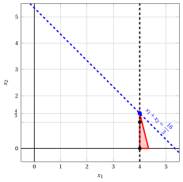{ .fig .ovale loading=lazy  }

                <em>Nodo 3: regione ammissibile di $\LP_{3}$ (in rosso), con il vincolo di branching $x_1 \ge 4$ (tratteggiato), e la sua soluzione ottima (in blu).</em>

                Una soluzione ottima ${\tilde{\boldsymbol x}}(\LP_{3})$ è:

                $$
                \tilde{x}_1=4,~~\tilde{x}_2=\dfrac{4}{3}
                $$

                il valore ottimo è:

                $$
                z(\LP_{3}) = \dfrac{16}{3}
                $$

                Il problema $\LP_{3}$ è <strong>ammissibile</strong> e abbiamo

                $$
                \left\lfloor z(\LP_{3}) \right\rfloor > \LB
                \qquad \text{poiché} \qquad
                \underbrace{\left\lfloor \dfrac{16}{3} \right\rfloor}_{=5} > -\infty
                $$

                La soluzione ottima ${\tilde{\boldsymbol x}}(\LP_{3})$ è <strong>frazionaria</strong>; di conseguenza, il problema $\LP_{3}$ viene <strong>inserito nella lista dei problemi</strong> $L$.

            Alla fine della prima iterazione, il branching su $x_{1}$ dal Nodo 1 ha generato il nodo di branching verso il basso, Nodo 2, e il nodo di branching verso l'alto, Nodo 3. Entrambi i nodi sono inseriti nella lista $L$. L'albero di branch-and-bound corrispondente è:

            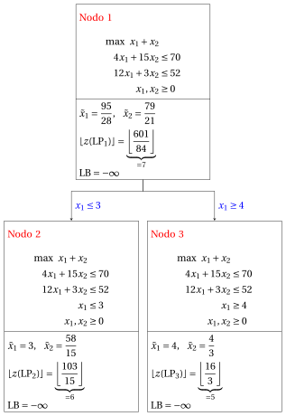{ .fig loading=lazy  }

            Con il lower bound $\LB$ e l'upper bound $\UB$ correnti, abbiamo:

            $$
            -\infty ~~\le~~ z(\ILP) ~~\le~~ \underbrace{\left\lfloor \dfrac{103}{15} \right\rfloor}_{=6}
            $$

        - <strong>Iterazione 2</strong>

            Il problema $\LP_{3}$ viene estratto e cancellato dalla lista dei problemi $L$.

            La variabile di branching è $x_{2}$. I vincoli di branching sono:

            $$
            x_2 \le \underbrace{\left\lfloor \dfrac{4}{3} \right\rfloor}_{ = 1} \mathrm{~~~e~~~} x_2 \ge \underbrace{\left\lfloor \dfrac{4}{3} \right\rfloor +1}_{= 2}
            $$

            Con questi vincoli di branching si creano i due problemi $\LP_{4}$ e $\LP_{5}$.

            1. Soluzione del problema $\LP_{4}$

                Consideriamo il problema $\LP_{4}$ in forma standard:

                $$
                \begin{array}{rrrrrrrrrrrrrrr}
                {\max} & {x_1} & {+} & {x_2} &  &  &  &  &  &  &  &  \\[2ex]
                & {4}\, {x_1} & {+} & {15}\, {x_2} & {+} & {x_3} &  &  &  &  &  &  & {=} & {70} \\[2ex]
                & {12}\, {x_1} & {+} & {3}\, {x_2} &  &  & {+} & {x_4} &  &  &  &  & {=} & {52} \\[2ex]
                & {x_1} &  &  &  &  &  &  & {-} & {x_5} &  &  & {=} & {4} \\[2ex]
                &  &  & {x_2} &  &  &  &  &  &  & {+} & {x_6} & {=} & {1} \\[2ex]
                & {x_1,} &  & {x_2,} &  & {x_3,} &  & {x_4,} &  & {x_5,} &  & {x_6} & {\ge} & {0}
                \end{array}
                $$

                Per il vincolo di branching abbiamo:

                $$
                x_2 + x_6 = 1 \quad \quad \Rightarrow \quad x_6 = 1 - x_2
                $$

                Usando le equazioni del dizionario ottimo possiamo esprimere questo vincolo di branching in funzione delle variabili fuori base. Sostituendo, otteniamo

                $$
                x_6 = 1 - \left(\dfrac{4}{3} - \dfrac{1}{3} \; x_4 - 4 \; x_5 \right)
                \quad \quad \Rightarrow \quad
                x_6 = -\dfrac{1}{3} + \dfrac{1}{3} \, x_4 + 4 \, x_5
                $$

                Aggiungiamo quindi questa equazione al dizionario ottimo precedente e otteniamo il seguente dizionario:

                \begin{equation*}
                \begin{cases}
                \begin{array}{rrrrrrr}
                {x_1} & {=} & {4} &  &  & {+} & {x_5} \\[2ex]
                {x_2} & {=} & {\dfrac{4}{3}} & {-} & {\dfrac{1}{3}}\, {x_4} & {-} & {4}\, {x_5} \\[2ex]
                {x_3} & {=} & {34} & {+} & {5}\, {x_4} & {+} & {56}\, {x_5} \\[2ex]
                {x_6} & {=} & {-\dfrac{1}{3}} & {+} & {\dfrac{1}{3}}\, {x_4} & {+} & {4}\, {x_5} \\[2ex]
                {z} & {=} & {\dfrac{16}{3}} & {-} & {\dfrac{1}{3}}\, {x_4} & {-} & {3}\, {x_5}
                \end{array}
                \end{cases}
                \end{equation*}

                dove $\pazocal{B}=\{1,2,3,6\}$ e $\pazocal{N}=\{4,5\}$ e

                - la soluzione di base primale non ammissibile è:

                    $$
                    \begin{gathered}
                    \bar x_1=4,~~
                    \bar x_2=\dfrac{4}{3},~~
                    \bar x_3=34,~~
                    \bar x_6=-\dfrac{1}{3},\\
                    \bar x_4=0,~~
                    \bar x_5=0~~
                    \mathrm{~~di~valore~~~} \dfrac{16}{3}
                    \end{gathered}
                    $$

                - la soluzione di base duale ammissibile è:

                    $$
                    \begin{gathered}
                    \bar \pi_1=0,~~
                    \bar \pi_2=0,~~
                    \bar \pi_3=0,~~
                    \bar \pi_6=0,\\
                    \bar \pi_4=\dfrac{1}{3},~~
                    \bar \pi_5=3~~
                    \mathrm{~~di~valore~~~} \dfrac{16}{3}
                    \end{gathered}
                    $$

                Se aumentiamo il valore di $\pi_{6}$, possiamo ottenere una soluzione duale migliore. Abbiamo:

                $$
                \begin{cases}
                \pi_4 &= \dfrac{1}{3} - \dfrac{1}{3}\,\pi_6 \\[2ex]
                \pi_5 &= 3 - 4\,\pi_6
                \end{cases}
                \qquad
                \qquad
                \begin{cases}
                \underbrace{ \dfrac{1}{3} - \dfrac{1}{3}\,\pi_6 \ge 0}_{\pi_4 \ge 0} \\[2ex]
                \underbrace{ 3 - 4\,\pi_6 \ge 0}_{\pi_5 \ge 0}
                \end{cases}
                \qquad
                \qquad
                \begin{cases}
                \pi_6 &\le 1 \\[2ex]
                \pi_6 &\le \dfrac{3}{4}
                \end{cases}
                $$

                Aumentando il valore di $\pi_{6}$ fino a $\min \left\{1, \dfrac{3}{4}\right\}=\dfrac{3}{4}$, il valore di $\pi_{5}$ scende a $0$. Abbiamo quindi che:

                - $\pi_{6}$ entra nella base duale e, di conseguenza, $x_{6}$ esce dalla base primale.

                - $\pi_{5}$ esce dalla base duale e, di conseguenza, $x_{5}$ entra nella base primale.

                Abbiamo:

                $$
                x_6 = -\dfrac{1}{3} + \dfrac{1}{3} \, x_4 + 4 \, x_5
                \quad \Rightarrow \quad
                x_5 = \dfrac{1}{12} - \dfrac{1}{12} \, x_4 + \dfrac{1}{4} \, x_6
                $$

                Sostituendo nelle altre equazioni del dizionario primale, otteniamo:

                $$
                x_1
                = 4 + \left( \dfrac{1}{12} - \dfrac{1}{12} \, x_4 + \dfrac{1}{4} \, x_6 \right)
                = \dfrac{49}{12} - \dfrac{1}{12} \, x_4 + \dfrac{1}{4} \, x_6
                $$

                $$
                x_2
                = \dfrac{4}{3} - \dfrac{1}{3} \; x_4 - 4 \left( \dfrac{1}{12} - \dfrac{1}{12} \, x_4 + \dfrac{1}{4} \, x_6 \right)
                = 1 - x_6
                $$

                $$
                x_3
                = 34 + 5 \; x_4 + 56 \left( \dfrac{1}{12} - \dfrac{1}{12} \, x_4 + \dfrac{1}{4} \, x_6 \right)
                = \dfrac{116}{3} + \dfrac{1}{3} \, x_4 + 14 \, x_6
                $$

                $$
                z
                = \dfrac{16}{3} - \dfrac{1}{3} \; x_4 - 3 \left( \dfrac{1}{12} - \dfrac{1}{12} \, x_4 + \dfrac{1}{4} \, x_6 \right)
                = \dfrac{61}{12} - \dfrac{1}{12} \, x_4 - \dfrac{3}{4} \, x_6
                $$

                Di conseguenza, abbiamo ora il seguente dizionario primale aggiornato:

                \begin{equation*}
                \begin{cases}
                \begin{array}{rrrrrrr}
                {x_1} & {=} & {\dfrac{49}{12}} & {-} & {\dfrac{1}{12}}\, {x_4} & {+} & {\dfrac{1}{4}}\, {x_6} \\[2ex]
                {x_2} & {=} & {1} &  &  & {-} & {x_6} \\[2ex]
                {x_3} & {=} & {\dfrac{116}{3}} & {+} & {\dfrac{1}{3}}\, {x_4} & {+} & {14}\, {x_6} \\[2ex]
                {x_5} & {=} & {\dfrac{1}{12}} & {-} & {\dfrac{1}{12}}\, {x_4} & {+} & {\dfrac{1}{4}}\, {x_6} \\[2ex]
                {z} & {=} & {\dfrac{61}{12}} & {-} & {\dfrac{1}{12}}\, {x_4} & {-} & {\dfrac{3}{4}}\, {x_6}
                \end{array}
                \end{cases}
                \end{equation*}

                dove $\pazocal{B}=\{1,2,3,5\}$ e $\pazocal{N}=\{4,6\}$ e

                - la soluzione di base primale ottima è:

                    $$
                    \begin{gathered}
                    \tilde x_1=\dfrac{49}{12},~~
                    \tilde x_2=1,~~
                    \tilde x_3=\dfrac{116}{3},~~
                    \tilde x_5=\dfrac{1}{12},\\
                    \tilde x_4=0,~~
                    \tilde x_6=0~~
                    \mathrm{~~di~valore~~~} \dfrac{61}{12}
                    \end{gathered}
                    $$

                - la soluzione di base duale ottima è:

                    $$
                    \begin{gathered}
                    \tilde \pi_1=0,~~
                    \tilde \pi_2=0,~~
                    \tilde \pi_3=0,~~
                    \tilde \pi_5=0,\\
                    \tilde \pi_4=\dfrac{1}{12},~~
                    \tilde \pi_6=\dfrac{3}{4}~~
                    \mathrm{~~di~valore~~~} \dfrac{61}{12}
                    \end{gathered}
                    $$

                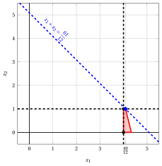{ .fig .ovale loading=lazy  }

                <em>Nodo 4: regione ammissibile di $\LP_{4}$ (in rosso), con il vincolo di branching $x_2 \le 1$ (tratteggiato), e la sua soluzione ottima (in blu).</em>

                Una soluzione ottima ${\tilde{\boldsymbol x}}(\LP_{4})$ è:

                $$
                \tilde{x}_1=\dfrac{49}{12},~~\tilde{x}_2=1
                $$

                il valore ottimo è:

                $$
                z(\LP_{4}) = \dfrac{61}{12}
                $$

                Il problema $\LP_{4}$ è <strong>ammissibile</strong> e abbiamo

                $$
                \left\lfloor z(\LP_{4}) \right\rfloor > \LB
                \qquad \text{poiché} \qquad
                \underbrace{\left\lfloor \dfrac{61}{12} \right\rfloor}_{=5} > -\infty
                $$

                La soluzione ottima ${\tilde{\boldsymbol x}}(\LP_{4})$ è <strong>frazionaria</strong>; di conseguenza, il problema $\LP_{4}$ viene <strong>inserito nella lista dei problemi</strong> $L$.

            2. Soluzione del problema $\LP_{5}$

                Consideriamo il problema $\LP_{5}$ in forma standard:

                $$
                \begin{array}{rrrrrrrrrrrrrrr}
                {\max} & {x_1} & {+} & {x_2} &  &  &  &  &  &  &  &  \\[2ex]
                & {4}\, {x_1} & {+} & {15}\, {x_2} & {+} & {x_3} &  &  &  &  &  &  & {=} & {70} \\[2ex]
                & {12}\, {x_1} & {+} & {3}\, {x_2} &  &  & {+} & {x_4} &  &  &  &  & {=} & {52} \\[2ex]
                & {x_1} &  &  &  &  &  &  & {-} & {x_5} &  &  & {=} & {4} \\[2ex]
                &  &  & {x_2} &  &  &  &  &  &  & {-} & {x_6} & {=} & {2} \\[2ex]
                & {x_1,} &  & {x_2,} &  & {x_3,} &  & {x_4,} &  & {x_5,} &  & {x_6} & {\ge} & {0}
                \end{array}
                $$

                Per il vincolo di branching abbiamo:

                $$
                x_2 - x_6 = 2 \quad \quad \Rightarrow \quad x_6 = -2 + x_2
                $$

                Usando le equazioni del dizionario ottimo possiamo esprimere questo vincolo di branching in funzione delle variabili fuori base. Sostituendo, otteniamo

                $$
                x_6 = -2 + \left(\dfrac{4}{3} - \dfrac{1}{3} \; x_4 - 4 \; x_5 \right)
                \quad \quad \Rightarrow \quad
                x_6 = -\dfrac{2}{3} - \dfrac{1}{3} \, x_4 - 4 \, x_5
                $$

                Aggiungiamo quindi questa equazione al dizionario ottimo precedente e otteniamo il seguente dizionario:

                \begin{equation*}
                \begin{cases}
                \begin{array}{rrrrrrr}
                {x_1} & {=} & {4} &  &  & {+} & {x_5} \\[2ex]
                {x_2} & {=} & {\dfrac{4}{3}} & {-} & {\dfrac{1}{3}}\, {x_4} & {-} & {4}\, {x_5} \\[2ex]
                {x_3} & {=} & {34} & {+} & {5}\, {x_4} & {+} & {56}\, {x_5} \\[2ex]
                {x_6} & {=} & {-\dfrac{2}{3}} & {-} & {\dfrac{1}{3}}\, {x_4} & {-} & {4}\, {x_5} \\[2ex]
                {z} & {=} & {\dfrac{16}{3}} & {-} & {\dfrac{1}{3}}\, {x_4} & {-} & {3}\, {x_5}
                \end{array}
                \end{cases}
                \end{equation*}

                dove $\pazocal{B}=\{1,2,3,6\}$ e $\pazocal{N}=\{4,5\}$ e

                - la soluzione di base primale non ammissibile è:

                    $$
                    \begin{gathered}
                    \bar x_1=4,~~
                    \bar x_2=\dfrac{4}{3},~~
                    \bar x_3=34,~~
                    \bar x_6=-\dfrac{2}{3},\\
                    \bar x_4=0,~~
                    \bar x_5=0~~
                    \mathrm{~~di~valore~~~} \dfrac{16}{3}
                    \end{gathered}
                    $$

                - la soluzione di base duale ammissibile è:

                    $$
                    \begin{gathered}
                    \bar \pi_1=0,~~
                    \bar \pi_2=0,~~
                    \bar \pi_3=0,~~
                    \bar \pi_6=0,\\
                    \bar \pi_4=\dfrac{1}{3},~~
                    \bar \pi_5=3~~
                    \mathrm{~~di~valore~~~} \dfrac{16}{3}
                    \end{gathered}
                    $$

                Se aumentiamo il valore di $\pi_{6}$, possiamo ottenere una soluzione duale migliore. Abbiamo:

                $$
                \begin{cases}
                \pi_4 &= \dfrac{1}{3} + \dfrac{1}{3}\,\pi_6 \\[2ex]
                \pi_5 &= 3 + 4\,\pi_6
                \end{cases}
                \qquad
                \qquad
                \begin{cases}
                \underbrace{ \dfrac{1}{3} + \dfrac{1}{3}\,\pi_6 \ge 0}_{\pi_4 \ge 0} \\[2ex]
                \underbrace{ 3 + 4\,\pi_6 \ge 0}_{\pi_5 \ge 0}
                \end{cases}
                \qquad
                \qquad
                \begin{cases}
                \pi_6 &\ge -1 \\[2ex]
                \pi_6 &\ge -\dfrac{3}{4}
                \end{cases}
                $$

                Di conseguenza, possiamo aumentare il valore di $\pi_{6}$ senza violare l'ammissibilità duale: il problema duale è <strong>illimitato</strong>. Ne segue che il problema primale $\LP_{5}$ è <strong>inammissibile</strong> e il nodo di branching corrispondente è <u>potato per inammissibilità</u>.

            Alla fine della seconda iterazione, il branching su $x_{2}$ dal Nodo 3 ha generato il nodo di branching verso il basso, Nodo 4, e il nodo di branching verso l'alto, Nodo 5. Il Nodo 4 è inserito nella lista $L$, mentre il Nodo 5 è potato per inammissibilità. L'albero di branch-and-bound corrispondente è:

            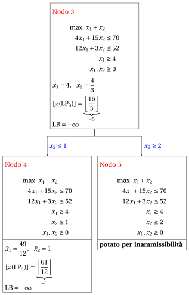{ .fig loading=lazy  }

            Con il lower bound $\LB$ e l'upper bound $\UB$ correnti, abbiamo:

            $$
            -\infty ~~\le~~ z(\ILP) ~~\le~~ \underbrace{\left\lfloor \dfrac{103}{15} \right\rfloor}_{=6}
            $$

        - <strong>Iterazione 3</strong>

            Il problema $\LP_{4}$ viene estratto e cancellato dalla lista dei problemi $L$.

            La variabile di branching è $x_{1}$. I vincoli di branching sono:

            $$
            x_1 \le \underbrace{\left\lfloor \dfrac{49}{12} \right\rfloor}_{ = 4} \mathrm{~~~e~~~} x_1 \ge \underbrace{\left\lfloor \dfrac{49}{12} \right\rfloor +1}_{= 5}
            $$

            Con il primo vincolo di branching si crea il problema $\LP_{6}$ (il secondo figlio si risolve solo se necessario).

            1. Soluzione del problema $\LP_{6}$

                Consideriamo il problema $\LP_{6}$ in forma standard:

                $$
                \begin{array}{rrrrrrrrrrrrrrrrr}
                {\max} & {x_1} & {+} & {x_2} &  &  &  &  &  &  &  &  &  &  \\[2ex]
                & {4}\, {x_1} & {+} & {15}\, {x_2} & {+} & {x_3} &  &  &  &  &  &  &  &  & {=} & {70} \\[2ex]
                & {12}\, {x_1} & {+} & {3}\, {x_2} &  &  & {+} & {x_4} &  &  &  &  &  &  & {=} & {52} \\[2ex]
                & {x_1} &  &  &  &  &  &  & {-} & {x_5} &  &  &  &  & {=} & {4} \\[2ex]
                &  &  & {x_2} &  &  &  &  &  &  & {+} & {x_6} &  &  & {=} & {1} \\[2ex]
                & {x_1} &  &  &  &  &  &  &  &  &  &  & {+} & {x_7} & {=} & {4} \\[2ex]
                & {x_1,} &  & {x_2,} &  & {x_3,} &  & {x_4,} &  & {x_5,} &  & {x_6,} &  & {x_7} & {\ge} & {0}
                \end{array}
                $$

                Per il vincolo di branching abbiamo:

                $$
                x_1 + x_7 = 4 \quad \quad \Rightarrow \quad x_7 = 4 - x_1
                $$

                Usando le equazioni del dizionario ottimo possiamo esprimere questo vincolo di branching in funzione delle variabili fuori base. Sostituendo, otteniamo

                $$
                x_7 = 4 - \left(\dfrac{49}{12} - \dfrac{1}{12} \; x_4 + \dfrac{1}{4} \; x_6 \right)
                \quad \quad \Rightarrow \quad
                x_7 = -\dfrac{1}{12} + \dfrac{1}{12} \, x_4 - \dfrac{1}{4} \, x_6
                $$

                Aggiungiamo quindi questa equazione al dizionario ottimo precedente e otteniamo il seguente dizionario:

                \begin{equation*}
                \begin{cases}
                \begin{array}{rrrrrrr}
                {x_1} & {=} & {\dfrac{49}{12}} & {-} & {\dfrac{1}{12}}\, {x_4} & {+} & {\dfrac{1}{4}}\, {x_6} \\[2ex]
                {x_2} & {=} & {1} &  &  & {-} & {x_6} \\[2ex]
                {x_3} & {=} & {\dfrac{116}{3}} & {+} & {\dfrac{1}{3}}\, {x_4} & {+} & {14}\, {x_6} \\[2ex]
                {x_5} & {=} & {\dfrac{1}{12}} & {-} & {\dfrac{1}{12}}\, {x_4} & {+} & {\dfrac{1}{4}}\, {x_6} \\[2ex]
                {x_7} & {=} & {-\dfrac{1}{12}} & {+} & {\dfrac{1}{12}}\, {x_4} & {-} & {\dfrac{1}{4}}\, {x_6} \\[2ex]
                {z} & {=} & {\dfrac{61}{12}} & {-} & {\dfrac{1}{12}}\, {x_4} & {-} & {\dfrac{3}{4}}\, {x_6}
                \end{array}
                \end{cases}
                \end{equation*}

                dove $\pazocal{B}=\{1,2,3,5,7\}$ e $\pazocal{N}=\{4,6\}$ e

                - la soluzione di base primale non ammissibile è:

                    $$
                    \begin{gathered}
                    \bar x_1=\dfrac{49}{12},~~
                    \bar x_2=1,~~
                    \bar x_3=\dfrac{116}{3},~~
                    \bar x_5=\dfrac{1}{12},~~
                    \bar x_7=-\dfrac{1}{12},\\
                    \bar x_4=0,~~
                    \bar x_6=0~~
                    \mathrm{~~di~valore~~~} \dfrac{61}{12}
                    \end{gathered}
                    $$

                - la soluzione di base duale ammissibile è:

                    $$
                    \begin{gathered}
                    \bar \pi_1=0,~~
                    \bar \pi_2=0,~~
                    \bar \pi_3=0,~~
                    \bar \pi_5=0,~~
                    \bar \pi_7=0,\\
                    \bar \pi_4=\dfrac{1}{12},~~
                    \bar \pi_6=\dfrac{3}{4}~~
                    \mathrm{~~di~valore~~~} \dfrac{61}{12}
                    \end{gathered}
                    $$

                Se aumentiamo il valore di $\pi_{7}$, possiamo ottenere una soluzione duale migliore. Abbiamo:

                $$
                \begin{cases}
                \pi_4 &= \dfrac{1}{12} - \dfrac{1}{12}\,\pi_7 \\[2ex]
                \pi_6 &= \dfrac{3}{4} + \dfrac{1}{4}\,\pi_7
                \end{cases}
                \qquad
                \qquad
                \begin{cases}
                \underbrace{ \dfrac{1}{12} - \dfrac{1}{12}\,\pi_7 \ge 0}_{\pi_4 \ge 0} \\[2ex]
                \underbrace{ \dfrac{3}{4} + \dfrac{1}{4}\,\pi_7 \ge 0}_{\pi_6 \ge 0}
                \end{cases}
                \qquad
                \qquad
                \begin{cases}
                \pi_7 &\le 1 \\[2ex]
                \pi_7 &\ge -3
                \end{cases}
                $$

                Aumentando il valore di $\pi_{7}$ fino a $1$, il valore di $\pi_{4}$ scende a $0$. Abbiamo quindi che:

                - $\pi_{7}$ entra nella base duale e, di conseguenza, $x_{7}$ esce dalla base primale.

                - $\pi_{4}$ esce dalla base duale e, di conseguenza, $x_{4}$ entra nella base primale.

                Abbiamo:

                $$
                x_7 = -\dfrac{1}{12} + \dfrac{1}{12} \, x_4 - \dfrac{1}{4} \, x_6
                \quad \Rightarrow \quad
                x_4 = 1 + 3 \, x_6 + 12 \, x_7
                $$

                Sostituendo nelle altre equazioni del dizionario primale, otteniamo:

                $$
                x_1
                = \dfrac{49}{12} - \dfrac{1}{12} \left( 1 + 3 \, x_6 + 12 \, x_7 \right) + \dfrac{1}{4} \; x_6
                = 4 - x_7
                $$

                $$
                x_3
                = \dfrac{116}{3} + \dfrac{1}{3} \left( 1 + 3 \, x_6 + 12 \, x_7 \right) + 14 \; x_6
                = 39 + 15 \, x_6 + 4 \, x_7
                $$

                $$
                x_5
                = \dfrac{1}{12} - \dfrac{1}{12} \left( 1 + 3 \, x_6 + 12 \, x_7 \right) + \dfrac{1}{4} \; x_6
                = 0 - x_7
                $$

                $$
                z
                = \dfrac{61}{12} - \dfrac{1}{12} \left( 1 + 3 \, x_6 + 12 \, x_7 \right) - \dfrac{3}{4} \; x_6
                = 5 - x_6 - x_7
                $$

                Di conseguenza, abbiamo ora il seguente dizionario primale aggiornato:

                \begin{equation*}
                \begin{cases}
                \begin{array}{rrrrrrr}
                {x_1} & {=} & {4} &  &  & {-} & {x_7} \\[2ex]
                {x_2} & {=} & {1} & {-} & {x_6} &  &  \\[2ex]
                {x_3} & {=} & {39} & {+} & {15}\, {x_6} & {+} & {4}\, {x_7} \\[2ex]
                {x_4} & {=} & {1} & {+} & {3}\, {x_6} & {+} & {12}\, {x_7} \\[2ex]
                {x_5} & {=} & {0} &  &  & {-} & {x_7} \\[2ex]
                {z} & {=} & {5} & {-} & {x_6} & {-} & {x_7}
                \end{array}
                \end{cases}
                \end{equation*}

                dove $\pazocal{B}=\{1,2,3,4,5\}$ e $\pazocal{N}=\{6,7\}$ e

                - la soluzione di base primale ottima è:

                    $$
                    \begin{gathered}
                    \tilde x_1=4,~~
                    \tilde x_2=1,~~
                    \tilde x_3=39,~~
                    \tilde x_4=1,~~
                    \tilde x_5=0,\\
                    \tilde x_6=0,~~
                    \tilde x_7=0~~
                    \mathrm{~~di~valore~~~} 5
                    \end{gathered}
                    $$

                - la soluzione di base duale ottima è:

                    $$
                    \begin{gathered}
                    \tilde \pi_1=0,~~
                    \tilde \pi_2=0,~~
                    \tilde \pi_3=0,~~
                    \tilde \pi_4=0,~~
                    \tilde \pi_5=0,\\
                    \tilde \pi_6=1,~~
                    \tilde \pi_7=1~~
                    \mathrm{~~di~valore~~~} 5
                    \end{gathered}
                    $$

                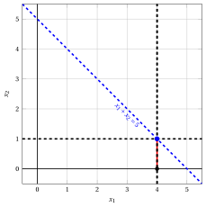{ .fig .ovale loading=lazy  }

                <em>Nodo 6: regione ammissibile di $\LP_{6}$ (in rosso), con il vincolo di branching $x_1 \le 4$ (tratteggiato), e la sua soluzione ottima (in blu).</em>

                Una soluzione ottima ${\tilde{\boldsymbol x}}(\LP_{6})$ è:

                $$
                \tilde{x}_1=4,~~\tilde{x}_2=1
                $$

                il valore ottimo è:

                $$
                z(\LP_{6}) = 5
                $$

                Il problema $\LP_{6}$ è <strong>ammissibile</strong> e abbiamo

                $$
                \left\lfloor z(\LP_{6}) \right\rfloor > \LB
                \qquad \text{poiché} \qquad
                5 > -\infty
                $$

                La soluzione ottima ${\tilde{\boldsymbol x}}(\LP_{6})$ è <strong>intera</strong>; di conseguenza, il lower bound $\LB$ diventa $5$ e la soluzione incumbent ${\bar{\boldsymbol x}}(\ILP)$ diventa $\bar{x}_1=4,\bar{x}_2=1$.

                Di conseguenza, il nodo di branching è <u>potato per integralità</u>.

            Alla fine della terza iterazione, il branching su $x_{1}$ dal Nodo 4 ha generato il nodo di branching verso il basso, Nodo 6. Questo nodo è potato per integralità. Il nodo di branching verso l'alto non viene risolto, poiché dopo il Nodo 6 il lower bound soddisfa

            $$
            \left\lfloor z(\LP_{4}) \right\rfloor \le \LB.
            $$

            Questa è la parte dell'albero di branch-and-bound che mostra i problemi LP dei nodi di branching risolti:

            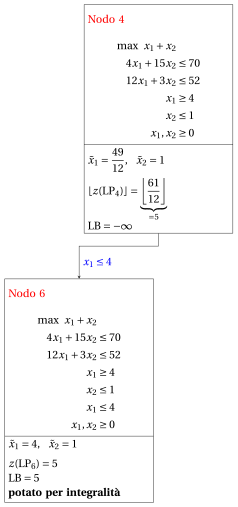{ .fig loading=lazy  }

            Con il lower bound $\LB$ e l'upper bound $\UB$ correnti, abbiamo:

            $$
            5 ~~\le~~ z(\ILP) ~~\le~~ \underbrace{\left\lfloor \dfrac{103}{15} \right\rfloor}_{=6}
            $$

        - <strong>Iterazione 4</strong>

            Il problema $\LP_{2}$ viene estratto e cancellato dalla lista dei problemi $L$.

            La variabile di branching è $x_{2}$. I vincoli di branching sono:

            $$
            x_2 \le \underbrace{\left\lfloor \dfrac{58}{15} \right\rfloor}_{ = 3} \mathrm{~~~e~~~} x_2 \ge \underbrace{\left\lfloor \dfrac{58}{15} \right\rfloor +1}_{= 4}
            $$

            Con il primo vincolo di branching si crea il problema $\LP_{7}$ (il secondo figlio si risolve solo se necessario).

            1. Soluzione del problema $\LP_{7}$

                Consideriamo il problema $\LP_{7}$ in forma standard:

                $$
                \begin{array}{rrrrrrrrrrrrrrr}
                {\max} & {x_1} & {+} & {x_2} &  &  &  &  &  &  &  &  \\[2ex]
                & {4}\, {x_1} & {+} & {15}\, {x_2} & {+} & {x_3} &  &  &  &  &  &  & {=} & {70} \\[2ex]
                & {12}\, {x_1} & {+} & {3}\, {x_2} &  &  & {+} & {x_4} &  &  &  &  & {=} & {52} \\[2ex]
                & {x_1} &  &  &  &  &  &  & {+} & {x_5} &  &  & {=} & {3} \\[2ex]
                &  &  & {x_2} &  &  &  &  &  &  & {+} & {x_6} & {=} & {3} \\[2ex]
                & {x_1,} &  & {x_2,} &  & {x_3,} &  & {x_4,} &  & {x_5,} &  & {x_6} & {\ge} & {0}
                \end{array}
                $$

                Per il vincolo di branching abbiamo:

                $$
                x_2 + x_6 = 3 \quad \quad \Rightarrow \quad x_6 = 3 - x_2
                $$

                Usando le equazioni del dizionario ottimo possiamo esprimere questo vincolo di branching in funzione delle variabili fuori base. Sostituendo, otteniamo

                $$
                x_6 = 3 - \left(\dfrac{58}{15} - \dfrac{1}{15} \; x_3 + \dfrac{4}{15} \; x_5 \right)
                \quad \quad \Rightarrow \quad
                x_6 = -\dfrac{13}{15} + \dfrac{1}{15} \, x_3 - \dfrac{4}{15} \, x_5
                $$

                Aggiungiamo quindi questa equazione al dizionario ottimo precedente e otteniamo il seguente dizionario:

                \begin{equation*}
                \begin{cases}
                \begin{array}{rrrrrrr}
                {x_1} & {=} & {3} &  &  & {-} & {x_5} \\[2ex]
                {x_2} & {=} & {\dfrac{58}{15}} & {-} & {\dfrac{1}{15}}\, {x_3} & {+} & {\dfrac{4}{15}}\, {x_5} \\[2ex]
                {x_4} & {=} & {\dfrac{22}{5}} & {+} & {\dfrac{1}{5}}\, {x_3} & {+} & {\dfrac{56}{5}}\, {x_5} \\[2ex]
                {x_6} & {=} & {-\dfrac{13}{15}} & {+} & {\dfrac{1}{15}}\, {x_3} & {-} & {\dfrac{4}{15}}\, {x_5} \\[2ex]
                {z} & {=} & {\dfrac{103}{15}} & {-} & {\dfrac{1}{15}}\, {x_3} & {-} & {\dfrac{11}{15}}\, {x_5}
                \end{array}
                \end{cases}
                \end{equation*}

                dove $\pazocal{B}=\{1,2,4,6\}$ e $\pazocal{N}=\{3,5\}$ e

                - la soluzione di base primale non ammissibile è:

                    $$
                    \begin{gathered}
                    \bar x_1=3,~~
                    \bar x_2=\dfrac{58}{15},~~
                    \bar x_4=\dfrac{22}{5},~~
                    \bar x_6=-\dfrac{13}{15},\\
                    \bar x_3=0,~~
                    \bar x_5=0~~
                    \mathrm{~~di~valore~~~} \dfrac{103}{15}
                    \end{gathered}
                    $$

                - la soluzione di base duale ammissibile è:

                    $$
                    \begin{gathered}
                    \bar \pi_1=0,~~
                    \bar \pi_2=0,~~
                    \bar \pi_4=0,~~
                    \bar \pi_6=0,\\
                    \bar \pi_3=\dfrac{1}{15},~~
                    \bar \pi_5=\dfrac{11}{15}~~
                    \mathrm{~~di~valore~~~} \dfrac{103}{15}
                    \end{gathered}
                    $$

                Se aumentiamo il valore di $\pi_{6}$, possiamo ottenere una soluzione duale migliore. Abbiamo:

                $$
                \begin{cases}
                \pi_3 &= \dfrac{1}{15} - \dfrac{1}{15}\,\pi_6 \\[2ex]
                \pi_5 &= \dfrac{11}{15} + \dfrac{4}{15}\,\pi_6
                \end{cases}
                \qquad
                \qquad
                \begin{cases}
                \underbrace{ \dfrac{1}{15} - \dfrac{1}{15}\,\pi_6 \ge 0}_{\pi_3 \ge 0} \\[2ex]
                \underbrace{ \dfrac{11}{15} + \dfrac{4}{15}\,\pi_6 \ge 0}_{\pi_5 \ge 0}
                \end{cases}
                \qquad
                \qquad
                \begin{cases}
                \pi_6 &\le 1 \\[2ex]
                \pi_6 &\ge -\dfrac{11}{4}
                \end{cases}
                $$

                Aumentando il valore di $\pi_{6}$ fino a $1$, il valore di $\pi_{3}$ scende a $0$. Abbiamo quindi che:

                - $\pi_{6}$ entra nella base duale e, di conseguenza, $x_{6}$ esce dalla base primale.

                - $\pi_{3}$ esce dalla base duale e, di conseguenza, $x_{3}$ entra nella base primale.

                Abbiamo:

                $$
                x_6 = -\dfrac{13}{15} + \dfrac{1}{15} \, x_3 - \dfrac{4}{15} \, x_5
                \quad \Rightarrow \quad
                x_3 = 13 + 4 \, x_5 + 15 \, x_6
                $$

                Sostituendo nelle altre equazioni del dizionario primale, otteniamo:

                $$
                x_2
                = \dfrac{58}{15} - \dfrac{1}{15} \left( 13 + 4 \, x_5 + 15 \, x_6 \right) + \dfrac{4}{15} \; x_5
                = 3 - x_6
                $$

                $$
                x_4
                = \dfrac{22}{5} + \dfrac{1}{5} \left( 13 + 4 \, x_5 + 15 \, x_6 \right) + \dfrac{56}{5} \; x_5
                = 7 + 12 \, x_5 + 3 \, x_6
                $$

                $$
                z
                = \dfrac{103}{15} - \dfrac{1}{15} \left( 13 + 4 \, x_5 + 15 \, x_6 \right) - \dfrac{11}{15} \; x_5
                = 6 - x_5 - x_6
                $$

                Di conseguenza, abbiamo ora il seguente dizionario primale aggiornato:

                \begin{equation*}
                \begin{cases}
                \begin{array}{rrrrrrr}
                {x_1} & {=} & {3} & {-} & {x_5} &  &  \\[2ex]
                {x_2} & {=} & {3} &  &  & {-} & {x_6} \\[2ex]
                {x_3} & {=} & {13} & {+} & {4}\, {x_5} & {+} & {15}\, {x_6} \\[2ex]
                {x_4} & {=} & {7} & {+} & {12}\, {x_5} & {+} & {3}\, {x_6} \\[2ex]
                {z} & {=} & {6} & {-} & {x_5} & {-} & {x_6}
                \end{array}
                \end{cases}
                \end{equation*}

                dove $\pazocal{B}=\{1,2,3,4\}$ e $\pazocal{N}=\{5,6\}$ e

                - la soluzione di base primale ottima è:

                    $$
                    \begin{gathered}
                    \tilde x_1=3,~~
                    \tilde x_2=3,~~
                    \tilde x_3=13,~~
                    \tilde x_4=7,\\
                    \tilde x_5=0,~~
                    \tilde x_6=0~~
                    \mathrm{~~di~valore~~~} 6
                    \end{gathered}
                    $$

                - la soluzione di base duale ottima è:

                    $$
                    \begin{gathered}
                    \tilde \pi_1=0,~~
                    \tilde \pi_2=0,~~
                    \tilde \pi_3=0,~~
                    \tilde \pi_4=0,\\
                    \tilde \pi_5=1,~~
                    \tilde \pi_6=1~~
                    \mathrm{~~di~valore~~~} 6
                    \end{gathered}
                    $$

                { .fig .ovale loading=lazy  }

                <em>Nodo 7: regione ammissibile di $\LP_{7}$ (in rosso), con il vincolo di branching $x_2 \le 3$ (tratteggiato), e la sua soluzione ottima (in blu).</em>

                Una soluzione ottima ${\tilde{\boldsymbol x}}(\LP_{7})$ è:

                $$
                \tilde{x}_1=3,~~\tilde{x}_2=3
                $$

                il valore ottimo è:

                $$
                z(\LP_{7}) = 6
                $$

                Il problema $\LP_{7}$ è <strong>ammissibile</strong> e abbiamo

                $$
                \left\lfloor z(\LP_{7}) \right\rfloor > \LB
                \qquad \text{poiché} \qquad
                6 > 5
                $$

                La soluzione ottima ${\tilde{\boldsymbol x}}(\LP_{7})$ è <strong>intera</strong>; di conseguenza, il lower bound $\LB$ diventa $6$ e la soluzione incumbent ${\bar{\boldsymbol x}}(\ILP)$ diventa $\bar{x}_1=3,\bar{x}_2=3$.

                Di conseguenza, il nodo di branching è <u>potato per integralità</u>.

            Alla fine della quarta iterazione, il branching su $x_{2}$ dal Nodo 2 ha generato il nodo di branching verso il basso, Nodo 7. Questo nodo è potato per integralità. Il nodo di branching verso l'alto non viene risolto, poiché dopo il Nodo 7 il lower bound soddisfa

            $$
            \left\lfloor z(\LP_{2}) \right\rfloor \le \LB.
            $$

            Questa è la parte dell'albero di branch-and-bound che mostra i problemi LP dei nodi di branching risolti:

            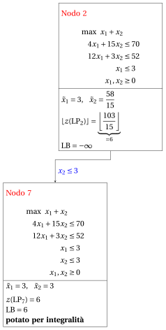{ .fig loading=lazy  }

            Con il lower bound $\LB$ e l'upper bound $\UB$ correnti, abbiamo:

            $$
            6 ~~\le~~ z(\ILP) ~~\le~~ 6
            $$

        - <strong>Terminazione</strong>

            Poiché la lista $L$ è vuota, il lower bound $\LB$ è uguale all'upper bound $\UB$ e il problema $\ILP$ è risolto all'ottimo.

            Il valore ottimo è $z(\ILP)=6$ (il valore del lower bound $\LB$) e una soluzione ottima ${\tilde{\boldsymbol x}}(\ILP)$ è $\tilde x_1=3,\tilde x_2=3$ (la soluzione incumbent ${\bar{\boldsymbol x}}(\ILP)$).

    2. L'albero di branch-and-bound finale è:

        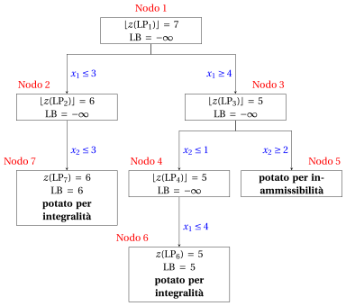{ .fig loading=lazy  }

        I motivi per cui i nodi di branching vengono potati sono i seguenti.

        - Il Nodo 1 ha una soluzione ottima frazionaria con $\lfloor z(\LP_{1})\rfloor = 7$: si effettua il branching su $x_1$.

        - Il Nodo 2 ha una soluzione ottima frazionaria con $\lfloor z(\LP_{2})\rfloor = 6$: si effettua il branching su $x_2$.

        - Il nodo di branching verso l'alto del Nodo 2 non viene risolto né disegnato, poiché $\lfloor z(\LP_{2})\rfloor = 6$ $\le \LB = 6$ dopo il suo primo figlio.

        - Il Nodo 3 ha una soluzione ottima frazionaria con $\lfloor z(\LP_{3})\rfloor = 5$: si effettua il branching su $x_2$.

        - Il Nodo 4 ha una soluzione ottima frazionaria con $\lfloor z(\LP_{4})\rfloor = 5$: si effettua il branching su $x_1$.

        - Il nodo di branching verso l'alto del Nodo 4 non viene risolto né disegnato, poiché $\lfloor z(\LP_{4})\rfloor = 5$ $\le \LB = 5$ dopo il suo primo figlio.

        - Il Nodo 5 è potato per inammissibilità: il problema $\LP_{5}$ non ha soluzioni ammissibili.

        - Il Nodo 6 è potato per integralità: $\tilde{\boldsymbol x}(\LP_{6}) = (4, 1)$ è intera, con valore $5$, e diventa la soluzione incumbent.

        - Il Nodo 7 è potato per integralità: $\tilde{\boldsymbol x}(\LP_{7}) = (3, 3)$ è intera, con valore $6$, e diventa la soluzione incumbent.

        Il valore ottimo è $z(\ILP) = 6$ e l'algoritmo di branch-and-bound restituisce la soluzione ottima $\tilde{\boldsymbol x}(\ILP) = (3, 3)$. La soluzione ottima <strong>non è unica</strong>: anche $(2, 4)$ ha valore $6$. Con le regole indicate nella domanda, l'algoritmo trova $(3, 3)$.

!!! esercizio "Esercizio 7.7: Algoritmo branch-and-bound (P7)"

    !!! nota ""

        Consideriamo il seguente problema PLI in forma canonica di massimo con $n=2$ variabili intere e $m=2$ vincoli:

        $$
        \begin{array}{rrrrrrr}
        {\max} & {3}\, {x_1} & {+} & {x_2} \\[2ex]
        & {x_1} & {+} & {4}\, {x_2} & {\le} & {12} \\[2ex]
        & {2}\, {x_1} & {+} & {x_2} & {\le} & {5} \\[2ex]
        & {x_1,} &  & {x_2} & {\in} & {\Z_{\ge 0}}
        \end{array}
        $$

        e un dizionario ottimo del suo rilassamento lineare in forma standard:

        \begin{equation*}
        \begin{cases}
        \begin{array}{rrrrrrr}
        {x_1} & {=} & {\dfrac{5}{2}} & {-} & {\dfrac{1}{2}}\, {x_2} & {-} & {\dfrac{1}{2}}\, {x_4} \\[2ex]
        {x_3} & {=} & {\dfrac{19}{2}} & {-} & {\dfrac{7}{2}}\, {x_2} & {+} & {\dfrac{1}{2}}\, {x_4} \\[2ex]
        {z} & {=} & {\dfrac{15}{2}} & {-} & {\dfrac{1}{2}}\, {x_2} & {-} & {\dfrac{3}{2}}\, {x_4}
        \end{array}
        \end{cases}
        \end{equation*}

    **Domande**

    1. Eseguire l'algoritmo branch-and-bound utilizzando:

        1. la regola dell'indice minimo come strategia di selezione della variabile di branching;

        2. la regola FIFO come strategia di selezione del nodo di branching;

        3. risolvere prima il nodo di branching verso il basso e poi il nodo di branching verso l'alto;

        4. porre il lower bound $\LB$ a $-\infty$ (non si esegue alcun algoritmo euristico).

        Risolvere i problemi LP dei nodi di branching con l'algoritmo del simplesso duale. Nell'algoritmo del simplesso duale, la variabile uscente è la variabile in base con valore negativo e indice minimo, e i pareggi nel test dei rapporti si risolvono con l'indice minimo. Mostrare graficamente la soluzione ottima dei problemi LP associati ai nodi di branching.

    2. Determinare e commentare l'albero di branch-and-bound, indicando il motivo per cui ogni nodo di branching viene potato.

??? soluzione "Soluzione"

    1. Esecuzione dell'algoritmo branch-and-bound per risolvere il problema $\ILP$.

        - <strong>Inizializzazione</strong>

            Consideriamo il problema $\LP_{1}$ in forma standard:

            $$
            \begin{array}{rrrrrrrrrrr}
            {\max} & {3}\, {x_1} & {+} & {x_2} &  &  &  &  \\[2ex]
            & {x_1} & {+} & {4}\, {x_2} & {+} & {x_3} &  &  & {=} & {12} \\[2ex]
            & {2}\, {x_1} & {+} & {x_2} &  &  & {+} & {x_4} & {=} & {5} \\[2ex]
            & {x_1,} &  & {x_2,} &  & {x_3,} &  & {x_4} & {\ge} & {0}
            \end{array}
            $$

            e il suo dizionario ottimo:

            \begin{equation*}
            \begin{cases}
            \begin{array}{rrrrrrr}
            {x_1} & {=} & {\dfrac{5}{2}} & {-} & {\dfrac{1}{2}}\, {x_2} & {-} & {\dfrac{1}{2}}\, {x_4} \\[2ex]
            {x_3} & {=} & {\dfrac{19}{2}} & {-} & {\dfrac{7}{2}}\, {x_2} & {+} & {\dfrac{1}{2}}\, {x_4} \\[2ex]
            {z} & {=} & {\dfrac{15}{2}} & {-} & {\dfrac{1}{2}}\, {x_2} & {-} & {\dfrac{3}{2}}\, {x_4}
            \end{array}
            \end{cases}
            \end{equation*}

            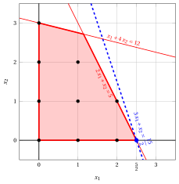{ .fig .ovale loading=lazy  }

            <em>Nodo 1: regione ammissibile di $\LP_{1}$ (rossa), punti ammissibili del problema PLI (neri) e soluzione ottima di $\LP_{1}$ (blu) con la retta della funzione obiettivo che vi passa.</em>

            Una soluzione ottima ${\tilde{\boldsymbol x}}(\LP_{1})$ è:

            $$
            \tilde{x}_1=\dfrac{5}{2},~~\tilde{x}_2=0
            $$

            il valore ottimo è:

            $$
            z(\LP_{1}) = \dfrac{15}{2}
            $$

            La soluzione ottima ${\tilde{\boldsymbol x}}(\LP_{1})$ è <strong>frazionaria</strong> e il problema $\LP_{1}$ è <strong>ammissibile</strong>, quindi il problema $\LP_{1}$ viene inserito nella lista dei problemi $L$ e il lower bound $\LB$ viene posto a $-\infty$.

            Dati il lower bound $\LB$ e l'upper bound $\UB$ correnti, abbiamo:

            $$
            -\infty ~~\le~~ z(\ILP) ~~\le~~ \underbrace{\left\lfloor \dfrac{15}{2} \right\rfloor}_{=7}
            $$

        - <strong>Iterazione 1</strong>

            Il problema $\LP_{1}$ viene estratto ed eliminato dalla lista dei problemi $L$.

            La variabile di branching è $x_{1}$. I vincoli di branching sono:

            $$
            x_1 \le \underbrace{\left\lfloor \dfrac{5}{2} \right\rfloor}_{ = 2} \mathrm{~~~e~~~} x_1 \ge \underbrace{\left\lfloor \dfrac{5}{2} \right\rfloor +1}_{= 3}
            $$

            Il problema $\LP_{2}$ si crea con il primo vincolo di branching (il secondo figlio si risolve solo se necessario).

            1. Soluzione del problema $\LP_{2}$

                Consideriamo il problema $\LP_{2}$ in forma standard:

                $$
                \begin{array}{rrrrrrrrrrrrr}
                {\max} & {3}\, {x_1} & {+} & {x_2} &  &  &  &  &  &  \\[2ex]
                & {x_1} & {+} & {4}\, {x_2} & {+} & {x_3} &  &  &  &  & {=} & {12} \\[2ex]
                & {2}\, {x_1} & {+} & {x_2} &  &  & {+} & {x_4} &  &  & {=} & {5} \\[2ex]
                & {x_1} &  &  &  &  &  &  & {+} & {x_5} & {=} & {2} \\[2ex]
                & {x_1,} &  & {x_2,} &  & {x_3,} &  & {x_4,} &  & {x_5} & {\ge} & {0}
                \end{array}
                $$

                Per il vincolo di branching abbiamo:

                $$
                x_1 + x_5 = 2 \quad \quad \Rightarrow \quad x_5 = 2 - x_1
                $$

                Usando le equazioni del dizionario ottimo possiamo esprimere questo vincolo di branching in funzione delle variabili fuori base. Sostituendo, otteniamo

                $$
                x_5 = 2 - \left(\dfrac{5}{2} - \dfrac{1}{2} \; x_2 - \dfrac{1}{2} \; x_4 \right)
                \quad \quad \Rightarrow \quad
                x_5 = -\dfrac{1}{2} + \dfrac{1}{2} \, x_2 + \dfrac{1}{2} \, x_4
                $$

                Aggiungiamo quindi questa equazione al precedente dizionario ottimo e otteniamo il seguente dizionario:

                \begin{equation*}
                \begin{cases}
                \begin{array}{rrrrrrr}
                {x_1} & {=} & {\dfrac{5}{2}} & {-} & {\dfrac{1}{2}}\, {x_2} & {-} & {\dfrac{1}{2}}\, {x_4} \\[2ex]
                {x_3} & {=} & {\dfrac{19}{2}} & {-} & {\dfrac{7}{2}}\, {x_2} & {+} & {\dfrac{1}{2}}\, {x_4} \\[2ex]
                {x_5} & {=} & {-\dfrac{1}{2}} & {+} & {\dfrac{1}{2}}\, {x_2} & {+} & {\dfrac{1}{2}}\, {x_4} \\[2ex]
                {z} & {=} & {\dfrac{15}{2}} & {-} & {\dfrac{1}{2}}\, {x_2} & {-} & {\dfrac{3}{2}}\, {x_4}
                \end{array}
                \end{cases}
                \end{equation*}

                dove $\pazocal{B}=\{1,3,5\}$ e $\pazocal{N}=\{2,4\}$ e

                - la soluzione di base primale non ammissibile è:

                    $$
                    \bar x_1=\dfrac{5}{2},~~
                    \bar x_3=\dfrac{19}{2},~~
                    \bar x_5=-\dfrac{1}{2},~~~~~~
                    \bar x_2=0,~~
                    \bar x_4=0~~
                    \mathrm{~~di~valore~~~} \dfrac{15}{2}
                    $$

                - la soluzione di base duale ammissibile è:

                    $$
                    \bar \pi_1=0,~~
                    \bar \pi_3=0,~~
                    \bar \pi_5=0,~~~~~~
                    \bar \pi_2=\dfrac{1}{2},~~
                    \bar \pi_4=\dfrac{3}{2}~~
                    \mathrm{~~di~valore~~~} \dfrac{15}{2}
                    $$

                Se aumentiamo il valore di $\pi_{5}$, possiamo ottenere una soluzione duale migliore. Abbiamo:

                $$
                \begin{cases}
                \pi_2 &= \dfrac{1}{2} - \dfrac{1}{2}\,\pi_5 \\[2ex]
                \pi_4 &= \dfrac{3}{2} - \dfrac{1}{2}\,\pi_5
                \end{cases}
                \qquad
                \qquad
                \begin{cases}
                \underbrace{ \dfrac{1}{2} - \dfrac{1}{2}\,\pi_5 \ge 0}_{\pi_2 \ge 0} \\[2ex]
                \underbrace{ \dfrac{3}{2} - \dfrac{1}{2}\,\pi_5 \ge 0}_{\pi_4 \ge 0}
                \end{cases}
                \qquad
                \qquad
                \begin{cases}
                \pi_5 &\le 1 \\[2ex]
                \pi_5 &\le 3
                \end{cases}
                $$

                Aumentando il valore di $\pi_{5}$ fino a $\min \left\{1, 3\right\}=1$, il valore di $\pi_{2}$ scende a $0$. Abbiamo quindi che:

                - $\pi_{5}$ diventa una variabile duale in base e, di conseguenza, $x_{5}$ diventa una variabile primale fuori base.

                - $\pi_{2}$ diventa una variabile duale fuori base e, di conseguenza, $x_{2}$ diventa una variabile primale in base.

                Abbiamo:

                $$
                x_5 = -\dfrac{1}{2} + \dfrac{1}{2} \, x_2 + \dfrac{1}{2} \, x_4
                \quad \Rightarrow \quad
                x_2 = 1 - x_4 + 2 \, x_5
                $$

                Sostituendo nelle altre equazioni del dizionario primale, otteniamo:

                $$
                x_1
                = \dfrac{5}{2} - \dfrac{1}{2} \left( 1 - x_4 + 2 \, x_5 \right) - \dfrac{1}{2} \; x_4
                = 2 - x_5
                $$

                $$
                x_3
                = \dfrac{19}{2} - \dfrac{7}{2} \left( 1 - x_4 + 2 \, x_5 \right) + \dfrac{1}{2} \; x_4
                = 6 + 4 \, x_4 - 7 \, x_5
                $$

                $$
                z
                = \dfrac{15}{2} - \dfrac{1}{2} \left( 1 - x_4 + 2 \, x_5 \right) - \dfrac{3}{2} \; x_4
                = 7 - x_4 - x_5
                $$

                Di conseguenza, abbiamo ora il seguente dizionario primale aggiornato:

                \begin{equation*}
                \begin{cases}
                \begin{array}{rrrrrrr}
                {x_1} & {=} & {2} &  &  & {-} & {x_5} \\[2ex]
                {x_2} & {=} & {1} & {-} & {x_4} & {+} & {2}\, {x_5} \\[2ex]
                {x_3} & {=} & {6} & {+} & {4}\, {x_4} & {-} & {7}\, {x_5} \\[2ex]
                {z} & {=} & {7} & {-} & {x_4} & {-} & {x_5}
                \end{array}
                \end{cases}
                \end{equation*}

                dove $\pazocal{B}=\{1,2,3\}$ e $\pazocal{N}=\{4,5\}$ e

                - la soluzione di base primale ottima è:

                    $$
                    \tilde x_1=2,~~
                    \tilde x_2=1,~~
                    \tilde x_3=6,~~~~~~
                    \tilde x_4=0,~~
                    \tilde x_5=0~~
                    \mathrm{~~di~valore~~~} 7
                    $$

                - la soluzione di base duale ottima è:

                    $$
                    \tilde \pi_1=0,~~
                    \tilde \pi_2=0,~~
                    \tilde \pi_3=0,~~~~~~
                    \tilde \pi_4=1,~~
                    \tilde \pi_5=1~~
                    \mathrm{~~di~valore~~~} 7
                    $$

                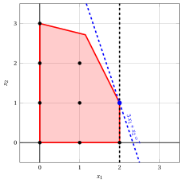{ .fig .ovale loading=lazy  }

                <em>Nodo 2: regione ammissibile di $\LP_{2}$ (rossa), con il vincolo di branching $x_1 \le 2$ (tratteggiato), e la sua soluzione ottima (blu).</em>

                Una soluzione ottima ${\tilde{\boldsymbol x}}(\LP_{2})$ è:

                $$
                \tilde{x}_1=2,~~\tilde{x}_2=1
                $$

                il valore ottimo è:

                $$
                z(\LP_{2}) = 7
                $$

                Il problema $\LP_{2}$ è <strong>ammissibile</strong> e abbiamo

                $$
                \left\lfloor z(\LP_{2}) \right\rfloor > \LB
                \qquad \text{poiché} \qquad
                7 > -\infty
                $$

                La soluzione ottima ${\tilde{\boldsymbol x}}(\LP_{2})$ è <strong>intera</strong>, di conseguenza il lower bound $\LB$ diventa $7$ e la soluzione incumbent ${\bar{\boldsymbol x}}(\ILP)$ diventa $\bar{x}_1=2,\bar{x}_2=1$.

                Di conseguenza, il nodo di branching è <u>potato per integralità</u>.

            Alla fine della prima iterazione, il branching su $x_{1}$ dal Nodo 1 ha generato il nodo di branching verso il basso, Nodo 2. Questo nodo è potato per integralità. Il nodo di branching verso l'alto non è risolto, poiché dopo il Nodo 2 il lower bound soddisfa

            $$
            \left\lfloor z(\LP_{1}) \right\rfloor \le \LB.
            $$

            Questa è la porzione dell'albero di branch-and-bound che mostra i problemi LP dei nodi di branching risolti:

            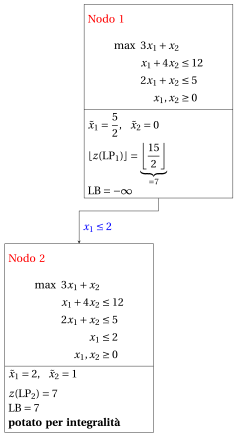{ .fig loading=lazy  }

            Dati il lower bound $\LB$ e l'upper bound $\UB$ correnti, abbiamo:

            $$
            7 ~~\le~~ z(\ILP) ~~\le~~ 7
            $$

        - <strong>Terminazione</strong>

            Poiché la lista $L$ è vuota, il lower bound $\LB$ è uguale all'upper bound $\UB$ e il problema $\ILP$ è risolto all'ottimo.

            Il valore ottimo è $z(\ILP)=7$ (il valore del lower bound $\LB$) e una soluzione ottima ${\tilde{\boldsymbol x}}(\ILP)$ è $\tilde x_1=2,\tilde x_2=1$ (la soluzione incumbent ${\bar{\boldsymbol x}}(\ILP)$).

    2. L'albero di branch-and-bound finale è:

        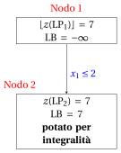{ .fig loading=lazy  }

        I motivi per cui i nodi di branching sono potati sono i seguenti.

        - Il Nodo 1 ha una soluzione ottima frazionaria con $\lfloor z(\LP_{1})\rfloor = 7$: si esegue il branching su $x_1$.

        - Il nodo di branching verso l'alto del Nodo 1 non è risolto, e non è disegnato, poiché $\lfloor z(\LP_{1})\rfloor = 7$ $\le \LB = 7$ dopo il suo primo figlio.

        - Il Nodo 2 è potato per integralità: $\tilde{\boldsymbol x}(\LP_{2}) = (2, 1)$ è intera, con valore $7$, e diventa la soluzione incumbent.

        Il valore ottimo è $z(\ILP) = 7$ e l'algoritmo branch-and-bound restituisce la soluzione ottima $\tilde{\boldsymbol x}(\ILP) = (2, 1)$.

!!! esercizio "Esercizio 7.8: Algoritmo branch-and-bound (P9)"

    !!! nota ""

        Consideriamo il seguente problema PLI in forma canonica di massimo con $n=2$ variabili intere e $m=2$ vincoli:

        $$
        \begin{array}{rrrrrrr}
        {\max} & {2}\, {x_1} & {+} & {x_2} \\[2ex]
        & {-}{x_1} & {+} & {x_2} & {\le} & {1} \\[2ex]
        & {6}\, {x_1} & {+} & {4}\, {x_2} & {\le} & {39} \\[2ex]
        & {x_1,} &  & {x_2} & {\in} & {\Z_{\ge 0}}
        \end{array}
        $$

        e un dizionario ottimo del suo rilassamento lineare in forma standard:

        \begin{equation*}
        \begin{cases}
        \begin{array}{rrrrrrr}
        {x_1} & {=} & {\dfrac{13}{2}} & {-} & {\dfrac{2}{3}}\, {x_2} & {-} & {\dfrac{1}{6}}\, {x_4} \\[2ex]
        {x_3} & {=} & {\dfrac{15}{2}} & {-} & {\dfrac{5}{3}}\, {x_2} & {-} & {\dfrac{1}{6}}\, {x_4} \\[2ex]
        {z} & {=} & {13} & {-} & {\dfrac{1}{3}}\, {x_2} & {-} & {\dfrac{1}{3}}\, {x_4}
        \end{array}
        \end{cases}
        \end{equation*}

    **Domande**

    1. Eseguire l'algoritmo branch-and-bound utilizzando:

        1. la regola dell'indice minimo come strategia di selezione della variabile di branching;

        2. la regola LIFO come strategia di selezione del nodo di branching;

        3. risolvere prima il nodo di branching verso il basso e poi il nodo di branching verso l'alto;

        4. porre il lower bound $\LB$ a $-\infty$ (non si esegue alcun algoritmo euristico).

        Risolvere i problemi LP dei nodi di branching con l'algoritmo del simplesso duale. Nell'algoritmo del simplesso duale, la variabile uscente è la variabile in base con valore negativo e indice minimo, e i pareggi nel test dei rapporti si risolvono con l'indice minimo. Mostrare graficamente la soluzione ottima dei problemi LP associati ai nodi di branching.

    2. Determinare e commentare l'albero di branch-and-bound, indicando il motivo per cui ogni nodo di branching viene potato.

??? soluzione "Soluzione"

    1. Esecuzione dell'algoritmo branch-and-bound per risolvere il problema $\ILP$.

        - <strong>Inizializzazione</strong>

            Consideriamo il problema $\LP_{1}$ in forma standard:

            $$
            \begin{array}{rrrrrrrrrrr}
            {\max} & {2}\, {x_1} & {+} & {x_2} &  &  &  &  \\[2ex]
            & {-}{x_1} & {+} & {x_2} & {+} & {x_3} &  &  & {=} & {1} \\[2ex]
            & {6}\, {x_1} & {+} & {4}\, {x_2} &  &  & {+} & {x_4} & {=} & {39} \\[2ex]
            & {x_1,} &  & {x_2,} &  & {x_3,} &  & {x_4} & {\ge} & {0}
            \end{array}
            $$

            e il suo dizionario ottimo:

            \begin{equation*}
            \begin{cases}
            \begin{array}{rrrrrrr}
            {x_1} & {=} & {\dfrac{13}{2}} & {-} & {\dfrac{2}{3}}\, {x_2} & {-} & {\dfrac{1}{6}}\, {x_4} \\[2ex]
            {x_3} & {=} & {\dfrac{15}{2}} & {-} & {\dfrac{5}{3}}\, {x_2} & {-} & {\dfrac{1}{6}}\, {x_4} \\[2ex]
            {z} & {=} & {13} & {-} & {\dfrac{1}{3}}\, {x_2} & {-} & {\dfrac{1}{3}}\, {x_4}
            \end{array}
            \end{cases}
            \end{equation*}

            { .fig .ovale loading=lazy  }

            <em>Nodo 1: regione ammissibile di $\LP_{1}$ (rossa), punti ammissibili del problema PLI (neri) e soluzione ottima di $\LP_{1}$ (blu) con la retta della funzione obiettivo che vi passa.</em>

            Una soluzione ottima ${\tilde{\boldsymbol x}}(\LP_{1})$ è:

            $$
            \tilde{x}_1=\dfrac{13}{2},~~\tilde{x}_2=0
            $$

            il valore ottimo è:

            $$
            z(\LP_{1}) = 13
            $$

            La soluzione ottima ${\tilde{\boldsymbol x}}(\LP_{1})$ è <strong>frazionaria</strong> e il problema $\LP_{1}$ è <strong>ammissibile</strong>, quindi il problema $\LP_{1}$ viene inserito nella lista dei problemi $L$ e il lower bound $\LB$ viene posto a $-\infty$.

            Dati il lower bound $\LB$ e l'upper bound $\UB$ correnti, abbiamo:

            $$
            -\infty ~~\le~~ z(\ILP) ~~\le~~ 13
            $$

        - <strong>Iterazione 1</strong>

            Il problema $\LP_{1}$ viene estratto ed eliminato dalla lista dei problemi $L$.

            La variabile di branching è $x_{1}$. I vincoli di branching sono:

            $$
            x_1 \le \underbrace{\left\lfloor \dfrac{13}{2} \right\rfloor}_{ = 6} \mathrm{~~~e~~~} x_1 \ge \underbrace{\left\lfloor \dfrac{13}{2} \right\rfloor +1}_{= 7}
            $$

            Con questi vincoli di branching si creano i due problemi $\LP_{2}$ e $\LP_{3}$.

            1. Soluzione del problema $\LP_{2}$

                Consideriamo il problema $\LP_{2}$ in forma standard:

                $$
                \begin{array}{rrrrrrrrrrrrr}
                {\max} & {2}\, {x_1} & {+} & {x_2} &  &  &  &  &  &  \\[2ex]
                & {-}{x_1} & {+} & {x_2} & {+} & {x_3} &  &  &  &  & {=} & {1} \\[2ex]
                & {6}\, {x_1} & {+} & {4}\, {x_2} &  &  & {+} & {x_4} &  &  & {=} & {39} \\[2ex]
                & {x_1} &  &  &  &  &  &  & {+} & {x_5} & {=} & {6} \\[2ex]
                & {x_1,} &  & {x_2,} &  & {x_3,} &  & {x_4,} &  & {x_5} & {\ge} & {0}
                \end{array}
                $$

                Per il vincolo di branching abbiamo:

                $$
                x_1 + x_5 = 6 \quad \quad \Rightarrow \quad x_5 = 6 - x_1
                $$

                Usando le equazioni del dizionario ottimo possiamo esprimere questo vincolo di branching in funzione delle variabili fuori base. Sostituendo, otteniamo

                $$
                x_5 = 6 - \left(\dfrac{13}{2} - \dfrac{2}{3} \; x_2 - \dfrac{1}{6} \; x_4 \right)
                \quad \quad \Rightarrow \quad
                x_5 = -\dfrac{1}{2} + \dfrac{2}{3} \, x_2 + \dfrac{1}{6} \, x_4
                $$

                Aggiungiamo quindi questa equazione al precedente dizionario ottimo e otteniamo il seguente dizionario:

                \begin{equation*}
                \begin{cases}
                \begin{array}{rrrrrrr}
                {x_1} & {=} & {\dfrac{13}{2}} & {-} & {\dfrac{2}{3}}\, {x_2} & {-} & {\dfrac{1}{6}}\, {x_4} \\[2ex]
                {x_3} & {=} & {\dfrac{15}{2}} & {-} & {\dfrac{5}{3}}\, {x_2} & {-} & {\dfrac{1}{6}}\, {x_4} \\[2ex]
                {x_5} & {=} & {-\dfrac{1}{2}} & {+} & {\dfrac{2}{3}}\, {x_2} & {+} & {\dfrac{1}{6}}\, {x_4} \\[2ex]
                {z} & {=} & {13} & {-} & {\dfrac{1}{3}}\, {x_2} & {-} & {\dfrac{1}{3}}\, {x_4}
                \end{array}
                \end{cases}
                \end{equation*}

                dove $\pazocal{B}=\{1,3,5\}$ e $\pazocal{N}=\{2,4\}$ e

                - la soluzione di base primale non ammissibile è:

                    $$
                    \bar x_1=\dfrac{13}{2},~~
                    \bar x_3=\dfrac{15}{2},~~
                    \bar x_5=-\dfrac{1}{2},~~~~~~
                    \bar x_2=0,~~
                    \bar x_4=0~~
                    \mathrm{~~di~valore~~~} 13
                    $$

                - la soluzione di base duale ammissibile è:

                    $$
                    \bar \pi_1=0,~~
                    \bar \pi_3=0,~~
                    \bar \pi_5=0,~~~~~~
                    \bar \pi_2=\dfrac{1}{3},~~
                    \bar \pi_4=\dfrac{1}{3}~~
                    \mathrm{~~di~valore~~~} 13
                    $$

                Se aumentiamo il valore di $\pi_{5}$, possiamo ottenere una soluzione duale migliore. Abbiamo:

                $$
                \begin{cases}
                \pi_2 &= \dfrac{1}{3} - \dfrac{2}{3}\,\pi_5 \\[2ex]
                \pi_4 &= \dfrac{1}{3} - \dfrac{1}{6}\,\pi_5
                \end{cases}
                \qquad
                \qquad
                \begin{cases}
                \underbrace{ \dfrac{1}{3} - \dfrac{2}{3}\,\pi_5 \ge 0}_{\pi_2 \ge 0} \\[2ex]
                \underbrace{ \dfrac{1}{3} - \dfrac{1}{6}\,\pi_5 \ge 0}_{\pi_4 \ge 0}
                \end{cases}
                \qquad
                \qquad
                \begin{cases}
                \pi_5 &\le \dfrac{1}{2} \\[2ex]
                \pi_5 &\le 2
                \end{cases}
                $$

                Aumentando il valore di $\pi_{5}$ fino a $\min \left\{\dfrac{1}{2}, 2\right\}=\dfrac{1}{2}$, il valore di $\pi_{2}$ scende a $0$. Abbiamo quindi che:

                - $\pi_{5}$ diventa una variabile duale in base e, di conseguenza, $x_{5}$ diventa una variabile primale fuori base.

                - $\pi_{2}$ diventa una variabile duale fuori base e, di conseguenza, $x_{2}$ diventa una variabile primale in base.

                Abbiamo:

                $$
                x_5 = -\dfrac{1}{2} + \dfrac{2}{3} \, x_2 + \dfrac{1}{6} \, x_4
                \quad \Rightarrow \quad
                x_2 = \dfrac{3}{4} - \dfrac{1}{4} \, x_4 + \dfrac{3}{2} \, x_5
                $$

                Sostituendo nelle altre equazioni del dizionario primale, otteniamo:

                $$
                x_1
                = \dfrac{13}{2} - \dfrac{2}{3} \left( \dfrac{3}{4} - \dfrac{1}{4} \, x_4 + \dfrac{3}{2} \, x_5 \right) - \dfrac{1}{6} \; x_4
                = 6 - x_5
                $$

                $$
                x_3
                = \dfrac{15}{2} - \dfrac{5}{3} \left( \dfrac{3}{4} - \dfrac{1}{4} \, x_4 + \dfrac{3}{2} \, x_5 \right) - \dfrac{1}{6} \; x_4
                = \dfrac{25}{4} + \dfrac{1}{4} \, x_4 - \dfrac{5}{2} \, x_5
                $$

                $$
                z
                = 13 - \dfrac{1}{3} \left( \dfrac{3}{4} - \dfrac{1}{4} \, x_4 + \dfrac{3}{2} \, x_5 \right) - \dfrac{1}{3} \; x_4
                = \dfrac{51}{4} - \dfrac{1}{4} \, x_4 - \dfrac{1}{2} \, x_5
                $$

                Di conseguenza, abbiamo ora il seguente dizionario primale aggiornato:

                \begin{equation*}
                \begin{cases}
                \begin{array}{rrrrrrr}
                {x_1} & {=} & {6} &  &  & {-} & {x_5} \\[2ex]
                {x_2} & {=} & {\dfrac{3}{4}} & {-} & {\dfrac{1}{4}}\, {x_4} & {+} & {\dfrac{3}{2}}\, {x_5} \\[2ex]
                {x_3} & {=} & {\dfrac{25}{4}} & {+} & {\dfrac{1}{4}}\, {x_4} & {-} & {\dfrac{5}{2}}\, {x_5} \\[2ex]
                {z} & {=} & {\dfrac{51}{4}} & {-} & {\dfrac{1}{4}}\, {x_4} & {-} & {\dfrac{1}{2}}\, {x_5}
                \end{array}
                \end{cases}
                \end{equation*}

                dove $\pazocal{B}=\{1,2,3\}$ e $\pazocal{N}=\{4,5\}$ e

                - la soluzione di base primale ottima è:

                    $$
                    \tilde x_1=6,~~
                    \tilde x_2=\dfrac{3}{4},~~
                    \tilde x_3=\dfrac{25}{4},~~~~~~
                    \tilde x_4=0,~~
                    \tilde x_5=0~~
                    \mathrm{~~di~valore~~~} \dfrac{51}{4}
                    $$

                - la soluzione di base duale ottima è:

                    $$
                    \tilde \pi_1=0,~~
                    \tilde \pi_2=0,~~
                    \tilde \pi_3=0,~~~~~~
                    \tilde \pi_4=\dfrac{1}{4},~~
                    \tilde \pi_5=\dfrac{1}{2}~~
                    \mathrm{~~di~valore~~~} \dfrac{51}{4}
                    $$

                { .fig .ovale loading=lazy  }

                <em>Nodo 2: regione ammissibile di $\LP_{2}$ (rossa), con il vincolo di branching $x_1 \le 6$ (tratteggiato), e la sua soluzione ottima (blu).</em>

                Una soluzione ottima ${\tilde{\boldsymbol x}}(\LP_{2})$ è:

                $$
                \tilde{x}_1=6,~~\tilde{x}_2=\dfrac{3}{4}
                $$

                il valore ottimo è:

                $$
                z(\LP_{2}) = \dfrac{51}{4}
                $$

                Il problema $\LP_{2}$ è <strong>ammissibile</strong> e abbiamo

                $$
                \left\lfloor z(\LP_{2}) \right\rfloor > \LB
                \qquad \text{poiché} \qquad
                \underbrace{\left\lfloor \dfrac{51}{4} \right\rfloor}_{=12} > -\infty
                $$

                La soluzione ottima ${\tilde{\boldsymbol x}}(\LP_{2})$ è <strong>frazionaria</strong>, di conseguenza il problema $\LP_{2}$ è <strong>inserito nella lista dei problemi</strong> $L$.

            2. Soluzione del problema $\LP_{3}$

                Consideriamo il problema $\LP_{3}$ in forma standard:

                $$
                \begin{array}{rrrrrrrrrrrrr}
                {\max} & {2}\, {x_1} & {+} & {x_2} &  &  &  &  &  &  \\[2ex]
                & {-}{x_1} & {+} & {x_2} & {+} & {x_3} &  &  &  &  & {=} & {1} \\[2ex]
                & {6}\, {x_1} & {+} & {4}\, {x_2} &  &  & {+} & {x_4} &  &  & {=} & {39} \\[2ex]
                & {x_1} &  &  &  &  &  &  & {-} & {x_5} & {=} & {7} \\[2ex]
                & {x_1,} &  & {x_2,} &  & {x_3,} &  & {x_4,} &  & {x_5} & {\ge} & {0}
                \end{array}
                $$

                Per il vincolo di branching abbiamo:

                $$
                x_1 - x_5 = 7 \quad \quad \Rightarrow \quad x_5 = -7 + x_1
                $$

                Usando le equazioni del dizionario ottimo possiamo esprimere questo vincolo di branching in funzione delle variabili fuori base. Sostituendo, otteniamo

                $$
                x_5 = -7 + \left(\dfrac{13}{2} - \dfrac{2}{3} \; x_2 - \dfrac{1}{6} \; x_4 \right)
                \quad \quad \Rightarrow \quad
                x_5 = -\dfrac{1}{2} - \dfrac{2}{3} \, x_2 - \dfrac{1}{6} \, x_4
                $$

                Aggiungiamo quindi questa equazione al precedente dizionario ottimo e otteniamo il seguente dizionario:

                \begin{equation*}
                \begin{cases}
                \begin{array}{rrrrrrr}
                {x_1} & {=} & {\dfrac{13}{2}} & {-} & {\dfrac{2}{3}}\, {x_2} & {-} & {\dfrac{1}{6}}\, {x_4} \\[2ex]
                {x_3} & {=} & {\dfrac{15}{2}} & {-} & {\dfrac{5}{3}}\, {x_2} & {-} & {\dfrac{1}{6}}\, {x_4} \\[2ex]
                {x_5} & {=} & {-\dfrac{1}{2}} & {-} & {\dfrac{2}{3}}\, {x_2} & {-} & {\dfrac{1}{6}}\, {x_4} \\[2ex]
                {z} & {=} & {13} & {-} & {\dfrac{1}{3}}\, {x_2} & {-} & {\dfrac{1}{3}}\, {x_4}
                \end{array}
                \end{cases}
                \end{equation*}

                dove $\pazocal{B}=\{1,3,5\}$ e $\pazocal{N}=\{2,4\}$ e

                - la soluzione di base primale non ammissibile è:

                    $$
                    \bar x_1=\dfrac{13}{2},~~
                    \bar x_3=\dfrac{15}{2},~~
                    \bar x_5=-\dfrac{1}{2},~~~~~~
                    \bar x_2=0,~~
                    \bar x_4=0~~
                    \mathrm{~~di~valore~~~} 13
                    $$

                - la soluzione di base duale ammissibile è:

                    $$
                    \bar \pi_1=0,~~
                    \bar \pi_3=0,~~
                    \bar \pi_5=0,~~~~~~
                    \bar \pi_2=\dfrac{1}{3},~~
                    \bar \pi_4=\dfrac{1}{3}~~
                    \mathrm{~~di~valore~~~} 13
                    $$

                Se aumentiamo il valore di $\pi_{5}$, possiamo ottenere una soluzione duale migliore. Abbiamo:

                $$
                \begin{cases}
                \pi_2 &= \dfrac{1}{3} + \dfrac{2}{3}\,\pi_5 \\[2ex]
                \pi_4 &= \dfrac{1}{3} + \dfrac{1}{6}\,\pi_5
                \end{cases}
                \qquad
                \qquad
                \begin{cases}
                \underbrace{ \dfrac{1}{3} + \dfrac{2}{3}\,\pi_5 \ge 0}_{\pi_2 \ge 0} \\[2ex]
                \underbrace{ \dfrac{1}{3} + \dfrac{1}{6}\,\pi_5 \ge 0}_{\pi_4 \ge 0}
                \end{cases}
                \qquad
                \qquad
                \begin{cases}
                \pi_5 &\ge -\dfrac{1}{2} \\[2ex]
                \pi_5 &\ge -2
                \end{cases}
                $$

                Di conseguenza, possiamo aumentare il valore di $\pi_{5}$ senza violare l'ammissibilità duale, il che implica che il problema duale è <strong>illimitato</strong>. Di conseguenza, il problema primale $\LP_{3}$ è <strong>inammissibile</strong>, e il nodo di branching corrispondente è <u>potato per inammissibilità</u>.

            Alla fine della prima iterazione, il branching su $x_{1}$ dal Nodo 1 ha generato il nodo di branching verso il basso, Nodo 2, e il nodo di branching verso l'alto, Nodo 3. Il Nodo 2 è inserito nella lista $L$, mentre il Nodo 3 è potato per inammissibilità. L'albero di branch-and-bound corrispondente è:

            { .fig loading=lazy  }

            Dati il lower bound $\LB$ e l'upper bound $\UB$ correnti, abbiamo:

            $$
            -\infty ~~\le~~ z(\ILP) ~~\le~~ \underbrace{\left\lfloor \dfrac{51}{4} \right\rfloor}_{=12}
            $$

        - <strong>Iterazione 2</strong>

            Il problema $\LP_{2}$ viene estratto ed eliminato dalla lista dei problemi $L$.

            La variabile di branching è $x_{2}$. I vincoli di branching sono:

            $$
            x_2 \le \underbrace{\left\lfloor \dfrac{3}{4} \right\rfloor}_{ = 0} \mathrm{~~~e~~~} x_2 \ge \underbrace{\left\lfloor \dfrac{3}{4} \right\rfloor +1}_{= 1}
            $$

            Il problema $\LP_{4}$ si crea con il primo vincolo di branching (il secondo figlio si risolve solo se necessario).

            1. Soluzione del problema $\LP_{4}$

                Consideriamo il problema $\LP_{4}$ in forma standard:

                $$
                \begin{array}{rrrrrrrrrrrrrrr}
                {\max} & {2}\, {x_1} & {+} & {x_2} &  &  &  &  &  &  &  &  \\[2ex]
                & {-}{x_1} & {+} & {x_2} & {+} & {x_3} &  &  &  &  &  &  & {=} & {1} \\[2ex]
                & {6}\, {x_1} & {+} & {4}\, {x_2} &  &  & {+} & {x_4} &  &  &  &  & {=} & {39} \\[2ex]
                & {x_1} &  &  &  &  &  &  & {+} & {x_5} &  &  & {=} & {6} \\[2ex]
                &  &  & {x_2} &  &  &  &  &  &  & {+} & {x_6} & {=} & {0} \\[2ex]
                & {x_1,} &  & {x_2,} &  & {x_3,} &  & {x_4,} &  & {x_5,} &  & {x_6} & {\ge} & {0}
                \end{array}
                $$

                Per il vincolo di branching abbiamo:

                $$
                x_2 + x_6 = 0 \quad \quad \Rightarrow \quad x_6 = 0 - x_2
                $$

                Usando le equazioni del dizionario ottimo possiamo esprimere questo vincolo di branching in funzione delle variabili fuori base. Sostituendo, otteniamo

                $$
                x_6 = 0 - \left(\dfrac{3}{4} - \dfrac{1}{4} \; x_4 + \dfrac{3}{2} \; x_5 \right)
                \quad \quad \Rightarrow \quad
                x_6 = -\dfrac{3}{4} + \dfrac{1}{4} \, x_4 - \dfrac{3}{2} \, x_5
                $$

                Aggiungiamo quindi questa equazione al precedente dizionario ottimo e otteniamo il seguente dizionario:

                \begin{equation*}
                \begin{cases}
                \begin{array}{rrrrrrr}
                {x_1} & {=} & {6} &  &  & {-} & {x_5} \\[2ex]
                {x_2} & {=} & {\dfrac{3}{4}} & {-} & {\dfrac{1}{4}}\, {x_4} & {+} & {\dfrac{3}{2}}\, {x_5} \\[2ex]
                {x_3} & {=} & {\dfrac{25}{4}} & {+} & {\dfrac{1}{4}}\, {x_4} & {-} & {\dfrac{5}{2}}\, {x_5} \\[2ex]
                {x_6} & {=} & {-\dfrac{3}{4}} & {+} & {\dfrac{1}{4}}\, {x_4} & {-} & {\dfrac{3}{2}}\, {x_5} \\[2ex]
                {z} & {=} & {\dfrac{51}{4}} & {-} & {\dfrac{1}{4}}\, {x_4} & {-} & {\dfrac{1}{2}}\, {x_5}
                \end{array}
                \end{cases}
                \end{equation*}

                dove $\pazocal{B}=\{1,2,3,6\}$ e $\pazocal{N}=\{4,5\}$ e

                - la soluzione di base primale non ammissibile è:

                    $$
                    \begin{gathered}
                    \bar x_1=6,~~
                    \bar x_2=\dfrac{3}{4},~~
                    \bar x_3=\dfrac{25}{4},~~
                    \bar x_6=-\dfrac{3}{4},\\
                    \bar x_4=0,~~
                    \bar x_5=0~~
                    \mathrm{~~di~valore~~~} \dfrac{51}{4}
                    \end{gathered}
                    $$

                - la soluzione di base duale ammissibile è:

                    $$
                    \begin{gathered}
                    \bar \pi_1=0,~~
                    \bar \pi_2=0,~~
                    \bar \pi_3=0,~~
                    \bar \pi_6=0,\\
                    \bar \pi_4=\dfrac{1}{4},~~
                    \bar \pi_5=\dfrac{1}{2}~~
                    \mathrm{~~di~valore~~~} \dfrac{51}{4}
                    \end{gathered}
                    $$

                Se aumentiamo il valore di $\pi_{6}$, possiamo ottenere una soluzione duale migliore. Abbiamo:

                $$
                \begin{cases}
                \pi_4 &= \dfrac{1}{4} - \dfrac{1}{4}\,\pi_6 \\[2ex]
                \pi_5 &= \dfrac{1}{2} + \dfrac{3}{2}\,\pi_6
                \end{cases}
                \qquad
                \qquad
                \begin{cases}
                \underbrace{ \dfrac{1}{4} - \dfrac{1}{4}\,\pi_6 \ge 0}_{\pi_4 \ge 0} \\[2ex]
                \underbrace{ \dfrac{1}{2} + \dfrac{3}{2}\,\pi_6 \ge 0}_{\pi_5 \ge 0}
                \end{cases}
                \qquad
                \qquad
                \begin{cases}
                \pi_6 &\le 1 \\[2ex]
                \pi_6 &\ge -\dfrac{1}{3}
                \end{cases}
                $$

                Aumentando il valore di $\pi_{6}$ fino a $1$, il valore di $\pi_{4}$ scende a $0$. Abbiamo quindi che:

                - $\pi_{6}$ diventa una variabile duale in base e, di conseguenza, $x_{6}$ diventa una variabile primale fuori base.

                - $\pi_{4}$ diventa una variabile duale fuori base e, di conseguenza, $x_{4}$ diventa una variabile primale in base.

                Abbiamo:

                $$
                x_6 = -\dfrac{3}{4} + \dfrac{1}{4} \, x_4 - \dfrac{3}{2} \, x_5
                \quad \Rightarrow \quad
                x_4 = 3 + 6 \, x_5 + 4 \, x_6
                $$

                Sostituendo nelle altre equazioni del dizionario primale, otteniamo:

                $$
                x_2
                = \dfrac{3}{4} - \dfrac{1}{4} \left( 3 + 6 \, x_5 + 4 \, x_6 \right) + \dfrac{3}{2} \; x_5
                = 0 - x_6
                $$

                $$
                x_3
                = \dfrac{25}{4} + \dfrac{1}{4} \left( 3 + 6 \, x_5 + 4 \, x_6 \right) - \dfrac{5}{2} \; x_5
                = 7 - x_5 + x_6
                $$

                $$
                z
                = \dfrac{51}{4} - \dfrac{1}{4} \left( 3 + 6 \, x_5 + 4 \, x_6 \right) - \dfrac{1}{2} \; x_5
                = 12 - 2 \, x_5 - x_6
                $$

                Di conseguenza, abbiamo ora il seguente dizionario primale aggiornato:

                \begin{equation*}
                \begin{cases}
                \begin{array}{rrrrrrr}
                {x_1} & {=} & {6} & {-} & {x_5} &  &  \\[2ex]
                {x_2} & {=} & {0} &  &  & {-} & {x_6} \\[2ex]
                {x_3} & {=} & {7} & {-} & {x_5} & {+} & {x_6} \\[2ex]
                {x_4} & {=} & {3} & {+} & {6}\, {x_5} & {+} & {4}\, {x_6} \\[2ex]
                {z} & {=} & {12} & {-} & {2}\, {x_5} & {-} & {x_6}
                \end{array}
                \end{cases}
                \end{equation*}

                dove $\pazocal{B}=\{1,2,3,4\}$ e $\pazocal{N}=\{5,6\}$ e

                - la soluzione di base primale ottima è:

                    $$
                    \begin{gathered}
                    \tilde x_1=6,~~
                    \tilde x_2=0,~~
                    \tilde x_3=7,~~
                    \tilde x_4=3,\\
                    \tilde x_5=0,~~
                    \tilde x_6=0~~
                    \mathrm{~~di~valore~~~} 12
                    \end{gathered}
                    $$

                - la soluzione di base duale ottima è:

                    $$
                    \begin{gathered}
                    \tilde \pi_1=0,~~
                    \tilde \pi_2=0,~~
                    \tilde \pi_3=0,~~
                    \tilde \pi_4=0,\\
                    \tilde \pi_5=2,~~
                    \tilde \pi_6=1~~
                    \mathrm{~~di~valore~~~} 12
                    \end{gathered}
                    $$

                { .fig .ovale loading=lazy  }

                <em>Nodo 4: regione ammissibile di $\LP_{4}$ (rossa), con il vincolo di branching $x_2 \le 0$ (tratteggiato), e la sua soluzione ottima (blu).</em>

                Una soluzione ottima ${\tilde{\boldsymbol x}}(\LP_{4})$ è:

                $$
                \tilde{x}_1=6,~~\tilde{x}_2=0
                $$

                il valore ottimo è:

                $$
                z(\LP_{4}) = 12
                $$

                Il problema $\LP_{4}$ è <strong>ammissibile</strong> e abbiamo

                $$
                \left\lfloor z(\LP_{4}) \right\rfloor > \LB
                \qquad \text{poiché} \qquad
                12 > -\infty
                $$

                La soluzione ottima ${\tilde{\boldsymbol x}}(\LP_{4})$ è <strong>intera</strong>, di conseguenza il lower bound $\LB$ diventa $12$ e la soluzione incumbent ${\bar{\boldsymbol x}}(\ILP)$ diventa $\bar{x}_1=6,\bar{x}_2=0$.

                Di conseguenza, il nodo di branching è <u>potato per integralità</u>.

            Alla fine della seconda iterazione, il branching su $x_{2}$ dal Nodo 2 ha generato il nodo di branching verso il basso, Nodo 4. Questo nodo è potato per integralità. Il nodo di branching verso l'alto non è risolto, poiché dopo il Nodo 4 il lower bound soddisfa

            $$
            \left\lfloor z(\LP_{2}) \right\rfloor \le \LB.
            $$

            Questa è la porzione dell'albero di branch-and-bound che mostra i problemi LP dei nodi di branching risolti:

            { .fig loading=lazy  }

            Dati il lower bound $\LB$ e l'upper bound $\UB$ correnti, abbiamo:

            $$
            12 ~~\le~~ z(\ILP) ~~\le~~ 12
            $$

        - <strong>Terminazione</strong>

            Poiché la lista $L$ è vuota, il lower bound $\LB$ è uguale all'upper bound $\UB$ e il problema $\ILP$ è risolto all'ottimo.

            Il valore ottimo è $z(\ILP)=12$ (il valore del lower bound $\LB$) e una soluzione ottima ${\tilde{\boldsymbol x}}(\ILP)$ è $\tilde x_1=6,\tilde x_2=0$ (la soluzione incumbent ${\bar{\boldsymbol x}}(\ILP)$).

    2. L'albero di branch-and-bound finale è:

        { .fig loading=lazy  }

        I motivi per cui i nodi di branching sono potati sono i seguenti.

        - Il Nodo 1 ha una soluzione ottima frazionaria con $z(\LP_{1}) = 13$: si esegue il branching su $x_1$.

        - Il Nodo 2 ha una soluzione ottima frazionaria con $\lfloor z(\LP_{2})\rfloor = 12$: si esegue il branching su $x_2$.

        - Il nodo di branching verso l'alto del Nodo 2 non è risolto, e non è disegnato, poiché $\lfloor z(\LP_{2})\rfloor = 12$ $\le \LB = 12$ dopo il suo primo figlio.

        - Il Nodo 3 è potato per inammissibilità: il problema $\LP_{3}$ non ha soluzioni ammissibili.

        - Il Nodo 4 è potato per integralità: $\tilde{\boldsymbol x}(\LP_{4}) = (6, 0)$ è intera, con valore $12$, e diventa la soluzione incumbent.

        Il valore ottimo è $z(\ILP) = 12$ e l'algoritmo branch-and-bound restituisce la soluzione ottima $\tilde{\boldsymbol x}(\ILP) = (6, 0)$. La soluzione ottima <strong>non è unica</strong>: anche $(5, 2)$ ha valore $12$. Con le regole indicate nella domanda, l'algoritmo trova $(6, 0)$.

!!! esercizio "Esercizio 7.9: Algoritmo branch-and-bound (P10)"

    !!! nota ""

        Consideriamo il seguente problema PLI in forma canonica di massimo con $n=2$ variabili intere e $m=3$ vincoli:

        $$
        \begin{array}{rrrrrrr}
        {\max} & {5}\, {x_1} & {+} & {2}\, {x_2} \\[2ex]
        & {-}{x_1} & {+} & {3}\, {x_2} & {\le} & {12} \\[2ex]
        & {x_1} & {+} & {2}\, {x_2} & {\le} & {12} \\[2ex]
        & {3}\, {x_1} & {-} & {2}\, {x_2} & {\le} & {8} \\[2ex]
        & {x_1,} &  & {x_2} & {\in} & {\Z_{\ge 0}}
        \end{array}
        $$

        e un dizionario ottimo del suo rilassamento lineare in forma standard:

        \begin{equation*}
        \begin{cases}
        \begin{array}{rrrrrrr}
        {x_1} & {=} & {5} & {-} & {\dfrac{1}{4}}\, {x_4} & {-} & {\dfrac{1}{4}}\, {x_5} \\[2ex]
        {x_2} & {=} & {\dfrac{7}{2}} & {-} & {\dfrac{3}{8}}\, {x_4} & {+} & {\dfrac{1}{8}}\, {x_5} \\[2ex]
        {x_3} & {=} & {\dfrac{13}{2}} & {+} & {\dfrac{7}{8}}\, {x_4} & {-} & {\dfrac{5}{8}}\, {x_5} \\[2ex]
        {z} & {=} & {32} & {-} & {2}\, {x_4} & {-} & {x_5}
        \end{array}
        \end{cases}
        \end{equation*}

    **Domande**

    1. Eseguire l'algoritmo branch-and-bound utilizzando:

        1. la regola dell'indice massimo come strategia di selezione della variabile di branching;

        2. la regola FIFO come strategia di selezione del nodo di branching;

        3. risolvere prima il nodo di branching verso il basso e poi il nodo di branching verso l'alto;

        4. porre il lower bound $\LB$ a $-\infty$ (non si esegue alcun algoritmo euristico).

        Risolvere i problemi LP dei nodi di branching con l'algoritmo del simplesso duale. Nell'algoritmo del simplesso duale, la variabile uscente è la variabile in base con valore negativo e indice minimo, e i pareggi nel test dei rapporti si risolvono con l'indice minimo. Mostrare graficamente la soluzione ottima dei problemi LP associati ai nodi di branching.

    2. Determinare e commentare l'albero di branch-and-bound, indicando il motivo per cui ogni nodo di branching viene potato.

??? soluzione "Soluzione"

    1. Esecuzione dell'algoritmo branch-and-bound per risolvere il problema $\ILP$.

        - <strong>Inizializzazione</strong>

            Consideriamo il problema $\LP_{1}$ in forma standard:

            $$
            \begin{array}{rrrrrrrrrrrrr}
            {\max} & {5}\, {x_1} & {+} & {2}\, {x_2} &  &  &  &  &  &  \\[2ex]
            & {-}{x_1} & {+} & {3}\, {x_2} & {+} & {x_3} &  &  &  &  & {=} & {12} \\[2ex]
            & {x_1} & {+} & {2}\, {x_2} &  &  & {+} & {x_4} &  &  & {=} & {12} \\[2ex]
            & {3}\, {x_1} & {-} & {2}\, {x_2} &  &  &  &  & {+} & {x_5} & {=} & {8} \\[2ex]
            & {x_1,} &  & {x_2,} &  & {x_3,} &  & {x_4,} &  & {x_5} & {\ge} & {0}
            \end{array}
            $$

            e il suo dizionario ottimo:

            \begin{equation*}
            \begin{cases}
            \begin{array}{rrrrrrr}
            {x_1} & {=} & {5} & {-} & {\dfrac{1}{4}}\, {x_4} & {-} & {\dfrac{1}{4}}\, {x_5} \\[2ex]
            {x_2} & {=} & {\dfrac{7}{2}} & {-} & {\dfrac{3}{8}}\, {x_4} & {+} & {\dfrac{1}{8}}\, {x_5} \\[2ex]
            {x_3} & {=} & {\dfrac{13}{2}} & {+} & {\dfrac{7}{8}}\, {x_4} & {-} & {\dfrac{5}{8}}\, {x_5} \\[2ex]
            {z} & {=} & {32} & {-} & {2}\, {x_4} & {-} & {x_5}
            \end{array}
            \end{cases}
            \end{equation*}

            { .fig .ovale loading=lazy  }

            <em>Nodo 1: regione ammissibile di $\LP_{1}$ (rossa), punti ammissibili del problema PLI (neri) e soluzione ottima di $\LP_{1}$ (blu) con la retta della funzione obiettivo che vi passa.</em>

            Una soluzione ottima ${\tilde{\boldsymbol x}}(\LP_{1})$ è:

            $$
            \tilde{x}_1=5,~~\tilde{x}_2=\dfrac{7}{2}
            $$

            il valore ottimo è:

            $$
            z(\LP_{1}) = 32
            $$

            La soluzione ottima ${\tilde{\boldsymbol x}}(\LP_{1})$ è <strong>frazionaria</strong> e il problema $\LP_{1}$ è <strong>ammissibile</strong>, quindi il problema $\LP_{1}$ viene inserito nella lista dei problemi $L$ e il lower bound $\LB$ viene posto a $-\infty$.

            Dati il lower bound $\LB$ e l'upper bound $\UB$ correnti, abbiamo:

            $$
            -\infty ~~\le~~ z(\ILP) ~~\le~~ 32
            $$

        - <strong>Iterazione 1</strong>

            Il problema $\LP_{1}$ viene estratto ed eliminato dalla lista dei problemi $L$.

            La variabile di branching è $x_{2}$. I vincoli di branching sono:

            $$
            x_2 \le \underbrace{\left\lfloor \dfrac{7}{2} \right\rfloor}_{ = 3} \mathrm{~~~e~~~} x_2 \ge \underbrace{\left\lfloor \dfrac{7}{2} \right\rfloor +1}_{= 4}
            $$

            Con questi vincoli di branching si creano i due problemi $\LP_{2}$ e $\LP_{3}$.

            1. Soluzione del problema $\LP_{2}$

                Consideriamo il problema $\LP_{2}$ in forma standard:

                $$
                \begin{array}{rrrrrrrrrrrrrrr}
                {\max} & {5}\, {x_1} & {+} & {2}\, {x_2} &  &  &  &  &  &  &  &  \\[2ex]
                & {-}{x_1} & {+} & {3}\, {x_2} & {+} & {x_3} &  &  &  &  &  &  & {=} & {12} \\[2ex]
                & {x_1} & {+} & {2}\, {x_2} &  &  & {+} & {x_4} &  &  &  &  & {=} & {12} \\[2ex]
                & {3}\, {x_1} & {-} & {2}\, {x_2} &  &  &  &  & {+} & {x_5} &  &  & {=} & {8} \\[2ex]
                &  &  & {x_2} &  &  &  &  &  &  & {+} & {x_6} & {=} & {3} \\[2ex]
                & {x_1,} &  & {x_2,} &  & {x_3,} &  & {x_4,} &  & {x_5,} &  & {x_6} & {\ge} & {0}
                \end{array}
                $$

                Per il vincolo di branching abbiamo:

                $$
                x_2 + x_6 = 3 \quad \quad \Rightarrow \quad x_6 = 3 - x_2
                $$

                Usando le equazioni del dizionario ottimo possiamo esprimere questo vincolo di branching in funzione delle variabili fuori base. Sostituendo, otteniamo

                $$
                x_6 = 3 - \left(\dfrac{7}{2} - \dfrac{3}{8} \; x_4 + \dfrac{1}{8} \; x_5 \right)
                \quad \quad \Rightarrow \quad
                x_6 = -\dfrac{1}{2} + \dfrac{3}{8} \, x_4 - \dfrac{1}{8} \, x_5
                $$

                Aggiungiamo quindi questa equazione al precedente dizionario ottimo e otteniamo il seguente dizionario:

                \begin{equation*}
                \begin{cases}
                \begin{array}{rrrrrrr}
                {x_1} & {=} & {5} & {-} & {\dfrac{1}{4}}\, {x_4} & {-} & {\dfrac{1}{4}}\, {x_5} \\[2ex]
                {x_2} & {=} & {\dfrac{7}{2}} & {-} & {\dfrac{3}{8}}\, {x_4} & {+} & {\dfrac{1}{8}}\, {x_5} \\[2ex]
                {x_3} & {=} & {\dfrac{13}{2}} & {+} & {\dfrac{7}{8}}\, {x_4} & {-} & {\dfrac{5}{8}}\, {x_5} \\[2ex]
                {x_6} & {=} & {-\dfrac{1}{2}} & {+} & {\dfrac{3}{8}}\, {x_4} & {-} & {\dfrac{1}{8}}\, {x_5} \\[2ex]
                {z} & {=} & {32} & {-} & {2}\, {x_4} & {-} & {x_5}
                \end{array}
                \end{cases}
                \end{equation*}

                dove $\pazocal{B}=\{1,2,3,6\}$ e $\pazocal{N}=\{4,5\}$ e

                - la soluzione di base primale non ammissibile è:

                    $$
                    \begin{gathered}
                    \bar x_1=5,~~
                    \bar x_2=\dfrac{7}{2},~~
                    \bar x_3=\dfrac{13}{2},~~
                    \bar x_6=-\dfrac{1}{2},\\
                    \bar x_4=0,~~
                    \bar x_5=0~~
                    \mathrm{~~di~valore~~~} 32
                    \end{gathered}
                    $$

                - la soluzione di base duale ammissibile è:

                    $$
                    \begin{gathered}
                    \bar \pi_1=0,~~
                    \bar \pi_2=0,~~
                    \bar \pi_3=0,~~
                    \bar \pi_6=0,\\
                    \bar \pi_4=2,~~
                    \bar \pi_5=1~~
                    \mathrm{~~di~valore~~~} 32
                    \end{gathered}
                    $$

                Se aumentiamo il valore di $\pi_{6}$, possiamo ottenere una soluzione duale migliore. Abbiamo:

                $$
                \begin{cases}
                \pi_4 &= 2 - \dfrac{3}{8}\,\pi_6 \\[2ex]
                \pi_5 &= 1 + \dfrac{1}{8}\,\pi_6
                \end{cases}
                \qquad
                \qquad
                \begin{cases}
                \underbrace{ 2 - \dfrac{3}{8}\,\pi_6 \ge 0}_{\pi_4 \ge 0} \\[2ex]
                \underbrace{ 1 + \dfrac{1}{8}\,\pi_6 \ge 0}_{\pi_5 \ge 0}
                \end{cases}
                \qquad
                \qquad
                \begin{cases}
                \pi_6 &\le \dfrac{16}{3} \\[2ex]
                \pi_6 &\ge -8
                \end{cases}
                $$

                Aumentando il valore di $\pi_{6}$ fino a $\dfrac{16}{3}$, il valore di $\pi_{4}$ scende a $0$. Abbiamo quindi che:

                - $\pi_{6}$ diventa una variabile duale in base e, di conseguenza, $x_{6}$ diventa una variabile primale fuori base.

                - $\pi_{4}$ diventa una variabile duale fuori base e, di conseguenza, $x_{4}$ diventa una variabile primale in base.

                Abbiamo:

                $$
                x_6 = -\dfrac{1}{2} + \dfrac{3}{8} \, x_4 - \dfrac{1}{8} \, x_5
                \quad \Rightarrow \quad
                x_4 = \dfrac{4}{3} + \dfrac{1}{3} \, x_5 + \dfrac{8}{3} \, x_6
                $$

                Sostituendo nelle altre equazioni del dizionario primale, otteniamo:

                $$
                x_1
                = 5 - \dfrac{1}{4} \left( \dfrac{4}{3} + \dfrac{1}{3} \, x_5 + \dfrac{8}{3} \, x_6 \right) - \dfrac{1}{4} \; x_5
                = \dfrac{14}{3} - \dfrac{1}{3} \, x_5 - \dfrac{2}{3} \, x_6
                $$

                $$
                x_2
                = \dfrac{7}{2} - \dfrac{3}{8} \left( \dfrac{4}{3} + \dfrac{1}{3} \, x_5 + \dfrac{8}{3} \, x_6 \right) + \dfrac{1}{8} \; x_5
                = 3 - x_6
                $$

                $$
                x_3
                = \dfrac{13}{2} + \dfrac{7}{8} \left( \dfrac{4}{3} + \dfrac{1}{3} \, x_5 + \dfrac{8}{3} \, x_6 \right) - \dfrac{5}{8} \; x_5
                = \dfrac{23}{3} - \dfrac{1}{3} \, x_5 + \dfrac{7}{3} \, x_6
                $$

                $$
                z
                = 32 - 2 \left( \dfrac{4}{3} + \dfrac{1}{3} \, x_5 + \dfrac{8}{3} \, x_6 \right) - x_5
                = \dfrac{88}{3} - \dfrac{5}{3} \, x_5 - \dfrac{16}{3} \, x_6
                $$

                Di conseguenza, abbiamo ora il seguente dizionario primale aggiornato:

                \begin{equation*}
                \begin{cases}
                \begin{array}{rrrrrrr}
                {x_1} & {=} & {\dfrac{14}{3}} & {-} & {\dfrac{1}{3}}\, {x_5} & {-} & {\dfrac{2}{3}}\, {x_6} \\[2ex]
                {x_2} & {=} & {3} &  &  & {-} & {x_6} \\[2ex]
                {x_3} & {=} & {\dfrac{23}{3}} & {-} & {\dfrac{1}{3}}\, {x_5} & {+} & {\dfrac{7}{3}}\, {x_6} \\[2ex]
                {x_4} & {=} & {\dfrac{4}{3}} & {+} & {\dfrac{1}{3}}\, {x_5} & {+} & {\dfrac{8}{3}}\, {x_6} \\[2ex]
                {z} & {=} & {\dfrac{88}{3}} & {-} & {\dfrac{5}{3}}\, {x_5} & {-} & {\dfrac{16}{3}}\, {x_6}
                \end{array}
                \end{cases}
                \end{equation*}

                dove $\pazocal{B}=\{1,2,3,4\}$ e $\pazocal{N}=\{5,6\}$ e

                - la soluzione di base primale ottima è:

                    $$
                    \begin{gathered}
                    \tilde x_1=\dfrac{14}{3},~~
                    \tilde x_2=3,~~
                    \tilde x_3=\dfrac{23}{3},~~
                    \tilde x_4=\dfrac{4}{3},\\
                    \tilde x_5=0,~~
                    \tilde x_6=0~~
                    \mathrm{~~di~valore~~~} \dfrac{88}{3}
                    \end{gathered}
                    $$

                - la soluzione di base duale ottima è:

                    $$
                    \begin{gathered}
                    \tilde \pi_1=0,~~
                    \tilde \pi_2=0,~~
                    \tilde \pi_3=0,~~
                    \tilde \pi_4=0,\\
                    \tilde \pi_5=\dfrac{5}{3},~~
                    \tilde \pi_6=\dfrac{16}{3}~~
                    \mathrm{~~di~valore~~~} \dfrac{88}{3}
                    \end{gathered}
                    $$

                { .fig .ovale loading=lazy  }

                <em>Nodo 2: regione ammissibile di $\LP_{2}$ (rossa), con il vincolo di branching $x_2 \le 3$ (tratteggiato), e la sua soluzione ottima (blu).</em>

                Una soluzione ottima ${\tilde{\boldsymbol x}}(\LP_{2})$ è:

                $$
                \tilde{x}_1=\dfrac{14}{3},~~\tilde{x}_2=3
                $$

                il valore ottimo è:

                $$
                z(\LP_{2}) = \dfrac{88}{3}
                $$

                Il problema $\LP_{2}$ è <strong>ammissibile</strong> e abbiamo

                $$
                \left\lfloor z(\LP_{2}) \right\rfloor > \LB
                \qquad \text{poiché} \qquad
                \underbrace{\left\lfloor \dfrac{88}{3} \right\rfloor}_{=29} > -\infty
                $$

                La soluzione ottima ${\tilde{\boldsymbol x}}(\LP_{2})$ è <strong>frazionaria</strong>, di conseguenza il problema $\LP_{2}$ è <strong>inserito nella lista dei problemi</strong> $L$.

            2. Soluzione del problema $\LP_{3}$

                Consideriamo il problema $\LP_{3}$ in forma standard:

                $$
                \begin{array}{rrrrrrrrrrrrrrr}
                {\max} & {5}\, {x_1} & {+} & {2}\, {x_2} &  &  &  &  &  &  &  &  \\[2ex]
                & {-}{x_1} & {+} & {3}\, {x_2} & {+} & {x_3} &  &  &  &  &  &  & {=} & {12} \\[2ex]
                & {x_1} & {+} & {2}\, {x_2} &  &  & {+} & {x_4} &  &  &  &  & {=} & {12} \\[2ex]
                & {3}\, {x_1} & {-} & {2}\, {x_2} &  &  &  &  & {+} & {x_5} &  &  & {=} & {8} \\[2ex]
                &  &  & {x_2} &  &  &  &  &  &  & {-} & {x_6} & {=} & {4} \\[2ex]
                & {x_1,} &  & {x_2,} &  & {x_3,} &  & {x_4,} &  & {x_5,} &  & {x_6} & {\ge} & {0}
                \end{array}
                $$

                Per il vincolo di branching abbiamo:

                $$
                x_2 - x_6 = 4 \quad \quad \Rightarrow \quad x_6 = -4 + x_2
                $$

                Usando le equazioni del dizionario ottimo possiamo esprimere questo vincolo di branching in funzione delle variabili fuori base. Sostituendo, otteniamo

                $$
                x_6 = -4 + \left(\dfrac{7}{2} - \dfrac{3}{8} \; x_4 + \dfrac{1}{8} \; x_5 \right)
                \quad \quad \Rightarrow \quad
                x_6 = -\dfrac{1}{2} - \dfrac{3}{8} \, x_4 + \dfrac{1}{8} \, x_5
                $$

                Aggiungiamo quindi questa equazione al precedente dizionario ottimo e otteniamo il seguente dizionario:

                \begin{equation*}
                \begin{cases}
                \begin{array}{rrrrrrr}
                {x_1} & {=} & {5} & {-} & {\dfrac{1}{4}}\, {x_4} & {-} & {\dfrac{1}{4}}\, {x_5} \\[2ex]
                {x_2} & {=} & {\dfrac{7}{2}} & {-} & {\dfrac{3}{8}}\, {x_4} & {+} & {\dfrac{1}{8}}\, {x_5} \\[2ex]
                {x_3} & {=} & {\dfrac{13}{2}} & {+} & {\dfrac{7}{8}}\, {x_4} & {-} & {\dfrac{5}{8}}\, {x_5} \\[2ex]
                {x_6} & {=} & {-\dfrac{1}{2}} & {-} & {\dfrac{3}{8}}\, {x_4} & {+} & {\dfrac{1}{8}}\, {x_5} \\[2ex]
                {z} & {=} & {32} & {-} & {2}\, {x_4} & {-} & {x_5}
                \end{array}
                \end{cases}
                \end{equation*}

                dove $\pazocal{B}=\{1,2,3,6\}$ e $\pazocal{N}=\{4,5\}$ e

                - la soluzione di base primale non ammissibile è:

                    $$
                    \begin{gathered}
                    \bar x_1=5,~~
                    \bar x_2=\dfrac{7}{2},~~
                    \bar x_3=\dfrac{13}{2},~~
                    \bar x_6=-\dfrac{1}{2},\\
                    \bar x_4=0,~~
                    \bar x_5=0~~
                    \mathrm{~~di~valore~~~} 32
                    \end{gathered}
                    $$

                - la soluzione di base duale ammissibile è:

                    $$
                    \begin{gathered}
                    \bar \pi_1=0,~~
                    \bar \pi_2=0,~~
                    \bar \pi_3=0,~~
                    \bar \pi_6=0,\\
                    \bar \pi_4=2,~~
                    \bar \pi_5=1~~
                    \mathrm{~~di~valore~~~} 32
                    \end{gathered}
                    $$

                Se aumentiamo il valore di $\pi_{6}$, possiamo ottenere una soluzione duale migliore. Abbiamo:

                $$
                \begin{cases}
                \pi_4 &= 2 + \dfrac{3}{8}\,\pi_6 \\[2ex]
                \pi_5 &= 1 - \dfrac{1}{8}\,\pi_6
                \end{cases}
                \qquad
                \qquad
                \begin{cases}
                \underbrace{ 2 + \dfrac{3}{8}\,\pi_6 \ge 0}_{\pi_4 \ge 0} \\[2ex]
                \underbrace{ 1 - \dfrac{1}{8}\,\pi_6 \ge 0}_{\pi_5 \ge 0}
                \end{cases}
                \qquad
                \qquad
                \begin{cases}
                \pi_6 &\ge -\dfrac{16}{3} \\[2ex]
                \pi_6 &\le 8
                \end{cases}
                $$

                Aumentando il valore di $\pi_{6}$ fino a $8$, il valore di $\pi_{5}$ scende a $0$. Abbiamo quindi che:

                - $\pi_{6}$ diventa una variabile duale in base e, di conseguenza, $x_{6}$ diventa una variabile primale fuori base.

                - $\pi_{5}$ diventa una variabile duale fuori base e, di conseguenza, $x_{5}$ diventa una variabile primale in base.

                Abbiamo:

                $$
                x_6 = -\dfrac{1}{2} - \dfrac{3}{8} \, x_4 + \dfrac{1}{8} \, x_5
                \quad \Rightarrow \quad
                x_5 = 4 + 3 \, x_4 + 8 \, x_6
                $$

                Sostituendo nelle altre equazioni del dizionario primale, otteniamo:

                $$
                x_1
                = 5 - \dfrac{1}{4} \; x_4 - \dfrac{1}{4} \left( 4 + 3 \, x_4 + 8 \, x_6 \right)
                = 4 - x_4 - 2 \, x_6
                $$

                $$
                x_2
                = \dfrac{7}{2} - \dfrac{3}{8} \; x_4 + \dfrac{1}{8} \left( 4 + 3 \, x_4 + 8 \, x_6 \right)
                = 4 + x_6
                $$

                $$
                x_3
                = \dfrac{13}{2} + \dfrac{7}{8} \; x_4 - \dfrac{5}{8} \left( 4 + 3 \, x_4 + 8 \, x_6 \right)
                = 4 - x_4 - 5 \, x_6
                $$

                $$
                z
                = 32 - 2 \; x_4 - \left( 4 + 3 \, x_4 + 8 \, x_6 \right)
                = 28 - 5 \, x_4 - 8 \, x_6
                $$

                Di conseguenza, abbiamo ora il seguente dizionario primale aggiornato:

                \begin{equation*}
                \begin{cases}
                \begin{array}{rrrrrrr}
                {x_1} & {=} & {4} & {-} & {x_4} & {-} & {2}\, {x_6} \\[2ex]
                {x_2} & {=} & {4} &  &  & {+} & {x_6} \\[2ex]
                {x_3} & {=} & {4} & {-} & {x_4} & {-} & {5}\, {x_6} \\[2ex]
                {x_5} & {=} & {4} & {+} & {3}\, {x_4} & {+} & {8}\, {x_6} \\[2ex]
                {z} & {=} & {28} & {-} & {5}\, {x_4} & {-} & {8}\, {x_6}
                \end{array}
                \end{cases}
                \end{equation*}

                dove $\pazocal{B}=\{1,2,3,5\}$ e $\pazocal{N}=\{4,6\}$ e

                - la soluzione di base primale ottima è:

                    $$
                    \begin{gathered}
                    \tilde x_1=4,~~
                    \tilde x_2=4,~~
                    \tilde x_3=4,~~
                    \tilde x_5=4,\\
                    \tilde x_4=0,~~
                    \tilde x_6=0~~
                    \mathrm{~~di~valore~~~} 28
                    \end{gathered}
                    $$

                - la soluzione di base duale ottima è:

                    $$
                    \begin{gathered}
                    \tilde \pi_1=0,~~
                    \tilde \pi_2=0,~~
                    \tilde \pi_3=0,~~
                    \tilde \pi_5=0,\\
                    \tilde \pi_4=5,~~
                    \tilde \pi_6=8~~
                    \mathrm{~~di~valore~~~} 28
                    \end{gathered}
                    $$

                { .fig .ovale loading=lazy  }

                <em>Nodo 3: regione ammissibile di $\LP_{3}$ (rossa), con il vincolo di branching $x_2 \ge 4$ (tratteggiato), e la sua soluzione ottima (blu).</em>

                Una soluzione ottima ${\tilde{\boldsymbol x}}(\LP_{3})$ è:

                $$
                \tilde{x}_1=4,~~\tilde{x}_2=4
                $$

                il valore ottimo è:

                $$
                z(\LP_{3}) = 28
                $$

                Il problema $\LP_{3}$ è <strong>ammissibile</strong> e abbiamo

                $$
                \left\lfloor z(\LP_{3}) \right\rfloor > \LB
                \qquad \text{poiché} \qquad
                28 > -\infty
                $$

                La soluzione ottima ${\tilde{\boldsymbol x}}(\LP_{3})$ è <strong>intera</strong>, di conseguenza il lower bound $\LB$ diventa $28$ e la soluzione incumbent ${\bar{\boldsymbol x}}(\ILP)$ diventa $\bar{x}_1=4,\bar{x}_2=4$.

                Di conseguenza, il nodo di branching è <u>potato per integralità</u>.

            Alla fine della prima iterazione, il branching su $x_{2}$ dal Nodo 1 ha generato il nodo di branching verso il basso, Nodo 2, e il nodo di branching verso l'alto, Nodo 3. Il Nodo 2 è inserito nella lista $L$, mentre il Nodo 3 è potato per integralità. L'albero di branch-and-bound corrispondente è:

            { .fig loading=lazy  }

            Dati il lower bound $\LB$ e l'upper bound $\UB$ correnti, abbiamo:

            $$
            28 ~~\le~~ z(\ILP) ~~\le~~ \underbrace{\left\lfloor \dfrac{88}{3} \right\rfloor}_{=29}
            $$

        - <strong>Iterazione 2</strong>

            Il problema $\LP_{2}$ viene estratto ed eliminato dalla lista dei problemi $L$.

            La variabile di branching è $x_{1}$. I vincoli di branching sono:

            $$
            x_1 \le \underbrace{\left\lfloor \dfrac{14}{3} \right\rfloor}_{ = 4} \mathrm{~~~e~~~} x_1 \ge \underbrace{\left\lfloor \dfrac{14}{3} \right\rfloor +1}_{= 5}
            $$

            Con questi vincoli di branching si creano i due problemi $\LP_{4}$ e $\LP_{5}$.

            1. Soluzione del problema $\LP_{4}$

                Consideriamo il problema $\LP_{4}$ in forma standard:

                $$
                \begin{array}{rrrrrrrrrrrrrrrrr}
                {\max} & {5}\, {x_1} & {+} & {2}\, {x_2} &  &  &  &  &  &  &  &  &  &  \\[2ex]
                & {-}{x_1} & {+} & {3}\, {x_2} & {+} & {x_3} &  &  &  &  &  &  &  &  & {=} & {12} \\[2ex]
                & {x_1} & {+} & {2}\, {x_2} &  &  & {+} & {x_4} &  &  &  &  &  &  & {=} & {12} \\[2ex]
                & {3}\, {x_1} & {-} & {2}\, {x_2} &  &  &  &  & {+} & {x_5} &  &  &  &  & {=} & {8} \\[2ex]
                &  &  & {x_2} &  &  &  &  &  &  & {+} & {x_6} &  &  & {=} & {3} \\[2ex]
                & {x_1} &  &  &  &  &  &  &  &  &  &  & {+} & {x_7} & {=} & {4} \\[2ex]
                & {x_1,} &  & {x_2,} &  & {x_3,} &  & {x_4,} &  & {x_5,} &  & {x_6,} &  & {x_7} & {\ge} & {0}
                \end{array}
                $$

                Per il vincolo di branching abbiamo:

                $$
                x_1 + x_7 = 4 \quad \quad \Rightarrow \quad x_7 = 4 - x_1
                $$

                Usando le equazioni del dizionario ottimo possiamo esprimere questo vincolo di branching in funzione delle variabili fuori base. Sostituendo, otteniamo

                $$
                x_7 = 4 - \left(\dfrac{14}{3} - \dfrac{1}{3} \; x_5 - \dfrac{2}{3} \; x_6 \right)
                \quad \quad \Rightarrow \quad
                x_7 = -\dfrac{2}{3} + \dfrac{1}{3} \, x_5 + \dfrac{2}{3} \, x_6
                $$

                Aggiungiamo quindi questa equazione al precedente dizionario ottimo e otteniamo il seguente dizionario:

                \begin{equation*}
                \begin{cases}
                \begin{array}{rrrrrrr}
                {x_1} & {=} & {\dfrac{14}{3}} & {-} & {\dfrac{1}{3}}\, {x_5} & {-} & {\dfrac{2}{3}}\, {x_6} \\[2ex]
                {x_2} & {=} & {3} &  &  & {-} & {x_6} \\[2ex]
                {x_3} & {=} & {\dfrac{23}{3}} & {-} & {\dfrac{1}{3}}\, {x_5} & {+} & {\dfrac{7}{3}}\, {x_6} \\[2ex]
                {x_4} & {=} & {\dfrac{4}{3}} & {+} & {\dfrac{1}{3}}\, {x_5} & {+} & {\dfrac{8}{3}}\, {x_6} \\[2ex]
                {x_7} & {=} & {-\dfrac{2}{3}} & {+} & {\dfrac{1}{3}}\, {x_5} & {+} & {\dfrac{2}{3}}\, {x_6} \\[2ex]
                {z} & {=} & {\dfrac{88}{3}} & {-} & {\dfrac{5}{3}}\, {x_5} & {-} & {\dfrac{16}{3}}\, {x_6}
                \end{array}
                \end{cases}
                \end{equation*}

                dove $\pazocal{B}=\{1,2,3,4,7\}$ e $\pazocal{N}=\{5,6\}$ e

                - la soluzione di base primale non ammissibile è:

                    $$
                    \begin{gathered}
                    \bar x_1=\dfrac{14}{3},~~
                    \bar x_2=3,~~
                    \bar x_3=\dfrac{23}{3},~~
                    \bar x_4=\dfrac{4}{3},~~
                    \bar x_7=-\dfrac{2}{3},\\
                    \bar x_5=0,~~
                    \bar x_6=0~~
                    \mathrm{~~di~valore~~~} \dfrac{88}{3}
                    \end{gathered}
                    $$

                - la soluzione di base duale ammissibile è:

                    $$
                    \begin{gathered}
                    \bar \pi_1=0,~~
                    \bar \pi_2=0,~~
                    \bar \pi_3=0,~~
                    \bar \pi_4=0,~~
                    \bar \pi_7=0,\\
                    \bar \pi_5=\dfrac{5}{3},~~
                    \bar \pi_6=\dfrac{16}{3}~~
                    \mathrm{~~di~valore~~~} \dfrac{88}{3}
                    \end{gathered}
                    $$

                Se aumentiamo il valore di $\pi_{7}$, possiamo ottenere una soluzione duale migliore. Abbiamo:

                $$
                \begin{cases}
                \pi_5 &= \dfrac{5}{3} - \dfrac{1}{3}\,\pi_7 \\[2ex]
                \pi_6 &= \dfrac{16}{3} - \dfrac{2}{3}\,\pi_7
                \end{cases}
                \qquad
                \qquad
                \begin{cases}
                \underbrace{ \dfrac{5}{3} - \dfrac{1}{3}\,\pi_7 \ge 0}_{\pi_5 \ge 0} \\[2ex]
                \underbrace{ \dfrac{16}{3} - \dfrac{2}{3}\,\pi_7 \ge 0}_{\pi_6 \ge 0}
                \end{cases}
                \qquad
                \qquad
                \begin{cases}
                \pi_7 &\le 5 \\[2ex]
                \pi_7 &\le 8
                \end{cases}
                $$

                Aumentando il valore di $\pi_{7}$ fino a $\min \left\{5, 8\right\}=5$, il valore di $\pi_{5}$ scende a $0$. Abbiamo quindi che:

                - $\pi_{7}$ diventa una variabile duale in base e, di conseguenza, $x_{7}$ diventa una variabile primale fuori base.

                - $\pi_{5}$ diventa una variabile duale fuori base e, di conseguenza, $x_{5}$ diventa una variabile primale in base.

                Abbiamo:

                $$
                x_7 = -\dfrac{2}{3} + \dfrac{1}{3} \, x_5 + \dfrac{2}{3} \, x_6
                \quad \Rightarrow \quad
                x_5 = 2 - 2 \, x_6 + 3 \, x_7
                $$

                Sostituendo nelle altre equazioni del dizionario primale, otteniamo:

                $$
                x_1
                = \dfrac{14}{3} - \dfrac{1}{3} \left( 2 - 2 \, x_6 + 3 \, x_7 \right) - \dfrac{2}{3} \; x_6
                = 4 - x_7
                $$

                $$
                x_3
                = \dfrac{23}{3} - \dfrac{1}{3} \left( 2 - 2 \, x_6 + 3 \, x_7 \right) + \dfrac{7}{3} \; x_6
                = 7 + 3 \, x_6 - x_7
                $$

                $$
                x_4
                = \dfrac{4}{3} + \dfrac{1}{3} \left( 2 - 2 \, x_6 + 3 \, x_7 \right) + \dfrac{8}{3} \; x_6
                = 2 + 2 \, x_6 + x_7
                $$

                $$
                z
                = \dfrac{88}{3} - \dfrac{5}{3} \left( 2 - 2 \, x_6 + 3 \, x_7 \right) - \dfrac{16}{3} \; x_6
                = 26 - 2 \, x_6 - 5 \, x_7
                $$

                Di conseguenza, abbiamo ora il seguente dizionario primale aggiornato:

                \begin{equation*}
                \begin{cases}
                \begin{array}{rrrrrrr}
                {x_1} & {=} & {4} &  &  & {-} & {x_7} \\[2ex]
                {x_2} & {=} & {3} & {-} & {x_6} &  &  \\[2ex]
                {x_3} & {=} & {7} & {+} & {3}\, {x_6} & {-} & {x_7} \\[2ex]
                {x_4} & {=} & {2} & {+} & {2}\, {x_6} & {+} & {x_7} \\[2ex]
                {x_5} & {=} & {2} & {-} & {2}\, {x_6} & {+} & {3}\, {x_7} \\[2ex]
                {z} & {=} & {26} & {-} & {2}\, {x_6} & {-} & {5}\, {x_7}
                \end{array}
                \end{cases}
                \end{equation*}

                dove $\pazocal{B}=\{1,2,3,4,5\}$ e $\pazocal{N}=\{6,7\}$ e

                - la soluzione di base primale ottima è:

                    $$
                    \begin{gathered}
                    \tilde x_1=4,~~
                    \tilde x_2=3,~~
                    \tilde x_3=7,~~
                    \tilde x_4=2,~~
                    \tilde x_5=2,\\
                    \tilde x_6=0,~~
                    \tilde x_7=0~~
                    \mathrm{~~di~valore~~~} 26
                    \end{gathered}
                    $$

                - la soluzione di base duale ottima è:

                    $$
                    \begin{gathered}
                    \tilde \pi_1=0,~~
                    \tilde \pi_2=0,~~
                    \tilde \pi_3=0,~~
                    \tilde \pi_4=0,~~
                    \tilde \pi_5=0,\\
                    \tilde \pi_6=2,~~
                    \tilde \pi_7=5~~
                    \mathrm{~~di~valore~~~} 26
                    \end{gathered}
                    $$

                { .fig .ovale loading=lazy  }

                <em>Nodo 4: regione ammissibile di $\LP_{4}$ (rossa), con il vincolo di branching $x_1 \le 4$ (tratteggiato), e la sua soluzione ottima (blu).</em>

                Una soluzione ottima ${\tilde{\boldsymbol x}}(\LP_{4})$ è:

                $$
                \tilde{x}_1=4,~~\tilde{x}_2=3
                $$

                il valore ottimo è:

                $$
                z(\LP_{4}) = 26
                $$

                Il problema $\LP_{4}$ è <strong>ammissibile</strong> e abbiamo

                $$
                \left\lfloor z(\LP_{4}) \right\rfloor \le \LB
                \qquad \text{poiché} \qquad
                26 \le 28
                $$

                La soluzione ottima ${\tilde{\boldsymbol x}}(\LP_{4})$ è <strong>intera</strong>, ma il suo valore non migliora il lower bound $\LB$, che rimane $28$.

                Di conseguenza, il nodo di branching è <u>potato per integralità</u>.

            2. Soluzione del problema $\LP_{5}$

                Consideriamo il problema $\LP_{5}$ in forma standard:

                $$
                \begin{array}{rrrrrrrrrrrrrrrrr}
                {\max} & {5}\, {x_1} & {+} & {2}\, {x_2} &  &  &  &  &  &  &  &  &  &  \\[2ex]
                & {-}{x_1} & {+} & {3}\, {x_2} & {+} & {x_3} &  &  &  &  &  &  &  &  & {=} & {12} \\[2ex]
                & {x_1} & {+} & {2}\, {x_2} &  &  & {+} & {x_4} &  &  &  &  &  &  & {=} & {12} \\[2ex]
                & {3}\, {x_1} & {-} & {2}\, {x_2} &  &  &  &  & {+} & {x_5} &  &  &  &  & {=} & {8} \\[2ex]
                &  &  & {x_2} &  &  &  &  &  &  & {+} & {x_6} &  &  & {=} & {3} \\[2ex]
                & {x_1} &  &  &  &  &  &  &  &  &  &  & {-} & {x_7} & {=} & {5} \\[2ex]
                & {x_1,} &  & {x_2,} &  & {x_3,} &  & {x_4,} &  & {x_5,} &  & {x_6,} &  & {x_7} & {\ge} & {0}
                \end{array}
                $$

                Per il vincolo di branching abbiamo:

                $$
                x_1 - x_7 = 5 \quad \quad \Rightarrow \quad x_7 = -5 + x_1
                $$

                Usando le equazioni del dizionario ottimo possiamo esprimere questo vincolo di branching in funzione delle variabili fuori base. Sostituendo, otteniamo

                $$
                x_7 = -5 + \left(\dfrac{14}{3} - \dfrac{1}{3} \; x_5 - \dfrac{2}{3} \; x_6 \right)
                \quad \quad \Rightarrow \quad
                x_7 = -\dfrac{1}{3} - \dfrac{1}{3} \, x_5 - \dfrac{2}{3} \, x_6
                $$

                Aggiungiamo quindi questa equazione al precedente dizionario ottimo e otteniamo il seguente dizionario:

                \begin{equation*}
                \begin{cases}
                \begin{array}{rrrrrrr}
                {x_1} & {=} & {\dfrac{14}{3}} & {-} & {\dfrac{1}{3}}\, {x_5} & {-} & {\dfrac{2}{3}}\, {x_6} \\[2ex]
                {x_2} & {=} & {3} &  &  & {-} & {x_6} \\[2ex]
                {x_3} & {=} & {\dfrac{23}{3}} & {-} & {\dfrac{1}{3}}\, {x_5} & {+} & {\dfrac{7}{3}}\, {x_6} \\[2ex]
                {x_4} & {=} & {\dfrac{4}{3}} & {+} & {\dfrac{1}{3}}\, {x_5} & {+} & {\dfrac{8}{3}}\, {x_6} \\[2ex]
                {x_7} & {=} & {-\dfrac{1}{3}} & {-} & {\dfrac{1}{3}}\, {x_5} & {-} & {\dfrac{2}{3}}\, {x_6} \\[2ex]
                {z} & {=} & {\dfrac{88}{3}} & {-} & {\dfrac{5}{3}}\, {x_5} & {-} & {\dfrac{16}{3}}\, {x_6}
                \end{array}
                \end{cases}
                \end{equation*}

                dove $\pazocal{B}=\{1,2,3,4,7\}$ e $\pazocal{N}=\{5,6\}$ e

                - la soluzione di base primale non ammissibile è:

                    $$
                    \begin{gathered}
                    \bar x_1=\dfrac{14}{3},~~
                    \bar x_2=3,~~
                    \bar x_3=\dfrac{23}{3},~~
                    \bar x_4=\dfrac{4}{3},~~
                    \bar x_7=-\dfrac{1}{3},\\
                    \bar x_5=0,~~
                    \bar x_6=0~~
                    \mathrm{~~di~valore~~~} \dfrac{88}{3}
                    \end{gathered}
                    $$

                - la soluzione di base duale ammissibile è:

                    $$
                    \begin{gathered}
                    \bar \pi_1=0,~~
                    \bar \pi_2=0,~~
                    \bar \pi_3=0,~~
                    \bar \pi_4=0,~~
                    \bar \pi_7=0,\\
                    \bar \pi_5=\dfrac{5}{3},~~
                    \bar \pi_6=\dfrac{16}{3}~~
                    \mathrm{~~di~valore~~~} \dfrac{88}{3}
                    \end{gathered}
                    $$

                Se aumentiamo il valore di $\pi_{7}$, possiamo ottenere una soluzione duale migliore. Abbiamo:

                $$
                \begin{cases}
                \pi_5 &= \dfrac{5}{3} + \dfrac{1}{3}\,\pi_7 \\[2ex]
                \pi_6 &= \dfrac{16}{3} + \dfrac{2}{3}\,\pi_7
                \end{cases}
                \qquad
                \qquad
                \begin{cases}
                \underbrace{ \dfrac{5}{3} + \dfrac{1}{3}\,\pi_7 \ge 0}_{\pi_5 \ge 0} \\[2ex]
                \underbrace{ \dfrac{16}{3} + \dfrac{2}{3}\,\pi_7 \ge 0}_{\pi_6 \ge 0}
                \end{cases}
                \qquad
                \qquad
                \begin{cases}
                \pi_7 &\ge -5 \\[2ex]
                \pi_7 &\ge -8
                \end{cases}
                $$

                Di conseguenza, possiamo aumentare il valore di $\pi_{7}$ senza violare l'ammissibilità duale, il che implica che il problema duale è <strong>illimitato</strong>. Di conseguenza, il problema primale $\LP_{5}$ è <strong>inammissibile</strong>, e il nodo di branching corrispondente è <u>potato per inammissibilità</u>.

            Alla fine della seconda iterazione, il branching su $x_{1}$ dal Nodo 2 ha generato il nodo di branching verso il basso, Nodo 4, e il nodo di branching verso l'alto, Nodo 5. Il Nodo 4 è potato per integralità, mentre il Nodo 5 è potato per inammissibilità. L'albero di branch-and-bound corrispondente è:

            { .fig loading=lazy  }

            Dati il lower bound $\LB$ e l'upper bound $\UB$ correnti, abbiamo:

            $$
            28 ~~\le~~ z(\ILP) ~~\le~~ 28
            $$

        - <strong>Terminazione</strong>

            Poiché la lista $L$ è vuota, il lower bound $\LB$ è uguale all'upper bound $\UB$ e il problema $\ILP$ è risolto all'ottimo.

            Il valore ottimo è $z(\ILP)=28$ (il valore del lower bound $\LB$) e una soluzione ottima ${\tilde{\boldsymbol x}}(\ILP)$ è $\tilde x_1=4,\tilde x_2=4$ (la soluzione incumbent ${\bar{\boldsymbol x}}(\ILP)$).

    2. L'albero di branch-and-bound finale è:

        { .fig loading=lazy  }

        I motivi per cui i nodi di branching sono potati sono i seguenti.

        - Il Nodo 1 ha una soluzione ottima frazionaria con $z(\LP_{1}) = 32$: si esegue il branching su $x_2$.

        - Il Nodo 2 ha una soluzione ottima frazionaria con $\lfloor z(\LP_{2})\rfloor = 29$: si esegue il branching su $x_1$.

        - Il Nodo 3 è potato per integralità: $\tilde{\boldsymbol x}(\LP_{3}) = (4, 4)$ è intera, con valore $28$, e diventa la soluzione incumbent.

        - Il Nodo 4 è potato per integralità: $\tilde{\boldsymbol x}(\LP_{4}) = (4, 3)$ è intera, con valore $26$, che non migliora il lower bound $\LB = 28$.

        - Il Nodo 5 è potato per inammissibilità: il problema $\LP_{5}$ non ha soluzioni ammissibili.

        Il valore ottimo è $z(\ILP) = 28$ e l'algoritmo branch-and-bound restituisce la soluzione ottima $\tilde{\boldsymbol x}(\ILP) = (4, 4)$.

!!! esercizio "Esercizio 7.10: Algoritmo branch-and-bound (P21)"

    !!! nota ""

        Consideriamo il seguente problema PLI in forma canonica di massimo con $n=2$ variabili intere e $m=3$ vincoli:

        $$
        \begin{array}{rrrrrrr}
        {\max} & {x_1} & {+} & {2}\, {x_2} \\[2ex]
        & {-}{x_1} & {-} & {x_2} & {\le} & {-2} \\[2ex]
        & {4}\, {x_1} & {-} & {2}\, {x_2} & {\le} & {7} \\[2ex]
        & {x_1} & {+} & {5}\, {x_2} & {\le} & {21} \\[2ex]
        & {x_1,} &  & {x_2} & {\in} & {\Z_{\ge 0}}
        \end{array}
        $$

        e un dizionario ottimo del suo rilassamento lineare in forma standard:

        \begin{equation*}
        \begin{cases}
        \begin{array}{rrrrrrr}
        {x_1} & {=} & {\dfrac{7}{2}} & {-} & {\dfrac{5}{22}}\, {x_4} & {-} & {\dfrac{1}{11}}\, {x_5} \\[2ex]
        {x_2} & {=} & {\dfrac{7}{2}} & {+} & {\dfrac{1}{22}}\, {x_4} & {-} & {\dfrac{2}{11}}\, {x_5} \\[2ex]
        {x_3} & {=} & {5} & {-} & {\dfrac{2}{11}}\, {x_4} & {-} & {\dfrac{3}{11}}\, {x_5} \\[2ex]
        {z} & {=} & {\dfrac{21}{2}} & {-} & {\dfrac{3}{22}}\, {x_4} & {-} & {\dfrac{5}{11}}\, {x_5}
        \end{array}
        \end{cases}
        \end{equation*}

    **Domande**

    1. Eseguire l'algoritmo branch-and-bound utilizzando:

        1. la regola dell'indice massimo come strategia di selezione della variabile di branching;

        2. la regola LIFO come strategia di selezione del nodo di branching;

        3. risolvere prima il nodo di branching verso il basso e poi il nodo di branching verso l'alto;

        4. porre il lower bound $\LB$ a $-\infty$ (non si esegue alcun algoritmo euristico).

        Risolvere i problemi LP dei nodi di branching con l'algoritmo del simplesso duale. Nell'algoritmo del simplesso duale, la variabile uscente è la variabile in base con valore negativo e indice minimo, e i pareggi nel test dei rapporti si risolvono con l'indice minimo. Mostrare graficamente la soluzione ottima dei problemi LP associati ai nodi di branching.

    2. Determinare e commentare l'albero di branch-and-bound, indicando il motivo per cui ogni nodo di branching viene potato.

    3. Eseguire di nuovo l'algoritmo branch-and-bound cambiando solo la strategia di selezione della variabile di branching: usare la regola dell'indice minimo. Determinare e commentare l'albero di branch-and-bound corrispondente.

??? soluzione "Soluzione"

    1. Esecuzione dell'algoritmo branch-and-bound per risolvere il problema $\ILP$.

        - <strong>Inizializzazione</strong>

            Consideriamo il problema $\LP_{1}$ in forma standard:

            $$
            \begin{array}{rrrrrrrrrrrrr}
            {\max} & {x_1} & {+} & {2}\, {x_2} &  &  &  &  &  &  \\[2ex]
            & {-}{x_1} & {-} & {x_2} & {+} & {x_3} &  &  &  &  & {=} & {-2} \\[2ex]
            & {4}\, {x_1} & {-} & {2}\, {x_2} &  &  & {+} & {x_4} &  &  & {=} & {7} \\[2ex]
            & {x_1} & {+} & {5}\, {x_2} &  &  &  &  & {+} & {x_5} & {=} & {21} \\[2ex]
            & {x_1,} &  & {x_2,} &  & {x_3,} &  & {x_4,} &  & {x_5} & {\ge} & {0}
            \end{array}
            $$

            e il suo dizionario ottimo:

            \begin{equation*}
            \begin{cases}
            \begin{array}{rrrrrrr}
            {x_1} & {=} & {\dfrac{7}{2}} & {-} & {\dfrac{5}{22}}\, {x_4} & {-} & {\dfrac{1}{11}}\, {x_5} \\[2ex]
            {x_2} & {=} & {\dfrac{7}{2}} & {+} & {\dfrac{1}{22}}\, {x_4} & {-} & {\dfrac{2}{11}}\, {x_5} \\[2ex]
            {x_3} & {=} & {5} & {-} & {\dfrac{2}{11}}\, {x_4} & {-} & {\dfrac{3}{11}}\, {x_5} \\[2ex]
            {z} & {=} & {\dfrac{21}{2}} & {-} & {\dfrac{3}{22}}\, {x_4} & {-} & {\dfrac{5}{11}}\, {x_5}
            \end{array}
            \end{cases}
            \end{equation*}

            { .fig .ovale loading=lazy  }

            <em>Nodo 1: regione ammissibile di $\LP_{1}$ (rossa), punti ammissibili del problema PLI (neri) e soluzione ottima di $\LP_{1}$ (blu) con la retta della funzione obiettivo che vi passa.</em>

            Una soluzione ottima ${\tilde{\boldsymbol x}}(\LP_{1})$ è:

            $$
            \tilde{x}_1=\dfrac{7}{2},~~\tilde{x}_2=\dfrac{7}{2}
            $$

            il valore ottimo è:

            $$
            z(\LP_{1}) = \dfrac{21}{2}
            $$

            La soluzione ottima ${\tilde{\boldsymbol x}}(\LP_{1})$ è <strong>frazionaria</strong> e il problema $\LP_{1}$ è <strong>ammissibile</strong>, quindi il problema $\LP_{1}$ viene inserito nella lista dei problemi $L$ e il lower bound $\LB$ viene posto a $-\infty$.

            Dati il lower bound $\LB$ e l'upper bound $\UB$ correnti, abbiamo:

            $$
            -\infty ~~\le~~ z(\ILP) ~~\le~~ \underbrace{\left\lfloor \dfrac{21}{2} \right\rfloor}_{=10}
            $$

        - <strong>Iterazione 1</strong>

            Il problema $\LP_{1}$ viene estratto ed eliminato dalla lista dei problemi $L$.

            La variabile di branching è $x_{2}$. I vincoli di branching sono:

            $$
            x_2 \le \underbrace{\left\lfloor \dfrac{7}{2} \right\rfloor}_{ = 3} \mathrm{~~~e~~~} x_2 \ge \underbrace{\left\lfloor \dfrac{7}{2} \right\rfloor +1}_{= 4}
            $$

            Con questi vincoli di branching si creano i due problemi $\LP_{2}$ e $\LP_{3}$.

            1. Soluzione del problema $\LP_{2}$

                Consideriamo il problema $\LP_{2}$ in forma standard:

                $$
                \begin{array}{rrrrrrrrrrrrrrr}
                {\max} & {x_1} & {+} & {2}\, {x_2} &  &  &  &  &  &  &  &  \\[2ex]
                & {-}{x_1} & {-} & {x_2} & {+} & {x_3} &  &  &  &  &  &  & {=} & {-2} \\[2ex]
                & {4}\, {x_1} & {-} & {2}\, {x_2} &  &  & {+} & {x_4} &  &  &  &  & {=} & {7} \\[2ex]
                & {x_1} & {+} & {5}\, {x_2} &  &  &  &  & {+} & {x_5} &  &  & {=} & {21} \\[2ex]
                &  &  & {x_2} &  &  &  &  &  &  & {+} & {x_6} & {=} & {3} \\[2ex]
                & {x_1,} &  & {x_2,} &  & {x_3,} &  & {x_4,} &  & {x_5,} &  & {x_6} & {\ge} & {0}
                \end{array}
                $$

                Per il vincolo di branching abbiamo:

                $$
                x_2 + x_6 = 3 \quad \quad \Rightarrow \quad x_6 = 3 - x_2
                $$

                Usando le equazioni del dizionario ottimo possiamo esprimere questo vincolo di branching in funzione delle variabili fuori base. Sostituendo, otteniamo

                $$
                x_6 = 3 - \left(\dfrac{7}{2} + \dfrac{1}{22} \; x_4 - \dfrac{2}{11} \; x_5 \right)
                \quad \quad \Rightarrow \quad
                x_6 = -\dfrac{1}{2} - \dfrac{1}{22} \, x_4 + \dfrac{2}{11} \, x_5
                $$

                Aggiungiamo quindi questa equazione al precedente dizionario ottimo e otteniamo il seguente dizionario:

                \begin{equation*}
                \begin{cases}
                \begin{array}{rrrrrrr}
                {x_1} & {=} & {\dfrac{7}{2}} & {-} & {\dfrac{5}{22}}\, {x_4} & {-} & {\dfrac{1}{11}}\, {x_5} \\[2ex]
                {x_2} & {=} & {\dfrac{7}{2}} & {+} & {\dfrac{1}{22}}\, {x_4} & {-} & {\dfrac{2}{11}}\, {x_5} \\[2ex]
                {x_3} & {=} & {5} & {-} & {\dfrac{2}{11}}\, {x_4} & {-} & {\dfrac{3}{11}}\, {x_5} \\[2ex]
                {x_6} & {=} & {-\dfrac{1}{2}} & {-} & {\dfrac{1}{22}}\, {x_4} & {+} & {\dfrac{2}{11}}\, {x_5} \\[2ex]
                {z} & {=} & {\dfrac{21}{2}} & {-} & {\dfrac{3}{22}}\, {x_4} & {-} & {\dfrac{5}{11}}\, {x_5}
                \end{array}
                \end{cases}
                \end{equation*}

                dove $\pazocal{B}=\{1,2,3,6\}$ e $\pazocal{N}=\{4,5\}$ e

                - la soluzione di base primale non ammissibile è:

                    $$
                    \begin{gathered}
                    \bar x_1=\dfrac{7}{2},~~
                    \bar x_2=\dfrac{7}{2},~~
                    \bar x_3=5,~~
                    \bar x_6=-\dfrac{1}{2},\\
                    \bar x_4=0,~~
                    \bar x_5=0~~
                    \mathrm{~~di~valore~~~} \dfrac{21}{2}
                    \end{gathered}
                    $$

                - la soluzione di base duale ammissibile è:

                    $$
                    \begin{gathered}
                    \bar \pi_1=0,~~
                    \bar \pi_2=0,~~
                    \bar \pi_3=0,~~
                    \bar \pi_6=0,\\
                    \bar \pi_4=\dfrac{3}{22},~~
                    \bar \pi_5=\dfrac{5}{11}~~
                    \mathrm{~~di~valore~~~} \dfrac{21}{2}
                    \end{gathered}
                    $$

                Se aumentiamo il valore di $\pi_{6}$, possiamo ottenere una soluzione duale migliore. Abbiamo:

                $$
                \begin{cases}
                \pi_4 &= \dfrac{3}{22} + \dfrac{1}{22}\,\pi_6 \\[2ex]
                \pi_5 &= \dfrac{5}{11} - \dfrac{2}{11}\,\pi_6
                \end{cases}
                \qquad
                \qquad
                \begin{cases}
                \underbrace{ \dfrac{3}{22} + \dfrac{1}{22}\,\pi_6 \ge 0}_{\pi_4 \ge 0} \\[2ex]
                \underbrace{ \dfrac{5}{11} - \dfrac{2}{11}\,\pi_6 \ge 0}_{\pi_5 \ge 0}
                \end{cases}
                \qquad
                \qquad
                \begin{cases}
                \pi_6 &\ge -3 \\[2ex]
                \pi_6 &\le \dfrac{5}{2}
                \end{cases}
                $$

                Aumentando il valore di $\pi_{6}$ fino a $\dfrac{5}{2}$, il valore di $\pi_{5}$ scende a $0$. Abbiamo quindi che:

                - $\pi_{6}$ diventa una variabile duale in base e, di conseguenza, $x_{6}$ diventa una variabile primale fuori base.

                - $\pi_{5}$ diventa una variabile duale fuori base e, di conseguenza, $x_{5}$ diventa una variabile primale in base.

                Abbiamo:

                $$
                x_6 = -\dfrac{1}{2} - \dfrac{1}{22} \, x_4 + \dfrac{2}{11} \, x_5
                \quad \Rightarrow \quad
                x_5 = \dfrac{11}{4} + \dfrac{1}{4} \, x_4 + \dfrac{11}{2} \, x_6
                $$

                Sostituendo nelle altre equazioni del dizionario primale, otteniamo:

                $$
                x_1
                = \dfrac{7}{2} - \dfrac{5}{22} \; x_4 - \dfrac{1}{11} \left( \dfrac{11}{4} + \dfrac{1}{4} \, x_4 + \dfrac{11}{2} \, x_6 \right)
                = \dfrac{13}{4} - \dfrac{1}{4} \, x_4 - \dfrac{1}{2} \, x_6
                $$

                $$
                x_2
                = \dfrac{7}{2} + \dfrac{1}{22} \; x_4 - \dfrac{2}{11} \left( \dfrac{11}{4} + \dfrac{1}{4} \, x_4 + \dfrac{11}{2} \, x_6 \right)
                = 3 - x_6
                $$

                $$
                x_3
                = 5 - \dfrac{2}{11} \; x_4 - \dfrac{3}{11} \left( \dfrac{11}{4} + \dfrac{1}{4} \, x_4 + \dfrac{11}{2} \, x_6 \right)
                = \dfrac{17}{4} - \dfrac{1}{4} \, x_4 - \dfrac{3}{2} \, x_6
                $$

                $$
                z
                = \dfrac{21}{2} - \dfrac{3}{22} \; x_4 - \dfrac{5}{11} \left( \dfrac{11}{4} + \dfrac{1}{4} \, x_4 + \dfrac{11}{2} \, x_6 \right)
                = \dfrac{37}{4} - \dfrac{1}{4} \, x_4 - \dfrac{5}{2} \, x_6
                $$

                Di conseguenza, abbiamo ora il seguente dizionario primale aggiornato:

                \begin{equation*}
                \begin{cases}
                \begin{array}{rrrrrrr}
                {x_1} & {=} & {\dfrac{13}{4}} & {-} & {\dfrac{1}{4}}\, {x_4} & {-} & {\dfrac{1}{2}}\, {x_6} \\[2ex]
                {x_2} & {=} & {3} &  &  & {-} & {x_6} \\[2ex]
                {x_3} & {=} & {\dfrac{17}{4}} & {-} & {\dfrac{1}{4}}\, {x_4} & {-} & {\dfrac{3}{2}}\, {x_6} \\[2ex]
                {x_5} & {=} & {\dfrac{11}{4}} & {+} & {\dfrac{1}{4}}\, {x_4} & {+} & {\dfrac{11}{2}}\, {x_6} \\[2ex]
                {z} & {=} & {\dfrac{37}{4}} & {-} & {\dfrac{1}{4}}\, {x_4} & {-} & {\dfrac{5}{2}}\, {x_6}
                \end{array}
                \end{cases}
                \end{equation*}

                dove $\pazocal{B}=\{1,2,3,5\}$ e $\pazocal{N}=\{4,6\}$ e

                - la soluzione di base primale ottima è:

                    $$
                    \begin{gathered}
                    \tilde x_1=\dfrac{13}{4},~~
                    \tilde x_2=3,~~
                    \tilde x_3=\dfrac{17}{4},~~
                    \tilde x_5=\dfrac{11}{4},\\
                    \tilde x_4=0,~~
                    \tilde x_6=0~~
                    \mathrm{~~di~valore~~~} \dfrac{37}{4}
                    \end{gathered}
                    $$

                - la soluzione di base duale ottima è:

                    $$
                    \begin{gathered}
                    \tilde \pi_1=0,~~
                    \tilde \pi_2=0,~~
                    \tilde \pi_3=0,~~
                    \tilde \pi_5=0,\\
                    \tilde \pi_4=\dfrac{1}{4},~~
                    \tilde \pi_6=\dfrac{5}{2}~~
                    \mathrm{~~di~valore~~~} \dfrac{37}{4}
                    \end{gathered}
                    $$

                { .fig .ovale loading=lazy  }

                <em>Nodo 2: regione ammissibile di $\LP_{2}$ (rossa), con il vincolo di branching $x_2 \le 3$ (tratteggiato), e la sua soluzione ottima (blu).</em>

                Una soluzione ottima ${\tilde{\boldsymbol x}}(\LP_{2})$ è:

                $$
                \tilde{x}_1=\dfrac{13}{4},~~\tilde{x}_2=3
                $$

                il valore ottimo è:

                $$
                z(\LP_{2}) = \dfrac{37}{4}
                $$

                Il problema $\LP_{2}$ è <strong>ammissibile</strong> e abbiamo

                $$
                \left\lfloor z(\LP_{2}) \right\rfloor > \LB
                \qquad \text{poiché} \qquad
                \underbrace{\left\lfloor \dfrac{37}{4} \right\rfloor}_{=9} > -\infty
                $$

                La soluzione ottima ${\tilde{\boldsymbol x}}(\LP_{2})$ è <strong>frazionaria</strong>, di conseguenza il problema $\LP_{2}$ è <strong>inserito nella lista dei problemi</strong> $L$.

            2. Soluzione del problema $\LP_{3}$

                Consideriamo il problema $\LP_{3}$ in forma standard:

                $$
                \begin{array}{rrrrrrrrrrrrrrr}
                {\max} & {x_1} & {+} & {2}\, {x_2} &  &  &  &  &  &  &  &  \\[2ex]
                & {-}{x_1} & {-} & {x_2} & {+} & {x_3} &  &  &  &  &  &  & {=} & {-2} \\[2ex]
                & {4}\, {x_1} & {-} & {2}\, {x_2} &  &  & {+} & {x_4} &  &  &  &  & {=} & {7} \\[2ex]
                & {x_1} & {+} & {5}\, {x_2} &  &  &  &  & {+} & {x_5} &  &  & {=} & {21} \\[2ex]
                &  &  & {x_2} &  &  &  &  &  &  & {-} & {x_6} & {=} & {4} \\[2ex]
                & {x_1,} &  & {x_2,} &  & {x_3,} &  & {x_4,} &  & {x_5,} &  & {x_6} & {\ge} & {0}
                \end{array}
                $$

                Per il vincolo di branching abbiamo:

                $$
                x_2 - x_6 = 4 \quad \quad \Rightarrow \quad x_6 = -4 + x_2
                $$

                Usando le equazioni del dizionario ottimo possiamo esprimere questo vincolo di branching in funzione delle variabili fuori base. Sostituendo, otteniamo

                $$
                x_6 = -4 + \left(\dfrac{7}{2} + \dfrac{1}{22} \; x_4 - \dfrac{2}{11} \; x_5 \right)
                \quad \quad \Rightarrow \quad
                x_6 = -\dfrac{1}{2} + \dfrac{1}{22} \, x_4 - \dfrac{2}{11} \, x_5
                $$

                Aggiungiamo quindi questa equazione al precedente dizionario ottimo e otteniamo il seguente dizionario:

                \begin{equation*}
                \begin{cases}
                \begin{array}{rrrrrrr}
                {x_1} & {=} & {\dfrac{7}{2}} & {-} & {\dfrac{5}{22}}\, {x_4} & {-} & {\dfrac{1}{11}}\, {x_5} \\[2ex]
                {x_2} & {=} & {\dfrac{7}{2}} & {+} & {\dfrac{1}{22}}\, {x_4} & {-} & {\dfrac{2}{11}}\, {x_5} \\[2ex]
                {x_3} & {=} & {5} & {-} & {\dfrac{2}{11}}\, {x_4} & {-} & {\dfrac{3}{11}}\, {x_5} \\[2ex]
                {x_6} & {=} & {-\dfrac{1}{2}} & {+} & {\dfrac{1}{22}}\, {x_4} & {-} & {\dfrac{2}{11}}\, {x_5} \\[2ex]
                {z} & {=} & {\dfrac{21}{2}} & {-} & {\dfrac{3}{22}}\, {x_4} & {-} & {\dfrac{5}{11}}\, {x_5}
                \end{array}
                \end{cases}
                \end{equation*}

                dove $\pazocal{B}=\{1,2,3,6\}$ e $\pazocal{N}=\{4,5\}$ e

                - la soluzione di base primale non ammissibile è:

                    $$
                    \begin{gathered}
                    \bar x_1=\dfrac{7}{2},~~
                    \bar x_2=\dfrac{7}{2},~~
                    \bar x_3=5,~~
                    \bar x_6=-\dfrac{1}{2},\\
                    \bar x_4=0,~~
                    \bar x_5=0~~
                    \mathrm{~~di~valore~~~} \dfrac{21}{2}
                    \end{gathered}
                    $$

                - la soluzione di base duale ammissibile è:

                    $$
                    \begin{gathered}
                    \bar \pi_1=0,~~
                    \bar \pi_2=0,~~
                    \bar \pi_3=0,~~
                    \bar \pi_6=0,\\
                    \bar \pi_4=\dfrac{3}{22},~~
                    \bar \pi_5=\dfrac{5}{11}~~
                    \mathrm{~~di~valore~~~} \dfrac{21}{2}
                    \end{gathered}
                    $$

                Se aumentiamo il valore di $\pi_{6}$, possiamo ottenere una soluzione duale migliore. Abbiamo:

                $$
                \begin{cases}
                \pi_4 &= \dfrac{3}{22} - \dfrac{1}{22}\,\pi_6 \\[2ex]
                \pi_5 &= \dfrac{5}{11} + \dfrac{2}{11}\,\pi_6
                \end{cases}
                \qquad
                \qquad
                \begin{cases}
                \underbrace{ \dfrac{3}{22} - \dfrac{1}{22}\,\pi_6 \ge 0}_{\pi_4 \ge 0} \\[2ex]
                \underbrace{ \dfrac{5}{11} + \dfrac{2}{11}\,\pi_6 \ge 0}_{\pi_5 \ge 0}
                \end{cases}
                \qquad
                \qquad
                \begin{cases}
                \pi_6 &\le 3 \\[2ex]
                \pi_6 &\ge -\dfrac{5}{2}
                \end{cases}
                $$

                Aumentando il valore di $\pi_{6}$ fino a $3$, il valore di $\pi_{4}$ scende a $0$. Abbiamo quindi che:

                - $\pi_{6}$ diventa una variabile duale in base e, di conseguenza, $x_{6}$ diventa una variabile primale fuori base.

                - $\pi_{4}$ diventa una variabile duale fuori base e, di conseguenza, $x_{4}$ diventa una variabile primale in base.

                Abbiamo:

                $$
                x_6 = -\dfrac{1}{2} + \dfrac{1}{22} \, x_4 - \dfrac{2}{11} \, x_5
                \quad \Rightarrow \quad
                x_4 = 11 + 4 \, x_5 + 22 \, x_6
                $$

                Sostituendo nelle altre equazioni del dizionario primale, otteniamo:

                $$
                x_1
                = \dfrac{7}{2} - \dfrac{5}{22} \left( 11 + 4 \, x_5 + 22 \, x_6 \right) - \dfrac{1}{11} \; x_5
                = 1 - x_5 - 5 \, x_6
                $$

                $$
                x_2
                = \dfrac{7}{2} + \dfrac{1}{22} \left( 11 + 4 \, x_5 + 22 \, x_6 \right) - \dfrac{2}{11} \; x_5
                = 4 + x_6
                $$

                $$
                x_3
                = 5 - \dfrac{2}{11} \left( 11 + 4 \, x_5 + 22 \, x_6 \right) - \dfrac{3}{11} \; x_5
                = 3 - x_5 - 4 \, x_6
                $$

                $$
                z
                = \dfrac{21}{2} - \dfrac{3}{22} \left( 11 + 4 \, x_5 + 22 \, x_6 \right) - \dfrac{5}{11} \; x_5
                = 9 - x_5 - 3 \, x_6
                $$

                Di conseguenza, abbiamo ora il seguente dizionario primale aggiornato:

                \begin{equation*}
                \begin{cases}
                \begin{array}{rrrrrrr}
                {x_1} & {=} & {1} & {-} & {x_5} & {-} & {5}\, {x_6} \\[2ex]
                {x_2} & {=} & {4} &  &  & {+} & {x_6} \\[2ex]
                {x_3} & {=} & {3} & {-} & {x_5} & {-} & {4}\, {x_6} \\[2ex]
                {x_4} & {=} & {11} & {+} & {4}\, {x_5} & {+} & {22}\, {x_6} \\[2ex]
                {z} & {=} & {9} & {-} & {x_5} & {-} & {3}\, {x_6}
                \end{array}
                \end{cases}
                \end{equation*}

                dove $\pazocal{B}=\{1,2,3,4\}$ e $\pazocal{N}=\{5,6\}$ e

                - la soluzione di base primale ottima è:

                    $$
                    \begin{gathered}
                    \tilde x_1=1,~~
                    \tilde x_2=4,~~
                    \tilde x_3=3,~~
                    \tilde x_4=11,\\
                    \tilde x_5=0,~~
                    \tilde x_6=0~~
                    \mathrm{~~di~valore~~~} 9
                    \end{gathered}
                    $$

                - la soluzione di base duale ottima è:

                    $$
                    \begin{gathered}
                    \tilde \pi_1=0,~~
                    \tilde \pi_2=0,~~
                    \tilde \pi_3=0,~~
                    \tilde \pi_4=0,\\
                    \tilde \pi_5=1,~~
                    \tilde \pi_6=3~~
                    \mathrm{~~di~valore~~~} 9
                    \end{gathered}
                    $$

                { .fig .ovale loading=lazy  }

                <em>Nodo 3: regione ammissibile di $\LP_{3}$ (rossa), con il vincolo di branching $x_2 \ge 4$ (tratteggiato), e la sua soluzione ottima (blu).</em>

                Una soluzione ottima ${\tilde{\boldsymbol x}}(\LP_{3})$ è:

                $$
                \tilde{x}_1=1,~~\tilde{x}_2=4
                $$

                il valore ottimo è:

                $$
                z(\LP_{3}) = 9
                $$

                Il problema $\LP_{3}$ è <strong>ammissibile</strong> e abbiamo

                $$
                \left\lfloor z(\LP_{3}) \right\rfloor > \LB
                \qquad \text{poiché} \qquad
                9 > -\infty
                $$

                La soluzione ottima ${\tilde{\boldsymbol x}}(\LP_{3})$ è <strong>intera</strong>, di conseguenza il lower bound $\LB$ diventa $9$ e la soluzione incumbent ${\bar{\boldsymbol x}}(\ILP)$ diventa $\bar{x}_1=1,\bar{x}_2=4$.

                Di conseguenza, il nodo di branching è <u>potato per integralità</u>.

                Il Nodo 2 viene rimosso dalla lista dei problemi $L$ (<u>potato per bound</u>), poiché ora

                $$
                \left\lfloor z(\LP_{2}) \right\rfloor = 9 \le \LB = 9
                $$

            Alla fine della prima iterazione, il branching su $x_{2}$ dal Nodo 1 ha generato il nodo di branching verso il basso, Nodo 2, e il nodo di branching verso l'alto, Nodo 3. Il Nodo 2 è inserito nella lista $L$, mentre il Nodo 3 è potato per integralità. Il Nodo 2 viene quindi rimosso dalla lista dei problemi $L$ (potato per bound). L'albero di branch-and-bound corrispondente è:

            { .fig loading=lazy  }

            Dati il lower bound $\LB$ e l'upper bound $\UB$ correnti, abbiamo:

            $$
            9 ~~\le~~ z(\ILP) ~~\le~~ 9
            $$

        - <strong>Terminazione</strong>

            Poiché la lista $L$ è vuota, il lower bound $\LB$ è uguale all'upper bound $\UB$ e il problema $\ILP$ è risolto all'ottimo.

            Il valore ottimo è $z(\ILP)=9$ (il valore del lower bound $\LB$) e una soluzione ottima ${\tilde{\boldsymbol x}}(\ILP)$ è $\tilde x_1=1,\tilde x_2=4$ (la soluzione incumbent ${\bar{\boldsymbol x}}(\ILP)$).

    2. L'albero di branch-and-bound finale è:

        { .fig loading=lazy  }

        I motivi per cui i nodi di branching sono potati sono i seguenti.

        - Il Nodo 1 ha una soluzione ottima frazionaria con $\lfloor z(\LP_{1})\rfloor = 10$: si esegue il branching su $x_2$.

        - Il Nodo 2 è potato per bound: dopo un miglioramento del lower bound viene rimosso dalla lista, poiché $\lfloor z(\LP_{2})\rfloor = 9$ $\le \LB = 9$.

        - Il Nodo 3 è potato per integralità: $\tilde{\boldsymbol x}(\LP_{3}) = (1, 4)$ è intera, con valore $9$, e diventa la soluzione incumbent.

        Il valore ottimo è $z(\ILP) = 9$ e l'algoritmo branch-and-bound restituisce la soluzione ottima $\tilde{\boldsymbol x}(\ILP) = (1, 4)$. La soluzione ottima <strong>non è unica</strong>: anche $(3, 3)$ ha valore $9$. Con le regole indicate nella domanda, l'algoritmo trova $(1, 4)$.

    3. Esecuzione dell'algoritmo branch-and-bound con la regola dell'indice minimo come strategia di selezione della variabile di branching.

        - <strong>Inizializzazione</strong>

            Consideriamo il problema $\LP_{1}$ in forma standard:

            $$
            \begin{array}{rrrrrrrrrrrrr}
            {\max} & {x_1} & {+} & {2}\, {x_2} &  &  &  &  &  &  \\[2ex]
            & {-}{x_1} & {-} & {x_2} & {+} & {x_3} &  &  &  &  & {=} & {-2} \\[2ex]
            & {4}\, {x_1} & {-} & {2}\, {x_2} &  &  & {+} & {x_4} &  &  & {=} & {7} \\[2ex]
            & {x_1} & {+} & {5}\, {x_2} &  &  &  &  & {+} & {x_5} & {=} & {21} \\[2ex]
            & {x_1,} &  & {x_2,} &  & {x_3,} &  & {x_4,} &  & {x_5} & {\ge} & {0}
            \end{array}
            $$

            e il suo dizionario ottimo:

            \begin{equation*}
            \begin{cases}
            \begin{array}{rrrrrrr}
            {x_1} & {=} & {\dfrac{7}{2}} & {-} & {\dfrac{5}{22}}\, {x_4} & {-} & {\dfrac{1}{11}}\, {x_5} \\[2ex]
            {x_2} & {=} & {\dfrac{7}{2}} & {+} & {\dfrac{1}{22}}\, {x_4} & {-} & {\dfrac{2}{11}}\, {x_5} \\[2ex]
            {x_3} & {=} & {5} & {-} & {\dfrac{2}{11}}\, {x_4} & {-} & {\dfrac{3}{11}}\, {x_5} \\[2ex]
            {z} & {=} & {\dfrac{21}{2}} & {-} & {\dfrac{3}{22}}\, {x_4} & {-} & {\dfrac{5}{11}}\, {x_5}
            \end{array}
            \end{cases}
            \end{equation*}

            { .fig .ovale loading=lazy  }

            <em>Nodo 1: regione ammissibile di $\LP_{1}$ (rossa), punti ammissibili del problema PLI (neri) e soluzione ottima di $\LP_{1}$ (blu) con la retta della funzione obiettivo che vi passa.</em>

            Una soluzione ottima ${\tilde{\boldsymbol x}}(\LP_{1})$ è:

            $$
            \tilde{x}_1=\dfrac{7}{2},~~\tilde{x}_2=\dfrac{7}{2}
            $$

            il valore ottimo è:

            $$
            z(\LP_{1}) = \dfrac{21}{2}
            $$

            La soluzione ottima ${\tilde{\boldsymbol x}}(\LP_{1})$ è <strong>frazionaria</strong> e il problema $\LP_{1}$ è <strong>ammissibile</strong>, quindi il problema $\LP_{1}$ viene inserito nella lista dei problemi $L$ e il lower bound $\LB$ viene posto a $-\infty$.

            Dati il lower bound $\LB$ e l'upper bound $\UB$ correnti, abbiamo:

            $$
            -\infty ~~\le~~ z(\ILP) ~~\le~~ \underbrace{\left\lfloor \dfrac{21}{2} \right\rfloor}_{=10}
            $$

        - <strong>Iterazione 1</strong>

            Il problema $\LP_{1}$ viene estratto ed eliminato dalla lista dei problemi $L$.

            La variabile di branching è $x_{1}$. I vincoli di branching sono:

            $$
            x_1 \le \underbrace{\left\lfloor \dfrac{7}{2} \right\rfloor}_{ = 3} \mathrm{~~~e~~~} x_1 \ge \underbrace{\left\lfloor \dfrac{7}{2} \right\rfloor +1}_{= 4}
            $$

            Con questi vincoli di branching si creano i due problemi $\LP_{2}$ e $\LP_{3}$.

            1. Soluzione del problema $\LP_{2}$

                Consideriamo il problema $\LP_{2}$ in forma standard:

                $$
                \begin{array}{rrrrrrrrrrrrrrr}
                {\max} & {x_1} & {+} & {2}\, {x_2} &  &  &  &  &  &  &  &  \\[2ex]
                & {-}{x_1} & {-} & {x_2} & {+} & {x_3} &  &  &  &  &  &  & {=} & {-2} \\[2ex]
                & {4}\, {x_1} & {-} & {2}\, {x_2} &  &  & {+} & {x_4} &  &  &  &  & {=} & {7} \\[2ex]
                & {x_1} & {+} & {5}\, {x_2} &  &  &  &  & {+} & {x_5} &  &  & {=} & {21} \\[2ex]
                & {x_1} &  &  &  &  &  &  &  &  & {+} & {x_6} & {=} & {3} \\[2ex]
                & {x_1,} &  & {x_2,} &  & {x_3,} &  & {x_4,} &  & {x_5,} &  & {x_6} & {\ge} & {0}
                \end{array}
                $$

                Per il vincolo di branching abbiamo:

                $$
                x_1 + x_6 = 3 \quad \quad \Rightarrow \quad x_6 = 3 - x_1
                $$

                Usando le equazioni del dizionario ottimo possiamo esprimere questo vincolo di branching in funzione delle variabili fuori base. Sostituendo, otteniamo

                $$
                x_6 = 3 - \left(\dfrac{7}{2} - \dfrac{5}{22} \; x_4 - \dfrac{1}{11} \; x_5 \right)
                \quad \quad \Rightarrow \quad
                x_6 = -\dfrac{1}{2} + \dfrac{5}{22} \, x_4 + \dfrac{1}{11} \, x_5
                $$

                Aggiungiamo quindi questa equazione al precedente dizionario ottimo e otteniamo il seguente dizionario:

                \begin{equation*}
                \begin{cases}
                \begin{array}{rrrrrrr}
                {x_1} & {=} & {\dfrac{7}{2}} & {-} & {\dfrac{5}{22}}\, {x_4} & {-} & {\dfrac{1}{11}}\, {x_5} \\[2ex]
                {x_2} & {=} & {\dfrac{7}{2}} & {+} & {\dfrac{1}{22}}\, {x_4} & {-} & {\dfrac{2}{11}}\, {x_5} \\[2ex]
                {x_3} & {=} & {5} & {-} & {\dfrac{2}{11}}\, {x_4} & {-} & {\dfrac{3}{11}}\, {x_5} \\[2ex]
                {x_6} & {=} & {-\dfrac{1}{2}} & {+} & {\dfrac{5}{22}}\, {x_4} & {+} & {\dfrac{1}{11}}\, {x_5} \\[2ex]
                {z} & {=} & {\dfrac{21}{2}} & {-} & {\dfrac{3}{22}}\, {x_4} & {-} & {\dfrac{5}{11}}\, {x_5}
                \end{array}
                \end{cases}
                \end{equation*}

                dove $\pazocal{B}=\{1,2,3,6\}$ e $\pazocal{N}=\{4,5\}$ e

                - la soluzione di base primale non ammissibile è:

                    $$
                    \begin{gathered}
                    \bar x_1=\dfrac{7}{2},~~
                    \bar x_2=\dfrac{7}{2},~~
                    \bar x_3=5,~~
                    \bar x_6=-\dfrac{1}{2},\\
                    \bar x_4=0,~~
                    \bar x_5=0~~
                    \mathrm{~~di~valore~~~} \dfrac{21}{2}
                    \end{gathered}
                    $$

                - la soluzione di base duale ammissibile è:

                    $$
                    \begin{gathered}
                    \bar \pi_1=0,~~
                    \bar \pi_2=0,~~
                    \bar \pi_3=0,~~
                    \bar \pi_6=0,\\
                    \bar \pi_4=\dfrac{3}{22},~~
                    \bar \pi_5=\dfrac{5}{11}~~
                    \mathrm{~~di~valore~~~} \dfrac{21}{2}
                    \end{gathered}
                    $$

                Se aumentiamo il valore di $\pi_{6}$, possiamo ottenere una soluzione duale migliore. Abbiamo:

                $$
                \begin{cases}
                \pi_4 &= \dfrac{3}{22} - \dfrac{5}{22}\,\pi_6 \\[2ex]
                \pi_5 &= \dfrac{5}{11} - \dfrac{1}{11}\,\pi_6
                \end{cases}
                \qquad
                \qquad
                \begin{cases}
                \underbrace{ \dfrac{3}{22} - \dfrac{5}{22}\,\pi_6 \ge 0}_{\pi_4 \ge 0} \\[2ex]
                \underbrace{ \dfrac{5}{11} - \dfrac{1}{11}\,\pi_6 \ge 0}_{\pi_5 \ge 0}
                \end{cases}
                \qquad
                \qquad
                \begin{cases}
                \pi_6 &\le \dfrac{3}{5} \\[2ex]
                \pi_6 &\le 5
                \end{cases}
                $$

                Aumentando il valore di $\pi_{6}$ fino a $\min \left\{\dfrac{3}{5}, 5\right\}=\dfrac{3}{5}$, il valore di $\pi_{4}$ scende a $0$. Abbiamo quindi che:

                - $\pi_{6}$ diventa una variabile duale in base e, di conseguenza, $x_{6}$ diventa una variabile primale fuori base.

                - $\pi_{4}$ diventa una variabile duale fuori base e, di conseguenza, $x_{4}$ diventa una variabile primale in base.

                Abbiamo:

                $$
                x_6 = -\dfrac{1}{2} + \dfrac{5}{22} \, x_4 + \dfrac{1}{11} \, x_5
                \quad \Rightarrow \quad
                x_4 = \dfrac{11}{5} - \dfrac{2}{5} \, x_5 + \dfrac{22}{5} \, x_6
                $$

                Sostituendo nelle altre equazioni del dizionario primale, otteniamo:

                $$
                x_1
                = \dfrac{7}{2} - \dfrac{5}{22} \left( \dfrac{11}{5} - \dfrac{2}{5} \, x_5 + \dfrac{22}{5} \, x_6 \right) - \dfrac{1}{11} \; x_5
                = 3 - x_6
                $$

                $$
                x_2
                = \dfrac{7}{2} + \dfrac{1}{22} \left( \dfrac{11}{5} - \dfrac{2}{5} \, x_5 + \dfrac{22}{5} \, x_6 \right) - \dfrac{2}{11} \; x_5
                = \dfrac{18}{5} - \dfrac{1}{5} \, x_5 + \dfrac{1}{5} \, x_6
                $$

                $$
                x_3
                = 5 - \dfrac{2}{11} \left( \dfrac{11}{5} - \dfrac{2}{5} \, x_5 + \dfrac{22}{5} \, x_6 \right) - \dfrac{3}{11} \; x_5
                = \dfrac{23}{5} - \dfrac{1}{5} \, x_5 - \dfrac{4}{5} \, x_6
                $$

                $$
                z
                = \dfrac{21}{2} - \dfrac{3}{22} \left( \dfrac{11}{5} - \dfrac{2}{5} \, x_5 + \dfrac{22}{5} \, x_6 \right) - \dfrac{5}{11} \; x_5
                = \dfrac{51}{5} - \dfrac{2}{5} \, x_5 - \dfrac{3}{5} \, x_6
                $$

                Di conseguenza, abbiamo ora il seguente dizionario primale aggiornato:

                \begin{equation*}
                \begin{cases}
                \begin{array}{rrrrrrr}
                {x_1} & {=} & {3} &  &  & {-} & {x_6} \\[2ex]
                {x_2} & {=} & {\dfrac{18}{5}} & {-} & {\dfrac{1}{5}}\, {x_5} & {+} & {\dfrac{1}{5}}\, {x_6} \\[2ex]
                {x_3} & {=} & {\dfrac{23}{5}} & {-} & {\dfrac{1}{5}}\, {x_5} & {-} & {\dfrac{4}{5}}\, {x_6} \\[2ex]
                {x_4} & {=} & {\dfrac{11}{5}} & {-} & {\dfrac{2}{5}}\, {x_5} & {+} & {\dfrac{22}{5}}\, {x_6} \\[2ex]
                {z} & {=} & {\dfrac{51}{5}} & {-} & {\dfrac{2}{5}}\, {x_5} & {-} & {\dfrac{3}{5}}\, {x_6}
                \end{array}
                \end{cases}
                \end{equation*}

                dove $\pazocal{B}=\{1,2,3,4\}$ e $\pazocal{N}=\{5,6\}$ e

                - la soluzione di base primale ottima è:

                    $$
                    \begin{gathered}
                    \tilde x_1=3,~~
                    \tilde x_2=\dfrac{18}{5},~~
                    \tilde x_3=\dfrac{23}{5},~~
                    \tilde x_4=\dfrac{11}{5},\\
                    \tilde x_5=0,~~
                    \tilde x_6=0~~
                    \mathrm{~~di~valore~~~} \dfrac{51}{5}
                    \end{gathered}
                    $$

                - la soluzione di base duale ottima è:

                    $$
                    \begin{gathered}
                    \tilde \pi_1=0,~~
                    \tilde \pi_2=0,~~
                    \tilde \pi_3=0,~~
                    \tilde \pi_4=0,\\
                    \tilde \pi_5=\dfrac{2}{5},~~
                    \tilde \pi_6=\dfrac{3}{5}~~
                    \mathrm{~~di~valore~~~} \dfrac{51}{5}
                    \end{gathered}
                    $$

                { .fig .ovale loading=lazy  }

                <em>Nodo 2: regione ammissibile di $\LP_{2}$ (rossa), con il vincolo di branching $x_1 \le 3$ (tratteggiato), e la sua soluzione ottima (blu).</em>

                Una soluzione ottima ${\tilde{\boldsymbol x}}(\LP_{2})$ è:

                $$
                \tilde{x}_1=3,~~\tilde{x}_2=\dfrac{18}{5}
                $$

                il valore ottimo è:

                $$
                z(\LP_{2}) = \dfrac{51}{5}
                $$

                Il problema $\LP_{2}$ è <strong>ammissibile</strong> e abbiamo

                $$
                \left\lfloor z(\LP_{2}) \right\rfloor > \LB
                \qquad \text{poiché} \qquad
                \underbrace{\left\lfloor \dfrac{51}{5} \right\rfloor}_{=10} > -\infty
                $$

                La soluzione ottima ${\tilde{\boldsymbol x}}(\LP_{2})$ è <strong>frazionaria</strong>, di conseguenza il problema $\LP_{2}$ è <strong>inserito nella lista dei problemi</strong> $L$.

            2. Soluzione del problema $\LP_{3}$

                Consideriamo il problema $\LP_{3}$ in forma standard:

                $$
                \begin{array}{rrrrrrrrrrrrrrr}
                {\max} & {x_1} & {+} & {2}\, {x_2} &  &  &  &  &  &  &  &  \\[2ex]
                & {-}{x_1} & {-} & {x_2} & {+} & {x_3} &  &  &  &  &  &  & {=} & {-2} \\[2ex]
                & {4}\, {x_1} & {-} & {2}\, {x_2} &  &  & {+} & {x_4} &  &  &  &  & {=} & {7} \\[2ex]
                & {x_1} & {+} & {5}\, {x_2} &  &  &  &  & {+} & {x_5} &  &  & {=} & {21} \\[2ex]
                & {x_1} &  &  &  &  &  &  &  &  & {-} & {x_6} & {=} & {4} \\[2ex]
                & {x_1,} &  & {x_2,} &  & {x_3,} &  & {x_4,} &  & {x_5,} &  & {x_6} & {\ge} & {0}
                \end{array}
                $$

                Per il vincolo di branching abbiamo:

                $$
                x_1 - x_6 = 4 \quad \quad \Rightarrow \quad x_6 = -4 + x_1
                $$

                Usando le equazioni del dizionario ottimo possiamo esprimere questo vincolo di branching in funzione delle variabili fuori base. Sostituendo, otteniamo

                $$
                x_6 = -4 + \left(\dfrac{7}{2} - \dfrac{5}{22} \; x_4 - \dfrac{1}{11} \; x_5 \right)
                \quad \quad \Rightarrow \quad
                x_6 = -\dfrac{1}{2} - \dfrac{5}{22} \, x_4 - \dfrac{1}{11} \, x_5
                $$

                Aggiungiamo quindi questa equazione al precedente dizionario ottimo e otteniamo il seguente dizionario:

                \begin{equation*}
                \begin{cases}
                \begin{array}{rrrrrrr}
                {x_1} & {=} & {\dfrac{7}{2}} & {-} & {\dfrac{5}{22}}\, {x_4} & {-} & {\dfrac{1}{11}}\, {x_5} \\[2ex]
                {x_2} & {=} & {\dfrac{7}{2}} & {+} & {\dfrac{1}{22}}\, {x_4} & {-} & {\dfrac{2}{11}}\, {x_5} \\[2ex]
                {x_3} & {=} & {5} & {-} & {\dfrac{2}{11}}\, {x_4} & {-} & {\dfrac{3}{11}}\, {x_5} \\[2ex]
                {x_6} & {=} & {-\dfrac{1}{2}} & {-} & {\dfrac{5}{22}}\, {x_4} & {-} & {\dfrac{1}{11}}\, {x_5} \\[2ex]
                {z} & {=} & {\dfrac{21}{2}} & {-} & {\dfrac{3}{22}}\, {x_4} & {-} & {\dfrac{5}{11}}\, {x_5}
                \end{array}
                \end{cases}
                \end{equation*}

                dove $\pazocal{B}=\{1,2,3,6\}$ e $\pazocal{N}=\{4,5\}$ e

                - la soluzione di base primale non ammissibile è:

                    $$
                    \begin{gathered}
                    \bar x_1=\dfrac{7}{2},~~
                    \bar x_2=\dfrac{7}{2},~~
                    \bar x_3=5,~~
                    \bar x_6=-\dfrac{1}{2},\\
                    \bar x_4=0,~~
                    \bar x_5=0~~
                    \mathrm{~~di~valore~~~} \dfrac{21}{2}
                    \end{gathered}
                    $$

                - la soluzione di base duale ammissibile è:

                    $$
                    \begin{gathered}
                    \bar \pi_1=0,~~
                    \bar \pi_2=0,~~
                    \bar \pi_3=0,~~
                    \bar \pi_6=0,\\
                    \bar \pi_4=\dfrac{3}{22},~~
                    \bar \pi_5=\dfrac{5}{11}~~
                    \mathrm{~~di~valore~~~} \dfrac{21}{2}
                    \end{gathered}
                    $$

                Se aumentiamo il valore di $\pi_{6}$, possiamo ottenere una soluzione duale migliore. Abbiamo:

                $$
                \begin{cases}
                \pi_4 &= \dfrac{3}{22} + \dfrac{5}{22}\,\pi_6 \\[2ex]
                \pi_5 &= \dfrac{5}{11} + \dfrac{1}{11}\,\pi_6
                \end{cases}
                \qquad
                \qquad
                \begin{cases}
                \underbrace{ \dfrac{3}{22} + \dfrac{5}{22}\,\pi_6 \ge 0}_{\pi_4 \ge 0} \\[2ex]
                \underbrace{ \dfrac{5}{11} + \dfrac{1}{11}\,\pi_6 \ge 0}_{\pi_5 \ge 0}
                \end{cases}
                \qquad
                \qquad
                \begin{cases}
                \pi_6 &\ge -\dfrac{3}{5} \\[2ex]
                \pi_6 &\ge -5
                \end{cases}
                $$

                Di conseguenza, possiamo aumentare il valore di $\pi_{6}$ senza violare l'ammissibilità duale, il che implica che il problema duale è <strong>illimitato</strong>. Di conseguenza, il problema primale $\LP_{3}$ è <strong>inammissibile</strong>, e il nodo di branching corrispondente è <u>potato per inammissibilità</u>.

            Alla fine della prima iterazione, il branching su $x_{1}$ dal Nodo 1 ha generato il nodo di branching verso il basso, Nodo 2, e il nodo di branching verso l'alto, Nodo 3. Il Nodo 2 è inserito nella lista $L$, mentre il Nodo 3 è potato per inammissibilità. L'albero di branch-and-bound corrispondente è:

            { .fig loading=lazy  }

            Dati il lower bound $\LB$ e l'upper bound $\UB$ correnti, abbiamo:

            $$
            -\infty ~~\le~~ z(\ILP) ~~\le~~ \underbrace{\left\lfloor \dfrac{51}{5} \right\rfloor}_{=10}
            $$

        - <strong>Iterazione 2</strong>

            Il problema $\LP_{2}$ viene estratto ed eliminato dalla lista dei problemi $L$.

            La variabile di branching è $x_{2}$. I vincoli di branching sono:

            $$
            x_2 \le \underbrace{\left\lfloor \dfrac{18}{5} \right\rfloor}_{ = 3} \mathrm{~~~e~~~} x_2 \ge \underbrace{\left\lfloor \dfrac{18}{5} \right\rfloor +1}_{= 4}
            $$

            Con questi vincoli di branching si creano i due problemi $\LP_{4}$ e $\LP_{5}$.

            1. Soluzione del problema $\LP_{4}$

                Consideriamo il problema $\LP_{4}$ in forma standard:

                $$
                \begin{array}{rrrrrrrrrrrrrrrrr}
                {\max} & {x_1} & {+} & {2}\, {x_2} &  &  &  &  &  &  &  &  &  &  \\[2ex]
                & {-}{x_1} & {-} & {x_2} & {+} & {x_3} &  &  &  &  &  &  &  &  & {=} & {-2} \\[2ex]
                & {4}\, {x_1} & {-} & {2}\, {x_2} &  &  & {+} & {x_4} &  &  &  &  &  &  & {=} & {7} \\[2ex]
                & {x_1} & {+} & {5}\, {x_2} &  &  &  &  & {+} & {x_5} &  &  &  &  & {=} & {21} \\[2ex]
                & {x_1} &  &  &  &  &  &  &  &  & {+} & {x_6} &  &  & {=} & {3} \\[2ex]
                &  &  & {x_2} &  &  &  &  &  &  &  &  & {+} & {x_7} & {=} & {3} \\[2ex]
                & {x_1,} &  & {x_2,} &  & {x_3,} &  & {x_4,} &  & {x_5,} &  & {x_6,} &  & {x_7} & {\ge} & {0}
                \end{array}
                $$

                Per il vincolo di branching abbiamo:

                $$
                x_2 + x_7 = 3 \quad \quad \Rightarrow \quad x_7 = 3 - x_2
                $$

                Usando le equazioni del dizionario ottimo possiamo esprimere questo vincolo di branching in funzione delle variabili fuori base. Sostituendo, otteniamo

                $$
                x_7 = 3 - \left(\dfrac{18}{5} - \dfrac{1}{5} \; x_5 + \dfrac{1}{5} \; x_6 \right)
                \quad \quad \Rightarrow \quad
                x_7 = -\dfrac{3}{5} + \dfrac{1}{5} \, x_5 - \dfrac{1}{5} \, x_6
                $$

                Aggiungiamo quindi questa equazione al precedente dizionario ottimo e otteniamo il seguente dizionario:

                \begin{equation*}
                \begin{cases}
                \begin{array}{rrrrrrr}
                {x_1} & {=} & {3} &  &  & {-} & {x_6} \\[2ex]
                {x_2} & {=} & {\dfrac{18}{5}} & {-} & {\dfrac{1}{5}}\, {x_5} & {+} & {\dfrac{1}{5}}\, {x_6} \\[2ex]
                {x_3} & {=} & {\dfrac{23}{5}} & {-} & {\dfrac{1}{5}}\, {x_5} & {-} & {\dfrac{4}{5}}\, {x_6} \\[2ex]
                {x_4} & {=} & {\dfrac{11}{5}} & {-} & {\dfrac{2}{5}}\, {x_5} & {+} & {\dfrac{22}{5}}\, {x_6} \\[2ex]
                {x_7} & {=} & {-\dfrac{3}{5}} & {+} & {\dfrac{1}{5}}\, {x_5} & {-} & {\dfrac{1}{5}}\, {x_6} \\[2ex]
                {z} & {=} & {\dfrac{51}{5}} & {-} & {\dfrac{2}{5}}\, {x_5} & {-} & {\dfrac{3}{5}}\, {x_6}
                \end{array}
                \end{cases}
                \end{equation*}

                dove $\pazocal{B}=\{1,2,3,4,7\}$ e $\pazocal{N}=\{5,6\}$ e

                - la soluzione di base primale non ammissibile è:

                    $$
                    \begin{gathered}
                    \bar x_1=3,~~
                    \bar x_2=\dfrac{18}{5},~~
                    \bar x_3=\dfrac{23}{5},~~
                    \bar x_4=\dfrac{11}{5},~~
                    \bar x_7=-\dfrac{3}{5},\\
                    \bar x_5=0,~~
                    \bar x_6=0~~
                    \mathrm{~~di~valore~~~} \dfrac{51}{5}
                    \end{gathered}
                    $$

                - la soluzione di base duale ammissibile è:

                    $$
                    \begin{gathered}
                    \bar \pi_1=0,~~
                    \bar \pi_2=0,~~
                    \bar \pi_3=0,~~
                    \bar \pi_4=0,~~
                    \bar \pi_7=0,\\
                    \bar \pi_5=\dfrac{2}{5},~~
                    \bar \pi_6=\dfrac{3}{5}~~
                    \mathrm{~~di~valore~~~} \dfrac{51}{5}
                    \end{gathered}
                    $$

                Se aumentiamo il valore di $\pi_{7}$, possiamo ottenere una soluzione duale migliore. Abbiamo:

                $$
                \begin{cases}
                \pi_5 &= \dfrac{2}{5} - \dfrac{1}{5}\,\pi_7 \\[2ex]
                \pi_6 &= \dfrac{3}{5} + \dfrac{1}{5}\,\pi_7
                \end{cases}
                \qquad
                \qquad
                \begin{cases}
                \underbrace{ \dfrac{2}{5} - \dfrac{1}{5}\,\pi_7 \ge 0}_{\pi_5 \ge 0} \\[2ex]
                \underbrace{ \dfrac{3}{5} + \dfrac{1}{5}\,\pi_7 \ge 0}_{\pi_6 \ge 0}
                \end{cases}
                \qquad
                \qquad
                \begin{cases}
                \pi_7 &\le 2 \\[2ex]
                \pi_7 &\ge -3
                \end{cases}
                $$

                Aumentando il valore di $\pi_{7}$ fino a $2$, il valore di $\pi_{5}$ scende a $0$. Abbiamo quindi che:

                - $\pi_{7}$ diventa una variabile duale in base e, di conseguenza, $x_{7}$ diventa una variabile primale fuori base.

                - $\pi_{5}$ diventa una variabile duale fuori base e, di conseguenza, $x_{5}$ diventa una variabile primale in base.

                Abbiamo:

                $$
                x_7 = -\dfrac{3}{5} + \dfrac{1}{5} \, x_5 - \dfrac{1}{5} \, x_6
                \quad \Rightarrow \quad
                x_5 = 3 + x_6 + 5 \, x_7
                $$

                Sostituendo nelle altre equazioni del dizionario primale, otteniamo:

                $$
                x_2
                = \dfrac{18}{5} - \dfrac{1}{5} \left( 3 + x_6 + 5 \, x_7 \right) + \dfrac{1}{5} \; x_6
                = 3 - x_7
                $$

                $$
                x_3
                = \dfrac{23}{5} - \dfrac{1}{5} \left( 3 + x_6 + 5 \, x_7 \right) - \dfrac{4}{5} \; x_6
                = 4 - x_6 - x_7
                $$

                $$
                x_4
                = \dfrac{11}{5} - \dfrac{2}{5} \left( 3 + x_6 + 5 \, x_7 \right) + \dfrac{22}{5} \; x_6
                = 1 + 4 \, x_6 - 2 \, x_7
                $$

                $$
                z
                = \dfrac{51}{5} - \dfrac{2}{5} \left( 3 + x_6 + 5 \, x_7 \right) - \dfrac{3}{5} \; x_6
                = 9 - x_6 - 2 \, x_7
                $$

                Di conseguenza, abbiamo ora il seguente dizionario primale aggiornato:

                \begin{equation*}
                \begin{cases}
                \begin{array}{rrrrrrr}
                {x_1} & {=} & {3} & {-} & {x_6} &  &  \\[2ex]
                {x_2} & {=} & {3} &  &  & {-} & {x_7} \\[2ex]
                {x_3} & {=} & {4} & {-} & {x_6} & {-} & {x_7} \\[2ex]
                {x_4} & {=} & {1} & {+} & {4}\, {x_6} & {-} & {2}\, {x_7} \\[2ex]
                {x_5} & {=} & {3} & {+} & {x_6} & {+} & {5}\, {x_7} \\[2ex]
                {z} & {=} & {9} & {-} & {x_6} & {-} & {2}\, {x_7}
                \end{array}
                \end{cases}
                \end{equation*}

                dove $\pazocal{B}=\{1,2,3,4,5\}$ e $\pazocal{N}=\{6,7\}$ e

                - la soluzione di base primale ottima è:

                    $$
                    \begin{gathered}
                    \tilde x_1=3,~~
                    \tilde x_2=3,~~
                    \tilde x_3=4,~~
                    \tilde x_4=1,~~
                    \tilde x_5=3,\\
                    \tilde x_6=0,~~
                    \tilde x_7=0~~
                    \mathrm{~~di~valore~~~} 9
                    \end{gathered}
                    $$

                - la soluzione di base duale ottima è:

                    $$
                    \begin{gathered}
                    \tilde \pi_1=0,~~
                    \tilde \pi_2=0,~~
                    \tilde \pi_3=0,~~
                    \tilde \pi_4=0,~~
                    \tilde \pi_5=0,\\
                    \tilde \pi_6=1,~~
                    \tilde \pi_7=2~~
                    \mathrm{~~di~valore~~~} 9
                    \end{gathered}
                    $$

                { .fig .ovale loading=lazy  }

                <em>Nodo 4: regione ammissibile di $\LP_{4}$ (rossa), con il vincolo di branching $x_2 \le 3$ (tratteggiato), e la sua soluzione ottima (blu).</em>

                Una soluzione ottima ${\tilde{\boldsymbol x}}(\LP_{4})$ è:

                $$
                \tilde{x}_1=3,~~\tilde{x}_2=3
                $$

                il valore ottimo è:

                $$
                z(\LP_{4}) = 9
                $$

                Il problema $\LP_{4}$ è <strong>ammissibile</strong> e abbiamo

                $$
                \left\lfloor z(\LP_{4}) \right\rfloor > \LB
                \qquad \text{poiché} \qquad
                9 > -\infty
                $$

                La soluzione ottima ${\tilde{\boldsymbol x}}(\LP_{4})$ è <strong>intera</strong>, di conseguenza il lower bound $\LB$ diventa $9$ e la soluzione incumbent ${\bar{\boldsymbol x}}(\ILP)$ diventa $\bar{x}_1=3,\bar{x}_2=3$.

                Di conseguenza, il nodo di branching è <u>potato per integralità</u>.

            2. Soluzione del problema $\LP_{5}$

                Consideriamo il problema $\LP_{5}$ in forma standard:

                $$
                \begin{array}{rrrrrrrrrrrrrrrrr}
                {\max} & {x_1} & {+} & {2}\, {x_2} &  &  &  &  &  &  &  &  &  &  \\[2ex]
                & {-}{x_1} & {-} & {x_2} & {+} & {x_3} &  &  &  &  &  &  &  &  & {=} & {-2} \\[2ex]
                & {4}\, {x_1} & {-} & {2}\, {x_2} &  &  & {+} & {x_4} &  &  &  &  &  &  & {=} & {7} \\[2ex]
                & {x_1} & {+} & {5}\, {x_2} &  &  &  &  & {+} & {x_5} &  &  &  &  & {=} & {21} \\[2ex]
                & {x_1} &  &  &  &  &  &  &  &  & {+} & {x_6} &  &  & {=} & {3} \\[2ex]
                &  &  & {x_2} &  &  &  &  &  &  &  &  & {-} & {x_7} & {=} & {4} \\[2ex]
                & {x_1,} &  & {x_2,} &  & {x_3,} &  & {x_4,} &  & {x_5,} &  & {x_6,} &  & {x_7} & {\ge} & {0}
                \end{array}
                $$

                Per il vincolo di branching abbiamo:

                $$
                x_2 - x_7 = 4 \quad \quad \Rightarrow \quad x_7 = -4 + x_2
                $$

                Usando le equazioni del dizionario ottimo possiamo esprimere questo vincolo di branching in funzione delle variabili fuori base. Sostituendo, otteniamo

                $$
                x_7 = -4 + \left(\dfrac{18}{5} - \dfrac{1}{5} \; x_5 + \dfrac{1}{5} \; x_6 \right)
                \quad \quad \Rightarrow \quad
                x_7 = -\dfrac{2}{5} - \dfrac{1}{5} \, x_5 + \dfrac{1}{5} \, x_6
                $$

                Aggiungiamo quindi questa equazione al precedente dizionario ottimo e otteniamo il seguente dizionario:

                \begin{equation*}
                \begin{cases}
                \begin{array}{rrrrrrr}
                {x_1} & {=} & {3} &  &  & {-} & {x_6} \\[2ex]
                {x_2} & {=} & {\dfrac{18}{5}} & {-} & {\dfrac{1}{5}}\, {x_5} & {+} & {\dfrac{1}{5}}\, {x_6} \\[2ex]
                {x_3} & {=} & {\dfrac{23}{5}} & {-} & {\dfrac{1}{5}}\, {x_5} & {-} & {\dfrac{4}{5}}\, {x_6} \\[2ex]
                {x_4} & {=} & {\dfrac{11}{5}} & {-} & {\dfrac{2}{5}}\, {x_5} & {+} & {\dfrac{22}{5}}\, {x_6} \\[2ex]
                {x_7} & {=} & {-\dfrac{2}{5}} & {-} & {\dfrac{1}{5}}\, {x_5} & {+} & {\dfrac{1}{5}}\, {x_6} \\[2ex]
                {z} & {=} & {\dfrac{51}{5}} & {-} & {\dfrac{2}{5}}\, {x_5} & {-} & {\dfrac{3}{5}}\, {x_6}
                \end{array}
                \end{cases}
                \end{equation*}

                dove $\pazocal{B}=\{1,2,3,4,7\}$ e $\pazocal{N}=\{5,6\}$ e

                - la soluzione di base primale non ammissibile è:

                    $$
                    \begin{gathered}
                    \bar x_1=3,~~
                    \bar x_2=\dfrac{18}{5},~~
                    \bar x_3=\dfrac{23}{5},~~
                    \bar x_4=\dfrac{11}{5},~~
                    \bar x_7=-\dfrac{2}{5},\\
                    \bar x_5=0,~~
                    \bar x_6=0~~
                    \mathrm{~~di~valore~~~} \dfrac{51}{5}
                    \end{gathered}
                    $$

                - la soluzione di base duale ammissibile è:

                    $$
                    \begin{gathered}
                    \bar \pi_1=0,~~
                    \bar \pi_2=0,~~
                    \bar \pi_3=0,~~
                    \bar \pi_4=0,~~
                    \bar \pi_7=0,\\
                    \bar \pi_5=\dfrac{2}{5},~~
                    \bar \pi_6=\dfrac{3}{5}~~
                    \mathrm{~~di~valore~~~} \dfrac{51}{5}
                    \end{gathered}
                    $$

                Se aumentiamo il valore di $\pi_{7}$, possiamo ottenere una soluzione duale migliore. Abbiamo:

                $$
                \begin{cases}
                \pi_5 &= \dfrac{2}{5} + \dfrac{1}{5}\,\pi_7 \\[2ex]
                \pi_6 &= \dfrac{3}{5} - \dfrac{1}{5}\,\pi_7
                \end{cases}
                \qquad
                \qquad
                \begin{cases}
                \underbrace{ \dfrac{2}{5} + \dfrac{1}{5}\,\pi_7 \ge 0}_{\pi_5 \ge 0} \\[2ex]
                \underbrace{ \dfrac{3}{5} - \dfrac{1}{5}\,\pi_7 \ge 0}_{\pi_6 \ge 0}
                \end{cases}
                \qquad
                \qquad
                \begin{cases}
                \pi_7 &\ge -2 \\[2ex]
                \pi_7 &\le 3
                \end{cases}
                $$

                Aumentando il valore di $\pi_{7}$ fino a $3$, il valore di $\pi_{6}$ scende a $0$. Abbiamo quindi che:

                - $\pi_{7}$ diventa una variabile duale in base e, di conseguenza, $x_{7}$ diventa una variabile primale fuori base.

                - $\pi_{6}$ diventa una variabile duale fuori base e, di conseguenza, $x_{6}$ diventa una variabile primale in base.

                Abbiamo:

                $$
                x_7 = -\dfrac{2}{5} - \dfrac{1}{5} \, x_5 + \dfrac{1}{5} \, x_6
                \quad \Rightarrow \quad
                x_6 = 2 + x_5 + 5 \, x_7
                $$

                Sostituendo nelle altre equazioni del dizionario primale, otteniamo:

                $$
                x_1
                = 3 - \left( 2 + x_5 + 5 \, x_7 \right)
                = 1 - x_5 - 5 \, x_7
                $$

                $$
                x_2
                = \dfrac{18}{5} - \dfrac{1}{5} \; x_5 + \dfrac{1}{5} \left( 2 + x_5 + 5 \, x_7 \right)
                = 4 + x_7
                $$

                $$
                x_3
                = \dfrac{23}{5} - \dfrac{1}{5} \; x_5 - \dfrac{4}{5} \left( 2 + x_5 + 5 \, x_7 \right)
                = 3 - x_5 - 4 \, x_7
                $$

                $$
                x_4
                = \dfrac{11}{5} - \dfrac{2}{5} \; x_5 + \dfrac{22}{5} \left( 2 + x_5 + 5 \, x_7 \right)
                = 11 + 4 \, x_5 + 22 \, x_7
                $$

                $$
                z
                = \dfrac{51}{5} - \dfrac{2}{5} \; x_5 - \dfrac{3}{5} \left( 2 + x_5 + 5 \, x_7 \right)
                = 9 - x_5 - 3 \, x_7
                $$

                Di conseguenza, abbiamo ora il seguente dizionario primale aggiornato:

                \begin{equation*}
                \begin{cases}
                \begin{array}{rrrrrrr}
                {x_1} & {=} & {1} & {-} & {x_5} & {-} & {5}\, {x_7} \\[2ex]
                {x_2} & {=} & {4} &  &  & {+} & {x_7} \\[2ex]
                {x_3} & {=} & {3} & {-} & {x_5} & {-} & {4}\, {x_7} \\[2ex]
                {x_4} & {=} & {11} & {+} & {4}\, {x_5} & {+} & {22}\, {x_7} \\[2ex]
                {x_6} & {=} & {2} & {+} & {x_5} & {+} & {5}\, {x_7} \\[2ex]
                {z} & {=} & {9} & {-} & {x_5} & {-} & {3}\, {x_7}
                \end{array}
                \end{cases}
                \end{equation*}

                dove $\pazocal{B}=\{1,2,3,4,6\}$ e $\pazocal{N}=\{5,7\}$ e

                - la soluzione di base primale ottima è:

                    $$
                    \begin{gathered}
                    \tilde x_1=1,~~
                    \tilde x_2=4,~~
                    \tilde x_3=3,~~
                    \tilde x_4=11,~~
                    \tilde x_6=2,\\
                    \tilde x_5=0,~~
                    \tilde x_7=0~~
                    \mathrm{~~di~valore~~~} 9
                    \end{gathered}
                    $$

                - la soluzione di base duale ottima è:

                    $$
                    \begin{gathered}
                    \tilde \pi_1=0,~~
                    \tilde \pi_2=0,~~
                    \tilde \pi_3=0,~~
                    \tilde \pi_4=0,~~
                    \tilde \pi_6=0,\\
                    \tilde \pi_5=1,~~
                    \tilde \pi_7=3~~
                    \mathrm{~~di~valore~~~} 9
                    \end{gathered}
                    $$

                { .fig .ovale loading=lazy  }

                <em>Nodo 5: regione ammissibile di $\LP_{5}$ (rossa), con il vincolo di branching $x_2 \ge 4$ (tratteggiato), e la sua soluzione ottima (blu).</em>

                Una soluzione ottima ${\tilde{\boldsymbol x}}(\LP_{5})$ è:

                $$
                \tilde{x}_1=1,~~\tilde{x}_2=4
                $$

                il valore ottimo è:

                $$
                z(\LP_{5}) = 9
                $$

                Il problema $\LP_{5}$ è <strong>ammissibile</strong> e abbiamo

                $$
                \left\lfloor z(\LP_{5}) \right\rfloor \le \LB
                \qquad \text{poiché} \qquad
                9 \le 9
                $$

                La soluzione ottima ${\tilde{\boldsymbol x}}(\LP_{5})$ è <strong>intera</strong>, ma il suo valore non migliora il lower bound $\LB$, che rimane $9$.

                Di conseguenza, il nodo di branching è <u>potato per integralità</u>.

            Alla fine della seconda iterazione, il branching su $x_{2}$ dal Nodo 2 ha generato il nodo di branching verso il basso, Nodo 4, e il nodo di branching verso l'alto, Nodo 5. Entrambi i nodi sono potati per integralità. L'albero di branch-and-bound corrispondente è:

            { .fig loading=lazy  }

            Dati il lower bound $\LB$ e l'upper bound $\UB$ correnti, abbiamo:

            $$
            9 ~~\le~~ z(\ILP) ~~\le~~ 9
            $$

        - <strong>Terminazione</strong>

            Poiché la lista $L$ è vuota, il lower bound $\LB$ è uguale all'upper bound $\UB$ e il problema $\ILP$ è risolto all'ottimo.

            Il valore ottimo è $z(\ILP)=9$ (il valore del lower bound $\LB$) e una soluzione ottima ${\tilde{\boldsymbol x}}(\ILP)$ è $\tilde x_1=3,\tilde x_2=3$ (la soluzione incumbent ${\bar{\boldsymbol x}}(\ILP)$).

        L'albero di branch-and-bound finale di questa seconda esecuzione è:

        { .fig loading=lazy  }

        I motivi per cui i nodi di branching sono potati sono i seguenti.

        - Il Nodo 1 ha una soluzione ottima frazionaria con $\lfloor z(\LP_{1})\rfloor = 10$: si esegue il branching su $x_1$.

        - Il Nodo 2 ha una soluzione ottima frazionaria con $\lfloor z(\LP_{2})\rfloor = 10$: si esegue il branching su $x_2$.

        - Il Nodo 3 è potato per inammissibilità: il problema $\LP_{3}$ non ha soluzioni ammissibili.

        - Il Nodo 4 è potato per integralità: $\tilde{\boldsymbol x}(\LP_{4}) = (3, 3)$ è intera, con valore $9$, e diventa la soluzione incumbent.

        - Il Nodo 5 è potato per integralità: $\tilde{\boldsymbol x}(\LP_{5}) = (1, 4)$ è intera, con valore $9$, che non migliora il lower bound $\LB = 9$.

        Il valore ottimo è $z(\ILP) = 9$ e l'algoritmo branch-and-bound restituisce la soluzione ottima $\tilde{\boldsymbol x}(\ILP) = (3, 3)$. La soluzione ottima <strong>non è unica</strong>: anche $(1, 4)$ ha valore $9$. Con le regole indicate nella domanda, l'algoritmo trova $(3, 3)$.

        Le due esecuzioni restituiscono due soluzioni ottime diverse, $(1, 4)$ e $(3, 3)$, con lo stesso valore ottimo $9$.

!!! esercizio "Esercizio 7.11: Algoritmo branch-and-bound (P23)"

    !!! nota ""

        Consideriamo il seguente problema PLI in forma canonica di massimo con $n=2$ variabili intere e $m=3$ vincoli:

        $$
        \begin{array}{rrrrrrr}
        {\max} & {x_1} & {+} & {4}\, {x_2} \\[2ex]
        & {3}\, {x_1} & {+} & {8}\, {x_2} & {\le} & {24} \\[2ex]
        & {-}{x_1} &  &  & {\le} & {-1} \\[2ex]
        &  &  & {-}{x_2} & {\le} & {-1} \\[2ex]
        & {x_1,} &  & {x_2} & {\in} & {\Z_{\ge 0}}
        \end{array}
        $$

        I vincoli $x_1\ge 1$ e $x_2\ge 1$ sono scritti in forma canonica come $-x_1\le -1$ e $-x_2\le -1$.

        e un dizionario ottimo del suo rilassamento lineare in forma standard:

        \begin{equation*}
        \begin{cases}
        \begin{array}{rrrrrrr}
        {x_1} & {=} & {1} &  &  & {+} & {x_4} \\[2ex]
        {x_2} & {=} & {\dfrac{21}{8}} & {-} & {\dfrac{1}{8}}\, {x_3} & {-} & {\dfrac{3}{8}}\, {x_4} \\[2ex]
        {x_5} & {=} & {\dfrac{13}{8}} & {-} & {\dfrac{1}{8}}\, {x_3} & {-} & {\dfrac{3}{8}}\, {x_4} \\[2ex]
        {z} & {=} & {\dfrac{23}{2}} & {-} & {\dfrac{1}{2}}\, {x_3} & {-} & {\dfrac{1}{2}}\, {x_4}
        \end{array}
        \end{cases}
        \end{equation*}

    **Domande**

    1. Eseguire l'algoritmo branch-and-bound utilizzando:

        1. la regola dell'indice minimo come strategia di selezione della variabile di branching;

        2. la regola LIFO come strategia di selezione del nodo di branching;

        3. risolvere prima il nodo di branching verso il basso e poi il nodo di branching verso l'alto;

        4. porre il lower bound $\LB$ a $-\infty$ (non si esegue alcun algoritmo euristico).

        Risolvere i problemi LP dei nodi di branching con l'algoritmo del simplesso duale. Nell'algoritmo del simplesso duale, la variabile uscente è la variabile in base con valore negativo e indice minimo, e i pareggi nel test dei rapporti si risolvono con l'indice minimo. Mostrare graficamente la soluzione ottima dei problemi LP associati ai nodi di branching.

    2. Determinare e commentare l'albero di branch-and-bound, indicando il motivo per cui ogni nodo di branching viene potato.

??? soluzione "Soluzione"

    1. Esecuzione dell'algoritmo branch-and-bound per risolvere il problema $\ILP$.

        - <strong>Inizializzazione</strong>

            Consideriamo il problema $\LP_{1}$ in forma standard:

            $$
            \begin{array}{rrrrrrrrrrrrr}
            {\max} & {x_1} & {+} & {4}\, {x_2} &  &  &  &  &  &  \\[2ex]
            & {3}\, {x_1} & {+} & {8}\, {x_2} & {+} & {x_3} &  &  &  &  & {=} & {24} \\[2ex]
            & {-}{x_1} &  &  &  &  & {+} & {x_4} &  &  & {=} & {-1} \\[2ex]
            &  &  & {-}{x_2} &  &  &  &  & {+} & {x_5} & {=} & {-1} \\[2ex]
            & {x_1,} &  & {x_2,} &  & {x_3,} &  & {x_4,} &  & {x_5} & {\ge} & {0}
            \end{array}
            $$

            e il suo dizionario ottimo:

            \begin{equation*}
            \begin{cases}
            \begin{array}{rrrrrrr}
            {x_1} & {=} & {1} &  &  & {+} & {x_4} \\[2ex]
            {x_2} & {=} & {\dfrac{21}{8}} & {-} & {\dfrac{1}{8}}\, {x_3} & {-} & {\dfrac{3}{8}}\, {x_4} \\[2ex]
            {x_5} & {=} & {\dfrac{13}{8}} & {-} & {\dfrac{1}{8}}\, {x_3} & {-} & {\dfrac{3}{8}}\, {x_4} \\[2ex]
            {z} & {=} & {\dfrac{23}{2}} & {-} & {\dfrac{1}{2}}\, {x_3} & {-} & {\dfrac{1}{2}}\, {x_4}
            \end{array}
            \end{cases}
            \end{equation*}

            { .fig .ovale loading=lazy  }

            <em>Nodo 1: regione ammissibile di $\LP_{1}$ (rossa), punti ammissibili del problema PLI (neri) e soluzione ottima di $\LP_{1}$ (blu) con la retta della funzione obiettivo che vi passa.</em>

            Una soluzione ottima ${\tilde{\boldsymbol x}}(\LP_{1})$ è:

            $$
            \tilde{x}_1=1,~~\tilde{x}_2=\dfrac{21}{8}
            $$

            il valore ottimo è:

            $$
            z(\LP_{1}) = \dfrac{23}{2}
            $$

            La soluzione ottima ${\tilde{\boldsymbol x}}(\LP_{1})$ è <strong>frazionaria</strong> e il problema $\LP_{1}$ è <strong>ammissibile</strong>, quindi il problema $\LP_{1}$ viene inserito nella lista dei problemi $L$ e il lower bound $\LB$ viene posto a $-\infty$.

            Dati il lower bound $\LB$ e l'upper bound $\UB$ correnti, abbiamo:

            $$
            -\infty ~~\le~~ z(\ILP) ~~\le~~ \underbrace{\left\lfloor \dfrac{23}{2} \right\rfloor}_{=11}
            $$

        - <strong>Iterazione 1</strong>

            Il problema $\LP_{1}$ viene estratto ed eliminato dalla lista dei problemi $L$.

            La variabile di branching è $x_{2}$. I vincoli di branching sono:

            $$
            x_2 \le \underbrace{\left\lfloor \dfrac{21}{8} \right\rfloor}_{ = 2} \mathrm{~~~e~~~} x_2 \ge \underbrace{\left\lfloor \dfrac{21}{8} \right\rfloor +1}_{= 3}
            $$

            Con questi vincoli di branching si creano i due problemi $\LP_{2}$ e $\LP_{3}$.

            1. Soluzione del problema $\LP_{2}$

                Consideriamo il problema $\LP_{2}$ in forma standard:

                $$
                \begin{array}{rrrrrrrrrrrrrrr}
                {\max} & {x_1} & {+} & {4}\, {x_2} &  &  &  &  &  &  &  &  \\[2ex]
                & {3}\, {x_1} & {+} & {8}\, {x_2} & {+} & {x_3} &  &  &  &  &  &  & {=} & {24} \\[2ex]
                & {-}{x_1} &  &  &  &  & {+} & {x_4} &  &  &  &  & {=} & {-1} \\[2ex]
                &  &  & {-}{x_2} &  &  &  &  & {+} & {x_5} &  &  & {=} & {-1} \\[2ex]
                &  &  & {x_2} &  &  &  &  &  &  & {+} & {x_6} & {=} & {2} \\[2ex]
                & {x_1,} &  & {x_2,} &  & {x_3,} &  & {x_4,} &  & {x_5,} &  & {x_6} & {\ge} & {0}
                \end{array}
                $$

                Per il vincolo di branching abbiamo:

                $$
                x_2 + x_6 = 2 \quad \quad \Rightarrow \quad x_6 = 2 - x_2
                $$

                Usando le equazioni del dizionario ottimo possiamo esprimere questo vincolo di branching in funzione delle variabili fuori base. Sostituendo, otteniamo

                $$
                x_6 = 2 - \left(\dfrac{21}{8} - \dfrac{1}{8} \; x_3 - \dfrac{3}{8} \; x_4 \right)
                \quad \quad \Rightarrow \quad
                x_6 = -\dfrac{5}{8} + \dfrac{1}{8} \, x_3 + \dfrac{3}{8} \, x_4
                $$

                Aggiungiamo quindi questa equazione al precedente dizionario ottimo e otteniamo il seguente dizionario:

                \begin{equation*}
                \begin{cases}
                \begin{array}{rrrrrrr}
                {x_1} & {=} & {1} &  &  & {+} & {x_4} \\[2ex]
                {x_2} & {=} & {\dfrac{21}{8}} & {-} & {\dfrac{1}{8}}\, {x_3} & {-} & {\dfrac{3}{8}}\, {x_4} \\[2ex]
                {x_5} & {=} & {\dfrac{13}{8}} & {-} & {\dfrac{1}{8}}\, {x_3} & {-} & {\dfrac{3}{8}}\, {x_4} \\[2ex]
                {x_6} & {=} & {-\dfrac{5}{8}} & {+} & {\dfrac{1}{8}}\, {x_3} & {+} & {\dfrac{3}{8}}\, {x_4} \\[2ex]
                {z} & {=} & {\dfrac{23}{2}} & {-} & {\dfrac{1}{2}}\, {x_3} & {-} & {\dfrac{1}{2}}\, {x_4}
                \end{array}
                \end{cases}
                \end{equation*}

                dove $\pazocal{B}=\{1,2,5,6\}$ e $\pazocal{N}=\{3,4\}$ e

                - la soluzione di base primale non ammissibile è:

                    $$
                    \begin{gathered}
                    \bar x_1=1,~~
                    \bar x_2=\dfrac{21}{8},~~
                    \bar x_5=\dfrac{13}{8},~~
                    \bar x_6=-\dfrac{5}{8},\\
                    \bar x_3=0,~~
                    \bar x_4=0~~
                    \mathrm{~~di~valore~~~} \dfrac{23}{2}
                    \end{gathered}
                    $$

                - la soluzione di base duale ammissibile è:

                    $$
                    \begin{gathered}
                    \bar \pi_1=0,~~
                    \bar \pi_2=0,~~
                    \bar \pi_5=0,~~
                    \bar \pi_6=0,\\
                    \bar \pi_3=\dfrac{1}{2},~~
                    \bar \pi_4=\dfrac{1}{2}~~
                    \mathrm{~~di~valore~~~} \dfrac{23}{2}
                    \end{gathered}
                    $$

                Se aumentiamo il valore di $\pi_{6}$, possiamo ottenere una soluzione duale migliore. Abbiamo:

                $$
                \begin{cases}
                \pi_3 &= \dfrac{1}{2} - \dfrac{1}{8}\,\pi_6 \\[2ex]
                \pi_4 &= \dfrac{1}{2} - \dfrac{3}{8}\,\pi_6
                \end{cases}
                \qquad
                \qquad
                \begin{cases}
                \underbrace{ \dfrac{1}{2} - \dfrac{1}{8}\,\pi_6 \ge 0}_{\pi_3 \ge 0} \\[2ex]
                \underbrace{ \dfrac{1}{2} - \dfrac{3}{8}\,\pi_6 \ge 0}_{\pi_4 \ge 0}
                \end{cases}
                \qquad
                \qquad
                \begin{cases}
                \pi_6 &\le 4 \\[2ex]
                \pi_6 &\le \dfrac{4}{3}
                \end{cases}
                $$

                Aumentando il valore di $\pi_{6}$ fino a $\min \left\{4, \dfrac{4}{3}\right\}=\dfrac{4}{3}$, il valore di $\pi_{4}$ scende a $0$. Abbiamo quindi che:

                - $\pi_{6}$ diventa una variabile duale in base e, di conseguenza, $x_{6}$ diventa una variabile primale fuori base.

                - $\pi_{4}$ diventa una variabile duale fuori base e, di conseguenza, $x_{4}$ diventa una variabile primale in base.

                Abbiamo:

                $$
                x_6 = -\dfrac{5}{8} + \dfrac{1}{8} \, x_3 + \dfrac{3}{8} \, x_4
                \quad \Rightarrow \quad
                x_4 = \dfrac{5}{3} - \dfrac{1}{3} \, x_3 + \dfrac{8}{3} \, x_6
                $$

                Sostituendo nelle altre equazioni del dizionario primale, otteniamo:

                $$
                x_1
                = 1 + \left( \dfrac{5}{3} - \dfrac{1}{3} \, x_3 + \dfrac{8}{3} \, x_6 \right)
                = \dfrac{8}{3} - \dfrac{1}{3} \, x_3 + \dfrac{8}{3} \, x_6
                $$

                $$
                x_2
                = \dfrac{21}{8} - \dfrac{1}{8} \; x_3 - \dfrac{3}{8} \left( \dfrac{5}{3} - \dfrac{1}{3} \, x_3 + \dfrac{8}{3} \, x_6 \right)
                = 2 - x_6
                $$

                $$
                x_5
                = \dfrac{13}{8} - \dfrac{1}{8} \; x_3 - \dfrac{3}{8} \left( \dfrac{5}{3} - \dfrac{1}{3} \, x_3 + \dfrac{8}{3} \, x_6 \right)
                = 1 - x_6
                $$

                $$
                z
                = \dfrac{23}{2} - \dfrac{1}{2} \; x_3 - \dfrac{1}{2} \left( \dfrac{5}{3} - \dfrac{1}{3} \, x_3 + \dfrac{8}{3} \, x_6 \right)
                = \dfrac{32}{3} - \dfrac{1}{3} \, x_3 - \dfrac{4}{3} \, x_6
                $$

                Di conseguenza, abbiamo ora il seguente dizionario primale aggiornato:

                \begin{equation*}
                \begin{cases}
                \begin{array}{rrrrrrr}
                {x_1} & {=} & {\dfrac{8}{3}} & {-} & {\dfrac{1}{3}}\, {x_3} & {+} & {\dfrac{8}{3}}\, {x_6} \\[2ex]
                {x_2} & {=} & {2} &  &  & {-} & {x_6} \\[2ex]
                {x_4} & {=} & {\dfrac{5}{3}} & {-} & {\dfrac{1}{3}}\, {x_3} & {+} & {\dfrac{8}{3}}\, {x_6} \\[2ex]
                {x_5} & {=} & {1} &  &  & {-} & {x_6} \\[2ex]
                {z} & {=} & {\dfrac{32}{3}} & {-} & {\dfrac{1}{3}}\, {x_3} & {-} & {\dfrac{4}{3}}\, {x_6}
                \end{array}
                \end{cases}
                \end{equation*}

                dove $\pazocal{B}=\{1,2,4,5\}$ e $\pazocal{N}=\{3,6\}$ e

                - la soluzione di base primale ottima è:

                    $$
                    \begin{gathered}
                    \tilde x_1=\dfrac{8}{3},~~
                    \tilde x_2=2,~~
                    \tilde x_4=\dfrac{5}{3},~~
                    \tilde x_5=1,\\
                    \tilde x_3=0,~~
                    \tilde x_6=0~~
                    \mathrm{~~di~valore~~~} \dfrac{32}{3}
                    \end{gathered}
                    $$

                - la soluzione di base duale ottima è:

                    $$
                    \begin{gathered}
                    \tilde \pi_1=0,~~
                    \tilde \pi_2=0,~~
                    \tilde \pi_4=0,~~
                    \tilde \pi_5=0,\\
                    \tilde \pi_3=\dfrac{1}{3},~~
                    \tilde \pi_6=\dfrac{4}{3}~~
                    \mathrm{~~di~valore~~~} \dfrac{32}{3}
                    \end{gathered}
                    $$

                { .fig .ovale loading=lazy  }

                <em>Nodo 2: regione ammissibile di $\LP_{2}$ (rossa), con il vincolo di branching $x_2 \le 2$ (tratteggiato), e la sua soluzione ottima (blu).</em>

                Una soluzione ottima ${\tilde{\boldsymbol x}}(\LP_{2})$ è:

                $$
                \tilde{x}_1=\dfrac{8}{3},~~\tilde{x}_2=2
                $$

                il valore ottimo è:

                $$
                z(\LP_{2}) = \dfrac{32}{3}
                $$

                Il problema $\LP_{2}$ è <strong>ammissibile</strong> e abbiamo

                $$
                \left\lfloor z(\LP_{2}) \right\rfloor > \LB
                \qquad \text{poiché} \qquad
                \underbrace{\left\lfloor \dfrac{32}{3} \right\rfloor}_{=10} > -\infty
                $$

                La soluzione ottima ${\tilde{\boldsymbol x}}(\LP_{2})$ è <strong>frazionaria</strong>, di conseguenza il problema $\LP_{2}$ è <strong>inserito nella lista dei problemi</strong> $L$.

            2. Soluzione del problema $\LP_{3}$

                Consideriamo il problema $\LP_{3}$ in forma standard:

                $$
                \begin{array}{rrrrrrrrrrrrrrr}
                {\max} & {x_1} & {+} & {4}\, {x_2} &  &  &  &  &  &  &  &  \\[2ex]
                & {3}\, {x_1} & {+} & {8}\, {x_2} & {+} & {x_3} &  &  &  &  &  &  & {=} & {24} \\[2ex]
                & {-}{x_1} &  &  &  &  & {+} & {x_4} &  &  &  &  & {=} & {-1} \\[2ex]
                &  &  & {-}{x_2} &  &  &  &  & {+} & {x_5} &  &  & {=} & {-1} \\[2ex]
                &  &  & {x_2} &  &  &  &  &  &  & {-} & {x_6} & {=} & {3} \\[2ex]
                & {x_1,} &  & {x_2,} &  & {x_3,} &  & {x_4,} &  & {x_5,} &  & {x_6} & {\ge} & {0}
                \end{array}
                $$

                Per il vincolo di branching abbiamo:

                $$
                x_2 - x_6 = 3 \quad \quad \Rightarrow \quad x_6 = -3 + x_2
                $$

                Usando le equazioni del dizionario ottimo possiamo esprimere questo vincolo di branching in funzione delle variabili fuori base. Sostituendo, otteniamo

                $$
                x_6 = -3 + \left(\dfrac{21}{8} - \dfrac{1}{8} \; x_3 - \dfrac{3}{8} \; x_4 \right)
                \quad \quad \Rightarrow \quad
                x_6 = -\dfrac{3}{8} - \dfrac{1}{8} \, x_3 - \dfrac{3}{8} \, x_4
                $$

                Aggiungiamo quindi questa equazione al precedente dizionario ottimo e otteniamo il seguente dizionario:

                \begin{equation*}
                \begin{cases}
                \begin{array}{rrrrrrr}
                {x_1} & {=} & {1} &  &  & {+} & {x_4} \\[2ex]
                {x_2} & {=} & {\dfrac{21}{8}} & {-} & {\dfrac{1}{8}}\, {x_3} & {-} & {\dfrac{3}{8}}\, {x_4} \\[2ex]
                {x_5} & {=} & {\dfrac{13}{8}} & {-} & {\dfrac{1}{8}}\, {x_3} & {-} & {\dfrac{3}{8}}\, {x_4} \\[2ex]
                {x_6} & {=} & {-\dfrac{3}{8}} & {-} & {\dfrac{1}{8}}\, {x_3} & {-} & {\dfrac{3}{8}}\, {x_4} \\[2ex]
                {z} & {=} & {\dfrac{23}{2}} & {-} & {\dfrac{1}{2}}\, {x_3} & {-} & {\dfrac{1}{2}}\, {x_4}
                \end{array}
                \end{cases}
                \end{equation*}

                dove $\pazocal{B}=\{1,2,5,6\}$ e $\pazocal{N}=\{3,4\}$ e

                - la soluzione di base primale non ammissibile è:

                    $$
                    \begin{gathered}
                    \bar x_1=1,~~
                    \bar x_2=\dfrac{21}{8},~~
                    \bar x_5=\dfrac{13}{8},~~
                    \bar x_6=-\dfrac{3}{8},\\
                    \bar x_3=0,~~
                    \bar x_4=0~~
                    \mathrm{~~di~valore~~~} \dfrac{23}{2}
                    \end{gathered}
                    $$

                - la soluzione di base duale ammissibile è:

                    $$
                    \begin{gathered}
                    \bar \pi_1=0,~~
                    \bar \pi_2=0,~~
                    \bar \pi_5=0,~~
                    \bar \pi_6=0,\\
                    \bar \pi_3=\dfrac{1}{2},~~
                    \bar \pi_4=\dfrac{1}{2}~~
                    \mathrm{~~di~valore~~~} \dfrac{23}{2}
                    \end{gathered}
                    $$

                Se aumentiamo il valore di $\pi_{6}$, possiamo ottenere una soluzione duale migliore. Abbiamo:

                $$
                \begin{cases}
                \pi_3 &= \dfrac{1}{2} + \dfrac{1}{8}\,\pi_6 \\[2ex]
                \pi_4 &= \dfrac{1}{2} + \dfrac{3}{8}\,\pi_6
                \end{cases}
                \qquad
                \qquad
                \begin{cases}
                \underbrace{ \dfrac{1}{2} + \dfrac{1}{8}\,\pi_6 \ge 0}_{\pi_3 \ge 0} \\[2ex]
                \underbrace{ \dfrac{1}{2} + \dfrac{3}{8}\,\pi_6 \ge 0}_{\pi_4 \ge 0}
                \end{cases}
                \qquad
                \qquad
                \begin{cases}
                \pi_6 &\ge -4 \\[2ex]
                \pi_6 &\ge -\dfrac{4}{3}
                \end{cases}
                $$

                Di conseguenza, possiamo aumentare il valore di $\pi_{6}$ senza violare l'ammissibilità duale, il che implica che il problema duale è <strong>illimitato</strong>. Di conseguenza, il problema primale $\LP_{3}$ è <strong>inammissibile</strong>, e il nodo di branching corrispondente è <u>potato per inammissibilità</u>.

            Alla fine della prima iterazione, il branching su $x_{2}$ dal Nodo 1 ha generato il nodo di branching verso il basso, Nodo 2, e il nodo di branching verso l'alto, Nodo 3. Il Nodo 2 è inserito nella lista $L$, mentre il Nodo 3 è potato per inammissibilità. L'albero di branch-and-bound corrispondente è:

            { .fig loading=lazy  }

            Dati il lower bound $\LB$ e l'upper bound $\UB$ correnti, abbiamo:

            $$
            -\infty ~~\le~~ z(\ILP) ~~\le~~ \underbrace{\left\lfloor \dfrac{32}{3} \right\rfloor}_{=10}
            $$

        - <strong>Iterazione 2</strong>

            Il problema $\LP_{2}$ viene estratto ed eliminato dalla lista dei problemi $L$.

            La variabile di branching è $x_{1}$. I vincoli di branching sono:

            $$
            x_1 \le \underbrace{\left\lfloor \dfrac{8}{3} \right\rfloor}_{ = 2} \mathrm{~~~e~~~} x_1 \ge \underbrace{\left\lfloor \dfrac{8}{3} \right\rfloor +1}_{= 3}
            $$

            Il problema $\LP_{4}$ si crea con il primo vincolo di branching (il secondo figlio si risolve solo se necessario).

            1. Soluzione del problema $\LP_{4}$

                Consideriamo il problema $\LP_{4}$ in forma standard:

                $$
                \begin{array}{rrrrrrrrrrrrrrrrr}
                {\max} & {x_1} & {+} & {4}\, {x_2} &  &  &  &  &  &  &  &  &  &  \\[2ex]
                & {3}\, {x_1} & {+} & {8}\, {x_2} & {+} & {x_3} &  &  &  &  &  &  &  &  & {=} & {24} \\[2ex]
                & {-}{x_1} &  &  &  &  & {+} & {x_4} &  &  &  &  &  &  & {=} & {-1} \\[2ex]
                &  &  & {-}{x_2} &  &  &  &  & {+} & {x_5} &  &  &  &  & {=} & {-1} \\[2ex]
                &  &  & {x_2} &  &  &  &  &  &  & {+} & {x_6} &  &  & {=} & {2} \\[2ex]
                & {x_1} &  &  &  &  &  &  &  &  &  &  & {+} & {x_7} & {=} & {2} \\[2ex]
                & {x_1,} &  & {x_2,} &  & {x_3,} &  & {x_4,} &  & {x_5,} &  & {x_6,} &  & {x_7} & {\ge} & {0}
                \end{array}
                $$

                Per il vincolo di branching abbiamo:

                $$
                x_1 + x_7 = 2 \quad \quad \Rightarrow \quad x_7 = 2 - x_1
                $$

                Usando le equazioni del dizionario ottimo possiamo esprimere questo vincolo di branching in funzione delle variabili fuori base. Sostituendo, otteniamo

                $$
                x_7 = 2 - \left(\dfrac{8}{3} - \dfrac{1}{3} \; x_3 + \dfrac{8}{3} \; x_6 \right)
                \quad \quad \Rightarrow \quad
                x_7 = -\dfrac{2}{3} + \dfrac{1}{3} \, x_3 - \dfrac{8}{3} \, x_6
                $$

                Aggiungiamo quindi questa equazione al precedente dizionario ottimo e otteniamo il seguente dizionario:

                \begin{equation*}
                \begin{cases}
                \begin{array}{rrrrrrr}
                {x_1} & {=} & {\dfrac{8}{3}} & {-} & {\dfrac{1}{3}}\, {x_3} & {+} & {\dfrac{8}{3}}\, {x_6} \\[2ex]
                {x_2} & {=} & {2} &  &  & {-} & {x_6} \\[2ex]
                {x_4} & {=} & {\dfrac{5}{3}} & {-} & {\dfrac{1}{3}}\, {x_3} & {+} & {\dfrac{8}{3}}\, {x_6} \\[2ex]
                {x_5} & {=} & {1} &  &  & {-} & {x_6} \\[2ex]
                {x_7} & {=} & {-\dfrac{2}{3}} & {+} & {\dfrac{1}{3}}\, {x_3} & {-} & {\dfrac{8}{3}}\, {x_6} \\[2ex]
                {z} & {=} & {\dfrac{32}{3}} & {-} & {\dfrac{1}{3}}\, {x_3} & {-} & {\dfrac{4}{3}}\, {x_6}
                \end{array}
                \end{cases}
                \end{equation*}

                dove $\pazocal{B}=\{1,2,4,5,7\}$ e $\pazocal{N}=\{3,6\}$ e

                - la soluzione di base primale non ammissibile è:

                    $$
                    \begin{gathered}
                    \bar x_1=\dfrac{8}{3},~~
                    \bar x_2=2,~~
                    \bar x_4=\dfrac{5}{3},~~
                    \bar x_5=1,~~
                    \bar x_7=-\dfrac{2}{3},\\
                    \bar x_3=0,~~
                    \bar x_6=0~~
                    \mathrm{~~di~valore~~~} \dfrac{32}{3}
                    \end{gathered}
                    $$

                - la soluzione di base duale ammissibile è:

                    $$
                    \begin{gathered}
                    \bar \pi_1=0,~~
                    \bar \pi_2=0,~~
                    \bar \pi_4=0,~~
                    \bar \pi_5=0,~~
                    \bar \pi_7=0,\\
                    \bar \pi_3=\dfrac{1}{3},~~
                    \bar \pi_6=\dfrac{4}{3}~~
                    \mathrm{~~di~valore~~~} \dfrac{32}{3}
                    \end{gathered}
                    $$

                Se aumentiamo il valore di $\pi_{7}$, possiamo ottenere una soluzione duale migliore. Abbiamo:

                $$
                \begin{cases}
                \pi_3 &= \dfrac{1}{3} - \dfrac{1}{3}\,\pi_7 \\[2ex]
                \pi_6 &= \dfrac{4}{3} + \dfrac{8}{3}\,\pi_7
                \end{cases}
                \qquad
                \qquad
                \begin{cases}
                \underbrace{ \dfrac{1}{3} - \dfrac{1}{3}\,\pi_7 \ge 0}_{\pi_3 \ge 0} \\[2ex]
                \underbrace{ \dfrac{4}{3} + \dfrac{8}{3}\,\pi_7 \ge 0}_{\pi_6 \ge 0}
                \end{cases}
                \qquad
                \qquad
                \begin{cases}
                \pi_7 &\le 1 \\[2ex]
                \pi_7 &\ge -\dfrac{1}{2}
                \end{cases}
                $$

                Aumentando il valore di $\pi_{7}$ fino a $1$, il valore di $\pi_{3}$ scende a $0$. Abbiamo quindi che:

                - $\pi_{7}$ diventa una variabile duale in base e, di conseguenza, $x_{7}$ diventa una variabile primale fuori base.

                - $\pi_{3}$ diventa una variabile duale fuori base e, di conseguenza, $x_{3}$ diventa una variabile primale in base.

                Abbiamo:

                $$
                x_7 = -\dfrac{2}{3} + \dfrac{1}{3} \, x_3 - \dfrac{8}{3} \, x_6
                \quad \Rightarrow \quad
                x_3 = 2 + 8 \, x_6 + 3 \, x_7
                $$

                Sostituendo nelle altre equazioni del dizionario primale, otteniamo:

                $$
                x_1
                = \dfrac{8}{3} - \dfrac{1}{3} \left( 2 + 8 \, x_6 + 3 \, x_7 \right) + \dfrac{8}{3} \; x_6
                = 2 - x_7
                $$

                $$
                x_4
                = \dfrac{5}{3} - \dfrac{1}{3} \left( 2 + 8 \, x_6 + 3 \, x_7 \right) + \dfrac{8}{3} \; x_6
                = 1 - x_7
                $$

                $$
                z
                = \dfrac{32}{3} - \dfrac{1}{3} \left( 2 + 8 \, x_6 + 3 \, x_7 \right) - \dfrac{4}{3} \; x_6
                = 10 - 4 \, x_6 - x_7
                $$

                Di conseguenza, abbiamo ora il seguente dizionario primale aggiornato:

                \begin{equation*}
                \begin{cases}
                \begin{array}{rrrrrrr}
                {x_1} & {=} & {2} &  &  & {-} & {x_7} \\[2ex]
                {x_2} & {=} & {2} & {-} & {x_6} &  &  \\[2ex]
                {x_3} & {=} & {2} & {+} & {8}\, {x_6} & {+} & {3}\, {x_7} \\[2ex]
                {x_4} & {=} & {1} &  &  & {-} & {x_7} \\[2ex]
                {x_5} & {=} & {1} & {-} & {x_6} &  &  \\[2ex]
                {z} & {=} & {10} & {-} & {4}\, {x_6} & {-} & {x_7}
                \end{array}
                \end{cases}
                \end{equation*}

                dove $\pazocal{B}=\{1,2,3,4,5\}$ e $\pazocal{N}=\{6,7\}$ e

                - la soluzione di base primale ottima è:

                    $$
                    \begin{gathered}
                    \tilde x_1=2,~~
                    \tilde x_2=2,~~
                    \tilde x_3=2,~~
                    \tilde x_4=1,~~
                    \tilde x_5=1,\\
                    \tilde x_6=0,~~
                    \tilde x_7=0~~
                    \mathrm{~~di~valore~~~} 10
                    \end{gathered}
                    $$

                - la soluzione di base duale ottima è:

                    $$
                    \begin{gathered}
                    \tilde \pi_1=0,~~
                    \tilde \pi_2=0,~~
                    \tilde \pi_3=0,~~
                    \tilde \pi_4=0,~~
                    \tilde \pi_5=0,\\
                    \tilde \pi_6=4,~~
                    \tilde \pi_7=1~~
                    \mathrm{~~di~valore~~~} 10
                    \end{gathered}
                    $$

                { .fig .ovale loading=lazy  }

                <em>Nodo 4: regione ammissibile di $\LP_{4}$ (rossa), con il vincolo di branching $x_1 \le 2$ (tratteggiato), e la sua soluzione ottima (blu).</em>

                Una soluzione ottima ${\tilde{\boldsymbol x}}(\LP_{4})$ è:

                $$
                \tilde{x}_1=2,~~\tilde{x}_2=2
                $$

                il valore ottimo è:

                $$
                z(\LP_{4}) = 10
                $$

                Il problema $\LP_{4}$ è <strong>ammissibile</strong> e abbiamo

                $$
                \left\lfloor z(\LP_{4}) \right\rfloor > \LB
                \qquad \text{poiché} \qquad
                10 > -\infty
                $$

                La soluzione ottima ${\tilde{\boldsymbol x}}(\LP_{4})$ è <strong>intera</strong>, di conseguenza il lower bound $\LB$ diventa $10$ e la soluzione incumbent ${\bar{\boldsymbol x}}(\ILP)$ diventa $\bar{x}_1=2,\bar{x}_2=2$.

                Di conseguenza, il nodo di branching è <u>potato per integralità</u>.

            Alla fine della seconda iterazione, il branching su $x_{1}$ dal Nodo 2 ha generato il nodo di branching verso il basso, Nodo 4. Questo nodo è potato per integralità. Il nodo di branching verso l'alto non è risolto, poiché dopo il Nodo 4 il lower bound soddisfa

            $$
            \left\lfloor z(\LP_{2}) \right\rfloor \le \LB.
            $$

            Questa è la porzione dell'albero di branch-and-bound che mostra i problemi LP dei nodi di branching risolti:

            { .fig loading=lazy  }

            Dati il lower bound $\LB$ e l'upper bound $\UB$ correnti, abbiamo:

            $$
            10 ~~\le~~ z(\ILP) ~~\le~~ 10
            $$

        - <strong>Terminazione</strong>

            Poiché la lista $L$ è vuota, il lower bound $\LB$ è uguale all'upper bound $\UB$ e il problema $\ILP$ è risolto all'ottimo.

            Il valore ottimo è $z(\ILP)=10$ (il valore del lower bound $\LB$) e una soluzione ottima ${\tilde{\boldsymbol x}}(\ILP)$ è $\tilde x_1=2,\tilde x_2=2$ (la soluzione incumbent ${\bar{\boldsymbol x}}(\ILP)$).

    2. L'albero di branch-and-bound finale è:

        { .fig loading=lazy  }

        I motivi per cui i nodi di branching sono potati sono i seguenti.

        - Il Nodo 1 ha una soluzione ottima frazionaria con $\lfloor z(\LP_{1})\rfloor = 11$: si esegue il branching su $x_2$.

        - Il Nodo 2 ha una soluzione ottima frazionaria con $\lfloor z(\LP_{2})\rfloor = 10$: si esegue il branching su $x_1$.

        - Il nodo di branching verso l'alto del Nodo 2 non è risolto, e non è disegnato, poiché $\lfloor z(\LP_{2})\rfloor = 10$ $\le \LB = 10$ dopo il suo primo figlio.

        - Il Nodo 3 è potato per inammissibilità: il problema $\LP_{3}$ non ha soluzioni ammissibili.

        - Il Nodo 4 è potato per integralità: $\tilde{\boldsymbol x}(\LP_{4}) = (2, 2)$ è intera, con valore $10$, e diventa la soluzione incumbent.

        Il valore ottimo è $z(\ILP) = 10$ e l'algoritmo branch-and-bound restituisce la soluzione ottima $\tilde{\boldsymbol x}(\ILP) = (2, 2)$.

!!! esercizio "Esercizio 7.12: Algoritmo branch-and-bound (P24)"

    !!! nota ""

        Consideriamo il seguente problema PLI in forma canonica di massimo con $n=2$ variabili intere e $m=4$ vincoli:

        $$
        \begin{array}{rrrrrrr}
        {\max} & {4}\, {x_1} & {+} & {3}\, {x_2} \\[2ex]
        & {7}\, {x_1} & {+} & {3}\, {x_2} & {\le} & {24} \\[2ex]
        & {-}{x_1} & {+} & {x_2} & {\le} & {3} \\[2ex]
        & {-}{x_1} &  &  & {\le} & {-1} \\[2ex]
        &  &  & {-}{x_2} & {\le} & {-2} \\[2ex]
        & {x_1,} &  & {x_2} & {\in} & {\Z_{\ge 0}}
        \end{array}
        $$

        I vincoli $x_1\ge 1$ e $x_2\ge 2$ sono scritti in forma canonica come $-x_1\le -1$ e $-x_2\le -2$.

        e un dizionario ottimo del suo rilassamento lineare in forma standard:

        \begin{equation*}
        \begin{cases}
        \begin{array}{rrrrrrr}
        {x_1} & {=} & {\dfrac{3}{2}} & {-} & {\dfrac{1}{10}}\, {x_3} & {+} & {\dfrac{3}{10}}\, {x_4} \\[2ex]
        {x_2} & {=} & {\dfrac{9}{2}} & {-} & {\dfrac{1}{10}}\, {x_3} & {-} & {\dfrac{7}{10}}\, {x_4} \\[2ex]
        {x_5} & {=} & {\dfrac{1}{2}} & {-} & {\dfrac{1}{10}}\, {x_3} & {+} & {\dfrac{3}{10}}\, {x_4} \\[2ex]
        {x_6} & {=} & {\dfrac{5}{2}} & {-} & {\dfrac{1}{10}}\, {x_3} & {-} & {\dfrac{7}{10}}\, {x_4} \\[2ex]
        {z} & {=} & {\dfrac{39}{2}} & {-} & {\dfrac{7}{10}}\, {x_3} & {-} & {\dfrac{9}{10}}\, {x_4}
        \end{array}
        \end{cases}
        \end{equation*}

    **Domande**

    1. Eseguire l'algoritmo branch-and-bound utilizzando:

        1. la regola dell'indice massimo come strategia di selezione della variabile di branching;

        2. la regola LIFO come strategia di selezione del nodo di branching;

        3. risolvere prima il nodo di branching verso il basso e poi il nodo di branching verso l'alto;

        4. porre il lower bound $\LB$ a $-\infty$ (non si esegue alcun algoritmo euristico).

        Risolvere i problemi LP dei nodi di branching con l'algoritmo del simplesso duale. Nell'algoritmo del simplesso duale, la variabile uscente è la variabile in base con valore negativo e indice minimo, e i pareggi nel test dei rapporti si risolvono con l'indice minimo. Mostrare graficamente la soluzione ottima dei problemi LP associati ai nodi di branching.

    2. Determinare e commentare l'albero di branch-and-bound, indicando il motivo per cui ogni nodo di branching viene potato.

??? soluzione "Soluzione"

    1. Esecuzione dell'algoritmo branch-and-bound per risolvere il problema $\ILP$.

        - <strong>Inizializzazione</strong>

            Consideriamo il problema $\LP_{1}$ in forma standard:

            $$
            \begin{array}{rrrrrrrrrrrrrrr}
            {\max} & {4}\, {x_1} & {+} & {3}\, {x_2} &  &  &  &  &  &  &  &  \\[2ex]
            & {7}\, {x_1} & {+} & {3}\, {x_2} & {+} & {x_3} &  &  &  &  &  &  & {=} & {24} \\[2ex]
            & {-}{x_1} & {+} & {x_2} &  &  & {+} & {x_4} &  &  &  &  & {=} & {3} \\[2ex]
            & {-}{x_1} &  &  &  &  &  &  & {+} & {x_5} &  &  & {=} & {-1} \\[2ex]
            &  &  & {-}{x_2} &  &  &  &  &  &  & {+} & {x_6} & {=} & {-2} \\[2ex]
            & {x_1,} &  & {x_2,} &  & {x_3,} &  & {x_4,} &  & {x_5,} &  & {x_6} & {\ge} & {0}
            \end{array}
            $$

            e il suo dizionario ottimo:

            \begin{equation*}
            \begin{cases}
            \begin{array}{rrrrrrr}
            {x_1} & {=} & {\dfrac{3}{2}} & {-} & {\dfrac{1}{10}}\, {x_3} & {+} & {\dfrac{3}{10}}\, {x_4} \\[2ex]
            {x_2} & {=} & {\dfrac{9}{2}} & {-} & {\dfrac{1}{10}}\, {x_3} & {-} & {\dfrac{7}{10}}\, {x_4} \\[2ex]
            {x_5} & {=} & {\dfrac{1}{2}} & {-} & {\dfrac{1}{10}}\, {x_3} & {+} & {\dfrac{3}{10}}\, {x_4} \\[2ex]
            {x_6} & {=} & {\dfrac{5}{2}} & {-} & {\dfrac{1}{10}}\, {x_3} & {-} & {\dfrac{7}{10}}\, {x_4} \\[2ex]
            {z} & {=} & {\dfrac{39}{2}} & {-} & {\dfrac{7}{10}}\, {x_3} & {-} & {\dfrac{9}{10}}\, {x_4}
            \end{array}
            \end{cases}
            \end{equation*}

            { .fig .ovale loading=lazy  }

            <em>Nodo 1: regione ammissibile di $\LP_{1}$ (rossa), punti ammissibili del problema PLI (neri) e soluzione ottima di $\LP_{1}$ (blu) con la retta della funzione obiettivo che vi passa.</em>

            Una soluzione ottima ${\tilde{\boldsymbol x}}(\LP_{1})$ è:

            $$
            \tilde{x}_1=\dfrac{3}{2},~~\tilde{x}_2=\dfrac{9}{2}
            $$

            il valore ottimo è:

            $$
            z(\LP_{1}) = \dfrac{39}{2}
            $$

            La soluzione ottima ${\tilde{\boldsymbol x}}(\LP_{1})$ è <strong>frazionaria</strong> e il problema $\LP_{1}$ è <strong>ammissibile</strong>, quindi il problema $\LP_{1}$ viene inserito nella lista dei problemi $L$ e il lower bound $\LB$ viene posto a $-\infty$.

            Dati il lower bound $\LB$ e l'upper bound $\UB$ correnti, abbiamo:

            $$
            -\infty ~~\le~~ z(\ILP) ~~\le~~ \underbrace{\left\lfloor \dfrac{39}{2} \right\rfloor}_{=19}
            $$

        - <strong>Iterazione 1</strong>

            Il problema $\LP_{1}$ viene estratto ed eliminato dalla lista dei problemi $L$.

            La variabile di branching è $x_{2}$. I vincoli di branching sono:

            $$
            x_2 \le \underbrace{\left\lfloor \dfrac{9}{2} \right\rfloor}_{ = 4} \mathrm{~~~e~~~} x_2 \ge \underbrace{\left\lfloor \dfrac{9}{2} \right\rfloor +1}_{= 5}
            $$

            Con questi vincoli di branching si creano i due problemi $\LP_{2}$ e $\LP_{3}$.

            1. Soluzione del problema $\LP_{2}$

                Consideriamo il problema $\LP_{2}$ in forma standard:

                $$
                \begin{array}{rrrrrrrrrrrrrrrrr}
                {\max} & {4}\, {x_1} & {+} & {3}\, {x_2} &  &  &  &  &  &  &  &  &  &  \\[2ex]
                & {7}\, {x_1} & {+} & {3}\, {x_2} & {+} & {x_3} &  &  &  &  &  &  &  &  & {=} & {24} \\[2ex]
                & {-}{x_1} & {+} & {x_2} &  &  & {+} & {x_4} &  &  &  &  &  &  & {=} & {3} \\[2ex]
                & {-}{x_1} &  &  &  &  &  &  & {+} & {x_5} &  &  &  &  & {=} & {-1} \\[2ex]
                &  &  & {-}{x_2} &  &  &  &  &  &  & {+} & {x_6} &  &  & {=} & {-2} \\[2ex]
                &  &  & {x_2} &  &  &  &  &  &  &  &  & {+} & {x_7} & {=} & {4} \\[2ex]
                & {x_1,} &  & {x_2,} &  & {x_3,} &  & {x_4,} &  & {x_5,} &  & {x_6,} &  & {x_7} & {\ge} & {0}
                \end{array}
                $$

                Per il vincolo di branching abbiamo:

                $$
                x_2 + x_7 = 4 \quad \quad \Rightarrow \quad x_7 = 4 - x_2
                $$

                Usando le equazioni del dizionario ottimo possiamo esprimere questo vincolo di branching in funzione delle variabili fuori base. Sostituendo, otteniamo

                $$
                x_7 = 4 - \left(\dfrac{9}{2} - \dfrac{1}{10} \; x_3 - \dfrac{7}{10} \; x_4 \right)
                \quad \quad \Rightarrow \quad
                x_7 = -\dfrac{1}{2} + \dfrac{1}{10} \, x_3 + \dfrac{7}{10} \, x_4
                $$

                Aggiungiamo quindi questa equazione al precedente dizionario ottimo e otteniamo il seguente dizionario:

                \begin{equation*}
                \begin{cases}
                \begin{array}{rrrrrrr}
                {x_1} & {=} & {\dfrac{3}{2}} & {-} & {\dfrac{1}{10}}\, {x_3} & {+} & {\dfrac{3}{10}}\, {x_4} \\[2ex]
                {x_2} & {=} & {\dfrac{9}{2}} & {-} & {\dfrac{1}{10}}\, {x_3} & {-} & {\dfrac{7}{10}}\, {x_4} \\[2ex]
                {x_5} & {=} & {\dfrac{1}{2}} & {-} & {\dfrac{1}{10}}\, {x_3} & {+} & {\dfrac{3}{10}}\, {x_4} \\[2ex]
                {x_6} & {=} & {\dfrac{5}{2}} & {-} & {\dfrac{1}{10}}\, {x_3} & {-} & {\dfrac{7}{10}}\, {x_4} \\[2ex]
                {x_7} & {=} & {-\dfrac{1}{2}} & {+} & {\dfrac{1}{10}}\, {x_3} & {+} & {\dfrac{7}{10}}\, {x_4} \\[2ex]
                {z} & {=} & {\dfrac{39}{2}} & {-} & {\dfrac{7}{10}}\, {x_3} & {-} & {\dfrac{9}{10}}\, {x_4}
                \end{array}
                \end{cases}
                \end{equation*}

                dove $\pazocal{B}=\{1,2,5,6,7\}$ e $\pazocal{N}=\{3,4\}$ e

                - la soluzione di base primale non ammissibile è:

                    $$
                    \begin{gathered}
                    \bar x_1=\dfrac{3}{2},~~
                    \bar x_2=\dfrac{9}{2},~~
                    \bar x_5=\dfrac{1}{2},~~
                    \bar x_6=\dfrac{5}{2},~~
                    \bar x_7=-\dfrac{1}{2},\\
                    \bar x_3=0,~~
                    \bar x_4=0~~
                    \mathrm{~~di~valore~~~} \dfrac{39}{2}
                    \end{gathered}
                    $$

                - la soluzione di base duale ammissibile è:

                    $$
                    \begin{gathered}
                    \bar \pi_1=0,~~
                    \bar \pi_2=0,~~
                    \bar \pi_5=0,~~
                    \bar \pi_6=0,~~
                    \bar \pi_7=0,\\
                    \bar \pi_3=\dfrac{7}{10},~~
                    \bar \pi_4=\dfrac{9}{10}~~
                    \mathrm{~~di~valore~~~} \dfrac{39}{2}
                    \end{gathered}
                    $$

                Se aumentiamo il valore di $\pi_{7}$, possiamo ottenere una soluzione duale migliore. Abbiamo:

                $$
                \begin{cases}
                \pi_3 &= \dfrac{7}{10} - \dfrac{1}{10}\,\pi_7 \\[2ex]
                \pi_4 &= \dfrac{9}{10} - \dfrac{7}{10}\,\pi_7
                \end{cases}
                \qquad
                \qquad
                \begin{cases}
                \underbrace{ \dfrac{7}{10} - \dfrac{1}{10}\,\pi_7 \ge 0}_{\pi_3 \ge 0} \\[2ex]
                \underbrace{ \dfrac{9}{10} - \dfrac{7}{10}\,\pi_7 \ge 0}_{\pi_4 \ge 0}
                \end{cases}
                \qquad
                \qquad
                \begin{cases}
                \pi_7 &\le 7 \\[2ex]
                \pi_7 &\le \dfrac{9}{7}
                \end{cases}
                $$

                Aumentando il valore di $\pi_{7}$ fino a $\min \left\{7, \dfrac{9}{7}\right\}=\dfrac{9}{7}$, il valore di $\pi_{4}$ scende a $0$. Abbiamo quindi che:

                - $\pi_{7}$ diventa una variabile duale in base e, di conseguenza, $x_{7}$ diventa una variabile primale fuori base.

                - $\pi_{4}$ diventa una variabile duale fuori base e, di conseguenza, $x_{4}$ diventa una variabile primale in base.

                Abbiamo:

                $$
                x_7 = -\dfrac{1}{2} + \dfrac{1}{10} \, x_3 + \dfrac{7}{10} \, x_4
                \quad \Rightarrow \quad
                x_4 = \dfrac{5}{7} - \dfrac{1}{7} \, x_3 + \dfrac{10}{7} \, x_7
                $$

                Sostituendo nelle altre equazioni del dizionario primale, otteniamo:

                $$
                x_1
                = \dfrac{3}{2} - \dfrac{1}{10} \; x_3 + \dfrac{3}{10} \left( \dfrac{5}{7} - \dfrac{1}{7} \, x_3 + \dfrac{10}{7} \, x_7 \right)
                = \dfrac{12}{7} - \dfrac{1}{7} \, x_3 + \dfrac{3}{7} \, x_7
                $$

                $$
                x_2
                = \dfrac{9}{2} - \dfrac{1}{10} \; x_3 - \dfrac{7}{10} \left( \dfrac{5}{7} - \dfrac{1}{7} \, x_3 + \dfrac{10}{7} \, x_7 \right)
                = 4 - x_7
                $$

                $$
                x_5
                = \dfrac{1}{2} - \dfrac{1}{10} \; x_3 + \dfrac{3}{10} \left( \dfrac{5}{7} - \dfrac{1}{7} \, x_3 + \dfrac{10}{7} \, x_7 \right)
                = \dfrac{5}{7} - \dfrac{1}{7} \, x_3 + \dfrac{3}{7} \, x_7
                $$

                $$
                x_6
                = \dfrac{5}{2} - \dfrac{1}{10} \; x_3 - \dfrac{7}{10} \left( \dfrac{5}{7} - \dfrac{1}{7} \, x_3 + \dfrac{10}{7} \, x_7 \right)
                = 2 - x_7
                $$

                $$
                z
                = \dfrac{39}{2} - \dfrac{7}{10} \; x_3 - \dfrac{9}{10} \left( \dfrac{5}{7} - \dfrac{1}{7} \, x_3 + \dfrac{10}{7} \, x_7 \right)
                = \dfrac{132}{7} - \dfrac{4}{7} \, x_3 - \dfrac{9}{7} \, x_7
                $$

                Di conseguenza, abbiamo ora il seguente dizionario primale aggiornato:

                \begin{equation*}
                \begin{cases}
                \begin{array}{rrrrrrr}
                {x_1} & {=} & {\dfrac{12}{7}} & {-} & {\dfrac{1}{7}}\, {x_3} & {+} & {\dfrac{3}{7}}\, {x_7} \\[2ex]
                {x_2} & {=} & {4} &  &  & {-} & {x_7} \\[2ex]
                {x_4} & {=} & {\dfrac{5}{7}} & {-} & {\dfrac{1}{7}}\, {x_3} & {+} & {\dfrac{10}{7}}\, {x_7} \\[2ex]
                {x_5} & {=} & {\dfrac{5}{7}} & {-} & {\dfrac{1}{7}}\, {x_3} & {+} & {\dfrac{3}{7}}\, {x_7} \\[2ex]
                {x_6} & {=} & {2} &  &  & {-} & {x_7} \\[2ex]
                {z} & {=} & {\dfrac{132}{7}} & {-} & {\dfrac{4}{7}}\, {x_3} & {-} & {\dfrac{9}{7}}\, {x_7}
                \end{array}
                \end{cases}
                \end{equation*}

                dove $\pazocal{B}=\{1,2,4,5,6\}$ e $\pazocal{N}=\{3,7\}$ e

                - la soluzione di base primale ottima è:

                    $$
                    \begin{gathered}
                    \tilde x_1=\dfrac{12}{7},~~
                    \tilde x_2=4,~~
                    \tilde x_4=\dfrac{5}{7},~~
                    \tilde x_5=\dfrac{5}{7},~~
                    \tilde x_6=2,\\
                    \tilde x_3=0,~~
                    \tilde x_7=0~~
                    \mathrm{~~di~valore~~~} \dfrac{132}{7}
                    \end{gathered}
                    $$

                - la soluzione di base duale ottima è:

                    $$
                    \begin{gathered}
                    \tilde \pi_1=0,~~
                    \tilde \pi_2=0,~~
                    \tilde \pi_4=0,~~
                    \tilde \pi_5=0,~~
                    \tilde \pi_6=0,\\
                    \tilde \pi_3=\dfrac{4}{7},~~
                    \tilde \pi_7=\dfrac{9}{7}~~
                    \mathrm{~~di~valore~~~} \dfrac{132}{7}
                    \end{gathered}
                    $$

                { .fig .ovale loading=lazy  }

                <em>Nodo 2: regione ammissibile di $\LP_{2}$ (rossa), con il vincolo di branching $x_2 \le 4$ (tratteggiato), e la sua soluzione ottima (blu).</em>

                Una soluzione ottima ${\tilde{\boldsymbol x}}(\LP_{2})$ è:

                $$
                \tilde{x}_1=\dfrac{12}{7},~~\tilde{x}_2=4
                $$

                il valore ottimo è:

                $$
                z(\LP_{2}) = \dfrac{132}{7}
                $$

                Il problema $\LP_{2}$ è <strong>ammissibile</strong> e abbiamo

                $$
                \left\lfloor z(\LP_{2}) \right\rfloor > \LB
                \qquad \text{poiché} \qquad
                \underbrace{\left\lfloor \dfrac{132}{7} \right\rfloor}_{=18} > -\infty
                $$

                La soluzione ottima ${\tilde{\boldsymbol x}}(\LP_{2})$ è <strong>frazionaria</strong>, di conseguenza il problema $\LP_{2}$ è <strong>inserito nella lista dei problemi</strong> $L$.

            2. Soluzione del problema $\LP_{3}$

                Consideriamo il problema $\LP_{3}$ in forma standard:

                $$
                \begin{array}{rrrrrrrrrrrrrrrrr}
                {\max} & {4}\, {x_1} & {+} & {3}\, {x_2} &  &  &  &  &  &  &  &  &  &  \\[2ex]
                & {7}\, {x_1} & {+} & {3}\, {x_2} & {+} & {x_3} &  &  &  &  &  &  &  &  & {=} & {24} \\[2ex]
                & {-}{x_1} & {+} & {x_2} &  &  & {+} & {x_4} &  &  &  &  &  &  & {=} & {3} \\[2ex]
                & {-}{x_1} &  &  &  &  &  &  & {+} & {x_5} &  &  &  &  & {=} & {-1} \\[2ex]
                &  &  & {-}{x_2} &  &  &  &  &  &  & {+} & {x_6} &  &  & {=} & {-2} \\[2ex]
                &  &  & {x_2} &  &  &  &  &  &  &  &  & {-} & {x_7} & {=} & {5} \\[2ex]
                & {x_1,} &  & {x_2,} &  & {x_3,} &  & {x_4,} &  & {x_5,} &  & {x_6,} &  & {x_7} & {\ge} & {0}
                \end{array}
                $$

                Per il vincolo di branching abbiamo:

                $$
                x_2 - x_7 = 5 \quad \quad \Rightarrow \quad x_7 = -5 + x_2
                $$

                Usando le equazioni del dizionario ottimo possiamo esprimere questo vincolo di branching in funzione delle variabili fuori base. Sostituendo, otteniamo

                $$
                x_7 = -5 + \left(\dfrac{9}{2} - \dfrac{1}{10} \; x_3 - \dfrac{7}{10} \; x_4 \right)
                \quad \quad \Rightarrow \quad
                x_7 = -\dfrac{1}{2} - \dfrac{1}{10} \, x_3 - \dfrac{7}{10} \, x_4
                $$

                Aggiungiamo quindi questa equazione al precedente dizionario ottimo e otteniamo il seguente dizionario:

                \begin{equation*}
                \begin{cases}
                \begin{array}{rrrrrrr}
                {x_1} & {=} & {\dfrac{3}{2}} & {-} & {\dfrac{1}{10}}\, {x_3} & {+} & {\dfrac{3}{10}}\, {x_4} \\[2ex]
                {x_2} & {=} & {\dfrac{9}{2}} & {-} & {\dfrac{1}{10}}\, {x_3} & {-} & {\dfrac{7}{10}}\, {x_4} \\[2ex]
                {x_5} & {=} & {\dfrac{1}{2}} & {-} & {\dfrac{1}{10}}\, {x_3} & {+} & {\dfrac{3}{10}}\, {x_4} \\[2ex]
                {x_6} & {=} & {\dfrac{5}{2}} & {-} & {\dfrac{1}{10}}\, {x_3} & {-} & {\dfrac{7}{10}}\, {x_4} \\[2ex]
                {x_7} & {=} & {-\dfrac{1}{2}} & {-} & {\dfrac{1}{10}}\, {x_3} & {-} & {\dfrac{7}{10}}\, {x_4} \\[2ex]
                {z} & {=} & {\dfrac{39}{2}} & {-} & {\dfrac{7}{10}}\, {x_3} & {-} & {\dfrac{9}{10}}\, {x_4}
                \end{array}
                \end{cases}
                \end{equation*}

                dove $\pazocal{B}=\{1,2,5,6,7\}$ e $\pazocal{N}=\{3,4\}$ e

                - la soluzione di base primale non ammissibile è:

                    $$
                    \begin{gathered}
                    \bar x_1=\dfrac{3}{2},~~
                    \bar x_2=\dfrac{9}{2},~~
                    \bar x_5=\dfrac{1}{2},~~
                    \bar x_6=\dfrac{5}{2},~~
                    \bar x_7=-\dfrac{1}{2},\\
                    \bar x_3=0,~~
                    \bar x_4=0~~
                    \mathrm{~~di~valore~~~} \dfrac{39}{2}
                    \end{gathered}
                    $$

                - la soluzione di base duale ammissibile è:

                    $$
                    \begin{gathered}
                    \bar \pi_1=0,~~
                    \bar \pi_2=0,~~
                    \bar \pi_5=0,~~
                    \bar \pi_6=0,~~
                    \bar \pi_7=0,\\
                    \bar \pi_3=\dfrac{7}{10},~~
                    \bar \pi_4=\dfrac{9}{10}~~
                    \mathrm{~~di~valore~~~} \dfrac{39}{2}
                    \end{gathered}
                    $$

                Se aumentiamo il valore di $\pi_{7}$, possiamo ottenere una soluzione duale migliore. Abbiamo:

                $$
                \begin{cases}
                \pi_3 &= \dfrac{7}{10} + \dfrac{1}{10}\,\pi_7 \\[2ex]
                \pi_4 &= \dfrac{9}{10} + \dfrac{7}{10}\,\pi_7
                \end{cases}
                \qquad
                \qquad
                \begin{cases}
                \underbrace{ \dfrac{7}{10} + \dfrac{1}{10}\,\pi_7 \ge 0}_{\pi_3 \ge 0} \\[2ex]
                \underbrace{ \dfrac{9}{10} + \dfrac{7}{10}\,\pi_7 \ge 0}_{\pi_4 \ge 0}
                \end{cases}
                \qquad
                \qquad
                \begin{cases}
                \pi_7 &\ge -7 \\[2ex]
                \pi_7 &\ge -\dfrac{9}{7}
                \end{cases}
                $$

                Di conseguenza, possiamo aumentare il valore di $\pi_{7}$ senza violare l'ammissibilità duale, il che implica che il problema duale è <strong>illimitato</strong>. Di conseguenza, il problema primale $\LP_{3}$ è <strong>inammissibile</strong>, e il nodo di branching corrispondente è <u>potato per inammissibilità</u>.

            Alla fine della prima iterazione, il branching su $x_{2}$ dal Nodo 1 ha generato il nodo di branching verso il basso, Nodo 2, e il nodo di branching verso l'alto, Nodo 3. Il Nodo 2 è inserito nella lista $L$, mentre il Nodo 3 è potato per inammissibilità. L'albero di branch-and-bound corrispondente è:

            { .fig loading=lazy  }

            Dati il lower bound $\LB$ e l'upper bound $\UB$ correnti, abbiamo:

            $$
            -\infty ~~\le~~ z(\ILP) ~~\le~~ \underbrace{\left\lfloor \dfrac{132}{7} \right\rfloor}_{=18}
            $$

        - <strong>Iterazione 2</strong>

            Il problema $\LP_{2}$ viene estratto ed eliminato dalla lista dei problemi $L$.

            La variabile di branching è $x_{1}$. I vincoli di branching sono:

            $$
            x_1 \le \underbrace{\left\lfloor \dfrac{12}{7} \right\rfloor}_{ = 1} \mathrm{~~~e~~~} x_1 \ge \underbrace{\left\lfloor \dfrac{12}{7} \right\rfloor +1}_{= 2}
            $$

            Con questi vincoli di branching si creano i due problemi $\LP_{4}$ e $\LP_{5}$.

            1. Soluzione del problema $\LP_{4}$

                Consideriamo il problema $\LP_{4}$ in forma standard:

                $$
                \begin{array}{rrrrrrrrrrrrrrrrrrr}
                {\max} & {4}\, {x_1} & {+} & {3}\, {x_2} &  &  &  &  &  &  &  &  &  &  &  &  \\[2ex]
                & {7}\, {x_1} & {+} & {3}\, {x_2} & {+} & {x_3} &  &  &  &  &  &  &  &  &  &  & {=} & {24} \\[2ex]
                & {-}{x_1} & {+} & {x_2} &  &  & {+} & {x_4} &  &  &  &  &  &  &  &  & {=} & {3} \\[2ex]
                & {-}{x_1} &  &  &  &  &  &  & {+} & {x_5} &  &  &  &  &  &  & {=} & {-1} \\[2ex]
                &  &  & {-}{x_2} &  &  &  &  &  &  & {+} & {x_6} &  &  &  &  & {=} & {-2} \\[2ex]
                &  &  & {x_2} &  &  &  &  &  &  &  &  & {+} & {x_7} &  &  & {=} & {4} \\[2ex]
                & {x_1} &  &  &  &  &  &  &  &  &  &  &  &  & {+} & {x_8} & {=} & {1} \\[2ex]
                & {x_1,} &  & {x_2,} &  & {x_3,} &  & {x_4,} &  & {x_5,} &  & {x_6,} &  & {x_7,} &  & {x_8} & {\ge} & {0}
                \end{array}
                $$

                Per il vincolo di branching abbiamo:

                $$
                x_1 + x_8 = 1 \quad \quad \Rightarrow \quad x_8 = 1 - x_1
                $$

                Usando le equazioni del dizionario ottimo possiamo esprimere questo vincolo di branching in funzione delle variabili fuori base. Sostituendo, otteniamo

                $$
                x_8 = 1 - \left(\dfrac{12}{7} - \dfrac{1}{7} \; x_3 + \dfrac{3}{7} \; x_7 \right)
                \quad \quad \Rightarrow \quad
                x_8 = -\dfrac{5}{7} + \dfrac{1}{7} \, x_3 - \dfrac{3}{7} \, x_7
                $$

                Aggiungiamo quindi questa equazione al precedente dizionario ottimo e otteniamo il seguente dizionario:

                \begin{equation*}
                \begin{cases}
                \begin{array}{rrrrrrr}
                {x_1} & {=} & {\dfrac{12}{7}} & {-} & {\dfrac{1}{7}}\, {x_3} & {+} & {\dfrac{3}{7}}\, {x_7} \\[2ex]
                {x_2} & {=} & {4} &  &  & {-} & {x_7} \\[2ex]
                {x_4} & {=} & {\dfrac{5}{7}} & {-} & {\dfrac{1}{7}}\, {x_3} & {+} & {\dfrac{10}{7}}\, {x_7} \\[2ex]
                {x_5} & {=} & {\dfrac{5}{7}} & {-} & {\dfrac{1}{7}}\, {x_3} & {+} & {\dfrac{3}{7}}\, {x_7} \\[2ex]
                {x_6} & {=} & {2} &  &  & {-} & {x_7} \\[2ex]
                {x_8} & {=} & {-\dfrac{5}{7}} & {+} & {\dfrac{1}{7}}\, {x_3} & {-} & {\dfrac{3}{7}}\, {x_7} \\[2ex]
                {z} & {=} & {\dfrac{132}{7}} & {-} & {\dfrac{4}{7}}\, {x_3} & {-} & {\dfrac{9}{7}}\, {x_7}
                \end{array}
                \end{cases}
                \end{equation*}

                dove $\pazocal{B}=\{1,2,4,5,6,8\}$ e $\pazocal{N}=\{3,7\}$ e

                - la soluzione di base primale non ammissibile è:

                    $$
                    \begin{gathered}
                    \bar x_1=\dfrac{12}{7},~~
                    \bar x_2=4,~~
                    \bar x_4=\dfrac{5}{7},\\
                    \bar x_5=\dfrac{5}{7},~~
                    \bar x_6=2,~~
                    \bar x_8=-\dfrac{5}{7},\\
                    \bar x_3=0,~~
                    \bar x_7=0~~
                    \mathrm{~~di~valore~~~} \dfrac{132}{7}
                    \end{gathered}
                    $$

                - la soluzione di base duale ammissibile è:

                    $$
                    \begin{gathered}
                    \bar \pi_1=0,~~
                    \bar \pi_2=0,~~
                    \bar \pi_4=0,\\
                    \bar \pi_5=0,~~
                    \bar \pi_6=0,~~
                    \bar \pi_8=0,\\
                    \bar \pi_3=\dfrac{4}{7},~~
                    \bar \pi_7=\dfrac{9}{7}~~
                    \mathrm{~~di~valore~~~} \dfrac{132}{7}
                    \end{gathered}
                    $$

                Se aumentiamo il valore di $\pi_{8}$, possiamo ottenere una soluzione duale migliore. Abbiamo:

                $$
                \begin{cases}
                \pi_3 &= \dfrac{4}{7} - \dfrac{1}{7}\,\pi_8 \\[2ex]
                \pi_7 &= \dfrac{9}{7} + \dfrac{3}{7}\,\pi_8
                \end{cases}
                \qquad
                \qquad
                \begin{cases}
                \underbrace{ \dfrac{4}{7} - \dfrac{1}{7}\,\pi_8 \ge 0}_{\pi_3 \ge 0} \\[2ex]
                \underbrace{ \dfrac{9}{7} + \dfrac{3}{7}\,\pi_8 \ge 0}_{\pi_7 \ge 0}
                \end{cases}
                \qquad
                \qquad
                \begin{cases}
                \pi_8 &\le 4 \\[2ex]
                \pi_8 &\ge -3
                \end{cases}
                $$

                Aumentando il valore di $\pi_{8}$ fino a $4$, il valore di $\pi_{3}$ scende a $0$. Abbiamo quindi che:

                - $\pi_{8}$ diventa una variabile duale in base e, di conseguenza, $x_{8}$ diventa una variabile primale fuori base.

                - $\pi_{3}$ diventa una variabile duale fuori base e, di conseguenza, $x_{3}$ diventa una variabile primale in base.

                Abbiamo:

                $$
                x_8 = -\dfrac{5}{7} + \dfrac{1}{7} \, x_3 - \dfrac{3}{7} \, x_7
                \quad \Rightarrow \quad
                x_3 = 5 + 3 \, x_7 + 7 \, x_8
                $$

                Sostituendo nelle altre equazioni del dizionario primale, otteniamo:

                $$
                x_1
                = \dfrac{12}{7} - \dfrac{1}{7} \left( 5 + 3 \, x_7 + 7 \, x_8 \right) + \dfrac{3}{7} \; x_7
                = 1 - x_8
                $$

                $$
                x_4
                = \dfrac{5}{7} - \dfrac{1}{7} \left( 5 + 3 \, x_7 + 7 \, x_8 \right) + \dfrac{10}{7} \; x_7
                = 0 + x_7 - x_8
                $$

                $$
                x_5
                = \dfrac{5}{7} - \dfrac{1}{7} \left( 5 + 3 \, x_7 + 7 \, x_8 \right) + \dfrac{3}{7} \; x_7
                = 0 - x_8
                $$

                $$
                z
                = \dfrac{132}{7} - \dfrac{4}{7} \left( 5 + 3 \, x_7 + 7 \, x_8 \right) - \dfrac{9}{7} \; x_7
                = 16 - 3 \, x_7 - 4 \, x_8
                $$

                Di conseguenza, abbiamo ora il seguente dizionario primale aggiornato:

                \begin{equation*}
                \begin{cases}
                \begin{array}{rrrrrrr}
                {x_1} & {=} & {1} &  &  & {-} & {x_8} \\[2ex]
                {x_2} & {=} & {4} & {-} & {x_7} &  &  \\[2ex]
                {x_3} & {=} & {5} & {+} & {3}\, {x_7} & {+} & {7}\, {x_8} \\[2ex]
                {x_4} & {=} & {0} & {+} & {x_7} & {-} & {x_8} \\[2ex]
                {x_5} & {=} & {0} &  &  & {-} & {x_8} \\[2ex]
                {x_6} & {=} & {2} & {-} & {x_7} &  &  \\[2ex]
                {z} & {=} & {16} & {-} & {3}\, {x_7} & {-} & {4}\, {x_8}
                \end{array}
                \end{cases}
                \end{equation*}

                dove $\pazocal{B}=\{1,2,3,4,5,6\}$ e $\pazocal{N}=\{7,8\}$ e

                - la soluzione di base primale ottima è:

                    $$
                    \begin{gathered}
                    \tilde x_1=1,~~
                    \tilde x_2=4,~~
                    \tilde x_3=5,\\
                    \tilde x_4=0,~~
                    \tilde x_5=0,~~
                    \tilde x_6=2,\\
                    \tilde x_7=0,~~
                    \tilde x_8=0~~
                    \mathrm{~~di~valore~~~} 16
                    \end{gathered}
                    $$

                - la soluzione di base duale ottima è:

                    $$
                    \begin{gathered}
                    \tilde \pi_1=0,~~
                    \tilde \pi_2=0,~~
                    \tilde \pi_3=0,\\
                    \tilde \pi_4=0,~~
                    \tilde \pi_5=0,~~
                    \tilde \pi_6=0,\\
                    \tilde \pi_7=3,~~
                    \tilde \pi_8=4~~
                    \mathrm{~~di~valore~~~} 16
                    \end{gathered}
                    $$

                { .fig .ovale loading=lazy  }

                <em>Nodo 4: regione ammissibile di $\LP_{4}$ (rossa), con il vincolo di branching $x_1 \le 1$ (tratteggiato), e la sua soluzione ottima (blu).</em>

                Una soluzione ottima ${\tilde{\boldsymbol x}}(\LP_{4})$ è:

                $$
                \tilde{x}_1=1,~~\tilde{x}_2=4
                $$

                il valore ottimo è:

                $$
                z(\LP_{4}) = 16
                $$

                Il problema $\LP_{4}$ è <strong>ammissibile</strong> e abbiamo

                $$
                \left\lfloor z(\LP_{4}) \right\rfloor > \LB
                \qquad \text{poiché} \qquad
                16 > -\infty
                $$

                La soluzione ottima ${\tilde{\boldsymbol x}}(\LP_{4})$ è <strong>intera</strong>, di conseguenza il lower bound $\LB$ diventa $16$ e la soluzione incumbent ${\bar{\boldsymbol x}}(\ILP)$ diventa $\bar{x}_1=1,\bar{x}_2=4$.

                Di conseguenza, il nodo di branching è <u>potato per integralità</u>.

            2. Soluzione del problema $\LP_{5}$

                Consideriamo il problema $\LP_{5}$ in forma standard:

                $$
                \begin{array}{rrrrrrrrrrrrrrrrrrr}
                {\max} & {4}\, {x_1} & {+} & {3}\, {x_2} &  &  &  &  &  &  &  &  &  &  &  &  \\[2ex]
                & {7}\, {x_1} & {+} & {3}\, {x_2} & {+} & {x_3} &  &  &  &  &  &  &  &  &  &  & {=} & {24} \\[2ex]
                & {-}{x_1} & {+} & {x_2} &  &  & {+} & {x_4} &  &  &  &  &  &  &  &  & {=} & {3} \\[2ex]
                & {-}{x_1} &  &  &  &  &  &  & {+} & {x_5} &  &  &  &  &  &  & {=} & {-1} \\[2ex]
                &  &  & {-}{x_2} &  &  &  &  &  &  & {+} & {x_6} &  &  &  &  & {=} & {-2} \\[2ex]
                &  &  & {x_2} &  &  &  &  &  &  &  &  & {+} & {x_7} &  &  & {=} & {4} \\[2ex]
                & {x_1} &  &  &  &  &  &  &  &  &  &  &  &  & {-} & {x_8} & {=} & {2} \\[2ex]
                & {x_1,} &  & {x_2,} &  & {x_3,} &  & {x_4,} &  & {x_5,} &  & {x_6,} &  & {x_7,} &  & {x_8} & {\ge} & {0}
                \end{array}
                $$

                Per il vincolo di branching abbiamo:

                $$
                x_1 - x_8 = 2 \quad \quad \Rightarrow \quad x_8 = -2 + x_1
                $$

                Usando le equazioni del dizionario ottimo possiamo esprimere questo vincolo di branching in funzione delle variabili fuori base. Sostituendo, otteniamo

                $$
                x_8 = -2 + \left(\dfrac{12}{7} - \dfrac{1}{7} \; x_3 + \dfrac{3}{7} \; x_7 \right)
                \quad \quad \Rightarrow \quad
                x_8 = -\dfrac{2}{7} - \dfrac{1}{7} \, x_3 + \dfrac{3}{7} \, x_7
                $$

                Aggiungiamo quindi questa equazione al precedente dizionario ottimo e otteniamo il seguente dizionario:

                \begin{equation*}
                \begin{cases}
                \begin{array}{rrrrrrr}
                {x_1} & {=} & {\dfrac{12}{7}} & {-} & {\dfrac{1}{7}}\, {x_3} & {+} & {\dfrac{3}{7}}\, {x_7} \\[2ex]
                {x_2} & {=} & {4} &  &  & {-} & {x_7} \\[2ex]
                {x_4} & {=} & {\dfrac{5}{7}} & {-} & {\dfrac{1}{7}}\, {x_3} & {+} & {\dfrac{10}{7}}\, {x_7} \\[2ex]
                {x_5} & {=} & {\dfrac{5}{7}} & {-} & {\dfrac{1}{7}}\, {x_3} & {+} & {\dfrac{3}{7}}\, {x_7} \\[2ex]
                {x_6} & {=} & {2} &  &  & {-} & {x_7} \\[2ex]
                {x_8} & {=} & {-\dfrac{2}{7}} & {-} & {\dfrac{1}{7}}\, {x_3} & {+} & {\dfrac{3}{7}}\, {x_7} \\[2ex]
                {z} & {=} & {\dfrac{132}{7}} & {-} & {\dfrac{4}{7}}\, {x_3} & {-} & {\dfrac{9}{7}}\, {x_7}
                \end{array}
                \end{cases}
                \end{equation*}

                dove $\pazocal{B}=\{1,2,4,5,6,8\}$ e $\pazocal{N}=\{3,7\}$ e

                - la soluzione di base primale non ammissibile è:

                    $$
                    \begin{gathered}
                    \bar x_1=\dfrac{12}{7},~~
                    \bar x_2=4,~~
                    \bar x_4=\dfrac{5}{7},\\
                    \bar x_5=\dfrac{5}{7},~~
                    \bar x_6=2,~~
                    \bar x_8=-\dfrac{2}{7},\\
                    \bar x_3=0,~~
                    \bar x_7=0~~
                    \mathrm{~~di~valore~~~} \dfrac{132}{7}
                    \end{gathered}
                    $$

                - la soluzione di base duale ammissibile è:

                    $$
                    \begin{gathered}
                    \bar \pi_1=0,~~
                    \bar \pi_2=0,~~
                    \bar \pi_4=0,\\
                    \bar \pi_5=0,~~
                    \bar \pi_6=0,~~
                    \bar \pi_8=0,\\
                    \bar \pi_3=\dfrac{4}{7},~~
                    \bar \pi_7=\dfrac{9}{7}~~
                    \mathrm{~~di~valore~~~} \dfrac{132}{7}
                    \end{gathered}
                    $$

                Se aumentiamo il valore di $\pi_{8}$, possiamo ottenere una soluzione duale migliore. Abbiamo:

                $$
                \begin{cases}
                \pi_3 &= \dfrac{4}{7} + \dfrac{1}{7}\,\pi_8 \\[2ex]
                \pi_7 &= \dfrac{9}{7} - \dfrac{3}{7}\,\pi_8
                \end{cases}
                \qquad
                \qquad
                \begin{cases}
                \underbrace{ \dfrac{4}{7} + \dfrac{1}{7}\,\pi_8 \ge 0}_{\pi_3 \ge 0} \\[2ex]
                \underbrace{ \dfrac{9}{7} - \dfrac{3}{7}\,\pi_8 \ge 0}_{\pi_7 \ge 0}
                \end{cases}
                \qquad
                \qquad
                \begin{cases}
                \pi_8 &\ge -4 \\[2ex]
                \pi_8 &\le 3
                \end{cases}
                $$

                Aumentando il valore di $\pi_{8}$ fino a $3$, il valore di $\pi_{7}$ scende a $0$. Abbiamo quindi che:

                - $\pi_{8}$ diventa una variabile duale in base e, di conseguenza, $x_{8}$ diventa una variabile primale fuori base.

                - $\pi_{7}$ diventa una variabile duale fuori base e, di conseguenza, $x_{7}$ diventa una variabile primale in base.

                Abbiamo:

                $$
                x_8 = -\dfrac{2}{7} - \dfrac{1}{7} \, x_3 + \dfrac{3}{7} \, x_7
                \quad \Rightarrow \quad
                x_7 = \dfrac{2}{3} + \dfrac{1}{3} \, x_3 + \dfrac{7}{3} \, x_8
                $$

                Sostituendo nelle altre equazioni del dizionario primale, otteniamo:

                $$
                x_1
                = \dfrac{12}{7} - \dfrac{1}{7} \; x_3 + \dfrac{3}{7} \left( \dfrac{2}{3} + \dfrac{1}{3} \, x_3 + \dfrac{7}{3} \, x_8 \right)
                = 2 + x_8
                $$

                $$
                x_2
                = 4 - \left( \dfrac{2}{3} + \dfrac{1}{3} \, x_3 + \dfrac{7}{3} \, x_8 \right)
                = \dfrac{10}{3} - \dfrac{1}{3} \, x_3 - \dfrac{7}{3} \, x_8
                $$

                $$
                x_4
                = \dfrac{5}{7} - \dfrac{1}{7} \; x_3 + \dfrac{10}{7} \left( \dfrac{2}{3} + \dfrac{1}{3} \, x_3 + \dfrac{7}{3} \, x_8 \right)
                = \dfrac{5}{3} + \dfrac{1}{3} \, x_3 + \dfrac{10}{3} \, x_8
                $$

                $$
                x_5
                = \dfrac{5}{7} - \dfrac{1}{7} \; x_3 + \dfrac{3}{7} \left( \dfrac{2}{3} + \dfrac{1}{3} \, x_3 + \dfrac{7}{3} \, x_8 \right)
                = 1 + x_8
                $$

                $$
                x_6
                = 2 - \left( \dfrac{2}{3} + \dfrac{1}{3} \, x_3 + \dfrac{7}{3} \, x_8 \right)
                = \dfrac{4}{3} - \dfrac{1}{3} \, x_3 - \dfrac{7}{3} \, x_8
                $$

                $$
                z
                = \dfrac{132}{7} - \dfrac{4}{7} \; x_3 - \dfrac{9}{7} \left( \dfrac{2}{3} + \dfrac{1}{3} \, x_3 + \dfrac{7}{3} \, x_8 \right)
                = 18 - x_3 - 3 \, x_8
                $$

                Di conseguenza, abbiamo ora il seguente dizionario primale aggiornato:

                \begin{equation*}
                \begin{cases}
                \begin{array}{rrrrrrr}
                {x_1} & {=} & {2} &  &  & {+} & {x_8} \\[2ex]
                {x_2} & {=} & {\dfrac{10}{3}} & {-} & {\dfrac{1}{3}}\, {x_3} & {-} & {\dfrac{7}{3}}\, {x_8} \\[2ex]
                {x_4} & {=} & {\dfrac{5}{3}} & {+} & {\dfrac{1}{3}}\, {x_3} & {+} & {\dfrac{10}{3}}\, {x_8} \\[2ex]
                {x_5} & {=} & {1} &  &  & {+} & {x_8} \\[2ex]
                {x_6} & {=} & {\dfrac{4}{3}} & {-} & {\dfrac{1}{3}}\, {x_3} & {-} & {\dfrac{7}{3}}\, {x_8} \\[2ex]
                {x_7} & {=} & {\dfrac{2}{3}} & {+} & {\dfrac{1}{3}}\, {x_3} & {+} & {\dfrac{7}{3}}\, {x_8} \\[2ex]
                {z} & {=} & {18} & {-} & {x_3} & {-} & {3}\, {x_8}
                \end{array}
                \end{cases}
                \end{equation*}

                dove $\pazocal{B}=\{1,2,4,5,6,7\}$ e $\pazocal{N}=\{3,8\}$ e

                - la soluzione di base primale ottima è:

                    $$
                    \begin{gathered}
                    \tilde x_1=2,~~
                    \tilde x_2=\dfrac{10}{3},~~
                    \tilde x_4=\dfrac{5}{3},\\
                    \tilde x_5=1,~~
                    \tilde x_6=\dfrac{4}{3},~~
                    \tilde x_7=\dfrac{2}{3},\\
                    \tilde x_3=0,~~
                    \tilde x_8=0~~
                    \mathrm{~~di~valore~~~} 18
                    \end{gathered}
                    $$

                - la soluzione di base duale ottima è:

                    $$
                    \begin{gathered}
                    \tilde \pi_1=0,~~
                    \tilde \pi_2=0,~~
                    \tilde \pi_4=0,\\
                    \tilde \pi_5=0,~~
                    \tilde \pi_6=0,~~
                    \tilde \pi_7=0,\\
                    \tilde \pi_3=1,~~
                    \tilde \pi_8=3~~
                    \mathrm{~~di~valore~~~} 18
                    \end{gathered}
                    $$

                { .fig .ovale loading=lazy  }

                <em>Nodo 5: regione ammissibile di $\LP_{5}$ (rossa), con il vincolo di branching $x_1 \ge 2$ (tratteggiato), e la sua soluzione ottima (blu).</em>

                Una soluzione ottima ${\tilde{\boldsymbol x}}(\LP_{5})$ è:

                $$
                \tilde{x}_1=2,~~\tilde{x}_2=\dfrac{10}{3}
                $$

                il valore ottimo è:

                $$
                z(\LP_{5}) = 18
                $$

                Il problema $\LP_{5}$ è <strong>ammissibile</strong> e abbiamo

                $$
                \left\lfloor z(\LP_{5}) \right\rfloor > \LB
                \qquad \text{poiché} \qquad
                18 > 16
                $$

                La soluzione ottima ${\tilde{\boldsymbol x}}(\LP_{5})$ è <strong>frazionaria</strong>, di conseguenza il problema $\LP_{5}$ è <strong>inserito nella lista dei problemi</strong> $L$.

            Alla fine della seconda iterazione, il branching su $x_{1}$ dal Nodo 2 ha generato il nodo di branching verso il basso, Nodo 4, e il nodo di branching verso l'alto, Nodo 5. Il Nodo 4 è potato per integralità, mentre il Nodo 5 è inserito nella lista $L$. L'albero di branch-and-bound corrispondente è:

            { .fig loading=lazy  }

            Dati il lower bound $\LB$ e l'upper bound $\UB$ correnti, abbiamo:

            $$
            16 ~~\le~~ z(\ILP) ~~\le~~ 18
            $$

        - <strong>Iterazione 3</strong>

            Il problema $\LP_{5}$ viene estratto ed eliminato dalla lista dei problemi $L$.

            La variabile di branching è $x_{2}$. I vincoli di branching sono:

            $$
            x_2 \le \underbrace{\left\lfloor \dfrac{10}{3} \right\rfloor}_{ = 3} \mathrm{~~~e~~~} x_2 \ge \underbrace{\left\lfloor \dfrac{10}{3} \right\rfloor +1}_{= 4}
            $$

            Con questi vincoli di branching si creano i due problemi $\LP_{6}$ e $\LP_{7}$.

            1. Soluzione del problema $\LP_{6}$

                Consideriamo il problema $\LP_{6}$ in forma standard:

                $$
                \begin{array}{rrrrrrrrrrrrrrrrrrrrr}
                {\max} & {4}\, {x_1} & {+} & {3}\, {x_2} &  &  &  &  &  &  &  &  &  &  &  &  &  &  \\[2ex]
                & {7}\, {x_1} & {+} & {3}\, {x_2} & {+} & {x_3} &  &  &  &  &  &  &  &  &  &  &  &  & {=} & {24} \\[2ex]
                & {-}{x_1} & {+} & {x_2} &  &  & {+} & {x_4} &  &  &  &  &  &  &  &  &  &  & {=} & {3} \\[2ex]
                & {-}{x_1} &  &  &  &  &  &  & {+} & {x_5} &  &  &  &  &  &  &  &  & {=} & {-1} \\[2ex]
                &  &  & {-}{x_2} &  &  &  &  &  &  & {+} & {x_6} &  &  &  &  &  &  & {=} & {-2} \\[2ex]
                &  &  & {x_2} &  &  &  &  &  &  &  &  & {+} & {x_7} &  &  &  &  & {=} & {4} \\[2ex]
                & {x_1} &  &  &  &  &  &  &  &  &  &  &  &  & {-} & {x_8} &  &  & {=} & {2} \\[2ex]
                &  &  & {x_2} &  &  &  &  &  &  &  &  &  &  &  &  & {+} & {x_9} & {=} & {3} \\[2ex]
                & {x_1,} &  & {x_2,} &  & {x_3,} &  & {x_4,} &  & {x_5,} &  & {x_6,} &  & {x_7,} &  & {x_8,} &  & {x_9} & {\ge} & {0}
                \end{array}
                $$

                Per il vincolo di branching abbiamo:

                $$
                x_2 + x_9 = 3 \quad \quad \Rightarrow \quad x_9 = 3 - x_2
                $$

                Usando le equazioni del dizionario ottimo possiamo esprimere questo vincolo di branching in funzione delle variabili fuori base. Sostituendo, otteniamo

                $$
                x_9 = 3 - \left(\dfrac{10}{3} - \dfrac{1}{3} \; x_3 - \dfrac{7}{3} \; x_8 \right)
                \quad \quad \Rightarrow \quad
                x_9 = -\dfrac{1}{3} + \dfrac{1}{3} \, x_3 + \dfrac{7}{3} \, x_8
                $$

                Aggiungiamo quindi questa equazione al precedente dizionario ottimo e otteniamo il seguente dizionario:

                \begin{equation*}
                \begin{cases}
                \begin{array}{rrrrrrr}
                {x_1} & {=} & {2} &  &  & {+} & {x_8} \\[2ex]
                {x_2} & {=} & {\dfrac{10}{3}} & {-} & {\dfrac{1}{3}}\, {x_3} & {-} & {\dfrac{7}{3}}\, {x_8} \\[2ex]
                {x_4} & {=} & {\dfrac{5}{3}} & {+} & {\dfrac{1}{3}}\, {x_3} & {+} & {\dfrac{10}{3}}\, {x_8} \\[2ex]
                {x_5} & {=} & {1} &  &  & {+} & {x_8} \\[2ex]
                {x_6} & {=} & {\dfrac{4}{3}} & {-} & {\dfrac{1}{3}}\, {x_3} & {-} & {\dfrac{7}{3}}\, {x_8} \\[2ex]
                {x_7} & {=} & {\dfrac{2}{3}} & {+} & {\dfrac{1}{3}}\, {x_3} & {+} & {\dfrac{7}{3}}\, {x_8} \\[2ex]
                {x_9} & {=} & {-\dfrac{1}{3}} & {+} & {\dfrac{1}{3}}\, {x_3} & {+} & {\dfrac{7}{3}}\, {x_8} \\[2ex]
                {z} & {=} & {18} & {-} & {x_3} & {-} & {3}\, {x_8}
                \end{array}
                \end{cases}
                \end{equation*}

                dove $\pazocal{B}=\{1,2,4,5,6,7,9\}$ e $\pazocal{N}=\{3,8\}$ e

                - la soluzione di base primale non ammissibile è:

                    $$
                    \begin{gathered}
                    \bar x_1=2,~~
                    \bar x_2=\dfrac{10}{3},~~
                    \bar x_4=\dfrac{5}{3},~~
                    \bar x_5=1,\\
                    \bar x_6=\dfrac{4}{3},~~
                    \bar x_7=\dfrac{2}{3},~~
                    \bar x_9=-\dfrac{1}{3},\\
                    \bar x_3=0,~~
                    \bar x_8=0~~
                    \mathrm{~~di~valore~~~} 18
                    \end{gathered}
                    $$

                - la soluzione di base duale ammissibile è:

                    $$
                    \begin{gathered}
                    \bar \pi_1=0,~~
                    \bar \pi_2=0,~~
                    \bar \pi_4=0,~~
                    \bar \pi_5=0,\\
                    \bar \pi_6=0,~~
                    \bar \pi_7=0,~~
                    \bar \pi_9=0,\\
                    \bar \pi_3=1,~~
                    \bar \pi_8=3~~
                    \mathrm{~~di~valore~~~} 18
                    \end{gathered}
                    $$

                Se aumentiamo il valore di $\pi_{9}$, possiamo ottenere una soluzione duale migliore. Abbiamo:

                $$
                \begin{cases}
                \pi_3 &= 1 - \dfrac{1}{3}\,\pi_9 \\[2ex]
                \pi_8 &= 3 - \dfrac{7}{3}\,\pi_9
                \end{cases}
                \qquad
                \qquad
                \begin{cases}
                \underbrace{ 1 - \dfrac{1}{3}\,\pi_9 \ge 0}_{\pi_3 \ge 0} \\[2ex]
                \underbrace{ 3 - \dfrac{7}{3}\,\pi_9 \ge 0}_{\pi_8 \ge 0}
                \end{cases}
                \qquad
                \qquad
                \begin{cases}
                \pi_9 &\le 3 \\[2ex]
                \pi_9 &\le \dfrac{9}{7}
                \end{cases}
                $$

                Aumentando il valore di $\pi_{9}$ fino a $\min \left\{3, \dfrac{9}{7}\right\}=\dfrac{9}{7}$, il valore di $\pi_{8}$ scende a $0$. Abbiamo quindi che:

                - $\pi_{9}$ diventa una variabile duale in base e, di conseguenza, $x_{9}$ diventa una variabile primale fuori base.

                - $\pi_{8}$ diventa una variabile duale fuori base e, di conseguenza, $x_{8}$ diventa una variabile primale in base.

                Abbiamo:

                $$
                x_9 = -\dfrac{1}{3} + \dfrac{1}{3} \, x_3 + \dfrac{7}{3} \, x_8
                \quad \Rightarrow \quad
                x_8 = \dfrac{1}{7} - \dfrac{1}{7} \, x_3 + \dfrac{3}{7} \, x_9
                $$

                Sostituendo nelle altre equazioni del dizionario primale, otteniamo:

                $$
                x_1
                = 2 + \left( \dfrac{1}{7} - \dfrac{1}{7} \, x_3 + \dfrac{3}{7} \, x_9 \right)
                = \dfrac{15}{7} - \dfrac{1}{7} \, x_3 + \dfrac{3}{7} \, x_9
                $$

                $$
                x_2
                = \dfrac{10}{3} - \dfrac{1}{3} \; x_3 - \dfrac{7}{3} \left( \dfrac{1}{7} - \dfrac{1}{7} \, x_3 + \dfrac{3}{7} \, x_9 \right)
                = 3 - x_9
                $$

                $$
                x_4
                = \dfrac{5}{3} + \dfrac{1}{3} \; x_3 + \dfrac{10}{3} \left( \dfrac{1}{7} - \dfrac{1}{7} \, x_3 + \dfrac{3}{7} \, x_9 \right)
                = \dfrac{15}{7} - \dfrac{1}{7} \, x_3 + \dfrac{10}{7} \, x_9
                $$

                $$
                x_5
                = 1 + \left( \dfrac{1}{7} - \dfrac{1}{7} \, x_3 + \dfrac{3}{7} \, x_9 \right)
                = \dfrac{8}{7} - \dfrac{1}{7} \, x_3 + \dfrac{3}{7} \, x_9
                $$

                $$
                x_6
                = \dfrac{4}{3} - \dfrac{1}{3} \; x_3 - \dfrac{7}{3} \left( \dfrac{1}{7} - \dfrac{1}{7} \, x_3 + \dfrac{3}{7} \, x_9 \right)
                = 1 - x_9
                $$

                $$
                x_7
                = \dfrac{2}{3} + \dfrac{1}{3} \; x_3 + \dfrac{7}{3} \left( \dfrac{1}{7} - \dfrac{1}{7} \, x_3 + \dfrac{3}{7} \, x_9 \right)
                = 1 + x_9
                $$

                $$
                z
                = 18 - x_3 - 3 \left( \dfrac{1}{7} - \dfrac{1}{7} \, x_3 + \dfrac{3}{7} \, x_9 \right)
                = \dfrac{123}{7} - \dfrac{4}{7} \, x_3 - \dfrac{9}{7} \, x_9
                $$

                Di conseguenza, abbiamo ora il seguente dizionario primale aggiornato:

                \begin{equation*}
                \begin{cases}
                \begin{array}{rrrrrrr}
                {x_1} & {=} & {\dfrac{15}{7}} & {-} & {\dfrac{1}{7}}\, {x_3} & {+} & {\dfrac{3}{7}}\, {x_9} \\[2ex]
                {x_2} & {=} & {3} &  &  & {-} & {x_9} \\[2ex]
                {x_4} & {=} & {\dfrac{15}{7}} & {-} & {\dfrac{1}{7}}\, {x_3} & {+} & {\dfrac{10}{7}}\, {x_9} \\[2ex]
                {x_5} & {=} & {\dfrac{8}{7}} & {-} & {\dfrac{1}{7}}\, {x_3} & {+} & {\dfrac{3}{7}}\, {x_9} \\[2ex]
                {x_6} & {=} & {1} &  &  & {-} & {x_9} \\[2ex]
                {x_7} & {=} & {1} &  &  & {+} & {x_9} \\[2ex]
                {x_8} & {=} & {\dfrac{1}{7}} & {-} & {\dfrac{1}{7}}\, {x_3} & {+} & {\dfrac{3}{7}}\, {x_9} \\[2ex]
                {z} & {=} & {\dfrac{123}{7}} & {-} & {\dfrac{4}{7}}\, {x_3} & {-} & {\dfrac{9}{7}}\, {x_9}
                \end{array}
                \end{cases}
                \end{equation*}

                dove $\pazocal{B}=\{1,2,4,5,6,7,8\}$ e $\pazocal{N}=\{3,9\}$ e

                - la soluzione di base primale ottima è:

                    $$
                    \begin{gathered}
                    \tilde x_1=\dfrac{15}{7},~~
                    \tilde x_2=3,~~
                    \tilde x_4=\dfrac{15}{7},~~
                    \tilde x_5=\dfrac{8}{7},\\
                    \tilde x_6=1,~~
                    \tilde x_7=1,~~
                    \tilde x_8=\dfrac{1}{7},\\
                    \tilde x_3=0,~~
                    \tilde x_9=0~~
                    \mathrm{~~di~valore~~~} \dfrac{123}{7}
                    \end{gathered}
                    $$

                - la soluzione di base duale ottima è:

                    $$
                    \begin{gathered}
                    \tilde \pi_1=0,~~
                    \tilde \pi_2=0,~~
                    \tilde \pi_4=0,~~
                    \tilde \pi_5=0,\\
                    \tilde \pi_6=0,~~
                    \tilde \pi_7=0,~~
                    \tilde \pi_8=0,\\
                    \tilde \pi_3=\dfrac{4}{7},~~
                    \tilde \pi_9=\dfrac{9}{7}~~
                    \mathrm{~~di~valore~~~} \dfrac{123}{7}
                    \end{gathered}
                    $$

                { .fig .ovale loading=lazy  }

                <em>Nodo 6: regione ammissibile di $\LP_{6}$ (rossa), con il vincolo di branching $x_2 \le 3$ (tratteggiato), e la sua soluzione ottima (blu).</em>

                Una soluzione ottima ${\tilde{\boldsymbol x}}(\LP_{6})$ è:

                $$
                \tilde{x}_1=\dfrac{15}{7},~~\tilde{x}_2=3
                $$

                il valore ottimo è:

                $$
                z(\LP_{6}) = \dfrac{123}{7}
                $$

                Il problema $\LP_{6}$ è <strong>ammissibile</strong> e abbiamo

                $$
                \left\lfloor z(\LP_{6}) \right\rfloor > \LB
                \qquad \text{poiché} \qquad
                \underbrace{\left\lfloor \dfrac{123}{7} \right\rfloor}_{=17} > 16
                $$

                La soluzione ottima ${\tilde{\boldsymbol x}}(\LP_{6})$ è <strong>frazionaria</strong>, di conseguenza il problema $\LP_{6}$ è <strong>inserito nella lista dei problemi</strong> $L$.

            2. Soluzione del problema $\LP_{7}$

                Consideriamo il problema $\LP_{7}$ in forma standard:

                $$
                \begin{array}{rrrrrrrrrrrrrrrrrrrrr}
                {\max} & {4}\, {x_1} & {+} & {3}\, {x_2} &  &  &  &  &  &  &  &  &  &  &  &  &  &  \\[2ex]
                & {7}\, {x_1} & {+} & {3}\, {x_2} & {+} & {x_3} &  &  &  &  &  &  &  &  &  &  &  &  & {=} & {24} \\[2ex]
                & {-}{x_1} & {+} & {x_2} &  &  & {+} & {x_4} &  &  &  &  &  &  &  &  &  &  & {=} & {3} \\[2ex]
                & {-}{x_1} &  &  &  &  &  &  & {+} & {x_5} &  &  &  &  &  &  &  &  & {=} & {-1} \\[2ex]
                &  &  & {-}{x_2} &  &  &  &  &  &  & {+} & {x_6} &  &  &  &  &  &  & {=} & {-2} \\[2ex]
                &  &  & {x_2} &  &  &  &  &  &  &  &  & {+} & {x_7} &  &  &  &  & {=} & {4} \\[2ex]
                & {x_1} &  &  &  &  &  &  &  &  &  &  &  &  & {-} & {x_8} &  &  & {=} & {2} \\[2ex]
                &  &  & {x_2} &  &  &  &  &  &  &  &  &  &  &  &  & {-} & {x_9} & {=} & {4} \\[2ex]
                & {x_1,} &  & {x_2,} &  & {x_3,} &  & {x_4,} &  & {x_5,} &  & {x_6,} &  & {x_7,} &  & {x_8,} &  & {x_9} & {\ge} & {0}
                \end{array}
                $$

                Per il vincolo di branching abbiamo:

                $$
                x_2 - x_9 = 4 \quad \quad \Rightarrow \quad x_9 = -4 + x_2
                $$

                Usando le equazioni del dizionario ottimo possiamo esprimere questo vincolo di branching in funzione delle variabili fuori base. Sostituendo, otteniamo

                $$
                x_9 = -4 + \left(\dfrac{10}{3} - \dfrac{1}{3} \; x_3 - \dfrac{7}{3} \; x_8 \right)
                \quad \quad \Rightarrow \quad
                x_9 = -\dfrac{2}{3} - \dfrac{1}{3} \, x_3 - \dfrac{7}{3} \, x_8
                $$

                Aggiungiamo quindi questa equazione al precedente dizionario ottimo e otteniamo il seguente dizionario:

                \begin{equation*}
                \begin{cases}
                \begin{array}{rrrrrrr}
                {x_1} & {=} & {2} &  &  & {+} & {x_8} \\[2ex]
                {x_2} & {=} & {\dfrac{10}{3}} & {-} & {\dfrac{1}{3}}\, {x_3} & {-} & {\dfrac{7}{3}}\, {x_8} \\[2ex]
                {x_4} & {=} & {\dfrac{5}{3}} & {+} & {\dfrac{1}{3}}\, {x_3} & {+} & {\dfrac{10}{3}}\, {x_8} \\[2ex]
                {x_5} & {=} & {1} &  &  & {+} & {x_8} \\[2ex]
                {x_6} & {=} & {\dfrac{4}{3}} & {-} & {\dfrac{1}{3}}\, {x_3} & {-} & {\dfrac{7}{3}}\, {x_8} \\[2ex]
                {x_7} & {=} & {\dfrac{2}{3}} & {+} & {\dfrac{1}{3}}\, {x_3} & {+} & {\dfrac{7}{3}}\, {x_8} \\[2ex]
                {x_9} & {=} & {-\dfrac{2}{3}} & {-} & {\dfrac{1}{3}}\, {x_3} & {-} & {\dfrac{7}{3}}\, {x_8} \\[2ex]
                {z} & {=} & {18} & {-} & {x_3} & {-} & {3}\, {x_8}
                \end{array}
                \end{cases}
                \end{equation*}

                dove $\pazocal{B}=\{1,2,4,5,6,7,9\}$ e $\pazocal{N}=\{3,8\}$ e

                - la soluzione di base primale non ammissibile è:

                    $$
                    \begin{gathered}
                    \bar x_1=2,~~
                    \bar x_2=\dfrac{10}{3},~~
                    \bar x_4=\dfrac{5}{3},~~
                    \bar x_5=1,\\
                    \bar x_6=\dfrac{4}{3},~~
                    \bar x_7=\dfrac{2}{3},~~
                    \bar x_9=-\dfrac{2}{3},\\
                    \bar x_3=0,~~
                    \bar x_8=0~~
                    \mathrm{~~di~valore~~~} 18
                    \end{gathered}
                    $$

                - la soluzione di base duale ammissibile è:

                    $$
                    \begin{gathered}
                    \bar \pi_1=0,~~
                    \bar \pi_2=0,~~
                    \bar \pi_4=0,~~
                    \bar \pi_5=0,\\
                    \bar \pi_6=0,~~
                    \bar \pi_7=0,~~
                    \bar \pi_9=0,\\
                    \bar \pi_3=1,~~
                    \bar \pi_8=3~~
                    \mathrm{~~di~valore~~~} 18
                    \end{gathered}
                    $$

                Se aumentiamo il valore di $\pi_{9}$, possiamo ottenere una soluzione duale migliore. Abbiamo:

                $$
                \begin{cases}
                \pi_3 &= 1 + \dfrac{1}{3}\,\pi_9 \\[2ex]
                \pi_8 &= 3 + \dfrac{7}{3}\,\pi_9
                \end{cases}
                \qquad
                \qquad
                \begin{cases}
                \underbrace{ 1 + \dfrac{1}{3}\,\pi_9 \ge 0}_{\pi_3 \ge 0} \\[2ex]
                \underbrace{ 3 + \dfrac{7}{3}\,\pi_9 \ge 0}_{\pi_8 \ge 0}
                \end{cases}
                \qquad
                \qquad
                \begin{cases}
                \pi_9 &\ge -3 \\[2ex]
                \pi_9 &\ge -\dfrac{9}{7}
                \end{cases}
                $$

                Di conseguenza, possiamo aumentare il valore di $\pi_{9}$ senza violare l'ammissibilità duale, il che implica che il problema duale è <strong>illimitato</strong>. Di conseguenza, il problema primale $\LP_{7}$ è <strong>inammissibile</strong>, e il nodo di branching corrispondente è <u>potato per inammissibilità</u>.

            Alla fine della terza iterazione, il branching su $x_{2}$ dal Nodo 5 ha generato il nodo di branching verso il basso, Nodo 6, e il nodo di branching verso l'alto, Nodo 7. Il Nodo 6 è inserito nella lista $L$, mentre il Nodo 7 è potato per inammissibilità. L'albero di branch-and-bound corrispondente è:

            { .fig loading=lazy  }

            Dati il lower bound $\LB$ e l'upper bound $\UB$ correnti, abbiamo:

            $$
            16 ~~\le~~ z(\ILP) ~~\le~~ \underbrace{\left\lfloor \dfrac{123}{7} \right\rfloor}_{=17}
            $$

        - <strong>Iterazione 4</strong>

            Il problema $\LP_{6}$ viene estratto ed eliminato dalla lista dei problemi $L$.

            La variabile di branching è $x_{1}$. I vincoli di branching sono:

            $$
            x_1 \le \underbrace{\left\lfloor \dfrac{15}{7} \right\rfloor}_{ = 2} \mathrm{~~~e~~~} x_1 \ge \underbrace{\left\lfloor \dfrac{15}{7} \right\rfloor +1}_{= 3}
            $$

            Il problema $\LP_{8}$ si crea con il primo vincolo di branching (il secondo figlio si risolve solo se necessario).

            1. Soluzione del problema $\LP_{8}$

                Consideriamo il problema $\LP_{8}$ in forma standard:

                $$
                \begin{array}{rrrrrrrrrrrrrrrrrrrrrrr}
                {\max} & {4}\, {x_1} & {+} & {3}\, {x_2} &  &  &  &  &  &  &  &  &  &  &  &  &  &  &  &  \\[2ex]
                & {7}\, {x_1} & {+} & {3}\, {x_2} & {+} & {x_3} &  &  &  &  &  &  &  &  &  &  &  &  &  &  & {=} & {24} \\[2ex]
                & {-}{x_1} & {+} & {x_2} &  &  & {+} & {x_4} &  &  &  &  &  &  &  &  &  &  &  &  & {=} & {3} \\[2ex]
                & {-}{x_1} &  &  &  &  &  &  & {+} & {x_5} &  &  &  &  &  &  &  &  &  &  & {=} & {-1} \\[2ex]
                &  &  & {-}{x_2} &  &  &  &  &  &  & {+} & {x_6} &  &  &  &  &  &  &  &  & {=} & {-2} \\[2ex]
                &  &  & {x_2} &  &  &  &  &  &  &  &  & {+} & {x_7} &  &  &  &  &  &  & {=} & {4} \\[2ex]
                & {x_1} &  &  &  &  &  &  &  &  &  &  &  &  & {-} & {x_8} &  &  &  &  & {=} & {2} \\[2ex]
                &  &  & {x_2} &  &  &  &  &  &  &  &  &  &  &  &  & {+} & {x_9} &  &  & {=} & {3} \\[2ex]
                & {x_1} &  &  &  &  &  &  &  &  &  &  &  &  &  &  &  &  & {+} & {x_{10}} & {=} & {2} \\[2ex]
                & {x_1,} &  & {x_2,} &  & {x_3,} &  & {x_4,} &  & {x_5,} &  & {x_6,} &  & {x_7,} &  & {x_8,} &  & {x_9,} &  & {x_{10}} & {\ge} & {0}
                \end{array}
                $$

                Per il vincolo di branching abbiamo:

                $$
                x_1 + x_{10} = 2 \quad \quad \Rightarrow \quad x_{10} = 2 - x_1
                $$

                Usando le equazioni del dizionario ottimo possiamo esprimere questo vincolo di branching in funzione delle variabili fuori base. Sostituendo, otteniamo

                $$
                x_{10} = 2 - \left(\dfrac{15}{7} - \dfrac{1}{7} \; x_3 + \dfrac{3}{7} \; x_9 \right)
                \quad \quad \Rightarrow \quad
                x_{10} = -\dfrac{1}{7} + \dfrac{1}{7} \, x_3 - \dfrac{3}{7} \, x_9
                $$

                Aggiungiamo quindi questa equazione al precedente dizionario ottimo e otteniamo il seguente dizionario:

                \begin{equation*}
                \begin{cases}
                \begin{array}{rrrrrrr}
                {x_1} & {=} & {\dfrac{15}{7}} & {-} & {\dfrac{1}{7}}\, {x_3} & {+} & {\dfrac{3}{7}}\, {x_9} \\[2ex]
                {x_2} & {=} & {3} &  &  & {-} & {x_9} \\[2ex]
                {x_4} & {=} & {\dfrac{15}{7}} & {-} & {\dfrac{1}{7}}\, {x_3} & {+} & {\dfrac{10}{7}}\, {x_9} \\[2ex]
                {x_5} & {=} & {\dfrac{8}{7}} & {-} & {\dfrac{1}{7}}\, {x_3} & {+} & {\dfrac{3}{7}}\, {x_9} \\[2ex]
                {x_6} & {=} & {1} &  &  & {-} & {x_9} \\[2ex]
                {x_7} & {=} & {1} &  &  & {+} & {x_9} \\[2ex]
                {x_8} & {=} & {\dfrac{1}{7}} & {-} & {\dfrac{1}{7}}\, {x_3} & {+} & {\dfrac{3}{7}}\, {x_9} \\[2ex]
                {x_{10}} & {=} & {-\dfrac{1}{7}} & {+} & {\dfrac{1}{7}}\, {x_3} & {-} & {\dfrac{3}{7}}\, {x_9} \\[2ex]
                {z} & {=} & {\dfrac{123}{7}} & {-} & {\dfrac{4}{7}}\, {x_3} & {-} & {\dfrac{9}{7}}\, {x_9}
                \end{array}
                \end{cases}
                \end{equation*}

                dove $\pazocal{B}=\{1,2,4,5,6,7,8,10\}$ e $\pazocal{N}=\{3,9\}$ e

                - la soluzione di base primale non ammissibile è:

                    $$
                    \begin{gathered}
                    \bar x_1=\dfrac{15}{7},~~
                    \bar x_2=3,~~
                    \bar x_4=\dfrac{15}{7},~~
                    \bar x_5=\dfrac{8}{7},\\
                    \bar x_6=1,~~
                    \bar x_7=1,~~
                    \bar x_8=\dfrac{1}{7},~~
                    \bar x_{10}=-\dfrac{1}{7},\\
                    \bar x_3=0,~~
                    \bar x_9=0~~
                    \mathrm{~~di~valore~~~} \dfrac{123}{7}
                    \end{gathered}
                    $$

                - la soluzione di base duale ammissibile è:

                    $$
                    \begin{gathered}
                    \bar \pi_1=0,~~
                    \bar \pi_2=0,~~
                    \bar \pi_4=0,~~
                    \bar \pi_5=0,\\
                    \bar \pi_6=0,~~
                    \bar \pi_7=0,~~
                    \bar \pi_8=0,~~
                    \bar \pi_{10}=0,\\
                    \bar \pi_3=\dfrac{4}{7},~~
                    \bar \pi_9=\dfrac{9}{7}~~
                    \mathrm{~~di~valore~~~} \dfrac{123}{7}
                    \end{gathered}
                    $$

                Se aumentiamo il valore di $\pi_{10}$, possiamo ottenere una soluzione duale migliore. Abbiamo:

                $$
                \begin{cases}
                \pi_3 &= \dfrac{4}{7} - \dfrac{1}{7}\,\pi_{10} \\[2ex]
                \pi_9 &= \dfrac{9}{7} + \dfrac{3}{7}\,\pi_{10}
                \end{cases}
                \qquad
                \qquad
                \begin{cases}
                \underbrace{ \dfrac{4}{7} - \dfrac{1}{7}\,\pi_{10} \ge 0}_{\pi_3 \ge 0} \\[2ex]
                \underbrace{ \dfrac{9}{7} + \dfrac{3}{7}\,\pi_{10} \ge 0}_{\pi_9 \ge 0}
                \end{cases}
                \qquad
                \qquad
                \begin{cases}
                \pi_{10} &\le 4 \\[2ex]
                \pi_{10} &\ge -3
                \end{cases}
                $$

                Aumentando il valore di $\pi_{10}$ fino a $4$, il valore di $\pi_{3}$ scende a $0$. Abbiamo quindi che:

                - $\pi_{10}$ diventa una variabile duale in base e, di conseguenza, $x_{10}$ diventa una variabile primale fuori base.

                - $\pi_{3}$ diventa una variabile duale fuori base e, di conseguenza, $x_{3}$ diventa una variabile primale in base.

                Abbiamo:

                $$
                x_{10} = -\dfrac{1}{7} + \dfrac{1}{7} \, x_3 - \dfrac{3}{7} \, x_9
                \quad \Rightarrow \quad
                x_3 = 1 + 3 \, x_9 + 7 \, x_{10}
                $$

                Sostituendo nelle altre equazioni del dizionario primale, otteniamo:

                $$
                x_1
                = \dfrac{15}{7} - \dfrac{1}{7} \left( 1 + 3 \, x_9 + 7 \, x_{10} \right) + \dfrac{3}{7} \; x_9
                = 2 - x_{10}
                $$

                $$
                x_4
                = \dfrac{15}{7} - \dfrac{1}{7} \left( 1 + 3 \, x_9 + 7 \, x_{10} \right) + \dfrac{10}{7} \; x_9
                = 2 + x_9 - x_{10}
                $$

                $$
                x_5
                = \dfrac{8}{7} - \dfrac{1}{7} \left( 1 + 3 \, x_9 + 7 \, x_{10} \right) + \dfrac{3}{7} \; x_9
                = 1 - x_{10}
                $$

                $$
                x_8
                = \dfrac{1}{7} - \dfrac{1}{7} \left( 1 + 3 \, x_9 + 7 \, x_{10} \right) + \dfrac{3}{7} \; x_9
                = 0 - x_{10}
                $$

                $$
                z
                = \dfrac{123}{7} - \dfrac{4}{7} \left( 1 + 3 \, x_9 + 7 \, x_{10} \right) - \dfrac{9}{7} \; x_9
                = 17 - 3 \, x_9 - 4 \, x_{10}
                $$

                Di conseguenza, abbiamo ora il seguente dizionario primale aggiornato:

                \begin{equation*}
                \begin{cases}
                \begin{array}{rrrrrrr}
                {x_1} & {=} & {2} &  &  & {-} & {x_{10}} \\[2ex]
                {x_2} & {=} & {3} & {-} & {x_9} &  &  \\[2ex]
                {x_3} & {=} & {1} & {+} & {3}\, {x_9} & {+} & {7}\, {x_{10}} \\[2ex]
                {x_4} & {=} & {2} & {+} & {x_9} & {-} & {x_{10}} \\[2ex]
                {x_5} & {=} & {1} &  &  & {-} & {x_{10}} \\[2ex]
                {x_6} & {=} & {1} & {-} & {x_9} &  &  \\[2ex]
                {x_7} & {=} & {1} & {+} & {x_9} &  &  \\[2ex]
                {x_8} & {=} & {0} &  &  & {-} & {x_{10}} \\[2ex]
                {z} & {=} & {17} & {-} & {3}\, {x_9} & {-} & {4}\, {x_{10}}
                \end{array}
                \end{cases}
                \end{equation*}

                dove $\pazocal{B}=\{1,2,3,4,5,6,7,8\}$ e $\pazocal{N}=\{9,10\}$ e

                - la soluzione di base primale ottima è:

                    $$
                    \begin{gathered}
                    \tilde x_1=2,~~
                    \tilde x_2=3,~~
                    \tilde x_3=1,~~
                    \tilde x_4=2,\\
                    \tilde x_5=1,~~
                    \tilde x_6=1,~~
                    \tilde x_7=1,~~
                    \tilde x_8=0,\\
                    \tilde x_9=0,~~
                    \tilde x_{10}=0~~
                    \mathrm{~~di~valore~~~} 17
                    \end{gathered}
                    $$

                - la soluzione di base duale ottima è:

                    $$
                    \begin{gathered}
                    \tilde \pi_1=0,~~
                    \tilde \pi_2=0,~~
                    \tilde \pi_3=0,~~
                    \tilde \pi_4=0,\\
                    \tilde \pi_5=0,~~
                    \tilde \pi_6=0,~~
                    \tilde \pi_7=0,~~
                    \tilde \pi_8=0,\\
                    \tilde \pi_9=3,~~
                    \tilde \pi_{10}=4~~
                    \mathrm{~~di~valore~~~} 17
                    \end{gathered}
                    $$

                { .fig .ovale loading=lazy  }

                <em>Nodo 8: regione ammissibile di $\LP_{8}$ (rossa), con il vincolo di branching $x_1 \le 2$ (tratteggiato), e la sua soluzione ottima (blu).</em>

                Una soluzione ottima ${\tilde{\boldsymbol x}}(\LP_{8})$ è:

                $$
                \tilde{x}_1=2,~~\tilde{x}_2=3
                $$

                il valore ottimo è:

                $$
                z(\LP_{8}) = 17
                $$

                Il problema $\LP_{8}$ è <strong>ammissibile</strong> e abbiamo

                $$
                \left\lfloor z(\LP_{8}) \right\rfloor > \LB
                \qquad \text{poiché} \qquad
                17 > 16
                $$

                La soluzione ottima ${\tilde{\boldsymbol x}}(\LP_{8})$ è <strong>intera</strong>, di conseguenza il lower bound $\LB$ diventa $17$ e la soluzione incumbent ${\bar{\boldsymbol x}}(\ILP)$ diventa $\bar{x}_1=2,\bar{x}_2=3$.

                Di conseguenza, il nodo di branching è <u>potato per integralità</u>.

            Alla fine della quarta iterazione, il branching su $x_{1}$ dal Nodo 6 ha generato il nodo di branching verso il basso, Nodo 8. Questo nodo è potato per integralità. Il nodo di branching verso l'alto non è risolto, poiché dopo il Nodo 8 il lower bound soddisfa

            $$
            \left\lfloor z(\LP_{6}) \right\rfloor \le \LB.
            $$

            Questa è la porzione dell'albero di branch-and-bound che mostra i problemi LP dei nodi di branching risolti:

            { .fig loading=lazy  }

            Dati il lower bound $\LB$ e l'upper bound $\UB$ correnti, abbiamo:

            $$
            17 ~~\le~~ z(\ILP) ~~\le~~ 17
            $$

        - <strong>Terminazione</strong>

            Poiché la lista $L$ è vuota, il lower bound $\LB$ è uguale all'upper bound $\UB$ e il problema $\ILP$ è risolto all'ottimo.

            Il valore ottimo è $z(\ILP)=17$ (il valore del lower bound $\LB$) e una soluzione ottima ${\tilde{\boldsymbol x}}(\ILP)$ è $\tilde x_1=2,\tilde x_2=3$ (la soluzione incumbent ${\bar{\boldsymbol x}}(\ILP)$).

    2. L'albero di branch-and-bound finale è:

        { .fig loading=lazy  }

        I motivi per cui i nodi di branching sono potati sono i seguenti.

        - Il Nodo 1 ha una soluzione ottima frazionaria con $\lfloor z(\LP_{1})\rfloor = 19$: si esegue il branching su $x_2$.

        - Il Nodo 2 ha una soluzione ottima frazionaria con $\lfloor z(\LP_{2})\rfloor = 18$: si esegue il branching su $x_1$.

        - Il Nodo 3 è potato per inammissibilità: il problema $\LP_{3}$ non ha soluzioni ammissibili.

        - Il Nodo 4 è potato per integralità: $\tilde{\boldsymbol x}(\LP_{4}) = (1, 4)$ è intera, con valore $16$, e diventa la soluzione incumbent.

        - Il Nodo 5 ha una soluzione ottima frazionaria con $z(\LP_{5}) = 18$: si esegue il branching su $x_2$.

        - Il Nodo 6 ha una soluzione ottima frazionaria con $\lfloor z(\LP_{6})\rfloor = 17$: si esegue il branching su $x_1$.

        - Il nodo di branching verso l'alto del Nodo 6 non è risolto, e non è disegnato, poiché $\lfloor z(\LP_{6})\rfloor = 17$ $\le \LB = 17$ dopo il suo primo figlio.

        - Il Nodo 7 è potato per inammissibilità: il problema $\LP_{7}$ non ha soluzioni ammissibili.

        - Il Nodo 8 è potato per integralità: $\tilde{\boldsymbol x}(\LP_{8}) = (2, 3)$ è intera, con valore $17$, e diventa la soluzione incumbent.

        Il valore ottimo è $z(\ILP) = 17$ e l'algoritmo branch-and-bound restituisce la soluzione ottima $\tilde{\boldsymbol x}(\ILP) = (2, 3)$.

## Strong branching

!!! esercizio "Esercizio 7.13: Strong branching (P1)"

    !!! nota ""

        Consideriamo il seguente problema PLI in forma canonica di massimo con $n=2$ variabili intere e $m=1$ vincolo:

        $$
        \begin{array}{rrrrrrr}
        {\max} & {x_1} & {+} & {8}\, {x_2} \\[2ex]
        & {3}\, {x_1} & {+} & {6}\, {x_2} & {\le} & {16} \\[2ex]
        & {x_1,} &  & {x_2} & {\in} & {\Z_{\ge 0}}
        \end{array}
        $$

    **Domande**

    1. Risolvere graficamente il rilassamento lineare $\LP_{1}$ del problema PLI.

    2. Determinare la variabile di branching con la strategia di selezione della variabile di branching strong branching (in caso di pareggio, scegliere la variabile di indice minimo). Risolvere graficamente i problemi LP dei nodi di branching.

??? soluzione "Soluzione"

    !!! nota ""

        Per una variabile frazionaria $x_j$ di $\tilde{\boldsymbol x}(\LP_{1})$, i due nodi di branching sono $\LP_{2}$ (con $x_j\le\lfloor\tilde x_j\rfloor$) e $\LP_{3}$ (con $x_j\ge\lfloor\tilde x_j\rfloor+1$), e

        $$
        \delta_1^d(x_j) = z(\LP_{1}) - z(\LP_{2}), \qquad \delta_1^u(x_j) = z(\LP_{1}) - z(\LP_{3}),
        $$

        con $\delta = +\infty$ per un nodo inammissibile. Lo strong branching seleziona la variabile con il punteggio più alto $\min\{\delta_1^d(x_j),\,\delta_1^u(x_j)\}$.

    1. Per il problema $\LP_{1}$, graficamente abbiamo:

        { .fig .ovale loading=lazy  }

        <em>Regione ammissibile di $\LP_{1}$ (in rosso), punti interi (in nero) e soluzione ottima di $\LP_{1}$ (in blu) con la retta della funzione obiettivo che passa per essa.</em>

        Una soluzione ottima $\tilde{\boldsymbol x}(\LP_{1})$ è:

        $$
        \tilde{x}_1=0,\quad \tilde{x}_2=\dfrac{8}{3}
        $$

        il valore ottimo è:

        $$
        z(\LP_{1}) = \dfrac{64}{3}
        $$

        Solo $x_2$ è frazionaria: è l'unica variabile candidata per il branching, e lo strong branching ne calcola comunque il punteggio.

    2. Strong branching. Graficamente abbiamo:

        1. Branching su $x_2$:

            - Con $x_2 \le 2$, una soluzione ottima di $\LP_{2}$ è

                $$
                \tilde{x}_1=\dfrac{4}{3},\quad \tilde{x}_2=2 \quad \text{e} \quad z(\LP_{2}) = \dfrac{52}{3},
                $$

                di conseguenza

                $$
                \delta_1^d(x_2) = \dfrac{64}{3} - \dfrac{52}{3} = 4.
                $$

            - Con $x_2 \ge 3$, il problema $\LP_{3}$ è <strong>inammissibile</strong>, di conseguenza

                $$
                \delta_1^u(x_2) = +\infty
                $$

            Per la variabile $x_2$ abbiamo:

            $$
            \min\left\{\delta_1^d(x_2),\,\delta_1^u(x_2)\right\} = \min\left\{4,\,+\infty\right\} = 4.
            $$

            { .fig .ovale loading=lazy  }

            <em>Branching su $x_2$: regioni ammissibili di $\LP_{2}$ ($x_2\le 2$) e $\LP_{3}$ ($x_2\ge 3$) in rosso, punti interi (in nero) e soluzioni ottime (in blu).</em>

        Quindi lo strong branching seleziona $x_2$, l'unica variabile frazionaria, con punteggio $4$.

!!! esercizio "Esercizio 7.14: Strong branching (P2)"

    !!! nota ""

        Consideriamo il seguente problema PLI in forma canonica di massimo con $n=2$ variabili intere e $m=2$ vincoli:

        $$
        \begin{array}{rrrrrrr}
        {\max} & {x_1} & {+} & {3}\, {x_2} \\[2ex]
        & {-}{4}\, {x_1} & {+} & {10}\, {x_2} & {\le} & {35} \\[2ex]
        & {3}\, {x_1} & {+} & {x_2} & {\le} & {12} \\[2ex]
        & {x_1,} &  & {x_2} & {\in} & {\Z_{\ge 0}}
        \end{array}
        $$

    **Domande**

    1. Risolvere graficamente il rilassamento lineare $\LP_{1}$ del problema PLI.

    2. Determinare la variabile di branching con la strategia di selezione della variabile di branching strong branching (in caso di pareggio, scegliere la variabile di indice minimo). Risolvere graficamente i problemi LP dei nodi di branching.

??? soluzione "Soluzione"

    !!! nota ""

        Per una variabile frazionaria $x_j$ di $\tilde{\boldsymbol x}(\LP_{1})$, i due nodi di branching sono $\LP_{2}$ (con $x_j\le\lfloor\tilde x_j\rfloor$) e $\LP_{3}$ (con $x_j\ge\lfloor\tilde x_j\rfloor+1$), e

        $$
        \delta_1^d(x_j) = z(\LP_{1}) - z(\LP_{2}), \qquad \delta_1^u(x_j) = z(\LP_{1}) - z(\LP_{3}),
        $$

        con $\delta = +\infty$ per un nodo inammissibile. Lo strong branching seleziona la variabile con il punteggio più alto $\min\{\delta_1^d(x_j),\,\delta_1^u(x_j)\}$.

    1. Per il problema $\LP_{1}$, graficamente abbiamo:

        { .fig .ovale loading=lazy  }

        <em>Regione ammissibile di $\LP_{1}$ (in rosso), punti interi (in nero) e soluzione ottima di $\LP_{1}$ (in blu) con la retta della funzione obiettivo che passa per essa.</em>

        Una soluzione ottima $\tilde{\boldsymbol x}(\LP_{1})$ è:

        $$
        \tilde{x}_1=\dfrac{5}{2},\quad \tilde{x}_2=\dfrac{9}{2}
        $$

        il valore ottimo è:

        $$
        z(\LP_{1}) = 16
        $$

    2. Strong branching. Graficamente abbiamo:

        1. Branching su $x_1$:

            - Con $x_1 \le 2$, una soluzione ottima di $\LP_{2}$ è

                $$
                \tilde{x}_1=2,\quad \tilde{x}_2=\dfrac{43}{10} \quad \text{e} \quad z(\LP_{2}) = \dfrac{149}{10},
                $$

                di conseguenza

                $$
                \delta_1^d(x_1) = 16 - \dfrac{149}{10} = \dfrac{11}{10}.
                $$

            - Con $x_1 \ge 3$, una soluzione ottima di $\LP_{3}$ è

                $$
                \tilde{x}_1=3,\quad \tilde{x}_2=3 \quad \text{e} \quad z(\LP_{3}) = 12,
                $$

                di conseguenza

                $$
                \delta_1^u(x_1) = 16 - 12 = 4.
                $$

            Per la variabile $x_1$ abbiamo:

            $$
            \min\left\{\delta_1^d(x_1),\,\delta_1^u(x_1)\right\} = \min\left\{\dfrac{11}{10},\,4\right\} = \dfrac{11}{10}.
            $$

            { .fig .ovale loading=lazy  }

            <em>Branching su $x_1$: regioni ammissibili di $\LP_{2}$ ($x_1\le 2$) e $\LP_{3}$ ($x_1\ge 3$) in rosso, punti interi (in nero) e soluzioni ottime (in blu).</em>

        2. Branching su $x_2$:

            - Con $x_2 \le 4$, una soluzione ottima di $\LP_{2}$ è

                $$
                \tilde{x}_1=\dfrac{8}{3},\quad \tilde{x}_2=4 \quad \text{e} \quad z(\LP_{2}) = \dfrac{44}{3},
                $$

                di conseguenza

                $$
                \delta_1^d(x_2) = 16 - \dfrac{44}{3} = \dfrac{4}{3}.
                $$

            - Con $x_2 \ge 5$, il problema $\LP_{3}$ è <strong>inammissibile</strong>, di conseguenza

                $$
                \delta_1^u(x_2) = +\infty
                $$

            Per la variabile $x_2$ abbiamo:

            $$
            \min\left\{\delta_1^d(x_2),\,\delta_1^u(x_2)\right\} = \min\left\{\dfrac{4}{3},\,+\infty\right\} = \dfrac{4}{3}.
            $$

            { .fig .ovale loading=lazy  }

            <em>Branching su $x_2$: regioni ammissibili di $\LP_{2}$ ($x_2\le 4$) e $\LP_{3}$ ($x_2\ge 5$) in rosso, punti interi (in nero) e soluzioni ottime (in blu).</em>

        Quindi lo strong branching seleziona $x_2$, perché il suo punteggio è il più alto:

        $$
        \dfrac{4}{3} > \dfrac{11}{10}.
        $$

!!! esercizio "Esercizio 7.15: Strong branching (P3)"

    !!! nota ""

        Consideriamo il seguente problema PLI in forma canonica di massimo con $n=2$ variabili intere e $m=2$ vincoli:

        $$
        \begin{array}{rrrrrrr}
        {\max} & {2}\, {x_1} & {+} & {4}\, {x_2} \\[2ex]
        & {-}{x_1} & {+} & {x_2} & {\le} & {2} \\[2ex]
        & {8}\, {x_1} & {+} & {2}\, {x_2} & {\le} & {19} \\[2ex]
        & {x_1,} &  & {x_2} & {\in} & {\Z_{\ge 0}}
        \end{array}
        $$

    **Domande**

    1. Risolvere graficamente il rilassamento lineare $\LP_{1}$ del problema PLI.

    2. Determinare la variabile di branching con la strategia di selezione della variabile di branching strong branching (in caso di pareggio, scegliere la variabile di indice minimo). Risolvere graficamente i problemi LP dei nodi di branching.

??? soluzione "Soluzione"

    !!! nota ""

        Per una variabile frazionaria $x_j$ di $\tilde{\boldsymbol x}(\LP_{1})$, i due nodi di branching sono $\LP_{2}$ (con $x_j\le\lfloor\tilde x_j\rfloor$) e $\LP_{3}$ (con $x_j\ge\lfloor\tilde x_j\rfloor+1$), e

        $$
        \delta_1^d(x_j) = z(\LP_{1}) - z(\LP_{2}), \qquad \delta_1^u(x_j) = z(\LP_{1}) - z(\LP_{3}),
        $$

        con $\delta = +\infty$ per un nodo inammissibile. Lo strong branching seleziona la variabile con il punteggio più alto $\min\{\delta_1^d(x_j),\,\delta_1^u(x_j)\}$.

    1. Per il problema $\LP_{1}$, graficamente abbiamo:

        { .fig .ovale loading=lazy  }

        <em>Regione ammissibile di $\LP_{1}$ (in rosso), punti interi (in nero) e soluzione ottima di $\LP_{1}$ (in blu) con la retta della funzione obiettivo che passa per essa.</em>

        Una soluzione ottima $\tilde{\boldsymbol x}(\LP_{1})$ è:

        $$
        \tilde{x}_1=\dfrac{3}{2},\quad \tilde{x}_2=\dfrac{7}{2}
        $$

        il valore ottimo è:

        $$
        z(\LP_{1}) = 17
        $$

    2. Strong branching. Graficamente abbiamo:

        1. Branching su $x_1$:

            - Con $x_1 \le 1$, una soluzione ottima di $\LP_{2}$ è

                $$
                \tilde{x}_1=1,\quad \tilde{x}_2=3 \quad \text{e} \quad z(\LP_{2}) = 14,
                $$

                di conseguenza

                $$
                \delta_1^d(x_1) = 17 - 14 = 3.
                $$

            - Con $x_1 \ge 2$, una soluzione ottima di $\LP_{3}$ è

                $$
                \tilde{x}_1=2,\quad \tilde{x}_2=\dfrac{3}{2} \quad \text{e} \quad z(\LP_{3}) = 10,
                $$

                di conseguenza

                $$
                \delta_1^u(x_1) = 17 - 10 = 7.
                $$

            Per la variabile $x_1$ abbiamo:

            $$
            \min\left\{\delta_1^d(x_1),\,\delta_1^u(x_1)\right\} = \min\left\{3,\,7\right\} = 3.
            $$

            { .fig .ovale loading=lazy  }

            <em>Branching su $x_1$: regioni ammissibili di $\LP_{2}$ ($x_1\le 1$) e $\LP_{3}$ ($x_1\ge 2$) in rosso, punti interi (in nero) e soluzioni ottime (in blu).</em>

        2. Branching su $x_2$:

            - Con $x_2 \le 3$, una soluzione ottima di $\LP_{2}$ è

                $$
                \tilde{x}_1=\dfrac{13}{8},\quad \tilde{x}_2=3 \quad \text{e} \quad z(\LP_{2}) = \dfrac{61}{4},
                $$

                di conseguenza

                $$
                \delta_1^d(x_2) = 17 - \dfrac{61}{4} = \dfrac{7}{4}.
                $$

            - Con $x_2 \ge 4$, il problema $\LP_{3}$ è <strong>inammissibile</strong>, di conseguenza

                $$
                \delta_1^u(x_2) = +\infty
                $$

            Per la variabile $x_2$ abbiamo:

            $$
            \min\left\{\delta_1^d(x_2),\,\delta_1^u(x_2)\right\} = \min\left\{\dfrac{7}{4},\,+\infty\right\} = \dfrac{7}{4}.
            $$

            { .fig .ovale loading=lazy  }

            <em>Branching su $x_2$: regioni ammissibili di $\LP_{2}$ ($x_2\le 3$) e $\LP_{3}$ ($x_2\ge 4$) in rosso, punti interi (in nero) e soluzioni ottime (in blu).</em>

        Quindi lo strong branching seleziona $x_1$, perché il suo punteggio è il più alto:

        $$
        3 > \dfrac{7}{4}.
        $$

!!! esercizio "Esercizio 7.16: Strong branching (P4)"

    !!! nota ""

        Consideriamo il seguente problema PLI in forma canonica di massimo con $n=2$ variabili intere e $m=2$ vincoli:

        $$
        \begin{array}{rrrrrrr}
        {\max} & {5}\, {x_1} & {+} & {3}\, {x_2} \\[2ex]
        & {2}\, {x_1} & {+} & {x_2} & {\le} & {14} \\[2ex]
        & {x_1} & {+} & {8}\, {x_2} & {\le} & {32} \\[2ex]
        & {x_1,} &  & {x_2} & {\in} & {\Z_{\ge 0}}
        \end{array}
        $$

    **Domande**

    1. Risolvere graficamente il rilassamento lineare $\LP_{1}$ del problema PLI.

    2. Determinare la variabile di branching con la strategia di selezione della variabile di branching strong branching (in caso di pareggio, scegliere la variabile di indice minimo). Risolvere graficamente i problemi LP dei nodi di branching.

??? soluzione "Soluzione"

    !!! nota ""

        Per una variabile frazionaria $x_j$ di $\tilde{\boldsymbol x}(\LP_{1})$, i due nodi di branching sono $\LP_{2}$ (con $x_j\le\lfloor\tilde x_j\rfloor$) e $\LP_{3}$ (con $x_j\ge\lfloor\tilde x_j\rfloor+1$), e

        $$
        \delta_1^d(x_j) = z(\LP_{1}) - z(\LP_{2}), \qquad \delta_1^u(x_j) = z(\LP_{1}) - z(\LP_{3}),
        $$

        con $\delta = +\infty$ per un nodo inammissibile. Lo strong branching seleziona la variabile con il punteggio più alto $\min\{\delta_1^d(x_j),\,\delta_1^u(x_j)\}$.

    1. Per il problema $\LP_{1}$, graficamente abbiamo:

        { .fig .ovale loading=lazy  }

        <em>Regione ammissibile di $\LP_{1}$ (in rosso), punti interi (in nero) e soluzione ottima di $\LP_{1}$ (in blu) con la retta della funzione obiettivo che passa per essa.</em>

        Una soluzione ottima $\tilde{\boldsymbol x}(\LP_{1})$ è:

        $$
        \tilde{x}_1=\dfrac{16}{3},\quad \tilde{x}_2=\dfrac{10}{3}
        $$

        il valore ottimo è:

        $$
        z(\LP_{1}) = \dfrac{110}{3}
        $$

    2. Strong branching. Graficamente abbiamo:

        1. Branching su $x_1$:

            - Con $x_1 \le 5$, una soluzione ottima di $\LP_{2}$ è

                $$
                \tilde{x}_1=5,\quad \tilde{x}_2=\dfrac{27}{8} \quad \text{e} \quad z(\LP_{2}) = \dfrac{281}{8},
                $$

                di conseguenza

                $$
                \delta_1^d(x_1) = \dfrac{110}{3} - \dfrac{281}{8} = \dfrac{37}{24}.
                $$

            - Con $x_1 \ge 6$, una soluzione ottima di $\LP_{3}$ è

                $$
                \tilde{x}_1=6,\quad \tilde{x}_2=2 \quad \text{e} \quad z(\LP_{3}) = 36,
                $$

                di conseguenza

                $$
                \delta_1^u(x_1) = \dfrac{110}{3} - 36 = \dfrac{2}{3}.
                $$

            Per la variabile $x_1$ abbiamo:

            $$
            \min\left\{\delta_1^d(x_1),\,\delta_1^u(x_1)\right\} = \min\left\{\dfrac{37}{24},\,\dfrac{2}{3}\right\} = \dfrac{2}{3}.
            $$

            { .fig .ovale loading=lazy  }

            <em>Branching su $x_1$: regioni ammissibili di $\LP_{2}$ ($x_1\le 5$) e $\LP_{3}$ ($x_1\ge 6$) in rosso, punti interi (in nero) e soluzioni ottime (in blu).</em>

        2. Branching su $x_2$:

            - Con $x_2 \le 3$, una soluzione ottima di $\LP_{2}$ è

                $$
                \tilde{x}_1=\dfrac{11}{2},\quad \tilde{x}_2=3 \quad \text{e} \quad z(\LP_{2}) = \dfrac{73}{2},
                $$

                di conseguenza

                $$
                \delta_1^d(x_2) = \dfrac{110}{3} - \dfrac{73}{2} = \dfrac{1}{6}.
                $$

            - Con $x_2 \ge 4$, una soluzione ottima di $\LP_{3}$ è

                $$
                \tilde{x}_1=0,\quad \tilde{x}_2=4 \quad \text{e} \quad z(\LP_{3}) = 12,
                $$

                di conseguenza

                $$
                \delta_1^u(x_2) = \dfrac{110}{3} - 12 = \dfrac{74}{3}.
                $$

            Per la variabile $x_2$ abbiamo:

            $$
            \min\left\{\delta_1^d(x_2),\,\delta_1^u(x_2)\right\} = \min\left\{\dfrac{1}{6},\,\dfrac{74}{3}\right\} = \dfrac{1}{6}.
            $$

            { .fig .ovale loading=lazy  }

            <em>Branching su $x_2$: regioni ammissibili di $\LP_{2}$ ($x_2\le 3$) e $\LP_{3}$ ($x_2\ge 4$) in rosso, punti interi (in nero) e soluzioni ottime (in blu).</em>

        Quindi lo strong branching seleziona $x_1$, perché il suo punteggio è il più alto:

        $$
        \dfrac{2}{3} > \dfrac{1}{6}.
        $$

!!! esercizio "Esercizio 7.17: Strong branching (P5)"

    !!! nota ""

        Consideriamo il seguente problema PLI in forma canonica di massimo con $n=2$ variabili intere e $m=2$ vincoli:

        $$
        \begin{array}{rrrrrrr}
        {\max} & {2}\, {x_1} & {+} & {3}\, {x_2} \\[2ex]
        & {6}\, {x_1} & {+} & {21}\, {x_2} & {\le} & {77} \\[2ex]
        & {8}\, {x_1} & {+} & {3}\, {x_2} & {\le} & {36} \\[2ex]
        & {x_1,} &  & {x_2} & {\in} & {\Z_{\ge 0}}
        \end{array}
        $$

    **Domande**

    1. Risolvere graficamente il rilassamento lineare $\LP_{1}$ del problema PLI.

    2. Determinare la variabile di branching con la strategia di selezione della variabile di branching strong branching (in caso di pareggio, scegliere la variabile di indice minimo). Risolvere graficamente i problemi LP dei nodi di branching.

??? soluzione "Soluzione"

    !!! nota ""

        Per una variabile frazionaria $x_j$ di $\tilde{\boldsymbol x}(\LP_{1})$, i due nodi di branching sono $\LP_{2}$ (con $x_j\le\lfloor\tilde x_j\rfloor$) e $\LP_{3}$ (con $x_j\ge\lfloor\tilde x_j\rfloor+1$), e

        $$
        \delta_1^d(x_j) = z(\LP_{1}) - z(\LP_{2}), \qquad \delta_1^u(x_j) = z(\LP_{1}) - z(\LP_{3}),
        $$

        con $\delta = +\infty$ per un nodo inammissibile. Lo strong branching seleziona la variabile con il punteggio più alto $\min\{\delta_1^d(x_j),\,\delta_1^u(x_j)\}$.

    1. Per il problema $\LP_{1}$, graficamente abbiamo:

        { .fig .ovale loading=lazy  }

        <em>Regione ammissibile di $\LP_{1}$ (in rosso), punti interi (in nero) e soluzione ottima di $\LP_{1}$ (in blu) con la retta della funzione obiettivo che passa per essa.</em>

        Una soluzione ottima $\tilde{\boldsymbol x}(\LP_{1})$ è:

        $$
        \tilde{x}_1=\dfrac{7}{2},\quad \tilde{x}_2=\dfrac{8}{3}
        $$

        il valore ottimo è:

        $$
        z(\LP_{1}) = 15
        $$

    2. Strong branching. Graficamente abbiamo:

        1. Branching su $x_1$:

            - Con $x_1 \le 3$, una soluzione ottima di $\LP_{2}$ è

                $$
                \tilde{x}_1=3,\quad \tilde{x}_2=\dfrac{59}{21} \quad \text{e} \quad z(\LP_{2}) = \dfrac{101}{7},
                $$

                di conseguenza

                $$
                \delta_1^d(x_1) = 15 - \dfrac{101}{7} = \dfrac{4}{7}.
                $$

            - Con $x_1 \ge 4$, una soluzione ottima di $\LP_{3}$ è

                $$
                \tilde{x}_1=4,\quad \tilde{x}_2=\dfrac{4}{3} \quad \text{e} \quad z(\LP_{3}) = 12,
                $$

                di conseguenza

                $$
                \delta_1^u(x_1) = 15 - 12 = 3.
                $$

            Per la variabile $x_1$ abbiamo:

            $$
            \min\left\{\delta_1^d(x_1),\,\delta_1^u(x_1)\right\} = \min\left\{\dfrac{4}{7},\,3\right\} = \dfrac{4}{7}.
            $$

            { .fig .ovale loading=lazy  }

            <em>Branching su $x_1$: regioni ammissibili di $\LP_{2}$ ($x_1\le 3$) e $\LP_{3}$ ($x_1\ge 4$) in rosso, punti interi (in nero) e soluzioni ottime (in blu).</em>

        2. Branching su $x_2$:

            - Con $x_2 \le 2$, una soluzione ottima di $\LP_{2}$ è

                $$
                \tilde{x}_1=\dfrac{15}{4},\quad \tilde{x}_2=2 \quad \text{e} \quad z(\LP_{2}) = \dfrac{27}{2},
                $$

                di conseguenza

                $$
                \delta_1^d(x_2) = 15 - \dfrac{27}{2} = \dfrac{3}{2}.
                $$

            - Con $x_2 \ge 3$, una soluzione ottima di $\LP_{3}$ è

                $$
                \tilde{x}_1=\dfrac{7}{3},\quad \tilde{x}_2=3 \quad \text{e} \quad z(\LP_{3}) = \dfrac{41}{3},
                $$

                di conseguenza

                $$
                \delta_1^u(x_2) = 15 - \dfrac{41}{3} = \dfrac{4}{3}.
                $$

            Per la variabile $x_2$ abbiamo:

            $$
            \min\left\{\delta_1^d(x_2),\,\delta_1^u(x_2)\right\} = \min\left\{\dfrac{3}{2},\,\dfrac{4}{3}\right\} = \dfrac{4}{3}.
            $$

            { .fig .ovale loading=lazy  }

            <em>Branching su $x_2$: regioni ammissibili di $\LP_{2}$ ($x_2\le 2$) e $\LP_{3}$ ($x_2\ge 3$) in rosso, punti interi (in nero) e soluzioni ottime (in blu).</em>

        Quindi lo strong branching seleziona $x_2$, perché il suo punteggio è il più alto:

        $$
        \dfrac{4}{3} > \dfrac{4}{7}.
        $$

!!! esercizio "Esercizio 7.18: Strong branching (P6)"

    !!! nota ""

        Consideriamo il seguente problema PLI in forma canonica di massimo con $n=2$ variabili intere e $m=2$ vincoli:

        $$
        \begin{array}{rrrrrrr}
        {\max} & {x_1} & {+} & {x_2} \\[2ex]
        & {4}\, {x_1} & {+} & {15}\, {x_2} & {\le} & {70} \\[2ex]
        & {12}\, {x_1} & {+} & {3}\, {x_2} & {\le} & {52} \\[2ex]
        & {x_1,} &  & {x_2} & {\in} & {\Z_{\ge 0}}
        \end{array}
        $$

    **Domande**

    1. Risolvere graficamente il rilassamento lineare $\LP_{1}$ del problema PLI.

    2. Determinare la variabile di branching con la strategia di selezione della variabile di branching strong branching (in caso di pareggio, scegliere la variabile di indice minimo). Risolvere graficamente i problemi LP dei nodi di branching.

??? soluzione "Soluzione"

    !!! nota ""

        Per una variabile frazionaria $x_j$ di $\tilde{\boldsymbol x}(\LP_{1})$, i due nodi di branching sono $\LP_{2}$ (con $x_j\le\lfloor\tilde x_j\rfloor$) e $\LP_{3}$ (con $x_j\ge\lfloor\tilde x_j\rfloor+1$), e

        $$
        \delta_1^d(x_j) = z(\LP_{1}) - z(\LP_{2}), \qquad \delta_1^u(x_j) = z(\LP_{1}) - z(\LP_{3}),
        $$

        con $\delta = +\infty$ per un nodo inammissibile. Lo strong branching seleziona la variabile con il punteggio più alto $\min\{\delta_1^d(x_j),\,\delta_1^u(x_j)\}$.

    1. Per il problema $\LP_{1}$, graficamente abbiamo:

        { .fig .ovale loading=lazy  }

        <em>Regione ammissibile di $\LP_{1}$ (in rosso), punti interi (in nero) e soluzione ottima di $\LP_{1}$ (in blu) con la retta della funzione obiettivo che passa per essa.</em>

        Una soluzione ottima $\tilde{\boldsymbol x}(\LP_{1})$ è:

        $$
        \tilde{x}_1=\dfrac{95}{28},\quad \tilde{x}_2=\dfrac{79}{21}
        $$

        il valore ottimo è:

        $$
        z(\LP_{1}) = \dfrac{601}{84}
        $$

    2. Strong branching. Graficamente abbiamo:

        1. Branching su $x_1$:

            - Con $x_1 \le 3$, una soluzione ottima di $\LP_{2}$ è

                $$
                \tilde{x}_1=3,\quad \tilde{x}_2=\dfrac{58}{15} \quad \text{e} \quad z(\LP_{2}) = \dfrac{103}{15},
                $$

                di conseguenza

                $$
                \delta_1^d(x_1) = \dfrac{601}{84} - \dfrac{103}{15} = \dfrac{121}{420}.
                $$

            - Con $x_1 \ge 4$, una soluzione ottima di $\LP_{3}$ è

                $$
                \tilde{x}_1=4,\quad \tilde{x}_2=\dfrac{4}{3} \quad \text{e} \quad z(\LP_{3}) = \dfrac{16}{3},
                $$

                di conseguenza

                $$
                \delta_1^u(x_1) = \dfrac{601}{84} - \dfrac{16}{3} = \dfrac{51}{28}.
                $$

            Per la variabile $x_1$ abbiamo:

            $$
            \min\left\{\delta_1^d(x_1),\,\delta_1^u(x_1)\right\} = \min\left\{\dfrac{121}{420},\,\dfrac{51}{28}\right\} = \dfrac{121}{420}.
            $$

            { .fig .ovale loading=lazy  }

            <em>Branching su $x_1$: regioni ammissibili di $\LP_{2}$ ($x_1\le 3$) e $\LP_{3}$ ($x_1\ge 4$) in rosso, punti interi (in nero) e soluzioni ottime (in blu).</em>

        2. Branching su $x_2$:

            - Con $x_2 \le 3$, una soluzione ottima di $\LP_{2}$ è

                $$
                \tilde{x}_1=\dfrac{43}{12},\quad \tilde{x}_2=3 \quad \text{e} \quad z(\LP_{2}) = \dfrac{79}{12},
                $$

                di conseguenza

                $$
                \delta_1^d(x_2) = \dfrac{601}{84} - \dfrac{79}{12} = \dfrac{4}{7}.
                $$

            - Con $x_2 \ge 4$, una soluzione ottima di $\LP_{3}$ è

                $$
                \tilde{x}_1=\dfrac{5}{2},\quad \tilde{x}_2=4 \quad \text{e} \quad z(\LP_{3}) = \dfrac{13}{2},
                $$

                di conseguenza

                $$
                \delta_1^u(x_2) = \dfrac{601}{84} - \dfrac{13}{2} = \dfrac{55}{84}.
                $$

            Per la variabile $x_2$ abbiamo:

            $$
            \min\left\{\delta_1^d(x_2),\,\delta_1^u(x_2)\right\} = \min\left\{\dfrac{4}{7},\,\dfrac{55}{84}\right\} = \dfrac{4}{7}.
            $$

            { .fig .ovale loading=lazy  }

            <em>Branching su $x_2$: regioni ammissibili di $\LP_{2}$ ($x_2\le 3$) e $\LP_{3}$ ($x_2\ge 4$) in rosso, punti interi (in nero) e soluzioni ottime (in blu).</em>

        Quindi lo strong branching seleziona $x_2$, perché il suo punteggio è il più alto:

        $$
        \dfrac{4}{7} > \dfrac{121}{420}.
        $$

!!! esercizio "Esercizio 7.19: Strong branching (P7)"

    !!! nota ""

        Consideriamo il seguente problema PLI in forma canonica di massimo con $n=2$ variabili intere e $m=2$ vincoli:

        $$
        \begin{array}{rrrrrrr}
        {\max} & {3}\, {x_1} & {+} & {x_2} \\[2ex]
        & {x_1} & {+} & {4}\, {x_2} & {\le} & {12} \\[2ex]
        & {2}\, {x_1} & {+} & {x_2} & {\le} & {5} \\[2ex]
        & {x_1,} &  & {x_2} & {\in} & {\Z_{\ge 0}}
        \end{array}
        $$

    **Domande**

    1. Risolvere graficamente il rilassamento lineare $\LP_{1}$ del problema PLI.

    2. Determinare la variabile di branching con la strategia di selezione della variabile di branching strong branching (in caso di pareggio, scegliere la variabile di indice minimo). Risolvere graficamente i problemi LP dei nodi di branching.

??? soluzione "Soluzione"

    !!! nota ""

        Per una variabile frazionaria $x_j$ di $\tilde{\boldsymbol x}(\LP_{1})$, i due nodi di branching sono $\LP_{2}$ (con $x_j\le\lfloor\tilde x_j\rfloor$) e $\LP_{3}$ (con $x_j\ge\lfloor\tilde x_j\rfloor+1$), e

        $$
        \delta_1^d(x_j) = z(\LP_{1}) - z(\LP_{2}), \qquad \delta_1^u(x_j) = z(\LP_{1}) - z(\LP_{3}),
        $$

        con $\delta = +\infty$ per un nodo inammissibile. Lo strong branching seleziona la variabile con il punteggio più alto $\min\{\delta_1^d(x_j),\,\delta_1^u(x_j)\}$.

    1. Per il problema $\LP_{1}$, graficamente abbiamo:

        { .fig .ovale loading=lazy  }

        <em>Regione ammissibile di $\LP_{1}$ (in rosso), punti interi (in nero) e soluzione ottima di $\LP_{1}$ (in blu) con la retta della funzione obiettivo che passa per essa.</em>

        Una soluzione ottima $\tilde{\boldsymbol x}(\LP_{1})$ è:

        $$
        \tilde{x}_1=\dfrac{5}{2},\quad \tilde{x}_2=0
        $$

        il valore ottimo è:

        $$
        z(\LP_{1}) = \dfrac{15}{2}
        $$

        Solo $x_1$ è frazionaria: è l'unica variabile candidata per il branching, e lo strong branching ne calcola comunque il punteggio.

    2. Strong branching. Graficamente abbiamo:

        1. Branching su $x_1$:

            - Con $x_1 \le 2$, una soluzione ottima di $\LP_{2}$ è

                $$
                \tilde{x}_1=2,\quad \tilde{x}_2=1 \quad \text{e} \quad z(\LP_{2}) = 7,
                $$

                di conseguenza

                $$
                \delta_1^d(x_1) = \dfrac{15}{2} - 7 = \dfrac{1}{2}.
                $$

            - Con $x_1 \ge 3$, il problema $\LP_{3}$ è <strong>inammissibile</strong>, di conseguenza

                $$
                \delta_1^u(x_1) = +\infty
                $$

            Per la variabile $x_1$ abbiamo:

            $$
            \min\left\{\delta_1^d(x_1),\,\delta_1^u(x_1)\right\} = \min\left\{\dfrac{1}{2},\,+\infty\right\} = \dfrac{1}{2}.
            $$

            { .fig .ovale loading=lazy  }

            <em>Branching su $x_1$: regioni ammissibili di $\LP_{2}$ ($x_1\le 2$) e $\LP_{3}$ ($x_1\ge 3$) in rosso, punti interi (in nero) e soluzioni ottime (in blu).</em>

        Quindi lo strong branching seleziona $x_1$, l'unica variabile frazionaria, con punteggio $\dfrac{1}{2}$.

!!! esercizio "Esercizio 7.20: Strong branching (P8)"

    !!! nota ""

        Consideriamo il seguente problema PLI in forma canonica di massimo con $n=2$ variabili intere e $m=2$ vincoli:

        $$
        \begin{array}{rrrrrrr}
        {\max} & {x_1} & {+} & {2}\, {x_2} \\[2ex]
        & {-}{x_1} & {+} & {2}\, {x_2} & {\le} & {2} \\[2ex]
        & {x_1} & {+} & {x_2} & {\le} & {3} \\[2ex]
        & {x_1,} &  & {x_2} & {\in} & {\Z_{\ge 0}}
        \end{array}
        $$

    **Domande**

    1. Risolvere graficamente il rilassamento lineare $\LP_{1}$ del problema PLI.

    2. Determinare la variabile di branching con la strategia di selezione della variabile di branching strong branching (in caso di pareggio, scegliere la variabile di indice minimo). Risolvere graficamente i problemi LP dei nodi di branching.

??? soluzione "Soluzione"

    !!! nota ""

        Per una variabile frazionaria $x_j$ di $\tilde{\boldsymbol x}(\LP_{1})$, i due nodi di branching sono $\LP_{2}$ (con $x_j\le\lfloor\tilde x_j\rfloor$) e $\LP_{3}$ (con $x_j\ge\lfloor\tilde x_j\rfloor+1$), e

        $$
        \delta_1^d(x_j) = z(\LP_{1}) - z(\LP_{2}), \qquad \delta_1^u(x_j) = z(\LP_{1}) - z(\LP_{3}),
        $$

        con $\delta = +\infty$ per un nodo inammissibile. Lo strong branching seleziona la variabile con il punteggio più alto $\min\{\delta_1^d(x_j),\,\delta_1^u(x_j)\}$.

    1. Per il problema $\LP_{1}$, graficamente abbiamo:

        { .fig .ovale loading=lazy  }

        <em>Regione ammissibile di $\LP_{1}$ (in rosso), punti interi (in nero) e soluzione ottima di $\LP_{1}$ (in blu) con la retta della funzione obiettivo che passa per essa.</em>

        Una soluzione ottima $\tilde{\boldsymbol x}(\LP_{1})$ è:

        $$
        \tilde{x}_1=\dfrac{4}{3},\quad \tilde{x}_2=\dfrac{5}{3}
        $$

        il valore ottimo è:

        $$
        z(\LP_{1}) = \dfrac{14}{3}
        $$

    2. Strong branching. Graficamente abbiamo:

        1. Branching su $x_1$:

            - Con $x_1 \le 1$, una soluzione ottima di $\LP_{2}$ è

                $$
                \tilde{x}_1=1,\quad \tilde{x}_2=\dfrac{3}{2} \quad \text{e} \quad z(\LP_{2}) = 4,
                $$

                di conseguenza

                $$
                \delta_1^d(x_1) = \dfrac{14}{3} - 4 = \dfrac{2}{3}.
                $$

            - Con $x_1 \ge 2$, una soluzione ottima di $\LP_{3}$ è

                $$
                \tilde{x}_1=2,\quad \tilde{x}_2=1 \quad \text{e} \quad z(\LP_{3}) = 4,
                $$

                di conseguenza

                $$
                \delta_1^u(x_1) = \dfrac{14}{3} - 4 = \dfrac{2}{3}.
                $$

            Per la variabile $x_1$ abbiamo:

            $$
            \min\left\{\delta_1^d(x_1),\,\delta_1^u(x_1)\right\} = \min\left\{\dfrac{2}{3},\,\dfrac{2}{3}\right\} = \dfrac{2}{3}.
            $$

            { .fig .ovale loading=lazy  }

            <em>Branching su $x_1$: regioni ammissibili di $\LP_{2}$ ($x_1\le 1$) e $\LP_{3}$ ($x_1\ge 2$) in rosso, punti interi (in nero) e soluzioni ottime (in blu).</em>

        2. Branching su $x_2$:

            - Con $x_2 \le 1$, una soluzione ottima di $\LP_{2}$ è

                $$
                \tilde{x}_1=2,\quad \tilde{x}_2=1 \quad \text{e} \quad z(\LP_{2}) = 4,
                $$

                di conseguenza

                $$
                \delta_1^d(x_2) = \dfrac{14}{3} - 4 = \dfrac{2}{3}.
                $$

            - Con $x_2 \ge 2$, il problema $\LP_{3}$ è <strong>inammissibile</strong>, di conseguenza

                $$
                \delta_1^u(x_2) = +\infty
                $$

            Per la variabile $x_2$ abbiamo:

            $$
            \min\left\{\delta_1^d(x_2),\,\delta_1^u(x_2)\right\} = \min\left\{\dfrac{2}{3},\,+\infty\right\} = \dfrac{2}{3}.
            $$

            { .fig .ovale loading=lazy  }

            <em>Branching su $x_2$: regioni ammissibili di $\LP_{2}$ ($x_2\le 1$) e $\LP_{3}$ ($x_2\ge 2$) in rosso, punti interi (in nero) e soluzioni ottime (in blu).</em>

        Le due variabili hanno lo stesso punteggio $\dfrac{2}{3}$: con la regola di spareggio (indice minimo), lo strong branching seleziona $x_1$.

!!! esercizio "Esercizio 7.21: Strong branching (P9)"

    !!! nota ""

        Consideriamo il seguente problema PLI in forma canonica di massimo con $n=2$ variabili intere e $m=2$ vincoli:

        $$
        \begin{array}{rrrrrrr}
        {\max} & {2}\, {x_1} & {+} & {x_2} \\[2ex]
        & {-}{x_1} & {+} & {x_2} & {\le} & {1} \\[2ex]
        & {6}\, {x_1} & {+} & {4}\, {x_2} & {\le} & {39} \\[2ex]
        & {x_1,} &  & {x_2} & {\in} & {\Z_{\ge 0}}
        \end{array}
        $$

    **Domande**

    1. Risolvere graficamente il rilassamento lineare $\LP_{1}$ del problema PLI.

    2. Determinare la variabile di branching con la strategia di selezione della variabile di branching strong branching (in caso di pareggio, scegliere la variabile di indice minimo). Risolvere graficamente i problemi LP dei nodi di branching.

??? soluzione "Soluzione"

    !!! nota ""

        Per una variabile frazionaria $x_j$ di $\tilde{\boldsymbol x}(\LP_{1})$, i due nodi di branching sono $\LP_{2}$ (con $x_j\le\lfloor\tilde x_j\rfloor$) e $\LP_{3}$ (con $x_j\ge\lfloor\tilde x_j\rfloor+1$), e

        $$
        \delta_1^d(x_j) = z(\LP_{1}) - z(\LP_{2}), \qquad \delta_1^u(x_j) = z(\LP_{1}) - z(\LP_{3}),
        $$

        con $\delta = +\infty$ per un nodo inammissibile. Lo strong branching seleziona la variabile con il punteggio più alto $\min\{\delta_1^d(x_j),\,\delta_1^u(x_j)\}$.

    1. Per il problema $\LP_{1}$, graficamente abbiamo:

        { .fig .ovale loading=lazy  }

        <em>Regione ammissibile di $\LP_{1}$ (in rosso), punti interi (in nero) e soluzione ottima di $\LP_{1}$ (in blu) con la retta della funzione obiettivo che passa per essa.</em>

        Una soluzione ottima $\tilde{\boldsymbol x}(\LP_{1})$ è:

        $$
        \tilde{x}_1=\dfrac{13}{2},\quad \tilde{x}_2=0
        $$

        il valore ottimo è:

        $$
        z(\LP_{1}) = 13
        $$

        Solo $x_1$ è frazionaria: è l'unica variabile candidata per il branching, e lo strong branching ne calcola comunque il punteggio.

    2. Strong branching. Graficamente abbiamo:

        1. Branching su $x_1$:

            - Con $x_1 \le 6$, una soluzione ottima di $\LP_{2}$ è

                $$
                \tilde{x}_1=6,\quad \tilde{x}_2=\dfrac{3}{4} \quad \text{e} \quad z(\LP_{2}) = \dfrac{51}{4},
                $$

                di conseguenza

                $$
                \delta_1^d(x_1) = 13 - \dfrac{51}{4} = \dfrac{1}{4}.
                $$

            - Con $x_1 \ge 7$, il problema $\LP_{3}$ è <strong>inammissibile</strong>, di conseguenza

                $$
                \delta_1^u(x_1) = +\infty
                $$

            Per la variabile $x_1$ abbiamo:

            $$
            \min\left\{\delta_1^d(x_1),\,\delta_1^u(x_1)\right\} = \min\left\{\dfrac{1}{4},\,+\infty\right\} = \dfrac{1}{4}.
            $$

            { .fig .ovale loading=lazy  }

            <em>Branching su $x_1$: regioni ammissibili di $\LP_{2}$ ($x_1\le 6$) e $\LP_{3}$ ($x_1\ge 7$) in rosso, punti interi (in nero) e soluzioni ottime (in blu).</em>

        Quindi lo strong branching seleziona $x_1$, l'unica variabile frazionaria, con punteggio $\dfrac{1}{4}$.

!!! esercizio "Esercizio 7.22: Strong branching (P10)"

    !!! nota ""

        Consideriamo il seguente problema PLI in forma canonica di massimo con $n=2$ variabili intere e $m=3$ vincoli:

        $$
        \begin{array}{rrrrrrr}
        {\max} & {5}\, {x_1} & {+} & {2}\, {x_2} \\[2ex]
        & {-}{x_1} & {+} & {3}\, {x_2} & {\le} & {12} \\[2ex]
        & {x_1} & {+} & {2}\, {x_2} & {\le} & {12} \\[2ex]
        & {3}\, {x_1} & {-} & {2}\, {x_2} & {\le} & {8} \\[2ex]
        & {x_1,} &  & {x_2} & {\in} & {\Z_{\ge 0}}
        \end{array}
        $$

    **Domande**

    1. Risolvere graficamente il rilassamento lineare $\LP_{1}$ del problema PLI.

    2. Determinare la variabile di branching con la strategia di selezione della variabile di branching strong branching (in caso di pareggio, scegliere la variabile di indice minimo). Risolvere graficamente i problemi LP dei nodi di branching.

??? soluzione "Soluzione"

    !!! nota ""

        Per una variabile frazionaria $x_j$ di $\tilde{\boldsymbol x}(\LP_{1})$, i due nodi di branching sono $\LP_{2}$ (con $x_j\le\lfloor\tilde x_j\rfloor$) e $\LP_{3}$ (con $x_j\ge\lfloor\tilde x_j\rfloor+1$), e

        $$
        \delta_1^d(x_j) = z(\LP_{1}) - z(\LP_{2}), \qquad \delta_1^u(x_j) = z(\LP_{1}) - z(\LP_{3}),
        $$

        con $\delta = +\infty$ per un nodo inammissibile. Lo strong branching seleziona la variabile con il punteggio più alto $\min\{\delta_1^d(x_j),\,\delta_1^u(x_j)\}$.

    1. Per il problema $\LP_{1}$, graficamente abbiamo:

        { .fig .ovale loading=lazy  }

        <em>Regione ammissibile di $\LP_{1}$ (in rosso), punti interi (in nero) e soluzione ottima di $\LP_{1}$ (in blu) con la retta della funzione obiettivo che passa per essa.</em>

        Una soluzione ottima $\tilde{\boldsymbol x}(\LP_{1})$ è:

        $$
        \tilde{x}_1=5,\quad \tilde{x}_2=\dfrac{7}{2}
        $$

        il valore ottimo è:

        $$
        z(\LP_{1}) = 32
        $$

        Solo $x_2$ è frazionaria: è l'unica variabile candidata per il branching, e lo strong branching ne calcola comunque il punteggio.

    2. Strong branching. Graficamente abbiamo:

        1. Branching su $x_2$:

            - Con $x_2 \le 3$, una soluzione ottima di $\LP_{2}$ è

                $$
                \tilde{x}_1=\dfrac{14}{3},\quad \tilde{x}_2=3 \quad \text{e} \quad z(\LP_{2}) = \dfrac{88}{3},
                $$

                di conseguenza

                $$
                \delta_1^d(x_2) = 32 - \dfrac{88}{3} = \dfrac{8}{3}.
                $$

            - Con $x_2 \ge 4$, una soluzione ottima di $\LP_{3}$ è

                $$
                \tilde{x}_1=4,\quad \tilde{x}_2=4 \quad \text{e} \quad z(\LP_{3}) = 28,
                $$

                di conseguenza

                $$
                \delta_1^u(x_2) = 32 - 28 = 4.
                $$

            Per la variabile $x_2$ abbiamo:

            $$
            \min\left\{\delta_1^d(x_2),\,\delta_1^u(x_2)\right\} = \min\left\{\dfrac{8}{3},\,4\right\} = \dfrac{8}{3}.
            $$

            { .fig .ovale loading=lazy  }

            <em>Branching su $x_2$: regioni ammissibili di $\LP_{2}$ ($x_2\le 3$) e $\LP_{3}$ ($x_2\ge 4$) in rosso, punti interi (in nero) e soluzioni ottime (in blu).</em>

        Quindi lo strong branching seleziona $x_2$, l'unica variabile frazionaria, con punteggio $\dfrac{8}{3}$.
