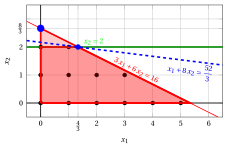
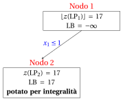
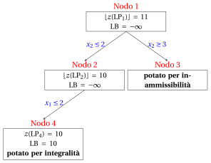
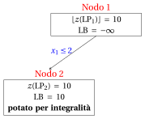
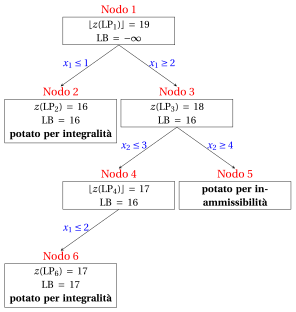
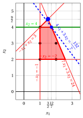
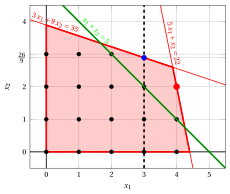

# Esercizi · Il branch-and-cut

**Esercizi · Capitolo 8** · ogni soluzione si apre con un clic · [:material-book-open-variant: Capitolo 8: Branch-and-cut](../metodi-esatti/branch-and-cut.md) · [:material-file-pdf-box: Eserciziario, volume 2 (PDF)](../pdf/esercizi-2-metodi-esatti.pdf)

!!! esercizio "Esercizio 8.1: Cut-and-branch (P1)"

    !!! nota ""

        Consideriamo il seguente problema PLI in forma canonica di massimo con $n=2$ variabili intere e $m=1$ vincolo:

        $$
        \begin{array}{rrrrrrr}
        {\max} & {x_1} & {+} & {8}\, {x_2} \\[1.5ex]
        & {3}\, {x_1} & {+} & {6}\, {x_2} & {\le} & {16} \\[1.5ex]
        & {x_1,} &  & {x_2} & {\in} & {\Z_{\ge 0}}
        \end{array}
        $$

        e il seguente dizionario ottimo del simplesso del suo rilassamento lineare in forma standard:

        \begin{equation*}
        \begin{cases}
        \begin{array}{rrrrrrr}
        {x_2} & {=} & {\dfrac{8}{3}} & {-} & {\dfrac{1}{2}}\, {x_1} & {-} & {\dfrac{1}{6}}\, {x_3} \\[2ex]
        {z} & {=} & {\dfrac{64}{3}} & {-} & {3}\, {x_1} & {-} & {\dfrac{4}{3}}\, {x_3}
        \end{array}
        \end{cases}
        \end{equation*}

    **Domande**

    1. Eseguire l'algoritmo branch-and-bound usando la regola dell'indice minimo come strategia di selezione della variabile di branching, la regola LIFO come strategia di selezione del nodo di branching, il nodo di branching verso il basso risolto per primo, e $\LB = -\infty$ all'inizio (nessun algoritmo euristico). Dare l'albero di branch-and-bound e il numero di problemi LP risolti.

    2. Eseguire un round di un algoritmo cut-and-branch nel nodo radice: generare il taglio frazionario di Gomory della riga con il termine noto frazionario più grande (in caso di pareggio, l'indice minimo della variabile in base, con la riga della funzione obiettivo per ultima), scritto nelle variabili originali e reso primitivo prima di aggiungere la sua variabile di scarto.

    3. Riottimizzare il problema LP del nodo radice con il taglio, usando l'algoritmo del simplesso duale (variabile uscente: la variabile in base con valore negativo e indice minimo; pareggi nel test dei rapporti risolti con l'indice minimo). Mostrare graficamente l'effetto del taglio.

    4. Eseguire l'algoritmo branch-and-bound sul problema rafforzato, con le stesse regole, e confrontare il numero di problemi LP risolti con quello della prima domanda.

??? soluzione "Soluzione"

    1. Il problema $\LP_1$ ha la soluzione ottima $(0,\tfrac{8}{3})$ con $z(\LP_1) = \dfrac{64}{3}$. L'algoritmo branch-and-bound risolve $4$ problemi LP:

        { .fig loading=lazy  }

        
<table>
        <tr>
        <th>Nodo</th>
        <th>Padre</th>
        <th>Branching</th>
        <th>\(\tilde{\vet x}(\LP_k)\)</th>
        <th>\(z(\LP_k)\)</th>
        <th>\(\LB\)</th>
        <th>Esito</th>
        </tr>
        <tr>
        <td>1</td>
        <td>–</td>
        <td>–</td>
        <td>\((0,\tfrac{8}{3})\)</td>
        <td>\(\tfrac{64}{3}\)</td>
        <td>\(-\infty\)</td>
        <td>branching su \(x_2\)</td>
        </tr>
        <tr>
        <td>2</td>
        <td>1</td>
        <td>\(x_2 \le 2\)</td>
        <td>\((\tfrac{4}{3},2)\)</td>
        <td>\(\tfrac{52}{3}\)</td>
        <td>\(-\infty\)</td>
        <td>branching su \(x_1\)</td>
        </tr>
        <tr>
        <td>3</td>
        <td>1</td>
        <td>\(x_2 \ge 3\)</td>
        <td>–</td>
        <td>–</td>
        <td>\(-\infty\)</td>
        <td>potato per inammissibilità</td>
        </tr>
        <tr>
        <td>4</td>
        <td>2</td>
        <td>\(x_1 \le 1\)</td>
        <td>\((1,2)\)</td>
        <td>\(17\)</td>
        <td>\(17\)</td>
        <td>potato per integralità</td>
        </tr>
        </table>

        La soluzione ottima è $\tilde{\vet x}(\ILP) = (1,2)$, con $z(\ILP) = 17$.

    2. Le righe candidate sono quelle del dizionario ottimo con termine noto frazionario:

        
<table>
        <tr>
        <th>Riga</th>
        <th>parte frazionaria del termine noto</th>
        </tr>
        <tr>
        <td>\(x_2\)</td>
        <td>\(\tfrac{2}{3}\)</td>
        </tr>
        <tr>
        <td>\(z\)</td>
        <td>\(\tfrac{1}{3}\)</td>
        </tr>
        </table>

        La parte frazionaria più grande è $\tfrac{2}{3}$, nella riga di $x_2$.

        In forma di equazione, la riga di $x_2$ si scrive

        $$
        x_2 + \tfrac{1}{2}\,x_1 + \tfrac{1}{6}\,x_3 = \dfrac{8}{3},
        $$

        e il taglio frazionario di Gomory generato da questa riga è

        $$
        \underbrace{\left(\tfrac{1}{2} - \left\lfloor \tfrac{1}{2} \right\rfloor\right)}_{=\tfrac{1}{2}}\,x_1 + \underbrace{\left(\tfrac{1}{6} - \left\lfloor \tfrac{1}{6} \right\rfloor\right)}_{=\tfrac{1}{6}}\,x_3 ~\ge~ \underbrace{\tfrac{8}{3} - \left\lfloor \tfrac{8}{3} \right\rfloor}_{=\tfrac{2}{3}},
        $$

        cioè

        $$
        \dfrac{1}{2}\,x_1 + \dfrac{1}{6}\,x_3 \ge \dfrac{2}{3}.
        $$

        Sostituendo le variabili di scarto con le loro espressioni nelle variabili originali, il taglio diventa

        $$
        x_2 \le 2.
        $$

        I coefficienti hanno massimo comun divisore $1$: il taglio $x_2 \le 2$ è primitivo.

        Nel nodo radice non c'è alcun vincolo di branching, quindi il taglio è <strong>globale</strong>. Esclude $(0,\tfrac{8}{3})$: $0 \cdot 0 + 1 \cdot \tfrac{8}{3} = \tfrac{8}{3} > 2$.

    3. Il taglio $x_2 \le 2$ si aggiunge con la sua variabile di scarto $x_4 = 2 - x_2 \ge 0$. Esprimendolo con le variabili fuori base e aggiungendolo al dizionario ottimo otteniamo un dizionario duale ammissibile ma non primale ammissibile:

        \begin{equation*}
        \begin{cases}
        \begin{array}{rrrrrrr}
        {x_2} & {=} & {\dfrac{8}{3}} & {-} & {\dfrac{1}{2}}\, {x_1} & {-} & {\dfrac{1}{6}}\, {x_3} \\[2ex]
        {x_4} & {=} & {-\dfrac{2}{3}} & {+} & {\dfrac{1}{2}}\, {x_1} & {+} & {\dfrac{1}{6}}\, {x_3} \\[2ex]
        {z} & {=} & {\dfrac{64}{3}} & {-} & {3}\, {x_1} & {-} & {\dfrac{4}{3}}\, {x_3}
        \end{array}
        \end{cases}
        \end{equation*}

        Se aumentiamo il valore di $\pi_{4}$, possiamo ottenere una soluzione duale migliore. Abbiamo:

        $$
        \begin{cases}
        \pi_1 &= 3 - \dfrac{1}{2}\,\pi_4 \\[2ex]
        \pi_3 &= \dfrac{4}{3} - \dfrac{1}{6}\,\pi_4
        \end{cases}
        \qquad
        \qquad
        \begin{cases}
        \underbrace{ 3 - \dfrac{1}{2}\,\pi_4 \ge 0}_{\pi_1 \ge 0} \\[2ex]
        \underbrace{ \dfrac{4}{3} - \dfrac{1}{6}\,\pi_4 \ge 0}_{\pi_3 \ge 0}
        \end{cases}
        \qquad
        \qquad
        \begin{cases}
        \pi_4 &\le 6 \\[2ex]
        \pi_4 &\le 8
        \end{cases}
        $$

        Aumentando il valore di $\pi_{4}$ fino a $\min \left\{6, 8\right\}=6$, il valore di $\pi_{1}$ scende a $0$. Abbiamo quindi che:

        - $\pi_{4}$ entra nella base duale e, di conseguenza, $x_{4}$ esce dalla base primale.

        - $\pi_{1}$ esce dalla base duale e, di conseguenza, $x_{1}$ entra nella base primale.

        Abbiamo:

        $$
        x_4 = -\dfrac{2}{3} + \dfrac{1}{2} \, x_1 + \dfrac{1}{6} \, x_3
        \quad \Rightarrow \quad
        x_1 = \dfrac{4}{3} - \dfrac{1}{3} \, x_3 + 2 \, x_4
        $$

        Sostituendo nelle altre equazioni del dizionario primale, otteniamo:

        $$
        x_2
        = \dfrac{8}{3} - \dfrac{1}{2} \left( \dfrac{4}{3} - \dfrac{1}{3} \, x_3 + 2 \, x_4 \right) - \dfrac{1}{6} \; x_3
        = 2 - x_4
        $$

        $$
        z
        = \dfrac{64}{3} - 3 \left( \dfrac{4}{3} - \dfrac{1}{3} \, x_3 + 2 \, x_4 \right) - \dfrac{4}{3} \; x_3
        = \dfrac{52}{3} - \dfrac{1}{3} \, x_3 - 6 \, x_4
        $$

        Di conseguenza, abbiamo ora il seguente dizionario primale aggiornato:

        \begin{equation*}
        \begin{cases}
        \begin{array}{rrrrrrr}
        {x_1} & {=} & {\dfrac{4}{3}} & {-} & {\dfrac{1}{3}}\, {x_3} & {+} & {2}\, {x_4} \\[2ex]
        {x_2} & {=} & {2} &  &  & {-} & {x_4} \\[2ex]
        {z} & {=} & {\dfrac{52}{3}} & {-} & {\dfrac{1}{3}}\, {x_3} & {-} & {6}\, {x_4}
        \end{array}
        \end{cases}
        \end{equation*}

        dove $\pazocal{B}=\{1,2\}$ e $\pazocal{N}=\{3,4\}$, e

        - la soluzione di base primale ottima è:

            $$
            \tilde x_1=\dfrac{4}{3},~~
            \tilde x_2=2,~~~~~~
            \tilde x_3=0,~~
            \tilde x_4=0~~
            \mathrm{~~di~valore~~~} \dfrac{52}{3}
            $$

        - la soluzione di base duale ottima è:

            $$
            \tilde \pi_1=0,~~
            \tilde \pi_2=0,~~~~~~
            \tilde \pi_3=\dfrac{1}{3},~~
            \tilde \pi_4=6~~
            \mathrm{~~di~valore~~~} \dfrac{52}{3}
            $$

        La nuova soluzione ottima di $\LP_1$ è $(\tfrac{4}{3},2)$, con $z(\LP_1) = \dfrac{52}{3}$ e upper bound $17$. Graficamente, abbiamo:

        { .fig .ovale loading=lazy  }

        <em>Il problema LP della radice con il taglio di Gomory (in verde): la vecchia soluzione ottima (cerchio blu) è esclusa, e la nuova soluzione ottima è in blu, con la sua retta di livello della funzione obiettivo (tratteggiata).</em>

    4. Ogni nodo eredita il taglio. Ora l'algoritmo branch-and-bound risolve $2$ problemi LP:

        { .fig loading=lazy  }

        
<table>
        <tr>
        <th>Nodo</th>
        <th>Padre</th>
        <th>Branching</th>
        <th>\(\tilde{\vet x}(\LP_k)\)</th>
        <th>\(z(\LP_k)\)</th>
        <th>\(\LB\)</th>
        <th>Esito</th>
        </tr>
        <tr>
        <td>1</td>
        <td>–</td>
        <td>–</td>
        <td>\((\tfrac{4}{3},2)\)</td>
        <td>\(\tfrac{52}{3}\)</td>
        <td>\(-\infty\)</td>
        <td>branching su \(x_1\)</td>
        </tr>
        <tr>
        <td>2</td>
        <td>1</td>
        <td>\(x_1 \le 1\)</td>
        <td>\((1,2)\)</td>
        <td>\(17\)</td>
        <td>\(17\)</td>
        <td>potato per integralità</td>
        </tr>
        </table>

        !!! chiave ""

            Branch-and-bound: $4$ problemi LP; cut-and-branch con un taglio di Gomory: $2$ problemi LP. Il taglio abbassa il bound della radice e <strong>riduce</strong> l'albero. Entrambi trovano $\tilde{\vet x}(\ILP) = (1,2)$, $z(\ILP) = 17$.

!!! esercizio "Esercizio 8.2: Cut-and-branch (P23)"

    !!! nota ""

        Consideriamo il seguente problema PLI in forma canonica di massimo con $n=2$ variabili intere e $m=3$ vincoli:

        $$
        \begin{array}{rrrrrrr}
        {\max} & {x_1} & {+} & {4}\, {x_2} \\[1.5ex]
        & {3}\, {x_1} & {+} & {8}\, {x_2} & {\le} & {24} \\[1.5ex]
        & {-}{x_1} &  &  & {\le} & {-1} \\[1.5ex]
        &  &  & {-}{x_2} & {\le} & {-1} \\[1.5ex]
        & {x_1,} &  & {x_2} & {\in} & {\Z_{\ge 0}}
        \end{array}
        $$

        I vincoli $x_1 \ge 1$ e $x_2 \ge 1$ si scrivono in forma canonica come $-x_1 \le -1$ e $-x_2 \le -1$.

        e il seguente dizionario ottimo del simplesso del suo rilassamento lineare in forma standard:

        \begin{equation*}
        \begin{cases}
        \begin{array}{rrrrrrr}
        {x_1} & {=} & {1} &  &  & {+} & {x_4} \\[2ex]
        {x_2} & {=} & {\dfrac{21}{8}} & {-} & {\dfrac{1}{8}}\, {x_3} & {-} & {\dfrac{3}{8}}\, {x_4} \\[2ex]
        {x_5} & {=} & {\dfrac{13}{8}} & {-} & {\dfrac{1}{8}}\, {x_3} & {-} & {\dfrac{3}{8}}\, {x_4} \\[2ex]
        {z} & {=} & {\dfrac{23}{2}} & {-} & {\dfrac{1}{2}}\, {x_3} & {-} & {\dfrac{1}{2}}\, {x_4}
        \end{array}
        \end{cases}
        \end{equation*}

    **Domande**

    1. Eseguire l'algoritmo branch-and-bound usando la regola dell'indice minimo come strategia di selezione della variabile di branching, la regola LIFO come strategia di selezione del nodo di branching, il nodo di branching verso il basso risolto per primo, e $\LB = -\infty$ all'inizio (nessun algoritmo euristico). Dare l'albero di branch-and-bound e il numero di problemi LP risolti.

    2. Eseguire un round di un algoritmo cut-and-branch nel nodo radice: generare il taglio frazionario di Gomory della riga con il termine noto frazionario più grande (in caso di pareggio, l'indice minimo della variabile in base, con la riga della funzione obiettivo per ultima), scritto nelle variabili originali e reso primitivo prima di aggiungere la sua variabile di scarto.

    3. Riottimizzare il problema LP del nodo radice con il taglio, usando l'algoritmo del simplesso duale (variabile uscente: la variabile in base con valore negativo e indice minimo; pareggi nel test dei rapporti risolti con l'indice minimo). Mostrare graficamente l'effetto del taglio.

    4. Eseguire l'algoritmo branch-and-bound sul problema rafforzato, con le stesse regole, e confrontare il numero di problemi LP risolti con quello della prima domanda.

??? soluzione "Soluzione"

    1. Il problema $\LP_1$ ha la soluzione ottima $(1,\tfrac{21}{8})$ con $z(\LP_1) = \dfrac{23}{2}$. L'algoritmo branch-and-bound risolve $4$ problemi LP:

        { .fig loading=lazy  }

        
<table>
        <tr>
        <th>Nodo</th>
        <th>Padre</th>
        <th>Branching</th>
        <th>\(\tilde{\vet x}(\LP_k)\)</th>
        <th>\(z(\LP_k)\)</th>
        <th>\(\LB\)</th>
        <th>Esito</th>
        </tr>
        <tr>
        <td>1</td>
        <td>–</td>
        <td>–</td>
        <td>\((1,\tfrac{21}{8})\)</td>
        <td>\(\tfrac{23}{2}\)</td>
        <td>\(-\infty\)</td>
        <td>branching su \(x_2\)</td>
        </tr>
        <tr>
        <td>2</td>
        <td>1</td>
        <td>\(x_2 \le 2\)</td>
        <td>\((\tfrac{8}{3},2)\)</td>
        <td>\(\tfrac{32}{3}\)</td>
        <td>\(-\infty\)</td>
        <td>branching su \(x_1\)</td>
        </tr>
        <tr>
        <td>3</td>
        <td>1</td>
        <td>\(x_2 \ge 3\)</td>
        <td>–</td>
        <td>–</td>
        <td>\(-\infty\)</td>
        <td>potato per inammissibilità</td>
        </tr>
        <tr>
        <td>4</td>
        <td>2</td>
        <td>\(x_1 \le 2\)</td>
        <td>\((2,2)\)</td>
        <td>\(10\)</td>
        <td>\(10\)</td>
        <td>potato per integralità</td>
        </tr>
        </table>

        La soluzione ottima è $\tilde{\vet x}(\ILP) = (2,2)$, con $z(\ILP) = 10$.

    2. Le righe candidate sono quelle del dizionario ottimo con termine noto frazionario:

        
<table>
        <tr>
        <th>Riga</th>
        <th>parte frazionaria del termine noto</th>
        </tr>
        <tr>
        <td>\(x_2\)</td>
        <td>\(\tfrac{5}{8}\)</td>
        </tr>
        <tr>
        <td>\(x_5\)</td>
        <td>\(\tfrac{5}{8}\)</td>
        </tr>
        <tr>
        <td>\(z\)</td>
        <td>\(\tfrac{1}{2}\)</td>
        </tr>
        </table>

        La parte frazionaria più grande è $\tfrac{5}{8}$, nella riga di $x_2$.

        In forma di equazione, la riga di $x_2$ si scrive

        $$
        x_2 + \tfrac{1}{8}\,x_3 + \tfrac{3}{8}\,x_4 = \dfrac{21}{8},
        $$

        e il taglio frazionario di Gomory generato da questa riga è

        $$
        \underbrace{\left(\tfrac{1}{8} - \left\lfloor \tfrac{1}{8} \right\rfloor\right)}_{=\tfrac{1}{8}}\,x_3 + \underbrace{\left(\tfrac{3}{8} - \left\lfloor \tfrac{3}{8} \right\rfloor\right)}_{=\tfrac{3}{8}}\,x_4 ~\ge~ \underbrace{\tfrac{21}{8} - \left\lfloor \tfrac{21}{8} \right\rfloor}_{=\tfrac{5}{8}},
        $$

        cioè

        $$
        \dfrac{1}{8}\,x_3 + \dfrac{3}{8}\,x_4 \ge \dfrac{5}{8}.
        $$

        Sostituendo le variabili di scarto con le loro espressioni nelle variabili originali, il taglio diventa

        $$
        x_2 \le 2.
        $$

        I coefficienti hanno massimo comun divisore $1$: il taglio $x_2 \le 2$ è primitivo.

        Nel nodo radice non c'è alcun vincolo di branching, quindi il taglio è <strong>globale</strong>. Esclude $(1,\tfrac{21}{8})$: $0 \cdot 1 + 1 \cdot \tfrac{21}{8} = \tfrac{21}{8} > 2$.

    3. Il taglio $x_2 \le 2$ si aggiunge con la sua variabile di scarto $x_6 = 2 - x_2 \ge 0$. Esprimendolo con le variabili fuori base e aggiungendolo al dizionario ottimo otteniamo un dizionario duale ammissibile ma non primale ammissibile:

        \begin{equation*}
        \begin{cases}
        \begin{array}{rrrrrrr}
        {x_1} & {=} & {1} &  &  & {+} & {x_4} \\[2ex]
        {x_2} & {=} & {\dfrac{21}{8}} & {-} & {\dfrac{1}{8}}\, {x_3} & {-} & {\dfrac{3}{8}}\, {x_4} \\[2ex]
        {x_5} & {=} & {\dfrac{13}{8}} & {-} & {\dfrac{1}{8}}\, {x_3} & {-} & {\dfrac{3}{8}}\, {x_4} \\[2ex]
        {x_6} & {=} & {-\dfrac{5}{8}} & {+} & {\dfrac{1}{8}}\, {x_3} & {+} & {\dfrac{3}{8}}\, {x_4} \\[2ex]
        {z} & {=} & {\dfrac{23}{2}} & {-} & {\dfrac{1}{2}}\, {x_3} & {-} & {\dfrac{1}{2}}\, {x_4}
        \end{array}
        \end{cases}
        \end{equation*}

        Se aumentiamo il valore di $\pi_{6}$, possiamo ottenere una soluzione duale migliore. Abbiamo:

        $$
        \begin{cases}
        \pi_3 &= \dfrac{1}{2} - \dfrac{1}{8}\,\pi_6 \\[2ex]
        \pi_4 &= \dfrac{1}{2} - \dfrac{3}{8}\,\pi_6
        \end{cases}
        \qquad
        \qquad
        \begin{cases}
        \underbrace{ \dfrac{1}{2} - \dfrac{1}{8}\,\pi_6 \ge 0}_{\pi_3 \ge 0} \\[2ex]
        \underbrace{ \dfrac{1}{2} - \dfrac{3}{8}\,\pi_6 \ge 0}_{\pi_4 \ge 0}
        \end{cases}
        \qquad
        \qquad
        \begin{cases}
        \pi_6 &\le 4 \\[2ex]
        \pi_6 &\le \dfrac{4}{3}
        \end{cases}
        $$

        Aumentando il valore di $\pi_{6}$ fino a $\min \left\{4, \dfrac{4}{3}\right\}=\dfrac{4}{3}$, il valore di $\pi_{4}$ scende a $0$. Abbiamo quindi che:

        - $\pi_{6}$ entra nella base duale e, di conseguenza, $x_{6}$ esce dalla base primale.

        - $\pi_{4}$ esce dalla base duale e, di conseguenza, $x_{4}$ entra nella base primale.

        Abbiamo:

        $$
        x_6 = -\dfrac{5}{8} + \dfrac{1}{8} \, x_3 + \dfrac{3}{8} \, x_4
        \quad \Rightarrow \quad
        x_4 = \dfrac{5}{3} - \dfrac{1}{3} \, x_3 + \dfrac{8}{3} \, x_6
        $$

        Sostituendo nelle altre equazioni del dizionario primale, otteniamo:

        $$
        x_1
        = 1 + \left( \dfrac{5}{3} - \dfrac{1}{3} \, x_3 + \dfrac{8}{3} \, x_6 \right)
        = \dfrac{8}{3} - \dfrac{1}{3} \, x_3 + \dfrac{8}{3} \, x_6
        $$

        $$
        x_2
        = \dfrac{21}{8} - \dfrac{1}{8} \; x_3 - \dfrac{3}{8} \left( \dfrac{5}{3} - \dfrac{1}{3} \, x_3 + \dfrac{8}{3} \, x_6 \right)
        = 2 - x_6
        $$

        $$
        x_5
        = \dfrac{13}{8} - \dfrac{1}{8} \; x_3 - \dfrac{3}{8} \left( \dfrac{5}{3} - \dfrac{1}{3} \, x_3 + \dfrac{8}{3} \, x_6 \right)
        = 1 - x_6
        $$

        $$
        z
        = \dfrac{23}{2} - \dfrac{1}{2} \; x_3 - \dfrac{1}{2} \left( \dfrac{5}{3} - \dfrac{1}{3} \, x_3 + \dfrac{8}{3} \, x_6 \right)
        = \dfrac{32}{3} - \dfrac{1}{3} \, x_3 - \dfrac{4}{3} \, x_6
        $$

        Di conseguenza, abbiamo ora il seguente dizionario primale aggiornato:

        \begin{equation*}
        \begin{cases}
        \begin{array}{rrrrrrr}
        {x_1} & {=} & {\dfrac{8}{3}} & {-} & {\dfrac{1}{3}}\, {x_3} & {+} & {\dfrac{8}{3}}\, {x_6} \\[2ex]
        {x_2} & {=} & {2} &  &  & {-} & {x_6} \\[2ex]
        {x_4} & {=} & {\dfrac{5}{3}} & {-} & {\dfrac{1}{3}}\, {x_3} & {+} & {\dfrac{8}{3}}\, {x_6} \\[2ex]
        {x_5} & {=} & {1} &  &  & {-} & {x_6} \\[2ex]
        {z} & {=} & {\dfrac{32}{3}} & {-} & {\dfrac{1}{3}}\, {x_3} & {-} & {\dfrac{4}{3}}\, {x_6}
        \end{array}
        \end{cases}
        \end{equation*}

        dove $\pazocal{B}=\{1,2,4,5\}$ e $\pazocal{N}=\{3,6\}$, e

        - la soluzione di base primale ottima è:

            $$
            \tilde x_1=\dfrac{8}{3},~~
            \tilde x_2=2,~~
            \tilde x_4=\dfrac{5}{3},~~
            \tilde x_5=1,~~~~~~
            \tilde x_3=0,~~
            \tilde x_6=0~~
            \mathrm{~~di~valore~~~} \dfrac{32}{3}
            $$

        - la soluzione di base duale ottima è:

            $$
            \tilde \pi_1=0,~~
            \tilde \pi_2=0,~~
            \tilde \pi_4=0,~~
            \tilde \pi_5=0,~~~~~~
            \tilde \pi_3=\dfrac{1}{3},~~
            \tilde \pi_6=\dfrac{4}{3}~~
            \mathrm{~~di~valore~~~} \dfrac{32}{3}
            $$

        La nuova soluzione ottima di $\LP_1$ è $(\tfrac{8}{3},2)$, con $z(\LP_1) = \dfrac{32}{3}$ e upper bound $10$. Graficamente, abbiamo:

        { .fig .ovale loading=lazy  }

        <em>Il problema LP della radice con il taglio di Gomory (in verde): la vecchia soluzione ottima (cerchio blu) è esclusa, e la nuova soluzione ottima è in blu, con la sua retta di livello della funzione obiettivo (tratteggiata).</em>

    4. Ogni nodo eredita il taglio. Ora l'algoritmo branch-and-bound risolve $2$ problemi LP:

        { .fig loading=lazy  }

        
<table>
        <tr>
        <th>Nodo</th>
        <th>Padre</th>
        <th>Branching</th>
        <th>\(\tilde{\vet x}(\LP_k)\)</th>
        <th>\(z(\LP_k)\)</th>
        <th>\(\LB\)</th>
        <th>Esito</th>
        </tr>
        <tr>
        <td>1</td>
        <td>–</td>
        <td>–</td>
        <td>\((\tfrac{8}{3},2)\)</td>
        <td>\(\tfrac{32}{3}\)</td>
        <td>\(-\infty\)</td>
        <td>branching su \(x_1\)</td>
        </tr>
        <tr>
        <td>2</td>
        <td>1</td>
        <td>\(x_1 \le 2\)</td>
        <td>\((2,2)\)</td>
        <td>\(10\)</td>
        <td>\(10\)</td>
        <td>potato per integralità</td>
        </tr>
        </table>

        !!! chiave ""

            Branch-and-bound: $4$ problemi LP; cut-and-branch con un taglio di Gomory: $2$ problemi LP. Il taglio abbassa il bound della radice e <strong>riduce</strong> l'albero. Entrambi trovano $\tilde{\vet x}(\ILP) = (2,2)$, $z(\ILP) = 10$.

!!! esercizio "Esercizio 8.3: Cut-and-branch (P24)"

    !!! nota ""

        Consideriamo il seguente problema PLI in forma canonica di massimo con $n=2$ variabili intere e $m=4$ vincoli:

        $$
        \begin{array}{rrrrrrr}
        {\max} & {4}\, {x_1} & {+} & {3}\, {x_2} \\[1.5ex]
        & {7}\, {x_1} & {+} & {3}\, {x_2} & {\le} & {24} \\[1.5ex]
        & {-}{x_1} & {+} & {x_2} & {\le} & {3} \\[1.5ex]
        & {-}{x_1} &  &  & {\le} & {-1} \\[1.5ex]
        &  &  & {-}{x_2} & {\le} & {-2} \\[1.5ex]
        & {x_1,} &  & {x_2} & {\in} & {\Z_{\ge 0}}
        \end{array}
        $$

        I vincoli $x_1 \ge 1$ e $x_2 \ge 2$ si scrivono in forma canonica come $-x_1 \le -1$ e $-x_2 \le -2$.

        e il seguente dizionario ottimo del simplesso del suo rilassamento lineare in forma standard:

        \begin{equation*}
        \begin{cases}
        \begin{array}{rrrrrrr}
        {x_1} & {=} & {\dfrac{3}{2}} & {-} & {\dfrac{1}{10}}\, {x_3} & {+} & {\dfrac{3}{10}}\, {x_4} \\[2ex]
        {x_2} & {=} & {\dfrac{9}{2}} & {-} & {\dfrac{1}{10}}\, {x_3} & {-} & {\dfrac{7}{10}}\, {x_4} \\[2ex]
        {x_5} & {=} & {\dfrac{1}{2}} & {-} & {\dfrac{1}{10}}\, {x_3} & {+} & {\dfrac{3}{10}}\, {x_4} \\[2ex]
        {x_6} & {=} & {\dfrac{5}{2}} & {-} & {\dfrac{1}{10}}\, {x_3} & {-} & {\dfrac{7}{10}}\, {x_4} \\[2ex]
        {z} & {=} & {\dfrac{39}{2}} & {-} & {\dfrac{7}{10}}\, {x_3} & {-} & {\dfrac{9}{10}}\, {x_4}
        \end{array}
        \end{cases}
        \end{equation*}

    **Domande**

    1. Eseguire l'algoritmo branch-and-bound usando la regola dell'indice minimo come strategia di selezione della variabile di branching, la regola LIFO come strategia di selezione del nodo di branching, il nodo di branching verso il basso risolto per primo, e $\LB = -\infty$ all'inizio (nessun algoritmo euristico). Dare l'albero di branch-and-bound e il numero di problemi LP risolti.

    2. Eseguire un round di un algoritmo cut-and-branch nel nodo radice: generare il taglio frazionario di Gomory della riga con il termine noto frazionario più grande (in caso di pareggio, l'indice minimo della variabile in base, con la riga della funzione obiettivo per ultima), scritto nelle variabili originali e reso primitivo prima di aggiungere la sua variabile di scarto.

    3. Riottimizzare il problema LP del nodo radice con il taglio, usando l'algoritmo del simplesso duale (variabile uscente: la variabile in base con valore negativo e indice minimo; pareggi nel test dei rapporti risolti con l'indice minimo). Mostrare graficamente l'effetto del taglio.

    4. Eseguire l'algoritmo branch-and-bound sul problema rafforzato, con le stesse regole, e confrontare il numero di problemi LP risolti con quello della prima domanda.

??? soluzione "Soluzione"

    1. Il problema $\LP_1$ ha la soluzione ottima $(\tfrac{3}{2},\tfrac{9}{2})$ con $z(\LP_1) = \dfrac{39}{2}$. L'algoritmo branch-and-bound risolve $6$ problemi LP:

        { .fig loading=lazy  }

        
<table>
        <tr>
        <th>Nodo</th>
        <th>Padre</th>
        <th>Branching</th>
        <th>\(\tilde{\vet x}(\LP_k)\)</th>
        <th>\(z(\LP_k)\)</th>
        <th>\(\LB\)</th>
        <th>Esito</th>
        </tr>
        <tr>
        <td>1</td>
        <td>–</td>
        <td>–</td>
        <td>\((\tfrac{3}{2},\tfrac{9}{2})\)</td>
        <td>\(\tfrac{39}{2}\)</td>
        <td>\(-\infty\)</td>
        <td>branching su \(x_1\)</td>
        </tr>
        <tr>
        <td>2</td>
        <td>1</td>
        <td>\(x_1 \le 1\)</td>
        <td>\((1,4)\)</td>
        <td>\(16\)</td>
        <td>\(16\)</td>
        <td>potato per integralità</td>
        </tr>
        <tr>
        <td>3</td>
        <td>1</td>
        <td>\(x_1 \ge 2\)</td>
        <td>\((2,\tfrac{10}{3})\)</td>
        <td>\(18\)</td>
        <td>\(16\)</td>
        <td>branching su \(x_2\)</td>
        </tr>
        <tr>
        <td>4</td>
        <td>3</td>
        <td>\(x_2 \le 3\)</td>
        <td>\((\tfrac{15}{7},3)\)</td>
        <td>\(\tfrac{123}{7}\)</td>
        <td>\(16\)</td>
        <td>branching su \(x_1\)</td>
        </tr>
        <tr>
        <td>5</td>
        <td>3</td>
        <td>\(x_2 \ge 4\)</td>
        <td>–</td>
        <td>–</td>
        <td>\(16\)</td>
        <td>potato per inammissibilità</td>
        </tr>
        <tr>
        <td>6</td>
        <td>4</td>
        <td>\(x_1 \le 2\)</td>
        <td>\((2,3)\)</td>
        <td>\(17\)</td>
        <td>\(17\)</td>
        <td>potato per integralità</td>
        </tr>
        </table>

        La soluzione ottima è $\tilde{\vet x}(\ILP) = (2,3)$, con $z(\ILP) = 17$.

    2. Le righe candidate sono quelle del dizionario ottimo con termine noto frazionario:

        
<table>
        <tr>
        <th>Riga</th>
        <th>parte frazionaria del termine noto</th>
        </tr>
        <tr>
        <td>\(x_1\)</td>
        <td>\(\tfrac{1}{2}\)</td>
        </tr>
        <tr>
        <td>\(x_2\)</td>
        <td>\(\tfrac{1}{2}\)</td>
        </tr>
        <tr>
        <td>\(x_5\)</td>
        <td>\(\tfrac{1}{2}\)</td>
        </tr>
        <tr>
        <td>\(x_6\)</td>
        <td>\(\tfrac{1}{2}\)</td>
        </tr>
        <tr>
        <td>\(z\)</td>
        <td>\(\tfrac{1}{2}\)</td>
        </tr>
        </table>

        La parte frazionaria più grande è $\tfrac{1}{2}$, nella riga di $x_1$.

        In forma di equazione, la riga di $x_1$ si scrive

        $$
        x_1 + \tfrac{1}{10}\,x_3 - \tfrac{3}{10}\,x_4 = \dfrac{3}{2},
        $$

        e il taglio frazionario di Gomory generato da questa riga è

        $$
        \underbrace{\left(\tfrac{1}{10} - \left\lfloor \tfrac{1}{10} \right\rfloor\right)}_{=\tfrac{1}{10}}\,x_3 + \underbrace{\left(-\tfrac{3}{10} - \left\lfloor -\tfrac{3}{10} \right\rfloor\right)}_{=\tfrac{7}{10}}\,x_4 ~\ge~ \underbrace{\tfrac{3}{2} - \left\lfloor \tfrac{3}{2} \right\rfloor}_{=\tfrac{1}{2}},
        $$

        cioè

        $$
        \dfrac{1}{10}\,x_3 + \dfrac{7}{10}\,x_4 \ge \dfrac{1}{2}.
        $$

        Sostituendo le variabili di scarto con le loro espressioni nelle variabili originali, il taglio diventa

        $$
        x_2 \le 4.
        $$

        I coefficienti hanno massimo comun divisore $1$: il taglio $x_2 \le 4$ è primitivo.

        Nel nodo radice non c'è alcun vincolo di branching, quindi il taglio è <strong>globale</strong>. Esclude $(\tfrac{3}{2},\tfrac{9}{2})$: $0 \cdot \tfrac{3}{2} + 1 \cdot \tfrac{9}{2} = \tfrac{9}{2} > 4$.

    3. Il taglio $x_2 \le 4$ si aggiunge con la sua variabile di scarto $x_7 = 4 - x_2 \ge 0$. Esprimendolo con le variabili fuori base e aggiungendolo al dizionario ottimo otteniamo un dizionario duale ammissibile ma non primale ammissibile:

        \begin{equation*}
        \begin{cases}
        \begin{array}{rrrrrrr}
        {x_1} & {=} & {\dfrac{3}{2}} & {-} & {\dfrac{1}{10}}\, {x_3} & {+} & {\dfrac{3}{10}}\, {x_4} \\[2ex]
        {x_2} & {=} & {\dfrac{9}{2}} & {-} & {\dfrac{1}{10}}\, {x_3} & {-} & {\dfrac{7}{10}}\, {x_4} \\[2ex]
        {x_5} & {=} & {\dfrac{1}{2}} & {-} & {\dfrac{1}{10}}\, {x_3} & {+} & {\dfrac{3}{10}}\, {x_4} \\[2ex]
        {x_6} & {=} & {\dfrac{5}{2}} & {-} & {\dfrac{1}{10}}\, {x_3} & {-} & {\dfrac{7}{10}}\, {x_4} \\[2ex]
        {x_7} & {=} & {-\dfrac{1}{2}} & {+} & {\dfrac{1}{10}}\, {x_3} & {+} & {\dfrac{7}{10}}\, {x_4} \\[2ex]
        {z} & {=} & {\dfrac{39}{2}} & {-} & {\dfrac{7}{10}}\, {x_3} & {-} & {\dfrac{9}{10}}\, {x_4}
        \end{array}
        \end{cases}
        \end{equation*}

        Se aumentiamo il valore di $\pi_{7}$, possiamo ottenere una soluzione duale migliore. Abbiamo:

        $$
        \begin{cases}
        \pi_3 &= \dfrac{7}{10} - \dfrac{1}{10}\,\pi_7 \\[2ex]
        \pi_4 &= \dfrac{9}{10} - \dfrac{7}{10}\,\pi_7
        \end{cases}
        \qquad
        \qquad
        \begin{cases}
        \underbrace{ \dfrac{7}{10} - \dfrac{1}{10}\,\pi_7 \ge 0}_{\pi_3 \ge 0} \\[2ex]
        \underbrace{ \dfrac{9}{10} - \dfrac{7}{10}\,\pi_7 \ge 0}_{\pi_4 \ge 0}
        \end{cases}
        \qquad
        \qquad
        \begin{cases}
        \pi_7 &\le 7 \\[2ex]
        \pi_7 &\le \dfrac{9}{7}
        \end{cases}
        $$

        Aumentando il valore di $\pi_{7}$ fino a $\min \left\{7, \dfrac{9}{7}\right\}=\dfrac{9}{7}$, il valore di $\pi_{4}$ scende a $0$. Abbiamo quindi che:

        - $\pi_{7}$ entra nella base duale e, di conseguenza, $x_{7}$ esce dalla base primale.

        - $\pi_{4}$ esce dalla base duale e, di conseguenza, $x_{4}$ entra nella base primale.

        Abbiamo:

        $$
        x_7 = -\dfrac{1}{2} + \dfrac{1}{10} \, x_3 + \dfrac{7}{10} \, x_4
        \quad \Rightarrow \quad
        x_4 = \dfrac{5}{7} - \dfrac{1}{7} \, x_3 + \dfrac{10}{7} \, x_7
        $$

        Sostituendo nelle altre equazioni del dizionario primale, otteniamo:

        $$
        x_1
        = \dfrac{3}{2} - \dfrac{1}{10} \; x_3 + \dfrac{3}{10} \left( \dfrac{5}{7} - \dfrac{1}{7} \, x_3 + \dfrac{10}{7} \, x_7 \right)
        = \dfrac{12}{7} - \dfrac{1}{7} \, x_3 + \dfrac{3}{7} \, x_7
        $$

        $$
        x_2
        = \dfrac{9}{2} - \dfrac{1}{10} \; x_3 - \dfrac{7}{10} \left( \dfrac{5}{7} - \dfrac{1}{7} \, x_3 + \dfrac{10}{7} \, x_7 \right)
        = 4 - x_7
        $$

        $$
        x_5
        = \dfrac{1}{2} - \dfrac{1}{10} \; x_3 + \dfrac{3}{10} \left( \dfrac{5}{7} - \dfrac{1}{7} \, x_3 + \dfrac{10}{7} \, x_7 \right)
        = \dfrac{5}{7} - \dfrac{1}{7} \, x_3 + \dfrac{3}{7} \, x_7
        $$

        $$
        x_6
        = \dfrac{5}{2} - \dfrac{1}{10} \; x_3 - \dfrac{7}{10} \left( \dfrac{5}{7} - \dfrac{1}{7} \, x_3 + \dfrac{10}{7} \, x_7 \right)
        = 2 - x_7
        $$

        $$
        z
        = \dfrac{39}{2} - \dfrac{7}{10} \; x_3 - \dfrac{9}{10} \left( \dfrac{5}{7} - \dfrac{1}{7} \, x_3 + \dfrac{10}{7} \, x_7 \right)
        = \dfrac{132}{7} - \dfrac{4}{7} \, x_3 - \dfrac{9}{7} \, x_7
        $$

        Di conseguenza, abbiamo ora il seguente dizionario primale aggiornato:

        \begin{equation*}
        \begin{cases}
        \begin{array}{rrrrrrr}
        {x_1} & {=} & {\dfrac{12}{7}} & {-} & {\dfrac{1}{7}}\, {x_3} & {+} & {\dfrac{3}{7}}\, {x_7} \\[2ex]
        {x_2} & {=} & {4} &  &  & {-} & {x_7} \\[2ex]
        {x_4} & {=} & {\dfrac{5}{7}} & {-} & {\dfrac{1}{7}}\, {x_3} & {+} & {\dfrac{10}{7}}\, {x_7} \\[2ex]
        {x_5} & {=} & {\dfrac{5}{7}} & {-} & {\dfrac{1}{7}}\, {x_3} & {+} & {\dfrac{3}{7}}\, {x_7} \\[2ex]
        {x_6} & {=} & {2} &  &  & {-} & {x_7} \\[2ex]
        {z} & {=} & {\dfrac{132}{7}} & {-} & {\dfrac{4}{7}}\, {x_3} & {-} & {\dfrac{9}{7}}\, {x_7}
        \end{array}
        \end{cases}
        \end{equation*}

        dove $\pazocal{B}=\{1,2,4,5,6\}$ e $\pazocal{N}=\{3,7\}$, e

        - la soluzione di base primale ottima è:

            $$
            \tilde x_1=\dfrac{12}{7},~~
            \tilde x_2=4,~~
            \tilde x_4=\dfrac{5}{7},~~
            \tilde x_5=\dfrac{5}{7},~~
            \tilde x_6=2,~~~~~~
            \tilde x_3=0,~~
            \tilde x_7=0~~
            \mathrm{~~di~valore~~~} \dfrac{132}{7}
            $$

        - la soluzione di base duale ottima è:

            $$
            \tilde \pi_1=0,~~
            \tilde \pi_2=0,~~
            \tilde \pi_4=0,~~
            \tilde \pi_5=0,~~
            \tilde \pi_6=0,~~~~~~
            \tilde \pi_3=\dfrac{4}{7},~~
            \tilde \pi_7=\dfrac{9}{7}~~
            \mathrm{~~di~valore~~~} \dfrac{132}{7}
            $$

        La nuova soluzione ottima di $\LP_1$ è $(\tfrac{12}{7},4)$, con $z(\LP_1) = \dfrac{132}{7}$ e upper bound $18$. Graficamente, abbiamo:

        { .fig .ovale loading=lazy  }

        <em>Il problema LP della radice con il taglio di Gomory (in verde): la vecchia soluzione ottima (cerchio blu) è esclusa, e la nuova soluzione ottima è in blu, con la sua retta di livello della funzione obiettivo (tratteggiata).</em>

    4. Ogni nodo eredita il taglio. Ora l'algoritmo branch-and-bound risolve $6$ problemi LP:

        { .fig loading=lazy  }

        
<table>
        <tr>
        <th>Nodo</th>
        <th>Padre</th>
        <th>Branching</th>
        <th>\(\tilde{\vet x}(\LP_k)\)</th>
        <th>\(z(\LP_k)\)</th>
        <th>\(\LB\)</th>
        <th>Esito</th>
        </tr>
        <tr>
        <td>1</td>
        <td>–</td>
        <td>–</td>
        <td>\((\tfrac{12}{7},4)\)</td>
        <td>\(\tfrac{132}{7}\)</td>
        <td>\(-\infty\)</td>
        <td>branching su \(x_1\)</td>
        </tr>
        <tr>
        <td>2</td>
        <td>1</td>
        <td>\(x_1 \le 1\)</td>
        <td>\((1,4)\)</td>
        <td>\(16\)</td>
        <td>\(16\)</td>
        <td>potato per integralità</td>
        </tr>
        <tr>
        <td>3</td>
        <td>1</td>
        <td>\(x_1 \ge 2\)</td>
        <td>\((2,\tfrac{10}{3})\)</td>
        <td>\(18\)</td>
        <td>\(16\)</td>
        <td>branching su \(x_2\)</td>
        </tr>
        <tr>
        <td>4</td>
        <td>3</td>
        <td>\(x_2 \le 3\)</td>
        <td>\((\tfrac{15}{7},3)\)</td>
        <td>\(\tfrac{123}{7}\)</td>
        <td>\(16\)</td>
        <td>branching su \(x_1\)</td>
        </tr>
        <tr>
        <td>5</td>
        <td>3</td>
        <td>\(x_2 \ge 4\)</td>
        <td>–</td>
        <td>–</td>
        <td>\(16\)</td>
        <td>potato per inammissibilità</td>
        </tr>
        <tr>
        <td>6</td>
        <td>4</td>
        <td>\(x_1 \le 2\)</td>
        <td>\((2,3)\)</td>
        <td>\(17\)</td>
        <td>\(17\)</td>
        <td>potato per integralità</td>
        </tr>
        </table>

        !!! chiave ""

            Branch-and-bound: $6$ problemi LP; cut-and-branch con un taglio di Gomory: $6$ problemi LP. Il taglio abbassa il bound della radice ma <strong>non</strong> riduce l'albero: conta la qualità del taglio. Entrambi trovano $\tilde{\vet x}(\ILP) = (2,3)$, $z(\ILP) = 17$.

!!! esercizio "Esercizio 8.4: Tagli globali e locali"

    !!! nota ""

        Consideriamo il seguente problema PLI in forma canonica di massimo con $n=2$ variabili intere e $m=2$ vincoli:

        $$
        \begin{array}{rrrrrrr}
        {\max} & {2}\, {x_1} & {+} & {3}\, {x_2} \\[1.5ex]
        & {5}\, {x_1} & {+} & {x_2} & {\le} & {22} \\[1.5ex]
        & {3}\, {x_1} & {+} & {9}\, {x_2} & {\le} & {35} \\[1.5ex]
        & {x_1,} &  & {x_2} & {\in} & {\Z_{\ge 0}}
        \end{array}
        $$

        L'algoritmo branch-and-bound (con la regola dell'indice minimo come strategia di selezione della variabile di branching, la regola LIFO come strategia di selezione del nodo di branching, il nodo di branching verso il basso risolto per primo, e $\LB = -\infty$ all'inizio, senza algoritmo euristico) fa branching nella radice su $x_1$. Il Nodo 2 è il nodo di branching verso il basso, con il vincolo di branching $x_1 \le 3$ e la sua variabile di scarto $x_5 = 3 - x_1$. Il dizionario ottimo di $\LP_2$ è:

        \begin{equation*}
        \begin{cases}
        \begin{array}{rrrrrrr}
        {x_1} & {=} & {3} &  &  & {-} & {x_5} \\[2ex]
        {x_2} & {=} & {\dfrac{26}{9}} & {-} & {\dfrac{1}{9}}\, {x_4} & {+} & {\dfrac{1}{3}}\, {x_5} \\[2ex]
        {x_3} & {=} & {\dfrac{37}{9}} & {+} & {\dfrac{1}{9}}\, {x_4} & {+} & {\dfrac{14}{3}}\, {x_5} \\[2ex]
        {z} & {=} & {\dfrac{44}{3}} & {-} & {\dfrac{1}{3}}\, {x_4} & {-} & {x_5}
        \end{array}
        \end{cases}
        \end{equation*}

    **Domande**

    1. Generare nel Nodo 2 il taglio frazionario di Gomory della riga con il termine noto frazionario più grande (in caso di pareggio, l'indice minimo della variabile in base, con la riga della funzione obiettivo per ultima), scritto nelle variabili originali e reso primitivo prima di aggiungere la sua variabile di scarto.

    2. In base alla sua derivazione, il taglio è un taglio globale o un taglio locale del Nodo 2?

    3. Verificare per enumerazione se il taglio è soddisfatto dalle soluzioni intere ammissibili del Nodo 2 e da tutte le soluzioni intere ammissibili del problema PLI.

    4. Che cosa succederebbe se il taglio fosse memorizzato nel pool globale e usato in ogni nodo?

??? soluzione "Soluzione"

    1. Una soluzione ottima di $\LP_2$ è $(3,\tfrac{26}{9})$, con $z(\LP_2) = \dfrac{44}{3}$. Le righe candidate sono:

        
<table>
        <tr>
        <th>Riga</th>
        <th>parte frazionaria del termine noto</th>
        </tr>
        <tr>
        <td>\(x_2\)</td>
        <td>\(\tfrac{8}{9}\)</td>
        </tr>
        <tr>
        <td>\(x_3\)</td>
        <td>\(\tfrac{1}{9}\)</td>
        </tr>
        <tr>
        <td>\(z\)</td>
        <td>\(\tfrac{2}{3}\)</td>
        </tr>
        </table>

        La parte frazionaria più grande è $\tfrac{8}{9}$, nella riga di $x_2$.

        In forma di equazione, la riga di $x_2$ si scrive

        $$
        x_2 + \tfrac{1}{9}\,x_4 - \tfrac{1}{3}\,x_5 = \dfrac{26}{9},
        $$

        e il taglio frazionario di Gomory generato da questa riga è

        $$
        \underbrace{\left(\tfrac{1}{9} - \left\lfloor \tfrac{1}{9} \right\rfloor\right)}_{=\tfrac{1}{9}}\,x_4 + \underbrace{\left(-\tfrac{1}{3} - \left\lfloor -\tfrac{1}{3} \right\rfloor\right)}_{=\tfrac{2}{3}}\,x_5 ~\ge~ \underbrace{\tfrac{26}{9} - \left\lfloor \tfrac{26}{9} \right\rfloor}_{=\tfrac{8}{9}},
        $$

        cioè

        $$
        \dfrac{1}{9}\,x_4 + \dfrac{2}{3}\,x_5 \ge \dfrac{8}{9}.
        $$

        Sostituendo le variabili di scarto con le loro espressioni nelle variabili originali, il taglio diventa

        $$
        x_1 + x_2 \le 5.
        $$

        I coefficienti hanno massimo comun divisore $1$: il taglio $x_1 + x_2 \le 5$ è primitivo.

    2. La riga usata contiene la variabile di scarto $x_5$ del vincolo di branching $x_1 \le 3$, con coefficiente non nullo $\tfrac{2}{3}$ nel taglio: la sua derivazione usa il vincolo di branching, quindi l'algoritmo lo tratta come un <strong>taglio locale</strong> del Nodo 2, valido solo nel sottoalbero del Nodo 2.

    3. Le soluzioni ammissibili del Nodo 2 sono i $15$ punti di $F$ con $x_1 \le 3$: tutti soddisfano $x_1 + x_2 \le 5$ (il valore massimo di $x_1 + x_2$ fra di essi è $5$). Fra tutte le $18$ soluzioni ammissibili, invece, $(4,2)$ viola il taglio. Graficamente, abbiamo:

        { .fig .ovale loading=lazy  }

        <em>Il rilassamento lineare (in rosso), il vincolo di branching $x_1 = 3$ (tratteggiato), il taglio $x_1 + x_2 = 5$ (in verde), la soluzione ottima di $\LP_2$ (in blu) e le soluzioni ammissibili che violano il taglio (quadrati rossi).</em>

        Il taglio è localmente valido nel Nodo 2 ma <strong>non</strong> globalmente valido.

    4. Il punto $(4,2)$ è l'unica soluzione ottima del problema PLI, di valore $14$. Con il taglio nel pool globale verrebbe eliminato anche dal Nodo 3 ($x_1 \ge 4$), e l'algoritmo restituirebbe $(2,3)$, di valore $13$.

        !!! chiave ""

            Il taglio di Gomory $x_1 + x_2 \le 5$ del Nodo 2 è <strong>locale</strong>: deve restare nel sottoalbero del Nodo 2. Usato globalmente escluderebbe la soluzione ottima $(4,2)$, e l'algoritmo restituirebbe una soluzione di valore $13$ invece di $14$.

!!! esercizio "Esercizio 8.5: Round di tagli (P5)"

    !!! nota ""

        Consideriamo il seguente problema PLI in forma canonica di massimo con $n=2$ variabili intere e $m=2$ vincoli:

        $$
        \begin{array}{rrrrrrr}
        {\max} & {2}\, {x_1} & {+} & {3}\, {x_2} \\[1.5ex]
        & {6}\, {x_1} & {+} & {21}\, {x_2} & {\le} & {77} \\[1.5ex]
        & {8}\, {x_1} & {+} & {3}\, {x_2} & {\le} & {36} \\[1.5ex]
        & {x_1,} &  & {x_2} & {\in} & {\Z_{\ge 0}}
        \end{array}
        $$

        e il seguente dizionario ottimo del simplesso del suo rilassamento lineare in forma standard:

        \begin{equation*}
        \begin{cases}
        \begin{array}{rrrrrrr}
        {x_1} & {=} & {\dfrac{7}{2}} & {+} & {\dfrac{1}{50}}\, {x_3} & {-} & {\dfrac{7}{50}}\, {x_4} \\[2ex]
        {x_2} & {=} & {\dfrac{8}{3}} & {-} & {\dfrac{4}{75}}\, {x_3} & {+} & {\dfrac{1}{25}}\, {x_4} \\[2ex]
        {z} & {=} & {15} & {-} & {\dfrac{3}{25}}\, {x_3} & {-} & {\dfrac{4}{25}}\, {x_4}
        \end{array}
        \end{cases}
        \end{equation*}

    **Domande**

    1. Generare il primo taglio di Gomory del nodo radice: il taglio frazionario di Gomory della riga con il termine noto frazionario più grande (in caso di pareggio, l'indice minimo della variabile in base, con la riga della funzione obiettivo per ultima), scritto nelle variabili originali e reso primitivo prima di aggiungere la sua variabile di scarto.

    2. Un algoritmo cut-and-branch esegue $R$ round di tagli di Gomory nella radice (un taglio per round, con la stessa regola), e poi l'algoritmo branch-and-bound con la regola dell'indice minimo come strategia di selezione della variabile di branching, la regola LIFO come strategia di selezione del nodo di branching, il nodo di branching verso il basso risolto per primo, e $\LB = -\infty$ all'inizio (nessun algoritmo euristico). La tabella seguente riporta, per ogni $R$, l'ultimo taglio aggiunto, il problema LP della radice e il numero di problemi LP risolti. Verificare la riga $R = 1$ e commentare la tabella.

        
<table>
        <tr>
        <th>Round</th>
        <th>ultimo taglio aggiunto</th>
        <th>\(\tilde{\vet x}(\LP_1)\)</th>
        <th>\(z(\LP_1)\)</th>
        <th>\(\UB\) nella radice</th>
        <th>problemi LP risolti</th>
        </tr>
        <tr>
        <td>\(0\)</td>
        <td>–</td>
        <td>\((\tfrac{7}{2},\tfrac{8}{3})\)</td>
        <td>\(15\)</td>
        <td>\(15\)</td>
        <td>\(11\)</td>
        </tr>
        <tr>
        <td>\(1\)</td>
        <td>\(2\,x_1 + x_2 \le 9\)</td>
        <td>\((\tfrac{28}{9},\tfrac{25}{9})\)</td>
        <td>\(\tfrac{131}{9}\)</td>
        <td>\(14\)</td>
        <td>\(8\)</td>
        </tr>
        <tr>
        <td>\(2\)</td>
        <td>\(x_1 + x_2 \le 5\)</td>
        <td>\((\tfrac{28}{15},\tfrac{47}{15})\)</td>
        <td>\(\tfrac{197}{15}\)</td>
        <td>\(13\)</td>
        <td>\(3\)</td>
        </tr>
        <tr>
        <td>\(3\)</td>
        <td>\(3\,x_1 + 10\,x_2 \le 36\)</td>
        <td>\((2,3)\)</td>
        <td>\(13\)</td>
        <td>\(13\)</td>
        <td>\(1\)</td>
        </tr>
        </table>

    3. Quanti round servono per risolvere il problema nel nodo radice? Quali tagli aggiungeresti in pratica?

??? soluzione "Soluzione"

    1. Le righe candidate sono:

        
<table>
        <tr>
        <th>Riga</th>
        <th>parte frazionaria del termine noto</th>
        </tr>
        <tr>
        <td>\(x_1\)</td>
        <td>\(\tfrac{1}{2}\)</td>
        </tr>
        <tr>
        <td>\(x_2\)</td>
        <td>\(\tfrac{2}{3}\)</td>
        </tr>
        </table>

        La parte frazionaria più grande è $\tfrac{2}{3}$, nella riga di $x_2$.

        In forma di equazione, la riga di $x_2$ si scrive

        $$
        x_2 + \tfrac{4}{75}\,x_3 - \tfrac{1}{25}\,x_4 = \dfrac{8}{3},
        $$

        e il taglio frazionario di Gomory generato da questa riga è

        $$
        \underbrace{\left(\tfrac{4}{75} - \left\lfloor \tfrac{4}{75} \right\rfloor\right)}_{=\tfrac{4}{75}}\,x_3 + \underbrace{\left(-\tfrac{1}{25} - \left\lfloor -\tfrac{1}{25} \right\rfloor\right)}_{=\tfrac{24}{25}}\,x_4 ~\ge~ \underbrace{\tfrac{8}{3} - \left\lfloor \tfrac{8}{3} \right\rfloor}_{=\tfrac{2}{3}},
        $$

        cioè

        $$
        \dfrac{4}{75}\,x_3 + \dfrac{24}{25}\,x_4 \ge \dfrac{2}{3}.
        $$

        Sostituendo le variabili di scarto con le loro espressioni nelle variabili originali, il taglio diventa

        $$
        8\,x_1 + 4\,x_2 \le 38.
        $$

        Dividendo per il massimo comun divisore $g = 4$ dei coefficienti e arrotondando per difetto il termine noto otteniamo il taglio primitivo

        $$
        2\,x_1 + x_2 \le 9.
        $$

    2. Il taglio $2\,x_1 + x_2 \le 9$ si aggiunge con la sua variabile di scarto $x_5 = 9 - 2\,x_1 - x_2 \ge 0$. Esprimendolo con le variabili fuori base e aggiungendolo al dizionario ottimo otteniamo un dizionario duale ammissibile ma non primale ammissibile:

        \begin{equation*}
        \begin{cases}
        \begin{array}{rrrrrrr}
        {x_1} & {=} & {\dfrac{7}{2}} & {+} & {\dfrac{1}{50}}\, {x_3} & {-} & {\dfrac{7}{50}}\, {x_4} \\[2ex]
        {x_2} & {=} & {\dfrac{8}{3}} & {-} & {\dfrac{4}{75}}\, {x_3} & {+} & {\dfrac{1}{25}}\, {x_4} \\[2ex]
        {x_5} & {=} & {-\dfrac{2}{3}} & {+} & {\dfrac{1}{75}}\, {x_3} & {+} & {\dfrac{6}{25}}\, {x_4} \\[2ex]
        {z} & {=} & {15} & {-} & {\dfrac{3}{25}}\, {x_3} & {-} & {\dfrac{4}{25}}\, {x_4}
        \end{array}
        \end{cases}
        \end{equation*}

        Se aumentiamo il valore di $\pi_{5}$, possiamo ottenere una soluzione duale migliore. Abbiamo:

        $$
        \begin{cases}
        \pi_3 &= \dfrac{3}{25} - \dfrac{1}{75}\,\pi_5 \\[2ex]
        \pi_4 &= \dfrac{4}{25} - \dfrac{6}{25}\,\pi_5
        \end{cases}
        \qquad
        \qquad
        \begin{cases}
        \underbrace{ \dfrac{3}{25} - \dfrac{1}{75}\,\pi_5 \ge 0}_{\pi_3 \ge 0} \\[2ex]
        \underbrace{ \dfrac{4}{25} - \dfrac{6}{25}\,\pi_5 \ge 0}_{\pi_4 \ge 0}
        \end{cases}
        \qquad
        \qquad
        \begin{cases}
        \pi_5 &\le 9 \\[2ex]
        \pi_5 &\le \dfrac{2}{3}
        \end{cases}
        $$

        Aumentando il valore di $\pi_{5}$ fino a $\min \left\{9, \dfrac{2}{3}\right\}=\dfrac{2}{3}$, il valore di $\pi_{4}$ scende a $0$. Abbiamo quindi che:

        - $\pi_{5}$ entra nella base duale e, di conseguenza, $x_{5}$ esce dalla base primale.

        - $\pi_{4}$ esce dalla base duale e, di conseguenza, $x_{4}$ entra nella base primale.

        Abbiamo:

        $$
        x_5 = -\dfrac{2}{3} + \dfrac{1}{75} \, x_3 + \dfrac{6}{25} \, x_4
        \quad \Rightarrow \quad
        x_4 = \dfrac{25}{9} - \dfrac{1}{18} \, x_3 + \dfrac{25}{6} \, x_5
        $$

        Sostituendo nelle altre equazioni del dizionario primale, otteniamo:

        $$
        x_1
        = \dfrac{7}{2} + \dfrac{1}{50} \; x_3 - \dfrac{7}{50} \left( \dfrac{25}{9} - \dfrac{1}{18} \, x_3 + \dfrac{25}{6} \, x_5 \right)
        = \dfrac{28}{9} + \dfrac{1}{36} \, x_3 - \dfrac{7}{12} \, x_5
        $$

        $$
        x_2
        = \dfrac{8}{3} - \dfrac{4}{75} \; x_3 + \dfrac{1}{25} \left( \dfrac{25}{9} - \dfrac{1}{18} \, x_3 + \dfrac{25}{6} \, x_5 \right)
        = \dfrac{25}{9} - \dfrac{1}{18} \, x_3 + \dfrac{1}{6} \, x_5
        $$

        $$
        z
        = 15 - \dfrac{3}{25} \; x_3 - \dfrac{4}{25} \left( \dfrac{25}{9} - \dfrac{1}{18} \, x_3 + \dfrac{25}{6} \, x_5 \right)
        = \dfrac{131}{9} - \dfrac{1}{9} \, x_3 - \dfrac{2}{3} \, x_5
        $$

        Di conseguenza, abbiamo ora il seguente dizionario primale aggiornato:

        \begin{equation*}
        \begin{cases}
        \begin{array}{rrrrrrr}
        {x_1} & {=} & {\dfrac{28}{9}} & {+} & {\dfrac{1}{36}}\, {x_3} & {-} & {\dfrac{7}{12}}\, {x_5} \\[2ex]
        {x_2} & {=} & {\dfrac{25}{9}} & {-} & {\dfrac{1}{18}}\, {x_3} & {+} & {\dfrac{1}{6}}\, {x_5} \\[2ex]
        {x_4} & {=} & {\dfrac{25}{9}} & {-} & {\dfrac{1}{18}}\, {x_3} & {+} & {\dfrac{25}{6}}\, {x_5} \\[2ex]
        {z} & {=} & {\dfrac{131}{9}} & {-} & {\dfrac{1}{9}}\, {x_3} & {-} & {\dfrac{2}{3}}\, {x_5}
        \end{array}
        \end{cases}
        \end{equation*}

        dove $\pazocal{B}=\{1,2,4\}$ e $\pazocal{N}=\{3,5\}$, e

        - la soluzione di base primale ottima è:

            $$
            \tilde x_1=\dfrac{28}{9},~~
            \tilde x_2=\dfrac{25}{9},~~
            \tilde x_4=\dfrac{25}{9},~~~~~~
            \tilde x_3=0,~~
            \tilde x_5=0~~
            \mathrm{~~di~valore~~~} \dfrac{131}{9}
            $$

        - la soluzione di base duale ottima è:

            $$
            \tilde \pi_1=0,~~
            \tilde \pi_2=0,~~
            \tilde \pi_4=0,~~~~~~
            \tilde \pi_3=\dfrac{1}{9},~~
            \tilde \pi_5=\dfrac{2}{3}~~
            \mathrm{~~di~valore~~~} \dfrac{131}{9}
            $$

        Il problema LP della radice con il taglio ha la soluzione ottima $(\tfrac{28}{9},\tfrac{25}{9})$ e $z(\LP_1) = \dfrac{131}{9}$, come nella riga $R = 1$. Il numero di problemi LP scende da $11$ a $8$, $3$ e $1$: ogni round abbassa un po' $z(\LP_1)$, e l'albero si riduce.

    3. Dopo $3$ round la soluzione ottima del problema LP della radice è intera e l'albero si riduce al nodo radice. Il primo round da solo cambia appena il bound; in pratica un algoritmo cut-and-branch smette di tagliare quando la diminuzione di $z(\LP_1)$ diventa piccola (tailing off), perché ogni round rende più grande il problema LP di ogni nodo.

        !!! chiave ""

            Con $0, 1, 2, 3$ round di tagli di Gomory l'algoritmo risolve $11, 8, 3, 1$ problemi LP: su $P5$ i tagli convengono, e $3$ round risolvono il problema nella radice, $z(\ILP) = 13$.
