# Esercizi · Disuguaglianze di cover

**Esercizi · Capitolo 5** · ogni soluzione si apre con un clic · [:material-book-open-variant: Capitolo 5: Disuguaglianze di cover](../formulazioni/cover.md) · [:material-file-pdf-box: Eserciziario, volume 1 (PDF)](../pdf/esercizi-1-modelli-bound-formulazioni.pdf)

## Separazione delle cover

!!! esercizio "Esercizio 5.1: Disuguaglianze di cover (P1)"

    Consideriamo un problema binario con un vincolo $\sum_{j}a_jx_j\le b$, con coefficienti interi positivi $a_j$ e termine noto $b=8$, sulle variabili binarie indicizzate dall'insieme $\mathscr{I}=\{1,2,3,4\}$ di $n=4$ variabili, con i seguenti coefficienti dell'obiettivo e del vincolo:

    $$
    \begin{array}{l|rrrr}
    \hline {j} & 1 & 2 & 3 & 4 \\
    \hline {c_j} & 40 & 42 & 25 & 12 \\
    {a_j} & 4 & 7 & 5 & 3 \\
    \hline
    \end{array}
    $$

    Il $\LP$ associato è:

    $$
    \begin{array}{rrcrcrcrcl}
    {\max} & {40\,x_1} & {+} & {42\,x_2} & {+} & {25\,x_3} & {+} & {12\,x_4} &  &  \\[1ex]
    \text{soggetto a} & {4\,x_1} & {+} & {7\,x_2} & {+} & {5\,x_3} & {+} & {3\,x_4} & {\le} & {8} \\[1ex]
    & {x_1} &  &  &  &  &  &  & {\le} & {1} \\[0.5ex]
    &  &  & {x_2} &  &  &  &  & {\le} & {1} \\[0.5ex]
    &  &  &  &  & {x_3} &  &  & {\le} & {1} \\[0.5ex]
    &  &  &  &  &  &  & {x_4} & {\le} & {1} \\[0.5ex]
    & {x_1,} &  & {x_2,} &  & {x_3,} &  & {x_4} & {\ge} & {0}
    \end{array}
    $$

    Una soluzione ottima $\tilde{\boldsymbol{x}}$ di $\LP$ e il suo valore sono:

    $$
    \tilde{x}_1=1,~~\tilde{x}_2=\frac{4}{7},~~\tilde{x}_3=0,~~\tilde{x}_4=0\qquad\text{e}\qquad z(\LP)=64.
    $$

    **Domande**

    1. Elencare tutte le disuguaglianze di cover e individuare i cover minimali.

    2. Per il punto $\tilde{\boldsymbol{x}}$, scrivere il problema di separazione $\CSP$ e il suo problema complementare $\CSPKP$.

    3. Applicare l'euristica greedy a $\CSPKP$ e, se possibile, trovare una disuguaglianza di cover violata.

    4. Verificare se la soluzione greedy è ottima.

    !!! nota ""

        Un sottoinsieme di indici $C\subseteq\mathscr{I}$ con $\sum_{j\in C}a_j>b$ è un <strong>cover</strong>, e la disuguaglianza lineare

        \begin{equation*}
        \sum_{j\in C}x_j\le|C|-1
        \end{equation*}

        è la <strong>disuguaglianza di cover</strong> associata a $C$. Dato un punto $\tilde{\boldsymbol{x}}$, esiste una disuguaglianza di cover violata da $\tilde{\boldsymbol{x}}$ se e solo se $z(\CSP)<1$, dove

        \begin{equation*}
        (\CSP)\qquad \min\Big\{\sum_{j\in\mathscr{I}}(1-\tilde{x}_j)\,z_j:\
        \sum_{j\in\mathscr{I}}a_j\,z_j\ge b+1,\ z_j\in\{0,1\}\ \forall j\in\mathscr{I}\Big\}.
        \end{equation*}

??? soluzione "Soluzione"

    Separazione delle disuguaglianze di cover violate da $\tilde{\boldsymbol{x}}$.

    - <strong>Disuguaglianze di cover</strong>  I cover sono i sottoinsiemi di indici il cui coefficiente totale supera $b=8$:

        
<table>
        <tr>
        <th>\(C\)</th>
        <th>\(\sum_{j\in C}a_j\)</th>
        <th>\(|C|\)</th>
        <th>Disuguaglianza di cover</th>
        <th>Minimale</th>
        </tr>
        <tr>
        <td>\(\{1,2\}\)</td>
        <td>\(11\)</td>
        <td>\(2\)</td>
        <td>\(x_1+x_2\le 1\)</td>
        <td>sì</td>
        </tr>
        <tr>
        <td>\(\{1,3\}\)</td>
        <td>\(9\)</td>
        <td>\(2\)</td>
        <td>\(x_1+x_3\le 1\)</td>
        <td>sì</td>
        </tr>
        <tr>
        <td>\(\{2,3\}\)</td>
        <td>\(12\)</td>
        <td>\(2\)</td>
        <td>\(x_2+x_3\le 1\)</td>
        <td>sì</td>
        </tr>
        <tr>
        <td>\(\{2,4\}\)</td>
        <td>\(10\)</td>
        <td>\(2\)</td>
        <td>\(x_2+x_4\le 1\)</td>
        <td>sì</td>
        </tr>
        <tr>
        <td>\(\{1,2,3\}\)</td>
        <td>\(16\)</td>
        <td>\(3\)</td>
        <td>\(x_1+x_2+x_3\le 2\)</td>
        <td>no</td>
        </tr>
        <tr>
        <td>\(\{1,2,4\}\)</td>
        <td>\(14\)</td>
        <td>\(3\)</td>
        <td>\(x_1+x_2+x_4\le 2\)</td>
        <td>no</td>
        </tr>
        <tr>
        <td>\(\{1,3,4\}\)</td>
        <td>\(12\)</td>
        <td>\(3\)</td>
        <td>\(x_1+x_3+x_4\le 2\)</td>
        <td>no</td>
        </tr>
        <tr>
        <td>\(\{2,3,4\}\)</td>
        <td>\(15\)</td>
        <td>\(3\)</td>
        <td>\(x_2+x_3+x_4\le 2\)</td>
        <td>no</td>
        </tr>
        <tr>
        <td>\(\{1,2,3,4\}\)</td>
        <td>\(19\)</td>
        <td>\(4\)</td>
        <td>\(x_1+x_2+x_3+x_4\le 3\)</td>
        <td>no</td>
        </tr>
        </table>

        Ci sono $9$ cover, di cui $4$ minimali. Le disuguaglianze di cover dei cover non minimali sono implicate da quelle dei cover minimali e dagli upper bound $x_j\le1$.

    - <strong>Problema di separazione</strong>  I costi $q_j=1-\tilde{x}_j$ sono $q=\left(0,\tfrac{3}{7},1,1\right)$, e il problema di separazione $\CSP$ è:

        $$
        \begin{array}{rrcrcrcrcl}
        {\min} &  &  & {\frac{3}{7}\,z_2} & {+} & {z_3} & {+} & {z_4} &  &  \\[1ex]
        \text{soggetto a} & {4\,z_1} & {+} & {7\,z_2} & {+} & {5\,z_3} & {+} & {3\,z_4} & {\ge} & {9} \\[1ex]
        & {z_1,} &  & {z_2,} &  & {z_3,} &  & {z_4} & {\in} & {\{0,1\}}
        \end{array}
        $$

        Con $y_j=1-z_j$, il termine costante e il termine noto del problema complementare sono

        $$
        n-\sum_{j\in\mathscr{I}}\tilde{x}_j=\frac{17}{7},
        \qquad
        \sum_{j\in\mathscr{I}}a_j-(b+1)=19-9=10,
        $$

        e il problema complementare $\CSPKP$ è:

        $$
        \begin{array}{rrcrcrcrcl}
        {\max} &  &  & {\frac{3}{7}\,y_2} & {+} & {y_3} & {+} & {y_4} &  &  \\[1ex]
        \text{soggetto a} & {4\,y_1} & {+} & {7\,y_2} & {+} & {5\,y_3} & {+} & {3\,y_4} & {\le} & {10} \\[1ex]
        & {y_1,} &  & {y_2,} &  & {y_3,} &  & {y_4} & {\in} & {\{0,1\}}
        \end{array}
        $$

        con $z(\CSP)=\frac{17}{7}-z(\CSPKP)$.

    - <strong>Euristica greedy</strong>  Gli indici vengono scorsi per rapporto $q_j/a_j$ non crescente, partendo dal termine noto residuo $10$:

        
<table>
        <tr>
        <th>\(j\)</th>
        <th>\(q_j\)</th>
        <th>\(a_j\)</th>
        <th>\(q_j/a_j\)</th>
        <th>Decisione</th>
        <th>Residuo</th>
        </tr>
        <tr>
        <td>\(4\)</td>
        <td>\(1\)</td>
        <td>\(3\)</td>
        <td>\(\tfrac{1}{3}\)</td>
        <td>\(\bar{y}_j=1\)</td>
        <td>\(7\)</td>
        </tr>
        <tr>
        <td>\(3\)</td>
        <td>\(1\)</td>
        <td>\(5\)</td>
        <td>\(\tfrac{1}{5}\)</td>
        <td>\(\bar{y}_j=1\)</td>
        <td>\(2\)</td>
        </tr>
        <tr>
        <td>\(2\)</td>
        <td>\(\tfrac{3}{7}\)</td>
        <td>\(7\)</td>
        <td>\(\tfrac{3}{49}\)</td>
        <td>\(\bar{y}_j=0\)</td>
        <td>\(2\)</td>
        </tr>
        <tr>
        <td>\(1\)</td>
        <td>\(0\)</td>
        <td>\(4\)</td>
        <td>\(0\)</td>
        <td>\(q_j=0\), \(\bar{y}_j=0\)</td>
        <td>\(2\)</td>
        </tr>
        </table>

        La soluzione greedy è $\bar{\boldsymbol{y}}=\left(0,0,1,1\right)$, di valore $2$. Il cover corrispondente è $\bar{C}=\{j\in\mathscr{I}:\bar{y}_j=0\}=\{1,2\}$, di coefficiente totale $11>8$ e costo $\frac{17}{7}-2=\frac{3}{7}<1$. Quindi la disuguaglianza di cover

        $$
        x_1+x_2\le 1
        $$

        è violata da $\tilde{\boldsymbol{x}}$: $1+\frac{4}{7}-1=\frac{4}{7}$.

    - <strong>Verifica di ottimalità</strong>  Gli indici con $q_j=0$ non cambiano il valore di una soluzione. I sottoinsiemi non vuoti degli indici $\{2,3,4\}$ con $q_j>0$ che soddisfano il vincolo con termine noto $10$ sono: $\{2\}$ (valore $\frac{3}{7}$), $\{3\}$ (valore $1$), $\{4\}$ (valore $1$), $\{2,4\}$ (valore $\frac{10}{7}$), $\{3,4\}$ (valore $2$). Quindi $z(\CSPKP)=2$, la soluzione greedy è ottima, $z(\CSP)=\frac{3}{7}<1$, e la massima violazione di una disuguaglianza di cover è $\frac{4}{7}$.

!!! esercizio "Esercizio 5.2: Disuguaglianze di cover (P2)"

    Consideriamo un problema binario con un vincolo $\sum_{j}a_jx_j\le b$, con coefficienti interi positivi $a_j$ e termine noto $b=15$, sulle variabili binarie indicizzate dall'insieme $\mathscr{I}=\{1,2,3,4\}$ di $n=4$ variabili, con i seguenti coefficienti dell'obiettivo e del vincolo:

    $$
    \begin{array}{l|rrrr}
    \hline {j} & 1 & 2 & 3 & 4 \\
    \hline {c_j} & 24 & 17 & 12 & 6 \\
    {a_j} & 10 & 8 & 6 & 5 \\
    \hline
    \end{array}
    $$

    Il $\LP$ associato è:

    $$
    \begin{array}{rrcrcrcrcl}
    {\max} & {24\,x_1} & {+} & {17\,x_2} & {+} & {12\,x_3} & {+} & {6\,x_4} &  &  \\[1ex]
    \text{soggetto a} & {10\,x_1} & {+} & {8\,x_2} & {+} & {6\,x_3} & {+} & {5\,x_4} & {\le} & {15} \\[1ex]
    & {x_1} &  &  &  &  &  &  & {\le} & {1} \\[0.5ex]
    &  &  & {x_2} &  &  &  &  & {\le} & {1} \\[0.5ex]
    &  &  &  &  & {x_3} &  &  & {\le} & {1} \\[0.5ex]
    &  &  &  &  &  &  & {x_4} & {\le} & {1} \\[0.5ex]
    & {x_1,} &  & {x_2,} &  & {x_3,} &  & {x_4} & {\ge} & {0}
    \end{array}
    $$

    Una soluzione ottima $\tilde{\boldsymbol{x}}$ di $\LP$ e il suo valore sono:

    $$
    \tilde{x}_1=1,~~\tilde{x}_2=\frac{5}{8},~~\tilde{x}_3=0,~~\tilde{x}_4=0\qquad\text{e}\qquad z(\LP)=\frac{277}{8}.
    $$

    **Domande**

    1. Elencare tutte le disuguaglianze di cover e individuare i cover minimali.

    2. Per il punto $\tilde{\boldsymbol{x}}$, scrivere il problema di separazione $\CSP$ e il suo problema complementare $\CSPKP$.

    3. Applicare l'euristica greedy a $\CSPKP$ e, se possibile, trovare una disuguaglianza di cover violata.

    4. Verificare se la soluzione greedy è ottima.

    !!! nota ""

        Un sottoinsieme di indici $C\subseteq\mathscr{I}$ con $\sum_{j\in C}a_j>b$ è un <strong>cover</strong>, e la disuguaglianza lineare

        \begin{equation*}
        \sum_{j\in C}x_j\le|C|-1
        \end{equation*}

        è la <strong>disuguaglianza di cover</strong> associata a $C$. Dato un punto $\tilde{\boldsymbol{x}}$, esiste una disuguaglianza di cover violata da $\tilde{\boldsymbol{x}}$ se e solo se $z(\CSP)<1$, dove

        \begin{equation*}
        (\CSP)\qquad \min\Big\{\sum_{j\in\mathscr{I}}(1-\tilde{x}_j)\,z_j:\
        \sum_{j\in\mathscr{I}}a_j\,z_j\ge b+1,\ z_j\in\{0,1\}\ \forall j\in\mathscr{I}\Big\}.
        \end{equation*}

??? soluzione "Soluzione"

    Separazione delle disuguaglianze di cover violate da $\tilde{\boldsymbol{x}}$.

    - <strong>Disuguaglianze di cover</strong>  I cover sono i sottoinsiemi di indici il cui coefficiente totale supera $b=15$:

        
<table>
        <tr>
        <th>\(C\)</th>
        <th>\(\sum_{j\in C}a_j\)</th>
        <th>\(|C|\)</th>
        <th>Disuguaglianza di cover</th>
        <th>Minimale</th>
        </tr>
        <tr>
        <td>\(\{1,2\}\)</td>
        <td>\(18\)</td>
        <td>\(2\)</td>
        <td>\(x_1+x_2\le 1\)</td>
        <td>sì</td>
        </tr>
        <tr>
        <td>\(\{1,3\}\)</td>
        <td>\(16\)</td>
        <td>\(2\)</td>
        <td>\(x_1+x_3\le 1\)</td>
        <td>sì</td>
        </tr>
        <tr>
        <td>\(\{1,2,3\}\)</td>
        <td>\(24\)</td>
        <td>\(3\)</td>
        <td>\(x_1+x_2+x_3\le 2\)</td>
        <td>no</td>
        </tr>
        <tr>
        <td>\(\{1,2,4\}\)</td>
        <td>\(23\)</td>
        <td>\(3\)</td>
        <td>\(x_1+x_2+x_4\le 2\)</td>
        <td>no</td>
        </tr>
        <tr>
        <td>\(\{1,3,4\}\)</td>
        <td>\(21\)</td>
        <td>\(3\)</td>
        <td>\(x_1+x_3+x_4\le 2\)</td>
        <td>no</td>
        </tr>
        <tr>
        <td>\(\{2,3,4\}\)</td>
        <td>\(19\)</td>
        <td>\(3\)</td>
        <td>\(x_2+x_3+x_4\le 2\)</td>
        <td>sì</td>
        </tr>
        <tr>
        <td>\(\{1,2,3,4\}\)</td>
        <td>\(29\)</td>
        <td>\(4\)</td>
        <td>\(x_1+x_2+x_3+x_4\le 3\)</td>
        <td>no</td>
        </tr>
        </table>

        Ci sono $7$ cover, di cui $3$ minimali. Le disuguaglianze di cover dei cover non minimali sono implicate da quelle dei cover minimali e dagli upper bound $x_j\le1$.

    - <strong>Problema di separazione</strong>  I costi $q_j=1-\tilde{x}_j$ sono $q=\left(0,\tfrac{3}{8},1,1\right)$, e il problema di separazione $\CSP$ è:

        $$
        \begin{array}{rrcrcrcrcl}
        {\min} &  &  & {\frac{3}{8}\,z_2} & {+} & {z_3} & {+} & {z_4} &  &  \\[1ex]
        \text{soggetto a} & {10\,z_1} & {+} & {8\,z_2} & {+} & {6\,z_3} & {+} & {5\,z_4} & {\ge} & {16} \\[1ex]
        & {z_1,} &  & {z_2,} &  & {z_3,} &  & {z_4} & {\in} & {\{0,1\}}
        \end{array}
        $$

        Con $y_j=1-z_j$, il termine costante e il termine noto del problema complementare sono

        $$
        n-\sum_{j\in\mathscr{I}}\tilde{x}_j=\frac{19}{8},
        \qquad
        \sum_{j\in\mathscr{I}}a_j-(b+1)=29-16=13,
        $$

        e il problema complementare $\CSPKP$ è:

        $$
        \begin{array}{rrcrcrcrcl}
        {\max} &  &  & {\frac{3}{8}\,y_2} & {+} & {y_3} & {+} & {y_4} &  &  \\[1ex]
        \text{soggetto a} & {10\,y_1} & {+} & {8\,y_2} & {+} & {6\,y_3} & {+} & {5\,y_4} & {\le} & {13} \\[1ex]
        & {y_1,} &  & {y_2,} &  & {y_3,} &  & {y_4} & {\in} & {\{0,1\}}
        \end{array}
        $$

        con $z(\CSP)=\frac{19}{8}-z(\CSPKP)$.

    - <strong>Euristica greedy</strong>  Gli indici vengono scorsi per rapporto $q_j/a_j$ non crescente, partendo dal termine noto residuo $13$:

        
<table>
        <tr>
        <th>\(j\)</th>
        <th>\(q_j\)</th>
        <th>\(a_j\)</th>
        <th>\(q_j/a_j\)</th>
        <th>Decisione</th>
        <th>Residuo</th>
        </tr>
        <tr>
        <td>\(4\)</td>
        <td>\(1\)</td>
        <td>\(5\)</td>
        <td>\(\tfrac{1}{5}\)</td>
        <td>\(\bar{y}_j=1\)</td>
        <td>\(8\)</td>
        </tr>
        <tr>
        <td>\(3\)</td>
        <td>\(1\)</td>
        <td>\(6\)</td>
        <td>\(\tfrac{1}{6}\)</td>
        <td>\(\bar{y}_j=1\)</td>
        <td>\(2\)</td>
        </tr>
        <tr>
        <td>\(2\)</td>
        <td>\(\tfrac{3}{8}\)</td>
        <td>\(8\)</td>
        <td>\(\tfrac{3}{64}\)</td>
        <td>\(\bar{y}_j=0\)</td>
        <td>\(2\)</td>
        </tr>
        <tr>
        <td>\(1\)</td>
        <td>\(0\)</td>
        <td>\(10\)</td>
        <td>\(0\)</td>
        <td>\(q_j=0\), \(\bar{y}_j=0\)</td>
        <td>\(2\)</td>
        </tr>
        </table>

        La soluzione greedy è $\bar{\boldsymbol{y}}=\left(0,0,1,1\right)$, di valore $2$. Il cover corrispondente è $\bar{C}=\{j\in\mathscr{I}:\bar{y}_j=0\}=\{1,2\}$, di coefficiente totale $18>15$ e costo $\frac{19}{8}-2=\frac{3}{8}<1$. Quindi la disuguaglianza di cover

        $$
        x_1+x_2\le 1
        $$

        è violata da $\tilde{\boldsymbol{x}}$: $1+\frac{5}{8}-1=\frac{5}{8}$.

    - <strong>Verifica di ottimalità</strong>  Gli indici con $q_j=0$ non cambiano il valore di una soluzione. I sottoinsiemi non vuoti degli indici $\{2,3,4\}$ con $q_j>0$ che soddisfano il vincolo con termine noto $13$ sono: $\{2\}$ (valore $\frac{3}{8}$), $\{3\}$ (valore $1$), $\{4\}$ (valore $1$), $\{2,4\}$ (valore $\frac{11}{8}$), $\{3,4\}$ (valore $2$). Quindi $z(\CSPKP)=2$, la soluzione greedy è ottima, $z(\CSP)=\frac{3}{8}<1$, e la massima violazione di una disuguaglianza di cover è $\frac{5}{8}$.

!!! esercizio "Esercizio 5.3: Disuguaglianze di cover (P3)"

    Consideriamo un problema binario con un vincolo $\sum_{j}a_jx_j\le b$, con coefficienti interi positivi $a_j$ e termine noto $b=12$, sulle variabili binarie indicizzate dall'insieme $\mathscr{I}=\{1,2,3,4\}$ di $n=4$ variabili, con i seguenti coefficienti dell'obiettivo e del vincolo:

    $$
    \begin{array}{l|rrrr}
    \hline {j} & 1 & 2 & 3 & 4 \\
    \hline {c_j} & 38 & 14 & 44 & 19 \\
    {a_j} & 5 & 2 & 10 & 6 \\
    \hline
    \end{array}
    $$

    Il $\LP$ associato è:

    $$
    \begin{array}{rrcrcrcrcl}
    {\max} & {38\,x_1} & {+} & {14\,x_2} & {+} & {44\,x_3} & {+} & {19\,x_4} &  &  \\[1ex]
    \text{soggetto a} & {5\,x_1} & {+} & {2\,x_2} & {+} & {10\,x_3} & {+} & {6\,x_4} & {\le} & {12} \\[1ex]
    & {x_1} &  &  &  &  &  &  & {\le} & {1} \\[0.5ex]
    &  &  & {x_2} &  &  &  &  & {\le} & {1} \\[0.5ex]
    &  &  &  &  & {x_3} &  &  & {\le} & {1} \\[0.5ex]
    &  &  &  &  &  &  & {x_4} & {\le} & {1} \\[0.5ex]
    & {x_1,} &  & {x_2,} &  & {x_3,} &  & {x_4} & {\ge} & {0}
    \end{array}
    $$

    Una soluzione ottima $\tilde{\boldsymbol{x}}$ di $\LP$ e il suo valore sono:

    $$
    \tilde{x}_1=1,~~\tilde{x}_2=1,~~\tilde{x}_3=\frac{1}{2},~~\tilde{x}_4=0\qquad\text{e}\qquad z(\LP)=74.
    $$

    **Domande**

    1. Elencare tutte le disuguaglianze di cover e individuare i cover minimali.

    2. Per il punto $\tilde{\boldsymbol{x}}$, scrivere il problema di separazione $\CSP$ e il suo problema complementare $\CSPKP$.

    3. Applicare l'euristica greedy a $\CSPKP$ e, se possibile, trovare una disuguaglianza di cover violata.

    4. Verificare se la soluzione greedy è ottima.

    !!! nota ""

        Un sottoinsieme di indici $C\subseteq\mathscr{I}$ con $\sum_{j\in C}a_j>b$ è un <strong>cover</strong>, e la disuguaglianza lineare

        \begin{equation*}
        \sum_{j\in C}x_j\le|C|-1
        \end{equation*}

        è la <strong>disuguaglianza di cover</strong> associata a $C$. Dato un punto $\tilde{\boldsymbol{x}}$, esiste una disuguaglianza di cover violata da $\tilde{\boldsymbol{x}}$ se e solo se $z(\CSP)<1$, dove

        \begin{equation*}
        (\CSP)\qquad \min\Big\{\sum_{j\in\mathscr{I}}(1-\tilde{x}_j)\,z_j:\
        \sum_{j\in\mathscr{I}}a_j\,z_j\ge b+1,\ z_j\in\{0,1\}\ \forall j\in\mathscr{I}\Big\}.
        \end{equation*}

??? soluzione "Soluzione"

    Separazione delle disuguaglianze di cover violate da $\tilde{\boldsymbol{x}}$.

    - <strong>Disuguaglianze di cover</strong>  I cover sono i sottoinsiemi di indici il cui coefficiente totale supera $b=12$:

        
<table>
        <tr>
        <th>\(C\)</th>
        <th>\(\sum_{j\in C}a_j\)</th>
        <th>\(|C|\)</th>
        <th>Disuguaglianza di cover</th>
        <th>Minimale</th>
        </tr>
        <tr>
        <td>\(\{1,3\}\)</td>
        <td>\(15\)</td>
        <td>\(2\)</td>
        <td>\(x_1+x_3\le 1\)</td>
        <td>sì</td>
        </tr>
        <tr>
        <td>\(\{3,4\}\)</td>
        <td>\(16\)</td>
        <td>\(2\)</td>
        <td>\(x_3+x_4\le 1\)</td>
        <td>sì</td>
        </tr>
        <tr>
        <td>\(\{1,2,3\}\)</td>
        <td>\(17\)</td>
        <td>\(3\)</td>
        <td>\(x_1+x_2+x_3\le 2\)</td>
        <td>no</td>
        </tr>
        <tr>
        <td>\(\{1,2,4\}\)</td>
        <td>\(13\)</td>
        <td>\(3\)</td>
        <td>\(x_1+x_2+x_4\le 2\)</td>
        <td>sì</td>
        </tr>
        <tr>
        <td>\(\{1,3,4\}\)</td>
        <td>\(21\)</td>
        <td>\(3\)</td>
        <td>\(x_1+x_3+x_4\le 2\)</td>
        <td>no</td>
        </tr>
        <tr>
        <td>\(\{2,3,4\}\)</td>
        <td>\(18\)</td>
        <td>\(3\)</td>
        <td>\(x_2+x_3+x_4\le 2\)</td>
        <td>no</td>
        </tr>
        <tr>
        <td>\(\{1,2,3,4\}\)</td>
        <td>\(23\)</td>
        <td>\(4\)</td>
        <td>\(x_1+x_2+x_3+x_4\le 3\)</td>
        <td>no</td>
        </tr>
        </table>

        Ci sono $7$ cover, di cui $3$ minimali. Le disuguaglianze di cover dei cover non minimali sono implicate da quelle dei cover minimali e dagli upper bound $x_j\le1$.

    - <strong>Problema di separazione</strong>  I costi $q_j=1-\tilde{x}_j$ sono $q=\left(0,0,\tfrac{1}{2},1\right)$, e il problema di separazione $\CSP$ è:

        $$
        \begin{array}{rrcrcrcrcl}
        {\min} &  &  &  &  & {\frac{1}{2}\,z_3} & {+} & {z_4} &  &  \\[1ex]
        \text{soggetto a} & {5\,z_1} & {+} & {2\,z_2} & {+} & {10\,z_3} & {+} & {6\,z_4} & {\ge} & {13} \\[1ex]
        & {z_1,} &  & {z_2,} &  & {z_3,} &  & {z_4} & {\in} & {\{0,1\}}
        \end{array}
        $$

        Con $y_j=1-z_j$, il termine costante e il termine noto del problema complementare sono

        $$
        n-\sum_{j\in\mathscr{I}}\tilde{x}_j=\frac{3}{2},
        \qquad
        \sum_{j\in\mathscr{I}}a_j-(b+1)=23-13=10,
        $$

        e il problema complementare $\CSPKP$ è:

        $$
        \begin{array}{rrcrcrcrcl}
        {\max} &  &  &  &  & {\frac{1}{2}\,y_3} & {+} & {y_4} &  &  \\[1ex]
        \text{soggetto a} & {5\,y_1} & {+} & {2\,y_2} & {+} & {10\,y_3} & {+} & {6\,y_4} & {\le} & {10} \\[1ex]
        & {y_1,} &  & {y_2,} &  & {y_3,} &  & {y_4} & {\in} & {\{0,1\}}
        \end{array}
        $$

        con $z(\CSP)=\frac{3}{2}-z(\CSPKP)$.

    - <strong>Euristica greedy</strong>  Gli indici vengono scorsi per rapporto $q_j/a_j$ non crescente, partendo dal termine noto residuo $10$:

        
<table>
        <tr>
        <th>\(j\)</th>
        <th>\(q_j\)</th>
        <th>\(a_j\)</th>
        <th>\(q_j/a_j\)</th>
        <th>Decisione</th>
        <th>Residuo</th>
        </tr>
        <tr>
        <td>\(4\)</td>
        <td>\(1\)</td>
        <td>\(6\)</td>
        <td>\(\tfrac{1}{6}\)</td>
        <td>\(\bar{y}_j=1\)</td>
        <td>\(4\)</td>
        </tr>
        <tr>
        <td>\(3\)</td>
        <td>\(\tfrac{1}{2}\)</td>
        <td>\(10\)</td>
        <td>\(\tfrac{1}{20}\)</td>
        <td>\(\bar{y}_j=0\)</td>
        <td>\(4\)</td>
        </tr>
        <tr>
        <td>\(1\)</td>
        <td>\(0\)</td>
        <td>\(5\)</td>
        <td>\(0\)</td>
        <td>\(q_j=0\), \(\bar{y}_j=0\)</td>
        <td>\(4\)</td>
        </tr>
        <tr>
        <td>\(2\)</td>
        <td>\(0\)</td>
        <td>\(2\)</td>
        <td>\(0\)</td>
        <td>\(q_j=0\), \(\bar{y}_j=0\)</td>
        <td>\(4\)</td>
        </tr>
        </table>

        La soluzione greedy è $\bar{\boldsymbol{y}}=\left(0,0,0,1\right)$, di valore $1$. Il cover corrispondente è $\bar{C}=\{j\in\mathscr{I}:\bar{y}_j=0\}=\{1,2,3\}$, di coefficiente totale $17>12$ e costo $\frac{3}{2}-1=\frac{1}{2}<1$. Quindi la disuguaglianza di cover

        $$
        x_1+x_2+x_3\le 2
        $$

        è violata da $\tilde{\boldsymbol{x}}$: $1+1+\frac{1}{2}-2=\frac{1}{2}$.

    - <strong>Verifica di ottimalità</strong>  Gli indici con $q_j=0$ non cambiano il valore di una soluzione. I sottoinsiemi non vuoti degli indici $\{3,4\}$ con $q_j>0$ che soddisfano il vincolo con termine noto $10$ sono: $\{3\}$ (valore $\frac{1}{2}$), $\{4\}$ (valore $1$). Quindi $z(\CSPKP)=1$, la soluzione greedy è ottima, $z(\CSP)=\frac{1}{2}<1$, e la massima violazione di una disuguaglianza di cover è $\frac{1}{2}$.

        Il cover $\bar{C}$ non è minimale: rimuovendo un indice con $q_j=0$ si ottiene il cover minimale $\{1,3\}$, con lo stesso costo $\frac{1}{2}$. La sua disuguaglianza di cover $x_1+x_3\le 1$ ha la stessa violazione $\frac{1}{2}$ ed è più forte.

!!! esercizio "Esercizio 5.4: Disuguaglianze di cover (P4)"

    Consideriamo un problema binario con un vincolo $\sum_{j}a_jx_j\le b$, con coefficienti interi positivi $a_j$ e termine noto $b=11$, sulle variabili binarie indicizzate dall'insieme $\mathscr{I}=\{1,2,3,4\}$ di $n=4$ variabili, con i seguenti coefficienti dell'obiettivo e del vincolo:

    $$
    \begin{array}{l|rrrr}
    \hline {j} & 1 & 2 & 3 & 4 \\
    \hline {c_j} & 34 & 40 & 31 & 12 \\
    {a_j} & 5 & 9 & 9 & 5 \\
    \hline
    \end{array}
    $$

    Il $\LP$ associato è:

    $$
    \begin{array}{rrcrcrcrcl}
    {\max} & {34\,x_1} & {+} & {40\,x_2} & {+} & {31\,x_3} & {+} & {12\,x_4} &  &  \\[1ex]
    \text{soggetto a} & {5\,x_1} & {+} & {9\,x_2} & {+} & {9\,x_3} & {+} & {5\,x_4} & {\le} & {11} \\[1ex]
    & {x_1} &  &  &  &  &  &  & {\le} & {1} \\[0.5ex]
    &  &  & {x_2} &  &  &  &  & {\le} & {1} \\[0.5ex]
    &  &  &  &  & {x_3} &  &  & {\le} & {1} \\[0.5ex]
    &  &  &  &  &  &  & {x_4} & {\le} & {1} \\[0.5ex]
    & {x_1,} &  & {x_2,} &  & {x_3,} &  & {x_4} & {\ge} & {0}
    \end{array}
    $$

    Una soluzione ottima $\tilde{\boldsymbol{x}}$ di $\LP$ e il suo valore sono:

    $$
    \tilde{x}_1=1,~~\tilde{x}_2=\frac{2}{3},~~\tilde{x}_3=0,~~\tilde{x}_4=0\qquad\text{e}\qquad z(\LP)=\frac{182}{3}.
    $$

    **Domande**

    1. Elencare tutte le disuguaglianze di cover e individuare i cover minimali.

    2. Per il punto $\tilde{\boldsymbol{x}}$, scrivere il problema di separazione $\CSP$ e il suo problema complementare $\CSPKP$.

    3. Applicare l'euristica greedy a $\CSPKP$ e, se possibile, trovare una disuguaglianza di cover violata.

    4. Verificare se la soluzione greedy è ottima.

    !!! nota ""

        Un sottoinsieme di indici $C\subseteq\mathscr{I}$ con $\sum_{j\in C}a_j>b$ è un <strong>cover</strong>, e la disuguaglianza lineare

        \begin{equation*}
        \sum_{j\in C}x_j\le|C|-1
        \end{equation*}

        è la <strong>disuguaglianza di cover</strong> associata a $C$. Dato un punto $\tilde{\boldsymbol{x}}$, esiste una disuguaglianza di cover violata da $\tilde{\boldsymbol{x}}$ se e solo se $z(\CSP)<1$, dove

        \begin{equation*}
        (\CSP)\qquad \min\Big\{\sum_{j\in\mathscr{I}}(1-\tilde{x}_j)\,z_j:\
        \sum_{j\in\mathscr{I}}a_j\,z_j\ge b+1,\ z_j\in\{0,1\}\ \forall j\in\mathscr{I}\Big\}.
        \end{equation*}

??? soluzione "Soluzione"

    Separazione delle disuguaglianze di cover violate da $\tilde{\boldsymbol{x}}$.

    - <strong>Disuguaglianze di cover</strong>  I cover sono i sottoinsiemi di indici il cui coefficiente totale supera $b=11$:

        
<table>
        <tr>
        <th>\(C\)</th>
        <th>\(\sum_{j\in C}a_j\)</th>
        <th>\(|C|\)</th>
        <th>Disuguaglianza di cover</th>
        <th>Minimale</th>
        </tr>
        <tr>
        <td>\(\{1,2\}\)</td>
        <td>\(14\)</td>
        <td>\(2\)</td>
        <td>\(x_1+x_2\le 1\)</td>
        <td>sì</td>
        </tr>
        <tr>
        <td>\(\{1,3\}\)</td>
        <td>\(14\)</td>
        <td>\(2\)</td>
        <td>\(x_1+x_3\le 1\)</td>
        <td>sì</td>
        </tr>
        <tr>
        <td>\(\{2,3\}\)</td>
        <td>\(18\)</td>
        <td>\(2\)</td>
        <td>\(x_2+x_3\le 1\)</td>
        <td>sì</td>
        </tr>
        <tr>
        <td>\(\{2,4\}\)</td>
        <td>\(14\)</td>
        <td>\(2\)</td>
        <td>\(x_2+x_4\le 1\)</td>
        <td>sì</td>
        </tr>
        <tr>
        <td>\(\{3,4\}\)</td>
        <td>\(14\)</td>
        <td>\(2\)</td>
        <td>\(x_3+x_4\le 1\)</td>
        <td>sì</td>
        </tr>
        <tr>
        <td>\(\{1,2,3\}\)</td>
        <td>\(23\)</td>
        <td>\(3\)</td>
        <td>\(x_1+x_2+x_3\le 2\)</td>
        <td>no</td>
        </tr>
        <tr>
        <td>\(\{1,2,4\}\)</td>
        <td>\(19\)</td>
        <td>\(3\)</td>
        <td>\(x_1+x_2+x_4\le 2\)</td>
        <td>no</td>
        </tr>
        <tr>
        <td>\(\{1,3,4\}\)</td>
        <td>\(19\)</td>
        <td>\(3\)</td>
        <td>\(x_1+x_3+x_4\le 2\)</td>
        <td>no</td>
        </tr>
        <tr>
        <td>\(\{2,3,4\}\)</td>
        <td>\(23\)</td>
        <td>\(3\)</td>
        <td>\(x_2+x_3+x_4\le 2\)</td>
        <td>no</td>
        </tr>
        <tr>
        <td>\(\{1,2,3,4\}\)</td>
        <td>\(28\)</td>
        <td>\(4\)</td>
        <td>\(x_1+x_2+x_3+x_4\le 3\)</td>
        <td>no</td>
        </tr>
        </table>

        Ci sono $10$ cover, di cui $5$ minimali. Le disuguaglianze di cover dei cover non minimali sono implicate da quelle dei cover minimali e dagli upper bound $x_j\le1$.

    - <strong>Problema di separazione</strong>  I costi $q_j=1-\tilde{x}_j$ sono $q=\left(0,\tfrac{1}{3},1,1\right)$, e il problema di separazione $\CSP$ è:

        $$
        \begin{array}{rrcrcrcrcl}
        {\min} &  &  & {\frac{1}{3}\,z_2} & {+} & {z_3} & {+} & {z_4} &  &  \\[1ex]
        \text{soggetto a} & {5\,z_1} & {+} & {9\,z_2} & {+} & {9\,z_3} & {+} & {5\,z_4} & {\ge} & {12} \\[1ex]
        & {z_1,} &  & {z_2,} &  & {z_3,} &  & {z_4} & {\in} & {\{0,1\}}
        \end{array}
        $$

        Con $y_j=1-z_j$, il termine costante e il termine noto del problema complementare sono

        $$
        n-\sum_{j\in\mathscr{I}}\tilde{x}_j=\frac{7}{3},
        \qquad
        \sum_{j\in\mathscr{I}}a_j-(b+1)=28-12=16,
        $$

        e il problema complementare $\CSPKP$ è:

        $$
        \begin{array}{rrcrcrcrcl}
        {\max} &  &  & {\frac{1}{3}\,y_2} & {+} & {y_3} & {+} & {y_4} &  &  \\[1ex]
        \text{soggetto a} & {5\,y_1} & {+} & {9\,y_2} & {+} & {9\,y_3} & {+} & {5\,y_4} & {\le} & {16} \\[1ex]
        & {y_1,} &  & {y_2,} &  & {y_3,} &  & {y_4} & {\in} & {\{0,1\}}
        \end{array}
        $$

        con $z(\CSP)=\frac{7}{3}-z(\CSPKP)$.

    - <strong>Euristica greedy</strong>  Gli indici vengono scorsi per rapporto $q_j/a_j$ non crescente, partendo dal termine noto residuo $16$:

        
<table>
        <tr>
        <th>\(j\)</th>
        <th>\(q_j\)</th>
        <th>\(a_j\)</th>
        <th>\(q_j/a_j\)</th>
        <th>Decisione</th>
        <th>Residuo</th>
        </tr>
        <tr>
        <td>\(4\)</td>
        <td>\(1\)</td>
        <td>\(5\)</td>
        <td>\(\tfrac{1}{5}\)</td>
        <td>\(\bar{y}_j=1\)</td>
        <td>\(11\)</td>
        </tr>
        <tr>
        <td>\(3\)</td>
        <td>\(1\)</td>
        <td>\(9\)</td>
        <td>\(\tfrac{1}{9}\)</td>
        <td>\(\bar{y}_j=1\)</td>
        <td>\(2\)</td>
        </tr>
        <tr>
        <td>\(2\)</td>
        <td>\(\tfrac{1}{3}\)</td>
        <td>\(9\)</td>
        <td>\(\tfrac{1}{27}\)</td>
        <td>\(\bar{y}_j=0\)</td>
        <td>\(2\)</td>
        </tr>
        <tr>
        <td>\(1\)</td>
        <td>\(0\)</td>
        <td>\(5\)</td>
        <td>\(0\)</td>
        <td>\(q_j=0\), \(\bar{y}_j=0\)</td>
        <td>\(2\)</td>
        </tr>
        </table>

        La soluzione greedy è $\bar{\boldsymbol{y}}=\left(0,0,1,1\right)$, di valore $2$. Il cover corrispondente è $\bar{C}=\{j\in\mathscr{I}:\bar{y}_j=0\}=\{1,2\}$, di coefficiente totale $14>11$ e costo $\frac{7}{3}-2=\frac{1}{3}<1$. Quindi la disuguaglianza di cover

        $$
        x_1+x_2\le 1
        $$

        è violata da $\tilde{\boldsymbol{x}}$: $1+\frac{2}{3}-1=\frac{2}{3}$.

    - <strong>Verifica di ottimalità</strong>  Gli indici con $q_j=0$ non cambiano il valore di una soluzione. I sottoinsiemi non vuoti degli indici $\{2,3,4\}$ con $q_j>0$ che soddisfano il vincolo con termine noto $16$ sono: $\{2\}$ (valore $\frac{1}{3}$), $\{3\}$ (valore $1$), $\{4\}$ (valore $1$), $\{2,4\}$ (valore $\frac{4}{3}$), $\{3,4\}$ (valore $2$). Quindi $z(\CSPKP)=2$, la soluzione greedy è ottima, $z(\CSP)=\frac{1}{3}<1$, e la massima violazione di una disuguaglianza di cover è $\frac{2}{3}$.

!!! esercizio "Esercizio 5.5: Disuguaglianze di cover (P5)"

    Consideriamo un problema binario con un vincolo $\sum_{j}a_jx_j\le b$, con coefficienti interi positivi $a_j$ e termine noto $b=12$, sulle variabili binarie indicizzate dall'insieme $\mathscr{I}=\{1,2,3,4\}$ di $n=4$ variabili, con i seguenti coefficienti dell'obiettivo e del vincolo:

    $$
    \begin{array}{l|rrrr}
    \hline {j} & 1 & 2 & 3 & 4 \\
    \hline {c_j} & 41 & 40 & 24 & 11 \\
    {a_j} & 3 & 5 & 5 & 5 \\
    \hline
    \end{array}
    $$

    Il $\LP$ associato è:

    $$
    \begin{array}{rrcrcrcrcl}
    {\max} & {41\,x_1} & {+} & {40\,x_2} & {+} & {24\,x_3} & {+} & {11\,x_4} &  &  \\[1ex]
    \text{soggetto a} & {3\,x_1} & {+} & {5\,x_2} & {+} & {5\,x_3} & {+} & {5\,x_4} & {\le} & {12} \\[1ex]
    & {x_1} &  &  &  &  &  &  & {\le} & {1} \\[0.5ex]
    &  &  & {x_2} &  &  &  &  & {\le} & {1} \\[0.5ex]
    &  &  &  &  & {x_3} &  &  & {\le} & {1} \\[0.5ex]
    &  &  &  &  &  &  & {x_4} & {\le} & {1} \\[0.5ex]
    & {x_1,} &  & {x_2,} &  & {x_3,} &  & {x_4} & {\ge} & {0}
    \end{array}
    $$

    Una soluzione ottima $\tilde{\boldsymbol{x}}$ di $\LP$ e il suo valore sono:

    $$
    \tilde{x}_1=1,~~\tilde{x}_2=1,~~\tilde{x}_3=\frac{4}{5},~~\tilde{x}_4=0\qquad\text{e}\qquad z(\LP)=\frac{501}{5}.
    $$

    **Domande**

    1. Elencare tutte le disuguaglianze di cover e individuare i cover minimali.

    2. Per il punto $\tilde{\boldsymbol{x}}$, scrivere il problema di separazione $\CSP$ e il suo problema complementare $\CSPKP$.

    3. Applicare l'euristica greedy a $\CSPKP$ e, se possibile, trovare una disuguaglianza di cover violata.

    4. Verificare se la soluzione greedy è ottima.

    !!! nota ""

        Un sottoinsieme di indici $C\subseteq\mathscr{I}$ con $\sum_{j\in C}a_j>b$ è un <strong>cover</strong>, e la disuguaglianza lineare

        \begin{equation*}
        \sum_{j\in C}x_j\le|C|-1
        \end{equation*}

        è la <strong>disuguaglianza di cover</strong> associata a $C$. Dato un punto $\tilde{\boldsymbol{x}}$, esiste una disuguaglianza di cover violata da $\tilde{\boldsymbol{x}}$ se e solo se $z(\CSP)<1$, dove

        \begin{equation*}
        (\CSP)\qquad \min\Big\{\sum_{j\in\mathscr{I}}(1-\tilde{x}_j)\,z_j:\
        \sum_{j\in\mathscr{I}}a_j\,z_j\ge b+1,\ z_j\in\{0,1\}\ \forall j\in\mathscr{I}\Big\}.
        \end{equation*}

??? soluzione "Soluzione"

    Separazione delle disuguaglianze di cover violate da $\tilde{\boldsymbol{x}}$.

    - <strong>Disuguaglianze di cover</strong>  I cover sono i sottoinsiemi di indici il cui coefficiente totale supera $b=12$:

        
<table>
        <tr>
        <th>\(C\)</th>
        <th>\(\sum_{j\in C}a_j\)</th>
        <th>\(|C|\)</th>
        <th>Disuguaglianza di cover</th>
        <th>Minimale</th>
        </tr>
        <tr>
        <td>\(\{1,2,3\}\)</td>
        <td>\(13\)</td>
        <td>\(3\)</td>
        <td>\(x_1+x_2+x_3\le 2\)</td>
        <td>sì</td>
        </tr>
        <tr>
        <td>\(\{1,2,4\}\)</td>
        <td>\(13\)</td>
        <td>\(3\)</td>
        <td>\(x_1+x_2+x_4\le 2\)</td>
        <td>sì</td>
        </tr>
        <tr>
        <td>\(\{1,3,4\}\)</td>
        <td>\(13\)</td>
        <td>\(3\)</td>
        <td>\(x_1+x_3+x_4\le 2\)</td>
        <td>sì</td>
        </tr>
        <tr>
        <td>\(\{2,3,4\}\)</td>
        <td>\(15\)</td>
        <td>\(3\)</td>
        <td>\(x_2+x_3+x_4\le 2\)</td>
        <td>sì</td>
        </tr>
        <tr>
        <td>\(\{1,2,3,4\}\)</td>
        <td>\(18\)</td>
        <td>\(4\)</td>
        <td>\(x_1+x_2+x_3+x_4\le 3\)</td>
        <td>no</td>
        </tr>
        </table>

        Ci sono $5$ cover, di cui $4$ minimali. Le disuguaglianze di cover dei cover non minimali sono implicate da quelle dei cover minimali e dagli upper bound $x_j\le1$.

    - <strong>Problema di separazione</strong>  I costi $q_j=1-\tilde{x}_j$ sono $q=\left(0,0,\tfrac{1}{5},1\right)$, e il problema di separazione $\CSP$ è:

        $$
        \begin{array}{rrcrcrcrcl}
        {\min} &  &  &  &  & {\frac{1}{5}\,z_3} & {+} & {z_4} &  &  \\[1ex]
        \text{soggetto a} & {3\,z_1} & {+} & {5\,z_2} & {+} & {5\,z_3} & {+} & {5\,z_4} & {\ge} & {13} \\[1ex]
        & {z_1,} &  & {z_2,} &  & {z_3,} &  & {z_4} & {\in} & {\{0,1\}}
        \end{array}
        $$

        Con $y_j=1-z_j$, il termine costante e il termine noto del problema complementare sono

        $$
        n-\sum_{j\in\mathscr{I}}\tilde{x}_j=\frac{6}{5},
        \qquad
        \sum_{j\in\mathscr{I}}a_j-(b+1)=18-13=5,
        $$

        e il problema complementare $\CSPKP$ è:

        $$
        \begin{array}{rrcrcrcrcl}
        {\max} &  &  &  &  & {\frac{1}{5}\,y_3} & {+} & {y_4} &  &  \\[1ex]
        \text{soggetto a} & {3\,y_1} & {+} & {5\,y_2} & {+} & {5\,y_3} & {+} & {5\,y_4} & {\le} & {5} \\[1ex]
        & {y_1,} &  & {y_2,} &  & {y_3,} &  & {y_4} & {\in} & {\{0,1\}}
        \end{array}
        $$

        con $z(\CSP)=\frac{6}{5}-z(\CSPKP)$.

    - <strong>Euristica greedy</strong>  Gli indici vengono scorsi per rapporto $q_j/a_j$ non crescente, partendo dal termine noto residuo $5$:

        
<table>
        <tr>
        <th>\(j\)</th>
        <th>\(q_j\)</th>
        <th>\(a_j\)</th>
        <th>\(q_j/a_j\)</th>
        <th>Decisione</th>
        <th>Residuo</th>
        </tr>
        <tr>
        <td>\(4\)</td>
        <td>\(1\)</td>
        <td>\(5\)</td>
        <td>\(\tfrac{1}{5}\)</td>
        <td>\(\bar{y}_j=1\)</td>
        <td>\(0\)</td>
        </tr>
        <tr>
        <td>\(3\)</td>
        <td>\(\tfrac{1}{5}\)</td>
        <td>\(5\)</td>
        <td>\(\tfrac{1}{25}\)</td>
        <td>\(\bar{y}_j=0\)</td>
        <td>\(0\)</td>
        </tr>
        <tr>
        <td>\(1\)</td>
        <td>\(0\)</td>
        <td>\(3\)</td>
        <td>\(0\)</td>
        <td>\(q_j=0\), \(\bar{y}_j=0\)</td>
        <td>\(0\)</td>
        </tr>
        <tr>
        <td>\(2\)</td>
        <td>\(0\)</td>
        <td>\(5\)</td>
        <td>\(0\)</td>
        <td>\(q_j=0\), \(\bar{y}_j=0\)</td>
        <td>\(0\)</td>
        </tr>
        </table>

        La soluzione greedy è $\bar{\boldsymbol{y}}=\left(0,0,0,1\right)$, di valore $1$. Il cover corrispondente è $\bar{C}=\{j\in\mathscr{I}:\bar{y}_j=0\}=\{1,2,3\}$, di coefficiente totale $13>12$ e costo $\frac{6}{5}-1=\frac{1}{5}<1$. Quindi la disuguaglianza di cover

        $$
        x_1+x_2+x_3\le 2
        $$

        è violata da $\tilde{\boldsymbol{x}}$: $1+1+\frac{4}{5}-2=\frac{4}{5}$.

    - <strong>Verifica di ottimalità</strong>  Gli indici con $q_j=0$ non cambiano il valore di una soluzione. I sottoinsiemi non vuoti degli indici $\{3,4\}$ con $q_j>0$ che soddisfano il vincolo con termine noto $5$ sono: $\{3\}$ (valore $\frac{1}{5}$), $\{4\}$ (valore $1$). Quindi $z(\CSPKP)=1$, la soluzione greedy è ottima, $z(\CSP)=\frac{1}{5}<1$, e la massima violazione di una disuguaglianza di cover è $\frac{4}{5}$.

## Separazione delle cover in tre dimensioni

!!! esercizio "Esercizio 5.6: Disuguaglianze di cover in 3D (P1)"

    Consideriamo un problema binario con un vincolo $\sum_{j}a_jx_j\le b$, con coefficienti interi positivi $a_j$ e termine noto $b=8$, sulle variabili binarie indicizzate dall'insieme $\mathscr{I}=\{1,2,3\}$ di $n=3$ variabili, con i seguenti coefficienti dell'obiettivo e del vincolo:

    $$
    \begin{array}{l|rrr}
    \hline {j} & 1 & 2 & 3 \\
    \hline {c_j} & 12 & 4 & 2 \\
    {a_j} & 5 & 4 & 3 \\
    \hline
    \end{array}
    $$

    Il $\LP$ associato è:

    $$
    \begin{array}{rrcrcrcl}
    {\max} & {12\,x_1} & {+} & {4\,x_2} & {+} & {2\,x_3} &  &  \\[1ex]
    \text{soggetto a} & {5\,x_1} & {+} & {4\,x_2} & {+} & {3\,x_3} & {\le} & {8} \\[1ex]
    & {x_1} &  &  &  &  & {\le} & {1} \\[0.5ex]
    &  &  & {x_2} &  &  & {\le} & {1} \\[0.5ex]
    &  &  &  &  & {x_3} & {\le} & {1} \\[0.5ex]
    & {x_1,} &  & {x_2,} &  & {x_3} & {\ge} & {0}
    \end{array}
    $$

    e i seguenti punti della sua regione ammissibile:

    $$
    \begin{array}{cl}
    (a) & \tilde{\boldsymbol{x}}=\left(1,\tfrac{3}{4},0\right),\\[1ex]
    (b) & \tilde{\boldsymbol{x}}=\left(\tfrac{1}{5},1,1\right),\\[1ex]
    (c) & \tilde{\boldsymbol{x}}=\left(\tfrac{1}{3},\tfrac{1}{3},\tfrac{1}{3}\right).
    \end{array}
    $$

    **Domande**

    Per ogni punto:

    1. scrivere il problema di separazione $\CSP$ e il suo problema complementare $\CSPKP$;

    2. applicare l'euristica greedy a $\CSPKP$ e, se possibile, trovare una disuguaglianza di cover violata;

    3. verificare se la soluzione greedy è ottima;

    4. disegnare il rilassamento lineare insieme alla disuguaglianza di cover violata, se esiste.

    !!! nota ""

        Un sottoinsieme di indici $C\subseteq\mathscr{I}$ con $\sum_{j\in C}a_j>b$ è un <strong>cover</strong>, e la disuguaglianza lineare

        \begin{equation*}
        \sum_{j\in C}x_j\le|C|-1
        \end{equation*}

        è la <strong>disuguaglianza di cover</strong> associata a $C$. Dato un punto $\tilde{\boldsymbol{x}}$, esiste una disuguaglianza di cover violata da $\tilde{\boldsymbol{x}}$ se e solo se $z(\CSP)<1$, dove

        \begin{equation*}
        (\CSP)\qquad \min\Big\{\sum_{j\in\mathscr{I}}(1-\tilde{x}_j)\,z_j:\
        \sum_{j\in\mathscr{I}}a_j\,z_j\ge b+1,\ z_j\in\{0,1\}\ \forall j\in\mathscr{I}\Big\}.
        \end{equation*}

??? soluzione "Soluzione"

    Separazione delle disuguaglianze di cover violate dai tre punti.

    - <strong>Disuguaglianze di cover</strong>  Tutti e tre i punti appartengono al rilassamento lineare; i membri sinistri valgono

        $$
        5+4\cdot\frac{3}{4}+0=8,\qquad 5\cdot\frac{1}{5}+4+3=8,\qquad 5\cdot\frac{1}{3}+4\cdot\frac{1}{3}+3\cdot\frac{1}{3}=4\le 8.
        $$

        I cover sono i sottoinsiemi di indici il cui coefficiente totale supera $b=8$:

        
<table>
        <tr>
        <th>\(C\)</th>
        <th>\(\sum_{j\in C}a_j\)</th>
        <th>\(|C|\)</th>
        <th>Disuguaglianza di cover</th>
        <th>Minimale</th>
        </tr>
        <tr>
        <td>\(\{1,2\}\)</td>
        <td>\(9\)</td>
        <td>\(2\)</td>
        <td>\(x_1+x_2\le 1\)</td>
        <td>sì</td>
        </tr>
        <tr>
        <td>\(\{1,2,3\}\)</td>
        <td>\(12\)</td>
        <td>\(3\)</td>
        <td>\(x_1+x_2+x_3\le 2\)</td>
        <td>no</td>
        </tr>
        </table>

        In tutti e tre i casi, il termine noto del problema complementare è $\sum_{j\in\mathscr{I}}a_j-(b+1)=12-9=3$.

    - <strong>Caso (a): $\tilde{\boldsymbol{x}}=\left(1,\tfrac{3}{4},0\right)$</strong>

        - **a)** <strong>Problema di separazione</strong>   I costi $q_j=1-\tilde{x}_j$ sono $q=\left(0,\tfrac{1}{4},1\right)$. Il problema di separazione $\CSP$ (a sinistra) e, con $y_j=1-z_j$, il problema complementare $\CSPKP$ (a destra) sono:

            $$
            \begin{array}{rrcrcrcl}
            {\min} &  &  & {\frac{1}{4}\,z_2} & {+} & {z_3} &  &  \\[1ex]
            \text{soggetto a} & {5\,z_1} & {+} & {4\,z_2} & {+} & {3\,z_3} & {\ge} & {9} \\[1ex]
            & {z_1,} &  & {z_2,} &  & {z_3} & {\in} & {\{0,1\}}
            \end{array}
            $$

            $$
            \begin{array}{rrcrcrcl}
            {\max} &  &  & {\frac{1}{4}\,y_2} & {+} & {y_3} &  &  \\[1ex]
            \text{soggetto a} & {5\,y_1} & {+} & {4\,y_2} & {+} & {3\,y_3} & {\le} & {3} \\[1ex]
            & {y_1,} &  & {y_2,} &  & {y_3} & {\in} & {\{0,1\}}
            \end{array}
            $$

            con $z(\CSP)=n-\sum_{j\in\mathscr{I}}\tilde{x}_j-z(\CSPKP)=\frac{5}{4}-z(\CSPKP)$.

        - **b)** <strong>Euristica greedy</strong>   Gli indici vengono scorsi per rapporto $q_j/a_j$ non crescente, partendo dal termine noto residuo $3$:

            
<table>
            <tr>
            <th>\(j\)</th>
            <th>\(q_j\)</th>
            <th>\(a_j\)</th>
            <th>\(q_j/a_j\)</th>
            <th>Decisione</th>
            <th>Residuo</th>
            </tr>
            <tr>
            <td>\(3\)</td>
            <td>\(1\)</td>
            <td>\(3\)</td>
            <td>\(\tfrac{1}{3}\)</td>
            <td>\(\bar{y}_j=1\)</td>
            <td>\(0\)</td>
            </tr>
            <tr>
            <td>\(2\)</td>
            <td>\(\tfrac{1}{4}\)</td>
            <td>\(4\)</td>
            <td>\(\tfrac{1}{16}\)</td>
            <td>\(\bar{y}_j=0\)</td>
            <td>\(0\)</td>
            </tr>
            <tr>
            <td>\(1\)</td>
            <td>\(0\)</td>
            <td>\(5\)</td>
            <td>\(0\)</td>
            <td>\(q_j=0\), \(\bar{y}_j=0\)</td>
            <td>\(0\)</td>
            </tr>
            </table>

            La soluzione greedy è $\bar{\boldsymbol{y}}=\left(0,0,1\right)$, di valore $1$. Il cover corrispondente è $\bar{C}=\{j\in\mathscr{I}:\bar{y}_j=0\}=\{1,2\}$, di coefficiente totale $9>8$ e costo $\frac{5}{4}-1=\frac{1}{4}<1$. Quindi la disuguaglianza di cover

            $$
            x_1+x_2\le 1
            $$

            è violata da $\tilde{\boldsymbol{x}}$: $1+\frac{3}{4}-1=\frac{3}{4}$.

        - **c)** <strong>Verifica di ottimalità</strong>   Gli indici con $q_j=0$ non cambiano il valore di una soluzione. I sottoinsiemi non vuoti degli indici $\{2,3\}$ con $q_j>0$ che soddisfano il vincolo con termine noto $3$ sono: $\{3\}$ (valore $1$). Quindi $z(\CSPKP)=1$, la soluzione greedy è ottima, $z(\CSP)=\frac{1}{4}<1$, e la massima violazione di una disuguaglianza di cover è $\frac{3}{4}$.

        { .fig .ovale loading=lazy  }

        Caso (a): il rilassamento lineare e la disuguaglianza di cover $x_1+x_2\le 1$.

    - <strong>Caso (b): $\tilde{\boldsymbol{x}}=\left(\tfrac{1}{5},1,1\right)$</strong>

        - **a)** <strong>Problema di separazione</strong>   I costi $q_j=1-\tilde{x}_j$ sono $q=\left(\tfrac{4}{5},0,0\right)$. Il problema di separazione $\CSP$ (a sinistra) e, con $y_j=1-z_j$, il problema complementare $\CSPKP$ (a destra) sono:

            $$
            \begin{array}{rrcrcrcl}
            {\min} & {\frac{4}{5}\,z_1} &  &  &  &  &  &  \\[1ex]
            \text{soggetto a} & {5\,z_1} & {+} & {4\,z_2} & {+} & {3\,z_3} & {\ge} & {9} \\[1ex]
            & {z_1,} &  & {z_2,} &  & {z_3} & {\in} & {\{0,1\}}
            \end{array}
            $$

            $$
            \begin{array}{rrcrcrcl}
            {\max} & {\frac{4}{5}\,y_1} &  &  &  &  &  &  \\[1ex]
            \text{soggetto a} & {5\,y_1} & {+} & {4\,y_2} & {+} & {3\,y_3} & {\le} & {3} \\[1ex]
            & {y_1,} &  & {y_2,} &  & {y_3} & {\in} & {\{0,1\}}
            \end{array}
            $$

            con $z(\CSP)=n-\sum_{j\in\mathscr{I}}\tilde{x}_j-z(\CSPKP)=\frac{4}{5}-z(\CSPKP)$.

        - **b)** <strong>Euristica greedy</strong>   Gli indici vengono scorsi per rapporto $q_j/a_j$ non crescente, partendo dal termine noto residuo $3$:

            
<table>
            <tr>
            <th>\(j\)</th>
            <th>\(q_j\)</th>
            <th>\(a_j\)</th>
            <th>\(q_j/a_j\)</th>
            <th>Decisione</th>
            <th>Residuo</th>
            </tr>
            <tr>
            <td>\(1\)</td>
            <td>\(\tfrac{4}{5}\)</td>
            <td>\(5\)</td>
            <td>\(\tfrac{4}{25}\)</td>
            <td>\(\bar{y}_j=0\)</td>
            <td>\(3\)</td>
            </tr>
            <tr>
            <td>\(2\)</td>
            <td>\(0\)</td>
            <td>\(4\)</td>
            <td>\(0\)</td>
            <td>\(q_j=0\), \(\bar{y}_j=0\)</td>
            <td>\(3\)</td>
            </tr>
            <tr>
            <td>\(3\)</td>
            <td>\(0\)</td>
            <td>\(3\)</td>
            <td>\(0\)</td>
            <td>\(q_j=0\), \(\bar{y}_j=0\)</td>
            <td>\(3\)</td>
            </tr>
            </table>

            La soluzione greedy è $\bar{\boldsymbol{y}}=\left(0,0,0\right)$, di valore $0$. Il cover corrispondente è $\bar{C}=\{j\in\mathscr{I}:\bar{y}_j=0\}=\{1,2,3\}$, di coefficiente totale $12>8$ e costo $\frac{4}{5}-0=\frac{4}{5}<1$. Quindi la disuguaglianza di cover

            $$
            x_1+x_2+x_3\le 2
            $$

            è violata da $\tilde{\boldsymbol{x}}$: $\frac{1}{5}+1+1-2=\frac{1}{5}$.

        - **c)** <strong>Verifica di ottimalità</strong>   Nessun indice con $q_j>0$ soddisfa da solo il vincolo con termine noto $3$, quindi ogni soluzione ammissibile di $\CSPKP$ ha valore $0$. Quindi $z(\CSPKP)=0$, la soluzione greedy è ottima, $z(\CSP)=\frac{4}{5}<1$, e la massima violazione di una disuguaglianza di cover è $\frac{1}{5}$.

            Il cover $\bar{C}$ non è minimale: rimuovendo un indice con $q_j=0$ si ottiene il cover minimale $\{1,2\}$, con lo stesso costo $\frac{4}{5}$. La sua disuguaglianza di cover $x_1+x_2\le 1$ ha la stessa violazione $\frac{1}{5}$ ed è più forte.

        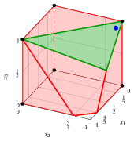{ .fig .ovale loading=lazy  }

        Caso (b): il rilassamento lineare e la disuguaglianza di cover $x_1+x_2+x_3\le 2$.

    - <strong>Caso (c): $\tilde{\boldsymbol{x}}=\left(\tfrac{1}{3},\tfrac{1}{3},\tfrac{1}{3}\right)$</strong>

        - **a)** <strong>Problema di separazione</strong>   I costi $q_j=1-\tilde{x}_j$ sono $q=\left(\tfrac{2}{3},\tfrac{2}{3},\tfrac{2}{3}\right)$. Il problema di separazione $\CSP$ (a sinistra) e, con $y_j=1-z_j$, il problema complementare $\CSPKP$ (a destra) sono:

            $$
            \begin{array}{rrcrcrcl}
            {\min} & {\frac{2}{3}\,z_1} & {+} & {\frac{2}{3}\,z_2} & {+} & {\frac{2}{3}\,z_3} &  &  \\[1ex]
            \text{soggetto a} & {5\,z_1} & {+} & {4\,z_2} & {+} & {3\,z_3} & {\ge} & {9} \\[1ex]
            & {z_1,} &  & {z_2,} &  & {z_3} & {\in} & {\{0,1\}}
            \end{array}
            $$

            $$
            \begin{array}{rrcrcrcl}
            {\max} & {\frac{2}{3}\,y_1} & {+} & {\frac{2}{3}\,y_2} & {+} & {\frac{2}{3}\,y_3} &  &  \\[1ex]
            \text{soggetto a} & {5\,y_1} & {+} & {4\,y_2} & {+} & {3\,y_3} & {\le} & {3} \\[1ex]
            & {y_1,} &  & {y_2,} &  & {y_3} & {\in} & {\{0,1\}}
            \end{array}
            $$

            con $z(\CSP)=n-\sum_{j\in\mathscr{I}}\tilde{x}_j-z(\CSPKP)=2-z(\CSPKP)$.

        - **b)** <strong>Euristica greedy</strong>   Gli indici vengono scorsi per rapporto $q_j/a_j$ non crescente, partendo dal termine noto residuo $3$:

            
<table>
            <tr>
            <th>\(j\)</th>
            <th>\(q_j\)</th>
            <th>\(a_j\)</th>
            <th>\(q_j/a_j\)</th>
            <th>Decisione</th>
            <th>Residuo</th>
            </tr>
            <tr>
            <td>\(3\)</td>
            <td>\(\tfrac{2}{3}\)</td>
            <td>\(3\)</td>
            <td>\(\tfrac{2}{9}\)</td>
            <td>\(\bar{y}_j=1\)</td>
            <td>\(0\)</td>
            </tr>
            <tr>
            <td>\(2\)</td>
            <td>\(\tfrac{2}{3}\)</td>
            <td>\(4\)</td>
            <td>\(\tfrac{1}{6}\)</td>
            <td>\(\bar{y}_j=0\)</td>
            <td>\(0\)</td>
            </tr>
            <tr>
            <td>\(1\)</td>
            <td>\(\tfrac{2}{3}\)</td>
            <td>\(5\)</td>
            <td>\(\tfrac{2}{15}\)</td>
            <td>\(\bar{y}_j=0\)</td>
            <td>\(0\)</td>
            </tr>
            </table>

            La soluzione greedy è $\bar{\boldsymbol{y}}=\left(0,0,1\right)$, di valore $\frac{2}{3}$. Il cover corrispondente è $\bar{C}=\{j\in\mathscr{I}:\bar{y}_j=0\}=\{1,2\}$, di costo $2-\frac{2}{3}=\frac{4}{3}\ge1$: la sua disuguaglianza di cover non è violata da $\tilde{\boldsymbol{x}}$.

        - **c)** <strong>Verifica di ottimalità</strong>   Gli indici con $q_j=0$ non cambiano il valore di una soluzione. I sottoinsiemi non vuoti degli indici $\{1,2,3\}$ con $q_j>0$ che soddisfano il vincolo con termine noto $3$ sono: $\{3\}$ (valore $\frac{2}{3}$). Quindi $z(\CSPKP)=\frac{2}{3}$, la soluzione greedy è ottima, e $z(\CSP)=\frac{4}{3}\ge1$: <strong>nessuna</strong> disuguaglianza di cover è violata da $\tilde{\boldsymbol{x}}$.

        { .fig .ovale loading=lazy  }

        Caso (c): il rilassamento lineare; nessuna disuguaglianza di cover è violata dal punto.

!!! esercizio "Esercizio 5.7: Disuguaglianze di cover in 3D (P2)"

    Consideriamo un problema binario con un vincolo $\sum_{j}a_jx_j\le b$, con coefficienti interi positivi $a_j$ e termine noto $b=11$, sulle variabili binarie indicizzate dall'insieme $\mathscr{I}=\{1,2,3\}$ di $n=3$ variabili, con i seguenti coefficienti dell'obiettivo e del vincolo:

    $$
    \begin{array}{l|rrr}
    \hline {j} & 1 & 2 & 3 \\
    \hline {c_j} & 20 & 11 & 4 \\
    {a_j} & 2 & 3 & 9 \\
    \hline
    \end{array}
    $$

    Il $\LP$ associato è:

    $$
    \begin{array}{rrcrcrcl}
    {\max} & {20\,x_1} & {+} & {11\,x_2} & {+} & {4\,x_3} &  &  \\[1ex]
    \text{soggetto a} & {2\,x_1} & {+} & {3\,x_2} & {+} & {9\,x_3} & {\le} & {11} \\[1ex]
    & {x_1} &  &  &  &  & {\le} & {1} \\[0.5ex]
    &  &  & {x_2} &  &  & {\le} & {1} \\[0.5ex]
    &  &  &  &  & {x_3} & {\le} & {1} \\[0.5ex]
    & {x_1,} &  & {x_2,} &  & {x_3} & {\ge} & {0}
    \end{array}
    $$

    e i seguenti punti della sua regione ammissibile:

    $$
    \begin{array}{cl}
    (a) & \tilde{\boldsymbol{x}}=\left(1,1,\tfrac{2}{3}\right),\\[1ex]
    (b) & \tilde{\boldsymbol{x}}=\left(0,\tfrac{2}{3},1\right),\\[1ex]
    (c) & \tilde{\boldsymbol{x}}=\left(\tfrac{1}{3},\tfrac{1}{3},\tfrac{1}{3}\right).
    \end{array}
    $$

    **Domande**

    Per ogni punto:

    1. scrivere il problema di separazione $\CSP$ e il suo problema complementare $\CSPKP$;

    2. applicare l'euristica greedy a $\CSPKP$ e, se possibile, trovare una disuguaglianza di cover violata;

    3. verificare se la soluzione greedy è ottima;

    4. disegnare il rilassamento lineare insieme alla disuguaglianza di cover violata, se esiste.

    !!! nota ""

        Un sottoinsieme di indici $C\subseteq\mathscr{I}$ con $\sum_{j\in C}a_j>b$ è un <strong>cover</strong>, e la disuguaglianza lineare

        \begin{equation*}
        \sum_{j\in C}x_j\le|C|-1
        \end{equation*}

        è la <strong>disuguaglianza di cover</strong> associata a $C$. Dato un punto $\tilde{\boldsymbol{x}}$, esiste una disuguaglianza di cover violata da $\tilde{\boldsymbol{x}}$ se e solo se $z(\CSP)<1$, dove

        \begin{equation*}
        (\CSP)\qquad \min\Big\{\sum_{j\in\mathscr{I}}(1-\tilde{x}_j)\,z_j:\
        \sum_{j\in\mathscr{I}}a_j\,z_j\ge b+1,\ z_j\in\{0,1\}\ \forall j\in\mathscr{I}\Big\}.
        \end{equation*}

??? soluzione "Soluzione"

    Separazione delle disuguaglianze di cover violate dai tre punti.

    - <strong>Disuguaglianze di cover</strong>  Tutti e tre i punti appartengono al rilassamento lineare; i membri sinistri valgono

        $$
        2+3+9\cdot\frac{2}{3}=11,\qquad 0+3\cdot\frac{2}{3}+9=11,\qquad 2\cdot\frac{1}{3}+3\cdot\frac{1}{3}+9\cdot\frac{1}{3}=\frac{14}{3}\le 11.
        $$

        I cover sono i sottoinsiemi di indici il cui coefficiente totale supera $b=11$:

        
<table>
        <tr>
        <th>\(C\)</th>
        <th>\(\sum_{j\in C}a_j\)</th>
        <th>\(|C|\)</th>
        <th>Disuguaglianza di cover</th>
        <th>Minimale</th>
        </tr>
        <tr>
        <td>\(\{2,3\}\)</td>
        <td>\(12\)</td>
        <td>\(2\)</td>
        <td>\(x_2+x_3\le 1\)</td>
        <td>sì</td>
        </tr>
        <tr>
        <td>\(\{1,2,3\}\)</td>
        <td>\(14\)</td>
        <td>\(3\)</td>
        <td>\(x_1+x_2+x_3\le 2\)</td>
        <td>no</td>
        </tr>
        </table>

        In tutti e tre i casi, il termine noto del problema complementare è $\sum_{j\in\mathscr{I}}a_j-(b+1)=14-12=2$.

    - <strong>Caso (a): $\tilde{\boldsymbol{x}}=\left(1,1,\tfrac{2}{3}\right)$</strong>

        - **a)** <strong>Problema di separazione</strong>   I costi $q_j=1-\tilde{x}_j$ sono $q=\left(0,0,\tfrac{1}{3}\right)$. Il problema di separazione $\CSP$ (a sinistra) e, con $y_j=1-z_j$, il problema complementare $\CSPKP$ (a destra) sono:

            $$
            \begin{array}{rrcrcrcl}
            {\min} &  &  &  &  & {\frac{1}{3}\,z_3} &  &  \\[1ex]
            \text{soggetto a} & {2\,z_1} & {+} & {3\,z_2} & {+} & {9\,z_3} & {\ge} & {12} \\[1ex]
            & {z_1,} &  & {z_2,} &  & {z_3} & {\in} & {\{0,1\}}
            \end{array}
            $$

            $$
            \begin{array}{rrcrcrcl}
            {\max} &  &  &  &  & {\frac{1}{3}\,y_3} &  &  \\[1ex]
            \text{soggetto a} & {2\,y_1} & {+} & {3\,y_2} & {+} & {9\,y_3} & {\le} & {2} \\[1ex]
            & {y_1,} &  & {y_2,} &  & {y_3} & {\in} & {\{0,1\}}
            \end{array}
            $$

            con $z(\CSP)=n-\sum_{j\in\mathscr{I}}\tilde{x}_j-z(\CSPKP)=\frac{1}{3}-z(\CSPKP)$.

        - **b)** <strong>Euristica greedy</strong>   Gli indici vengono scorsi per rapporto $q_j/a_j$ non crescente, partendo dal termine noto residuo $2$:

            
<table>
            <tr>
            <th>\(j\)</th>
            <th>\(q_j\)</th>
            <th>\(a_j\)</th>
            <th>\(q_j/a_j\)</th>
            <th>Decisione</th>
            <th>Residuo</th>
            </tr>
            <tr>
            <td>\(3\)</td>
            <td>\(\tfrac{1}{3}\)</td>
            <td>\(9\)</td>
            <td>\(\tfrac{1}{27}\)</td>
            <td>\(\bar{y}_j=0\)</td>
            <td>\(2\)</td>
            </tr>
            <tr>
            <td>\(1\)</td>
            <td>\(0\)</td>
            <td>\(2\)</td>
            <td>\(0\)</td>
            <td>\(q_j=0\), \(\bar{y}_j=0\)</td>
            <td>\(2\)</td>
            </tr>
            <tr>
            <td>\(2\)</td>
            <td>\(0\)</td>
            <td>\(3\)</td>
            <td>\(0\)</td>
            <td>\(q_j=0\), \(\bar{y}_j=0\)</td>
            <td>\(2\)</td>
            </tr>
            </table>

            La soluzione greedy è $\bar{\boldsymbol{y}}=\left(0,0,0\right)$, di valore $0$. Il cover corrispondente è $\bar{C}=\{j\in\mathscr{I}:\bar{y}_j=0\}=\{1,2,3\}$, di coefficiente totale $14>11$ e costo $\frac{1}{3}-0=\frac{1}{3}<1$. Quindi la disuguaglianza di cover

            $$
            x_1+x_2+x_3\le 2
            $$

            è violata da $\tilde{\boldsymbol{x}}$: $1+1+\frac{2}{3}-2=\frac{2}{3}$.

        - **c)** <strong>Verifica di ottimalità</strong>   Nessun indice con $q_j>0$ soddisfa da solo il vincolo con termine noto $2$, quindi ogni soluzione ammissibile di $\CSPKP$ ha valore $0$. Quindi $z(\CSPKP)=0$, la soluzione greedy è ottima, $z(\CSP)=\frac{1}{3}<1$, e la massima violazione di una disuguaglianza di cover è $\frac{2}{3}$.

            Il cover $\bar{C}$ non è minimale: rimuovendo un indice con $q_j=0$ si ottiene il cover minimale $\{2,3\}$, con lo stesso costo $\frac{1}{3}$. La sua disuguaglianza di cover $x_2+x_3\le 1$ ha la stessa violazione $\frac{2}{3}$ ed è più forte.

        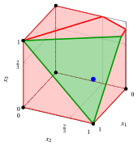{ .fig .ovale loading=lazy  }

        Caso (a): il rilassamento lineare e la disuguaglianza di cover $x_1+x_2+x_3\le 2$.

    - <strong>Caso (b): $\tilde{\boldsymbol{x}}=\left(0,\tfrac{2}{3},1\right)$</strong>

        - **a)** <strong>Problema di separazione</strong>   I costi $q_j=1-\tilde{x}_j$ sono $q=\left(1,\tfrac{1}{3},0\right)$. Il problema di separazione $\CSP$ (a sinistra) e, con $y_j=1-z_j$, il problema complementare $\CSPKP$ (a destra) sono:

            $$
            \begin{array}{rrcrcrcl}
            {\min} & {z_1} & {+} & {\frac{1}{3}\,z_2} &  &  &  &  \\[1ex]
            \text{soggetto a} & {2\,z_1} & {+} & {3\,z_2} & {+} & {9\,z_3} & {\ge} & {12} \\[1ex]
            & {z_1,} &  & {z_2,} &  & {z_3} & {\in} & {\{0,1\}}
            \end{array}
            $$

            $$
            \begin{array}{rrcrcrcl}
            {\max} & {y_1} & {+} & {\frac{1}{3}\,y_2} &  &  &  &  \\[1ex]
            \text{soggetto a} & {2\,y_1} & {+} & {3\,y_2} & {+} & {9\,y_3} & {\le} & {2} \\[1ex]
            & {y_1,} &  & {y_2,} &  & {y_3} & {\in} & {\{0,1\}}
            \end{array}
            $$

            con $z(\CSP)=n-\sum_{j\in\mathscr{I}}\tilde{x}_j-z(\CSPKP)=\frac{4}{3}-z(\CSPKP)$.

        - **b)** <strong>Euristica greedy</strong>   Gli indici vengono scorsi per rapporto $q_j/a_j$ non crescente, partendo dal termine noto residuo $2$:

            
<table>
            <tr>
            <th>\(j\)</th>
            <th>\(q_j\)</th>
            <th>\(a_j\)</th>
            <th>\(q_j/a_j\)</th>
            <th>Decisione</th>
            <th>Residuo</th>
            </tr>
            <tr>
            <td>\(1\)</td>
            <td>\(1\)</td>
            <td>\(2\)</td>
            <td>\(\tfrac{1}{2}\)</td>
            <td>\(\bar{y}_j=1\)</td>
            <td>\(0\)</td>
            </tr>
            <tr>
            <td>\(2\)</td>
            <td>\(\tfrac{1}{3}\)</td>
            <td>\(3\)</td>
            <td>\(\tfrac{1}{9}\)</td>
            <td>\(\bar{y}_j=0\)</td>
            <td>\(0\)</td>
            </tr>
            <tr>
            <td>\(3\)</td>
            <td>\(0\)</td>
            <td>\(9\)</td>
            <td>\(0\)</td>
            <td>\(q_j=0\), \(\bar{y}_j=0\)</td>
            <td>\(0\)</td>
            </tr>
            </table>

            La soluzione greedy è $\bar{\boldsymbol{y}}=\left(1,0,0\right)$, di valore $1$. Il cover corrispondente è $\bar{C}=\{j\in\mathscr{I}:\bar{y}_j=0\}=\{2,3\}$, di coefficiente totale $12>11$ e costo $\frac{4}{3}-1=\frac{1}{3}<1$. Quindi la disuguaglianza di cover

            $$
            x_2+x_3\le 1
            $$

            è violata da $\tilde{\boldsymbol{x}}$: $\frac{2}{3}+1-1=\frac{2}{3}$.

        - **c)** <strong>Verifica di ottimalità</strong>   Gli indici con $q_j=0$ non cambiano il valore di una soluzione. I sottoinsiemi non vuoti degli indici $\{1,2\}$ con $q_j>0$ che soddisfano il vincolo con termine noto $2$ sono: $\{1\}$ (valore $1$). Quindi $z(\CSPKP)=1$, la soluzione greedy è ottima, $z(\CSP)=\frac{1}{3}<1$, e la massima violazione di una disuguaglianza di cover è $\frac{2}{3}$.

        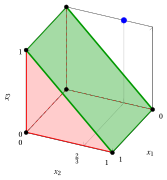{ .fig .ovale loading=lazy  }

        Caso (b): il rilassamento lineare e la disuguaglianza di cover $x_2+x_3\le 1$.

    - <strong>Caso (c): $\tilde{\boldsymbol{x}}=\left(\tfrac{1}{3},\tfrac{1}{3},\tfrac{1}{3}\right)$</strong>

        - **a)** <strong>Problema di separazione</strong>   I costi $q_j=1-\tilde{x}_j$ sono $q=\left(\tfrac{2}{3},\tfrac{2}{3},\tfrac{2}{3}\right)$. Il problema di separazione $\CSP$ (a sinistra) e, con $y_j=1-z_j$, il problema complementare $\CSPKP$ (a destra) sono:

            $$
            \begin{array}{rrcrcrcl}
            {\min} & {\frac{2}{3}\,z_1} & {+} & {\frac{2}{3}\,z_2} & {+} & {\frac{2}{3}\,z_3} &  &  \\[1ex]
            \text{soggetto a} & {2\,z_1} & {+} & {3\,z_2} & {+} & {9\,z_3} & {\ge} & {12} \\[1ex]
            & {z_1,} &  & {z_2,} &  & {z_3} & {\in} & {\{0,1\}}
            \end{array}
            $$

            $$
            \begin{array}{rrcrcrcl}
            {\max} & {\frac{2}{3}\,y_1} & {+} & {\frac{2}{3}\,y_2} & {+} & {\frac{2}{3}\,y_3} &  &  \\[1ex]
            \text{soggetto a} & {2\,y_1} & {+} & {3\,y_2} & {+} & {9\,y_3} & {\le} & {2} \\[1ex]
            & {y_1,} &  & {y_2,} &  & {y_3} & {\in} & {\{0,1\}}
            \end{array}
            $$

            con $z(\CSP)=n-\sum_{j\in\mathscr{I}}\tilde{x}_j-z(\CSPKP)=2-z(\CSPKP)$.

        - **b)** <strong>Euristica greedy</strong>   Gli indici vengono scorsi per rapporto $q_j/a_j$ non crescente, partendo dal termine noto residuo $2$:

            
<table>
            <tr>
            <th>\(j\)</th>
            <th>\(q_j\)</th>
            <th>\(a_j\)</th>
            <th>\(q_j/a_j\)</th>
            <th>Decisione</th>
            <th>Residuo</th>
            </tr>
            <tr>
            <td>\(1\)</td>
            <td>\(\tfrac{2}{3}\)</td>
            <td>\(2\)</td>
            <td>\(\tfrac{1}{3}\)</td>
            <td>\(\bar{y}_j=1\)</td>
            <td>\(0\)</td>
            </tr>
            <tr>
            <td>\(2\)</td>
            <td>\(\tfrac{2}{3}\)</td>
            <td>\(3\)</td>
            <td>\(\tfrac{2}{9}\)</td>
            <td>\(\bar{y}_j=0\)</td>
            <td>\(0\)</td>
            </tr>
            <tr>
            <td>\(3\)</td>
            <td>\(\tfrac{2}{3}\)</td>
            <td>\(9\)</td>
            <td>\(\tfrac{2}{27}\)</td>
            <td>\(\bar{y}_j=0\)</td>
            <td>\(0\)</td>
            </tr>
            </table>

            La soluzione greedy è $\bar{\boldsymbol{y}}=\left(1,0,0\right)$, di valore $\frac{2}{3}$. Il cover corrispondente è $\bar{C}=\{j\in\mathscr{I}:\bar{y}_j=0\}=\{2,3\}$, di costo $2-\frac{2}{3}=\frac{4}{3}\ge1$: la sua disuguaglianza di cover non è violata da $\tilde{\boldsymbol{x}}$.

        - **c)** <strong>Verifica di ottimalità</strong>   Gli indici con $q_j=0$ non cambiano il valore di una soluzione. I sottoinsiemi non vuoti degli indici $\{1,2,3\}$ con $q_j>0$ che soddisfano il vincolo con termine noto $2$ sono: $\{1\}$ (valore $\frac{2}{3}$). Quindi $z(\CSPKP)=\frac{2}{3}$, la soluzione greedy è ottima, e $z(\CSP)=\frac{4}{3}\ge1$: <strong>nessuna</strong> disuguaglianza di cover è violata da $\tilde{\boldsymbol{x}}$.

        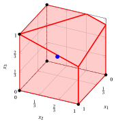{ .fig .ovale loading=lazy  }

        Caso (c): il rilassamento lineare; nessuna disuguaglianza di cover è violata dal punto.

!!! esercizio "Esercizio 5.8: Disuguaglianze di cover in 3D (P3)"

    Consideriamo un problema binario con un vincolo $\sum_{j}a_jx_j\le b$, con coefficienti interi positivi $a_j$ e termine noto $b=9$, sulle variabili binarie indicizzate dall'insieme $\mathscr{I}=\{1,2,3\}$ di $n=3$ variabili, con i seguenti coefficienti dell'obiettivo e del vincolo:

    $$
    \begin{array}{l|rrr}
    \hline {j} & 1 & 2 & 3 \\
    \hline {c_j} & 16 & 19 & 8 \\
    {a_j} & 5 & 6 & 7 \\
    \hline
    \end{array}
    $$

    Il $\LP$ associato è:

    $$
    \begin{array}{rrcrcrcl}
    {\max} & {16\,x_1} & {+} & {19\,x_2} & {+} & {8\,x_3} &  &  \\[1ex]
    \text{soggetto a} & {5\,x_1} & {+} & {6\,x_2} & {+} & {7\,x_3} & {\le} & {9} \\[1ex]
    & {x_1} &  &  &  &  & {\le} & {1} \\[0.5ex]
    &  &  & {x_2} &  &  & {\le} & {1} \\[0.5ex]
    &  &  &  &  & {x_3} & {\le} & {1} \\[0.5ex]
    & {x_1,} &  & {x_2,} &  & {x_3} & {\ge} & {0}
    \end{array}
    $$

    e i seguenti punti della sua regione ammissibile:

    $$
    \begin{array}{cl}
    (a) & \tilde{\boldsymbol{x}}=\left(1,\tfrac{2}{3},0\right),\\[1ex]
    (b) & \tilde{\boldsymbol{x}}=\left(0,\tfrac{1}{3},1\right),\\[1ex]
    (c) & \tilde{\boldsymbol{x}}=\left(\tfrac{1}{3},\tfrac{1}{3},\tfrac{1}{3}\right).
    \end{array}
    $$

    **Domande**

    Per ogni punto:

    1. scrivere il problema di separazione $\CSP$ e il suo problema complementare $\CSPKP$;

    2. applicare l'euristica greedy a $\CSPKP$ e, se possibile, trovare una disuguaglianza di cover violata;

    3. verificare se la soluzione greedy è ottima;

    4. disegnare il rilassamento lineare insieme alla disuguaglianza di cover violata, se esiste.

    !!! nota ""

        Un sottoinsieme di indici $C\subseteq\mathscr{I}$ con $\sum_{j\in C}a_j>b$ è un <strong>cover</strong>, e la disuguaglianza lineare

        \begin{equation*}
        \sum_{j\in C}x_j\le|C|-1
        \end{equation*}

        è la <strong>disuguaglianza di cover</strong> associata a $C$. Dato un punto $\tilde{\boldsymbol{x}}$, esiste una disuguaglianza di cover violata da $\tilde{\boldsymbol{x}}$ se e solo se $z(\CSP)<1$, dove

        \begin{equation*}
        (\CSP)\qquad \min\Big\{\sum_{j\in\mathscr{I}}(1-\tilde{x}_j)\,z_j:\
        \sum_{j\in\mathscr{I}}a_j\,z_j\ge b+1,\ z_j\in\{0,1\}\ \forall j\in\mathscr{I}\Big\}.
        \end{equation*}

??? soluzione "Soluzione"

    Separazione delle disuguaglianze di cover violate dai tre punti.

    - <strong>Disuguaglianze di cover</strong>  Tutti e tre i punti appartengono al rilassamento lineare; i membri sinistri valgono

        $$
        5+6\cdot\frac{2}{3}+0=9,\qquad 0+6\cdot\frac{1}{3}+7=9,\qquad 5\cdot\frac{1}{3}+6\cdot\frac{1}{3}+7\cdot\frac{1}{3}=6\le 9.
        $$

        I cover sono i sottoinsiemi di indici il cui coefficiente totale supera $b=9$:

        
<table>
        <tr>
        <th>\(C\)</th>
        <th>\(\sum_{j\in C}a_j\)</th>
        <th>\(|C|\)</th>
        <th>Disuguaglianza di cover</th>
        <th>Minimale</th>
        </tr>
        <tr>
        <td>\(\{1,2\}\)</td>
        <td>\(11\)</td>
        <td>\(2\)</td>
        <td>\(x_1+x_2\le 1\)</td>
        <td>sì</td>
        </tr>
        <tr>
        <td>\(\{1,3\}\)</td>
        <td>\(12\)</td>
        <td>\(2\)</td>
        <td>\(x_1+x_3\le 1\)</td>
        <td>sì</td>
        </tr>
        <tr>
        <td>\(\{2,3\}\)</td>
        <td>\(13\)</td>
        <td>\(2\)</td>
        <td>\(x_2+x_3\le 1\)</td>
        <td>sì</td>
        </tr>
        <tr>
        <td>\(\{1,2,3\}\)</td>
        <td>\(18\)</td>
        <td>\(3\)</td>
        <td>\(x_1+x_2+x_3\le 2\)</td>
        <td>no</td>
        </tr>
        </table>

        In tutti e tre i casi, il termine noto del problema complementare è $\sum_{j\in\mathscr{I}}a_j-(b+1)=18-10=8$.

    - <strong>Caso (a): $\tilde{\boldsymbol{x}}=\left(1,\tfrac{2}{3},0\right)$</strong>

        - **a)** <strong>Problema di separazione</strong>   I costi $q_j=1-\tilde{x}_j$ sono $q=\left(0,\tfrac{1}{3},1\right)$. Il problema di separazione $\CSP$ (a sinistra) e, con $y_j=1-z_j$, il problema complementare $\CSPKP$ (a destra) sono:

            $$
            \begin{array}{rrcrcrcl}
            {\min} &  &  & {\frac{1}{3}\,z_2} & {+} & {z_3} &  &  \\[1ex]
            \text{soggetto a} & {5\,z_1} & {+} & {6\,z_2} & {+} & {7\,z_3} & {\ge} & {10} \\[1ex]
            & {z_1,} &  & {z_2,} &  & {z_3} & {\in} & {\{0,1\}}
            \end{array}
            $$

            $$
            \begin{array}{rrcrcrcl}
            {\max} &  &  & {\frac{1}{3}\,y_2} & {+} & {y_3} &  &  \\[1ex]
            \text{soggetto a} & {5\,y_1} & {+} & {6\,y_2} & {+} & {7\,y_3} & {\le} & {8} \\[1ex]
            & {y_1,} &  & {y_2,} &  & {y_3} & {\in} & {\{0,1\}}
            \end{array}
            $$

            con $z(\CSP)=n-\sum_{j\in\mathscr{I}}\tilde{x}_j-z(\CSPKP)=\frac{4}{3}-z(\CSPKP)$.

        - **b)** <strong>Euristica greedy</strong>   Gli indici vengono scorsi per rapporto $q_j/a_j$ non crescente, partendo dal termine noto residuo $8$:

            
<table>
            <tr>
            <th>\(j\)</th>
            <th>\(q_j\)</th>
            <th>\(a_j\)</th>
            <th>\(q_j/a_j\)</th>
            <th>Decisione</th>
            <th>Residuo</th>
            </tr>
            <tr>
            <td>\(3\)</td>
            <td>\(1\)</td>
            <td>\(7\)</td>
            <td>\(\tfrac{1}{7}\)</td>
            <td>\(\bar{y}_j=1\)</td>
            <td>\(1\)</td>
            </tr>
            <tr>
            <td>\(2\)</td>
            <td>\(\tfrac{1}{3}\)</td>
            <td>\(6\)</td>
            <td>\(\tfrac{1}{18}\)</td>
            <td>\(\bar{y}_j=0\)</td>
            <td>\(1\)</td>
            </tr>
            <tr>
            <td>\(1\)</td>
            <td>\(0\)</td>
            <td>\(5\)</td>
            <td>\(0\)</td>
            <td>\(q_j=0\), \(\bar{y}_j=0\)</td>
            <td>\(1\)</td>
            </tr>
            </table>

            La soluzione greedy è $\bar{\boldsymbol{y}}=\left(0,0,1\right)$, di valore $1$. Il cover corrispondente è $\bar{C}=\{j\in\mathscr{I}:\bar{y}_j=0\}=\{1,2\}$, di coefficiente totale $11>9$ e costo $\frac{4}{3}-1=\frac{1}{3}<1$. Quindi la disuguaglianza di cover

            $$
            x_1+x_2\le 1
            $$

            è violata da $\tilde{\boldsymbol{x}}$: $1+\frac{2}{3}-1=\frac{2}{3}$.

        - **c)** <strong>Verifica di ottimalità</strong>   Gli indici con $q_j=0$ non cambiano il valore di una soluzione. I sottoinsiemi non vuoti degli indici $\{2,3\}$ con $q_j>0$ che soddisfano il vincolo con termine noto $8$ sono: $\{2\}$ (valore $\frac{1}{3}$), $\{3\}$ (valore $1$). Quindi $z(\CSPKP)=1$, la soluzione greedy è ottima, $z(\CSP)=\frac{1}{3}<1$, e la massima violazione di una disuguaglianza di cover è $\frac{2}{3}$.

        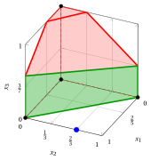{ .fig .ovale loading=lazy  }

        Caso (a): il rilassamento lineare e la disuguaglianza di cover $x_1+x_2\le 1$.

    - <strong>Caso (b): $\tilde{\boldsymbol{x}}=\left(0,\tfrac{1}{3},1\right)$</strong>

        - **a)** <strong>Problema di separazione</strong>   I costi $q_j=1-\tilde{x}_j$ sono $q=\left(1,\tfrac{2}{3},0\right)$. Il problema di separazione $\CSP$ (a sinistra) e, con $y_j=1-z_j$, il problema complementare $\CSPKP$ (a destra) sono:

            $$
            \begin{array}{rrcrcrcl}
            {\min} & {z_1} & {+} & {\frac{2}{3}\,z_2} &  &  &  &  \\[1ex]
            \text{soggetto a} & {5\,z_1} & {+} & {6\,z_2} & {+} & {7\,z_3} & {\ge} & {10} \\[1ex]
            & {z_1,} &  & {z_2,} &  & {z_3} & {\in} & {\{0,1\}}
            \end{array}
            $$

            $$
            \begin{array}{rrcrcrcl}
            {\max} & {y_1} & {+} & {\frac{2}{3}\,y_2} &  &  &  &  \\[1ex]
            \text{soggetto a} & {5\,y_1} & {+} & {6\,y_2} & {+} & {7\,y_3} & {\le} & {8} \\[1ex]
            & {y_1,} &  & {y_2,} &  & {y_3} & {\in} & {\{0,1\}}
            \end{array}
            $$

            con $z(\CSP)=n-\sum_{j\in\mathscr{I}}\tilde{x}_j-z(\CSPKP)=\frac{5}{3}-z(\CSPKP)$.

        - **b)** <strong>Euristica greedy</strong>   Gli indici vengono scorsi per rapporto $q_j/a_j$ non crescente, partendo dal termine noto residuo $8$:

            
<table>
            <tr>
            <th>\(j\)</th>
            <th>\(q_j\)</th>
            <th>\(a_j\)</th>
            <th>\(q_j/a_j\)</th>
            <th>Decisione</th>
            <th>Residuo</th>
            </tr>
            <tr>
            <td>\(1\)</td>
            <td>\(1\)</td>
            <td>\(5\)</td>
            <td>\(\tfrac{1}{5}\)</td>
            <td>\(\bar{y}_j=1\)</td>
            <td>\(3\)</td>
            </tr>
            <tr>
            <td>\(2\)</td>
            <td>\(\tfrac{2}{3}\)</td>
            <td>\(6\)</td>
            <td>\(\tfrac{1}{9}\)</td>
            <td>\(\bar{y}_j=0\)</td>
            <td>\(3\)</td>
            </tr>
            <tr>
            <td>\(3\)</td>
            <td>\(0\)</td>
            <td>\(7\)</td>
            <td>\(0\)</td>
            <td>\(q_j=0\), \(\bar{y}_j=0\)</td>
            <td>\(3\)</td>
            </tr>
            </table>

            La soluzione greedy è $\bar{\boldsymbol{y}}=\left(1,0,0\right)$, di valore $1$. Il cover corrispondente è $\bar{C}=\{j\in\mathscr{I}:\bar{y}_j=0\}=\{2,3\}$, di coefficiente totale $13>9$ e costo $\frac{5}{3}-1=\frac{2}{3}<1$. Quindi la disuguaglianza di cover

            $$
            x_2+x_3\le 1
            $$

            è violata da $\tilde{\boldsymbol{x}}$: $\frac{1}{3}+1-1=\frac{1}{3}$.

        - **c)** <strong>Verifica di ottimalità</strong>   Gli indici con $q_j=0$ non cambiano il valore di una soluzione. I sottoinsiemi non vuoti degli indici $\{1,2\}$ con $q_j>0$ che soddisfano il vincolo con termine noto $8$ sono: $\{1\}$ (valore $1$), $\{2\}$ (valore $\frac{2}{3}$). Quindi $z(\CSPKP)=1$, la soluzione greedy è ottima, $z(\CSP)=\frac{2}{3}<1$, e la massima violazione di una disuguaglianza di cover è $\frac{1}{3}$.

        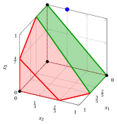{ .fig .ovale loading=lazy  }

        Caso (b): il rilassamento lineare e la disuguaglianza di cover $x_2+x_3\le 1$.

    - <strong>Caso (c): $\tilde{\boldsymbol{x}}=\left(\tfrac{1}{3},\tfrac{1}{3},\tfrac{1}{3}\right)$</strong>

        - **a)** <strong>Problema di separazione</strong>   I costi $q_j=1-\tilde{x}_j$ sono $q=\left(\tfrac{2}{3},\tfrac{2}{3},\tfrac{2}{3}\right)$. Il problema di separazione $\CSP$ (a sinistra) e, con $y_j=1-z_j$, il problema complementare $\CSPKP$ (a destra) sono:

            $$
            \begin{array}{rrcrcrcl}
            {\min} & {\frac{2}{3}\,z_1} & {+} & {\frac{2}{3}\,z_2} & {+} & {\frac{2}{3}\,z_3} &  &  \\[1ex]
            \text{soggetto a} & {5\,z_1} & {+} & {6\,z_2} & {+} & {7\,z_3} & {\ge} & {10} \\[1ex]
            & {z_1,} &  & {z_2,} &  & {z_3} & {\in} & {\{0,1\}}
            \end{array}
            $$

            $$
            \begin{array}{rrcrcrcl}
            {\max} & {\frac{2}{3}\,y_1} & {+} & {\frac{2}{3}\,y_2} & {+} & {\frac{2}{3}\,y_3} &  &  \\[1ex]
            \text{soggetto a} & {5\,y_1} & {+} & {6\,y_2} & {+} & {7\,y_3} & {\le} & {8} \\[1ex]
            & {y_1,} &  & {y_2,} &  & {y_3} & {\in} & {\{0,1\}}
            \end{array}
            $$

            con $z(\CSP)=n-\sum_{j\in\mathscr{I}}\tilde{x}_j-z(\CSPKP)=2-z(\CSPKP)$.

        - **b)** <strong>Euristica greedy</strong>   Gli indici vengono scorsi per rapporto $q_j/a_j$ non crescente, partendo dal termine noto residuo $8$:

            
<table>
            <tr>
            <th>\(j\)</th>
            <th>\(q_j\)</th>
            <th>\(a_j\)</th>
            <th>\(q_j/a_j\)</th>
            <th>Decisione</th>
            <th>Residuo</th>
            </tr>
            <tr>
            <td>\(1\)</td>
            <td>\(\tfrac{2}{3}\)</td>
            <td>\(5\)</td>
            <td>\(\tfrac{2}{15}\)</td>
            <td>\(\bar{y}_j=1\)</td>
            <td>\(3\)</td>
            </tr>
            <tr>
            <td>\(2\)</td>
            <td>\(\tfrac{2}{3}\)</td>
            <td>\(6\)</td>
            <td>\(\tfrac{1}{9}\)</td>
            <td>\(\bar{y}_j=0\)</td>
            <td>\(3\)</td>
            </tr>
            <tr>
            <td>\(3\)</td>
            <td>\(\tfrac{2}{3}\)</td>
            <td>\(7\)</td>
            <td>\(\tfrac{2}{21}\)</td>
            <td>\(\bar{y}_j=0\)</td>
            <td>\(3\)</td>
            </tr>
            </table>

            La soluzione greedy è $\bar{\boldsymbol{y}}=\left(1,0,0\right)$, di valore $\frac{2}{3}$. Il cover corrispondente è $\bar{C}=\{j\in\mathscr{I}:\bar{y}_j=0\}=\{2,3\}$, di costo $2-\frac{2}{3}=\frac{4}{3}\ge1$: la sua disuguaglianza di cover non è violata da $\tilde{\boldsymbol{x}}$.

        - **c)** <strong>Verifica di ottimalità</strong>   Gli indici con $q_j=0$ non cambiano il valore di una soluzione. I sottoinsiemi non vuoti degli indici $\{1,2,3\}$ con $q_j>0$ che soddisfano il vincolo con termine noto $8$ sono: $\{1\}$ (valore $\frac{2}{3}$), $\{2\}$ (valore $\frac{2}{3}$), $\{3\}$ (valore $\frac{2}{3}$). Quindi $z(\CSPKP)=\frac{2}{3}$, la soluzione greedy è ottima, e $z(\CSP)=\frac{4}{3}\ge1$: <strong>nessuna</strong> disuguaglianza di cover è violata da $\tilde{\boldsymbol{x}}$.

        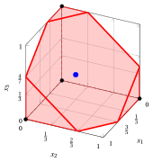{ .fig .ovale loading=lazy  }

        Caso (c): il rilassamento lineare; nessuna disuguaglianza di cover è violata dal punto.

!!! esercizio "Esercizio 5.9: Disuguaglianze di cover in 3D (P4)"

    Consideriamo un problema binario con un vincolo $\sum_{j}a_jx_j\le b$, con coefficienti interi positivi $a_j$ e termine noto $b=5$, sulle variabili binarie indicizzate dall'insieme $\mathscr{I}=\{1,2,3\}$ di $n=3$ variabili, con i seguenti coefficienti dell'obiettivo e del vincolo:

    $$
    \begin{array}{l|rrr}
    \hline {j} & 1 & 2 & 3 \\
    \hline {c_j} & 14 & 17 & 8 \\
    {a_j} & 2 & 5 & 5 \\
    \hline
    \end{array}
    $$

    Il $\LP$ associato è:

    $$
    \begin{array}{rrcrcrcl}
    {\max} & {14\,x_1} & {+} & {17\,x_2} & {+} & {8\,x_3} &  &  \\[1ex]
    \text{soggetto a} & {2\,x_1} & {+} & {5\,x_2} & {+} & {5\,x_3} & {\le} & {5} \\[1ex]
    & {x_1} &  &  &  &  & {\le} & {1} \\[0.5ex]
    &  &  & {x_2} &  &  & {\le} & {1} \\[0.5ex]
    &  &  &  &  & {x_3} & {\le} & {1} \\[0.5ex]
    & {x_1,} &  & {x_2,} &  & {x_3} & {\ge} & {0}
    \end{array}
    $$

    e i seguenti punti della sua regione ammissibile:

    $$
    \begin{array}{cl}
    (a) & \tilde{\boldsymbol{x}}=\left(1,\tfrac{3}{5},0\right),\\[1ex]
    (b) & \tilde{\boldsymbol{x}}=\left(1,0,\tfrac{3}{5}\right),\\[1ex]
    (c) & \tilde{\boldsymbol{x}}=\left(\tfrac{1}{3},\tfrac{1}{3},\tfrac{1}{3}\right).
    \end{array}
    $$

    **Domande**

    Per ogni punto:

    1. scrivere il problema di separazione $\CSP$ e il suo problema complementare $\CSPKP$;

    2. applicare l'euristica greedy a $\CSPKP$ e, se possibile, trovare una disuguaglianza di cover violata;

    3. verificare se la soluzione greedy è ottima;

    4. disegnare il rilassamento lineare insieme alla disuguaglianza di cover violata, se esiste.

    !!! nota ""

        Un sottoinsieme di indici $C\subseteq\mathscr{I}$ con $\sum_{j\in C}a_j>b$ è un <strong>cover</strong>, e la disuguaglianza lineare

        \begin{equation*}
        \sum_{j\in C}x_j\le|C|-1
        \end{equation*}

        è la <strong>disuguaglianza di cover</strong> associata a $C$. Dato un punto $\tilde{\boldsymbol{x}}$, esiste una disuguaglianza di cover violata da $\tilde{\boldsymbol{x}}$ se e solo se $z(\CSP)<1$, dove

        \begin{equation*}
        (\CSP)\qquad \min\Big\{\sum_{j\in\mathscr{I}}(1-\tilde{x}_j)\,z_j:\
        \sum_{j\in\mathscr{I}}a_j\,z_j\ge b+1,\ z_j\in\{0,1\}\ \forall j\in\mathscr{I}\Big\}.
        \end{equation*}

??? soluzione "Soluzione"

    Separazione delle disuguaglianze di cover violate dai tre punti.

    - <strong>Disuguaglianze di cover</strong>  Tutti e tre i punti appartengono al rilassamento lineare; i membri sinistri valgono

        $$
        2+5\cdot\frac{3}{5}+0=5,\qquad 2+0+5\cdot\frac{3}{5}=5,\qquad 2\cdot\frac{1}{3}+5\cdot\frac{1}{3}+5\cdot\frac{1}{3}=4\le 5.
        $$

        I cover sono i sottoinsiemi di indici il cui coefficiente totale supera $b=5$:

        
<table>
        <tr>
        <th>\(C\)</th>
        <th>\(\sum_{j\in C}a_j\)</th>
        <th>\(|C|\)</th>
        <th>Disuguaglianza di cover</th>
        <th>Minimale</th>
        </tr>
        <tr>
        <td>\(\{1,2\}\)</td>
        <td>\(7\)</td>
        <td>\(2\)</td>
        <td>\(x_1+x_2\le 1\)</td>
        <td>sì</td>
        </tr>
        <tr>
        <td>\(\{1,3\}\)</td>
        <td>\(7\)</td>
        <td>\(2\)</td>
        <td>\(x_1+x_3\le 1\)</td>
        <td>sì</td>
        </tr>
        <tr>
        <td>\(\{2,3\}\)</td>
        <td>\(10\)</td>
        <td>\(2\)</td>
        <td>\(x_2+x_3\le 1\)</td>
        <td>sì</td>
        </tr>
        <tr>
        <td>\(\{1,2,3\}\)</td>
        <td>\(12\)</td>
        <td>\(3\)</td>
        <td>\(x_1+x_2+x_3\le 2\)</td>
        <td>no</td>
        </tr>
        </table>

        In tutti e tre i casi, il termine noto del problema complementare è $\sum_{j\in\mathscr{I}}a_j-(b+1)=12-6=6$.

    - <strong>Caso (a): $\tilde{\boldsymbol{x}}=\left(1,\tfrac{3}{5},0\right)$</strong>

        - **a)** <strong>Problema di separazione</strong>   I costi $q_j=1-\tilde{x}_j$ sono $q=\left(0,\tfrac{2}{5},1\right)$. Il problema di separazione $\CSP$ (a sinistra) e, con $y_j=1-z_j$, il problema complementare $\CSPKP$ (a destra) sono:

            $$
            \begin{array}{rrcrcrcl}
            {\min} &  &  & {\frac{2}{5}\,z_2} & {+} & {z_3} &  &  \\[1ex]
            \text{soggetto a} & {2\,z_1} & {+} & {5\,z_2} & {+} & {5\,z_3} & {\ge} & {6} \\[1ex]
            & {z_1,} &  & {z_2,} &  & {z_3} & {\in} & {\{0,1\}}
            \end{array}
            $$

            $$
            \begin{array}{rrcrcrcl}
            {\max} &  &  & {\frac{2}{5}\,y_2} & {+} & {y_3} &  &  \\[1ex]
            \text{soggetto a} & {2\,y_1} & {+} & {5\,y_2} & {+} & {5\,y_3} & {\le} & {6} \\[1ex]
            & {y_1,} &  & {y_2,} &  & {y_3} & {\in} & {\{0,1\}}
            \end{array}
            $$

            con $z(\CSP)=n-\sum_{j\in\mathscr{I}}\tilde{x}_j-z(\CSPKP)=\frac{7}{5}-z(\CSPKP)$.

        - **b)** <strong>Euristica greedy</strong>   Gli indici vengono scorsi per rapporto $q_j/a_j$ non crescente, partendo dal termine noto residuo $6$:

            
<table>
            <tr>
            <th>\(j\)</th>
            <th>\(q_j\)</th>
            <th>\(a_j\)</th>
            <th>\(q_j/a_j\)</th>
            <th>Decisione</th>
            <th>Residuo</th>
            </tr>
            <tr>
            <td>\(3\)</td>
            <td>\(1\)</td>
            <td>\(5\)</td>
            <td>\(\tfrac{1}{5}\)</td>
            <td>\(\bar{y}_j=1\)</td>
            <td>\(1\)</td>
            </tr>
            <tr>
            <td>\(2\)</td>
            <td>\(\tfrac{2}{5}\)</td>
            <td>\(5\)</td>
            <td>\(\tfrac{2}{25}\)</td>
            <td>\(\bar{y}_j=0\)</td>
            <td>\(1\)</td>
            </tr>
            <tr>
            <td>\(1\)</td>
            <td>\(0\)</td>
            <td>\(2\)</td>
            <td>\(0\)</td>
            <td>\(q_j=0\), \(\bar{y}_j=0\)</td>
            <td>\(1\)</td>
            </tr>
            </table>

            La soluzione greedy è $\bar{\boldsymbol{y}}=\left(0,0,1\right)$, di valore $1$. Il cover corrispondente è $\bar{C}=\{j\in\mathscr{I}:\bar{y}_j=0\}=\{1,2\}$, di coefficiente totale $7>5$ e costo $\frac{7}{5}-1=\frac{2}{5}<1$. Quindi la disuguaglianza di cover

            $$
            x_1+x_2\le 1
            $$

            è violata da $\tilde{\boldsymbol{x}}$: $1+\frac{3}{5}-1=\frac{3}{5}$.

        - **c)** <strong>Verifica di ottimalità</strong>   Gli indici con $q_j=0$ non cambiano il valore di una soluzione. I sottoinsiemi non vuoti degli indici $\{2,3\}$ con $q_j>0$ che soddisfano il vincolo con termine noto $6$ sono: $\{2\}$ (valore $\frac{2}{5}$), $\{3\}$ (valore $1$). Quindi $z(\CSPKP)=1$, la soluzione greedy è ottima, $z(\CSP)=\frac{2}{5}<1$, e la massima violazione di una disuguaglianza di cover è $\frac{3}{5}$.

        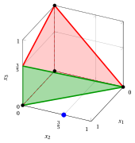{ .fig .ovale loading=lazy  }

        Caso (a): il rilassamento lineare e la disuguaglianza di cover $x_1+x_2\le 1$.

    - <strong>Caso (b): $\tilde{\boldsymbol{x}}=\left(1,0,\tfrac{3}{5}\right)$</strong>

        - **a)** <strong>Problema di separazione</strong>   I costi $q_j=1-\tilde{x}_j$ sono $q=\left(0,1,\tfrac{2}{5}\right)$. Il problema di separazione $\CSP$ (a sinistra) e, con $y_j=1-z_j$, il problema complementare $\CSPKP$ (a destra) sono:

            $$
            \begin{array}{rrcrcrcl}
            {\min} &  &  & {z_2} & {+} & {\frac{2}{5}\,z_3} &  &  \\[1ex]
            \text{soggetto a} & {2\,z_1} & {+} & {5\,z_2} & {+} & {5\,z_3} & {\ge} & {6} \\[1ex]
            & {z_1,} &  & {z_2,} &  & {z_3} & {\in} & {\{0,1\}}
            \end{array}
            $$

            $$
            \begin{array}{rrcrcrcl}
            {\max} &  &  & {y_2} & {+} & {\frac{2}{5}\,y_3} &  &  \\[1ex]
            \text{soggetto a} & {2\,y_1} & {+} & {5\,y_2} & {+} & {5\,y_3} & {\le} & {6} \\[1ex]
            & {y_1,} &  & {y_2,} &  & {y_3} & {\in} & {\{0,1\}}
            \end{array}
            $$

            con $z(\CSP)=n-\sum_{j\in\mathscr{I}}\tilde{x}_j-z(\CSPKP)=\frac{7}{5}-z(\CSPKP)$.

        - **b)** <strong>Euristica greedy</strong>   Gli indici vengono scorsi per rapporto $q_j/a_j$ non crescente, partendo dal termine noto residuo $6$:

            
<table>
            <tr>
            <th>\(j\)</th>
            <th>\(q_j\)</th>
            <th>\(a_j\)</th>
            <th>\(q_j/a_j\)</th>
            <th>Decisione</th>
            <th>Residuo</th>
            </tr>
            <tr>
            <td>\(2\)</td>
            <td>\(1\)</td>
            <td>\(5\)</td>
            <td>\(\tfrac{1}{5}\)</td>
            <td>\(\bar{y}_j=1\)</td>
            <td>\(1\)</td>
            </tr>
            <tr>
            <td>\(3\)</td>
            <td>\(\tfrac{2}{5}\)</td>
            <td>\(5\)</td>
            <td>\(\tfrac{2}{25}\)</td>
            <td>\(\bar{y}_j=0\)</td>
            <td>\(1\)</td>
            </tr>
            <tr>
            <td>\(1\)</td>
            <td>\(0\)</td>
            <td>\(2\)</td>
            <td>\(0\)</td>
            <td>\(q_j=0\), \(\bar{y}_j=0\)</td>
            <td>\(1\)</td>
            </tr>
            </table>

            La soluzione greedy è $\bar{\boldsymbol{y}}=\left(0,1,0\right)$, di valore $1$. Il cover corrispondente è $\bar{C}=\{j\in\mathscr{I}:\bar{y}_j=0\}=\{1,3\}$, di coefficiente totale $7>5$ e costo $\frac{7}{5}-1=\frac{2}{5}<1$. Quindi la disuguaglianza di cover

            $$
            x_1+x_3\le 1
            $$

            è violata da $\tilde{\boldsymbol{x}}$: $1+\frac{3}{5}-1=\frac{3}{5}$.

        - **c)** <strong>Verifica di ottimalità</strong>   Gli indici con $q_j=0$ non cambiano il valore di una soluzione. I sottoinsiemi non vuoti degli indici $\{2,3\}$ con $q_j>0$ che soddisfano il vincolo con termine noto $6$ sono: $\{2\}$ (valore $1$), $\{3\}$ (valore $\frac{2}{5}$). Quindi $z(\CSPKP)=1$, la soluzione greedy è ottima, $z(\CSP)=\frac{2}{5}<1$, e la massima violazione di una disuguaglianza di cover è $\frac{3}{5}$.

        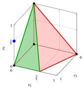{ .fig .ovale loading=lazy  }

        Caso (b): il rilassamento lineare e la disuguaglianza di cover $x_1+x_3\le 1$.

    - <strong>Caso (c): $\tilde{\boldsymbol{x}}=\left(\tfrac{1}{3},\tfrac{1}{3},\tfrac{1}{3}\right)$</strong>

        - **a)** <strong>Problema di separazione</strong>   I costi $q_j=1-\tilde{x}_j$ sono $q=\left(\tfrac{2}{3},\tfrac{2}{3},\tfrac{2}{3}\right)$. Il problema di separazione $\CSP$ (a sinistra) e, con $y_j=1-z_j$, il problema complementare $\CSPKP$ (a destra) sono:

            $$
            \begin{array}{rrcrcrcl}
            {\min} & {\frac{2}{3}\,z_1} & {+} & {\frac{2}{3}\,z_2} & {+} & {\frac{2}{3}\,z_3} &  &  \\[1ex]
            \text{soggetto a} & {2\,z_1} & {+} & {5\,z_2} & {+} & {5\,z_3} & {\ge} & {6} \\[1ex]
            & {z_1,} &  & {z_2,} &  & {z_3} & {\in} & {\{0,1\}}
            \end{array}
            $$

            $$
            \begin{array}{rrcrcrcl}
            {\max} & {\frac{2}{3}\,y_1} & {+} & {\frac{2}{3}\,y_2} & {+} & {\frac{2}{3}\,y_3} &  &  \\[1ex]
            \text{soggetto a} & {2\,y_1} & {+} & {5\,y_2} & {+} & {5\,y_3} & {\le} & {6} \\[1ex]
            & {y_1,} &  & {y_2,} &  & {y_3} & {\in} & {\{0,1\}}
            \end{array}
            $$

            con $z(\CSP)=n-\sum_{j\in\mathscr{I}}\tilde{x}_j-z(\CSPKP)=2-z(\CSPKP)$.

        - **b)** <strong>Euristica greedy</strong>   Gli indici vengono scorsi per rapporto $q_j/a_j$ non crescente, partendo dal termine noto residuo $6$:

            
<table>
            <tr>
            <th>\(j\)</th>
            <th>\(q_j\)</th>
            <th>\(a_j\)</th>
            <th>\(q_j/a_j\)</th>
            <th>Decisione</th>
            <th>Residuo</th>
            </tr>
            <tr>
            <td>\(1\)</td>
            <td>\(\tfrac{2}{3}\)</td>
            <td>\(2\)</td>
            <td>\(\tfrac{1}{3}\)</td>
            <td>\(\bar{y}_j=1\)</td>
            <td>\(4\)</td>
            </tr>
            <tr>
            <td>\(2\)</td>
            <td>\(\tfrac{2}{3}\)</td>
            <td>\(5\)</td>
            <td>\(\tfrac{2}{15}\)</td>
            <td>\(\bar{y}_j=0\)</td>
            <td>\(4\)</td>
            </tr>
            <tr>
            <td>\(3\)</td>
            <td>\(\tfrac{2}{3}\)</td>
            <td>\(5\)</td>
            <td>\(\tfrac{2}{15}\)</td>
            <td>\(\bar{y}_j=0\)</td>
            <td>\(4\)</td>
            </tr>
            </table>

            La soluzione greedy è $\bar{\boldsymbol{y}}=\left(1,0,0\right)$, di valore $\frac{2}{3}$. Il cover corrispondente è $\bar{C}=\{j\in\mathscr{I}:\bar{y}_j=0\}=\{2,3\}$, di costo $2-\frac{2}{3}=\frac{4}{3}\ge1$: la sua disuguaglianza di cover non è violata da $\tilde{\boldsymbol{x}}$.

        - **c)** <strong>Verifica di ottimalità</strong>   Gli indici con $q_j=0$ non cambiano il valore di una soluzione. I sottoinsiemi non vuoti degli indici $\{1,2,3\}$ con $q_j>0$ che soddisfano il vincolo con termine noto $6$ sono: $\{1\}$ (valore $\frac{2}{3}$), $\{2\}$ (valore $\frac{2}{3}$), $\{3\}$ (valore $\frac{2}{3}$). Quindi $z(\CSPKP)=\frac{2}{3}$, la soluzione greedy è ottima, e $z(\CSP)=\frac{4}{3}\ge1$: <strong>nessuna</strong> disuguaglianza di cover è violata da $\tilde{\boldsymbol{x}}$.

        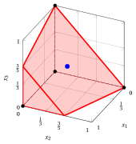{ .fig .ovale loading=lazy  }

        Caso (c): il rilassamento lineare; nessuna disuguaglianza di cover è violata dal punto.

!!! esercizio "Esercizio 5.10: Disuguaglianze di cover in 3D (P5)"

    Consideriamo un problema binario con un vincolo $\sum_{j}a_jx_j\le b$, con coefficienti interi positivi $a_j$ e termine noto $b=10$, sulle variabili binarie indicizzate dall'insieme $\mathscr{I}=\{1,2,3\}$ di $n=3$ variabili, con i seguenti coefficienti dell'obiettivo e del vincolo:

    $$
    \begin{array}{l|rrr}
    \hline {j} & 1 & 2 & 3 \\
    \hline {c_j} & 13 & 10 & 3 \\
    {a_j} & 5 & 4 & 6 \\
    \hline
    \end{array}
    $$

    Il $\LP$ associato è:

    $$
    \begin{array}{rrcrcrcl}
    {\max} & {13\,x_1} & {+} & {10\,x_2} & {+} & {3\,x_3} &  &  \\[1ex]
    \text{soggetto a} & {5\,x_1} & {+} & {4\,x_2} & {+} & {6\,x_3} & {\le} & {10} \\[1ex]
    & {x_1} &  &  &  &  & {\le} & {1} \\[0.5ex]
    &  &  & {x_2} &  &  & {\le} & {1} \\[0.5ex]
    &  &  &  &  & {x_3} & {\le} & {1} \\[0.5ex]
    & {x_1,} &  & {x_2,} &  & {x_3} & {\ge} & {0}
    \end{array}
    $$

    e i seguenti punti della sua regione ammissibile:

    $$
    \begin{array}{cl}
    (a) & \tilde{\boldsymbol{x}}=\left(1,1,\tfrac{1}{6}\right),\\[1ex]
    (b) & \tilde{\boldsymbol{x}}=\left(\tfrac{4}{5},0,1\right),\\[1ex]
    (c) & \tilde{\boldsymbol{x}}=\left(\tfrac{1}{3},\tfrac{1}{3},\tfrac{1}{3}\right).
    \end{array}
    $$

    **Domande**

    Per ogni punto:

    1. scrivere il problema di separazione $\CSP$ e il suo problema complementare $\CSPKP$;

    2. applicare l'euristica greedy a $\CSPKP$ e, se possibile, trovare una disuguaglianza di cover violata;

    3. verificare se la soluzione greedy è ottima;

    4. disegnare il rilassamento lineare insieme alla disuguaglianza di cover violata, se esiste.

    !!! nota ""

        Un sottoinsieme di indici $C\subseteq\mathscr{I}$ con $\sum_{j\in C}a_j>b$ è un <strong>cover</strong>, e la disuguaglianza lineare

        \begin{equation*}
        \sum_{j\in C}x_j\le|C|-1
        \end{equation*}

        è la <strong>disuguaglianza di cover</strong> associata a $C$. Dato un punto $\tilde{\boldsymbol{x}}$, esiste una disuguaglianza di cover violata da $\tilde{\boldsymbol{x}}$ se e solo se $z(\CSP)<1$, dove

        \begin{equation*}
        (\CSP)\qquad \min\Big\{\sum_{j\in\mathscr{I}}(1-\tilde{x}_j)\,z_j:\
        \sum_{j\in\mathscr{I}}a_j\,z_j\ge b+1,\ z_j\in\{0,1\}\ \forall j\in\mathscr{I}\Big\}.
        \end{equation*}

??? soluzione "Soluzione"

    Separazione delle disuguaglianze di cover violate dai tre punti.

    - <strong>Disuguaglianze di cover</strong>  Tutti e tre i punti appartengono al rilassamento lineare; i membri sinistri valgono

        $$
        5+4+6\cdot\frac{1}{6}=10,\qquad 5\cdot\frac{4}{5}+0+6=10,\qquad 5\cdot\frac{1}{3}+4\cdot\frac{1}{3}+6\cdot\frac{1}{3}=5\le 10.
        $$

        I cover sono i sottoinsiemi di indici il cui coefficiente totale supera $b=10$:

        
<table>
        <tr>
        <th>\(C\)</th>
        <th>\(\sum_{j\in C}a_j\)</th>
        <th>\(|C|\)</th>
        <th>Disuguaglianza di cover</th>
        <th>Minimale</th>
        </tr>
        <tr>
        <td>\(\{1,3\}\)</td>
        <td>\(11\)</td>
        <td>\(2\)</td>
        <td>\(x_1+x_3\le 1\)</td>
        <td>sì</td>
        </tr>
        <tr>
        <td>\(\{1,2,3\}\)</td>
        <td>\(15\)</td>
        <td>\(3\)</td>
        <td>\(x_1+x_2+x_3\le 2\)</td>
        <td>no</td>
        </tr>
        </table>

        In tutti e tre i casi, il termine noto del problema complementare è $\sum_{j\in\mathscr{I}}a_j-(b+1)=15-11=4$.

    - <strong>Caso (a): $\tilde{\boldsymbol{x}}=\left(1,1,\tfrac{1}{6}\right)$</strong>

        - **a)** <strong>Problema di separazione</strong>   I costi $q_j=1-\tilde{x}_j$ sono $q=\left(0,0,\tfrac{5}{6}\right)$. Il problema di separazione $\CSP$ (a sinistra) e, con $y_j=1-z_j$, il problema complementare $\CSPKP$ (a destra) sono:

            $$
            \begin{array}{rrcrcrcl}
            {\min} &  &  &  &  & {\frac{5}{6}\,z_3} &  &  \\[1ex]
            \text{soggetto a} & {5\,z_1} & {+} & {4\,z_2} & {+} & {6\,z_3} & {\ge} & {11} \\[1ex]
            & {z_1,} &  & {z_2,} &  & {z_3} & {\in} & {\{0,1\}}
            \end{array}
            $$

            $$
            \begin{array}{rrcrcrcl}
            {\max} &  &  &  &  & {\frac{5}{6}\,y_3} &  &  \\[1ex]
            \text{soggetto a} & {5\,y_1} & {+} & {4\,y_2} & {+} & {6\,y_3} & {\le} & {4} \\[1ex]
            & {y_1,} &  & {y_2,} &  & {y_3} & {\in} & {\{0,1\}}
            \end{array}
            $$

            con $z(\CSP)=n-\sum_{j\in\mathscr{I}}\tilde{x}_j-z(\CSPKP)=\frac{5}{6}-z(\CSPKP)$.

        - **b)** <strong>Euristica greedy</strong>   Gli indici vengono scorsi per rapporto $q_j/a_j$ non crescente, partendo dal termine noto residuo $4$:

            
<table>
            <tr>
            <th>\(j\)</th>
            <th>\(q_j\)</th>
            <th>\(a_j\)</th>
            <th>\(q_j/a_j\)</th>
            <th>Decisione</th>
            <th>Residuo</th>
            </tr>
            <tr>
            <td>\(3\)</td>
            <td>\(\tfrac{5}{6}\)</td>
            <td>\(6\)</td>
            <td>\(\tfrac{5}{36}\)</td>
            <td>\(\bar{y}_j=0\)</td>
            <td>\(4\)</td>
            </tr>
            <tr>
            <td>\(1\)</td>
            <td>\(0\)</td>
            <td>\(5\)</td>
            <td>\(0\)</td>
            <td>\(q_j=0\), \(\bar{y}_j=0\)</td>
            <td>\(4\)</td>
            </tr>
            <tr>
            <td>\(2\)</td>
            <td>\(0\)</td>
            <td>\(4\)</td>
            <td>\(0\)</td>
            <td>\(q_j=0\), \(\bar{y}_j=0\)</td>
            <td>\(4\)</td>
            </tr>
            </table>

            La soluzione greedy è $\bar{\boldsymbol{y}}=\left(0,0,0\right)$, di valore $0$. Il cover corrispondente è $\bar{C}=\{j\in\mathscr{I}:\bar{y}_j=0\}=\{1,2,3\}$, di coefficiente totale $15>10$ e costo $\frac{5}{6}-0=\frac{5}{6}<1$. Quindi la disuguaglianza di cover

            $$
            x_1+x_2+x_3\le 2
            $$

            è violata da $\tilde{\boldsymbol{x}}$: $1+1+\frac{1}{6}-2=\frac{1}{6}$.

        - **c)** <strong>Verifica di ottimalità</strong>   Nessun indice con $q_j>0$ soddisfa da solo il vincolo con termine noto $4$, quindi ogni soluzione ammissibile di $\CSPKP$ ha valore $0$. Quindi $z(\CSPKP)=0$, la soluzione greedy è ottima, $z(\CSP)=\frac{5}{6}<1$, e la massima violazione di una disuguaglianza di cover è $\frac{1}{6}$.

            Il cover $\bar{C}$ non è minimale: rimuovendo un indice con $q_j=0$ si ottiene il cover minimale $\{1,3\}$, con lo stesso costo $\frac{5}{6}$. La sua disuguaglianza di cover $x_1+x_3\le 1$ ha la stessa violazione $\frac{1}{6}$ ed è più forte.

        { .fig .ovale loading=lazy  }

        Caso (a): il rilassamento lineare e la disuguaglianza di cover $x_1+x_2+x_3\le 2$.

    - <strong>Caso (b): $\tilde{\boldsymbol{x}}=\left(\tfrac{4}{5},0,1\right)$</strong>

        - **a)** <strong>Problema di separazione</strong>   I costi $q_j=1-\tilde{x}_j$ sono $q=\left(\tfrac{1}{5},1,0\right)$. Il problema di separazione $\CSP$ (a sinistra) e, con $y_j=1-z_j$, il problema complementare $\CSPKP$ (a destra) sono:

            $$
            \begin{array}{rrcrcrcl}
            {\min} & {\frac{1}{5}\,z_1} & {+} & {z_2} &  &  &  &  \\[1ex]
            \text{soggetto a} & {5\,z_1} & {+} & {4\,z_2} & {+} & {6\,z_3} & {\ge} & {11} \\[1ex]
            & {z_1,} &  & {z_2,} &  & {z_3} & {\in} & {\{0,1\}}
            \end{array}
            $$

            $$
            \begin{array}{rrcrcrcl}
            {\max} & {\frac{1}{5}\,y_1} & {+} & {y_2} &  &  &  &  \\[1ex]
            \text{soggetto a} & {5\,y_1} & {+} & {4\,y_2} & {+} & {6\,y_3} & {\le} & {4} \\[1ex]
            & {y_1,} &  & {y_2,} &  & {y_3} & {\in} & {\{0,1\}}
            \end{array}
            $$

            con $z(\CSP)=n-\sum_{j\in\mathscr{I}}\tilde{x}_j-z(\CSPKP)=\frac{6}{5}-z(\CSPKP)$.

        - **b)** <strong>Euristica greedy</strong>   Gli indici vengono scorsi per rapporto $q_j/a_j$ non crescente, partendo dal termine noto residuo $4$:

            
<table>
            <tr>
            <th>\(j\)</th>
            <th>\(q_j\)</th>
            <th>\(a_j\)</th>
            <th>\(q_j/a_j\)</th>
            <th>Decisione</th>
            <th>Residuo</th>
            </tr>
            <tr>
            <td>\(2\)</td>
            <td>\(1\)</td>
            <td>\(4\)</td>
            <td>\(\tfrac{1}{4}\)</td>
            <td>\(\bar{y}_j=1\)</td>
            <td>\(0\)</td>
            </tr>
            <tr>
            <td>\(1\)</td>
            <td>\(\tfrac{1}{5}\)</td>
            <td>\(5\)</td>
            <td>\(\tfrac{1}{25}\)</td>
            <td>\(\bar{y}_j=0\)</td>
            <td>\(0\)</td>
            </tr>
            <tr>
            <td>\(3\)</td>
            <td>\(0\)</td>
            <td>\(6\)</td>
            <td>\(0\)</td>
            <td>\(q_j=0\), \(\bar{y}_j=0\)</td>
            <td>\(0\)</td>
            </tr>
            </table>

            La soluzione greedy è $\bar{\boldsymbol{y}}=\left(0,1,0\right)$, di valore $1$. Il cover corrispondente è $\bar{C}=\{j\in\mathscr{I}:\bar{y}_j=0\}=\{1,3\}$, di coefficiente totale $11>10$ e costo $\frac{6}{5}-1=\frac{1}{5}<1$. Quindi la disuguaglianza di cover

            $$
            x_1+x_3\le 1
            $$

            è violata da $\tilde{\boldsymbol{x}}$: $\frac{4}{5}+1-1=\frac{4}{5}$.

        - **c)** <strong>Verifica di ottimalità</strong>   Gli indici con $q_j=0$ non cambiano il valore di una soluzione. I sottoinsiemi non vuoti degli indici $\{1,2\}$ con $q_j>0$ che soddisfano il vincolo con termine noto $4$ sono: $\{2\}$ (valore $1$). Quindi $z(\CSPKP)=1$, la soluzione greedy è ottima, $z(\CSP)=\frac{1}{5}<1$, e la massima violazione di una disuguaglianza di cover è $\frac{4}{5}$.

        { .fig .ovale loading=lazy  }

        Caso (b): il rilassamento lineare e la disuguaglianza di cover $x_1+x_3\le 1$.

    - <strong>Caso (c): $\tilde{\boldsymbol{x}}=\left(\tfrac{1}{3},\tfrac{1}{3},\tfrac{1}{3}\right)$</strong>

        - **a)** <strong>Problema di separazione</strong>   I costi $q_j=1-\tilde{x}_j$ sono $q=\left(\tfrac{2}{3},\tfrac{2}{3},\tfrac{2}{3}\right)$. Il problema di separazione $\CSP$ (a sinistra) e, con $y_j=1-z_j$, il problema complementare $\CSPKP$ (a destra) sono:

            $$
            \begin{array}{rrcrcrcl}
            {\min} & {\frac{2}{3}\,z_1} & {+} & {\frac{2}{3}\,z_2} & {+} & {\frac{2}{3}\,z_3} &  &  \\[1ex]
            \text{soggetto a} & {5\,z_1} & {+} & {4\,z_2} & {+} & {6\,z_3} & {\ge} & {11} \\[1ex]
            & {z_1,} &  & {z_2,} &  & {z_3} & {\in} & {\{0,1\}}
            \end{array}
            $$

            $$
            \begin{array}{rrcrcrcl}
            {\max} & {\frac{2}{3}\,y_1} & {+} & {\frac{2}{3}\,y_2} & {+} & {\frac{2}{3}\,y_3} &  &  \\[1ex]
            \text{soggetto a} & {5\,y_1} & {+} & {4\,y_2} & {+} & {6\,y_3} & {\le} & {4} \\[1ex]
            & {y_1,} &  & {y_2,} &  & {y_3} & {\in} & {\{0,1\}}
            \end{array}
            $$

            con $z(\CSP)=n-\sum_{j\in\mathscr{I}}\tilde{x}_j-z(\CSPKP)=2-z(\CSPKP)$.

        - **b)** <strong>Euristica greedy</strong>   Gli indici vengono scorsi per rapporto $q_j/a_j$ non crescente, partendo dal termine noto residuo $4$:

            
<table>
            <tr>
            <th>\(j\)</th>
            <th>\(q_j\)</th>
            <th>\(a_j\)</th>
            <th>\(q_j/a_j\)</th>
            <th>Decisione</th>
            <th>Residuo</th>
            </tr>
            <tr>
            <td>\(2\)</td>
            <td>\(\tfrac{2}{3}\)</td>
            <td>\(4\)</td>
            <td>\(\tfrac{1}{6}\)</td>
            <td>\(\bar{y}_j=1\)</td>
            <td>\(0\)</td>
            </tr>
            <tr>
            <td>\(1\)</td>
            <td>\(\tfrac{2}{3}\)</td>
            <td>\(5\)</td>
            <td>\(\tfrac{2}{15}\)</td>
            <td>\(\bar{y}_j=0\)</td>
            <td>\(0\)</td>
            </tr>
            <tr>
            <td>\(3\)</td>
            <td>\(\tfrac{2}{3}\)</td>
            <td>\(6\)</td>
            <td>\(\tfrac{1}{9}\)</td>
            <td>\(\bar{y}_j=0\)</td>
            <td>\(0\)</td>
            </tr>
            </table>

            La soluzione greedy è $\bar{\boldsymbol{y}}=\left(0,1,0\right)$, di valore $\frac{2}{3}$. Il cover corrispondente è $\bar{C}=\{j\in\mathscr{I}:\bar{y}_j=0\}=\{1,3\}$, di costo $2-\frac{2}{3}=\frac{4}{3}\ge1$: la sua disuguaglianza di cover non è violata da $\tilde{\boldsymbol{x}}$.

        - **c)** <strong>Verifica di ottimalità</strong>   Gli indici con $q_j=0$ non cambiano il valore di una soluzione. I sottoinsiemi non vuoti degli indici $\{1,2,3\}$ con $q_j>0$ che soddisfano il vincolo con termine noto $4$ sono: $\{2\}$ (valore $\frac{2}{3}$). Quindi $z(\CSPKP)=\frac{2}{3}$, la soluzione greedy è ottima, e $z(\CSP)=\frac{4}{3}\ge1$: <strong>nessuna</strong> disuguaglianza di cover è violata da $\tilde{\boldsymbol{x}}$.

        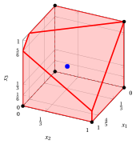{ .fig .ovale loading=lazy  }

        Caso (c): il rilassamento lineare; nessuna disuguaglianza di cover è violata dal punto.

## Chiusura e separazione

!!! esercizio "Esercizio 5.11: Chiusura dei cover per separazione (P1)"

    Consideriamo un problema binario con un vincolo $\sum_{j}a_jx_j\le b$, con coefficienti interi positivi $a_j$ e termine noto $b=9$, sulle variabili binarie indicizzate dall'insieme $\mathscr{I}=\{1,2,3,4\}$ di $n=4$ variabili, con i seguenti coefficienti dell'obiettivo e del vincolo:

    $$
    \begin{array}{l|rrrr}
    \hline {j} & 1 & 2 & 3 & 4 \\
    \hline {c_j} & 22 & 33 & 9 & 13 \\
    {a_j} & 5 & 9 & 3 & 6 \\
    \hline
    \end{array}
    $$

    Il $\LP$ associato è:

    $$
    \begin{array}{rrcrcrcrcl}
    {\max} & {22\,x_1} & {+} & {33\,x_2} & {+} & {9\,x_3} & {+} & {13\,x_4} &  &  \\[1ex]
    \text{soggetto a} & {5\,x_1} & {+} & {9\,x_2} & {+} & {3\,x_3} & {+} & {6\,x_4} & {\le} & {9} \\[1ex]
    & {x_1} &  &  &  &  &  &  & {\le} & {1} \\[0.5ex]
    &  &  & {x_2} &  &  &  &  & {\le} & {1} \\[0.5ex]
    &  &  &  &  & {x_3} &  &  & {\le} & {1} \\[0.5ex]
    &  &  &  &  &  &  & {x_4} & {\le} & {1} \\[0.5ex]
    & {x_1,} &  & {x_2,} &  & {x_3,} &  & {x_4} & {\ge} & {0}
    \end{array}
    $$

    Una soluzione ottima $\tilde{\boldsymbol{x}}$ di $\LP$ e il suo valore sono:

    $$
    \tilde{x}_1=1,~~\tilde{x}_2=\frac{4}{9},~~\tilde{x}_3=0,~~\tilde{x}_4=0\qquad\text{e}\qquad z(\LP)=\frac{110}{3}.
    $$

    **Domande**

    1. Partendo da $\tilde{\boldsymbol{x}}$, separare le disuguaglianze di cover risolvendo all'ottimo il problema complementare $\CSPKP$. Aggiungere all'LP la disuguaglianza di cover massimamente violata, risolverlo di nuovo e ripetere finché nessuna disuguaglianza di cover è violata. Se $\CSPKP$ ha più soluzioni ottime, scegliere quella che seleziona il maggior numero di variabili.

    2. Qual è il valore ottimo sulla chiusura dei cover? La soluzione finale è intera?

    !!! nota ""

        La <strong>chiusura dei cover</strong> è il poliedro ottenuto aggiungendo a $\LP$ tutte le disuguaglianze di cover $\sum_{j\in C}x_j\le|C|-1$, $C\in\mathcal{C}$. Dato un punto $\tilde{\boldsymbol{x}}$, sia $\tilde{y}_1,\dots,\tilde{y}_n$ una soluzione ottima del problema complementare

        \begin{equation*}
        (\CSPKP)\qquad \max\Big\{\sum_{j\in\mathscr{I}}(1-\tilde{x}_j)\,y_j:\
        \sum_{j\in\mathscr{I}}a_j\,y_j\le\sum_{j\in\mathscr{I}}a_j-(b+1),\
        y_j\in\{0,1\}\ \forall j\in\mathscr{I}\Big\}.
        \end{equation*}

        Se $n-\sum_{j\in\mathscr{I}}\tilde{x}_j-z(\CSPKP)<1$, il cover $\tilde{C}=\{j\in\mathscr{I}:\tilde{y}_j=0\}$ è associato alla disuguaglianza di cover massimamente violata da $\tilde{\boldsymbol{x}}$; altrimenti, nessuna disuguaglianza di cover è violata da $\tilde{\boldsymbol{x}}$.

??? soluzione "Soluzione"

    Separazione delle disuguaglianze di cover con il problema complementare; in tutte le iterazioni, il termine noto di $\CSPKP$ è $\sum_{j\in\mathscr{I}}a_j-(b+1)=23-10=13$.

    - <strong>Iterazione 1</strong>  La soluzione ottima di $\LP$ è $\tilde{\boldsymbol{x}}=\left(1,\tfrac{4}{9},0,0\right)$, di valore $z(\LP)=\frac{110}{3}$.

        I costi sono $q=\left(0,\tfrac{5}{9},1,1\right)$, il termine costante è $n-\sum_{j\in\mathscr{I}}\tilde{x}_j=\frac{23}{9}$, e il problema complementare è:

        $$
        \begin{array}{rrcrcrcrcl}
        {\max} &  &  & {\frac{5}{9}\,y_2} & {+} & {y_3} & {+} & {y_4} &  &  \\[1ex]
        \text{soggetto a} & {5\,y_1} & {+} & {9\,y_2} & {+} & {3\,y_3} & {+} & {6\,y_4} & {\le} & {13} \\[1ex]
        & {y_1,} &  & {y_2,} &  & {y_3,} &  & {y_4} & {\in} & {\{0,1\}}
        \end{array}
        $$

        I sottoinsiemi massimali di indici che soddisfano il vincolo con termine noto $13$ sono: $\{1,3\}$ (valore $1$), $\{1,4\}$ (valore $1$), $\{2,3\}$ (valore $\frac{14}{9}$), $\{3,4\}$ (valore $2$). Una soluzione ottima di $\CSPKP$ è $\tilde{y}_1=0,~\tilde{y}_2=0,~\tilde{y}_3=1,~\tilde{y}_4=1$, di valore $z(\CSPKP)=2$:

        $$
        n-\sum_{j\in\mathscr{I}}\tilde{x}_j-z(\CSPKP)=\frac{23}{9}-2=\frac{5}{9}<1.
        $$

        Di conseguenza, $\tilde{C}=\{j\in\mathscr{I}:\tilde{y}_j=0\}=\{1,2\}$ e la disuguaglianza di cover

        $$
        x_1+x_2\le 1
        $$

        è massimamente violata da $\tilde{\boldsymbol{x}}$: $1+\frac{4}{9}-1=\frac{4}{9}$.

    - <strong>Iterazione 2</strong>  Aggiungendo la disuguaglianza di cover $x_1+x_2\le 1$, otteniamo il seguente LP, indicato con $\mathrm{LP}_{1}$:

        $$
        \begin{array}{rrcrcrcrcl}
        {\max} & {22\,x_1} & {+} & {33\,x_2} & {+} & {9\,x_3} & {+} & {13\,x_4} &  &  \\[1ex]
        \text{soggetto a} & {5\,x_1} & {+} & {9\,x_2} & {+} & {3\,x_3} & {+} & {6\,x_4} & {\le} & {9} \\[1ex]
        & {x_1} & {+} & {x_2} &  &  &  &  & {\le} & {1} \\[1ex]
        & {x_1} &  &  &  &  &  &  & {\le} & {1} \\[0.5ex]
        &  &  & {x_2} &  &  &  &  & {\le} & {1} \\[0.5ex]
        &  &  &  &  & {x_3} &  &  & {\le} & {1} \\[0.5ex]
        &  &  &  &  &  &  & {x_4} & {\le} & {1} \\[0.5ex]
        & {x_1,} &  & {x_2,} &  & {x_3,} &  & {x_4} & {\ge} & {0}
        \end{array}
        $$

        Una soluzione ottima di $\mathrm{LP}_{1}$ è $\tilde{\boldsymbol{x}}=\left(\tfrac{3}{4},\tfrac{1}{4},1,0\right)$, di valore $z(\mathrm{LP}_{1})=\frac{135}{4}$.

        I costi sono $q=\left(\tfrac{1}{4},\tfrac{3}{4},0,1\right)$, il termine costante è $n-\sum_{j\in\mathscr{I}}\tilde{x}_j=2$, e il problema complementare è:

        $$
        \begin{array}{rrcrcrcrcl}
        {\max} & {\frac{1}{4}\,y_1} & {+} & {\frac{3}{4}\,y_2} &  &  & {+} & {y_4} &  &  \\[1ex]
        \text{soggetto a} & {5\,y_1} & {+} & {9\,y_2} & {+} & {3\,y_3} & {+} & {6\,y_4} & {\le} & {13} \\[1ex]
        & {y_1,} &  & {y_2,} &  & {y_3,} &  & {y_4} & {\in} & {\{0,1\}}
        \end{array}
        $$

        I sottoinsiemi massimali di indici che soddisfano il vincolo con termine noto $13$ sono: $\{1,3\}$ (valore $\frac{1}{4}$), $\{1,4\}$ (valore $\frac{5}{4}$), $\{2,3\}$ (valore $\frac{3}{4}$), $\{3,4\}$ (valore $1$). Una soluzione ottima di $\CSPKP$ è $\tilde{y}_1=1,~\tilde{y}_2=0,~\tilde{y}_3=0,~\tilde{y}_4=1$, di valore $z(\CSPKP)=\frac{5}{4}$:

        $$
        n-\sum_{j\in\mathscr{I}}\tilde{x}_j-z(\CSPKP)=2-\frac{5}{4}=\frac{3}{4}<1.
        $$

        Di conseguenza, $\tilde{C}=\{j\in\mathscr{I}:\tilde{y}_j=0\}=\{2,3\}$ e la disuguaglianza di cover

        $$
        x_2+x_3\le 1
        $$

        è massimamente violata da $\tilde{\boldsymbol{x}}$: $\frac{1}{4}+1-1=\frac{1}{4}$.

    - <strong>Iterazione 3</strong>  Aggiungendo la disuguaglianza di cover $x_2+x_3\le 1$, otteniamo il seguente LP, indicato con $\mathrm{LP}_{2}$:

        $$
        \begin{array}{rrcrcrcrcl}
        {\max} & {22\,x_1} & {+} & {33\,x_2} & {+} & {9\,x_3} & {+} & {13\,x_4} &  &  \\[1ex]
        \text{soggetto a} & {5\,x_1} & {+} & {9\,x_2} & {+} & {3\,x_3} & {+} & {6\,x_4} & {\le} & {9} \\[1ex]
        & {x_1} & {+} & {x_2} &  &  &  &  & {\le} & {1} \\[1ex]
        &  &  & {x_2} & {+} & {x_3} &  &  & {\le} & {1} \\[1ex]
        & {x_1} &  &  &  &  &  &  & {\le} & {1} \\[0.5ex]
        &  &  & {x_2} &  &  &  &  & {\le} & {1} \\[0.5ex]
        &  &  &  &  & {x_3} &  &  & {\le} & {1} \\[0.5ex]
        &  &  &  &  &  &  & {x_4} & {\le} & {1} \\[0.5ex]
        & {x_1,} &  & {x_2,} &  & {x_3,} &  & {x_4} & {\ge} & {0}
        \end{array}
        $$

        Una soluzione ottima di $\mathrm{LP}_{2}$ è $\tilde{\boldsymbol{x}}=\left(1,0,1,\tfrac{1}{6}\right)$, di valore $z(\mathrm{LP}_{2})=\frac{199}{6}$.

        I costi sono $q=\left(0,1,0,\tfrac{5}{6}\right)$, il termine costante è $n-\sum_{j\in\mathscr{I}}\tilde{x}_j=\frac{11}{6}$, e il problema complementare è:

        $$
        \begin{array}{rrcrcrcrcl}
        {\max} &  &  & {y_2} &  &  & {+} & {\frac{5}{6}\,y_4} &  &  \\[1ex]
        \text{soggetto a} & {5\,y_1} & {+} & {9\,y_2} & {+} & {3\,y_3} & {+} & {6\,y_4} & {\le} & {13} \\[1ex]
        & {y_1,} &  & {y_2,} &  & {y_3,} &  & {y_4} & {\in} & {\{0,1\}}
        \end{array}
        $$

        I sottoinsiemi massimali di indici che soddisfano il vincolo con termine noto $13$ sono: $\{1,3\}$ (valore $0$), $\{1,4\}$ (valore $\frac{5}{6}$), $\{2,3\}$ (valore $1$), $\{3,4\}$ (valore $\frac{5}{6}$). Una soluzione ottima di $\CSPKP$ è $\tilde{y}_1=0,~\tilde{y}_2=1,~\tilde{y}_3=1,~\tilde{y}_4=0$, di valore $z(\CSPKP)=1$:

        $$
        n-\sum_{j\in\mathscr{I}}\tilde{x}_j-z(\CSPKP)=\frac{11}{6}-1=\frac{5}{6}<1.
        $$

        Di conseguenza, $\tilde{C}=\{j\in\mathscr{I}:\tilde{y}_j=0\}=\{1,4\}$ e la disuguaglianza di cover

        $$
        x_1+x_4\le 1
        $$

        è massimamente violata da $\tilde{\boldsymbol{x}}$: $1+\frac{1}{6}-1=\frac{1}{6}$.

    - <strong>Iterazione 4</strong>  Aggiungendo la disuguaglianza di cover $x_1+x_4\le 1$, otteniamo il seguente LP, indicato con $\mathrm{LP}_{3}$:

        $$
        \begin{array}{rrcrcrcrcl}
        {\max} & {22\,x_1} & {+} & {33\,x_2} & {+} & {9\,x_3} & {+} & {13\,x_4} &  &  \\[1ex]
        \text{soggetto a} & {5\,x_1} & {+} & {9\,x_2} & {+} & {3\,x_3} & {+} & {6\,x_4} & {\le} & {9} \\[1ex]
        & {x_1} & {+} & {x_2} &  &  &  &  & {\le} & {1} \\[1ex]
        &  &  & {x_2} & {+} & {x_3} &  &  & {\le} & {1} \\[1ex]
        & {x_1} &  &  &  &  & {+} & {x_4} & {\le} & {1} \\[1ex]
        & {x_1} &  &  &  &  &  &  & {\le} & {1} \\[0.5ex]
        &  &  & {x_2} &  &  &  &  & {\le} & {1} \\[0.5ex]
        &  &  &  &  & {x_3} &  &  & {\le} & {1} \\[0.5ex]
        &  &  &  &  &  &  & {x_4} & {\le} & {1} \\[0.5ex]
        & {x_1,} &  & {x_2,} &  & {x_3,} &  & {x_4} & {\ge} & {0}
        \end{array}
        $$

        Una soluzione ottima di $\mathrm{LP}_{3}$ è $\tilde{\boldsymbol{x}}=\left(\tfrac{6}{7},\tfrac{1}{7},\tfrac{6}{7},\tfrac{1}{7}\right)$, di valore $z(\mathrm{LP}_{3})=\frac{232}{7}$.

        I costi sono $q=\left(\tfrac{1}{7},\tfrac{6}{7},\tfrac{1}{7},\tfrac{6}{7}\right)$, il termine costante è $n-\sum_{j\in\mathscr{I}}\tilde{x}_j=2$, e il problema complementare è:

        $$
        \begin{array}{rrcrcrcrcl}
        {\max} & {\frac{1}{7}\,y_1} & {+} & {\frac{6}{7}\,y_2} & {+} & {\frac{1}{7}\,y_3} & {+} & {\frac{6}{7}\,y_4} &  &  \\[1ex]
        \text{soggetto a} & {5\,y_1} & {+} & {9\,y_2} & {+} & {3\,y_3} & {+} & {6\,y_4} & {\le} & {13} \\[1ex]
        & {y_1,} &  & {y_2,} &  & {y_3,} &  & {y_4} & {\in} & {\{0,1\}}
        \end{array}
        $$

        I sottoinsiemi massimali di indici che soddisfano il vincolo con termine noto $13$ sono: $\{1,3\}$ (valore $\frac{2}{7}$), $\{1,4\}$ (valore $1$), $\{2,3\}$ (valore $1$), $\{3,4\}$ (valore $1$). Il valore ottimo di $\CSPKP$ è $z(\CSPKP)=1$:

        $$
        n-\sum_{j\in\mathscr{I}}\tilde{x}_j-z(\CSPKP)=2-1=1\ge1.
        $$

        !!! chiave ""

            Nessuna disuguaglianza di cover è violata da $\tilde{\boldsymbol{x}}=\left(\tfrac{6}{7},\tfrac{1}{7},\tfrac{6}{7},\tfrac{1}{7}\right)$: la separazione si ferma dopo $3$ disuguaglianze di cover. Il valore ottimo sulla chiusura dei cover è

            $$
            z(\mathrm{LP}^{\mathrm{cov}})=z(\mathrm{LP}_{3})=\frac{232}{7}<z(\LP)=\frac{110}{3},
            $$

            e $\tilde{\boldsymbol{x}}$ è <strong>frazionario</strong>: la chiusura dei cover non coincide con l'inviluppo convesso delle soluzioni intere.

!!! esercizio "Esercizio 5.12: Chiusura dei cover per separazione (P2)"

    Consideriamo un problema binario con un vincolo $\sum_{j}a_jx_j\le b$, con coefficienti interi positivi $a_j$ e termine noto $b=17$, sulle variabili binarie indicizzate dall'insieme $\mathscr{I}=\{1,2,3,4\}$ di $n=4$ variabili, con i seguenti coefficienti dell'obiettivo e del vincolo:

    $$
    \begin{array}{l|rrrr}
    \hline {j} & 1 & 2 & 3 & 4 \\
    \hline {c_j} & 29 & 29 & 27 & 21 \\
    {a_j} & 5 & 10 & 10 & 8 \\
    \hline
    \end{array}
    $$

    Il $\LP$ associato è:

    $$
    \begin{array}{rrcrcrcrcl}
    {\max} & {29\,x_1} & {+} & {29\,x_2} & {+} & {27\,x_3} & {+} & {21\,x_4} &  &  \\[1ex]
    \text{soggetto a} & {5\,x_1} & {+} & {10\,x_2} & {+} & {10\,x_3} & {+} & {8\,x_4} & {\le} & {17} \\[1ex]
    & {x_1} &  &  &  &  &  &  & {\le} & {1} \\[0.5ex]
    &  &  & {x_2} &  &  &  &  & {\le} & {1} \\[0.5ex]
    &  &  &  &  & {x_3} &  &  & {\le} & {1} \\[0.5ex]
    &  &  &  &  &  &  & {x_4} & {\le} & {1} \\[0.5ex]
    & {x_1,} &  & {x_2,} &  & {x_3,} &  & {x_4} & {\ge} & {0}
    \end{array}
    $$

    Una soluzione ottima $\tilde{\boldsymbol{x}}$ di $\LP$ e il suo valore sono:

    $$
    \tilde{x}_1=1,~~\tilde{x}_2=1,~~\tilde{x}_3=\frac{1}{5},~~\tilde{x}_4=0\qquad\text{e}\qquad z(\LP)=\frac{317}{5}.
    $$

    **Domande**

    1. Partendo da $\tilde{\boldsymbol{x}}$, separare le disuguaglianze di cover risolvendo all'ottimo il problema complementare $\CSPKP$. Aggiungere all'LP la disuguaglianza di cover massimamente violata, risolverlo di nuovo e ripetere finché nessuna disuguaglianza di cover è violata. Se $\CSPKP$ ha più soluzioni ottime, scegliere quella che seleziona il maggior numero di variabili.

    2. Qual è il valore ottimo sulla chiusura dei cover? La soluzione finale è intera?

    !!! nota ""

        La <strong>chiusura dei cover</strong> è il poliedro ottenuto aggiungendo a $\LP$ tutte le disuguaglianze di cover $\sum_{j\in C}x_j\le|C|-1$, $C\in\mathcal{C}$. Dato un punto $\tilde{\boldsymbol{x}}$, sia $\tilde{y}_1,\dots,\tilde{y}_n$ una soluzione ottima del problema complementare

        \begin{equation*}
        (\CSPKP)\qquad \max\Big\{\sum_{j\in\mathscr{I}}(1-\tilde{x}_j)\,y_j:\
        \sum_{j\in\mathscr{I}}a_j\,y_j\le\sum_{j\in\mathscr{I}}a_j-(b+1),\
        y_j\in\{0,1\}\ \forall j\in\mathscr{I}\Big\}.
        \end{equation*}

        Se $n-\sum_{j\in\mathscr{I}}\tilde{x}_j-z(\CSPKP)<1$, il cover $\tilde{C}=\{j\in\mathscr{I}:\tilde{y}_j=0\}$ è associato alla disuguaglianza di cover massimamente violata da $\tilde{\boldsymbol{x}}$; altrimenti, nessuna disuguaglianza di cover è violata da $\tilde{\boldsymbol{x}}$.

??? soluzione "Soluzione"

    Separazione delle disuguaglianze di cover con il problema complementare; in tutte le iterazioni, il termine noto di $\CSPKP$ è $\sum_{j\in\mathscr{I}}a_j-(b+1)=33-18=15$.

    - <strong>Iterazione 1</strong>  La soluzione ottima di $\LP$ è $\tilde{\boldsymbol{x}}=\left(1,1,\tfrac{1}{5},0\right)$, di valore $z(\LP)=\frac{317}{5}$.

        I costi sono $q=\left(0,0,\tfrac{4}{5},1\right)$, il termine costante è $n-\sum_{j\in\mathscr{I}}\tilde{x}_j=\frac{9}{5}$, e il problema complementare è:

        $$
        \begin{array}{rrcrcrcrcl}
        {\max} &  &  &  &  & {\frac{4}{5}\,y_3} & {+} & {y_4} &  &  \\[1ex]
        \text{soggetto a} & {5\,y_1} & {+} & {10\,y_2} & {+} & {10\,y_3} & {+} & {8\,y_4} & {\le} & {15} \\[1ex]
        & {y_1,} &  & {y_2,} &  & {y_3,} &  & {y_4} & {\in} & {\{0,1\}}
        \end{array}
        $$

        I sottoinsiemi massimali di indici che soddisfano il vincolo con termine noto $15$ sono: $\{1,2\}$ (valore $0$), $\{1,3\}$ (valore $\frac{4}{5}$), $\{1,4\}$ (valore $1$). Una soluzione ottima di $\CSPKP$ è $\tilde{y}_1=1,~\tilde{y}_2=0,~\tilde{y}_3=0,~\tilde{y}_4=1$, di valore $z(\CSPKP)=1$:

        $$
        n-\sum_{j\in\mathscr{I}}\tilde{x}_j-z(\CSPKP)=\frac{9}{5}-1=\frac{4}{5}<1.
        $$

        Di conseguenza, $\tilde{C}=\{j\in\mathscr{I}:\tilde{y}_j=0\}=\{2,3\}$ e la disuguaglianza di cover

        $$
        x_2+x_3\le 1
        $$

        è massimamente violata da $\tilde{\boldsymbol{x}}$: $1+\frac{1}{5}-1=\frac{1}{5}$.

    - <strong>Iterazione 2</strong>  Aggiungendo la disuguaglianza di cover $x_2+x_3\le 1$, otteniamo il seguente LP, indicato con $\mathrm{LP}_{1}$:

        $$
        \begin{array}{rrcrcrcrcl}
        {\max} & {29\,x_1} & {+} & {29\,x_2} & {+} & {27\,x_3} & {+} & {21\,x_4} &  &  \\[1ex]
        \text{soggetto a} & {5\,x_1} & {+} & {10\,x_2} & {+} & {10\,x_3} & {+} & {8\,x_4} & {\le} & {17} \\[1ex]
        &  &  & {x_2} & {+} & {x_3} &  &  & {\le} & {1} \\[1ex]
        & {x_1} &  &  &  &  &  &  & {\le} & {1} \\[0.5ex]
        &  &  & {x_2} &  &  &  &  & {\le} & {1} \\[0.5ex]
        &  &  &  &  & {x_3} &  &  & {\le} & {1} \\[0.5ex]
        &  &  &  &  &  &  & {x_4} & {\le} & {1} \\[0.5ex]
        & {x_1,} &  & {x_2,} &  & {x_3,} &  & {x_4} & {\ge} & {0}
        \end{array}
        $$

        Una soluzione ottima di $\mathrm{LP}_{1}$ è $\tilde{\boldsymbol{x}}=\left(1,1,0,\tfrac{1}{4}\right)$, di valore $z(\mathrm{LP}_{1})=\frac{253}{4}$.

        I costi sono $q=\left(0,0,1,\tfrac{3}{4}\right)$, il termine costante è $n-\sum_{j\in\mathscr{I}}\tilde{x}_j=\frac{7}{4}$, e il problema complementare è:

        $$
        \begin{array}{rrcrcrcrcl}
        {\max} &  &  &  &  & {y_3} & {+} & {\frac{3}{4}\,y_4} &  &  \\[1ex]
        \text{soggetto a} & {5\,y_1} & {+} & {10\,y_2} & {+} & {10\,y_3} & {+} & {8\,y_4} & {\le} & {15} \\[1ex]
        & {y_1,} &  & {y_2,} &  & {y_3,} &  & {y_4} & {\in} & {\{0,1\}}
        \end{array}
        $$

        I sottoinsiemi massimali di indici che soddisfano il vincolo con termine noto $15$ sono: $\{1,2\}$ (valore $0$), $\{1,3\}$ (valore $1$), $\{1,4\}$ (valore $\frac{3}{4}$). Una soluzione ottima di $\CSPKP$ è $\tilde{y}_1=1,~\tilde{y}_2=0,~\tilde{y}_3=1,~\tilde{y}_4=0$, di valore $z(\CSPKP)=1$:

        $$
        n-\sum_{j\in\mathscr{I}}\tilde{x}_j-z(\CSPKP)=\frac{7}{4}-1=\frac{3}{4}<1.
        $$

        Di conseguenza, $\tilde{C}=\{j\in\mathscr{I}:\tilde{y}_j=0\}=\{2,4\}$ e la disuguaglianza di cover

        $$
        x_2+x_4\le 1
        $$

        è massimamente violata da $\tilde{\boldsymbol{x}}$: $1+\frac{1}{4}-1=\frac{1}{4}$.

    - <strong>Iterazione 3</strong>  Aggiungendo la disuguaglianza di cover $x_2+x_4\le 1$, otteniamo il seguente LP, indicato con $\mathrm{LP}_{2}$:

        $$
        \begin{array}{rrcrcrcrcl}
        {\max} & {29\,x_1} & {+} & {29\,x_2} & {+} & {27\,x_3} & {+} & {21\,x_4} &  &  \\[1ex]
        \text{soggetto a} & {5\,x_1} & {+} & {10\,x_2} & {+} & {10\,x_3} & {+} & {8\,x_4} & {\le} & {17} \\[1ex]
        &  &  & {x_2} & {+} & {x_3} &  &  & {\le} & {1} \\[1ex]
        &  &  & {x_2} &  &  & {+} & {x_4} & {\le} & {1} \\[1ex]
        & {x_1} &  &  &  &  &  &  & {\le} & {1} \\[0.5ex]
        &  &  & {x_2} &  &  &  &  & {\le} & {1} \\[0.5ex]
        &  &  &  &  & {x_3} &  &  & {\le} & {1} \\[0.5ex]
        &  &  &  &  &  &  & {x_4} & {\le} & {1} \\[0.5ex]
        & {x_1,} &  & {x_2,} &  & {x_3,} &  & {x_4} & {\ge} & {0}
        \end{array}
        $$

        Una soluzione ottima di $\mathrm{LP}_{2}$ è $\tilde{\boldsymbol{x}}=\left(1,\tfrac{3}{4},\tfrac{1}{4},\tfrac{1}{4}\right)$, di valore $z(\mathrm{LP}_{2})=\frac{251}{4}$.

        I costi sono $q=\left(0,\tfrac{1}{4},\tfrac{3}{4},\tfrac{3}{4}\right)$, il termine costante è $n-\sum_{j\in\mathscr{I}}\tilde{x}_j=\frac{7}{4}$, e il problema complementare è:

        $$
        \begin{array}{rrcrcrcrcl}
        {\max} &  &  & {\frac{1}{4}\,y_2} & {+} & {\frac{3}{4}\,y_3} & {+} & {\frac{3}{4}\,y_4} &  &  \\[1ex]
        \text{soggetto a} & {5\,y_1} & {+} & {10\,y_2} & {+} & {10\,y_3} & {+} & {8\,y_4} & {\le} & {15} \\[1ex]
        & {y_1,} &  & {y_2,} &  & {y_3,} &  & {y_4} & {\in} & {\{0,1\}}
        \end{array}
        $$

        I sottoinsiemi massimali di indici che soddisfano il vincolo con termine noto $15$ sono: $\{1,2\}$ (valore $\frac{1}{4}$), $\{1,3\}$ (valore $\frac{3}{4}$), $\{1,4\}$ (valore $\frac{3}{4}$). Il valore ottimo di $\CSPKP$ è $z(\CSPKP)=\frac{3}{4}$:

        $$
        n-\sum_{j\in\mathscr{I}}\tilde{x}_j-z(\CSPKP)=\frac{7}{4}-\frac{3}{4}=1\ge1.
        $$

        !!! chiave ""

            Nessuna disuguaglianza di cover è violata da $\tilde{\boldsymbol{x}}=\left(1,\tfrac{3}{4},\tfrac{1}{4},\tfrac{1}{4}\right)$: la separazione si ferma dopo $2$ disuguaglianze di cover. Il valore ottimo sulla chiusura dei cover è

            $$
            z(\mathrm{LP}^{\mathrm{cov}})=z(\mathrm{LP}_{2})=\frac{251}{4}<z(\LP)=\frac{317}{5},
            $$

            e $\tilde{\boldsymbol{x}}$ è <strong>frazionario</strong>: la chiusura dei cover non coincide con l'inviluppo convesso delle soluzioni intere.

!!! esercizio "Esercizio 5.13: Chiusura dei cover per separazione (P3)"

    Consideriamo un problema binario con un vincolo $\sum_{j}a_jx_j\le b$, con coefficienti interi positivi $a_j$ e termine noto $b=15$, sulle variabili binarie indicizzate dall'insieme $\mathscr{I}=\{1,2,3,4\}$ di $n=4$ variabili, con i seguenti coefficienti dell'obiettivo e del vincolo:

    $$
    \begin{array}{l|rrrr}
    \hline {j} & 1 & 2 & 3 & 4 \\
    \hline {c_j} & 30 & 8 & 9 & 6 \\
    {a_j} & 5 & 2 & 9 & 9 \\
    \hline
    \end{array}
    $$

    Il $\LP$ associato è:

    $$
    \begin{array}{rrcrcrcrcl}
    {\max} & {30\,x_1} & {+} & {8\,x_2} & {+} & {9\,x_3} & {+} & {6\,x_4} &  &  \\[1ex]
    \text{soggetto a} & {5\,x_1} & {+} & {2\,x_2} & {+} & {9\,x_3} & {+} & {9\,x_4} & {\le} & {15} \\[1ex]
    & {x_1} &  &  &  &  &  &  & {\le} & {1} \\[0.5ex]
    &  &  & {x_2} &  &  &  &  & {\le} & {1} \\[0.5ex]
    &  &  &  &  & {x_3} &  &  & {\le} & {1} \\[0.5ex]
    &  &  &  &  &  &  & {x_4} & {\le} & {1} \\[0.5ex]
    & {x_1,} &  & {x_2,} &  & {x_3,} &  & {x_4} & {\ge} & {0}
    \end{array}
    $$

    Una soluzione ottima $\tilde{\boldsymbol{x}}$ di $\LP$ e il suo valore sono:

    $$
    \tilde{x}_1=1,~~\tilde{x}_2=1,~~\tilde{x}_3=\frac{8}{9},~~\tilde{x}_4=0\qquad\text{e}\qquad z(\LP)=46.
    $$

    **Domande**

    1. Partendo da $\tilde{\boldsymbol{x}}$, separare le disuguaglianze di cover risolvendo all'ottimo il problema complementare $\CSPKP$. Aggiungere all'LP la disuguaglianza di cover massimamente violata, risolverlo di nuovo e ripetere finché nessuna disuguaglianza di cover è violata. Se $\CSPKP$ ha più soluzioni ottime, scegliere quella che seleziona il maggior numero di variabili.

    2. Qual è il valore ottimo sulla chiusura dei cover? La soluzione finale è intera?

    !!! nota ""

        La <strong>chiusura dei cover</strong> è il poliedro ottenuto aggiungendo a $\LP$ tutte le disuguaglianze di cover $\sum_{j\in C}x_j\le|C|-1$, $C\in\mathcal{C}$. Dato un punto $\tilde{\boldsymbol{x}}$, sia $\tilde{y}_1,\dots,\tilde{y}_n$ una soluzione ottima del problema complementare

        \begin{equation*}
        (\CSPKP)\qquad \max\Big\{\sum_{j\in\mathscr{I}}(1-\tilde{x}_j)\,y_j:\
        \sum_{j\in\mathscr{I}}a_j\,y_j\le\sum_{j\in\mathscr{I}}a_j-(b+1),\
        y_j\in\{0,1\}\ \forall j\in\mathscr{I}\Big\}.
        \end{equation*}

        Se $n-\sum_{j\in\mathscr{I}}\tilde{x}_j-z(\CSPKP)<1$, il cover $\tilde{C}=\{j\in\mathscr{I}:\tilde{y}_j=0\}$ è associato alla disuguaglianza di cover massimamente violata da $\tilde{\boldsymbol{x}}$; altrimenti, nessuna disuguaglianza di cover è violata da $\tilde{\boldsymbol{x}}$.

??? soluzione "Soluzione"

    Separazione delle disuguaglianze di cover con il problema complementare; in tutte le iterazioni, il termine noto di $\CSPKP$ è $\sum_{j\in\mathscr{I}}a_j-(b+1)=25-16=9$.

    - <strong>Iterazione 1</strong>  La soluzione ottima di $\LP$ è $\tilde{\boldsymbol{x}}=\left(1,1,\tfrac{8}{9},0\right)$, di valore $z(\LP)=46$.

        I costi sono $q=\left(0,0,\tfrac{1}{9},1\right)$, il termine costante è $n-\sum_{j\in\mathscr{I}}\tilde{x}_j=\frac{10}{9}$, e il problema complementare è:

        $$
        \begin{array}{rrcrcrcrcl}
        {\max} &  &  &  &  & {\frac{1}{9}\,y_3} & {+} & {y_4} &  &  \\[1ex]
        \text{soggetto a} & {5\,y_1} & {+} & {2\,y_2} & {+} & {9\,y_3} & {+} & {9\,y_4} & {\le} & {9} \\[1ex]
        & {y_1,} &  & {y_2,} &  & {y_3,} &  & {y_4} & {\in} & {\{0,1\}}
        \end{array}
        $$

        I sottoinsiemi massimali di indici che soddisfano il vincolo con termine noto $9$ sono: $\{3\}$ (valore $\frac{1}{9}$), $\{4\}$ (valore $1$), $\{1,2\}$ (valore $0$). Una soluzione ottima di $\CSPKP$ è $\tilde{y}_1=0,~\tilde{y}_2=0,~\tilde{y}_3=0,~\tilde{y}_4=1$, di valore $z(\CSPKP)=1$:

        $$
        n-\sum_{j\in\mathscr{I}}\tilde{x}_j-z(\CSPKP)=\frac{10}{9}-1=\frac{1}{9}<1.
        $$

        Di conseguenza, $\tilde{C}=\{j\in\mathscr{I}:\tilde{y}_j=0\}=\{1,2,3\}$ e la disuguaglianza di cover

        $$
        x_1+x_2+x_3\le 2
        $$

        è massimamente violata da $\tilde{\boldsymbol{x}}$: $1+1+\frac{8}{9}-2=\frac{8}{9}$.

    - <strong>Iterazione 2</strong>  Aggiungendo la disuguaglianza di cover $x_1+x_2+x_3\le 2$, otteniamo il seguente LP, indicato con $\mathrm{LP}_{1}$:

        $$
        \begin{array}{rrcrcrcrcl}
        {\max} & {30\,x_1} & {+} & {8\,x_2} & {+} & {9\,x_3} & {+} & {6\,x_4} &  &  \\[1ex]
        \text{soggetto a} & {5\,x_1} & {+} & {2\,x_2} & {+} & {9\,x_3} & {+} & {9\,x_4} & {\le} & {15} \\[1ex]
        & {x_1} & {+} & {x_2} & {+} & {x_3} &  &  & {\le} & {2} \\[1ex]
        & {x_1} &  &  &  &  &  &  & {\le} & {1} \\[0.5ex]
        &  &  & {x_2} &  &  &  &  & {\le} & {1} \\[0.5ex]
        &  &  &  &  & {x_3} &  &  & {\le} & {1} \\[0.5ex]
        &  &  &  &  &  &  & {x_4} & {\le} & {1} \\[0.5ex]
        & {x_1,} &  & {x_2,} &  & {x_3,} &  & {x_4} & {\ge} & {0}
        \end{array}
        $$

        Una soluzione ottima di $\mathrm{LP}_{1}$ è $\tilde{\boldsymbol{x}}=\left(1,1,0,\tfrac{8}{9}\right)$, di valore $z(\mathrm{LP}_{1})=\frac{130}{3}$.

        I costi sono $q=\left(0,0,1,\tfrac{1}{9}\right)$, il termine costante è $n-\sum_{j\in\mathscr{I}}\tilde{x}_j=\frac{10}{9}$, e il problema complementare è:

        $$
        \begin{array}{rrcrcrcrcl}
        {\max} &  &  &  &  & {y_3} & {+} & {\frac{1}{9}\,y_4} &  &  \\[1ex]
        \text{soggetto a} & {5\,y_1} & {+} & {2\,y_2} & {+} & {9\,y_3} & {+} & {9\,y_4} & {\le} & {9} \\[1ex]
        & {y_1,} &  & {y_2,} &  & {y_3,} &  & {y_4} & {\in} & {\{0,1\}}
        \end{array}
        $$

        I sottoinsiemi massimali di indici che soddisfano il vincolo con termine noto $9$ sono: $\{3\}$ (valore $1$), $\{4\}$ (valore $\frac{1}{9}$), $\{1,2\}$ (valore $0$). Una soluzione ottima di $\CSPKP$ è $\tilde{y}_1=0,~\tilde{y}_2=0,~\tilde{y}_3=1,~\tilde{y}_4=0$, di valore $z(\CSPKP)=1$:

        $$
        n-\sum_{j\in\mathscr{I}}\tilde{x}_j-z(\CSPKP)=\frac{10}{9}-1=\frac{1}{9}<1.
        $$

        Di conseguenza, $\tilde{C}=\{j\in\mathscr{I}:\tilde{y}_j=0\}=\{1,2,4\}$ e la disuguaglianza di cover

        $$
        x_1+x_2+x_4\le 2
        $$

        è massimamente violata da $\tilde{\boldsymbol{x}}$: $1+1+\frac{8}{9}-2=\frac{8}{9}$.

    - <strong>Iterazione 3</strong>  Aggiungendo la disuguaglianza di cover $x_1+x_2+x_4\le 2$, otteniamo il seguente LP, indicato con $\mathrm{LP}_{2}$:

        $$
        \begin{array}{rrcrcrcrcl}
        {\max} & {30\,x_1} & {+} & {8\,x_2} & {+} & {9\,x_3} & {+} & {6\,x_4} &  &  \\[1ex]
        \text{soggetto a} & {5\,x_1} & {+} & {2\,x_2} & {+} & {9\,x_3} & {+} & {9\,x_4} & {\le} & {15} \\[1ex]
        & {x_1} & {+} & {x_2} & {+} & {x_3} &  &  & {\le} & {2} \\[1ex]
        & {x_1} & {+} & {x_2} &  &  & {+} & {x_4} & {\le} & {2} \\[1ex]
        & {x_1} &  &  &  &  &  &  & {\le} & {1} \\[0.5ex]
        &  &  & {x_2} &  &  &  &  & {\le} & {1} \\[0.5ex]
        &  &  &  &  & {x_3} &  &  & {\le} & {1} \\[0.5ex]
        &  &  &  &  &  &  & {x_4} & {\le} & {1} \\[0.5ex]
        & {x_1,} &  & {x_2,} &  & {x_3,} &  & {x_4} & {\ge} & {0}
        \end{array}
        $$

        Una soluzione ottima di $\mathrm{LP}_{2}$ è $\tilde{\boldsymbol{x}}=\left(1,\tfrac{1}{2},\tfrac{1}{2},\tfrac{1}{2}\right)$, di valore $z(\mathrm{LP}_{2})=\frac{83}{2}$.

        I costi sono $q=\left(0,\tfrac{1}{2},\tfrac{1}{2},\tfrac{1}{2}\right)$, il termine costante è $n-\sum_{j\in\mathscr{I}}\tilde{x}_j=\frac{3}{2}$, e il problema complementare è:

        $$
        \begin{array}{rrcrcrcrcl}
        {\max} &  &  & {\frac{1}{2}\,y_2} & {+} & {\frac{1}{2}\,y_3} & {+} & {\frac{1}{2}\,y_4} &  &  \\[1ex]
        \text{soggetto a} & {5\,y_1} & {+} & {2\,y_2} & {+} & {9\,y_3} & {+} & {9\,y_4} & {\le} & {9} \\[1ex]
        & {y_1,} &  & {y_2,} &  & {y_3,} &  & {y_4} & {\in} & {\{0,1\}}
        \end{array}
        $$

        I sottoinsiemi massimali di indici che soddisfano il vincolo con termine noto $9$ sono: $\{3\}$ (valore $\frac{1}{2}$), $\{4\}$ (valore $\frac{1}{2}$), $\{1,2\}$ (valore $\frac{1}{2}$). Il valore ottimo di $\CSPKP$ è $z(\CSPKP)=\frac{1}{2}$:

        $$
        n-\sum_{j\in\mathscr{I}}\tilde{x}_j-z(\CSPKP)=\frac{3}{2}-\frac{1}{2}=1\ge1.
        $$

        !!! chiave ""

            Nessuna disuguaglianza di cover è violata da $\tilde{\boldsymbol{x}}=\left(1,\tfrac{1}{2},\tfrac{1}{2},\tfrac{1}{2}\right)$: la separazione si ferma dopo $2$ disuguaglianze di cover. Il valore ottimo sulla chiusura dei cover è

            $$
            z(\mathrm{LP}^{\mathrm{cov}})=z(\mathrm{LP}_{2})=\frac{83}{2}<z(\LP)=46,
            $$

            e $\tilde{\boldsymbol{x}}$ è <strong>frazionario</strong>: la chiusura dei cover non coincide con l'inviluppo convesso delle soluzioni intere.

!!! esercizio "Esercizio 5.14: Chiusura dei cover per separazione (P4)"

    Consideriamo un problema binario con un vincolo $\sum_{j}a_jx_j\le b$, con coefficienti interi positivi $a_j$ e termine noto $b=9$, sulle variabili binarie indicizzate dall'insieme $\mathscr{I}=\{1,2,3,4\}$ di $n=4$ variabili, con i seguenti coefficienti dell'obiettivo e del vincolo:

    $$
    \begin{array}{l|rrrr}
    \hline {j} & 1 & 2 & 3 & 4 \\
    \hline {c_j} & 31 & 13 & 5 & 9 \\
    {a_j} & 8 & 6 & 3 & 8 \\
    \hline
    \end{array}
    $$

    Il $\LP$ associato è:

    $$
    \begin{array}{rrcrcrcrcl}
    {\max} & {31\,x_1} & {+} & {13\,x_2} & {+} & {5\,x_3} & {+} & {9\,x_4} &  &  \\[1ex]
    \text{soggetto a} & {8\,x_1} & {+} & {6\,x_2} & {+} & {3\,x_3} & {+} & {8\,x_4} & {\le} & {9} \\[1ex]
    & {x_1} &  &  &  &  &  &  & {\le} & {1} \\[0.5ex]
    &  &  & {x_2} &  &  &  &  & {\le} & {1} \\[0.5ex]
    &  &  &  &  & {x_3} &  &  & {\le} & {1} \\[0.5ex]
    &  &  &  &  &  &  & {x_4} & {\le} & {1} \\[0.5ex]
    & {x_1,} &  & {x_2,} &  & {x_3,} &  & {x_4} & {\ge} & {0}
    \end{array}
    $$

    Una soluzione ottima $\tilde{\boldsymbol{x}}$ di $\LP$ e il suo valore sono:

    $$
    \tilde{x}_1=1,~~\tilde{x}_2=\frac{1}{6},~~\tilde{x}_3=0,~~\tilde{x}_4=0\qquad\text{e}\qquad z(\LP)=\frac{199}{6}.
    $$

    **Domande**

    1. Partendo da $\tilde{\boldsymbol{x}}$, separare le disuguaglianze di cover risolvendo all'ottimo il problema complementare $\CSPKP$. Aggiungere all'LP la disuguaglianza di cover massimamente violata, risolverlo di nuovo e ripetere finché nessuna disuguaglianza di cover è violata. Se $\CSPKP$ ha più soluzioni ottime, scegliere quella che seleziona il maggior numero di variabili.

    2. Qual è il valore ottimo sulla chiusura dei cover? La soluzione finale è intera?

    !!! nota ""

        La <strong>chiusura dei cover</strong> è il poliedro ottenuto aggiungendo a $\LP$ tutte le disuguaglianze di cover $\sum_{j\in C}x_j\le|C|-1$, $C\in\mathcal{C}$. Dato un punto $\tilde{\boldsymbol{x}}$, sia $\tilde{y}_1,\dots,\tilde{y}_n$ una soluzione ottima del problema complementare

        \begin{equation*}
        (\CSPKP)\qquad \max\Big\{\sum_{j\in\mathscr{I}}(1-\tilde{x}_j)\,y_j:\
        \sum_{j\in\mathscr{I}}a_j\,y_j\le\sum_{j\in\mathscr{I}}a_j-(b+1),\
        y_j\in\{0,1\}\ \forall j\in\mathscr{I}\Big\}.
        \end{equation*}

        Se $n-\sum_{j\in\mathscr{I}}\tilde{x}_j-z(\CSPKP)<1$, il cover $\tilde{C}=\{j\in\mathscr{I}:\tilde{y}_j=0\}$ è associato alla disuguaglianza di cover massimamente violata da $\tilde{\boldsymbol{x}}$; altrimenti, nessuna disuguaglianza di cover è violata da $\tilde{\boldsymbol{x}}$.

??? soluzione "Soluzione"

    Separazione delle disuguaglianze di cover con il problema complementare; in tutte le iterazioni, il termine noto di $\CSPKP$ è $\sum_{j\in\mathscr{I}}a_j-(b+1)=25-10=15$.

    - <strong>Iterazione 1</strong>  La soluzione ottima di $\LP$ è $\tilde{\boldsymbol{x}}=\left(1,\tfrac{1}{6},0,0\right)$, di valore $z(\LP)=\frac{199}{6}$.

        I costi sono $q=\left(0,\tfrac{5}{6},1,1\right)$, il termine costante è $n-\sum_{j\in\mathscr{I}}\tilde{x}_j=\frac{17}{6}$, e il problema complementare è:

        $$
        \begin{array}{rrcrcrcrcl}
        {\max} &  &  & {\frac{5}{6}\,y_2} & {+} & {y_3} & {+} & {y_4} &  &  \\[1ex]
        \text{soggetto a} & {8\,y_1} & {+} & {6\,y_2} & {+} & {3\,y_3} & {+} & {8\,y_4} & {\le} & {15} \\[1ex]
        & {y_1,} &  & {y_2,} &  & {y_3,} &  & {y_4} & {\in} & {\{0,1\}}
        \end{array}
        $$

        I sottoinsiemi massimali di indici che soddisfano il vincolo con termine noto $15$ sono: $\{1,2\}$ (valore $\frac{5}{6}$), $\{1,3\}$ (valore $1$), $\{2,3\}$ (valore $\frac{11}{6}$), $\{2,4\}$ (valore $\frac{11}{6}$), $\{3,4\}$ (valore $2$). Una soluzione ottima di $\CSPKP$ è $\tilde{y}_1=0,~\tilde{y}_2=0,~\tilde{y}_3=1,~\tilde{y}_4=1$, di valore $z(\CSPKP)=2$:

        $$
        n-\sum_{j\in\mathscr{I}}\tilde{x}_j-z(\CSPKP)=\frac{17}{6}-2=\frac{5}{6}<1.
        $$

        Di conseguenza, $\tilde{C}=\{j\in\mathscr{I}:\tilde{y}_j=0\}=\{1,2\}$ e la disuguaglianza di cover

        $$
        x_1+x_2\le 1
        $$

        è massimamente violata da $\tilde{\boldsymbol{x}}$: $1+\frac{1}{6}-1=\frac{1}{6}$.

    - <strong>Iterazione 2</strong>  Aggiungendo la disuguaglianza di cover $x_1+x_2\le 1$, otteniamo il seguente LP, indicato con $\mathrm{LP}_{1}$:

        $$
        \begin{array}{rrcrcrcrcl}
        {\max} & {31\,x_1} & {+} & {13\,x_2} & {+} & {5\,x_3} & {+} & {9\,x_4} &  &  \\[1ex]
        \text{soggetto a} & {8\,x_1} & {+} & {6\,x_2} & {+} & {3\,x_3} & {+} & {8\,x_4} & {\le} & {9} \\[1ex]
        & {x_1} & {+} & {x_2} &  &  &  &  & {\le} & {1} \\[1ex]
        & {x_1} &  &  &  &  &  &  & {\le} & {1} \\[0.5ex]
        &  &  & {x_2} &  &  &  &  & {\le} & {1} \\[0.5ex]
        &  &  &  &  & {x_3} &  &  & {\le} & {1} \\[0.5ex]
        &  &  &  &  &  &  & {x_4} & {\le} & {1} \\[0.5ex]
        & {x_1,} &  & {x_2,} &  & {x_3,} &  & {x_4} & {\ge} & {0}
        \end{array}
        $$

        Una soluzione ottima di $\mathrm{LP}_{1}$ è $\tilde{\boldsymbol{x}}=\left(1,0,\tfrac{1}{3},0\right)$, di valore $z(\mathrm{LP}_{1})=\frac{98}{3}$.

        I costi sono $q=\left(0,1,\tfrac{2}{3},1\right)$, il termine costante è $n-\sum_{j\in\mathscr{I}}\tilde{x}_j=\frac{8}{3}$, e il problema complementare è:

        $$
        \begin{array}{rrcrcrcrcl}
        {\max} &  &  & {y_2} & {+} & {\frac{2}{3}\,y_3} & {+} & {y_4} &  &  \\[1ex]
        \text{soggetto a} & {8\,y_1} & {+} & {6\,y_2} & {+} & {3\,y_3} & {+} & {8\,y_4} & {\le} & {15} \\[1ex]
        & {y_1,} &  & {y_2,} &  & {y_3,} &  & {y_4} & {\in} & {\{0,1\}}
        \end{array}
        $$

        I sottoinsiemi massimali di indici che soddisfano il vincolo con termine noto $15$ sono: $\{1,2\}$ (valore $1$), $\{1,3\}$ (valore $\frac{2}{3}$), $\{2,3\}$ (valore $\frac{5}{3}$), $\{2,4\}$ (valore $2$), $\{3,4\}$ (valore $\frac{5}{3}$). Una soluzione ottima di $\CSPKP$ è $\tilde{y}_1=0,~\tilde{y}_2=1,~\tilde{y}_3=0,~\tilde{y}_4=1$, di valore $z(\CSPKP)=2$:

        $$
        n-\sum_{j\in\mathscr{I}}\tilde{x}_j-z(\CSPKP)=\frac{8}{3}-2=\frac{2}{3}<1.
        $$

        Di conseguenza, $\tilde{C}=\{j\in\mathscr{I}:\tilde{y}_j=0\}=\{1,3\}$ e la disuguaglianza di cover

        $$
        x_1+x_3\le 1
        $$

        è massimamente violata da $\tilde{\boldsymbol{x}}$: $1+\frac{1}{3}-1=\frac{1}{3}$.

    - <strong>Iterazione 3</strong>  Aggiungendo la disuguaglianza di cover $x_1+x_3\le 1$, otteniamo il seguente LP, indicato con $\mathrm{LP}_{2}$:

        $$
        \begin{array}{rrcrcrcrcl}
        {\max} & {31\,x_1} & {+} & {13\,x_2} & {+} & {5\,x_3} & {+} & {9\,x_4} &  &  \\[1ex]
        \text{soggetto a} & {8\,x_1} & {+} & {6\,x_2} & {+} & {3\,x_3} & {+} & {8\,x_4} & {\le} & {9} \\[1ex]
        & {x_1} & {+} & {x_2} &  &  &  &  & {\le} & {1} \\[1ex]
        & {x_1} &  &  & {+} & {x_3} &  &  & {\le} & {1} \\[1ex]
        & {x_1} &  &  &  &  &  &  & {\le} & {1} \\[0.5ex]
        &  &  & {x_2} &  &  &  &  & {\le} & {1} \\[0.5ex]
        &  &  &  &  & {x_3} &  &  & {\le} & {1} \\[0.5ex]
        &  &  &  &  &  &  & {x_4} & {\le} & {1} \\[0.5ex]
        & {x_1,} &  & {x_2,} &  & {x_3,} &  & {x_4} & {\ge} & {0}
        \end{array}
        $$

        Una soluzione ottima di $\mathrm{LP}_{2}$ è $\tilde{\boldsymbol{x}}=\left(1,0,0,\tfrac{1}{8}\right)$, di valore $z(\mathrm{LP}_{2})=\frac{257}{8}$.

        I costi sono $q=\left(0,1,1,\tfrac{7}{8}\right)$, il termine costante è $n-\sum_{j\in\mathscr{I}}\tilde{x}_j=\frac{23}{8}$, e il problema complementare è:

        $$
        \begin{array}{rrcrcrcrcl}
        {\max} &  &  & {y_2} & {+} & {y_3} & {+} & {\frac{7}{8}\,y_4} &  &  \\[1ex]
        \text{soggetto a} & {8\,y_1} & {+} & {6\,y_2} & {+} & {3\,y_3} & {+} & {8\,y_4} & {\le} & {15} \\[1ex]
        & {y_1,} &  & {y_2,} &  & {y_3,} &  & {y_4} & {\in} & {\{0,1\}}
        \end{array}
        $$

        I sottoinsiemi massimali di indici che soddisfano il vincolo con termine noto $15$ sono: $\{1,2\}$ (valore $1$), $\{1,3\}$ (valore $1$), $\{2,3\}$ (valore $2$), $\{2,4\}$ (valore $\frac{15}{8}$), $\{3,4\}$ (valore $\frac{15}{8}$). Una soluzione ottima di $\CSPKP$ è $\tilde{y}_1=0,~\tilde{y}_2=1,~\tilde{y}_3=1,~\tilde{y}_4=0$, di valore $z(\CSPKP)=2$:

        $$
        n-\sum_{j\in\mathscr{I}}\tilde{x}_j-z(\CSPKP)=\frac{23}{8}-2=\frac{7}{8}<1.
        $$

        Di conseguenza, $\tilde{C}=\{j\in\mathscr{I}:\tilde{y}_j=0\}=\{1,4\}$ e la disuguaglianza di cover

        $$
        x_1+x_4\le 1
        $$

        è massimamente violata da $\tilde{\boldsymbol{x}}$: $1+\frac{1}{8}-1=\frac{1}{8}$.

    - <strong>Iterazione 4</strong>  Aggiungendo la disuguaglianza di cover $x_1+x_4\le 1$, otteniamo il seguente LP, indicato con $\mathrm{LP}_{3}$:

        $$
        \begin{array}{rrcrcrcrcl}
        {\max} & {31\,x_1} & {+} & {13\,x_2} & {+} & {5\,x_3} & {+} & {9\,x_4} &  &  \\[1ex]
        \text{soggetto a} & {8\,x_1} & {+} & {6\,x_2} & {+} & {3\,x_3} & {+} & {8\,x_4} & {\le} & {9} \\[1ex]
        & {x_1} & {+} & {x_2} &  &  &  &  & {\le} & {1} \\[1ex]
        & {x_1} &  &  & {+} & {x_3} &  &  & {\le} & {1} \\[1ex]
        & {x_1} &  &  &  &  & {+} & {x_4} & {\le} & {1} \\[1ex]
        & {x_1} &  &  &  &  &  &  & {\le} & {1} \\[0.5ex]
        &  &  & {x_2} &  &  &  &  & {\le} & {1} \\[0.5ex]
        &  &  &  &  & {x_3} &  &  & {\le} & {1} \\[0.5ex]
        &  &  &  &  &  &  & {x_4} & {\le} & {1} \\[0.5ex]
        & {x_1,} &  & {x_2,} &  & {x_3,} &  & {x_4} & {\ge} & {0}
        \end{array}
        $$

        Una soluzione ottima di $\mathrm{LP}_{3}$ è $\tilde{\boldsymbol{x}}=\left(1,0,0,0\right)$, di valore $z(\mathrm{LP}_{3})=31$.

        I costi sono $q=\left(0,1,1,1\right)$, il termine costante è $n-\sum_{j\in\mathscr{I}}\tilde{x}_j=3$, e il problema complementare è:

        $$
        \begin{array}{rrcrcrcrcl}
        {\max} &  &  & {y_2} & {+} & {y_3} & {+} & {y_4} &  &  \\[1ex]
        \text{soggetto a} & {8\,y_1} & {+} & {6\,y_2} & {+} & {3\,y_3} & {+} & {8\,y_4} & {\le} & {15} \\[1ex]
        & {y_1,} &  & {y_2,} &  & {y_3,} &  & {y_4} & {\in} & {\{0,1\}}
        \end{array}
        $$

        I sottoinsiemi massimali di indici che soddisfano il vincolo con termine noto $15$ sono: $\{1,2\}$ (valore $1$), $\{1,3\}$ (valore $1$), $\{2,3\}$ (valore $2$), $\{2,4\}$ (valore $2$), $\{3,4\}$ (valore $2$). Il valore ottimo di $\CSPKP$ è $z(\CSPKP)=2$:

        $$
        n-\sum_{j\in\mathscr{I}}\tilde{x}_j-z(\CSPKP)=3-2=1\ge1.
        $$

        !!! chiave ""

            Nessuna disuguaglianza di cover è violata da $\tilde{\boldsymbol{x}}=\left(1,0,0,0\right)$: la separazione si ferma dopo $3$ disuguaglianze di cover. Il valore ottimo sulla chiusura dei cover è

            $$
            z(\mathrm{LP}^{\mathrm{cov}})=z(\mathrm{LP}_{3})=31<z(\LP)=\frac{199}{6},
            $$

            e $\tilde{\boldsymbol{x}}$ è <strong>intero</strong>, quindi è ottimo anche per il problema binario.

!!! esercizio "Esercizio 5.15: Chiusura dei cover per separazione (P5)"

    Consideriamo un problema binario con un vincolo $\sum_{j}a_jx_j\le b$, con coefficienti interi positivi $a_j$ e termine noto $b=12$, sulle variabili binarie indicizzate dall'insieme $\mathscr{I}=\{1,2,3,4\}$ di $n=4$ variabili, con i seguenti coefficienti dell'obiettivo e del vincolo:

    $$
    \begin{array}{l|rrrr}
    \hline {j} & 1 & 2 & 3 & 4 \\
    \hline {c_j} & 38 & 16 & 14 & 4 \\
    {a_j} & 7 & 4 & 7 & 6 \\
    \hline
    \end{array}
    $$

    Il $\LP$ associato è:

    $$
    \begin{array}{rrcrcrcrcl}
    {\max} & {38\,x_1} & {+} & {16\,x_2} & {+} & {14\,x_3} & {+} & {4\,x_4} &  &  \\[1ex]
    \text{soggetto a} & {7\,x_1} & {+} & {4\,x_2} & {+} & {7\,x_3} & {+} & {6\,x_4} & {\le} & {12} \\[1ex]
    & {x_1} &  &  &  &  &  &  & {\le} & {1} \\[0.5ex]
    &  &  & {x_2} &  &  &  &  & {\le} & {1} \\[0.5ex]
    &  &  &  &  & {x_3} &  &  & {\le} & {1} \\[0.5ex]
    &  &  &  &  &  &  & {x_4} & {\le} & {1} \\[0.5ex]
    & {x_1,} &  & {x_2,} &  & {x_3,} &  & {x_4} & {\ge} & {0}
    \end{array}
    $$

    Una soluzione ottima $\tilde{\boldsymbol{x}}$ di $\LP$ e il suo valore sono:

    $$
    \tilde{x}_1=1,~~\tilde{x}_2=1,~~\tilde{x}_3=\frac{1}{7},~~\tilde{x}_4=0\qquad\text{e}\qquad z(\LP)=56.
    $$

    **Domande**

    1. Partendo da $\tilde{\boldsymbol{x}}$, separare le disuguaglianze di cover risolvendo all'ottimo il problema complementare $\CSPKP$. Aggiungere all'LP la disuguaglianza di cover massimamente violata, risolverlo di nuovo e ripetere finché nessuna disuguaglianza di cover è violata. Se $\CSPKP$ ha più soluzioni ottime, scegliere quella che seleziona il maggior numero di variabili.

    2. Qual è il valore ottimo sulla chiusura dei cover? La soluzione finale è intera?

    !!! nota ""

        La <strong>chiusura dei cover</strong> è il poliedro ottenuto aggiungendo a $\LP$ tutte le disuguaglianze di cover $\sum_{j\in C}x_j\le|C|-1$, $C\in\mathcal{C}$. Dato un punto $\tilde{\boldsymbol{x}}$, sia $\tilde{y}_1,\dots,\tilde{y}_n$ una soluzione ottima del problema complementare

        \begin{equation*}
        (\CSPKP)\qquad \max\Big\{\sum_{j\in\mathscr{I}}(1-\tilde{x}_j)\,y_j:\
        \sum_{j\in\mathscr{I}}a_j\,y_j\le\sum_{j\in\mathscr{I}}a_j-(b+1),\
        y_j\in\{0,1\}\ \forall j\in\mathscr{I}\Big\}.
        \end{equation*}

        Se $n-\sum_{j\in\mathscr{I}}\tilde{x}_j-z(\CSPKP)<1$, il cover $\tilde{C}=\{j\in\mathscr{I}:\tilde{y}_j=0\}$ è associato alla disuguaglianza di cover massimamente violata da $\tilde{\boldsymbol{x}}$; altrimenti, nessuna disuguaglianza di cover è violata da $\tilde{\boldsymbol{x}}$.

??? soluzione "Soluzione"

    Separazione delle disuguaglianze di cover con il problema complementare; in tutte le iterazioni, il termine noto di $\CSPKP$ è $\sum_{j\in\mathscr{I}}a_j-(b+1)=24-13=11$.

    - <strong>Iterazione 1</strong>  La soluzione ottima di $\LP$ è $\tilde{\boldsymbol{x}}=\left(1,1,\tfrac{1}{7},0\right)$, di valore $z(\LP)=56$.

        I costi sono $q=\left(0,0,\tfrac{6}{7},1\right)$, il termine costante è $n-\sum_{j\in\mathscr{I}}\tilde{x}_j=\frac{13}{7}$, e il problema complementare è:

        $$
        \begin{array}{rrcrcrcrcl}
        {\max} &  &  &  &  & {\frac{6}{7}\,y_3} & {+} & {y_4} &  &  \\[1ex]
        \text{soggetto a} & {7\,y_1} & {+} & {4\,y_2} & {+} & {7\,y_3} & {+} & {6\,y_4} & {\le} & {11} \\[1ex]
        & {y_1,} &  & {y_2,} &  & {y_3,} &  & {y_4} & {\in} & {\{0,1\}}
        \end{array}
        $$

        I sottoinsiemi massimali di indici che soddisfano il vincolo con termine noto $11$ sono: $\{1,2\}$ (valore $0$), $\{2,3\}$ (valore $\frac{6}{7}$), $\{2,4\}$ (valore $1$). Una soluzione ottima di $\CSPKP$ è $\tilde{y}_1=0,~\tilde{y}_2=1,~\tilde{y}_3=0,~\tilde{y}_4=1$, di valore $z(\CSPKP)=1$:

        $$
        n-\sum_{j\in\mathscr{I}}\tilde{x}_j-z(\CSPKP)=\frac{13}{7}-1=\frac{6}{7}<1.
        $$

        Di conseguenza, $\tilde{C}=\{j\in\mathscr{I}:\tilde{y}_j=0\}=\{1,3\}$ e la disuguaglianza di cover

        $$
        x_1+x_3\le 1
        $$

        è massimamente violata da $\tilde{\boldsymbol{x}}$: $1+\frac{1}{7}-1=\frac{1}{7}$.

    - <strong>Iterazione 2</strong>  Aggiungendo la disuguaglianza di cover $x_1+x_3\le 1$, otteniamo il seguente LP, indicato con $\mathrm{LP}_{1}$:

        $$
        \begin{array}{rrcrcrcrcl}
        {\max} & {38\,x_1} & {+} & {16\,x_2} & {+} & {14\,x_3} & {+} & {4\,x_4} &  &  \\[1ex]
        \text{soggetto a} & {7\,x_1} & {+} & {4\,x_2} & {+} & {7\,x_3} & {+} & {6\,x_4} & {\le} & {12} \\[1ex]
        & {x_1} &  &  & {+} & {x_3} &  &  & {\le} & {1} \\[1ex]
        & {x_1} &  &  &  &  &  &  & {\le} & {1} \\[0.5ex]
        &  &  & {x_2} &  &  &  &  & {\le} & {1} \\[0.5ex]
        &  &  &  &  & {x_3} &  &  & {\le} & {1} \\[0.5ex]
        &  &  &  &  &  &  & {x_4} & {\le} & {1} \\[0.5ex]
        & {x_1,} &  & {x_2,} &  & {x_3,} &  & {x_4} & {\ge} & {0}
        \end{array}
        $$

        Una soluzione ottima di $\mathrm{LP}_{1}$ è $\tilde{\boldsymbol{x}}=\left(1,1,0,\tfrac{1}{6}\right)$, di valore $z(\mathrm{LP}_{1})=\frac{164}{3}$.

        I costi sono $q=\left(0,0,1,\tfrac{5}{6}\right)$, il termine costante è $n-\sum_{j\in\mathscr{I}}\tilde{x}_j=\frac{11}{6}$, e il problema complementare è:

        $$
        \begin{array}{rrcrcrcrcl}
        {\max} &  &  &  &  & {y_3} & {+} & {\frac{5}{6}\,y_4} &  &  \\[1ex]
        \text{soggetto a} & {7\,y_1} & {+} & {4\,y_2} & {+} & {7\,y_3} & {+} & {6\,y_4} & {\le} & {11} \\[1ex]
        & {y_1,} &  & {y_2,} &  & {y_3,} &  & {y_4} & {\in} & {\{0,1\}}
        \end{array}
        $$

        I sottoinsiemi massimali di indici che soddisfano il vincolo con termine noto $11$ sono: $\{1,2\}$ (valore $0$), $\{2,3\}$ (valore $1$), $\{2,4\}$ (valore $\frac{5}{6}$). Una soluzione ottima di $\CSPKP$ è $\tilde{y}_1=0,~\tilde{y}_2=1,~\tilde{y}_3=1,~\tilde{y}_4=0$, di valore $z(\CSPKP)=1$:

        $$
        n-\sum_{j\in\mathscr{I}}\tilde{x}_j-z(\CSPKP)=\frac{11}{6}-1=\frac{5}{6}<1.
        $$

        Di conseguenza, $\tilde{C}=\{j\in\mathscr{I}:\tilde{y}_j=0\}=\{1,4\}$ e la disuguaglianza di cover

        $$
        x_1+x_4\le 1
        $$

        è massimamente violata da $\tilde{\boldsymbol{x}}$: $1+\frac{1}{6}-1=\frac{1}{6}$.

    - <strong>Iterazione 3</strong>  Aggiungendo la disuguaglianza di cover $x_1+x_4\le 1$, otteniamo il seguente LP, indicato con $\mathrm{LP}_{2}$:

        $$
        \begin{array}{rrcrcrcrcl}
        {\max} & {38\,x_1} & {+} & {16\,x_2} & {+} & {14\,x_3} & {+} & {4\,x_4} &  &  \\[1ex]
        \text{soggetto a} & {7\,x_1} & {+} & {4\,x_2} & {+} & {7\,x_3} & {+} & {6\,x_4} & {\le} & {12} \\[1ex]
        & {x_1} &  &  & {+} & {x_3} &  &  & {\le} & {1} \\[1ex]
        & {x_1} &  &  &  &  & {+} & {x_4} & {\le} & {1} \\[1ex]
        & {x_1} &  &  &  &  &  &  & {\le} & {1} \\[0.5ex]
        &  &  & {x_2} &  &  &  &  & {\le} & {1} \\[0.5ex]
        &  &  &  &  & {x_3} &  &  & {\le} & {1} \\[0.5ex]
        &  &  &  &  &  &  & {x_4} & {\le} & {1} \\[0.5ex]
        & {x_1,} &  & {x_2,} &  & {x_3,} &  & {x_4} & {\ge} & {0}
        \end{array}
        $$

        Una soluzione ottima di $\mathrm{LP}_{2}$ è $\tilde{\boldsymbol{x}}=\left(1,1,0,0\right)$, di valore $z(\mathrm{LP}_{2})=54$.

        I costi sono $q=\left(0,0,1,1\right)$, il termine costante è $n-\sum_{j\in\mathscr{I}}\tilde{x}_j=2$, e il problema complementare è:

        $$
        \begin{array}{rrcrcrcrcl}
        {\max} &  &  &  &  & {y_3} & {+} & {y_4} &  &  \\[1ex]
        \text{soggetto a} & {7\,y_1} & {+} & {4\,y_2} & {+} & {7\,y_3} & {+} & {6\,y_4} & {\le} & {11} \\[1ex]
        & {y_1,} &  & {y_2,} &  & {y_3,} &  & {y_4} & {\in} & {\{0,1\}}
        \end{array}
        $$

        I sottoinsiemi massimali di indici che soddisfano il vincolo con termine noto $11$ sono: $\{1,2\}$ (valore $0$), $\{2,3\}$ (valore $1$), $\{2,4\}$ (valore $1$). Il valore ottimo di $\CSPKP$ è $z(\CSPKP)=1$:

        $$
        n-\sum_{j\in\mathscr{I}}\tilde{x}_j-z(\CSPKP)=2-1=1\ge1.
        $$

        !!! chiave ""

            Nessuna disuguaglianza di cover è violata da $\tilde{\boldsymbol{x}}=\left(1,1,0,0\right)$: la separazione si ferma dopo $2$ disuguaglianze di cover. Il valore ottimo sulla chiusura dei cover è

            $$
            z(\mathrm{LP}^{\mathrm{cov}})=z(\mathrm{LP}_{2})=54<z(\LP)=56,
            $$

            e $\tilde{\boldsymbol{x}}$ è <strong>intero</strong>, quindi è ottimo anche per il problema binario.
