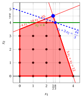
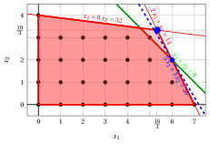
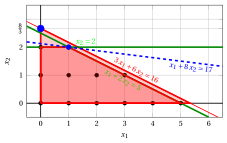

# Esercizi · Disuguaglianze valide

**Esercizi · Capitolo 4** · ogni soluzione si apre con un clic · [:material-book-open-variant: Capitolo 4: Disuguaglianze valide](../formulazioni/valid-inequalities.md) · [:material-file-pdf-box: Eserciziario, volume 1 (PDF)](../pdf/esercizi-1-modelli-bound-formulazioni.pdf)

!!! esercizio "Esercizio 4.1: Una disuguaglianza valida per arrotondamento (P2)"

    !!! nota ""

        Si consideri il seguente problema PLI in forma canonica di massimizzazione con $n=2$ variabili intere e $m=2$ vincoli:

        $$
        \begin{array}{rrrrrrr}
        {\max} & {x_1} & {+} & {3}\, {x_2} \\[1.5ex]
        & {-}{4}\, {x_1} & {+} & {10}\, {x_2} & {\le} & {35} \\[1.5ex]
        & {3}\, {x_1} & {+} & {x_2} & {\le} & {12} \\[1.5ex]
        & {x_1,} &  & {x_2} & {\in} & {\Z_{\ge 0}}
        \end{array}
        $$

        La soluzione ottima del suo rilassamento lineare è $\tilde{\vet x}(\LP) = (\tfrac{5}{2},\tfrac{9}{2})$, con $z(\LP) = 16$.

    **Domande**

    1. Usando i moltiplicatori $(\frac{3}{34}, \frac{2}{17})$, mostrare che $x_2 \le 4$ è una disuguaglianza valida.

    2. La disuguaglianza è saturata? Taglia la soluzione ottima del rilassamento lineare?

    3. Aggiungere la disuguaglianza alla formulazione e calcolare il nuovo upper bound.

??? soluzione "Soluzione"

    1. Moltiplicando i vincoli per i moltiplicatori non negativi $(\tfrac{3}{34}, \tfrac{2}{17})$ e sommando, $\tfrac{3}{34} \cdot (-4\,x_1 + 10\,x_2 \le 35) + \tfrac{2}{17} \cdot (3\,x_1 + x_2 \le 12)$, otteniamo

        $$
        x_2 \le \dfrac{9}{2}.
        $$

        Poiché $x_j \ge 0$ e i coefficienti $0 \ge 0$, $1 \ge 1$ sono almeno quelli di $x_2$, ogni soluzione ammissibile soddisfa $x_2 \le x_2 \le \tfrac{9}{2}$. Il membro sinistro è intero, quindi

        $$
        x_2 \le \left\lfloor \dfrac{9}{2} \right\rfloor = 4
        $$

        è una <strong>disuguaglianza valida</strong>.

    2. La soluzione ammissibile $(2,4)$ soddisfa $x_2 = 4$, quindi la disuguaglianza è <strong>saturata</strong>. La disuguaglianza <strong>taglia</strong> $\tilde{\vet x}(\LP) = (\tfrac{5}{2},\tfrac{9}{2})$, perché $0 \cdot \tfrac{5}{2} + 1 \cdot \tfrac{9}{2} = \tfrac{9}{2} > 4$.

    3. Graficamente:

        { .fig .ovale loading=lazy  }

        <em>Il rilassamento lineare con la disuguaglianza valida $x_2 \le 4$ (verde): la soluzione ottima $(\frac{5}{2},\frac{9}{2})$ del rilassamento lineare originale (cerchio blu) è tagliata, e la nuova soluzione ottima è in blu, con la sua retta obiettivo (tratteggiata).</em>

        
<table>
        <tr>
        <th>Formulazione</th>
        <th>\(\tilde{\vet x}(\LP)\)</th>
        <th>\(z(\LP)\)</th>
        <th>upper bound</th>
        </tr>
        <tr>
        <td>originale</td>
        <td>\((\tfrac{5}{2},\tfrac{9}{2})\)</td>
        <td>\(16\)</td>
        <td>\(16\)</td>
        </tr>
        <tr>
        <td>con \(x_2 \le 4\)</td>
        <td>\((\tfrac{8}{3},4)\)</td>
        <td>\(\tfrac{44}{3}\)</td>
        <td>\(14\)</td>
        </tr>
        </table>

        !!! chiave ""

            $x_2 \le 4$ è valida e saturata, taglia $\tilde{\vet x}(\LP)$, e l'upper bound migliora da $16$ a $14$ (il valore ottimo è $z(\ILP) = 14$).

!!! esercizio "Esercizio 4.2: Valida o non valida (P4)"

    !!! nota ""

        Si consideri il seguente problema PLI in forma canonica di massimizzazione con $n=2$ variabili intere e $m=2$ vincoli:

        $$
        \begin{array}{rrrrrrr}
        {\max} & {5}\, {x_1} & {+} & {3}\, {x_2} \\[1.5ex]
        & {2}\, {x_1} & {+} & {x_2} & {\le} & {14} \\[1.5ex]
        & {x_1} & {+} & {8}\, {x_2} & {\le} & {32} \\[1.5ex]
        & {x_1,} &  & {x_2} & {\in} & {\Z_{\ge 0}}
        \end{array}
        $$

        La soluzione ottima del suo rilassamento lineare è $\tilde{\vet x}(\LP) = (\tfrac{16}{3},\tfrac{10}{3})$, con $z(\LP) = \dfrac{110}{3}$.

    **Domande**

    1. $x_1 + x_2 \le 7$ è una disuguaglianza valida?

    2. Mostrare che $x_1 + x_2 \le 8$ è una disuguaglianza valida, usando i moltiplicatori $(\frac{7}{15},\frac{1}{15})$. Taglia la soluzione ottima del rilassamento lineare?

    3. Aggiungere $x_1 + x_2 \le 8$ alla formulazione e risolvere il nuovo rilassamento lineare. Che cosa si può concludere?

??? soluzione "Soluzione"

    1. No. Il punto $(6,2)$ è ammissibile, $2 \cdot 6 + 1 \cdot 2 = 14 \le 14, \quad 1 \cdot 6 + 8 \cdot 2 = 22 \le 32$, e viola la disuguaglianza: $6 + 2 = 8 > 7$; lo stesso vale per il punto ammissibile $(5,3)$. Una disuguaglianza valida deve essere soddisfatta da <strong>tutte</strong> le soluzioni ammissibili.

    2. Moltiplicando i vincoli per i moltiplicatori non negativi $(\tfrac{7}{15}, \tfrac{1}{15})$ e sommando, $\tfrac{7}{15} \cdot (2\,x_1 + x_2 \le 14) + \tfrac{1}{15} \cdot (x_1 + 8\,x_2 \le 32)$, otteniamo

        $$
        x_1 + x_2 \le \dfrac{26}{3}.
        $$

        Poiché $x_j \ge 0$ e i coefficienti $1 \ge 1$, $1 \ge 1$ sono almeno quelli di $x_1 + x_2$, ogni soluzione ammissibile soddisfa $x_1 + x_2 \le x_1 + x_2 \le \tfrac{26}{3}$. Il membro sinistro è intero, quindi

        $$
        x_1 + x_2 \le \left\lfloor \dfrac{26}{3} \right\rfloor = 8
        $$

        è una <strong>disuguaglianza valida</strong>. La disuguaglianza <strong>taglia</strong> $\tilde{\vet x}(\LP) = (\tfrac{16}{3},\tfrac{10}{3})$, perché $1 \cdot \tfrac{16}{3} + 1 \cdot \tfrac{10}{3} = \tfrac{26}{3} > 8$.

    3. Graficamente:

        { .fig .ovale loading=lazy  }

        <em>Il rilassamento lineare con la disuguaglianza valida $x_1 + x_2 \le 8$ (verde): la vecchia soluzione ottima (cerchio blu) è tagliata e la nuova soluzione ottima $(6,2)$ (blu) è intera.</em>

        
<table>
        <tr>
        <th>Formulazione</th>
        <th>\(\tilde{\vet x}(\LP)\)</th>
        <th>\(z(\LP)\)</th>
        <th>upper bound</th>
        </tr>
        <tr>
        <td>originale</td>
        <td>\((\tfrac{16}{3},\tfrac{10}{3})\)</td>
        <td>\(\tfrac{110}{3}\)</td>
        <td>\(36\)</td>
        </tr>
        <tr>
        <td>con \(x_1 + x_2 \le 8\)</td>
        <td>\((6,2)\)</td>
        <td>\(36\)</td>
        <td>\(36\)</td>
        </tr>
        </table>

        !!! chiave ""

            Il nuovo rilassamento lineare ha la soluzione ottima <strong>intera</strong> $(6,2)$: è una soluzione ottima del problema PLI, $z(\ILP) = 36$, e la disuguaglianza $x_1 + x_2 \le 7$, che la elimina, non è valida.

!!! esercizio "Esercizio 4.3: Arrotondamento e saturazione (P5)"

    !!! nota ""

        Si consideri il seguente problema PLI in forma canonica di massimizzazione con $n=2$ variabili intere e $m=2$ vincoli:

        $$
        \begin{array}{rrrrrrr}
        {\max} & {2}\, {x_1} & {+} & {3}\, {x_2} \\[1.5ex]
        & {6}\, {x_1} & {+} & {21}\, {x_2} & {\le} & {77} \\[1.5ex]
        & {8}\, {x_1} & {+} & {3}\, {x_2} & {\le} & {36} \\[1.5ex]
        & {x_1,} &  & {x_2} & {\in} & {\Z_{\ge 0}}
        \end{array}
        $$

        La soluzione ottima del suo rilassamento lineare è $\tilde{\vet x}(\LP) = (\tfrac{7}{2},\tfrac{8}{3})$, con $z(\LP) = 15$.

    **Domande**

    1. Moltiplicare entrambi i vincoli per $\frac{1}{7}$, sommarli, e ricavare per arrotondamento una disuguaglianza valida $2\,x_1 + 3\,x_2 \le \beta$. Taglia la soluzione ottima del rilassamento lineare?

    2. Rendere la disuguaglianza saturata con il Passo 1 dell'algoritmo del capitolo: diminuire $\beta$ finché un punto intero ammissibile non sta sulla retta $2\,x_1 + 3\,x_2 = \beta$.

    3. Aggiungere la disuguaglianza saturata alla formulazione. Qual è il nuovo upper bound?

??? soluzione "Soluzione"

    1. Moltiplicando i vincoli per i moltiplicatori non negativi $(\tfrac{1}{7}, \tfrac{1}{7})$ e sommando, $\tfrac{1}{7} \cdot (6\,x_1 + 21\,x_2 \le 77) + \tfrac{1}{7} \cdot (8\,x_1 + 3\,x_2 \le 36)$, otteniamo

        $$
        2\,x_1 + \dfrac{24}{7}\,x_2 \le \dfrac{113}{7}.
        $$

        Poiché $x_j \ge 0$ e i coefficienti $2 \ge 2$, $\tfrac{24}{7} \ge 3$ sono almeno quelli di $2\,x_1 + 3\,x_2$, ogni soluzione ammissibile soddisfa $2\,x_1 + 3\,x_2 \le 2\,x_1 + \tfrac{24}{7}\,x_2 \le \tfrac{113}{7}$. Il membro sinistro è intero, quindi

        $$
        2\,x_1 + 3\,x_2 \le \left\lfloor \dfrac{113}{7} \right\rfloor = 16
        $$

        è una <strong>disuguaglianza valida</strong>. La disuguaglianza <strong>non</strong> taglia $\tilde{\vet x}(\LP) = (\tfrac{7}{2},\tfrac{8}{3})$, perché $2 \cdot \tfrac{7}{2} + 3 \cdot \tfrac{8}{3} = 15 \le 16$. La disuguaglianza è valida ma inutile per il bound.

    2. Con due variabili i punti interi della retta $2\,x_1 + 3\,x_2 = \beta$ con $x_1, x_2 \ge 0$ sono in numero finito, e li controlliamo uno per uno sui vincoli.

        - <strong>$\beta = 16$.</strong> I punti interi di $2\,x_1 + 3\,x_2 = 16$ con $x \ge 0$: $(2,4)$ viola il vincolo 1 ($6 \cdot 2 + 21 \cdot 4 = 96 > 77$); $(5,2)$ viola il vincolo 2 ($8 \cdot 5 + 3 \cdot 2 = 46 > 36$); $(8,0)$ viola il vincolo 2 ($8 \cdot 8 + 3 \cdot 0 = 64 > 36$). Quindi nessun punto è ammissibile: poniamo $\beta = 15$.

        - <strong>$\beta = 15$.</strong> I punti interi di $2\,x_1 + 3\,x_2 = 15$ con $x \ge 0$: $(0,5)$ viola il vincolo 1 ($6 \cdot 0 + 21 \cdot 5 = 105 > 77$); $(3,3)$ viola il vincolo 1 ($6 \cdot 3 + 21 \cdot 3 = 81 > 77$); $(6,1)$ viola il vincolo 2 ($8 \cdot 6 + 3 \cdot 1 = 51 > 36$). Quindi nessun punto è ammissibile: poniamo $\beta = 14$.

        - <strong>$\beta = 14$.</strong> I punti interi di $2\,x_1 + 3\,x_2 = 14$ con $x \ge 0$: $(1,4)$ viola il vincolo 1 ($6 \cdot 1 + 21 \cdot 4 = 90 > 77$); $(4,2)$ viola il vincolo 2 ($8 \cdot 4 + 3 \cdot 2 = 38 > 36$); $(7,0)$ viola il vincolo 2 ($8 \cdot 7 + 3 \cdot 0 = 56 > 36$). Quindi nessun punto è ammissibile: poniamo $\beta = 13$.

        - <strong>$\beta = 13$.</strong> I punti interi di $2\,x_1 + 3\,x_2 = 13$ con $x \ge 0$: $(2,3)$ è ammissibile; $(5,1)$ viola il vincolo 2 ($8 \cdot 5 + 3 \cdot 1 = 43 > 36$). Quindi esiste un punto ammissibile: la disuguaglianza è saturata. <code>STOP</code>.

        La disuguaglianza valida saturata è $2\,x_1 + 3\,x_2 \le 13$. La disuguaglianza <strong>taglia</strong> $\tilde{\vet x}(\LP) = (\tfrac{7}{2},\tfrac{8}{3})$, perché $2 \cdot \tfrac{7}{2} + 3 \cdot \tfrac{8}{3} = 15 > 13$.

    3. La disuguaglianza saturata ha gli stessi coefficienti della funzione obiettivo, quindi il nuovo rilassamento lineare ha valore ottimo $z(\LP) = 13$, raggiunto per esempio in $(\tfrac{23}{6},\tfrac{16}{9})$.

        
<table>
        <tr>
        <th>Formulazione</th>
        <th>\(\tilde{\vet x}(\LP)\)</th>
        <th>\(z(\LP)\)</th>
        <th>upper bound</th>
        </tr>
        <tr>
        <td>originale</td>
        <td>\((\tfrac{7}{2},\tfrac{8}{3})\)</td>
        <td>\(15\)</td>
        <td>\(15\)</td>
        </tr>
        <tr>
        <td>con \(2\,x_1 + 3\,x_2 \le 13\)</td>
        <td>\((\tfrac{23}{6},\tfrac{16}{9})\)</td>
        <td>\(13\)</td>
        <td>\(13\)</td>
        </tr>
        </table>

        !!! chiave ""

            L'arrotondamento dà $2\,x_1 + 3\,x_2 \le 16$, che non taglia l'ottimo del rilassamento lineare; la versione saturata $2\,x_1 + 3\,x_2 \le 13$ dà $\UB = 13$, uguale al valore del punto ammissibile $(2,3)$: $z(\ILP) = 13$ è certificato.

!!! esercizio "Esercizio 4.4: Raggiungere l'inviluppo convesso per arrotondamento (P1)"

    !!! nota ""

        Si consideri il seguente problema PLI in forma canonica di massimizzazione con $n=2$ variabili intere e $m=1$ vincolo:

        $$
        \begin{array}{rrrrrrr}
        {\max} & {x_1} & {+} & {8}\, {x_2} \\[1.5ex]
        & {3}\, {x_1} & {+} & {6}\, {x_2} & {\le} & {16} \\[1.5ex]
        & {x_1,} &  & {x_2} & {\in} & {\Z_{\ge 0}}
        \end{array}
        $$

        La soluzione ottima del suo rilassamento lineare è $\tilde{\vet x}(\LP) = (0,\tfrac{8}{3})$, con $z(\LP) = \dfrac{64}{3}$.

    **Domande**

    1. Ricavare una disuguaglianza valida $x_2 \le \beta_1$ con il moltiplicatore $\frac{1}{6}$, e una disuguaglianza valida $x_1 + 2\,x_2 \le \beta_2$ con il moltiplicatore $\frac{1}{3}$.

    2. Calcolare l'upper bound dato dal rilassamento lineare dopo aver aggiunto ciascuna disuguaglianza da sola, e dopo averle aggiunte entrambe.

    3. Mostrare che la formulazione con entrambe le disuguaglianze è ideale.

??? soluzione "Soluzione"

    1. - Moltiplicando i vincoli per i moltiplicatori non negativi $(\tfrac{1}{6})$ e sommando, $\tfrac{1}{6} \cdot (3\,x_1 + 6\,x_2 \le 16)$, otteniamo

            $$
            \dfrac{1}{2}\,x_1 + x_2 \le \dfrac{8}{3}.
            $$

            Poiché $x_j \ge 0$ e i coefficienti $\tfrac{1}{2} \ge 0$, $1 \ge 1$ sono almeno quelli di $x_2$, ogni soluzione ammissibile soddisfa $x_2 \le \tfrac{1}{2}\,x_1 + x_2 \le \tfrac{8}{3}$. Il membro sinistro è intero, quindi

            $$
            x_2 \le \left\lfloor \dfrac{8}{3} \right\rfloor = 2
            $$

            è una <strong>disuguaglianza valida</strong>.

        - Moltiplicando i vincoli per i moltiplicatori non negativi $(\tfrac{1}{3})$ e sommando, $\tfrac{1}{3} \cdot (3\,x_1 + 6\,x_2 \le 16)$, otteniamo

            $$
            x_1 + 2\,x_2 \le \dfrac{16}{3}.
            $$

            Poiché $x_j \ge 0$ e i coefficienti $1 \ge 1$, $2 \ge 2$ sono almeno quelli di $x_1 + 2\,x_2$, ogni soluzione ammissibile soddisfa $x_1 + 2\,x_2 \le x_1 + 2\,x_2 \le \tfrac{16}{3}$. Il membro sinistro è intero, quindi

            $$
            x_1 + 2\,x_2 \le \left\lfloor \dfrac{16}{3} \right\rfloor = 5
            $$

            è una <strong>disuguaglianza valida</strong>.

    2. Graficamente:

        { .fig .ovale loading=lazy  }

        <em>Il rilassamento lineare (rosso chiaro) con le disuguaglianze valide $x_2 \le 2$ e $x_1 + 2\,x_2 \le 5$ (verde): il nuovo poliedro (rosso) ha il vertice ottimo intero $(1,2)$ (blu); la vecchia soluzione ottima è il cerchio blu.</em>

        
<table>
        <tr>
        <th>Formulazione</th>
        <th>\(\tilde{\vet x}(\LP)\)</th>
        <th>\(z(\LP)\)</th>
        <th>upper bound</th>
        </tr>
        <tr>
        <td>originale</td>
        <td>\((0,\tfrac{8}{3})\)</td>
        <td>\(\tfrac{64}{3}\)</td>
        <td>\(21\)</td>
        </tr>
        <tr>
        <td>con \(x_2 \le 2\)</td>
        <td>\((\tfrac{4}{3},2)\)</td>
        <td>\(\tfrac{52}{3}\)</td>
        <td>\(17\)</td>
        </tr>
        <tr>
        <td>con \(x_1 + 2\,x_2 \le 5\)</td>
        <td>\((0,\tfrac{5}{2})\)</td>
        <td>\(20\)</td>
        <td>\(20\)</td>
        </tr>
        <tr>
        <td>con entrambe</td>
        <td>\((1,2)\)</td>
        <td>\(17\)</td>
        <td>\(17\)</td>
        </tr>
        </table>

        Ciascuna disuguaglianza da sola taglia $\tilde{\vet x}(\LP)$ ma lascia un ottimo frazionario; insieme danno l'ottimo intero $(1,2)$.

    3. Il poliedro con entrambe le disuguaglianze ha i vertici $(0,0)$, $(0,2)$, $(1,2)$, $(5,0)$, tutti interi: è l'inviluppo convesso delle soluzioni ammissibili, quindi la formulazione è <strong>ideale</strong>.

        !!! chiave ""

            Con $x_2 \le 2$ e $x_1 + 2\,x_2 \le 5$, entrambe ottenute per arrotondamento, il rilassamento lineare dà $z(\LP) = 17 = z(\ILP)$ nel vertice intero $(1,2)$.

!!! esercizio "Esercizio 4.5: Arrotondamento con tre variabili (P42)"

    !!! nota ""

        Si consideri il seguente problema PLI in forma canonica di massimizzazione con $n=3$ variabili intere e $m=3$ vincoli:

        $$
        \begin{array}{rrrrrrrrr}
        {\max} & {3}\, {x_1} & {+} & {2}\, {x_2} & {+} & {4}\, {x_3} \\[1.5ex]
        & {x_1} & {+} & {x_2} & {+} & {2}\, {x_3} & {\le} & {4} \\[1.5ex]
        & {2}\, {x_1} &  &  & {+} & {3}\, {x_3} & {\le} & {5} \\[1.5ex]
        & {2}\, {x_1} & {+} & {x_2} & {+} & {3}\, {x_3} & {\le} & {7} \\[1.5ex]
        & {x_1,} &  & {x_2,} &  & {x_3} & {\in} & {\Z_{\ge 0}}
        \end{array}
        $$

        La soluzione ottima del suo rilassamento lineare è $\tilde{\vet x}(\LP) = (\tfrac{5}{2},\tfrac{3}{2},0)$, con $z(\LP) = \dfrac{21}{2}$.

    **Domande**

    1. Moltiplicare il secondo vincolo per $\frac{1}{2}$, arrotondare per difetto i suoi coefficienti e il suo termine noto, e mostrare che il risultato è una disuguaglianza valida.

    2. La disuguaglianza taglia la soluzione ottima del rilassamento lineare?

    3. Aggiungere la disuguaglianza alla formulazione. Il nuovo rilassamento lineare ha la soluzione ottima $(2,2,0)$: che cosa si può concludere?

??? soluzione "Soluzione"

    1. Il secondo vincolo moltiplicato per $\frac{1}{2}$ è $x_1 + \dfrac{3}{2}\,x_3 \le \dfrac{5}{2}$. Arrotondando per difetto i coefficienti si ottiene $x_1 + x_3$, i cui coefficienti non sono più grandi. Moltiplicando i vincoli per i moltiplicatori non negativi $(0, \tfrac{1}{2}, 0)$ e sommando, $\tfrac{1}{2} \cdot (2\,x_1 + 3\,x_3 \le 5)$, otteniamo

        $$
        x_1 + \dfrac{3}{2}\,x_3 \le \dfrac{5}{2}.
        $$

        Poiché $x_j \ge 0$ e i coefficienti $1 \ge 1$, $0 \ge 0$, $\tfrac{3}{2} \ge 1$ sono almeno quelli di $x_1 + x_3$, ogni soluzione ammissibile soddisfa $x_1 + x_3 \le x_1 + \tfrac{3}{2}\,x_3 \le \tfrac{5}{2}$. Il membro sinistro è intero, quindi

        $$
        x_1 + x_3 \le \left\lfloor \dfrac{5}{2} \right\rfloor = 2
        $$

        è una <strong>disuguaglianza valida</strong>.

    2. La disuguaglianza <strong>taglia</strong> $\tilde{\vet x}(\LP) = (\tfrac{5}{2},\tfrac{3}{2},0)$, perché $1 \cdot \tfrac{5}{2} + 0 \cdot \tfrac{3}{2} + 1 \cdot 0 = \tfrac{5}{2} > 2$.

    3. Il nuovo rilassamento lineare ha la soluzione ottima <strong>intera</strong> $(2,2,0)$, di valore $10$. Per la proposizione sul rilassamento lineare, è una soluzione ottima del problema PLI.

        !!! chiave ""

            La disuguaglianza valida $x_1 + x_3 \le 2$ abbassa l'upper bound da $\lfloor \dfrac{21}{2} \rfloor = 10$ a $10$ e dà la soluzione ottima $(2,2,0)$, $z(\ILP) = 10$.
