# Branch-and-bound basato sul rilassamento LP

**Parte 3 · Metodi esatti · Capitolo 7** · [:material-file-pdf-box: Appunti delle lezioni, volume 2 (PDF)](../pdf/lecture-notes-2-exact-methods.pdf) · [:material-pencil: Esercizi: Branch-and-bound](../exercises/bb.md) · [:material-gesture-tap: App: Branch-and-bound passo dopo passo](../lab/branch-and-bound-steps.md)

!!! nota "Prerequisiti"
    - Dal modulo <em>Programmazione Lineare</em>, [Capitolo 10 «Algoritmo del Simplesso Duale»](https://fabiofurini.github.io/programmazione-lineare/duality/10-dual-simplex/): dizionari del simplesso, basi duali ammissibili e operazioni di pivot duale. Un breve riepilogo è fornito in questo capitolo.

    - Da questo modulo, il capitolo «Programmazione lineare intera»: problemi ILP, soluzioni ammissibili e ottimali, e l'esempio dell'auto.

    - Da questo modulo, il capitolo «Limiti primal e duali»: la rilassazione LP, i limiti inferiori dalle soluzioni ammissibili, i limiti superiori dalla rilassazione LP e il divario di ottimalità.

!!! chiave "Obiettivi"
    Alla fine di questo capitolo sarai in grado di:

    - spiega come le operazioni di ramificazione dividono un problema ILP in problemi LP più piccoli e perché nessuna soluzione fattibile viene persa;

    - applicare i tre criteri di potatura e decidere quando il limite di un nodo può essere arrotondato per difetto;

    - eseguire manualmente un algoritmo branch-and-bound basato su LP, riottimizzando ogni nodo con l'algoritmo del simplesso duale;

    - calcolare il limite inferiore, il limite superiore e il divario di ottimalità a ogni iterazione;

    - confrontare diverse strategie di selezione delle variabili di diramazione e dei nodi di diramazione sulla stessa istanza.

- Questo capitolo definisce l'algoritmo di branch-and-bound basato su LP per problemi ILP in forma canonica di massimizzazione con dati interi, con le sue operazioni di ramificazione e di bounding.

- L'istanza guida è l'esempio dell'auto, $\max \{ 3\,x_1 + 2\,x_2 : 10\,x_1 + 4\,x_2 \le 45,~ 4\,x_1 + 14\,x_2 \le 49,~ x_1, x_2 \in \Z_{\ge 0} \}$, la cui rilassazione LP ha la soluzione ottimale frazionaria $(\frac{7}{2},\frac{5}{2})$, con $z(\LP) = \frac{31}{2}$.

## 7.1 L'idea in parole e in un'immagine

- L'<strong>algoritmo branch-and-bound basato su LP</strong> (<strong>algoritmo B&amp;B</strong>, in breve) è un metodo esatto per i problemi ILP. È chiamato <strong>basato su LP</strong> perché risolve le rilassazioni LP per guidare la ricerca di una soluzione ottimale.

- Nella soluzione ottimale della rilassazione LP dell'esempio dell'auto, la variabile $x_1$ assume un valore frazionario compreso tra $3$ e $4$. Ogni soluzione ammissibile del problema ILP soddisfa o $x_1 \le 3$ o $x_1 \ge 4$, quindi possiamo dividere il problema in due problemi LP più piccoli, uno per ciascun lato, e rimuovere la striscia intermedia, che non contiene alcun punto intero:

    $$
    \rightsquigarrow~\textbf{operazioni di ramificazione}.
    $$

- Ogni nuovo problema LP viene risolto. Il suo valore ottimale limita dall'alto il valore di ogni soluzione nella sua regione, quindi ci indica se la regione deve essere esplorata ulteriormente oppure può essere scartata:

    $$
    \rightsquigarrow~\textbf{operazioni di limitazione}.
    $$

{ .fig .ovale loading=lazy  }

<em>Ramificando su $x_1$ alla radice dell'esempio dell'auto: le due regioni rosse sono le regioni fattibili dei figli ($x_1 \le 3$ e $x_1 \ge 4$); la striscia grigia $3 < x_1 < 4$ è esclusa e non contiene punti interi.</em>

!!! chiave ""
    Un algoritmo branch-and-bound esplora implicitamente tutte le soluzioni ammissibili: divide la regione ammissibile in regioni più piccole (branching) e scarta ogni regione che non può contenere una soluzione migliore di quella migliore trovata finora (bounding).

## 7.2 Definizioni e notazione

### 7.2.1 Problemi ILP in forma canonica di massimizzazione

- Date le quantità $n$ $c_j \in \Z$, $m \cdot n$ $a_{ij} \in \Z$ e $m$ $b_i \in \Z$, un problema di <strong>programmazione lineare intera</strong> (ILP) in forma canonica di massimizzazione, con $n$ <u>variabili intere</u> e dati interi, si presenta come segue:

!!! chiave ""
    

    \begin{align*}
    \max ~~ \sum_{j=1}^{n} c_j \, x_j & & \label{bb:MIP-obj} \tag{7.1a}\\[1ex]
    \text{soggetto a} \quad \sum_{j=1}^{n} a_{ij} \, x_j &\le b_i, & \forall i \in \{1, 2, \dots, m\},
    \label{bb:MIP-cons} \tag{7.1b}\\[1ex]
    x_j &\in \Z_{\ge 0}, & \forall j \in \{1, 2, \dots, n\}. \label{bb:MIP-int} \tag{7.1c}
    \end{align*}

- L'esempio dell'auto è un problema ILP con $n = 2$ e $m = 2$.

- Indichiamo con $z(\ILP)$ il valore ottimale del problema [(7.1)](#eq-bb-MIP), e con $\tilde{\vet x}(\ILP)$ una soluzione ottimale.

- Il <strong>rilassamento LP</strong> del problema [(7.1)](#eq-bb-MIP), chiamato problema $\LP_1$, si ottiene sostituendo i vincoli di integrità $\eqref{bb:MIP-int}$ con i vincoli di non negatività $x_j \ge 0$, per tutti $j \in \{1, 2, \dots, n\}$.

### 7.2.2 Albero branch-and-bound, soluzione attuale e limite inferiore

!!! chiave ""
    Le <strong>operazioni di ramificazione</strong> generano un <strong>albero branch-and-bound</strong> contenente problemi LP. Ogni problema LP è ottenuto dalla rilassazione LP aggiungendo specifici <strong>vincoli di ramificazione</strong>.

- La struttura ricorsiva di un algoritmo B&amp;B induce l'albero. Ogni <strong>nodo di ramificazione</strong> dell'albero corrisponde a un problema LP; la radice è il problema $\LP_1$.

!!! definizione "Definizione 7.1: indice del nodo di diramazione"
    Per ciascun nodo di diramazione $k$, il problema di programmazione lineare associato è indicato da $\LP_k$. Se $\LP_k$ ha una soluzione ottimale, essa è indicata da $\tilde{\vet x}(\LP_k)$ e il suo valore ottimale da $z(\LP_k)$. L'intero $k$ è chiamato <strong>indice del nodo di diramazione</strong>: identifica univocamente il nodo e i nodi sono numerati nell'ordine in cui vengono risolti i loro problemi LP.

- Un algoritmo B&amp;B conserva la migliore soluzione ammissibile del problema [(7.1)](#eq-bb-MIP) trovata durante la ricerca. Questa soluzione è chiamata <strong>soluzione corrente</strong> ed è indicata con $\bar{\vet x}$; il suo valore è un <strong>limite inferiore</strong> $\LB$ su $z(\ILP)$. Prima che venga trovata qualsiasi soluzione ammissibile, impostiamo $\LB = -\infty$.

- Il limite inferiore e la soluzione corrente vengono aggiornati ogni volta che si trova una soluzione ammissibile migliore. Alla terminazione abbiamo un <strong>certificato algoritmico</strong> che

    \begin{equation*}
    z(\ILP) = \LB \qquad \text{e} \qquad \tilde{\vet x}(\ILP) = \bar{\vet x}. \tag{7.2}
    \end{equation*}

### 7.2.3 Operazioni di ramificazione

- L'operazione di ramificazione più comune è la <strong>ramificazione binaria</strong>: agisce su una singola <strong>variabile di ramificazione</strong> e produce due nodi figli di ramificazione, uno con un <strong>vincolo superiore</strong> aggiuntivo e uno con un <strong>vincolo inferiore</strong> aggiuntivo sulla variabile di ramificazione.

- Più precisamente, sia $\tilde{\vet x}(\LP_k)$ una soluzione ottimale del problema $\LP_k$, e sia $x_j$, con $j \in \{1, 2, \dots, p\}$, una <u>variabile intera</u> che assume un valore frazionario $\tilde x_j$. Il branching binario su $x_j$ genera due problemi LP figli:

    1. il problema $\LP_k$ con il <strong>vincolo di ramificazione discendente</strong> aggiuntivo

        \begin{equation*}
        \label{bb:down}
        x_j \le \left\lfloor \tilde x_j \right\rfloor ; \tag{7.3}
        \end{equation*}

    2. il problema $\LP_k$ con il <strong>vincolo di ramificazione verso l'alto</strong> aggiuntivo

        \begin{equation*}
        \label{bb:up}
        x_j \ge \left\lfloor \tilde x_j \right\rfloor + 1 . \tag{7.4}
        \end{equation*}

- I due nodi figli sono chiamati <strong>nodo a biforcazione verso il basso</strong> e <strong>nodo a biforcazione verso l'alto</strong>. In entrambi $\tilde{\vet x}(\LP_k)$ non è più fattibile.

!!! chiave ""
    Ogni soluzione fattibile del problema ILP contenuta nella regione di $\LP_k$ soddisfa o $\eqref{bb:down}$ o $\eqref{bb:up}$, quindi è contenuta nella regione di uno dei due figli. <strong>Questo garantisce la correttezza dell'algoritmo B&amp;B</strong>.

### 7.2.4 Operazioni di delimitazione e il limite di un nodo

- Il valore $z(\LP_k)$ è un limite superiore sul valore di ogni soluzione fattibile del problema ILP nella regione di $\LP_k$. Quando tutti i valori sono interi, questo limite può essere arrotondato per difetto.

!!! teorema "Osservazione 7.2: arrotondamento del limite di un nodo"
    Poiché tutte le variabili e tutti i costi sono interi, ogni soluzione fattibile nella regione di $\LP_k$ ha valore al massimo $\lfloor z(\LP_k) \rfloor$.

??? dimostrazione "Proof"

    Poiché $c_j \in \Z$ per tutti $j$, il valore $\sum_{j=1}^{n} c_j \, \bar x_j$ di una soluzione ammissibile $\bar{\vet x}$ è una somma di prodotti di numeri interi, quindi un numero intero. Poiché è al massimo $z(\LP_k)$, è al massimo il più grande intero non superiore a $z(\LP_k)$, cioè $\lfloor z(\LP_k) \rfloor$. □

- Di conseguenza, chiamiamo <strong>limite del nodo</strong> $k$ il valore

    \begin{equation*}
    \label{bb:ubk}
    \mathrm{UB}(\LP_k) =
    \begin{cases}
    \left\lfloor z(\LP_k) \right\rfloor & \text{if } p = n \text{ and } c_j \in \Z \text{ for all }
    j \in \{1, 2, \dots, n\},\\[1ex]
    z(\LP_k) & \text{otherwise.}
    \end{cases} 	ag{7.5}
    \fine{equazione*}

- Dato un nodo di ramificazione $k$, non viene eseguita alcuna operazione di ramificazione su di esso se si applica uno dei seguenti <strong>criteri di potatura</strong>. In questi casi il nodo si dice essere <strong>potato</strong>.

    1. <strong>Potatura per impossibilità</strong>: il problema $\LP_k$ è impossibile, quindi la sua regione non contiene alcuna soluzione fattibile del problema ILP.

    2. <strong>Potatura per integrità</strong>: le variabili intere hanno valori interi in $\tilde{\vet x}(\LP_k)$, quindi $\tilde{\vet x}(\LP_k)$ è fattibile per il problema ILP, ed è ottimale nella regione di $\LP_k$. Se $z(\LP_k) > \LB$, il limite inferiore e la soluzione attuale vengono aggiornati.

    3. <strong>Potatura per vincolo</strong>: il vincolo del nodo non supera il limite inferiore, $\mathrm{UB}(\LP_k) \le \LB$, quindi la regione di $\LP_k$ non contiene soluzioni migliori di quella attuale.

!!! chiave ""
    I criteri vengono verificati in questo ordine: impossibilità, integrità, limite. Quando sia l'integrità che il limite si applicano, il nodo viene eliminato per integrità.

### 7.2.5 L'elenco dei problemi di PL

- Un nodo ramificato che non viene potato viene inserito in una <strong>lista</strong> $L$ di problemi di PL in attesa di un'operazione di ramificazione.

- L'ordine con cui i problemi di PL vengono estratti dalla lista determina la <strong>strategia di selezione del nodo di ramificazione</strong>; la scelta della variabile di ramificazione determina la <strong>strategia di selezione della variabile di ramificazione</strong>. Entrambe vengono discusse dopo l'algoritmo.

### 7.2.6 Limite superiore e divario di ottimalità

- Se la lista $L$ non è vuota, ogni soluzione fattibile migliore di quella corrente si trova nella regione di qualche nodo della lista. Di conseguenza, l'algoritmo B&amp;B ha il <strong>limite superiore</strong>

    \begin{equation*}
    \label{bb:UB}
    z(\ILP) ~~\le~~ \UB = \max_{k \in L} \left\{ \mathrm{UB}(\LP_k) \right\}. \tag{7.6}
    \end{equation*}

    Quando la lista è vuota, la soluzione attuale è ottimale e $\UB = \LB$.

- Il limite superiore viene calcolato dopo la soluzione della radice e aggiornato alla fine di ogni iterazione. L'algoritmo non ne ha bisogno, ma misura i progressi attraverso il <strong>gap di ottimalità</strong>:

    \begin{equation*}
    \label{bb:gap}
    \text{optimality gap} = \frac{\UB - \LB}{|\LB|}, \qquad \text{for } \LB \ne 0 . \tag{7.7}
    \end{equation*}

### 7.2.7 Inizializzazione euristica

!!! chiave ""
    Prima dell'algoritmo B&amp;B, può essere eseguito un <strong>algoritmo euristico</strong> per trovare una buona soluzione fattibile. Il limite inferiore $\LB$ e la soluzione attuale $\bar{\vet x}$ vengono quindi inizializzati con questa soluzione.

- Un buon limite inferiore iniziale permette all'algoritmo di potare i nodi grazie al limite più presto, e può ridurre considerevolmente la dimensione dell'albero branch-and-bound.

- Se il limite inferiore iniziale soddisfa già $\mathrm{UB}(\LP_1) \le \LB$, la radice viene potata dal limite: la soluzione euristica è ottimale e non è necessario alcun branching.

## 7.3 L'algoritmo

### 7.3.1 Pseudocodice

!!! algoritmo "Algoritmo"
    - <strong>Input:</strong> Un problema ILP in forma canonica di massimizzazione con dati di input interi.

    - <strong>Output:</strong> Una soluzione ottimale al problema ILP (se esiste) o un certificato di irrisolvibilità/illimitatezza.

    - **Passo 0:** <strong>Inizializzazione</strong>

        1. Rilassare i vincoli di integrità e risolvere il problema $\LP_1$.

            - **1.** se ${\tilde{\vet x}}(\LP_1)$ è <strong>intero</strong>, allora è una soluzione ottimale e $z(\LP_1)$ è il valore ottimale del problema ILP.  <code>STOP</code>.

            - **2.** se il problema $\LP_1$ è <strong>infattibile</strong>, allora il problema ILP è infattibile. <code>FERMA</code>.

            - **3.** se il problema $\LP_1$ è <strong>illimitato</strong>, allora il problema ILP è o impossibile o illimitato.  <code>FERMA</code>.

        2. Inserire il problema $\LP_1$ in un <strong>elenco di problemi LP per il branching</strong> (denotare $L$). Impostare il <strong>limite inferiore</strong> $\LB \leftarrow -\infty$ (o il valore di una soluzione euristica), e impostare un contatore dei nodi di branching $c \leftarrow 1$.

    - **Passo 1:** <strong>Verifica dell'ottimalità</strong>

        1. se la lista $L$ è vuota e $\LB \neq -\infty$, allora $\LB$ è il valore ottimale e la <strong>soluzione attuale</strong> ${\bar{\vet x}}(\ILP)$ è una soluzione ottimale al problema ILP.  <code>FERMA</code>.

        2. se la lista $L$ è vuota e $\LB = -\infty$, allora il problema ILP è irrisolvibile. <code>STOP</code>.

    - **Passo 2:** <strong>Strategia di selezione del nodo di diramazione</strong>

        Seleziona e rimuovi un problema $\LP_k$ dalla lista $L$.

    - **Passo 3:** <strong>Strategia di selezione della variabile di ramificazione</strong>

        Seleziona una variabile $x_j$ con valore frazionario $\tilde{x}_j$ in ${\tilde{\vet x}}(\LP_k)$ e genera due nuovi problemi LP:

        1. il problema $\LP_{c+1}$ il problema $\rightsquigarrow$ il problema $\LP_k$ con il vincolo aggiuntivo di <strong>ramificazione verso il basso</strong>: $x_j \le \lfloor \tilde{x}_j \rfloor$

        2. il problema $\LP_{c+2}$ $\rightsquigarrow$ il problema $\LP_k$ con il vincolo aggiuntivo <strong>di ramificazione verso l'alto</strong>: $x_j \ge \lfloor \tilde{x}_j \rfloor + 1$

        Esegui la <strong>Sotto-procedura della Soluzione del Nodo a Diramazione</strong> per il problema $\LP_{c+1}$ e per il problema $\LP_{c+2}$; il secondo viene saltato se, dopo il primo, $\left\lfloor z(\LP_k) \right\rfloor \le \LB$. Incrementa il contatore dei nodi a diramazione $c \leftarrow c + 2$ e vai al passo 1.

- Questo è il pseudocodice della <strong>Sotto-procedura della Soluzione del Nodo di Ramificazione</strong>.

!!! algoritmo "Algoritmo"
    - <strong>Input:</strong> Un problema $\LP_k$ associato a un nodo ramificato.

    - **Passo 1:** <strong>Operazioni di delimitazione</strong>

        Risolvi il problema $\LP_k$.

        1. se il problema $\LP_k$ è irrisolvibile, allora <code>STOP</code>.

        2. se $\left\lfloor z(\LP_k) \right\rfloor \le \LB$, allora <code>STOP</code>.

        3. se ${\tilde{\vet x}}(\LP_k)$ è un intero, allora aggiorna il <strong>limite inferiore</strong> e la <strong>soluzione corrente</strong>:

            $$
            \LB \leftarrow z(\LP_k)
            \quad \text{e} \quad
            {\bar{\vet x}}(\ILP) \leftarrow {\tilde{\vet x}}(\LP_k)
            $$

            Rimuovere dalla lista $L$ tutti i problemi LP con $\left\lfloor z(\LP) \right\rfloor \le \LB$ e <code>STOP</code>.

    - **Passo 2:** <strong>Inserimento nella lista</strong>

        Inserisci il problema $\LP_k$ nella lista $L$ e <code>STOP</code>.

- Il problema LP con il vincolo di ramificazione verso il basso è chiamato <strong><em>nodo di ramificazione verso il basso</em></strong>. Il problema LP con il vincolo di ramificazione verso l'alto è chiamato <strong><em>nodo di ramificazione verso l'alto</em></strong>. L'ordine in cui vengono risolti determina l'ordine con cui i problemi LP entrano nella lista $L$.

- Il pseudocodice non specifica come vengono risolti i problemi di programmazione lineare: può essere utilizzato qualsiasi metodo per i problemi di programmazione lineare.

- Se viene utilizzato il <strong>algoritmo duale del simplesso</strong>, ogni figlio viene risolto partendo dal dizionario ottimale del suo genitore: dopo aver aggiunto il vincolo di ramificazione questo dizionario è ancora duale fattibile, quindi in generale sono sufficienti poche operazioni di pivot (Sezione [7.4](#sez-bb-sec-dualsimplex)).

### 7.3.2 La regola dello skip e la numerazione dei nodi

- Il limite di un figlio non supera mai il limite del suo genitore, poiché il figlio ha una restrizione in più. Di conseguenza, se dopo la soluzione del primo figlio abbiamo $\mathrm{UB}(\LP_k) \le \LB$, il secondo figlio non può contenere una soluzione migliore, e non è <strong>risolto</strong>. Questa è la <strong>regola di salto</strong>.

- Un nodo saltato non riceve un indice: i nodi sono numerati nell'ordine in cui vengono risolti i loro problemi LP, quindi gli indici dei nodi risolti sono sempre $1, 2, \dots, c$.

- L'ordine in cui vengono risolti i due bambini determina anche l'ordine con cui entrano nella lista $L$. In queste note il nodo a diramazione verso il basso viene risolto per primo, salvo diversa indicazione.

### 7.3.3 Numero di nodi di ramificazione

- Un albero binario <strong>completo</strong> di branch-and-bound con $n \ge 1$ livelli ha $2^{n-1}$ nodi foglia di diramazione, e lungo ogni percorso radice-foglia vengono imposte esattamente $n-1$ vincoli di diramazione.

!!! teorema "Osservazione 7.3"
    Il numero totale di nodi ramificati in un albero binario completo branch-and-bound con $n \ge 1$ livelli è:

    \begin{equation*}
    \label{bb:NODES}
    \sum_{j=0}^{n-1} 2^{j} = 2^{n}-1 . \tag{7.8}
    \end{equation*}

??? dimostrazione "Proof"

    Per induzione su $n$.

    - <strong>Caso base.</strong> Per $n = 1$ l'enunciato legge $\sum_{j=0}^{0} 2^{j} = 2^1 - 1$, cioè $1 = 1$, che è vero.

    - <strong>Passo induttivo.</strong> Supponiamo che l'affermazione valga per $n$; la dimostriamo per $n+1$. Abbiamo:

        \begin{align*}
        \sum_{j=0}^{n} 2^j &= \sum_{j=0}^{n-1} 2^{j} + 2^n = 2^n - 1 + 2^n \quad
        \text{(by the inductive hypothesis)} \\[1ex]
        &= 2^{n+1} - 1,
        \end{align*}

        qual è la dichiarazione per $n+1$.

    
□

- Il numero totale di nodi è la somma dei primi termini $n$ di una progressione geometrica con rapporto $r = 2$:

    \begin{equation*}
    \label{bb:GEOM}
    \sum_{j=0}^{n-1} r^{j} =
    \begin{cases}
    \dfrac{r^{n}-1}{r-1} & \text{if } r \neq 1,\\[2ex]
    n & \text{otherwise.}
    \end{cases} 	ag{7.9}
    \fine{equazione*}

- Con le variabili binarie $p$ l'albero completo ha $p + 1$ livelli e $2^{p+1} - 1$ nodi: i criteri di potatura sono ciò che rende pratico l'algoritmo.

## 7.4 Un breve riepilogo dell'algoritmo del simplesso duale { #sez-bb-sec-dualsimplex }

- Un bambino differisce dal suo genitore per <u>una</u> vincolo. Risolverlo da zero significherebbe sprecare il lavoro fatto per il genitore: l'algoritmo B&amp;B parte invece dal <strong>dizionario ottimale del genitore</strong> e lo riottimizza con il <strong>dual simplex algorithm</strong>.

- Sia $x_j$ la variabile di diramazione. È basica nel dizionario ottimale di $\LP_k$, poiché il suo valore è frazionario, e la sua riga recita

    $$
    x_j = \bar b_j - \sum_{q \in \pazocal{N}} \bar a_{jq} \, x_q, \qquad \text{with } \bar b_j =
    \tilde x_j .
    $$

- Alla profondità $d$ dell'albero, il vincolo di diramazione riceve la variabile di scarto (o eccedenza) $x_s$, con $s = n + m + d$.

!!! teorema "Osservazione 7.4: la riga del vincolo di ramificazione"
    Sostituendo la riga di $x_j$, i vincoli di ramificazione diventano nuove righe di base del dizionario:

    \begin{align*}
    x_j \le \lfloor \tilde x_j \rfloor
    &\quad\Longrightarrow\quad
    x_s = \lfloor \tilde x_j \rfloor - x_j
    = \big( \lfloor \tilde x_j \rfloor - \tilde x_j \big) + \sum_{q \in \pazocal{N}} \bar a_{jq} \,
    x_q ,\\[1ex]
    x_j \ge \lfloor \tilde x_j \rfloor + 1
    &\quad\Longrightarrow\quad
    x_s = x_j - \lfloor \tilde x_j \rfloor - 1
    = \big( \tilde x_j - \lfloor \tilde x_j \rfloor - 1 \big) - \sum_{q \in \pazocal{N}} \bar a_{jq} \,
    x_q .
    \end{align*}

    In entrambi i casi il valore di $x_s$ è negativo, mentre i costi ridotti non cambiano: il nuovo dizionario è <strong>dualmente fattibile</strong> ma non primalmente fattibile.

- Questo è esattamente il punto di partenza dell'algoritmo del duale simplesso. In queste note usiamo le stesse regole di pivotamento come nel modulo <em>Programmazione Lineare</em>.

!!! nota ""
    <strong>Operazione a doppio pivot</strong> su un dizionario $x_i = \bar b_i - \sum_{j \in \pazocal{N}} \bar a_{ij} \, x_j$, per $i \in \pazocal{B}$, e $z = \bar z + \sum_{j \in \pazocal{N}} \bar c_j \, x_j$, con $\bar c_j \le 0$ per tutti $j \in \pazocal{N}$:

    - **a.** la <strong>riga pivot</strong> è la variabile di base con valore negativo avente l'indice più piccolo:

        $$
        r = \min \left\{~ i \in \pazocal{B} : \bar b_i < 0 ~\right\};
        $$

    - **b.** se $\bar a_{rj} \ge 0$ per tutti $j \in \pazocal{N}$, il problema di LP è <strong>infattibile</strong>;

    - **c.** altrimenti la <strong>colonna pivot</strong> $x_p$ raggiunge il rapporto minimo (pareggi: indice più piccolo)

        $$
        \frac{\bar c_p}{\bar a_{rp}} = s_m = \min \left\{~ \frac{\bar c_j}{\bar a_{rj}} : j \in
        \pazocal{N},~ \bar a_{rj} < 0 ~\right\};
        $$

    - **d.** dopo l'operazione di pivoting, il valore dell'obiettivo è $\bar z + s_m \, \bar b_r \le \bar z$.

    L'algoritmo si ferma quando tutte le variabili di base sono non negative: il dizionario è allora ottimale.

- In un nodo figlio una o due operazioni di pivoting doppio sono spesso sufficienti, mentre l'algoritmo simplex dalla base slack necessiterebbe di diverse operazioni di pivoting per ogni nodo.

## 7.5 Strategie di selezione della variabile di ramificazione

- La scelta della variabile di diramazione ha un grande impatto sulla dimensione dell'albero di branch-and-bound.

!!! chiave ""
    Idealmente, la variabile di diramazione fornisce la più grande diminuzione dei limiti dei figli e conduce rapidamente a soluzioni fattibili. Tuttavia, anche il tempo impiegato per sceglierla conta: una regola costosa può rallentare l'intero algoritmo.

- In tutte le strategie sottostanti, i pareggi vengono risolti dal <strong>numero d'indice più piccolo</strong>.

### 7.5.1 Lessicografico

!!! chiave ""
    La strategia <strong>lessicografica</strong> seleziona la variabile intera con un valore frazionario che ha l'indice più piccolo (o più grande).

- Non richiede calcoli, ma non tiene conto né della diminuzione dei vincoli né della ricerca di soluzioni fattibili. È la regola usata negli esercizi, perché rende facile riprodurre l'esecuzione.

### 7.5.2 Infattibilità minima e massima

!!! chiave ""
    La strategia di <strong>infeasibilità minima</strong> (rispettivamente, <strong>massima</strong>) seleziona la variabile il cui valore frazionario è il più vicino (rispettivamente, il più lontano) da un valore intero.

- Dato un nodo di biforcazione $k$, per ogni variabile intera $x_j$ con un valore frazionario $\tilde x_j$ in $\tilde{\vet x}(\LP_k)$, il <strong>valore frazionario</strong> della variabile è

    \begin{equation*}
    f_j = \min \left\{ \tilde x_j - \lfloor \tilde x_j \rfloor,~ \lceil \tilde x_j \rceil - \tilde x_j
    \right\} . \tag{7.10}
    \end{equation*}

- L'infettibilità minima cerca di ridurre il numero di variabili frazionarie nei figli, per raggiungere soluzioni fattibili più rapidamente.

- L'infattibilità massima rimuove prima le variabili che contribuiscono maggiormente all'infattibilità di $\tilde{\vet x}(\LP_k)$. Nessuna delle due regole considera i limiti dei figli.

!!! esempio "Esempio 7.1: valori frazionari"
    Alla radice dell'albero dell'esempio dell'auto abbiamo $\tilde x_1 = \dfrac{7}{2},~~\tilde x_2 = \dfrac{5}{2}$, e i valori frazionari sono:

    $$
    f_1 = \min\left\{ \dfrac{7}{2} - 3,~ 4 - \dfrac{7}{2} \right\} = \dfrac{1}{2} \qquad f_2 = \min\left\{ \dfrac{5}{2} - 2,~ 3 - \dfrac{5}{2} \right\} = \dfrac{1}{2}
    $$

    I due valori sono uguali: sia l'infibilità minima che massima sono in parità, che viene risolta dal più piccolo indice, quindi entrambe le strategie selezionano $x_1$.

### 7.5.3 Ramificazione forte

!!! chiave ""
    La <strong>strategia di ramificazione forte</strong> seleziona la variabile che produce la maggiore diminuzione dei vincoli dei figli.

- Dato un nodo ramificato $k$, per ciascuna variabile intera $x_j$ con un valore frazionario, risolviamo i due nodi figli e calcoliamo le diminuzioni del valore ottimale

    $$
    \delta_k^d(x_j) = z(\LP_k) - z(\text{down-branching child}),
    \qquad
    \delta_k^u(x_j) = z(\LP_k) - z(\text{up-branching child}),
    $$

    dove la diminuzione è $+\infty$ per un figlio non fattibile.

- La variabile di ramificazione è $x_s$, con

    \begin{equation*}
    s = \argmax \left\{ \min \left\{ \delta_k^d(x_j), \delta_k^u(x_j) \right\} :
    j \in \{1, 2, \dots, p\},~ \tilde x_j \text{ fractional} \right\} . \tag{7.11}
    \end{equation*}

    Entrambi i figli della variabile selezionata hanno una grande diminuzione, quindi entrambi sono più inclini ad essere potati dal vincolo.

- Il branching forte è costoso, poiché risolve due problemi di PL per ogni variabile candidata. Per questo motivo viene generalmente applicato solo ai livelli superiori dell'albero.

!!! esempio "Esempio 7.2: ramificazione forte"
    Allo nodo radice dell'esempio dell'auto abbiamo $\tilde x_1 = \dfrac{7}{2},~~\tilde x_2 = \dfrac{5}{2}$ e $z(\LP_1) = \dfrac{31}{2}$. Per ogni variabile frazionaria risolviamo i due problemi LP figli (con l'algoritmo duale semplice, a partire dal dizionario ottimale di $\LP_1$):

    
<table>
    <tr>
    <th>Variabile</th>
    <th>Giù</th>
    <th>\(z\)</th>
    <th>\(\delta^d_1(x_j)\)</th>
    <th>Su</th>
    <th>\(z\)</th>
    <th>\(\delta^u_1(x_j)\)</th>
    <th>\(\min\{\delta^d_1, \delta^u_1\}\)</th>
    </tr>
    <tr>
    <td>\(x_1\)</td>
    <td>\(x_1 \le 3\)</td>
    <td>\(\dfrac{100}{7}\)</td>
    <td>\(\dfrac{17}{14}\)</td>
    <td>\(x_1 \ge 4\)</td>
    <td>\(\dfrac{29}{2}\)</td>
    <td>\(1\)</td>
    <td>\(1\)</td>
    </tr>
    <tr>
    <td>\(x_2\)</td>
    <td>\(x_2 \le 2\)</td>
    <td>\(\dfrac{151}{10}\)</td>
    <td>\(\dfrac{2}{5}\)</td>
    <td>\(x_2 \ge 3\)</td>
    <td>\(\dfrac{45}{4}\)</td>
    <td>\(\dfrac{17}{4}\)</td>
    <td>\(\dfrac{2}{5}\)</td>
    </tr>
    </table>

    La massima diminuzione minima è $1$: il forte branching seleziona $x_1$, la stessa variabile scelta dalla regola dell'indice più piccolo.

### 7.5.4 Ulteriori strategie

- I risolutori stimano le diminuzioni $\delta^d_k$ e $\delta^u_k$ dalla storia della ricerca, senza risolvere i figli, mediante <strong>pseudocosti</strong>; le stesse stime forniscono una regola di selezione del nodo di diramazione chiamata <strong>miglior stima</strong>. Queste strategie rappresentano una possibile estensione di questo capitolo.

## 7.6 Strategie di selezione dei nodi di ramificazione

- L'ordine in cui i nodi della lista $L$ vengono elaborati è la <strong>strategia di selezione dei nodi di diramazione</strong>: essa decide dove procederà la ricerca successivamente.

### 7.6.1 Miglior limite

!!! chiave ""
    La strategia <strong>best-bound</strong> seleziona il nodo della lista $L$ con il valore ottimale maggiore $z(\LP_k)$. I pareggi vengono risolti con l'indice del nodo più piccolo.

- Il nodo selezionato fornisce il limite superiore $\eqref{bb:UB}$: elaborarlo è l'unico modo per ridurre $\UB$. La regola tende a esplorare pochi nodi, ma la lista può diventare lunga.

### 7.6.2 LIFO e FIFO

!!! chiave ""
    La strategia <strong>Last-In-First-Out</strong> (LIFO) elabora i nodi nell'ordine inverso di inserimento nella lista $L$. È equivalente a una <strong>ricerca in profondità</strong> (DFS).

- La lista è implementata come uno <strong>stack</strong>. La ricerca scende in profondità nell'albero, dove le foglie spesso contengono soluzioni fattibili: l'obiettivo è aggiornare rapidamente il limite inferiore e la soluzione corrente. La lista rimane corta.

!!! chiave ""
    La strategia <strong>First-In-First-Out</strong> (FIFO) elabora i nodi nell'ordine di inserimento nella lista $L$. È equivalente a una <strong>ricerca in ampiezza</strong> (BFS).

- La lista è implementata come una <strong>coda</strong>. L'albero viene esplorato livello per livello: questo migliora il limite superiore, ma di solito non trova rapidamente buoni limiti inferiori.

!!! esempio "Esempio 7.3: strategia LIFO"
    Ordine in cui un albero di branch-and-bound binario completo di $4$ livelli viene esplorato con la strategia LIFO (nessun nodo viene potato).

    1. Se il nodo a diramazione inferiore viene risolto per primo, abbiamo:

        { .fig loading=lazy  }

    2. Se il nodo in alto ramificazione viene risolto per primo, abbiamo:

        { .fig loading=lazy  }

!!! esempio "Esempio 7.4: Strategia FIFO"
    Ordine in cui viene esplorato un albero completo binario branch-and-bound di $4$ livelli con la strategia FIFO (nessun nodo viene scartato).

    1. Se il nodo a diramazione inferiore viene risolto per primo, abbiamo:

        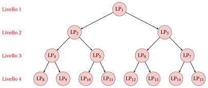{ .fig loading=lazy  }

    2. Se il nodo in alto ramificazione viene risolto per primo, abbiamo:

        { .fig loading=lazy  }

## 7.7 Esempi pratici sull'esempio dell'auto

- Ora risolviamo l'esempio dell'auto con due esecuzioni dell'algoritmo B&amp;B, che differiscono solo nelle strategie di selezione. Poiché tutte le variabili e tutti i costi sono interi, il limite di un nodo è $\mathrm{UB}(\LP_k) = \lfloor z(\LP_k) \rfloor$.

- Nella prima esecuzione ogni nodo viene riottimizzato con l'algoritmo del simplesso duale e riportiamo tutti i dizionari. Per ogni nodo una figura mostra la sua regione ammissibile.

- Prima di leggere la soluzione, prova a prevedere quale variabile viene selezionata alla radice e quale nodo viene estratto alla seconda iterazione.

!!! esempio "Esempio 7.5: esecuzione A: indice più piccolo e LIFO"
    Eseguiamo l'algoritmo B&amp;B sull'esempio dell'auto con:

    1. la regola dell'indice più piccolo (lessicografica) come strategia di selezione della variabile di ramificazione;

    2. la regola LIFO come strategia di selezione del nodo di diramazione;

    3. il nodo con diramazione verso il basso viene risolto per primo, poi il nodo con diramazione verso l'alto;

    4. il secondo bambino non è risolto quando si applica la regola di salto;

    5. Il limite inferiore è inizializzato a $\LB = -\infty$ (nessun algoritmo euristico viene eseguito).

    - <strong>Inizializzazione</strong>

        Il problema $\LP_1$ è la rilassazione LP dell'esempio dell'auto. L'algoritmo del simplesso con la regola di Bland, partendo dalla base delle variabili di slack, esegue 2 operazioni di pivot ($x_1$ entra e $x_3$ esce; $x_2$ entra e $x_4$ esce) e termina con il dizionario ottimale:

        \begin{equation*}
        \begin{cases}
        \begin{array}{rrrrrrr}
        {x_1} & {=} & {\dfrac{7}{2}} & {-} & {\dfrac{7}{62}}\, {x_3} & {+} & {\dfrac{1}{31}}\, {x_4} \\[2ex]
        {x_2} & {=} & {\dfrac{5}{2}} & {+} & {\dfrac{1}{31}}\, {x_3} & {-} & {\dfrac{5}{62}}\, {x_4} \\[2ex]
        {z} & {=} & {\dfrac{31}{2}} & {-} & {\dfrac{17}{62}}\, {x_3} & {-} & {\dfrac{2}{31}}\, {x_4}
        \end{array}
        \end{casi}
        \fine{equazione*}

        Una soluzione ottimale $\tilde{\vet x}(\LP_1)$ è:

        $$
        \tilde x_1 = \dfrac{7}{2},~~\tilde x_2 = \dfrac{5}{2}, \qquad z(\LP_1) = \dfrac{31}{2}.
        $$

        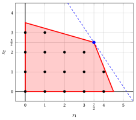{ .fig .ovale loading=lazy  }

        <em>Nodo $1$: la regione ammissibile di $\LP_1$, i punti interi, la soluzione ottimale di $\LP_1$ (blu) e la linea obiettivo attraverso di essa (tratteggiata).</em>

        La soluzione è frazionaria e $\left\lfloor z(\LP_{1}) \right\rfloor = \left\lfloor \dfrac{31}{2} \right\rfloor = 15 > \LB = -\infty$: il problema $\LP_1$ è inserito nella lista $L$.

        L'elenco è $L = \{\LP_{1}\}$, e il limite superiore è il limite più grande dei nodi nell'elenco:

        $$
        \underbrace{-\infty}_{\LB} ~~\le~~ z(\ILP) ~~\le~~ \underbrace{15}_{\UB} \qquad \left( \UB = \max_{k \in L} {\mathrm{UB}(\LP_k)} = 15 \right).
        $$

    - <strong>Iterazione 1</strong>

        L'elenco è $L = \{\LP_{1}\}$: il problema $\LP_{1}$ è estratto e rimosso da $L$.

        In $\tilde{\vet x}(\LP_{1})$ abbiamo $\tilde x_1 = \tfrac{7}{2}$ e $\tilde x_2 = \tfrac{5}{2}$, entrambi frazionari; secondo la regola del più piccolo indice la variabile di diramazione è $x_1$. I vincoli di diramazione sono:

        $$
        x_1 \le \underbrace{\left\lfloor \dfrac{7}{2} \right\rfloor}_{= 3} \qquad \text{e} \qquad x_1 \ge \underbrace{\left\lfloor \dfrac{7}{2} \right\rfloor + 1}_{= 4}.
        $$

        1. <strong>Nodo $2$: il figlio a ramo discendente ($x_1 \le 3$).</strong>

            Il vincolo di diramazione $x_1 \le 3$ è scritto come $x_1 + x_5 = 3$, con la variabile di slack $x_5 \ge 0$. Usando la riga di $x_1$ nel dizionario ottimale di $\LP_{1}$, abbiamo:

            $$
            x_5 = 3 - x_1 = 3 - \left( \dfrac{7}{2} - \dfrac{7}{62} \, x_3 + \dfrac{1}{31} \, x_4 \right) = -\dfrac{1}{2} + \dfrac{7}{62} \, x_3 - \dfrac{1}{31} \, x_4.
            $$

            Aggiungiamo questa riga al dizionario ottimale di $\LP_{1}$. I costi ridotti non cambiano, quindi il nuovo dizionario è <strong>dualmente fattibile</strong>; non è primariamente fattibile, poiché $\bar b_{5} = -\tfrac{1}{2} < 0$:

            \begin{equation*}
            \begin{cases}
            \begin{array}{rrrrrrr}
            {x_1} & {=} & {\dfrac{7}{2}} & {-} & {\dfrac{7}{62}}\, {x_3} & {+} & {\dfrac{1}{31}}\, {x_4} \\[2ex]
            {x_2} & {=} & {\dfrac{5}{2}} & {+} & {\dfrac{1}{31}}\, {x_3} & {-} & {\dfrac{5}{62}}\, {x_4} \\[2ex]
            {x_5} & {=} & {-\dfrac{1}{2}} & {+} & {\dfrac{7}{62}}\, {x_3} & {-} & {\dfrac{1}{31}}\, {x_4} \\[2ex]
            {z} & {=} & {\dfrac{31}{2}} & {-} & {\dfrac{17}{62}}\, {x_3} & {-} & {\dfrac{2}{31}}\, {x_4}
            \end{array}
            \end{casi}
            \fine{equazione*}

            <strong>Operazione di doppio pivot.</strong> La riga di pivot è $x_5$, l'unica variabile di base con un valore negativo ($\bar b_{5} = -\tfrac{1}{2}$).

            I candidati per la colonna pivot sono le variabili non basiche con $\bar a_{5,j} < 0$:

            $$
            \frac{\bar c_{3}}{\bar a_{5,3}} = \frac{-\tfrac{17}{62}}{-\tfrac{7}{62}} = \dfrac{17}{7}
            $$

            La colonna pivot è $x_3$, con $s_m = \tfrac{17}{7}$, e il valore obiettivo diventa

            $$
            \bar z + s_m \, \bar b_{5} = \dfrac{31}{2} + \dfrac{17}{7} \cdot \left( -\dfrac{1}{2} \right) = \dfrac{100}{7}.
            $$

            Dopo l'operazione di pivot otteniamo il seguente dizionario, che è ammissibile primale e duale, quindi <strong>ottimale</strong>:

            \begin{equation*}
            \begin{cases}
            \begin{array}{rrrrrrr}
            {x_1} & {=} & {3} &  &  & {-} & {x_5} \\[2ex]
            {x_2} & {=} & {\dfrac{37}{14}} & {-} & {\dfrac{1}{14}}\, {x_4} & {+} & {\dfrac{2}{7}}\, {x_5} \\[2ex]
            {x_3} & {=} & {\dfrac{31}{7}} & {+} & {\dfrac{2}{7}}\, {x_4} & {+} & {\dfrac{62}{7}}\, {x_5} \\[2ex]
            {z} & {=} & {\dfrac{100}{7}} & {-} & {\dfrac{1}{7}}\, {x_4} & {-} & {\dfrac{17}{7}}\, {x_5}
            \end{array}
            \end{casi}
            \fine{equazione*}

            Una soluzione ottimale $\tilde{\vet x}(\LP_{2})$ è:

            $$
            \tilde x_1 = 3,~~\tilde x_2 = \dfrac{37}{14}, \qquad z(\LP_{2}) = \dfrac{100}{7}.
            $$

            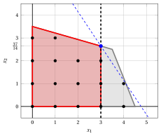{ .fig .ovale loading=lazy  }

            <em>Nodo $2$: la regione fattibile di $\LP_{2}$ (rossa) all'interno della regione del suo genitore $\LP_{1}$ (grigia), e la soluzione ottimale di $\LP_{2}$ (blu) con la linea obiettivo attraverso di essa (tratteggiata).</em>

            La soluzione è <strong>frazionaria</strong> e

            $$
            \left\lfloor z(\LP_{2}) \right\rfloor = \left\lfloor \dfrac{100}{7} \right\rfloor = 14 > \LB = -\infty,
            $$

            quindi il problema $\LP_{2}$ è <strong>inserito nella lista</strong> $L$.

        2. <strong>Nodo $3$: il figlio a ramo superiore ($x_1 \ge 4$).</strong>

            Il vincolo di diramazione $x_1 \ge 4$ è scritto come $x_1 - x_5 = 4$, con la variabile in eccedenza $x_5 \ge 0$. Usando la riga di $x_1$ nel dizionario ottimale di $\LP_{1}$, abbiamo:

            $$
            x_5 = x_1 - 4 = \left( \dfrac{7}{2} - \dfrac{7}{62} \, x_3 + \dfrac{1}{31} \, x_4 \right) - 4 = -\dfrac{1}{2} - \dfrac{7}{62} \, x_3 + \dfrac{1}{31} \, x_4.
            $$

            Aggiungiamo questa riga al dizionario ottimale di $\LP_{1}$. I costi ridotti non cambiano, quindi il nuovo dizionario è <strong>dualmente fattibile</strong>; non è primariamente fattibile, poiché $\bar b_{5} = -\tfrac{1}{2} < 0$:

            \begin{equation*}
            \begin{cases}
            \begin{array}{rrrrrrr}
            {x_1} & {=} & {\dfrac{7}{2}} & {-} & {\dfrac{7}{62}}\, {x_3} & {+} & {\dfrac{1}{31}}\, {x_4} \\[2ex]
            {x_2} & {=} & {\dfrac{5}{2}} & {+} & {\dfrac{1}{31}}\, {x_3} & {-} & {\dfrac{5}{62}}\, {x_4} \\[2ex]
            {x_5} & {=} & {-\dfrac{1}{2}} & {-} & {\dfrac{7}{62}}\, {x_3} & {+} & {\dfrac{1}{31}}\, {x_4} \\[2ex]
            {z} & {=} & {\dfrac{31}{2}} & {-} & {\dfrac{17}{62}}\, {x_3} & {-} & {\dfrac{2}{31}}\, {x_4}
            \end{array}
            \end{casi}
            \fine{equazione*}

            <strong>Operazione di doppio pivot.</strong> La riga di pivot è $x_5$, l'unica variabile di base con un valore negativo ($\bar b_{5} = -\tfrac{1}{2}$).

            I candidati per la colonna pivot sono le variabili non basiche con $\bar a_{5,j} < 0$:

            $$
            \frac{\bar c_{4}}{\bar a_{5,4}} = \frac{-\tfrac{2}{31}}{-\tfrac{1}{31}} = 2
            $$

            La colonna pivot è $x_4$, con $s_m = 2$, e il valore obiettivo diventa

            $$
            \bar z + s_m \, \bar b_{5} = \dfrac{31}{2} + 2 \cdot \left( -\dfrac{1}{2} \right) = \dfrac{29}{2}.
            $$

            Dopo l'operazione di pivot otteniamo il seguente dizionario, che è ammissibile primale e duale, quindi <strong>ottimale</strong>:

            \begin{equation*}
            \begin{cases}
            \begin{array}{rrrrrrr}
            {x_1} & {=} & {4} &  &  & {+} & {x_5} \\[2ex]
            {x_2} & {=} & {\dfrac{5}{4}} & {-} & {\dfrac{1}{4}}\, {x_3} & {-} & {\dfrac{5}{2}}\, {x_5} \\[2ex]
            {x_4} & {=} & {\dfrac{31}{2}} & {+} & {\dfrac{7}{2}}\, {x_3} & {+} & {31}\, {x_5} \\[2ex]
            {z} & {=} & {\dfrac{29}{2}} & {-} & {\dfrac{1}{2}}\, {x_3} & {-} & {2}\, {x_5}
            \end{array}
            \end{casi}
            \fine{equazione*}

            Una soluzione ottimale $\tilde{\vet x}(\LP_{3})$ è:

            $$
            \tilde x_1 = 4,~~\tilde x_2 = \dfrac{5}{4}, \qquad z(\LP_{3}) = \dfrac{29}{2}.
            $$

            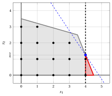{ .fig .ovale loading=lazy  }

            <em>Nodo $3$: la regione fattibile di $\LP_{3}$ (rossa) all'interno della regione del suo genitore $\LP_{1}$ (grigia), e la soluzione ottimale di $\LP_{3}$ (blu) con la linea obiettivo che la attraversa (tratteggiata).</em>

            La soluzione è <strong>frazionaria</strong> e

            $$
            \left\lfloor z(\LP_{3}) \right\rfloor = \left\lfloor \dfrac{29}{2} \right\rfloor = 14 > \LB = -\infty,
            $$

            quindi il problema $\LP_{3}$ è <strong>inserito nella lista</strong> $L$.

        L'elenco è $L = \{\LP_{2},~\LP_{3}\}$, e il limite superiore è il limite più grande dei nodi nell'elenco:

        $$
        \underbrace{-\infty}_{\LB} ~~\le~~ z(\ILP) ~~\le~~ \underbrace{14}_{\UB} \qquad \left( \UB = \max_{k \in L} {\mathrm{UB}(\LP_k)} = 14 \right).
        $$

        Questa è la porzione dell'albero branch-and-bound costruita nella prima iterazione, con i problemi LP dei nodi di ramificazione:

        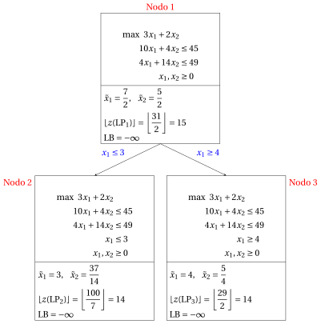{ .fig loading=lazy  }

    - <strong>Iterazione 2</strong>

        La lista è $L = \{\LP_{2},~\LP_{3}\}$; seguendo la regola LIFO, $\LP_{3}$ (l'ultimo problema inserito) viene estratto e rimosso da $L$.

        In $\tilde{\vet x}(\LP_{3})$ l'unica variabile intera con un valore frazionario è $x_2$, che è la variabile di divisione. I vincoli di divisione sono:

        $$
        x_2 \le \underbrace{\left\lfloor \dfrac{5}{4} \right\rfloor}_{= 1} \qquad \text{e} \qquad x_2 \ge \underbrace{\left\lfloor \dfrac{5}{4} \right\rfloor + 1}_{= 2}.
        $$

        1. <strong>Nodo $4$: il figlio a ramo discendente ($x_2 \le 1$).</strong>

            Il vincolo di diramazione $x_2 \le 1$ è scritto come $x_2 + x_6 = 1$, con la variabile di slack $x_6 \ge 0$. Usando la riga di $x_2$ nel dizionario ottimale di $\LP_{3}$, abbiamo:

            $$
            x_6 = 1 - x_2 = 1 - \left( \dfrac{5}{4} - \dfrac{1}{4} \, x_3 - \dfrac{5}{2} \, x_5 \right) = -\dfrac{1}{4} + \dfrac{1}{4} \, x_3 + \dfrac{5}{2} \, x_5.
            $$

            Aggiungiamo questa riga al dizionario ottimale di $\LP_{3}$. I costi ridotti non cambiano, quindi il nuovo dizionario è <strong>dualmente fattibile</strong>; non è primariamente fattibile, poiché $\bar b_{6} = -\tfrac{1}{4} < 0$:

            \begin{equation*}
            \begin{cases}
            \begin{array}{rrrrrrr}
            {x_1} & {=} & {4} &  &  & {+} & {x_5} \\[2ex]
            {x_2} & {=} & {\dfrac{5}{4}} & {-} & {\dfrac{1}{4}}\, {x_3} & {-} & {\dfrac{5}{2}}\, {x_5} \\[2ex]
            {x_4} & {=} & {\dfrac{31}{2}} & {+} & {\dfrac{7}{2}}\, {x_3} & {+} & {31}\, {x_5} \\[2ex]
            {x_6} & {=} & {-\dfrac{1}{4}} & {+} & {\dfrac{1}{4}}\, {x_3} & {+} & {\dfrac{5}{2}}\, {x_5} \\[2ex]
            {z} & {=} & {\dfrac{29}{2}} & {-} & {\dfrac{1}{2}}\, {x_3} & {-} & {2}\, {x_5}
            \end{array}
            \end{casi}
            \fine{equazione*}

            <strong>Operazione di doppio pivot.</strong> La riga pivot è $x_6$, l'unica variabile di base con un valore negativo ($\bar b_{6} = -\tfrac{1}{4}$).

            I candidati per la colonna pivot sono le variabili non di base con $\bar a_{6,j} < 0$:

            $$
            \frac{\bar c_{3}}{\bar a_{6,3}} = \frac{-\tfrac{1}{2}}{-\tfrac{1}{4}} = 2,~~\frac{\bar c_{5}}{\bar a_{6,5}} = \frac{-2}{-\tfrac{5}{2}} = \dfrac{4}{5}
            $$

            $$
            s_m = \min\left\{ 2, \dfrac{4}{5} \right\} = \dfrac{4}{5}.
            $$

            La colonna pivot è $x_5$, con $s_m = \tfrac{4}{5}$, e il valore obiettivo diventa

            $$
            \bar z + s_m \, \bar b_{6} = \dfrac{29}{2} + \dfrac{4}{5} \cdot \left( -\dfrac{1}{4} \right) = \dfrac{143}{10}.
            $$

            Dopo l'operazione di pivot otteniamo il seguente dizionario, che è ammissibile primale e duale, quindi <strong>ottimale</strong>:

            \begin{equation*}
            \begin{cases}
            \begin{array}{rrrrrrr}
            {x_1} & {=} & {\dfrac{41}{10}} & {-} & {\dfrac{1}{10}}\, {x_3} & {+} & {\dfrac{2}{5}}\, {x_6} \\[2ex]
            {x_2} & {=} & {1} &  &  & {-} & {x_6} \\[2ex]
            {x_4} & {=} & {\dfrac{93}{5}} & {+} & {\dfrac{2}{5}}\, {x_3} & {+} & {\dfrac{62}{5}}\, {x_6} \\[2ex]
            {x_5} & {=} & {\dfrac{1}{10}} & {-} & {\dfrac{1}{10}}\, {x_3} & {+} & {\dfrac{2}{5}}\, {x_6} \\[2ex]
            {z} & {=} & {\dfrac{143}{10}} & {-} & {\dfrac{3}{10}}\, {x_3} & {-} & {\dfrac{4}{5}}\, {x_6}
            \end{array}
            \end{casi}
            \fine{equazione*}

            Una soluzione ottimale $\tilde{\vet x}(\LP_{4})$ è:

            $$
            \tilde x_1 = \dfrac{41}{10},~~\tilde x_2 = 1, \qquad z(\LP_{4}) = \dfrac{143}{10}.
            $$

            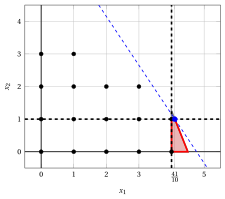{ .fig .ovale loading=lazy  }

            <em>Nodo $4$: la regione fattibile di $\LP_{4}$ (rossa) all'interno della regione del suo genitore $\LP_{3}$ (grigia), e la soluzione ottimale di $\LP_{4}$ (blu) con la linea obiettivo attraverso di essa (tratteggiata).</em>

            La soluzione è <strong>frazionaria</strong> e

            $$
            \left\lfloor z(\LP_{4}) \right\rfloor = \left\lfloor \dfrac{143}{10} \right\rfloor = 14 > \LB = -\infty,
            $$

            quindi il problema $\LP_{4}$ è <strong>inserito nella lista</strong> $L$.

        2. <strong>Nodo $5$: il figlio a ramo superiore ($x_2 \ge 2$).</strong>

            Il vincolo di diramazione $x_2 \ge 2$ è scritto come $x_2 - x_6 = 2$, con la variabile surplus $x_6 \ge 0$. Utilizzando la riga di $x_2$ nel dizionario ottimale di $\LP_{3}$, abbiamo:

            $$
            x_6 = x_2 - 2 = \left( \dfrac{5}{4} - \dfrac{1}{4} \, x_3 - \dfrac{5}{2} \, x_5 \right) - 2 = -\dfrac{3}{4} - \dfrac{1}{4} \, x_3 - \dfrac{5}{2} \, x_5.
            $$

            Aggiungiamo questa riga al dizionario ottimale di $\LP_{3}$. I costi ridotti non cambiano, quindi il nuovo dizionario è <strong>dualmente fattibile</strong>; non è primariamente fattibile, poiché $\bar b_{6} = -\tfrac{3}{4} < 0$:

            \begin{equation*}
            \begin{cases}
            \begin{array}{rrrrrrr}
            {x_1} & {=} & {4} &  &  & {+} & {x_5} \\[2ex]
            {x_2} & {=} & {\dfrac{5}{4}} & {-} & {\dfrac{1}{4}}\, {x_3} & {-} & {\dfrac{5}{2}}\, {x_5} \\[2ex]
            {x_4} & {=} & {\dfrac{31}{2}} & {+} & {\dfrac{7}{2}}\, {x_3} & {+} & {31}\, {x_5} \\[2ex]
            {x_6} & {=} & {-\dfrac{3}{4}} & {-} & {\dfrac{1}{4}}\, {x_3} & {-} & {\dfrac{5}{2}}\, {x_5} \\[2ex]
            {z} & {=} & {\dfrac{29}{2}} & {-} & {\dfrac{1}{2}}\, {x_3} & {-} & {2}\, {x_5}
            \end{array}
            \end{casi}
            \fine{equazione*}

            <strong>Operazione di doppio pivot.</strong> La riga pivot è $x_6$, l'unica variabile di base con un valore negativo ($\bar b_{6} = -\tfrac{3}{4}$).

            Tutti i coefficienti della riga pivot sono non negativi ($\bar a_{6,3} = \tfrac{1}{4}$, $\bar a_{6,5} = \tfrac{5}{2}$), cioè, la riga dice

            $$
            x_6 = -\dfrac{3}{4} - \dfrac{1}{4} \, x_3 - \dfrac{5}{2} \, x_5 \le -\dfrac{3}{4} < 0
            $$

            per ogni valore non negativo delle variabili non di base. Secondo l'algoritmo del simplesso duale, il problema $\LP_{5}$ è <strong>infattibile</strong>.

            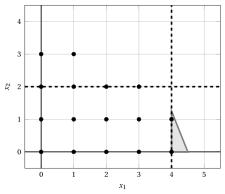{ .fig .ovale loading=lazy  }

            <em>Nodo $5$: il vincolo $x_2 \ge 2$ non lascia alcun punto nella regione del suo genitore $\LP_{3}$ (grigio): $\LP_{5}$ è irrealizzabile.</em>

            Di conseguenza, il Nodo $5$ è <u>potato per impossibilità</u>.

        L'elenco è $L = \{\LP_{2},~\LP_{4}\}$, e il limite superiore è il limite più grande dei nodi nell'elenco:

        $$
        \underbrace{-\infty}_{\LB} ~~\le~~ z(\ILP) ~~\le~~ \underbrace{14}_{\UB} \qquad \left( \UB = \max_{k \in L} {\mathrm{UB}(\LP_k)} = 14 \right).
        $$

        Questa è la porzione dell'albero branch-and-bound costruita nella seconda iterazione, con i problemi LP dei nodi di ramificazione:

        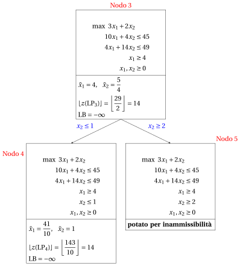{ .fig loading=lazy  }

    - <strong>Iterazione 3</strong>

        La lista è $L = \{\LP_{2},~\LP_{4}\}$; seguendo la regola LIFO, $\LP_{4}$ (l'ultimo problema inserito) viene estratto e rimosso da $L$.

        In $\tilde{\vet x}(\LP_{4})$ l'unica variabile intera con un valore frazionario è $x_1$, che è la variabile di ramificazione. I vincoli di ramificazione sono:

        $$
        x_1 \le \underbrace{\left\lfloor \dfrac{41}{10} \right\rfloor}_{= 4} \qquad \text{e} \qquad x_1 \ge \underbrace{\left\lfloor \dfrac{41}{10} \right\rfloor + 1}_{= 5}.
        $$

        1. <strong>Nodo $6$: il figlio a ramo discendente ($x_1 \le 4$).</strong>

            Il vincolo di diramazione $x_1 \le 4$ è scritto come $x_1 + x_7 = 4$, con la variabile di slack $x_7 \ge 0$. Usando la riga di $x_1$ nel dizionario ottimale di $\LP_{4}$, abbiamo:

            $$
            x_7 = 4 - x_1 = 4 - \left( \dfrac{41}{10} - \dfrac{1}{10} \, x_3 + \dfrac{2}{5} \, x_6 \right) = -\dfrac{1}{10} + \dfrac{1}{10} \, x_3 - \dfrac{2}{5} \, x_6.
            $$

            Aggiungiamo questa riga al dizionario ottimale di $\LP_{4}$. I costi ridotti non cambiano, quindi il nuovo dizionario è <strong>dualmente fattibile</strong>; non è primariamente fattibile, poiché $\bar b_{7} = -\tfrac{1}{10} < 0$:

            \begin{equation*}
            \begin{cases}
            \begin{array}{rrrrrrr}
            {x_1} & {=} & {\dfrac{41}{10}} & {-} & {\dfrac{1}{10}}\, {x_3} & {+} & {\dfrac{2}{5}}\, {x_6} \\[2ex]
            {x_2} & {=} & {1} &  &  & {-} & {x_6} \\[2ex]
            {x_4} & {=} & {\dfrac{93}{5}} & {+} & {\dfrac{2}{5}}\, {x_3} & {+} & {\dfrac{62}{5}}\, {x_6} \\[2ex]
            {x_5} & {=} & {\dfrac{1}{10}} & {-} & {\dfrac{1}{10}}\, {x_3} & {+} & {\dfrac{2}{5}}\, {x_6} \\[2ex]
            {x_7} & {=} & {-\dfrac{1}{10}} & {+} & {\dfrac{1}{10}}\, {x_3} & {-} & {\dfrac{2}{5}}\, {x_6} \\[2ex]
            {z} & {=} & {\dfrac{143}{10}} & {-} & {\dfrac{3}{10}}\, {x_3} & {-} & {\dfrac{4}{5}}\, {x_6}
            \end{array}
            \end{casi}
            \fine{equazione*}

            <strong>Operazione di doppio pivot.</strong> La riga pivot è $x_7$, l'unica variabile di base con un valore negativo ($\bar b_{7} = -\tfrac{1}{10}$).

            I candidati per la colonna pivot sono le variabili non basiche con $\bar a_{7,j} < 0$:

            $$
            \frac{\bar c_{3}}{\bar a_{7,3}} = \frac{-\tfrac{3}{10}}{-\tfrac{1}{10}} = 3
            $$

            La colonna pivot è $x_3$, con $s_m = 3$, e il valore obiettivo diventa

            $$
            \bar z + s_m \, \bar b_{7} = \dfrac{143}{10} + 3 \cdot \left( -\dfrac{1}{10} \right) = 14.
            $$

            Dopo l'operazione di pivot otteniamo il seguente dizionario, che è ammissibile primale e duale, quindi <strong>ottimale</strong>:

            \begin{equation*}
            \begin{cases}
            \begin{array}{rrrrrrr}
            {x_1} & {=} & {4} &  &  & {-} & {x_7} \\[2ex]
            {x_2} & {=} & {1} & {-} & {x_6} &  &  \\[2ex]
            {x_3} & {=} & {1} & {+} & {4}\, {x_6} & {+} & {10}\, {x_7} \\[2ex]
            {x_4} & {=} & {19} & {+} & {14}\, {x_6} & {+} & {4}\, {x_7} \\[2ex]
            {x_5} & {=} & {0} &  &  & {-} & {x_7} \\[2ex]
            {z} & {=} & {14} & {-} & {2}\, {x_6} & {-} & {3}\, {x_7}
            \end{array}
            \end{casi}
            \fine{equazione*}

            Una soluzione ottimale $\tilde{\vet x}(\LP_{6})$ è:

            $$
            \tilde x_1 = 4,~~\tilde x_2 = 1, \qquad z(\LP_{6}) = 14.
            $$

            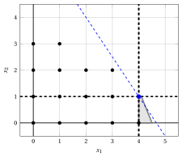{ .fig .ovale loading=lazy  }

            <em>Nodo $6$: la regione fattibile di $\LP_{6}$ (rossa) all'interno della regione del suo genitore $\LP_{4}$ (grigia), e la soluzione ottimale di $\LP_{6}$ (blu) con la linea obiettivo che la attraversa (tratteggiata).</em>

            La soluzione $\tilde{\vet x}(\LP_{6})$ è <strong>intero</strong>.

            Da $z(\LP_{6}) = 14 > \LB = -\infty$, il limite inferiore e la soluzione incumbente vengono aggiornati:

            $$
            \LB \leftarrow 14, \qquad \bar{\vet x} \leftarrow (4, 1).
            $$

            Il nodo $6$ è <u>potato per interezza</u>.

            Inoltre, $\LP_{2}$ è stato rimosso dalla lista $L$ (<u>potato in base al vincolo</u>), poiché ora

            $$
            \left\lfloor z(\LP_{2}) \right\rfloor = \left\lfloor \dfrac{100}{7} \right\rfloor = 14 \le \LB = 14.
            $$

        2. <strong>Salta la regola.</strong> Dopo il Nodo $6$ il limite inferiore soddisfa

            $$
            \left\lfloor z(\LP_{4}) \right\rfloor = \left\lfloor \dfrac{143}{10} \right\rfloor = 14 \le \LB = 14,
            $$

            quindi nessuna soluzione nella regione $\LP_{4}$ può migliorare la soluzione attuale: il figlio in ramificazione verso l'alto ($x_1 \ge 5$) <strong>non è risolto</strong> e non riceve un indice di nodo.

        La lista è vuota, quindi il limite superiore è uguale al limite inferiore:

        $$
        \underbrace{14}_{\LB} ~~\le~~ z(\ILP) ~~\le~~ \underbrace{14}_{\UB} \qquad \left( \UB = \LB = 14 \right).
        $$

        Questa è la porzione dell'albero branch-and-bound costruita nella terza iterazione, con i problemi LP dei nodi di ramificazione:

        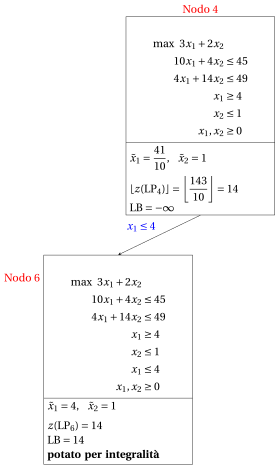{ .fig loading=lazy  }

    - <strong>Terminazione</strong>

        L'elenco $L$ è vuoto: $\LB = \UB = 14$ e la soluzione attuale è ottimale:

        $$
        \tilde x_1 = 4,~~\tilde x_2 = 1, \qquad z(\ILP) = 14.
        $$

    Questo è l'albero branch-and-bound finale. Per ogni nodo di ramificazione mostra il limite del nodo, il limite inferiore $\LB$ quando il nodo è stato risolto (o rimosso dall'elenco) e il criterio di potatura.

    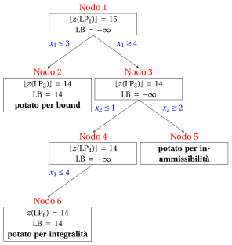{ .fig loading=lazy  }

    La stessa esecuzione in una tabella:

    
<table>
    <tr>
    <th>Nodo</th>
    <th>Genitore</th>
    <th>It.</th>
    <th>Rami</th>
    <th>\(\tilde{\vet x}(\LP_k)\)</th>
    <th>\(z(\LP_k)\)</th>
    <th>\(\LB\)</th>
    <th>Risultato</th>
    </tr>
    <tr>
    <td>1</td>
    <td>–</td>
    <td>0</td>
    <td>–</td>
    <td>\((\tfrac{7}{2}, \tfrac{5}{2})\)</td>
    <td>\(\tfrac{31}{2}\)</td>
    <td>\(-\infty\)</td>
    <td>ramificato su \(x_1\)</td>
    </tr>
    <tr>
    <td>2</td>
    <td>1</td>
    <td>1</td>
    <td>\(x_1 \le 3\)</td>
    <td>\((3, \tfrac{37}{14})\)</td>
    <td>\(\tfrac{100}{7}\)</td>
    <td>\(14\)</td>
    <td>potato per limite (rimosso da \(L\))</td>
    </tr>
    <tr>
    <td>3</td>
    <td>1</td>
    <td>1</td>
    <td>\(x_1 \ge 4\)</td>
    <td>\((4, \tfrac{5}{4})\)</td>
    <td>\(\tfrac{29}{2}\)</td>
    <td>\(-\infinito\)</td>
    <td>ramificato su \(x_2\)</td>
    </tr>
    <tr>
    <td>4</td>
    <td>3</td>
    <td>2</td>
    <td>\(x_2 \le 1\)</td>
    <td>\((\tfrac{41}{10}, 1)\)</td>
    <td>\(\tfrac{143}{10}\)</td>
    <td>\(-\infty\)</td>
    <td>ramificato su \(x_1\)</td>
    </tr>
    <tr>
    <td>5</td>
    <td>3</td>
    <td>2</td>
    <td>\(x_2 \ge 2\)</td>
    <td>–</td>
    <td>–</td>
    <td>\(-\infty\)</td>
    <td>potato per impossibilità</td>
    </tr>
    <tr>
    <td>6</td>
    <td>4</td>
    <td>3</td>
    <td>\(x_1 \le 4\)</td>
    <td>\((4, 1)\)</td>
    <td>\(14\)</td>
    <td>\(14\)</td>
    <td>potato per integrità</td>
    </tr>
    </table>

    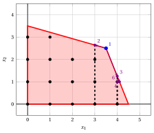{ .fig .ovale loading=lazy  }

    <em>Esecuzione A nel piano: i vincoli di ramificazione (neri, tratteggiati) all'interno delle regioni dei nodi genitori, e le soluzioni ottimali dei nodi risolti (viola), da $\LP_1$ (blu).</em>

!!! esempio "Esempio 7.6: esecuzione B: indice più grande e miglior limite"
    Eseguiamo di nuovo l'algoritmo B&amp;B sull'esempio della macchina, ora con:

    1. la regola dell'indice più grande (lessicografica) come strategia di selezione della variabile di ramificazione;

    2. la regola del miglior limite come strategia di selezione del nodo di diramazione (in caso di pareggio: indice del nodo più piccolo);

    3. il nodo con diramazione verso il basso viene risolto per primo, poi il nodo con diramazione verso l'alto;

    4. il secondo bambino non è risolto quando si applica la regola di salto;

    5. Il limite inferiore è inizializzato a $\LB = -\infty$ (nessun algoritmo euristico viene eseguito).

    Ogni figlio viene nuovamente ottimizzato con l'algoritmo del simplesso duale a partire dal dizionario ottimale del suo genitore, esattamente come in [Esempio 7.5](#box-9-ex-bb-runA); qui riportiamo solo i risultati.

    - <strong>Inizializzazione</strong>

        Come prima, $\tilde{\vet x}(\LP_1) = (\tfrac{7}{2}, \tfrac{5}{2})$ con $z(\LP_1) = \tfrac{31}{2}$, e $\LP_1$ è inserito nella lista $L$.

        L'elenco è $L = \{\LP_{1}\}$, e il limite superiore è il limite più grande dei nodi nell'elenco:

        $$
        \underbrace{-\infty}_{\LB} ~~\le~~ z(\ILP) ~~\le~~ \underbrace{15}_{\UB} \qquad \left( \UB = \max_{k \in L} {\mathrm{UB}(\LP_k)} = 15 \right).
        $$

    - <strong>Iterazione 1</strong>

        L'elenco è $L = \{\LP_{1}\}$: il problema $\LP_{1}$ è estratto e rimosso da $L$.

        In $\tilde{\vet x}(\LP_{1})$ abbiamo $\tilde x_1 = \tfrac{7}{2}$ e $\tilde x_2 = \tfrac{5}{2}$, entrambi frazionari; secondo la regola dell'indice più grande, la variabile di ramificazione è $x_2$. I vincoli di ramificazione sono:

        $$
        x_2 \le \underbrace{\left\lfloor \dfrac{5}{2} \right\rfloor}_{= 2} \qquad \text{e} \qquad x_2 \ge \underbrace{\left\lfloor \dfrac{5}{2} \right\rfloor + 1}_{= 3}.
        $$

        - Nodo $2$ ($x_2 \le 2$): $\tilde{\vet x}(\LP_{2}) = (\tfrac{37}{10}, 2)$ con $z(\LP_{2}) = \tfrac{151}{10}$. La soluzione è <strong>frazionaria</strong> e

            $$
            \left\lfloor z(\LP_{2}) \right\rfloor = \left\lfloor \dfrac{151}{10} \right\rfloor = 15 > \LB = -\infty,
            $$

            quindi il problema $\LP_{2}$ è <strong>inserito nella lista</strong> $L$.

        - Nodo $3$ ($x_2 \ge 3$): $\tilde{\vet x}(\LP_{3}) = (\tfrac{7}{4}, 3)$ con $z(\LP_{3}) = \tfrac{45}{4}$. La soluzione è <strong>frazionaria</strong> e

            $$
            \left\lfloor z(\LP_{3}) \right\rfloor = \left\lfloor \dfrac{45}{4} \right\rfloor = 11 > \LB = -\infty,
            $$

            quindi il problema $\LP_{3}$ è <strong>inserito nella lista</strong> $L$.

        L'elenco è $L = \{\LP_{2},~\LP_{3}\}$, e il limite superiore è il limite più grande dei nodi nell'elenco:

        $$
        \underbrace{-\infty}_{\LB} ~~\le~~ z(\ILP) ~~\le~~ \underbrace{15}_{\UB} \qquad \left( \UB = \max_{k \in L} {\mathrm{UB}(\LP_k)} = 15 \right).
        $$

    - <strong>Iterazione 2</strong>

        L'elenco è $L = \{\LP_{2},~\LP_{3}\}$; seguendo la regola del miglior vincolo, $\LP_{2}$ viene estratto e rimosso da $L$, poiché ha il valore ottimale più grande:

        $$
        z(\LP_{2}) = \dfrac{151}{10},~~z(\LP_{3}) = \dfrac{45}{4}.
        $$

        In $\tilde{\vet x}(\LP_{2})$ l'unica variabile intera con un valore frazionario è $x_1$, che è la variabile di divisione. I vincoli di divisione sono:

        $$
        x_1 \le \underbrace{\left\lfloor \dfrac{37}{10} \right\rfloor}_{= 3} \qquad \text{e} \qquad x_1 \ge \underbrace{\left\lfloor \dfrac{37}{10} \right\rfloor + 1}_{= 4}.
        $$

        - Nodo $4$ ($x_1 \le 3$): $\tilde{\vet x}(\LP_{4}) = (3, 2)$ con $z(\LP_{4}) = 13$. La soluzione $\tilde{\vet x}(\LP_{4})$ è <strong>intera</strong>. Dal momento che $z(\LP_{4}) = 13 > \LB = -\infty$, il limite inferiore e la soluzione corrente sono aggiornati:

            $$
            \LB \leftarrow 13, \qquad \bar{\vet x} \leftarrow (3, 2).
            $$

            Il nodo $4$ è <u>potato per integrità</u>. Inoltre, $\LP_{3}$ è rimosso dalla lista $L$ (<u>potato per limite</u>), poiché ora

            $$
            \left\lfloor z(\LP_{3}) \right\rfloor = \left\lfloor \dfrac{45}{4} \right\rfloor = 11 \le \LB = 13.
            $$

        - Nodo $5$ ($x_1 \ge 4$): $\tilde{\vet x}(\LP_{5}) = (4, \tfrac{5}{4})$ con $z(\LP_{5}) = \tfrac{29}{2}$. La soluzione è <strong>frazionaria</strong> e

            $$
            \left\lfloor z(\LP_{5}) \right\rfloor = \left\lfloor \dfrac{29}{2} \right\rfloor = 14 > \LB = 13,
            $$

            quindi il problema $\LP_{5}$ è <strong>inserito nella lista</strong> $L$.

        L'elenco è $L = \{\LP_{5}\}$, e il limite superiore è il limite più grande dei nodi nell'elenco:

        $$
        \underbrace{13}_{\LB} ~~\le~~ z(\ILP) ~~\le~~ \underbrace{14}_{\UB} \qquad \left( \UB = \max_{k \in L} {\mathrm{UB}(\LP_k)} = 14 \right).
        $$

    - <strong>Iterazione 3</strong>

        L'elenco è $L = \{\LP_{5}\}$: il problema $\LP_{5}$ è estratto e rimosso da $L$.

        In $\tilde{\vet x}(\LP_{5})$ l'unica variabile intera con un valore frazionario è $x_2$, che è la variabile di divisione. I vincoli di divisione sono:

        $$
        x_2 \le \underbrace{\left\lfloor \dfrac{5}{4} \right\rfloor}_{= 1} \qquad \text{e} \qquad x_2 \ge \underbrace{\left\lfloor \dfrac{5}{4} \right\rfloor + 1}_{= 2}.
        $$

        - Nodo $6$ ($x_2 \le 1$): $\tilde{\vet x}(\LP_{6}) = (\tfrac{41}{10}, 1)$ con $z(\LP_{6}) = \tfrac{143}{10}$. La soluzione è <strong>frazionaria</strong> e

            $$
            \left\lfloor z(\LP_{6}) \right\rfloor = \left\lfloor \dfrac{143}{10} \right\rfloor = 14 > \LB = 13,
            $$

            quindi il problema $\LP_{6}$ è <strong>inserito nella lista</strong> $L$.

        - Nodo $7$ ($x_2 \ge 2$): il problema $\LP_{7}$ è irrisolvibile: <u>eliminato per irrisolvibilità</u>.

        L'elenco è $L = \{\LP_{6}\}$, e il limite superiore è il limite più grande dei nodi nell'elenco:

        $$
        \underbrace{13}_{\LB} ~~\le~~ z(\ILP) ~~\le~~ \underbrace{14}_{\UB} \qquad \left( \UB = \max_{k \in L} {\mathrm{UB}(\LP_k)} = 14 \right).
        $$

    - <strong>Iterazione 4</strong>

        L'elenco è $L = \{\LP_{6}\}$: il problema $\LP_{6}$ è estratto e rimosso da $L$.

        In $\tilde{\vet x}(\LP_{6})$ l'unica variabile intera con un valore frazionario è $x_1$, che è la variabile di divisione. I vincoli di divisione sono:

        $$
        x_1 \le \underbrace{\left\lfloor \dfrac{41}{10} \right\rfloor}_{= 4} \qquad \text{e} \qquad x_1 \ge \underbrace{\left\lfloor \dfrac{41}{10} \right\rfloor + 1}_{= 5}.
        $$

        - Nodo $8$ ($x_1 \le 4$): $\tilde{\vet x}(\LP_{8}) = (4, 1)$ con $z(\LP_{8}) = 14$. La soluzione $\tilde{\vet x}(\LP_{8})$ è <strong>intera</strong>. Dal momento che $z(\LP_{8}) = 14 > \LB = 13$, il limite inferiore e la soluzione corrente sono aggiornati:

            $$
            \LB \leftarrow 14, \qquad \bar{\vet x} \leftarrow (4, 1).
            $$

            Il nodo $8$ è <u>potato per interezza</u>.

        - <strong>Salta la regola.</strong> Dopo il Nodo $8$ il limite inferiore soddisfa

            $$
            \left\lfloor z(\LP_{6}) \right\rfloor = \left\lfloor \dfrac{143}{10} \right\rfloor = 14 \le \LB = 14,
            $$

            quindi nessuna soluzione nella regione $\LP_{6}$ può migliorare la soluzione attuale: il figlio del ramo superiore ($x_1 \ge 5$) <strong>non è risolto</strong> e non riceve un indice del nodo.

        La lista è vuota, quindi il limite superiore è uguale al limite inferiore:

        $$
        \underbrace{14}_{\LB} ~~\le~~ z(\ILP) ~~\le~~ \underbrace{14}_{\UB} \qquad \left( \UB = \LB = 14 \right).
        $$

    - <strong>Terminazione</strong>

        L'elenco $L$ è vuoto: $\LB = \UB = 14$ e la soluzione attuale è ottimale:

        $$
        \tilde x_1 = 4,~~\tilde x_2 = 1, \qquad z(\ILP) = 14.
        $$

    Questo è l'albero finale di branch-and-bound:

    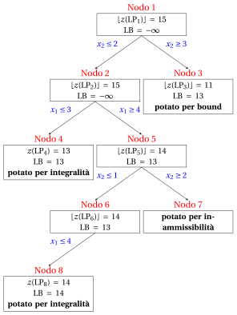{ .fig loading=lazy  }

    
<table>
    <tr>
    <th>Nodo</th>
    <th>Genitore</th>
    <th>It.</th>
    <th>Rami</th>
    <th>\(\tilde{\vet x}(\LP_k)\)</th>
    <th>\(z(\LP_k)\)</th>
    <th>\(\LB\)</th>
    <th>Risultato</th>
    </tr>
    <tr>
    <td>1</td>
    <td>–</td>
    <td>0</td>
    <td>–</td>
    <td>\((\tfrac{7}{2}, \tfrac{5}{2})\)</td>
    <td>\(\tfrac{31}{2}\)</td>
    <td>\(-\infty\)</td>
    <td>ramificato su \(x_2\)</td>
    </tr>
    <tr>
    <td>2</td>
    <td>1</td>
    <td>1</td>
    <td>\(x_2 \le 2\)</td>
    <td>\((\tfrac{37}{10}, 2)\)</td>
    <td>\(\tfrac{151}{10}\)</td>
    <td>\(-\infty\)</td>
    <td>ramificato su \(x_1\)</td>
    </tr>
    <tr>
    <td>3</td>
    <td>1</td>
    <td>1</td>
    <td>\(x_2 \ge 3\)</td>
    <td>\((\tfrac{7}{4}, 3)\)</td>
    <td>\(\tfrac{45}{4}\)</td>
    <td>\(13\)</td>
    <td>potato per limite (rimosso da \(L\))</td>
    </tr>
    <tr>
    <td>4</td>
    <td>2</td>
    <td>2</td>
    <td>\(x_1 \le 3\)</td>
    <td>\((3, 2)\)</td>
    <td>\(13\)</td>
    <td>\(13\)</td>
    <td>potato per integrità</td>
    </tr>
    <tr>
    <td>5</td>
    <td>2</td>
    <td>2</td>
    <td>\(x_1 \ge 4\)</td>
    <td>\((4, \tfrac{5}{4})\)</td>
    <td>\(\tfrac{29}{2}\)</td>
    <td>\(13\)</td>
    <td>ramificato su \(x_2\)</td>
    </tr>
    <tr>
    <td>6</td>
    <td>5</td>
    <td>3</td>
    <td>\(x_2 \le 1\)</td>
    <td>\((\tfrac{41}{10}, 1)\)</td>
    <td>\(\tfrac{143}{10}\)</td>
    <td>\(13\)</td>
    <td>ramificato su \(x_1\)</td>
    </tr>
    <tr>
    <td>7</td>
    <td>5</td>
    <td>3</td>
    <td>\(x_2 \ge 2\)</td>
    <td>–</td>
    <td>–</td>
    <td>\(13\)</td>
    <td>potato per non fattibilità</td>
    </tr>
    <tr>
    <td>8</td>
    <td>6</td>
    <td>4</td>
    <td>\(x_1 \le 4\)</td>
    <td>\((4, 1)\)</td>
    <td>\(14\)</td>
    <td>\(14\)</td>
    <td>potato per integrità</td>
    </tr>
    </table>

    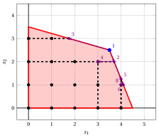{ .fig .ovale loading=lazy  }

    <em>Esecuzione B nel piano: vincoli di ramificazione e soluzioni ottimali dei nodi risolti.</em>

    - L'esecuzione A risolve problemi LP $6$, l'esecuzione B risolve $8$. Entrambe certificano la stessa soluzione ottimale $\tilde x_1 = 4, \tilde x_2 = 1$ di valore $14$, che è unica.

    - L'esecuzione B trova prima una prima soluzione incumbente di valore $13$, ma fare il branching prima su $x_2$ porta a un albero più grande in questo caso.

!!! esempio "Esempio 7.7: inizializzazione euristica"
    Eseguiamo l'algoritmo B&amp;B di [Esempio 7.5](#box-9-ex-bb-runA) (indice più piccolo, LIFO), a partire da una soluzione euristica dell'esempio dell'auto.

    - L'euristica a una variabile del Capitolo 1 fissa $x_1$ il più grande possibile e $x_2 = 0$: fornisce $\bar{\vet x} = (4, 0)$ di valore $12$. Avviando l'esecuzione A con $\LB = 12$, l'algoritmo risolve $6$ problemi LP, tanti quanti senza l'euristica: questo limite inferiore è troppo debole per potare qualsiasi nodo in anticipo.

    - L'euristica che fissa prima $x_1$ e poi $x_2$ al massimo possibile dà $\bar{\vet x} = (4, 1)$ di valore $14$. Partendo da $\LB = 14$, la radice non viene potata, poiché $\lfloor z(\LP_1) \rfloor = 15 > 14$, ma entrambi i figli sono potati dal limite e l'algoritmo si ferma dopo $3$ problemi di programmazione lineare:

    
<table>
    <tr>
    <th>Nodo</th>
    <th>Genitore</th>
    <th>It.</th>
    <th>Rami</th>
    <th>\(\tilde{\vet x}(\LP_k)\)</th>
    <th>\(z(\LP_k)\)</th>
    <th>\(\LB\)</th>
    <th>Risultato</th>
    </tr>
    <tr>
    <td>1</td>
    <td>–</td>
    <td>0</td>
    <td>–</td>
    <td>\((\tfrac{7}{2}, \tfrac{5}{2})\)</td>
    <td>\(\tfrac{31}{2}\)</td>
    <td>\(14\)</td>
    <td>ramificato su \(x_1\)</td>
    </tr>
    <tr>
    <td>2</td>
    <td>1</td>
    <td>1</td>
    <td>\(x_1 \le 3\)</td>
    <td>\((3, \tfrac{37}{14})\)</td>
    <td>\(\tfrac{100}{7}\)</td>
    <td>\(14\)</td>
    <td>potato dal vincolo</td>
    </tr>
    <tr>
    <td>3</td>
    <td>1</td>
    <td>1</td>
    <td>\(x_1 \ge 4\)</td>
    <td>\((4, \tfrac{5}{4})\)</td>
    <td>\(\tfrac{29}{2}\)</td>
    <td>\(14\)</td>
    <td>potato per limite</td>
    </tr>
    </table>

    La soluzione corrente fornita dall'euristica è ottimale, e l'algoritmo branch-and-bound <strong>certifica</strong> la sua ottimalità.

## 7.8 Errori tipici

!!! attenzione "Avviso"
    - <strong>Arrotondamento della soluzione LP.</strong> Arrotondare una soluzione ottimale della rilassazione LP fornisce al massimo una soluzione fattibile, in generale non ottimale. Nell'esempio dell'auto, arrotondare per difetto $\tilde{\vet x}(\LP) = (\tfrac{7}{2}, \tfrac{5}{2})$ dà $(3, 2)$ di valore $13$, mentre $z(\ILP) = 14$ a $(4, 1)$.

    - <strong>Ramificazione sulla variabile sbagliata.</strong> La variabile di ramificazione deve essere una variabile intera con un valore frazionario: una variabile con un valore intero non esclude $\tilde{\vet x}(\LP_k)$.

    - <strong>Prendendo il limite superiore dall'ultimo nodo.</strong> Il limite superiore è il più grande tra i nodi della lista $L$, non il limite dell'ultimo nodo risolto.

    - <strong>Potatura solo tramite il vincolo con un'ineguaglianza stretta.</strong> Un nodo con $\mathrm{UB}(\LP_k) = \LB$ è potato: la sua regione può contenere soluzioni altrettanto buone quanto quella corrente, ma non migliori.

    - <strong>Numerazione dei bambini saltati.</strong> Un bambino che non viene risolto non riceve un indice di nodo.

    - <strong>Risoluzione di ogni nodo da zero.</strong> La risposta è corretta, ma molto più lenta: ogni figlio inizia dal dizionario ottimale del suo genitore, che è dualmente fattibile.

## 7.9 Estensioni

- I problemi di LP dei nodi possono anche essere risolti con il <strong>algoritmo del simplesso a variabili vincolate</strong>, che gestisce i vincoli di ramificazione come limiti sulle variabili invece che come nuovi vincoli.

- In un problema <strong>misto</strong>, dove solo alcune variabili sono intere, si effettua la ramificazione solo sulle variabili intere e il limite di un nodo è $z(\LP_k)$, senza arrotondamento.

## 7.10 In sintesi

!!! chiave "In sintesi"
    - Un algoritmo B&amp;B divide la regione ammissibile con vincoli di ramificazione su variabili intere con valori frazionari, e non perde mai una soluzione ammissibile.

    - Ogni nodo viene potato per infeasibilità, per integrità o per limite, oppure attende nella lista; il limite di un nodo è $\lfloor z(\LP_k) \rfloor$ solo se tutte le variabili e i costi sono interi.

    - Il limite inferiore deriva dalla soluzione corrente, il limite superiore dai nodi della lista; quando la lista è vuota coincidono, e la soluzione corrente è certificata ottimale.

    - Ogni figlio viene riottimizzato con l'algoritmo duale del simplesso a partire dal dizionario del suo genitore.

    - Le strategie di selezione e una buona soluzione euristica cambiano la dimensione dell'albero, non il valore ottimale.

    <strong>Cruscotto dell'esempio dell'auto.</strong> I limiti inferiori e superiori su $z(\ILP)$ trovati finora in questo modulo:

    
<table>
    <tr>
    <th>Capitolo</th>
    <th>Limite inferiore</th>
    <th>Limite superiore</th>
    <th>Da</th>
    </tr>
    <tr>
    <td>Limiti primal e duali</td>
    <td>\(14\)</td>
    <td>\(15\)</td>
    <td>soluzione euristica \((4, 1)\), e \(\lfloor z(\LP) \rfloor\) con \(z(\LP) = \tfrac{31}{2}\)</td>
    </tr>
    <tr>
    <td>Algoritmo del piano di taglio</td>
    <td>\(14\)</td>
    <td>\(14\)</td>
    <td>\(5\) tagli frazionari di Gomory</td>
    </tr>
    <tr>
    <td>Questo capitolo, esecuzione A</td>
    <td>\(14\)</td>
    <td>\(14\)</td>
    <td>\(6\) problemi di PL risolti</td>
    </tr>
    <tr>
    <td>Questo capitolo, esecuzione B</td>
    <td>\(14\)</td>
    <td>\(14\)</td>
    <td>\(8\) problemi LP risolti</td>
    </tr>
    <tr>
    <td>Questo capitolo, con \(\LB = 14\)</td>
    <td>\(14\)</td>
    <td>\(14\)</td>
    <td>\(3\) problemi LP risolti</td>
    </tr>
    </table>

    Nell'esempio dell'auto, l'algoritmo chiude il divario tra $\LB = 13$ (soluzione LP arrotondata) e $\UB = 15$ (rilassamento LP) risolvendo $6$ problemi LP.

---

**Esercizi su questo capitolo:** [:material-pencil: Branch-and-bound](../exercises/bb.md)

<!-- laboratorio-interattivo: sezione generata da interattivi.py -->

## Laboratorio interattivo { #interactive-lab }

Le idee del capitolo, pratica: muovi i cursori e trascina i punti.
Ogni app apre anche una pagina completa nel [laboratorio interattivo](../lab/index.md): [Branch-and-bound passo passo](../lab/branch-and-bound-steps.md).

