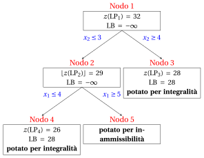
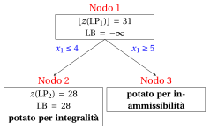

# Branch-and-cut

**Parte 3 · Metodi esatti · Capitolo 8** · [:material-file-pdf-box: Appunti delle lezioni, volume 2 (PDF)](../pdf/lecture-notes-2-exact-methods.pdf) · [:material-pencil: Esercizi: Branch-and-cut](../exercises/branch-and-cut.md)

!!! nota "Prerequisiti"
    - Da questo modulo, i capitoli «Disuguaglianze valide» e «Disuguaglianze di copertura»: disuguaglianze valide e la separazione di una disuguaglianza violata di una famiglia.

    - Da questo modulo, il capitolo «Algoritmo del piano di taglio»: tagli frazionari di Gomory e la riottimizzazione del problema LP con l'algoritmo del simplesso duale dopo l'inserimento di un taglio.

    - Da questo modulo, il capitolo «Branch-and-Bound basato su LP»: l'elenco dei problemi LP, i criteri di potatura e le strategie di selezione delle variabili e dei nodi su cui eseguire il branching.

!!! chiave "Obiettivi"
    Alla fine di questo capitolo sarai in grado di:

    - spiegare come le operazioni di piani di taglio e di ramificazione si completano a vicenda;

    - distinguere tra disuguaglianze valide globali e locali, e indicare dove può essere utilizzato un taglio;

    - descrivere gli algoritmi cut-and-branch e branch-and-cut, e il ruolo del pool di tagli;

    - eseguire manualmente un algoritmo cut-and-branch con tagli di Gomory su un piccolo problema ILP e confrontare la dimensione dell'albero con e senza tagli;

    - generare un taglio locale in un nodo di diramazione e riottimizzare con l'algoritmo del simplesso duale.

## 8.1 Algoritmi branch-and-cut

!!! definizione "Definizione 8.1: algoritmo branch-and-cut"
    Dato un problema ILP in forma canonica di massimizzazione con dati di input interi, un <strong>algoritmo branch-and-cut</strong> è un algoritmo branch-and-bound in cui i problemi LP dei nodi di ramificazione sono rinforzati con piani di taglio prima della ramificazione.

- Un <strong>algoritmo del piano di taglio</strong> spinge il rilassamento LP verso l'inviluppo convesso delle soluzioni intere, ma i tagli frazionari di Gomory perdono efficacia dopo le prime iterazioni (<strong>fenomeno di esaurimento</strong>).

- Un <strong>algoritmo branch-and-bound</strong> suddivide la regione ammissibile in problemi LP più piccoli, ma iniziando da una debole rilassamento LP ha bisogno di un grande albero.

!!! chiave ""
    I tagli riducono i limiti dei nodi, quindi più nodi vengono potati grazie ai limiti; la ramificazione garantisce la terminazione quando i tagli non sono più efficaci.

- Tutti i moderni risolutori MIP si basano su algoritmi branch-and-cut (vedi il capitolo «Cosa fa un risolutore MIP»).

## 8.2 Disuguaglianze valide globali e locali

- In un algoritmo branch-and-bound, il problema $\LP_k$ di un nodo di ramificazione $k$ è il rilassamento LP con i vincoli di ramificazione del percorso dalla radice al nodo $k$.

- Indichiamo con $F$ l'insieme delle soluzioni intere ammissibili del problema ILP, e con $F_k \subseteq F$ l'insieme di quelle che soddisfano i vincoli di diramazione del nodo $k$. Al nodo radice $F_1 = F$.

!!! definizione "Definizione 8.2: disuguaglianze valide globali e locali"
    Un'ineguaglianza lineare $\vet\alpha\T\vet x \le \beta$ è chiamata:

    1. una <strong>disuguaglianza valida a livello globale</strong> (o <strong>taglio globale</strong>) se è soddisfatta da tutte le soluzioni in $F$;

    2. una <strong>disuguaglianza localmente valida</strong> per il nodo di ramificazione $k$ (o <strong>taglio locale</strong>) se è soddisfatta da tutte le soluzioni in $F_k$.

- Dal momento che $F_k \subseteq F$, ogni taglio globale è anche un taglio locale di ogni nodo. Il contrario è falso: un taglio locale può rimuovere soluzioni intere fattibili che appartengono ad altri rami dell'albero.

- Un taglio locale del nodo $k$ è valido per tutti i nodi del sottoalbero radicato in $k$ e non deve <u>essere</u> utilizzato al di fuori di questo sottoalbero.

!!! chiave ""
    Un taglio derivato solo dai vincoli originali (e da altri tagli globali) è <strong>globale</strong>. Un taglio la cui derivazione utilizza un vincolo di ramificazione è, in generale, solo <strong>locale</strong>.

- Un taglio frazionario di Gomory generato al nodo radice è globale: deriva solo dai vincoli originali, ed è quindi un'ineguaglianza di una famiglia (come le disuguaglianze di copertura di un vincolo con coefficienti positivi) separata da essi. Un taglio frazionario di Gomory generato da una riga che contiene la variabile slack di un vincolo di ramificazione con un coefficiente diverso da zero è trattato come locale.

## 8.3 Taglia-e-intera e intera-e-taglia

!!! definizione "Definizione 8.3: algoritmo taglia-e-ramifica"
    Un <strong>algoritmo cut-and-branch</strong> esegue un algoritmo a piani di taglio sul nodo radice per un numero limitato di <strong>turni di tagli</strong>, aggiunge i tagli trovati al problema ILP, e poi esegue un algoritmo branch-and-bound sul problema rafforzato. Nessun taglio viene generato sugli altri nodi.

- Tutte le suddivisioni delle radici sono globali: al nodo radice non esiste alcuna restrizione di ramificazione.

- In un <strong>algoritmo branch-and-cut</strong> vengono generate tagli anche negli altri nodi (in tutti o in alcuni di essi, per esempio ogni dieci livelli dell'albero). I tagli possono essere globali o locali.

- In ogni nodo, la generazione dei tagli si ferma quando la soluzione del problema $\LP_k$ è intera o il nodo può essere eliminato; quando non viene trovato alcun taglio violato; quando viene raggiunto un numero massimo di cicli; o quando la diminuzione di $z(\LP_k)$ negli ultimi cicli è piccola (tailing off).

### 8.3.1 La piscina di taglio

- I tagli sono memorizzati in una struttura dati chiamata <strong>cut pool</strong>. Prima di chiamare le procedure di generazione dei tagli (più costose), l'algoritmo verifica se un taglio del pool è violato da $\tilde{\vet x}(\LP_k)$.

- I tagli globali sono memorizzati in un <strong>pool globale</strong>, utilizzabile in ogni nodo. I tagli locali sono memorizzati con il loro nodo e vengono ereditati solo dai suoi discendenti.

- Ogni taglio aggiunge un vincolo ai problemi di programmazione lineare. I tagli che rimangono inattivi per molte iterazioni vengono rimossi dal problema di programmazione lineare e mantenuti solo nel pool.

### 8.3.2 Pseudocodice di alto livello

- L'algoritmo branch-and-cut ha il pseudocodice dell'algoritmo branch-and-bound (stesse operazioni di branching, stessi criteri di potatura, stessa lista $L$): solo la <strong>Sotto-procedura della Soluzione del Nodo di Branching</strong> cambia.

!!! algoritmo "Algoritmo"
    - <strong>Input:</strong> Un problema $\LP_k$ associato a un nodo di ramificazione, al pool di tagli e a un numero massimo $R$ di round di tagli.

    - **Passo 1:** <strong>Operazioni di delimitazione</strong>

        Risolvi il problema $\LP_k$.

        1. se il problema $\LP_k$ è irrisolvibile, allora <code>STOP</code>.

        2. se $\left\lfloor z(\LP_k) \right\rfloor \le \LB$, allora <code>STOP</code>.

        3. se ${\tilde{\vet x}}(\LP_k)$ è un numero intero, allora aggiorna il <strong>limite inferiore</strong> e la <strong>soluzione corrente</strong>, rimuovi dalla lista $L$ tutti i problemi LP con $\left\lfloor z(\LP) \right\rfloor \le \LB$ e <code>STOP</code>.

    - **Passo 2:** <strong>Generazione dei tagli</strong>

        Se sono stati eseguiti $R$ cicli di tagli sul nodo $k$, vai al Passo 3. Altrimenti:

        1. cerca nella pool dei tagli i tagli violati da ${\tilde{\vet x}}(\LP_k)$; se non ne viene trovato nessuno, genera nuovi tagli violati e memorizzali nella pool (tagli globali nella pool globale, tagli locali con il nodo $k$);

        2. se non esiste alcun taglio violato, passa al Passo 3. Altrimenti aggiungi i tagli al problema $\LP_k$, riottimizzalo e torna al Passo 1.

    - **Passo 3:** <strong>Inserimento nella lista</strong>

        Inserisci il problema $\LP_k$ (con i suoi tagli) nella lista $L$ e <code>STOP</code>.

- Con $R = 0$ in ogni nodo eccetto la radice otteniamo un algoritmo di taglio e ramificazione; con $R = 0$ in ogni nodo otteniamo l'algoritmo branch-and-bound.

- Il pseudocodice non indica come vengono generati i tagli o come il problema LP venga riottimizzato. Dopo l'inserimento di un taglio, il dizionario è dualmente ammissibile, quindi l'<strong>algoritmo del simplesso duale</strong> parte dal dizionario ottimale del problema precedente, come dopo un vincolo di branching.

## 8.4 Esempio pratico: cut-and-branch con tagli di Gomory { #sez-sec-bc-example }

- Utilizziamo il problema $P10$ del catalogo dei problemi MIP: massimizzare $5x_1+2x_2$ soggetto a $-x_1+3x_2\le 12$, $x_1+2x_2\le 12$, $3x_1-2x_2\le 8$, $x_1,x_2\in\Z_{\ge 0}$. La sua soluzione ottimale unica è $\tilde{\vet x}(\ILP) = (4,4)$, con $z(\ILP) = 28$.

- I tagli sono i tagli frazionari di Gomory del capitolo sull'algoritmo del piano di taglio, con la stessa regola: la riga con il lato destro frazionario più grande e con l'indice più piccolo in caso di parità.

- Poiché i dati sono interi, il limite di un nodo è $\lfloor z(\LP_k) \rfloor$. Tutte le esecuzioni utilizzano le stesse regole: la regola dell'indice più piccolo come strategia di selezione della variabile di ramificazione, la regola LIFO come strategia di selezione del nodo di ramificazione, il nodo di ramificazione discendente risolto per primo, e $\LB = -\infty$ all'inizio.

!!! esempio "Esempio 8.1: branch-and-bound senza tagli"
    Il problema $\LP_1$ è il rilassamento LP di $P10$. Una soluzione ottimale è $\tilde{\vet x}(\LP_1) = (5,\tfrac{7}{2})$, con $z(\LP_1) = 32$ e $\UB = 32$. L'algoritmo branch-and-bound risolve $5$ problemi LP:

    { .fig loading=lazy  }

    
<table>
    <tr>
    <th>Nodo</th>
    <th>Genitore</th>
    <th>Rami</th>
    <th>\(\tilde{\vet x}(\LP_k)\)</th>
    <th>\(z(\LP_k)\)</th>
    <th>\(\LB\)</th>
    <th>Risultato</th>
    </tr>
    <tr>
    <td>1</td>
    <td>–</td>
    <td>–</td>
    <td>\((5, \tfrac{7}{2})\)</td>
    <td>\(32\)</td>
    <td>\(-\infty\)</td>
    <td>ramificazione su \(x_2\)</td>
    </tr>
    <tr>
    <td>2</td>
    <td>1</td>
    <td>\(x_2 \le 3\)</td>
    <td>\((\tfrac{14}{3}, 3)\)</td>
    <td>\(\tfrac{88}{3}\)</td>
    <td>\(-\infty\)</td>
    <td>ramificazione su \(x_1\)</td>
    </tr>
    <tr>
    <td>3</td>
    <td>1</td>
    <td>\(x_2 \ge 4\)</td>
    <td>\((4, 4)\)</td>
    <td>\(28\)</td>
    <td>\(28\)</td>
    <td>potato per integrità</td>
    </tr>
    <tr>
    <td>4</td>
    <td>2</td>
    <td>\(x_1 \le 4\)</td>
    <td>\((4, 3)\)</td>
    <td>\(26\)</td>
    <td>\(28\)</td>
    <td>potato per integrità</td>
    </tr>
    <tr>
    <td>5</td>
    <td>2</td>
    <td>\(x_1 \ge 5\)</td>
    <td>–</td>
    <td>–</td>
    <td>\(28\)</td>
    <td>potato per non fattibilità</td>
    </tr>
    </table>

!!! esempio "Esempio 8.2: taglia-e-ramo con un taglio di Gomory"
    - <strong>Radice: generazione di tagli.</strong> Le due righe del dizionario ottimale di $\LP_1$ con un termine noto frazionario, le righe di $x_2$ e di $x_3$, hanno lo stesso termine noto $\frac{1}{2}$; utilizziamo la riga di $x_2$, il cui indice è minore. Con le variabili di scarto $x_4 = 12 - x_1 - 2x_2$ e $x_5 = 8 - 3x_1 + 2x_2$ il taglio è

        $$
        \tfrac{3}{8}\,x_4 + \tfrac{7}{8}\,x_5 \ge \tfrac{1}{2}
        \qquad\Longleftrightarrow\qquad
        3\,x_1 - x_2 \le 11 .
        $$

        È un taglio globale, e taglia $\tilde{\vet x}(\LP_1)$: $3 \cdot 5 - \frac{7}{2} = \frac{23}{2} > 11$.

    - <strong>Radice: riottimizzazione.</strong> Aggiungiamo il taglio al problema $\LP_1$ e lo ri-ottimizziamo con l'algoritmo del simplesso duale. Una soluzione ottimale è

        $$
        \tilde{\vet x}(\LP_1) = (\tfrac{34}{7},\tfrac{25}{7}), \qquad z(\LP_1) = \tfrac{220}{7}, \qquad \UB = 31 .
        $$

    - <strong>Branch-and-bound.</strong> L'algoritmo branch-and-bound inizia ora da questo problema $\LP_1$. Ogni nodo eredita il taglio. Risolve problemi LP $3$ invece di $5$:

    { .fig loading=lazy  }

    
<table>
    <tr>
    <th>Nodo</th>
    <th>Genitore</th>
    <th>Rami</th>
    <th>\(\tilde{\vet x}(\LP_k)\)</th>
    <th>\(z(\LP_k)\)</th>
    <th>\(\LB\)</th>
    <th>Risultato</th>
    </tr>
    <tr>
    <td>1</td>
    <td>–</td>
    <td>–</td>
    <td>\((\tfrac{34}{7}, \tfrac{25}{7})\)</td>
    <td>\(\tfrac{220}{7}\)</td>
    <td>\(-\infty\)</td>
    <td>ramificazione su \(x_1\)</td>
    </tr>
    <tr>
    <td>2</td>
    <td>1</td>
    <td>\(x_1 \le 4\)</td>
    <td>\((4, 4)\)</td>
    <td>\(28\)</td>
    <td>\(28\)</td>
    <td>potato tramite integrità</td>
    </tr>
    <tr>
    <td>3</td>
    <td>1</td>
    <td>\(x_1 \ge 5\)</td>
    <td>–</td>
    <td>–</td>
    <td>\(28\)</td>
    <td>potato per non fattibilità</td>
    </tr>
    </table>

- Un taglio di Gomory riduce il numero di problemi LP da $5$ a $3$. Il taglio non trova la soluzione ottimale: sposta la soluzione ottimale del problema LP radice, in modo che l'algoritmo esegua il branching su $x_1$ e il nodo $x_1 \le 4$ dia subito la soluzione ottimale.

- Un secondo ciclo di tagli, nello stesso algoritmo taglia-e-ramo, fornisce una soluzione intera alla radice. La riga di $x_1$ ha il membro destro più grande $\frac{6}{7}$; con la variabile slack $x_6 = 11 - 3x_1 + x_2$ del primo taglio, il nuovo taglio è

    $$
    \tfrac{1}{7}\,x_4 + \tfrac{2}{7}\,x_6 \ge \tfrac{6}{7}
    \qquad\Longleftrightarrow\qquad
    x_1 \le 4 .
    $$

- La soluzione ottimale del nuovo problema $\LP_1$ è $(4,4)$, con $z(\LP_1) = 28$. Il nodo viene scartato per integrità, e l'algoritmo si ferma con $\LB = \UB = 28$ dopo aver risolto un problema LP.

<table>
<tr>
<th>Tagli aggiunti alla radice</th>
<th>\(z(\LP_1)\)</th>
<th>\(\UB\) alla radice</th>
<th>Problemi di LP risolti</th>
</tr>
<tr>
<td>nessuno (branch-and-bound)</td>
<td>\(32\)</td>
<td>\(32\)</td>
<td>\(5\)</td>
</tr>
<tr>
<td>\(3 \, x_1 - x_2 \le 11\)</td>
<td>\(\tfrac{220}{7}\)</td>
<td>\(31\)</td>
<td>\(3\)</td>
</tr>
<tr>
<td>\(3 \, x_1 - x_2 \le 11\) e \(x_1 \le 4\)</td>
<td>\(28\)</td>
<td>\(28\)</td>
<td>\(1\)</td>
</tr>
</table>

- Più forti sono i tagli, più piccolo è l'albero, fino a ridursi al nodo radice.

- Questa non è la regola. La tabella sottostante riporta lo stesso algoritmo sul problema $P2$ del catalogo (massimizzare $x_1+3x_2$ soggetto a $-4x_1+10x_2\le 35$, $3x_1+x_2\le 12$, $x_1,x_2\in\Z_{\ge 0}$, con $z(\ILP) = 14$) per un numero crescente di round di tagli di Gomory.

<table>
<tr>
<th>Turni</th>
<th>Ultima modifica aggiunta</th>
<th>\(z(\LP_1)\)</th>
<th>\(\UB\) alla radice</th>
<th>Problemi di LP risolti</th>
</tr>
<tr>
<td>\(0\)</td>
<td>–</td>
<td>\(16\)</td>
<td>\(16\)</td>
<td>\(4\)</td>
</tr>
<tr>
<td>\(1\)</td>
<td>\(-3 \, x_1 + 10 \, x_2 \le 37\)</td>
<td>\(\tfrac{524}{33}\)</td>
<td>\(15\)</td>
<td>\(4\)</td>
</tr>
<tr>
<td>\(2\)</td>
<td>\(x_1 + 3 \, x_2 \le 15\)</td>
<td>\(15\)</td>
<td>\(15\)</td>
<td>\(4\)</td>
</tr>
<tr>
<td>\(3\)</td>
<td>\(-x_1 + 5 \, x_2 \le 19\)</td>
<td>\(15\)</td>
<td>\(15\)</td>
<td>\(4\)</td>
</tr>
<tr>
<td>\(4\)</td>
<td>\(x_2 \le 4\)</td>
<td>\(\tfrac{44}{3}\)</td>
<td>\(14\)</td>
<td>\(2\)</td>
</tr>
<tr>
<td>\(5\)</td>
<td>\(x_1 + x_2 \le 6\)</td>
<td>\(14\)</td>
<td>\(14\)</td>
<td>\(1\)</td>
</tr>
</table>

- I primi tre tagli riducono $z(\LP_1)$ da $16$ a $15$ ma l'albero ha sempre $4$ nodi; sono necessari $5$ giri per raggiungere il nodo radice. Il limite superiore migliora lentamente, come nel <strong>tailing off</strong> dell'algoritmo del piano di taglio.

- Un algoritmo cut-and-branch deve decidere quando smettere di tagliare e iniziare a ramificare: il costo di ogni turno viene pagato in ogni nodo dell'albero.

## 8.5 Tagli locali: un esempio

- Usiamo l'esempio dell'auto ($x_1$ auto sportive e $x_2$ auto familiari): massimizzare $3x_1+2x_2$ soggetto a $10x_1+4x_2\le 45$, $4x_1+14x_2\le 49$, $x_1,x_2\in\Z_{\ge 0}$. Nell'algoritmo branch-and-bound senza tagli, il nodo $3$ è il figlio in salita del nodo radice, con il vincolo di ramificazione $x_1 \ge 4$ e la variabile di slack $x_5 = x_1 - 4$.

- Il dizionario ottimale del problema $\LP_3$, con $\tilde{\vet x}(\LP_3) = (4,\tfrac{5}{4})$ e $z(\LP_3) = \tfrac{29}{2}$, è:

\begin{equation*}
\begin{cases}
\begin{array}{rrrrrrr}
{x_1} & {=} & {4} &  &  & {+} & {x_5} \\[2ex]
{x_2} & {=} & {\dfrac{5}{4}} & {-} & {\dfrac{1}{4}}\, {x_3} & {-} & {\dfrac{5}{2}}\, {x_5} \\[2ex]
{x_4} & {=} & {\dfrac{31}{2}} & {+} & {\dfrac{7}{2}}\, {x_3} & {+} & {31}\, {x_5} \\[2ex]
{z} & {=} & {\dfrac{29}{2}} & {-} & {\dfrac{1}{2}}\, {x_3} & {-} & {2}\, {x_5}
\end{array}
\end{casi}
\fine{equazione*}

!!! esempio "Esempio 8.3: un taglio locale al nodo 3"
    - <strong>Un semplice taglio locale.</strong> Da $10\,x_1 + 4\,x_2 \le 45$ e dal vincolo di diramazione $x_1 \ge 4$ abbiamo

        $$
        4\,x_2 \le 45 - 10\,x_1 \le 45 - 10 \cdot 4 = 5
        \quad\Longrightarrow\quad
        x_2 \le \tfrac{5}{4}
        \quad\Longrightarrow\quad
        x_2 \le 1 .
        $$

    - L'ineguaglianza $x_2 \le 1$ è valida per tutte le soluzioni in $F_3$, ma <strong>non è globalmente valida</strong>: la soluzione intera ammissibile $(3,2)$, di valore $13$, la viola. È un taglio locale del nodo $3$.

    - Lo aggiungiamo al problema $\LP_3$, con la variabile di scarto $x_6 = 1 - x_2$, e riottimizziamo.

    - Il taglio è inserito con la variabile slack $x_6 \ge 0$. La nuova riga è

        $$
        x_6 = -\dfrac{1}{4} + \dfrac{1}{4} \, x_3 + \dfrac{5}{2} \, x_5.
        $$

    - Il dizionario sottostante è <strong>dualmente ammissibile</strong> ma non ammissibile primalmente, poiché $\bar b_{6} = -\dfrac{1}{4} < 0$:

    \begin{equation*}
    \begin{cases}
    \begin{array}{rrrrrrr}
    {x_1} & {=} & {4} &  &  & {+} & {x_5} \\[2ex]
    {x_2} & {=} & {\dfrac{5}{4}} & {-} & {\dfrac{1}{4}}\, {x_3} & {-} & {\dfrac{5}{2}}\, {x_5} \\[2ex]
    {x_4} & {=} & {\dfrac{31}{2}} & {+} & {\dfrac{7}{2}}\, {x_3} & {+} & {31}\, {x_5} \\[2ex]
    {x_6} & {=} & {-\dfrac{1}{4}} & {+} & {\dfrac{1}{4}}\, {x_3} & {+} & {\dfrac{5}{2}}\, {x_5} \\[2ex]
    {z} & {=} & {\dfrac{29}{2}} & {-} & {\dfrac{1}{2}}\, {x_3} & {-} & {2}\, {x_5}
    \end{array}
    \end{casi}
    \fine{equazione*}

    - <strong>Operazione di duplice pivot.</strong> La riga pivot è $x_6$, l'unica variabile di base con un valore negativo. I rapporti delle variabili non di base con $\bar a_{6j} < 0$ sono

        $$
        \frac{\bar c_{3}}{\bar a_{6,3}} = \frac{-\tfrac{1}{2}}{-\tfrac{1}{4}} = 2,\qquad \frac{\bar c_{5}}{\bar a_{6,5}} = \frac{-2}{-\tfrac{5}{2}} = \dfrac{4}{5}.
        $$

    - La colonna pivot è $x_5$, con $s_m = \dfrac{4}{5}$, e il valore obiettivo diventa $\bar z + s_m \, \bar b_{6} = \dfrac{29}{2} + \dfrac{4}{5} \cdot \left(-\dfrac{1}{4}\right) = \dfrac{143}{10}$. Il nuovo dizionario è ammissibile sia primalmente sia dualmente, quindi ottimale:

    \begin{equation*}
    \begin{cases}
    \begin{array}{rrrrrrr}
    {x_1} & {=} & {\dfrac{41}{10}} & {-} & {\dfrac{1}{10}}\, {x_3} & {+} & {\dfrac{2}{5}}\, {x_6} \\[2ex]
    {x_2} & {=} & {1} &  &  & {-} & {x_6} \\[2ex]
    {x_4} & {=} & {\dfrac{93}{5}} & {+} & {\dfrac{2}{5}}\, {x_3} & {+} & {\dfrac{62}{5}}\, {x_6} \\[2ex]
    {x_5} & {=} & {\dfrac{1}{10}} & {-} & {\dfrac{1}{10}}\, {x_3} & {+} & {\dfrac{2}{5}}\, {x_6} \\[2ex]
    {z} & {=} & {\dfrac{143}{10}} & {-} & {\dfrac{3}{10}}\, {x_3} & {-} & {\dfrac{4}{5}}\, {x_6}
    \end{array}
    \end{casi}
    \fine{equazione*}

    - La soluzione $\tilde{\vet x}(\LP_3) = (\tfrac{41}{10},1)$, con valore $\tfrac{143}{10}$, è la stessa che il figlio della diramazione inferiore del nodo $3$ fornisce: qui il taglio locale funziona come vincolo di diramazione, senza creare un nuovo nodo.

!!! esempio "Esempio 8.4: un taglio frazionario di Gomory al nodo 3"
    - La riga $x_2$ del dizionario del nodo $3$ fornisce il taglio frazionario di Gomory

    $$
    \dfrac{1}{4} \, x_3 + \dfrac{1}{2} \, x_5 \ge \dfrac{1}{4}
    $$

    - Contiene la variabile di scarto $x_5$ del vincolo di ramificazione $x_1 \ge 4$, quindi la sua derivazione utilizza questo vincolo e l'algoritmo lo considera come un <strong>taglio locale</strong>.

    - Nello spazio delle variabili originali ($x_3 = 45 - 10\,x_1 - 4\,x_2$, $x_5 = x_1 - 4$, moltiplicate per $4$) si legge $2\,x_1 + x_2 \le 9$. Enumerando le soluzioni intere ammissibili $16$ vediamo che questa disuguaglianza è valida per tutte loro.

    - L'algoritmo non può effettuare questo controllo in un nodo, quindi mantiene il taglio locale.

## 8.6 Aspetti pratici

### 8.6.1 Taglia selezione

- Ad ogni round possono essere disponibili molti tagli violati; aggiungerli tutti rende i problemi di programmazione lineare grandi e lenti da riorottimizzare. Un algoritmo branch-and-cut seleziona un sottoinsieme.

- L'<strong>efficacia</strong> di un taglio $\vet\alpha\T\vet x \le \beta$ alla soluzione frazionaria $\tilde{\vet x}(\LP_k)$ è la distanza euclidea di $\tilde{\vet x}(\LP_k)$ dall'iperpiano $\vet\alpha\T\vet x = \beta$:

    $$
    \text{efficacy} = \frac{\vet\alpha\T\,\tilde{\vet x}(\LP_k) - \beta}{\|\vet\alpha\|_2}.
    $$

- A differenza della violazione $\vet\alpha\T\tilde{\vet x}(\LP_k) - \beta$, l'efficacia non cambia se il taglio viene moltiplicato per una costante positiva. Le regole di selezione combinano l'efficacia con una misura del <strong>parallelismo</strong> dei tagli.

- Ad esempio, presso $\tilde{\vet x}(\LP_1) = (5,\tfrac{7}{2})$ di $P10$ il taglio $3x_1 - x_2 \le 11$ ha violazione $\frac{1}{2}$ ed efficacia $\frac{1}{2\sqrt{10}} \approx 0.158$, mentre lo stesso taglio moltiplicato per $2$, $6x_1 - 2x_2 \le 22$, ha violazione $1$ e la stessa efficacia $\frac{1}{\sqrt{40}} \approx 0.158$.

### 8.6.2 Quali tagli

- Qualsiasi famiglia di disuguaglianze valide con una procedura di separazione può essere utilizzata: tagli frazionari di Gomory (per problemi ILP con dati interi), disuguaglianze di copertura per i vincoli $\sum_j a_j x_j \le b$ con coefficienti positivi di un problema MIP con variabili binarie, e famiglie che sfruttano la struttura di un dato modello.

- I tagli frazionari di Gomory provengono dalle righe del dizionario ottimale, quindi sono sempre disponibili. Nell'aritmetica in virgola mobile i loro coefficienti sono influenzati dagli errori di arrotondamento, e i risolutori scartano i tagli con coefficienti molto grandi o molto piccoli.

### 8.6.3 Limite superiore e intervallo

- Come nell'algoritmo branch-and-bound, se la lista $L$ non è vuota abbiamo

    $$
    z(\ILP) ~~\le~~ \UB ~=~ \max_{k \in L} \left\{~ \mathrm{UB}(\LP_k) ~\right\},
    $$

    dove $z(\LP_k)$ è ora il valore ottimale del problema $\LP_k$ <u>dopo</u> i tagli.

- I tagli riducono i valori $z(\LP_k)$ e, di conseguenza, il limite superiore $\UB$ e il divario di ottimalità $\frac{\UB - \LB}{|\LB|}$.

## 8.7 Errori tipici

!!! attenzione "Avviso"
    - <strong>Uso di un taglio locale al di fuori del suo sottoalbero.</strong> Un taglio derivato con un vincolo di ramificazione del nodo $k$ è valido solo nel sottoalbero del nodo $k$: in un altro ramo può eliminare una soluzione ottimale.

    - <strong>Trattare un taglio come globale senza una dimostrazione.</strong> Un taglio frazionario di Gomory generato in un nodo può essere globale per caso ([Esempio 8.4](#box-7-ex-bc-local-gomory)); l'algoritmo lo mantiene locale a meno che la sua derivazione non utilizzi vincoli di ramificazione.

    - <strong>Aggiungendo ogni taglio violato.</strong> Troppi tagli rallentano i problemi dei LP; alcuni tagli efficaci per round sono migliori, e i tagli inattivi vengono rimossi.

    - <strong>Credere che ogni taglio riduca l'albero.</strong> Su $P2$ i primi tre tagli di Gomory lasciano l'albero a nodi $4$ (tabella della Sezione [8.4](#sez-sec-bc-example)); la qualità dei tagli è importante.

    - <strong>Scegliere il taglio con la massima efficacia come il più forte.</strong> L'efficacia è misurata solo nel punto corrente: un taglio dominato può avere un'efficacia maggiore in quel punto.

    - <strong>Dimenticare che i tagli riducono il limite superiore, non il valore ottimale.</strong> Il valore ottimale $z(\ILP)$ non cambia mai: cambiano solo $z(\LP_k)$ e il limite superiore.

## 8.8 In sintesi

!!! chiave "In sintesi"
    - Un algoritmo branch-and-cut rafforza il problema LP di ogni nodo con tagli prima di fare il branching.

    - Un taglio globale è valido per tutte le soluzioni intere; un taglio locale solo per quelle di un sottoalbero, e viene memorizzato con il suo nodo.

    - Un algoritmo cut-and-branch genera tagli solo alla radice; i tagli sono quindi globali.

    - Dopo un taglio, il problema LP viene riorganizzato con l'algoritmo del simplesso duale a partire dal dizionario precedente.

    - I tagli riducono la dimensione dell'albero, ma solo i tagli efficaci lo fanno: su $P10$, un taglio di Gomory riduce l'albero da problemi LP $5$ a $3$, e due tagli a $1$.

    <strong>Cruscotto di $P10$.</strong> I limiti inferiori e superiori su $z(\ILP) = 28$ trovati in questo capitolo:

    
<table>
    <tr>
    <th>Fase</th>
    <th>Limite inferiore</th>
    <th>Limite superiore</th>
    <th>Da</th>
    </tr>
    <tr>
    <td>Rilassamento LP di \(P10\)</td>
    <td>—</td>
    <td>\(32\)</td>
    <td>\(z(\LP) = 32\), \(\tilde{\vet x}(\LP) = (5,\tfrac{7}{2})\)</td>
    </tr>
    <tr>
    <td>Branch-and-bound</td>
    <td>\(28\)</td>
    <td>\(28\)</td>
    <td>\(5\) problemi LP risolti</td>
    </tr>
    <tr>
    <td>Dopo il primo taglio di Gomory</td>
    <td>—</td>
    <td>\(31\)</td>
    <td>\(z(\LP_1) = \tfrac{220}{7}\)</td>
    </tr>
    <tr>
    <td>Taglia e ramifica con un solo taglio</td>
    <td>\(28\)</td>
    <td>\(28\)</td>
    <td>\(3\) problemi LP risolti</td>
    </tr>
    <tr>
    <td>Dopo il secondo taglio di Gomory</td>
    <td>\(28\)</td>
    <td>\(28\)</td>
    <td>\(\tilde{\vet x}(\LP_1) = (4,4)\) è intero, \(1\) problema LP risolto</td>
    </tr>
    </table>

Come i solver MIP combinano queste idee è l'argomento del capitolo «Solver MIP».

---

**Esercizi su questo capitolo:** [:material-pencil: Branch-and-cut](../exercises/branch-and-cut.md)
