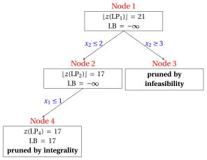
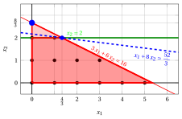
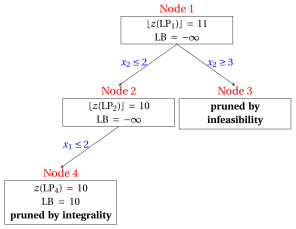
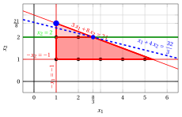
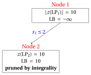
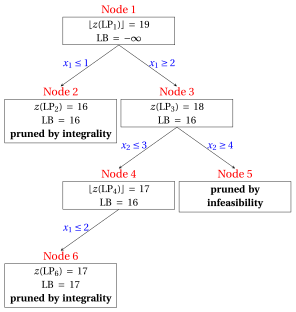

# Esercizi · Branch-and-cut

**Esercizi · Capitolo 8** · ogni soluzione si apre con un clic · [:material-book-open-variant: Capitolo 8: Branch-and-cut](../exact-methods/branch-and-cut.md) · [:material-file-pdf-box: Esercizi, volume 2 (PDF)](../pdf/exercises-2-exact-methods.pdf)

!!! esercizio "Esercizio 8.1: Taglia e dirama (P1)"
    !!! nota ""
        Considera il seguente problema ILP in forma canonica di massimizzazione con $n=2$ variabili intere e $m=1$ vincolo:

        $$
        \begin{array}{rrrrrrr}
        {\max} & {x_1} & {+} & {8}\, {x_2} \\[1.5ex]
        & {3}\, {x_1} & {+} & {6}\, {x_2} & {\le} & {16} \\[1.5ex]
        & {x_1,} &  & {x_2} & {\in} & {\Z_{\ge 0}}
        \end{array}
        $$

        e il seguente dizionario semplice ottimale della sua rilassamento LP in forma standard:

        \begin{equation*}
        \begin{cases}
        \begin{array}{rrrrrrr}
        {x_2} & {=} & {\dfrac{8}{3}} & {-} & {\dfrac{1}{2}}\, {x_1} & {-} & {\dfrac{1}{6}}\, {x_3} \\[2ex]
        {z} & {=} & {\dfrac{64}{3}} & {-} & {3}\, {x_1} & {-} & {\dfrac{4}{3}}\, {x_3}
        \end{array}
        \end{casi}
        \fine{equazione*}

    **Domande**

    1. Esegui l'algoritmo branch-and-bound utilizzando la regola del più piccolo indice come strategia di selezione della variabile di ramificazione, la regola LIFO come strategia di selezione del nodo di ramificazione, risolvendo prima il nodo di ramificazione inferiore, e $\LB = -\infty$ all'inizio (nessun algoritmo euristico). Fornisci l'albero branch-and-bound e il numero di problemi LP risolti.

    2. Esegui un turno di un algoritmo branch-and-cut al nodo radice: genera il taglio frazionario di Gomory della riga con il termine noto frazionario più grande (indice più basso della variabile di base in caso di parità, l’ultima riga della funzione obiettivo), scritto nelle variabili originali e reso primitivo prima che la sua variabile slack venga aggiunta.

    3. Rottimizzare il problema LP del nodo radice con il taglio, utilizzando l'algoritmo del simplesso duale (variabile uscente: la variabile base con valore negativo e indice più piccolo; in caso di parità nel test del rapporto, rompere con l'indice più piccolo). Mostrare l'effetto del taglio graficamente.

    4. Esegui l'algoritmo branch-and-bound sul problema rafforzato, con le stesse regole, e confronta il numero di problemi LP risolti con la prima domanda.

??? soluzione "Soluzione"

    1. Il problema $\LP_1$ ha la soluzione ottimale $(0,\tfrac{8}{3})$ con $z(\LP_1) = \dfrac{64}{3}$. L'algoritmo branch-and-bound risolve $4$ problemi LP:

        { .fig loading=lazy  }

        
<table>
        <tr>
        <th>Nodo</th>
        <th>Genitore</th>
        <th>Rami</th>
        <th>\(\tilde{\vet x}(\LP_k)\)</th>
        <th>\(z(\LP_k)\)</th>
        <th>\(\LB\)</th>
        <th>Risultato</th>
        </tr>
        <tr>
        <td>1</td>
        <td>–</td>
        <td>–</td>
        <td>\((0,\tfrac{8}{3})\)</td>
        <td>\(\tfrac{64}{3}\)</td>
        <td>\(-\infty\)</td>
        <td>ramificazione su \(x_2\)</td>
        </tr>
        <tr>
        <td>2</td>
        <td>1</td>
        <td>\(x_2 \le 2\)</td>
        <td>\((\tfrac{4}{3},2)\)</td>
        <td>\(\tfrac{52}{3}\)</td>
        <td>\(-\infty\)</td>
        <td>ramificazione su \(x_1\)</td>
        </tr>
        <tr>
        <td>3</td>
        <td>1</td>
        <td>\(x_2 \ge 3\)</td>
        <td>–</td>
        <td>–</td>
        <td>\(-\infty\)</td>
        <td>potato per non fattibilità</td>
        </tr>
        <tr>
        <td>4</td>
        <td>2</td>
        <td>\(x_1 \le 1\)</td>
        <td>\((1,2)\)</td>
        <td>\(17\)</td>
        <td>\(17\)</td>
        <td>potato tramite integrità</td>
        </tr>
        </table>

        La soluzione ottimale è $\tilde{\vet x}(\ILP) = (1,2)$, con $z(\ILP) = 17$.

    2. Le righe del dizionario ottimale con un termine noto frazionario sono i candidati:

        
<table>
        <tr>
        <th>Riga</th>
        <th>parte frazionaria del lato destro</th>
        </tr>
        <tr>
        <td>\(x_2\)</td>
        <td>\(\tfrac{2}{3}\)</td>
        </tr>
        <tr>
        <td>\(z\)</td>
        <td>\(\tfrac{1}{3}\)</td>
        </tr>
        </table>

        La parte frazionaria più grande è $\tfrac{2}{3}$, nella riga di $x_2$.

        In forma di equazione, la riga di $x_2$ legge

        $$
        x_2 + \tfrac{1}{2}\,x_1 + \tfrac{1}{6}\,x_3 = \dfrac{8}{3},
        $$

        e il taglio frazionario di Gomory generato da questa riga è

        $$
        \underbrace{\left(\tfrac{1}{2} - \left\lfloor \tfrac{1}{2} \right\rfloor\right)}_{=\tfrac{1}{2}}\,x_1 + \underbrace{\left(\tfrac{1}{6} - \left\lfloor \tfrac{1}{6} \right\rfloor\right)}_{=\tfrac{1}{6}}\,x_3 ~\ge~ \underbrace{\tfrac{8}{3} - \left\lfloor \tfrac{8}{3} \right\rfloor}_{=\tfrac{2}{3}},
        $$

        cioè

        $$
        \dfrac{1}{2}\,x_1 + \dfrac{1}{6}\,x_3 \ge \dfrac{2}{3}.
        $$

        Sostituendo le variabili slack con le loro espressioni nelle variabili originali, il taglio diventa

        $$
        x_2 \le 2.
        $$

        I coefficienti hanno massimo comun divisore $1$: il taglio $x_2 \le 2$ è primitivo.

        Al nodo radice non esiste alcun vincolo di diramazione, quindi il taglio è <strong>globale</strong>. Esclude $(0,\tfrac{8}{3})$: $0 \cdot 0 + 1 \cdot \tfrac{8}{3} = \tfrac{8}{3} > 2$.

    3. Il taglio $x_2 \le 2$ è aggiunto con la sua variabile di scarto $x_4 = 2 - x_2 \ge 0$. Espressolo con le variabili non di base e aggiungendolo al dizionario ottimale otteniamo un dizionario che è duale fattibile ma non primale fattibile:

        \begin{equation*}
        \begin{cases}
        \begin{array}{rrrrrrr}
        {x_2} & {=} & {\dfrac{8}{3}} & {-} & {\dfrac{1}{2}}\, {x_1} & {-} & {\dfrac{1}{6}}\, {x_3} \\[2ex]
        {x_4} & {=} & {-\dfrac{2}{3}} & {+} & {\dfrac{1}{2}}\, {x_1} & {+} & {\dfrac{1}{6}}\, {x_3} \\[2ex]
        {z} & {=} & {\dfrac{64}{3}} & {-} & {3}\, {x_1} & {-} & {\dfrac{4}{3}}\, {x_3}
        \end{array}
        \end{casi}
        \fine{equazione*}

        Se aumentiamo il valore di $\pi_{4}$, possiamo ottenere una migliore soluzione duale. Abbiamo:

        $$
        \begin{cases}
        \pi_1 &= 3 - \dfrac{1}{2}\,\pi_4 \\[2ex]
        \pi_3 &= \dfrac{4}{3} - \dfrac{1}{6}\,\pi_4
        \end{cases}
        \qquad
        \qquad
        \begin{cases}
        \underbrace{ 3 - \dfrac{1}{2}\,\pi_4 \ge 0}_{\pi_1 \ge 0} \\[2ex]
        \underbrace{ \dfrac{4}{3} - \dfrac{1}{6}\,\pi_4 \ge 0}_{\pi_3 \ge 0}
        \end{cases}
        \qquad
        \qquad
        \begin{cases}
        \pi_4 &\le 6 \\[2ex]
        \pi_4 &\le 8
        \end{cases}
        $$

        Aumentando il valore di $\pi_{4}$ a $\min \left\{6, 8\right\}=6$, il valore di $\pi_{1}$ diminuisce a $0$. Allora abbiamo che:

        - $\pi_{4}$ diventa una variabile di base duale e di conseguenza $x_{4}$ diventa una variabile non di base primale.

        - $\pi_{1}$ diventa una variabile non di base duale e di conseguenza $x_{1}$ diventa una variabile di base primaria.

        Abbiamo:

        $$
        x_4 = -\dfrac{2}{3} + \dfrac{1}{2} \, x_1 + \dfrac{1}{6} \, x_3
        \quad \Rightarrow \quad
        x_1 = \dfrac{4}{3} - \dfrac{1}{3} \, x_3 + 2 \, x_4
        $$

        Sostituendo nelle altre equazioni del dizionario primale del simplesso, otteniamo:

        $$
        x_2
        = \dfrac{8}{3} - \dfrac{1}{2} \left( \dfrac{4}{3} - \dfrac{1}{3} \, x_3 + 2 \, x_4 \right) - \dfrac{1}{6} \; x_3
        = 2 - x_4
        $$

        $$
        z
        = \dfrac{64}{3} - 3 \left( \dfrac{4}{3} - \dfrac{1}{3} \, x_3 + 2 \, x_4 \right) - \dfrac{4}{3} \; x_3
        = \dfrac{52}{3} - \dfrac{1}{3} \, x_3 - 6 \, x_4
        $$

        Di conseguenza, abbiamo ora il seguente dizionario primale del simplesso aggiornato:

        \begin{equation*}
        \begin{cases}
        \begin{array}{rrrrrrr}
        {x_1} & {=} & {\dfrac{4}{3}} & {-} & {\dfrac{1}{3}}\, {x_3} & {+} & {2}\, {x_4} \\[2ex]
        {x_2} & {=} & {2} &  &  & {-} & {x_4} \\[2ex]
        {z} & {=} & {\dfrac{52}{3}} & {-} & {\dfrac{1}{3}}\, {x_3} & {-} & {6}\, {x_4}
        \end{array}
        \end{casi}
        \fine{equazione*}

        dove $\pazocal{B}=\{1,2\}$ e $\pazocal{N}=\{3,4\}$ e

        - la soluzione ottimale primale di base è:

            $$
            \tilde x_1=\dfrac{4}{3},~~
            \tilde x_2=2,~~~~~~
            \tilde x_3=0,~~
            \tilde x_4=0~~
            \mathrm{~~of~value~~~} \dfrac{52}{3}
            $$

        - la soluzione duale ottimale di base è:

            $$
            \tilde \pi_1=0,~~
            \tilde \pi_2=0,~~~~~~
            \tilde \pi_3=\dfrac{1}{3},~~
            \tilde \pi_4=6~~
            \mathrm{~~of~value~~~} \dfrac{52}{3}
            $$

        La nuova soluzione ottimale di $\LP_1$ è $(\tfrac{4}{3},2)$, con $z(\LP_1) = \dfrac{52}{3}$ e il limite superiore $17$. Graficamente, abbiamo:

        { .fig .ovale loading=lazy  }

        <em>Il problema LP di base con il taglio di Gomory (verde): la vecchia soluzione ottimale (cerchio blu) viene eliminata, e la nuova soluzione ottimale è blu, con la sua linea obiettivo (tratteggiata).</em>

    4. Ogni nodo eredita il taglio. L'algoritmo branch-and-bound ora risolve problemi LP $2$:

        { .fig loading=lazy  }

        
<table>
        <tr>
        <th>Nodo</th>
        <th>Genitore</th>
        <th>Rami</th>
        <th>\(\tilde{\vet x}(\LP_k)\)</th>
        <th>\(z(\LP_k)\)</th>
        <th>\(\LB\)</th>
        <th>Risultato</th>
        </tr>
        <tr>
        <td>1</td>
        <td>–</td>
        <td>–</td>
        <td>\((\tfrac{4}{3},2)\)</td>
        <td>\(\tfrac{52}{3}\)</td>
        <td>\(-\infinito\)</td>
        <td>ramificazione su \(x_1\)</td>
        </tr>
        <tr>
        <td>2</td>
        <td>1</td>
        <td>\(x_1 \le 1\)</td>
        <td>\((1,2)\)</td>
        <td>\(17\)</td>
        <td>\(17\)</td>
        <td>potato per integrità</td>
        </tr>
        </table>

        !!! chiave ""
            Branch-and-bound: problemi LP $4$; cut-and-branch con un taglio di Gomory: problemi LP $2$. Il taglio abbassa il limite della radice e <strong>riduce</strong> l'albero. Entrambi trovano $\tilde{\vet x}(\ILP) = (1,2)$, $z(\ILP) = 17$.

!!! esercizio "Esercizio 8.2: Taglia e dirama (P23)"
    !!! nota ""
        Considera il seguente problema ILP in forma canonica di massimizzazione con $n=2$ variabili intere e $m=3$ vincoli:

        $$
        \begin{array}{rrrrrrr}
        {\max} & {x_1} & {+} & {4}\, {x_2} \\[1.5ex]
        & {3}\, {x_1} & {+} & {8}\, {x_2} & {\le} & {24} \\[1.5ex]
        & {-}{x_1} &  &  & {\le} & {-1} \\[1.5ex]
        &  &  & {-}{x_2} & {\le} & {-1} \\[1.5ex]
        & {x_1,} &  & {x_2} & {\in} & {\Z_{\ge 0}}
        \end{array}
        $$

        I vincoli $x_1 \ge 1$ e $x_2 \ge 1$ sono scritti in forma canonica come $-x_1 \le -1$ e $-x_2 \le -1$.

        e il seguente dizionario semplice ottimale della sua rilassamento LP in forma standard:

        \begin{equation*}
        \begin{cases}
        \begin{array}{rrrrrrr}
        {x_1} & {=} & {1} &  &  & {+} & {x_4} \\[2ex]
        {x_2} & {=} & {\dfrac{21}{8}} & {-} & {\dfrac{1}{8}}\, {x_3} & {-} & {\dfrac{3}{8}}\, {x_4} \\[2ex]
        {x_5} & {=} & {\dfrac{13}{8}} & {-} & {\dfrac{1}{8}}\, {x_3} & {-} & {\dfrac{3}{8}}\, {x_4} \\[2ex]
        {z} & {=} & {\dfrac{23}{2}} & {-} & {\dfrac{1}{2}}\, {x_3} & {-} & {\dfrac{1}{2}}\, {x_4}
        \end{array}
        \end{casi}
        \fine{equazione*}

    **Domande**

    1. Esegui l'algoritmo branch-and-bound utilizzando la regola del più piccolo indice come strategia di selezione della variabile di ramificazione, la regola LIFO come strategia di selezione del nodo di ramificazione, risolvendo prima il nodo di ramificazione inferiore, e $\LB = -\infty$ all'inizio (nessun algoritmo euristico). Fornisci l'albero branch-and-bound e il numero di problemi LP risolti.

    2. Esegui un turno di un algoritmo branch-and-cut al nodo radice: genera il taglio frazionario di Gomory della riga con il termine noto frazionario più grande (indice più basso della variabile di base in caso di parità, l’ultima riga della funzione obiettivo), scritto nelle variabili originali e reso primitivo prima che la sua variabile slack venga aggiunta.

    3. Riproottimizzare il problema LP del nodo radice con il taglio, usando l'algoritmo del simplesso duale (variabile uscente: la variabile base con valore negativo e indice più piccolo; in caso di parità nel test del rapporto, rompere con l'indice più piccolo). Mostrare l'effetto del taglio graficamente.

    4. Esegui l'algoritmo branch-and-bound sul problema rafforzato, con le stesse regole, e confronta il numero di problemi LP risolti con la prima domanda.

??? soluzione "Soluzione"

    1. Il problema $\LP_1$ ha la soluzione ottimale $(1,\tfrac{21}{8})$ con $z(\LP_1) = \dfrac{23}{2}$. L'algoritmo branch-and-bound risolve $4$ problemi LP:

        { .fig loading=lazy  }

        
<table>
        <tr>
        <th>Nodo</th>
        <th>Genitore</th>
        <th>Rami</th>
        <th>\(\tilde{\vet x}(\LP_k)\)</th>
        <th>\(z(\LP_k)\)</th>
        <th>\(\LB\)</th>
        <th>Risultato</th>
        </tr>
        <tr>
        <td>1</td>
        <td>–</td>
        <td>–</td>
        <td>\((1,\tfrac{21}{8})\)</td>
        <td>\(\tfrac{23}{2}\)</td>
        <td>\(-\infty\)</td>
        <td>ramificazione su \(x_2\)</td>
        </tr>
        <tr>
        <td>2</td>
        <td>1</td>
        <td>\(x_2 \le 2\)</td>
        <td>\((\tfrac{8}{3},2)\)</td>
        <td>\(\tfrac{32}{3}\)</td>
        <td>\(-\infty\)</td>
        <td>ramificazione su \(x_1\)</td>
        </tr>
        <tr>
        <td>3</td>
        <td>1</td>
        <td>\(x_2 \ge 3\)</td>
        <td>–</td>
        <td>–</td>
        <td>\(-\infty\)</td>
        <td>potato per non fattibilità</td>
        </tr>
        <tr>
        <td>4</td>
        <td>2</td>
        <td>\(x_1 \le 2\)</td>
        <td>\((2,2)\)</td>
        <td>\(10\)</td>
        <td>\(10\)</td>
        <td>potato per integrità</td>
        </tr>
        </table>

        La soluzione ottimale è $\tilde{\vet x}(\ILP) = (2,2)$, con $z(\ILP) = 10$.

    2. Le righe del dizionario ottimale con un termine noto frazionario sono i candidati:

        
<table>
        <tr>
        <th>Riga</th>
        <th>parte frazionaria del lato destro</th>
        </tr>
        <tr>
        <td>\(x_2\)</td>
        <td>\(\tfrac{5}{8}\)</td>
        </tr>
        <tr>
        <td>\(x_5\)</td>
        <td>\(\tfrac{5}{8}\)</td>
        </tr>
        <tr>
        <td>\(z\)</td>
        <td>\(\tfrac{1}{2}\)</td>
        </tr>
        </table>

        La parte frazionaria più grande è $\tfrac{5}{8}$, nella riga di $x_2$.

        In forma di equazione, la riga di $x_2$ recita

        $$
        x_2 + \tfrac{1}{8}\,x_3 + \tfrac{3}{8}\,x_4 = \dfrac{21}{8},
        $$

        e il taglio frazionario di Gomory generato da questa riga è

        $$
        \underbrace{\left(\tfrac{1}{8} - \left\lfloor \tfrac{1}{8} \right\rfloor\right)}_{=\tfrac{1}{8}}\,x_3 + \underbrace{\left(\tfrac{3}{8} - \left\lfloor \tfrac{3}{8} \right\rfloor\right)}_{=\tfrac{3}{8}}\,x_4 ~\ge~ \underbrace{\tfrac{21}{8} - \left\lfloor \tfrac{21}{8} \right\rfloor}_{=\tfrac{5}{8}},
        $$

        cioè

        $$
        \dfrac{1}{8}\,x_3 + \dfrac{3}{8}\,x_4 \ge \dfrac{5}{8}.
        $$

        Sostituendo le variabili slack con le loro espressioni nelle variabili originali, il taglio diventa

        $$
        x_2 \le 2.
        $$

        I coefficienti hanno massimo comun divisore $1$: il taglio $x_2 \le 2$ è primitivo.

        Al nodo radice non esiste alcun vincolo di diramazione, quindi il taglio è <strong>globale</strong>. Esclude $(1,\tfrac{21}{8})$: $0 \cdot 1 + 1 \cdot \tfrac{21}{8} = \tfrac{21}{8} > 2$.

    3. Il taglio $x_2 \le 2$ è aggiunto con la sua variabile slack $x_6 = 2 - x_2 \ge 0$. Esprimendolo con le variabili non di base e aggiungendolo al dizionario ottimale otteniamo un dizionario che è dualmente fattibile ma non primariamente fattibile:

        \begin{equation*}
        \begin{cases}
        \begin{array}{rrrrrrr}
        {x_1} & {=} & {1} &  &  & {+} & {x_4} \\[2ex]
        {x_2} & {=} & {\dfrac{21}{8}} & {-} & {\dfrac{1}{8}}\, {x_3} & {-} & {\dfrac{3}{8}}\, {x_4} \\[2ex]
        {x_5} & {=} & {\dfrac{13}{8}} & {-} & {\dfrac{1}{8}}\, {x_3} & {-} & {\dfrac{3}{8}}\, {x_4} \\[2ex]
        {x_6} & {=} & {-\dfrac{5}{8}} & {+} & {\dfrac{1}{8}}\, {x_3} & {+} & {\dfrac{3}{8}}\, {x_4} \\[2ex]
        {z} & {=} & {\dfrac{23}{2}} & {-} & {\dfrac{1}{2}}\, {x_3} & {-} & {\dfrac{1}{2}}\, {x_4}
        \end{array}
        \end{casi}
        \fine{equazione*}

        Se aumentiamo il valore di $\pi_{6}$, possiamo ottenere una migliore soluzione duale. Abbiamo:

        $$
        \begin{cases}
        \pi_3 &= \dfrac{1}{2} - \dfrac{1}{8}\,\pi_6 \\[2ex]
        \pi_4 &= \dfrac{1}{2} - \dfrac{3}{8}\,\pi_6
        \end{cases}
        \qquad
        \qquad
        \begin{cases}
        \underbrace{ \dfrac{1}{2} - \dfrac{1}{8}\,\pi_6 \ge 0}_{\pi_3 \ge 0} \\[2ex]
        \underbrace{ \dfrac{1}{2} - \dfrac{3}{8}\,\pi_6 \ge 0}_{\pi_4 \ge 0}
        \end{cases}
        \qquad
        \qquad
        \begin{cases}
        \pi_6 &\le 4 \\[2ex]
        \pi_6 &\le \dfrac{4}{3}
        \end{cases}
        $$

        Aumentando il valore di $\pi_{6}$ a $\min \left\{4, \dfrac{4}{3}\right\}=\dfrac{4}{3}$, il valore di $\pi_{4}$ diminuisce a $0$. Allora abbiamo che:

        - $\pi_{6}$ diventa una variabile di base doppia e di conseguenza $x_{6}$ diventa una variabile non di base primaria.

        - $\pi_{4}$ diventa una variabile non di base duale e di conseguenza $x_{4}$ diventa una variabile di base primaria.

        Abbiamo:

        $$
        x_6 = -\dfrac{5}{8} + \dfrac{1}{8} \, x_3 + \dfrac{3}{8} \, x_4
        \quad \Rightarrow \quad
        x_4 = \dfrac{5}{3} - \dfrac{1}{3} \, x_3 + \dfrac{8}{3} \, x_6
        $$

        Sostituendo nelle altre equazioni del dizionario primale del simplesso, otteniamo:

        $$
        x_1
        = 1 + \left( \dfrac{5}{3} - \dfrac{1}{3} \, x_3 + \dfrac{8}{3} \, x_6 \right)
        = \dfrac{8}{3} - \dfrac{1}{3} \, x_3 + \dfrac{8}{3} \, x_6
        $$

        $$
        x_2
        = \dfrac{21}{8} - \dfrac{1}{8} \; x_3 - \dfrac{3}{8} \left( \dfrac{5}{3} - \dfrac{1}{3} \, x_3 + \dfrac{8}{3} \, x_6 \right)
        = 2 - x_6
        $$

        $$
        x_5
        = \dfrac{13}{8} - \dfrac{1}{8} \; x_3 - \dfrac{3}{8} \left( \dfrac{5}{3} - \dfrac{1}{3} \, x_3 + \dfrac{8}{3} \, x_6 \right)
        = 1 - x_6
        $$

        $$
        z
        = \dfrac{23}{2} - \dfrac{1}{2} \; x_3 - \dfrac{1}{2} \left( \dfrac{5}{3} - \dfrac{1}{3} \, x_3 + \dfrac{8}{3} \, x_6 \right)
        = \dfrac{32}{3} - \dfrac{1}{3} \, x_3 - \dfrac{4}{3} \, x_6
        $$

        Di conseguenza, abbiamo ora il seguente dizionario primale del simplesso aggiornato:

        \begin{equation*}
        \begin{cases}
        \begin{array}{rrrrrrr}
        {x_1} & {=} & {\dfrac{8}{3}} & {-} & {\dfrac{1}{3}}\, {x_3} & {+} & {\dfrac{8}{3}}\, {x_6} \\[2ex]
        {x_2} & {=} & {2} &  &  & {-} & {x_6} \\[2ex]
        {x_4} & {=} & {\dfrac{5}{3}} & {-} & {\dfrac{1}{3}}\, {x_3} & {+} & {\dfrac{8}{3}}\, {x_6} \\[2ex]
        {x_5} & {=} & {1} &  &  & {-} & {x_6} \\[2ex]
        {z} & {=} & {\dfrac{32}{3}} & {-} & {\dfrac{1}{3}}\, {x_3} & {-} & {\dfrac{4}{3}}\, {x_6}
        \end{array}
        \end{casi}
        \fine{equazione*}

        dove $\pazocal{B}=\{1,2,4,5\}$ e $\pazocal{N}=\{3,6\}$ e

        - la soluzione ottimale primale di base è:

            $$
            \tilde x_1=\dfrac{8}{3},~~
            \tilde x_2=2,~~
            \tilde x_4=\dfrac{5}{3},~~
            \tilde x_5=1,~~~~~~
            \tilde x_3=0,~~
            \tilde x_6=0~~
            \mathrm{~~of~value~~~} \dfrac{32}{3}
            $$

        - la soluzione duale ottimale di base è:

            $$
            \tilde \pi_1=0,~~
            \tilde \pi_2=0,~~
            \tilde \pi_4=0,~~
            \tilde \pi_5=0,~~~~~~
            \tilde \pi_3=\dfrac{1}{3},~~
            \tilde \pi_6=\dfrac{4}{3}~~
            \mathrm{~~of~value~~~} \dfrac{32}{3}
            $$

        La nuova soluzione ottimale di $\LP_1$ è $(\tfrac{8}{3},2)$, con $z(\LP_1) = \dfrac{32}{3}$ e il limite superiore $10$. Graficamente, abbiamo:

        { .fig .ovale loading=lazy  }

        <em>Il problema LP di base con il taglio di Gomory (verde): la vecchia soluzione ottimale (cerchio blu) viene eliminata, e la nuova soluzione ottimale è blu, con la sua linea obiettivo (tratteggiata).</em>

    4. Ogni nodo eredita il taglio. L'algoritmo branch-and-bound ora risolve problemi LP $2$:

        { .fig loading=lazy  }

        
<table>
        <tr>
        <th>Nodo</th>
        <th>Genitore</th>
        <th>Rami</th>
        <th>\(\tilde{\vet x}(\LP_k)\)</th>
        <th>\(z(\LP_k)\)</th>
        <th>\(\LB\)</th>
        <th>Risultato</th>
        </tr>
        <tr>
        <td>1</td>
        <td>–</td>
        <td>–</td>
        <td>\((\tfrac{8}{3},2)\)</td>
        <td>\(\tfrac{32}{3}\)</td>
        <td>\(-\infty\)</td>
        <td>ramificazione su \(x_1\)</td>
        </tr>
        <tr>
        <td>2</td>
        <td>1</td>
        <td>\(x_1 \le 2\)</td>
        <td>\((2,2)\)</td>
        <td>\(10\)</td>
        <td>\(10\)</td>
        <td>potato per integrità</td>
        </tr>
        </table>

        !!! chiave ""
            Branch-and-bound: problemi LP $4$; cut-and-branch con un taglio di Gomory: problemi LP $2$. Il taglio abbassa il limite della radice e <strong>riduce</strong> l'albero. Entrambi trovano $\tilde{\vet x}(\ILP) = (2,2)$, $z(\ILP) = 10$.

!!! esercizio "Esercizio 8.3: Taglia e innesta (P24)"
    !!! nota ""
        Considera il seguente problema ILP in forma canonica di massimizzazione con $n=2$ variabili intere e $m=4$ vincoli:

        $$
        \begin{array}{rrrrrrr}
        {\max} & {4}\, {x_1} & {+} & {3}\, {x_2} \\[1.5ex]
        & {7}\, {x_1} & {+} & {3}\, {x_2} & {\le} & {24} \\[1.5ex]
        & {-}{x_1} & {+} & {x_2} & {\le} & {3} \\[1.5ex]
        & {-}{x_1} &  &  & {\le} & {-1} \\[1.5ex]
        &  &  & {-}{x_2} & {\le} & {-2} \\[1.5ex]
        & {x_1,} &  & {x_2} & {\in} & {\Z_{\ge 0}}
        \end{array}
        $$

        I vincoli $x_1 \ge 1$ e $x_2 \ge 2$ sono scritti in forma canonica come $-x_1 \le -1$ e $-x_2 \le -2$.

        e il seguente dizionario semplice ottimale della sua rilassamento LP in forma standard:

        \begin{equation*}
        \begin{cases}
        \begin{array}{rrrrrrr}
        {x_1} & {=} & {\dfrac{3}{2}} & {-} & {\dfrac{1}{10}}\, {x_3} & {+} & {\dfrac{3}{10}}\, {x_4} \\[2ex]
        {x_2} & {=} & {\dfrac{9}{2}} & {-} & {\dfrac{1}{10}}\, {x_3} & {-} & {\dfrac{7}{10}}\, {x_4} \\[2ex]
        {x_5} & {=} & {\dfrac{1}{2}} & {-} & {\dfrac{1}{10}}\, {x_3} & {+} & {\dfrac{3}{10}}\, {x_4} \\[2ex]
        {x_6} & {=} & {\dfrac{5}{2}} & {-} & {\dfrac{1}{10}}\, {x_3} & {-} & {\dfrac{7}{10}}\, {x_4} \\[2ex]
        {z} & {=} & {\dfrac{39}{2}} & {-} & {\dfrac{7}{10}}\, {x_3} & {-} & {\dfrac{9}{10}}\, {x_4}
        \end{array}
        \end{casi}
        \fine{equazione*}

    **Domande**

    1. Esegui l'algoritmo branch-and-bound utilizzando la regola dell'indice più piccolo come strategia di selezione della variabile di ramificazione, la regola LIFO come strategia di selezione del nodo di ramificazione, il nodo di ramificazione discendente risolto per primo e $\LB = -\infty$ all'inizio (nessun algoritmo euristico). Fornisci l'albero branch-and-bound e il numero di problemi LP risolti.

    2. Esegui un turno di un algoritmo branch-and-cut al nodo radice: genera il taglio frazionario di Gomory della riga con il termine noto frazionario più grande (indice più basso della variabile di base in caso di parità, l’ultima riga della funzione obiettivo), scritto nelle variabili originali e reso primitivo prima che la sua variabile slack venga aggiunta.

    3. Rottimizzare il problema LP del nodo radice con il taglio, utilizzando l'algoritmo del simplesso duale (variabile uscente: la variabile base con valore negativo e indice più piccolo; in caso di parità nel test del rapporto, si privilegia l'indice più piccolo). Mostrare l'effetto del taglio graficamente.

    4. Esegui l'algoritmo branch-and-bound sul problema rafforzato, con le stesse regole, e confronta il numero di problemi LP risolti con la prima domanda.

??? soluzione "Soluzione"

    1. Il problema $\LP_1$ ha la soluzione ottimale $(\tfrac{3}{2},\tfrac{9}{2})$ con $z(\LP_1) = \dfrac{39}{2}$. L'algoritmo branch-and-bound risolve $6$ problemi LP:

        { .fig loading=lazy  }

        
<table>
        <tr>
        <th>Nodo</th>
        <th>Genitore</th>
        <th>Rami</th>
        <th>\(\tilde{\vet x}(\LP_k)\)</th>
        <th>\(z(\LP_k)\)</th>
        <th>\(\LB\)</th>
        <th>Risultato</th>
        </tr>
        <tr>
        <td>1</td>
        <td>–</td>
        <td>–</td>
        <td>\((\tfrac{3}{2},\tfrac{9}{2})\)</td>
        <td>\(\tfrac{39}{2}\)</td>
        <td>\(-\infty\)</td>
        <td>branching on \(x_1\)</td>
        </tr>
        <tr>
        <td>2</td>
        <td>1</td>
        <td>\(x_1 \le 1\)</td>
        <td>\((1,4)\)</td>
        <td>\(16\)</td>
        <td>\(16\)</td>
        <td>potato per integrità</td>
        </tr>
        <tr>
        <td>3</td>
        <td>1</td>
        <td>\(x_1 \ge 2\)</td>
        <td>\((2,\tfrac{10}{3})\)</td>
        <td>\(18\)</td>
        <td>\(16\)</td>
        <td>ramificazione su \(x_2\)</td>
        </tr>
        <tr>
        <td>4</td>
        <td>3</td>
        <td>\(x_2 \le 3\)</td>
        <td>\((\tfrac{15}{7},3)\)</td>
        <td>\(\tfrac{123}{7}\)</td>
        <td>\(16\)</td>
        <td>ramificazione su \(x_1\)</td>
        </tr>
        <tr>
        <td>5</td>
        <td>3</td>
        <td>\(x_2 \ge 4\)</td>
        <td>–</td>
        <td>–</td>
        <td>\(16\)</td>
        <td>potato per non fattibilità</td>
        </tr>
        <tr>
        <td>6</td>
        <td>4</td>
        <td>\(x_1 \le 2\)</td>
        <td>\((2,3)\)</td>
        <td>\(17\)</td>
        <td>\(17\)</td>
        <td>potato per integrità</td>
        </tr>
        </table>

        La soluzione ottimale è $\tilde{\vet x}(\ILP) = (2,3)$, con $z(\ILP) = 17$.

    2. Le righe del dizionario ottimale con un termine noto frazionario sono i candidati:

        
<table>
        <tr>
        <th>Riga</th>
        <th>parte frazionaria del lato destro</th>
        </tr>
        <tr>
        <td>\(x_1\)</td>
        <td>\(\tfrac{1}{2}\)</td>
        </tr>
        <tr>
        <td>\(x_2\)</td>
        <td>\(\tfrac{1}{2}\)</td>
        </tr>
        <tr>
        <td>\(x_5\)</td>
        <td>\(\tfrac{1}{2}\)</td>
        </tr>
        <tr>
        <td>\(x_6\)</td>
        <td>\(\tfrac{1}{2}\)</td>
        </tr>
        <tr>
        <td>\(z\)</td>
        <td>\(\tfrac{1}{2}\)</td>
        </tr>
        </table>

        La parte frazionaria più grande è $\tfrac{1}{2}$, nella riga di $x_1$.

        In forma di equazione, la riga di $x_1$ legge

        $$
        x_1 + \tfrac{1}{10}\,x_3 - \tfrac{3}{10}\,x_4 = \dfrac{3}{2},
        $$

        e il taglio frazionario di Gomory generato da questa riga è

        $$
        \underbrace{\left(\tfrac{1}{10} - \left\lfloor \tfrac{1}{10} \right\rfloor\right)}_{=\tfrac{1}{10}}\,x_3 + \underbrace{\left(-\tfrac{3}{10} - \left\lfloor -\tfrac{3}{10} \right\rfloor\right)}_{=\tfrac{7}{10}}\,x_4 ~\ge~ \underbrace{\tfrac{3}{2} - \left\lfloor \tfrac{3}{2} \right\rfloor}_{=\tfrac{1}{2}},
        $$

        cioè

        $$
        \dfrac{1}{10}\,x_3 + \dfrac{7}{10}\,x_4 \ge \dfrac{1}{2}.
        $$

        Sostituendo le variabili slack con le loro espressioni nelle variabili originali, il taglio diventa

        $$
        x_2 \le 4.
        $$

        I coefficienti hanno massimo comune divisore $1$: il taglio $x_2 \le 4$ è primitivo.

        Alla radice del nodo non esiste alcuna restrizione di diramazione, quindi il taglio è <strong>globale</strong>. Taglia $(\tfrac{3}{2},\tfrac{9}{2})$: $0 \cdot \tfrac{3}{2} + 1 \cdot \tfrac{9}{2} = \tfrac{9}{2} > 4$.

    3. Il taglio $x_2 \le 4$ è aggiunto con la sua variabile di scarto $x_7 = 4 - x_2 \ge 0$. Espressolo con le variabili non di base e aggiungendolo al dizionario ottimale otteniamo un dizionario che è duale fattibile ma non primale fattibile:

        \begin{equation*}
        \begin{cases}
        \begin{array}{rrrrrrr}
        {x_1} & {=} & {\dfrac{3}{2}} & {-} & {\dfrac{1}{10}}\, {x_3} & {+} & {\dfrac{3}{10}}\, {x_4} \\[2ex]
        {x_2} & {=} & {\dfrac{9}{2}} & {-} & {\dfrac{1}{10}}\, {x_3} & {-} & {\dfrac{7}{10}}\, {x_4} \\[2ex]
        {x_5} & {=} & {\dfrac{1}{2}} & {-} & {\dfrac{1}{10}}\, {x_3} & {+} & {\dfrac{3}{10}}\, {x_4} \\[2ex]
        {x_6} & {=} & {\dfrac{5}{2}} & {-} & {\dfrac{1}{10}}\, {x_3} & {-} & {\dfrac{7}{10}}\, {x_4} \\[2ex]
        {x_7} & {=} & {-\dfrac{1}{2}} & {+} & {\dfrac{1}{10}}\, {x_3} & {+} & {\dfrac{7}{10}}\, {x_4} \\[2ex]
        {z} & {=} & {\dfrac{39}{2}} & {-} & {\dfrac{7}{10}}\, {x_3} & {-} & {\dfrac{9}{10}}\, {x_4}
        \end{array}
        \end{casi}
        \fine{equazione*}

        Se aumentiamo il valore di $\pi_{7}$, possiamo ottenere una migliore soluzione duale. Abbiamo:

        $$
        \begin{cases}
        \pi_3 &= \dfrac{7}{10} - \dfrac{1}{10}\,\pi_7 \\[2ex]
        \pi_4 &= \dfrac{9}{10} - \dfrac{7}{10}\,\pi_7
        \end{cases}
        \qquad
        \qquad
        \begin{cases}
        \underbrace{ \dfrac{7}{10} - \dfrac{1}{10}\,\pi_7 \ge 0}_{\pi_3 \ge 0} \\[2ex]
        \underbrace{ \dfrac{9}{10} - \dfrac{7}{10}\,\pi_7 \ge 0}_{\pi_4 \ge 0}
        \end{cases}
        \qquad
        \qquad
        \begin{cases}
        \pi_7 &\le 7 \\[2ex]
        \pi_7 &\le \dfrac{9}{7}
        \end{cases}
        $$

        Aumentando il valore di $\pi_{7}$ a $\min \left\{7, \dfrac{9}{7}\right\}=\dfrac{9}{7}$, il valore di $\pi_{4}$ diminuisce a $0$. Allora abbiamo che:

        - $\pi_{7}$ diventa una variabile di base duale e di conseguenza $x_{7}$ diventa una variabile non di base primale.

        - $\pi_{4}$ diventa una variabile non di base duale e di conseguenza $x_{4}$ diventa una variabile di base primaria.

        Abbiamo:

        $$
        x_7 = -\dfrac{1}{2} + \dfrac{1}{10} \, x_3 + \dfrac{7}{10} \, x_4
        \quad \Rightarrow \quad
        x_4 = \dfrac{5}{7} - \dfrac{1}{7} \, x_3 + \dfrac{10}{7} \, x_7
        $$

        Sostituendo nelle altre equazioni del dizionario primale del simplesso, otteniamo:

        $$
        x_1
        = \dfrac{3}{2} - \dfrac{1}{10} \; x_3 + \dfrac{3}{10} \left( \dfrac{5}{7} - \dfrac{1}{7} \, x_3 + \dfrac{10}{7} \, x_7 \right)
        = \dfrac{12}{7} - \dfrac{1}{7} \, x_3 + \dfrac{3}{7} \, x_7
        $$

        $$
        x_2
        = \dfrac{9}{2} - \dfrac{1}{10} \; x_3 - \dfrac{7}{10} \left( \dfrac{5}{7} - \dfrac{1}{7} \, x_3 + \dfrac{10}{7} \, x_7 \right)
        = 4 - x_7
        $$

        $$
        x_5
        = \dfrac{1}{2} - \dfrac{1}{10} \; x_3 + \dfrac{3}{10} \left( \dfrac{5}{7} - \dfrac{1}{7} \, x_3 + \dfrac{10}{7} \, x_7 \right)
        = \dfrac{5}{7} - \dfrac{1}{7} \, x_3 + \dfrac{3}{7} \, x_7
        $$

        $$
        x_6
        = \dfrac{5}{2} - \dfrac{1}{10} \; x_3 - \dfrac{7}{10} \left( \dfrac{5}{7} - \dfrac{1}{7} \, x_3 + \dfrac{10}{7} \, x_7 \right)
        = 2 - x_7
        $$

        $$
        z
        = \dfrac{39}{2} - \dfrac{7}{10} \; x_3 - \dfrac{9}{10} \left( \dfrac{5}{7} - \dfrac{1}{7} \, x_3 + \dfrac{10}{7} \, x_7 \right)
        = \dfrac{132}{7} - \dfrac{4}{7} \, x_3 - \dfrac{9}{7} \, x_7
        $$

        Di conseguenza, ora disponiamo del seguente dizionario primale semplice aggiornato:

        \begin{equation*}
        \begin{cases}
        \begin{array}{rrrrrrr}
        {x_1} & {=} & {\dfrac{12}{7}} & {-} & {\dfrac{1}{7}}\, {x_3} & {+} & {\dfrac{3}{7}}\, {x_7} \\[2ex]
        {x_2} & {=} & {4} &  &  & {-} & {x_7} \\[2ex]
        {x_4} & {=} & {\dfrac{5}{7}} & {-} & {\dfrac{1}{7}}\, {x_3} & {+} & {\dfrac{10}{7}}\, {x_7} \\[2ex]
        {x_5} & {=} & {\dfrac{5}{7}} & {-} & {\dfrac{1}{7}}\, {x_3} & {+} & {\dfrac{3}{7}}\, {x_7} \\[2ex]
        {x_6} & {=} & {2} &  &  & {-} & {x_7} \\[2ex]
        {z} & {=} & {\dfrac{132}{7}} & {-} & {\dfrac{4}{7}}\, {x_3} & {-} & {\dfrac{9}{7}}\, {x_7}
        \end{array}
        \end{casi}
        \fine{equazione*}

        dove $\pazocal{B}=\{1,2,4,5,6\}$ e $\pazocal{N}=\{3,7\}$ e

        - la soluzione ottimale primale di base è:

            $$
            \tilde x_1=\dfrac{12}{7},~~
            \tilde x_2=4,~~
            \tilde x_4=\dfrac{5}{7},~~
            \tilde x_5=\dfrac{5}{7},~~
            \tilde x_6=2,~~~~~~
            \tilde x_3=0,~~
            \tilde x_7=0~~
            \mathrm{~~of~value~~~} \dfrac{132}{7}
            $$

        - la soluzione duale ottimale di base è:

            $$
            \tilde \pi_1=0,~~
            \tilde \pi_2=0,~~
            \tilde \pi_4=0,~~
            \tilde \pi_5=0,~~
            \tilde \pi_6=0,~~~~~~
            \tilde \pi_3=\dfrac{4}{7},~~
            \tilde \pi_7=\dfrac{9}{7}~~
            \mathrm{~~of~value~~~} \dfrac{132}{7}
            $$

        La nuova soluzione ottimale di $\LP_1$ è $(\tfrac{12}{7},4)$, con $z(\LP_1) = \dfrac{132}{7}$ e il limite superiore $18$. Graficamente, abbiamo:

        { .fig .ovale loading=lazy  }

        <em>Il problema LP di base con il taglio di Gomory (verde): la vecchia soluzione ottimale (cerchio blu) viene eliminata, e la nuova soluzione ottimale è blu, con la sua linea obiettivo (tratteggiata).</em>

    4. Ogni nodo eredita il taglio. L'algoritmo branch-and-bound ora risolve problemi LP $6$:

        { .fig loading=lazy  }

        
<table>
        <tr>
        <th>Nodo</th>
        <th>Genitore</th>
        <th>Rami</th>
        <th>\(\tilde{\vet x}(\LP_k)\)</th>
        <th>\(z(\LP_k)\)</th>
        <th>\(\LB\)</th>
        <th>Risultato</th>
        </tr>
        <tr>
        <td>1</td>
        <td>–</td>
        <td>–</td>
        <td>\((\tfrac{12}{7},4)\)</td>
        <td>\(\tfrac{132}{7}\)</td>
        <td>\(-\infty\)</td>
        <td>ramificazione su \(x_1\)</td>
        </tr>
        <tr>
        <td>2</td>
        <td>1</td>
        <td>\(x_1 \le 1\)</td>
        <td>\((1,4)\)</td>
        <td>\(16\)</td>
        <td>\(16\)</td>
        <td>potato per integrità</td>
        </tr>
        <tr>
        <td>3</td>
        <td>1</td>
        <td>\(x_1 \ge 2\)</td>
        <td>\((2,\tfrac{10}{3})\)</td>
        <td>\(18\)</td>
        <td>\(16\)</td>
        <td>ramificazione su \(x_2\)</td>
        </tr>
        <tr>
        <td>4</td>
        <td>3</td>
        <td>\(x_2 \le 3\)</td>
        <td>\((\tfrac{15}{7},3)\)</td>
        <td>\(\tfrac{123}{7}\)</td>
        <td>\(16\)</td>
        <td>ramificazione su \(x_1\)</td>
        </tr>
        <tr>
        <td>5</td>
        <td>3</td>
        <td>\(x_2 \ge 4\)</td>
        <td>–</td>
        <td>–</td>
        <td>\(16\)</td>
        <td>potato per non fattibilità</td>
        </tr>
        <tr>
        <td>6</td>
        <td>4</td>
        <td>\(x_1 \le 2\)</td>
        <td>\((2,3)\)</td>
        <td>\(17\)</td>
        <td>\(17\)</td>
        <td>potato per integrità</td>
        </tr>
        </table>

        !!! chiave ""
            Branch-and-bound: problemi LP $6$; cut-and-branch con un taglio di Gomory: problemi LP $6$. Il taglio abbassa il bound della radice ma <strong>non</strong> riduce l'albero: la qualità del taglio è importante. Entrambi trovano $\tilde{\vet x}(\ILP) = (2,3)$, $z(\ILP) = 17$.

!!! esercizio "Esercizio 8.4: Tagli globali e locali"
    !!! nota ""
        Considera il seguente problema ILP in forma canonica di massimizzazione con $n=2$ variabili intere e $m=2$ vincoli:

        $$
        \begin{array}{rrrrrrr}
        {\max} & {2}\, {x_1} & {+} & {3}\, {x_2} \\[1.5ex]
        & {5}\, {x_1} & {+} & {x_2} & {\le} & {22} \\[1.5ex]
        & {3}\, {x_1} & {+} & {9}\, {x_2} & {\le} & {35} \\[1.5ex]
        & {x_1,} &  & {x_2} & {\in} & {\Z_{\ge 0}}
        \end{array}
        $$

        L'algoritmo branch-and-bound (la regola del più piccolo indice come strategia di selezione della variabile di branching, la regola LIFO come strategia di selezione del nodo di branching, il nodo di down-branching risolto per primo, e $\LB = -\infty$ all'inizio (nessun algoritmo euristico)) esegue il branching alla radice su $x_1$. Il Nodo 2 è il nodo di down-branching, con il vincolo di branching $x_1 \le 3$ e la sua variabile slack $x_5 = 3 - x_1$. Il dizionario ottimale di $\LP_2$ è:

        \begin{equation*}
        \begin{cases}
        \begin{array}{rrrrrrr}
        {x_1} & {=} & {3} &  &  & {-} & {x_5} \\[2ex]
        {x_2} & {=} & {\dfrac{26}{9}} & {-} & {\dfrac{1}{9}}\, {x_4} & {+} & {\dfrac{1}{3}}\, {x_5} \\[2ex]
        {x_3} & {=} & {\dfrac{37}{9}} & {+} & {\dfrac{1}{9}}\, {x_4} & {+} & {\dfrac{14}{3}}\, {x_5} \\[2ex]
        {z} & {=} & {\dfrac{44}{3}} & {-} & {\dfrac{1}{3}}\, {x_4} & {-} & {x_5}
        \end{array}
        \end{casi}
        \fine{equazione*}

    **Domande**

    1. Generare al Nodo 2 il taglio frazionario di Gomory della riga con il lato destro frazionario più grande (indice più piccolo della variabile di base in caso di pareggio, l’ultima riga della funzione obiettivo), scritto nelle variabili originali e reso primitivo prima che la sua variabile di scarto venga aggiunta.

    2. Dalla sua derivazione, il taglio è un taglio globale o un taglio locale del Nodo 2?

    3. Verifica mediante enumerazione se il taglio è soddisfatto dalle soluzioni intere ammissibili del Nodo 2 e da tutte le soluzioni intere ammissibili del problema ILP.

    4. Cosa succederebbe se il taglio fosse memorizzato nel pool globale e utilizzato in ogni nodo?

??? soluzione "Soluzione"

    1. Una soluzione ottimale di $\LP_2$ è $(3,\tfrac{26}{9})$, con $z(\LP_2) = \dfrac{44}{3}$. Le righe candidate sono:

        
<table>
        <tr>
        <th>Riga</th>
        <th>parte frazionaria del lato destro</th>
        </tr>
        <tr>
        <td>\(x_2\)</td>
        <td>\(\tfrac{8}{9}\)</td>
        </tr>
        <tr>
        <td>\(x_3\)</td>
        <td>\(\tfrac{1}{9}\)</td>
        </tr>
        <tr>
        <td>\(z\)</td>
        <td>\(\tfrac{2}{3}\)</td>
        </tr>
        </table>

        La parte frazionaria più grande è $\tfrac{8}{9}$, nella riga di $x_2$.

        In forma di equazione, la riga di $x_2$ recita

        $$
        x_2 + \tfrac{1}{9}\,x_4 - \tfrac{1}{3}\,x_5 = \dfrac{26}{9},
        $$

        e il taglio frazionario di Gomory generato da questa riga è

        $$
        \underbrace{\left(\tfrac{1}{9} - \left\lfloor \tfrac{1}{9} \right\rfloor\right)}_{=\tfrac{1}{9}}\,x_4 + \underbrace{\left(-\tfrac{1}{3} - \left\lfloor -\tfrac{1}{3} \right\rfloor\right)}_{=\tfrac{2}{3}}\,x_5 ~\ge~ \underbrace{\tfrac{26}{9} - \left\lfloor \tfrac{26}{9} \right\rfloor}_{=\tfrac{8}{9}},
        $$

        cioè

        $$
        \dfrac{1}{9}\,x_4 + \dfrac{2}{3}\,x_5 \ge \dfrac{8}{9}.
        $$

        Sostituendo le variabili slack con le loro espressioni nelle variabili originali, il taglio diventa

        $$
        x_1 + x_2 \le 5.
        $$

        I coefficienti hanno massimo comune divisore $1$: il taglio $x_1 + x_2 \le 5$ è primitivo.

    2. La riga utilizzata contiene la variabile slack $x_5$ del vincolo di ramificazione $x_1 \le 3$ con il coefficiente non nullo $\tfrac{2}{3}$ nel taglio: la sua derivazione utilizza il vincolo di ramificazione, quindi l'algoritmo la tratta come un <strong>taglio locale</strong> del Nodo 2, valido solo nel sott'albero del Nodo 2.

    3. Le soluzioni fattibili del Nodo 2 sono i punti $15$ di $F$ con $x_1 \le 3$: tutti soddisfano $x_1 + x_2 \le 5$ (il valore più grande di $x_1 + x_2$ tra di essi è $5$). Tra tutte le soluzioni fattibili $18$, invece, $(4,2)$ viola il taglio. Graficamente, abbiamo:

        { .fig .ovale loading=lazy  }

        <em>Il rilassamento LP (rosso), il vincolo di branching $x_1 = 3$ (tratteggiato), il taglio $x_1 + x_2 = 5$ (verde), la soluzione ottimale di $\LP_2$ (blu) e le soluzioni ammissibili che violano il taglio (quadrati rossi).</em>

        Il taglio è valido localmente al Nodo 2 ma <strong>non</strong> è valido globalmente.

    4. Il punto $(4,2)$ è la soluzione ottimale unica del problema ILP, con valore $14$. Con il taglio nel pool globale verrebbe rimosso anche dal Nodo 3 ($x_1 \ge 4$), e l'algoritmo restituirebbe $(2,3)$, di valore $13$.

        !!! chiave ""
            Il taglio di Gomory $x_1 + x_2 \le 5$ del Nodo 2 è <strong>locale</strong>: deve rimanere nel sott'albero del Nodo 2. Usato a livello globale taglierebbe la soluzione ottimale $(4,2)$ e l'algoritmo restituirebbe una soluzione di valore $13$ invece di $14$.

!!! esercizio "Esercizio 8.5: Serie di tagli (P5)"
    !!! nota ""
        Considera il seguente problema ILP in forma canonica di massimizzazione con $n=2$ variabili intere e $m=2$ vincoli:

        $$
        \begin{array}{rrrrrrr}
        {\max} & {2}\, {x_1} & {+} & {3}\, {x_2} \\[1.5ex]
        & {6}\, {x_1} & {+} & {21}\, {x_2} & {\le} & {77} \\[1.5ex]
        & {8}\, {x_1} & {+} & {3}\, {x_2} & {\le} & {36} \\[1.5ex]
        & {x_1,} &  & {x_2} & {\in} & {\Z_{\ge 0}}
        \end{array}
        $$

        e il seguente dizionario semplice ottimale della sua rilassamento LP in forma standard:

        \begin{equation*}
        \begin{cases}
        \begin{array}{rrrrrrr}
        {x_1} & {=} & {\dfrac{7}{2}} & {+} & {\dfrac{1}{50}}\, {x_3} & {-} & {\dfrac{7}{50}}\, {x_4} \\[2ex]
        {x_2} & {=} & {\dfrac{8}{3}} & {-} & {\dfrac{4}{75}}\, {x_3} & {+} & {\dfrac{1}{25}}\, {x_4} \\[2ex]
        {z} & {=} & {15} & {-} & {\dfrac{3}{25}}\, {x_3} & {-} & {\dfrac{4}{25}}\, {x_4}
        \end{array}
        \end{casi}
        \fine{equazione*}

    **Domande**

    1. Generare il primo taglio di Gomory del nodo radice: il taglio frazionario di Gomory della riga con il lato destro frazionario più grande (indice più piccolo della variabile di base in caso di parità, la riga della funzione obiettivo per ultima), scritto nelle variabili originali e reso primitivo prima che la sua variabile slack venga aggiunta.

    2. Un algoritmo cut-and-branch esegue $R$ round di tagli di Gomory alla radice (un taglio per round, con la stessa regola), e poi l'algoritmo branch-and-bound con la regola dell'indice più piccolo come strategia di selezione della variabile di ramificazione, la regola LIFO come strategia di selezione del nodo di ramificazione, il nodo di ramificazione verso il basso risolto per primo, e $\LB = -\infty$ all'inizio (nessun algoritmo euristico). La tabella sottostante riporta, per ciascun $R$, l'ultimo taglio aggiunto, il problema LP alla radice e il numero di problemi LP risolti. Verificare la riga $R = 1$ e commentare la tabella.

        
<table>
        <tr>
        <th>Turni</th>
        <th>ultimo taglio aggiunto</th>
        <th>\(\tilde{\vet x}(\LP_1)\)</th>
        <th>\(z(\LP_1)\)</th>
        <th>\(\UB\) at the root</th>
        <th>Problemi di LP risolti</th>
        </tr>
        <tr>
        <td>\(0\)</td>
        <td>–</td>
        <td>\((\tfrac{7}{2},\tfrac{8}{3})\)</td>
        <td>\(15\)</td>
        <td>\(15\)</td>
        <td>\(11\)</td>
        </tr>
        <tr>
        <td>\(1\)</td>
        <td>\(2\,x_1 + x_2 \le 9\)</td>
        <td>\((\tfrac{28}{9},\tfrac{25}{9})\)</td>
        <td>\(\tfrac{131}{9}\)</td>
        <td>\(14\)</td>
        <td>\(8\)</td>
        </tr>
        <tr>
        <td>\(2\)</td>
        <td>\(x_1 + x_2 \le 5\)</td>
        <td>\((\tfrac{28}{15},\tfrac{47}{15})\)</td>
        <td>\(\tfrac{197}{15}\)</td>
        <td>\(13\)</td>
        <td>\(3\)</td>
        </tr>
        <tr>
        <td>\(3\)</td>
        <td>\(3\,x_1 + 10\,x_2 \le 36\)</td>
        <td>\((2,3)\)</td>
        <td>\(13\)</td>
        <td>\(13\)</td>
        <td>\(1\)</td>
        </tr>
        </table>

    3. Quanti turni sono necessari per risolvere il problema al nodo radice? Quali tagli aggiungeresti nella pratica?

??? soluzione "Soluzione"

    1. Le righe dei candidati sono:

        
<table>
        <tr>
        <th>Riga</th>
        <th>parte frazionaria del lato destro</th>
        </tr>
        <tr>
        <td>\(x_1\)</td>
        <td>\(\tfrac{1}{2}\)</td>
        </tr>
        <tr>
        <td>\(x_2\)</td>
        <td>\(\tfrac{2}{3}\)</td>
        </tr>
        </table>

        La parte frazionaria più grande è $\tfrac{2}{3}$, nella riga di $x_2$.

        In forma di equazione, la riga di $x_2$ legge

        $$
        x_2 + \tfrac{4}{75}\,x_3 - \tfrac{1}{25}\,x_4 = \dfrac{8}{3},
        $$

        e il taglio frazionario di Gomory generato da questa riga è

        $$
        \underbrace{\left(\tfrac{4}{75} - \left\lfloor \tfrac{4}{75} \right\rfloor\right)}_{=\tfrac{4}{75}}\,x_3 + \underbrace{\left(-\tfrac{1}{25} - \left\lfloor -\tfrac{1}{25} \right\rfloor\right)}_{=\tfrac{24}{25}}\,x_4 ~\ge~ \underbrace{\tfrac{8}{3} - \left\lfloor \tfrac{8}{3} \right\rfloor}_{=\tfrac{2}{3}},
        $$

        cioè

        $$
        \dfrac{4}{75}\,x_3 + \dfrac{24}{25}\,x_4 \ge \dfrac{2}{3}.
        $$

        Sostituendo le variabili slack con le loro espressioni nelle variabili originali, il taglio diventa

        $$
        8\,x_1 + 4\,x_2 \le 38.
        $$

        Dividendo per il massimo comune divisore $g = 4$ dei coefficienti e arrotondando per difetto il lato destro otteniamo il taglio primitivo

        $$
        2\,x_1 + x_2 \le 9.
        $$

    2. Il taglio $2\,x_1 + x_2 \le 9$ è aggiunto con la sua variabile slack $x_5 = 9 - 2\,x_1 - x_2 \ge 0$. Esprimendolo con le variabili non di base e aggiungendolo al dizionario ottimale otteniamo un dizionario che è dualmente fattibile ma non primariamente fattibile:

        \begin{equation*}
        \begin{cases}
        \begin{array}{rrrrrrr}
        {x_1} & {=} & {\dfrac{7}{2}} & {+} & {\dfrac{1}{50}}\, {x_3} & {-} & {\dfrac{7}{50}}\, {x_4} \\[2ex]
        {x_2} & {=} & {\dfrac{8}{3}} & {-} & {\dfrac{4}{75}}\, {x_3} & {+} & {\dfrac{1}{25}}\, {x_4} \\[2ex]
        {x_5} & {=} & {-\dfrac{2}{3}} & {+} & {\dfrac{1}{75}}\, {x_3} & {+} & {\dfrac{6}{25}}\, {x_4} \\[2ex]
        {z} & {=} & {15} & {-} & {\dfrac{3}{25}}\, {x_3} & {-} & {\dfrac{4}{25}}\, {x_4}
        \end{array}
        \end{casi}
        \fine{equazione*}

        Se aumentiamo il valore di $\pi_{5}$, possiamo ottenere una migliore soluzione duale. Abbiamo:

        $$
        \begin{cases}
        \pi_3 &= \dfrac{3}{25} - \dfrac{1}{75}\,\pi_5 \\[2ex]
        \pi_4 &= \dfrac{4}{25} - \dfrac{6}{25}\,\pi_5
        \end{cases}
        \qquad
        \qquad
        \begin{cases}
        \underbrace{ \dfrac{3}{25} - \dfrac{1}{75}\,\pi_5 \ge 0}_{\pi_3 \ge 0} \\[2ex]
        \underbrace{ \dfrac{4}{25} - \dfrac{6}{25}\,\pi_5 \ge 0}_{\pi_4 \ge 0}
        \end{cases}
        \qquad
        \qquad
        \begin{cases}
        \pi_5 &\le 9 \\[2ex]
        \pi_5 &\le \dfrac{2}{3}
        \end{cases}
        $$

        Aumentando il valore di $\pi_{5}$ a $\min \left\{9, \dfrac{2}{3}\right\}=\dfrac{2}{3}$, il valore di $\pi_{4}$ diminuisce a $0$. Poi abbiamo che:

        - $\pi_{5}$ diventa una variabile di base doppia e di conseguenza $x_{5}$ diventa una variabile non di base primaria.

        - $\pi_{4}$ diventa una variabile non di base duale e di conseguenza $x_{4}$ diventa una variabile di base primaria.

        Abbiamo:

        $$
        x_5 = -\dfrac{2}{3} + \dfrac{1}{75} \, x_3 + \dfrac{6}{25} \, x_4
        \quad \Rightarrow \quad
        x_4 = \dfrac{25}{9} - \dfrac{1}{18} \, x_3 + \dfrac{25}{6} \, x_5
        $$

        Sostituendo nelle altre equazioni del dizionario del simplesso primale, otteniamo:

        $$
        x_1
        = \dfrac{7}{2} + \dfrac{1}{50} \; x_3 - \dfrac{7}{50} \left( \dfrac{25}{9} - \dfrac{1}{18} \, x_3 + \dfrac{25}{6} \, x_5 \right)
        = \dfrac{28}{9} + \dfrac{1}{36} \, x_3 - \dfrac{7}{12} \, x_5
        $$

        $$
        x_2
        = \dfrac{8}{3} - \dfrac{4}{75} \; x_3 + \dfrac{1}{25} \left( \dfrac{25}{9} - \dfrac{1}{18} \, x_3 + \dfrac{25}{6} \, x_5 \right)
        = \dfrac{25}{9} - \dfrac{1}{18} \, x_3 + \dfrac{1}{6} \, x_5
        $$

        $$
        z
        = 15 - \dfrac{3}{25} \; x_3 - \dfrac{4}{25} \left( \dfrac{25}{9} - \dfrac{1}{18} \, x_3 + \dfrac{25}{6} \, x_5 \right)
        = \dfrac{131}{9} - \dfrac{1}{9} \, x_3 - \dfrac{2}{3} \, x_5
        $$

        Di conseguenza, abbiamo ora il seguente dizionario primale del simplesso aggiornato:

        \begin{equation*}
        \begin{cases}
        \begin{array}{rrrrrrr}
        {x_1} & {=} & {\dfrac{28}{9}} & {+} & {\dfrac{1}{36}}\, {x_3} & {-} & {\dfrac{7}{12}}\, {x_5} \\[2ex]
        {x_2} & {=} & {\dfrac{25}{9}} & {-} & {\dfrac{1}{18}}\, {x_3} & {+} & {\dfrac{1}{6}}\, {x_5} \\[2ex]
        {x_4} & {=} & {\dfrac{25}{9}} & {-} & {\dfrac{1}{18}}\, {x_3} & {+} & {\dfrac{25}{6}}\, {x_5} \\[2ex]
        {z} & {=} & {\dfrac{131}{9}} & {-} & {\dfrac{1}{9}}\, {x_3} & {-} & {\dfrac{2}{3}}\, {x_5}
        \end{array}
        \end{casi}
        \fine{equazione*}

        dove $\pazocal{B}=\{1,2,4\}$ e $\pazocal{N}=\{3,5\}$ e

        - la soluzione ottimale primale di base è:

            $$
            \tilde x_1=\dfrac{28}{9},~~
            \tilde x_2=\dfrac{25}{9},~~
            \tilde x_4=\dfrac{25}{9},~~~~~~
            \tilde x_3=0,~~
            \tilde x_5=0~~
            \mathrm{~~of~value~~~} \dfrac{131}{9}
            $$

        - la soluzione duale ottimale di base è:

            $$
            \tilde \pi_1=0,~~
            \tilde \pi_2=0,~~
            \tilde \pi_4=0,~~~~~~
            \tilde \pi_3=\dfrac{1}{9},~~
            \tilde \pi_5=\dfrac{2}{3}~~
            \mathrm{~~of~value~~~} \dfrac{131}{9}
            $$

        Il problema LP principale con il taglio ha la soluzione ottimale $(\tfrac{28}{9},\tfrac{25}{9})$ e $z(\LP_1) = \dfrac{131}{9}$, come nella linea $R = 1$. Il numero di problemi LP diminuisce da $11$ a $8$, $3$ e $1$: ogni round riduce $z(\LP_1)$ un po', e l'albero si restringe.

    3. Dopo che $3$ completa i giri, la soluzione ottimale del problema LP radice è intera e l'albero si riduce al nodo radice. Solo il primo giro cambia a malapena il limite; in pratica, un algoritmo di cut-and-branch smette di tagliare quando la diminuzione di $z(\LP_1)$ diventa piccola (tailing off), poiché ogni giro rende più grande ogni problema LP dei nodi.

        !!! chiave ""
            Con $0, 1, 2, 3$ round di tagli di Gomory, l'algoritmo risolve $11, 8, 3, 1$ problemi LP: su $P5$ i tagli pagano, e $3$ round risolvono il problema alla radice, $z(\ILP) = 13$.
