# Esercizi · Tagli di Gomory

**Esercizi · Capitolo 6** · ogni soluzione si apre con un clic · [:material-book-open-variant: Capitolo 6: Piani di taglio](../exact-methods/gomory.md) · [:material-file-pdf-box: Esercizi, volume 2 (PDF)](../pdf/exercises-2-exact-methods.pdf)

!!! esercizio "Esercizio 6.1: Algoritmo del piano di taglio (P1)"
    Considera il seguente problema ILP nella forma canonica di massimizzazione con $n=2$ variabili intere e $m=1$ vincoli lineari:

    $$
    \begin{array}{rrrrrr}
    {\max} & {x_1} & {+} & {8\,x_2} &  &  \\[2ex]
    & {3\,x_1} & {+} & {6\,x_2} & {\le} & {16} \\[2ex]
    & {x_1,} &  & {x_2} & {\in} & {\Z_{\ge 0}}
    \end{array}
    $$

    e il seguente dizionario ottimale del suo rilassamento LP in forma standard:

    \begin{equation*}
    \begin{cases}
    \begin{array}{rrrrrrrrrrrrr}
    {x_2} & {=} & {\dfrac{8}{3}} & {-} & {\dfrac{1}{2}}\, {x_1} & {-} & {\dfrac{1}{6}}\, {x_3} \\[2ex]
    {z} & {=} & {\dfrac{64}{3}} & {-} & {3}\, {x_1} & {-} & {\dfrac{4}{3}}\, {x_3}
    \end{array}
    \end{casi}
    \fine{equazione*}

    **Domande**

    1. Esegui l'algoritmo del piano di taglio basato sui tagli frazionari di Gomory utilizzando:

        1. un taglio frazionario di Gomory a ogni iterazione;

        2. il lato destro più grande come strategia di selezione del taglio.

        Risolvi i problemi di PL dopo aver aggiunto il taglio frazionario di Gomory utilizzando l'algoritmo del simplesso duale. Mostra graficamente la soluzione ottimale del problema LP a ogni iterazione.

    2. Mostra graficamente l'effetto di ciascun taglio frazionario di Gomory sulil rilassamento LP del problema ILP in forma canonica.

    !!! nota ""
        Data una riga $i \in \pazocal{B}$ di un dizionario del simplesso associato a una soluzione di base fattibile tale che $\bar{b}_i$ è frazionaria, la disuguaglianza lineare

        \begin{equation*}
        \sum_{j \in \pazocal{N}}
        \left(
        \bar{a}_{ij}
        -
        \left\lfloor \bar{a}_{ij}\right\rfloor
        \right)x_j
        \ge
        \bar{b}_i - \left\lfloor \bar{b}_i \right\rfloor
        \end{equation*}

        è chiamato il <strong>taglio frazionario di Gomory</strong> generato dalla riga $i$.

??? soluzione "Soluzione"

    Esecuzione dell'algoritmo del piano di taglio per risolvere il problema ILP.

    - <strong>Inizializzazione</strong>

        Consideriamo il problema $LP_1$ nella forma standard:

        $$
        \begin{array}{rrrrrrrr}
        {\max} & {x_1} & {+} & {8\,x_2} &  &  &  &  \\[2ex]
        & {3\,x_1} & {+} & {6\,x_2} & {+} & {x_3} & {=} & {16} \\[2ex]
        & {x_1,} &  & {x_2,} &  & {x_3} & {\ge} & {0}
        \end{array}
        $$

        e il suo dizionario del simplesso ottimale:

        \begin{equation*}
        \begin{cases}
        \begin{array}{rrrrrrrrrrrrr}
        {x_2} & {=} & {\dfrac{8}{3}} & {-} & {\dfrac{1}{2}}\, {x_1} & {-} & {\dfrac{1}{6}}\, {x_3} \\[2ex]
        {z} & {=} & {\dfrac{64}{3}} & {-} & {3}\, {x_1} & {-} & {\dfrac{4}{3}}\, {x_3}
        \end{array}
        \end{casi}
        \fine{equazione*}

        La soluzione ottimale ${ \tilde{ \boldsymbol x}}(\,LP_1\,)$ è <strong>frazionaria</strong> e il problema $LP_1$ è <strong>fattibile</strong>.

        Abbiamo il limite superiore sul valore ottimale del problema ILP:

        $$
        z(~ILP~) ~~\le~~  \underbrace{\left\lfloor \dfrac{64}{3} \right\rfloor}_{=21}
        $$

        Per il problema $LP_1$ in forma canonica, abbiamo:

        $$
        \begin{array}{rrrrrr}
        {\max} & {x_1} & {+} & {8\,x_2} &  &  \\[2ex]
        & {3\,x_1} & {+} & {6\,x_2} & {\le} & {16} \\[2ex]
        & {x_1,} &  & {x_2} & {\ge} & {0}
        \end{array}
        $$

        Una soluzione ottimale ${ \tilde{ \boldsymbol x}}(\,LP_1\,)$ è:

        $$
        \tilde{x}_1=0,\qquad \tilde{x}_2=\dfrac{8}{3}
        $$

        Il valore ottimale è:

        $$
        z(~LP_1~)=\dfrac{64}{3}
        $$

        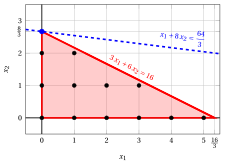{ .fig .ovale loading=lazy style="width:71%" }

    - <strong>Iterazione 1</strong>

        - **a)** <strong>Fase di generazione dei cut</strong>

            Abbiamo il seguente dizionario del simplesso associato a una soluzione di base ammissibile frazionaria del problema $LP_1$ in forma standard:

            \begin{equation*}
            \begin{cases}
            \begin{array}{rrrrrrrrrrrrr}
            {x_2} & {=} & {\dfrac{8}{3}} & {-} & {\dfrac{1}{2}}\, {x_1} & {-} & {\dfrac{1}{6}}\, {x_3} \\[2ex]
            {z} & {=} & {\dfrac{64}{3}} & {-} & {3}\, {x_1} & {-} & {\dfrac{4}{3}}\, {x_3}
            \end{array}
            \end{casi}
            \fine{equazione*}

            dove

            \begin{equation*}
            { \bar{\boldsymbol A}}=
            \begin{pmatrix}
            \frac{1}{2} & \frac{1}{6}
            \end{pmatrix}
            \qquad
            { ar{oldsymbol b}}=
            \begin{pmatrix}
            \frac{8}{3}
            \end{pmatrix}
            \fine{equazione*}

            - Il taglio frazionario di Gomory generato dalla prima riga è:

                \begin{align*}
                \underbrace{\left(\frac{1}{2} - \left\lfloor \frac{1}{2} \right\rfloor \right)}_{\frac{1}{2}-0=\frac{1}{2}} \; x_1 + \underbrace{\left(\frac{1}{6} - \left\lfloor \frac{1}{6} \right\rfloor \right)}_{\frac{1}{6}-0=\frac{1}{6}} \; x_3
                \ge \underbrace{\left(\frac{8}{3} - \left\lfloor \frac{8}{3} \right\rfloor \right)}_{\frac{8}{3} -2=\frac{2}{3}}
                \end{align*}

                \begin{align*}
                \frac{1}{2}\;x_1 + \frac{1}{6}\;x_3 \ge \frac{2}{3}
                \quad \Rightarrow \quad
                3\;x_1 + x_3 \ge 4
                \end{align*}

                Sottraendo una variabile in eccesso, otteniamo il taglio frazionario di Gomory in forma standard:

                $$
                \frac{1}{2}\;x_1 + \frac{1}{6}\;x_3 - x_4 = \frac{2}{3}
                \quad \Rightarrow \quad
                3\;x_1 + x_3 - 6\;x_4 = 4
                $$

                Dalla forma standard del problema $LP_1$, abbiamo:

                $$
                x_3= 16 - 3 \;x_1 - 6\;x_2.
                $$

                Sostituendo nel taglio frazionario di Gomory, possiamo esprimerlo in termini delle variabili originali del problema ILP:

                $$
                3\;x_1 + (16 - 3 \:x_1 - 6\:x_2) \ge 4
                \quad \Rightarrow \quad
                x_2 \le 2
                $$

                Effetto del taglio frazionario di Gomory generato dalla prima riga sul problema $LP_1$ in forma canonica:

                { .fig .ovale caricamento=lazy style="width:71%" }

            - Il taglio frazionario di Gomory generato dalla riga della funzione obiettivo è:

                \begin{align*}
                \underbrace{\left(3 - \left\lfloor 3 \right\rfloor \right)}_{3-3=0} \; x_1
                + \underbrace{\left(\frac{4}{3} - \left\lfloor \frac{4}{3} \right\rfloor \right)}_{\frac{4}{3}-1=\frac{1}{3}} \; x_3
                \ge \underbrace{\left(\frac{64}{3} - \left\lfloor \frac{64}{3} \right\rfloor \right)}_{\frac{64}{3} -21=\frac{1}{3}}
                \end{align*}

                \begin{align*}
                \frac{1}{3}\;x_3 \ge \frac{1}{3}
                \quad \Rightarrow \quad
                x_3 \ge 1
                \end{align*}

                Sottraendo una variabile di surplus, otteniamo il taglio frazionario di Gomory in forma standard:

                $$
                \frac{1}{3}\;x_3 - x_4 = \frac{1}{3}
                \quad \Rightarrow \quad
                x_3 - 3\;x_4 = 1
                $$

                Dalla forma standard del problema $LP_1$, abbiamo:

                $$
                x_3= 16 - 3 \;x_1 - 6\;x_2,
                $$

                Sostituendo nel taglio frazionario di Gomory, possiamo esprimerlo in termini delle variabili originali del problema ILP:

                $$
                16 - 3 \;x_1 - 6\;x_2 \ge 1
                \quad \Rightarrow \quad
                x_1 + 2\;x_2 \le 5
                $$

                Effetto del taglio frazionario di Gomory generato dalla riga della funzione obiettivo sul problema $LP_1$ in forma canonica:

                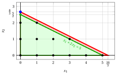{ .fig .ovale caricamento=lazy style="width:71%" }

                Selezioniamo il taglio frazionario di Gomory con il lato destro più grande e creiamo il problema $LP_2$ aggiungendolo al problema $LP_1$.

        - **b)** <strong>Fase di riottimizzazione LP</strong>

            Consideriamo il problema $LP_2$ nella forma standard:

            $$
            \begin{array}{rrrrrrrrrr}
            {\max} & {x_1} & {+} & {8\,x_2} &  &  &  &  &  &  \\[2ex]
            & {3\,x_1} & {+} & {6\,x_2} & {+} & {x_3} &  &  & {=} & {16} \\[2ex]
            &  &  & {x_2} &  &  & {+} & {x_4} & {=} & {2} \\[2ex]
            & {x_1,} &  & {x_2,} &  & {x_3,} &  & {x_4} & {\ge} & {0}
            \end{array}
            $$

            Per il taglio frazionario di Gomory aggiunto abbiamo:

            $$
            3 \; x_1 + x_3 - 6\;x_4 = 4
            \quad \Rightarrow \quad
            x_4 = -\dfrac{2}{3} + \dfrac{1}{2}\;x_1 + \dfrac{1}{6}\;x_3
            $$

            Aggiungiamo quindi questa equazione al precedente dizionario ottimale e otteniamo il seguente dizionario:

            \begin{equation*}
            \begin{cases}
            \begin{array}{rrrrrrrrrrrrr}
            {x_2} & {=} & {\dfrac{8}{3}} & {-} & {\dfrac{1}{2}}\, {x_1} & {-} & {\dfrac{1}{6}}\, {x_3} \\[2ex]
            {x_4} & {=} & {-\dfrac{2}{3}} & {+} & {\dfrac{1}{2}}\, {x_1} & {+} & {\dfrac{1}{6}}\, {x_3} \\[2ex]
            {z} & {=} & {\dfrac{64}{3}} & {-} & {3}\, {x_1} & {-} & {\dfrac{4}{3}}\, {x_3}
            \end{array}
            \end{casi}
            \fine{equazione*}

            dove $\pazocal{B}=\{2,4\}$ e $\pazocal{N}=\{1,3\}$ e

            - la soluzione primale di base inammissibile è:

                $$
                \bar x_2=\dfrac{8}{3},~~
                \bar x_4=-\dfrac{2}{3},~~~~~~
                \bar x_1=0,~~
                \bar x_3=0~~
                \text{  of value   }\dfrac{64}{3}
                $$

            - la soluzione duale di base fattibile è:

                $$
                \bar \pi_2=0,~~
                \bar \pi_4=0,~~~~~~
                \bar \pi_1=3,~~
                \bar \pi_3=\dfrac{4}{3}~~
                \text{  of value   }\dfrac{64}{3}
                $$

            Se aumentiamo il valore di $\pi_4$, possiamo ottenere una migliore soluzione duale. Abbiamo:

            $$
            \begin{cases}
            \pi_1 &= 3 - \dfrac{1}{2}\,\pi_4 \\[2ex]
            \pi_3 &= \dfrac{4}{3} - \dfrac{1}{6}\,\pi_4
            \end{cases}
            \qquad
            \qquad
            \begin{cases}
            \underbrace{ 3 - \dfrac{1}{2}\,\pi_4 \ge 0}_{\pi_1 \ge 0} \\[2ex]
            \underbrace{  \dfrac{4}{3} - \dfrac{1}{6}\,\pi_4 \ge 0}_{\pi_3 \ge 0}
            \end{cases}
            \qquad
            \qquad
            \begin{cases}
            \pi_4 &\le  6 \\[2ex]
            \pi_4 &\le  8
            \end{cases}
            $$

            Aumentando il valore di $\pi_4$ a $\min \left\{6, 8\right\}=6$, il valore di $\pi_1$ diminuisce a 0. Allora abbiamo che:

            - $\pi_4$ diventa una variabile di base doppia e di conseguenza $x_4$ diventa una variabile non di base primale

            - $\pi_1$ diventa una variabile non di base doppia e di conseguenza $x_1$ diventa una variabile basica primale

            Abbiamo:

            $$
            x_4 = -\dfrac{2}{3} + \dfrac{1}{2}\, x_1 + \dfrac{1}{6}\,x_3
            \quad \Longrightarrow \quad
            x_1 = \dfrac{4}{3} - \dfrac{1}{3}x_3 + 2x_4
            $$

            Sostituendo nelle altre equazioni del dizionario primale, otteniamo:

            $$
            x_2 = \dfrac{8}{3}  -  \dfrac{1}{2} \left( \dfrac{4}{3} - \dfrac{1}{3}x_3 + 2x_4   \right) -  \dfrac{1}{6} x_3
            = 2 - x_4
            $$

            $$
            z = \dfrac{64}{3}  -  3 \left( \dfrac{4}{3} - \dfrac{1}{3}x_3 + 2x_4   \right) -  \dfrac{4}{3} x_3
            = \dfrac{52}{3} - \dfrac{1}{3}x_3 - 6x_4
            $$

            Di conseguenza, abbiamo ora il seguente dizionario primale ottimale:

            \begin{equation*}
            \begin{cases}
            \begin{array}{rrrrrrrrrrrrr}
            {x_1} & {=} & {\dfrac{4}{3}} & {-} & {\dfrac{1}{3}}\, {x_3} & {+} & {2}\, {x_4} \\[2ex]
            {x_2} & {=} & {2} &  &  & {-} & {x_4} \\[2ex]
            {z} & {=} & {\dfrac{52}{3}} & {-} & {\dfrac{1}{3}}\, {x_3} & {-} & {6}\, {x_4}
            \end{array}
            \end{casi}
            \fine{equazione*}

            dove $\pazocal{B}=\{1,2\}$ e $\pazocal{N}=\{3,4\}$ e

            - la soluzione ottimale primale di base è:

                $$
                \tilde x_1 = \dfrac{4}{3},~~
                \tilde x_2 = 2,~~
                \tilde x_3 = 0,~~
                \tilde x_4 = 0
                \qquad
                \text{of value  }  \dfrac{52}{3}
                $$

            - la soluzione duale ottimale di base è:

                $$
                \tilde \pi_1 = 0,~~
                \tilde \pi_2 = 0,~~
                \tilde \pi_3 = \dfrac{1}{3},~~
                \tilde \pi_4 = 6
                \qquad
                \text{of value  }  \dfrac{52}{3}
                $$

            La soluzione ottimale ${ \tilde{ \boldsymbol x}}(\,LP_2\,)$ è <strong>frazionaria</strong> e il problema $LP_2$ è <strong>fattibile</strong>.

            Abbiamo il limite superiore sul valore ottimale del problema ILP:

            $$
            z(~ILP~) ~~\le~~  \underbrace{\left\lfloor \dfrac{52}{3} \right\rfloor}_{=17}
            $$

            Per il problema $LP_2$ in forma canonica, abbiamo:

            $$
            \begin{array}{rrrrrr}
            {\max} & {x_1} & {+} & {8\,x_2} &  &  \\[2ex]
            & {3\,x_1} & {+} & {6\,x_2} & {\le} & {16} \\[2ex]
            &  &  & {x_2} & {\le} & {2} \\[2ex]
            & {x_1,} &  & {x_2} & {\ge} & {0}
            \end{array}
            $$

            Una soluzione ottimale ${ \tilde{ \boldsymbol x}}(\,LP_2\,)$ è:

            $$
            \tilde{x}_1=\dfrac{4}{3},\qquad \tilde{x}_2=2
            $$

            Il valore ottimale è:

            $$
            z(~LP_2~)=\dfrac{52}{3}
            $$

            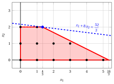{ .fig .ovale caricamento=lazy style="width:71%" }

    - <strong>Iterazione 2</strong>

        - **a)** <strong>Fase di generazione dei cut</strong>

            Abbiamo il seguente dizionario del simplesso associato a una soluzione di base ammissibile frazionaria del problema $LP_2$ in forma standard:

            \begin{equation*}
            \begin{cases}
            \begin{array}{rrrrrrrrrrrrr}
            {x_1} & {=} & {\dfrac{4}{3}} & {-} & {\dfrac{1}{3}}\, {x_3} & {+} & {2}\, {x_4} \\[2ex]
            {x_2} & {=} & {2} &  &  & {-} & {x_4} \\[2ex]
            {z} & {=} & {\dfrac{52}{3}} & {-} & {\dfrac{1}{3}}\, {x_3} & {-} & {6}\, {x_4}
            \end{array}
            \end{casi}
            \fine{equazione*}

            dove

            \begin{equation*}
            { \bar{\boldsymbol A}}=
            \begin{pmatrix}
            \frac{1}{3} & -2\\[2ex]
            0 & 1
            \end{pmatrix}
            \qquad
            { ar{oldsymbol b}}=
            \begin{pmatrix}
            \frac{4}{3}\\[2ex]
            2
            \end{pmatrix}
            \fine{equazione*}

            - Il taglio frazionario di Gomory generato dalla prima riga è:

                \begin{align*}
                \underbrace{\left(\frac{1}{3} - \left\lfloor \frac{1}{3} \right\rfloor \right)}_{\frac{1}{3}-0=\frac{1}{3}} \; x_3
                + \underbrace{\left(-2 - \left\lfloor -2 \right\rfloor \right)}_{-2-(-2)=0} \; x_4
                \ge \underbrace{\left(\frac{4}{3} - \left\lfloor \frac{4}{3} \right\rfloor \right)}_{\frac{4}{3}-1=\frac{1}{3}}
                \end{align*}

                \begin{align*}
                \frac{1}{3}\;x_3 \ge \frac{1}{3}
                \quad \Rightarrow \quad
                x_3 \ge 1
                \end{align*}

                Sottraendo una variabile di surplus, otteniamo il taglio frazionario di Gomory in forma standard:

                $$
                \frac{1}{3}\;x_3 - x_5 = \frac{1}{3}
                \quad \Rightarrow \quad
                x_3 - 3\;x_5 = 1
                $$

                Dalla forma standard del problema $LP_2$, abbiamo:

                $$
                x_3= 16 - 3 \;x_1 - 6\;x_2,
                $$

                Sostituendo nel taglio frazionario di Gomory, possiamo esprimerlo in termini delle variabili originali del problema ILP:

                $$
                (16 - 3 \;x_1 - 6\;x_2) \ge 1
                \quad \Rightarrow \quad
                x_1 + 2\;x_2 \le 5.
                $$

                Effetto del taglio frazionario di Gomory generato dalla prima riga sul problema $LP_2$ in forma canonica:

                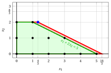{ .fig .ovale caricamento=lazy style="width:71%" }

            - Il taglio frazionario di Gomory generato dalla riga della funzione obiettivo è:

                \begin{align*}
                \underbrace{\left(\frac{1}{3} - \left\lfloor \frac{1}{3} \right\rfloor \right)}_{\frac{1}{3}-0=\frac{1}{3}} \; x_3
                + \underbrace{\left(6 - \left\lfloor 6 \right\rfloor \right)}_{6-6=0} \; x_4
                \ge \underbrace{\left(\frac{52}{3} - \left\lfloor \frac{52}{3} \right\rfloor \right)}_{\frac{52}{3} -17=\frac{1}{3}}
                \end{align*}

                \begin{align*}
                \frac{1}{3}\;x_3 \ge \frac{1}{3}
                \quad \Rightarrow \quad
                x_3 \ge 1
                \end{align*}

                Questo taglio frazionario di Gomory è lo stesso di quello generato dalla prima riga.

                Selezioniamo il taglio frazionario di Gomory con il lato destro più grande e creiamo il problema $LP_3$ aggiungendolo al problema $LP_2$.

        - **b)** <strong>Fase di riottimizzazione LP</strong>

            Consideriamo il problema $LP_3$ nella forma standard:

            $$
            \begin{array}{rrrrrrrrrrrr}
            {\max} & {x_1} & {+} & {8\,x_2} &  &  &  &  &  &  &  &  \\[2ex]
            & {3\,x_1} & {+} & {6\,x_2} & {+} & {x_3} &  &  &  &  & {=} & 16 \\[2ex]
            &  &  & {x_2} &  &  & {+} & {x_4} &  &  & {=} & 2 \\[2ex]
            & {x_1} & {+} & {2\,x_2} &  &  &  &  & {+} & {x_5} & {=} & 5 \\[2ex]
            & {x_1,} &  & {x_2,} &  & {x_3,} &  & {x_4,} &  & {x_5} & {\ge} & 0
            \end{array}
            $$

            Per il taglio frazionario di Gomory aggiunto abbiamo:

            $$
            x_3 - 3\;x_5 = 1
            \quad \Rightarrow \quad
            x_5 = -\dfrac{1}{3} + \dfrac{1}{3}\;x_3.
            $$

            Aggiungiamo quindi questa equazione al precedente dizionario ottimale e otteniamo il seguente dizionario:

            \begin{equation*}
            \begin{cases}
            \begin{array}{rrrrrrrrrrrrr}
            {x_1} & {=} & {\dfrac{4}{3}} & {-} & {\dfrac{1}{3}}\, {x_3} & {+} & {2}\, {x_4} \\[2ex]
            {x_2} & {=} & {2} &  &  & {-} & {x_4} \\[2ex]
            {x_5} & {=} & {-\dfrac{1}{3}} & {+} & {\dfrac{1}{3}}\, {x_3} &  &  \\[2ex]
            {z} & {=} & {\dfrac{52}{3}} & {-} & {\dfrac{1}{3}}\, {x_3} & {-} & {6}\, {x_4}
            \end{array}
            \end{casi}
            \end{equation*}

            dove $\pazocal{B} = \{1, 2, 5\}$ e $\pazocal{N} = \{3, 4\}$ e

            - la soluzione primale di base inammissibile è:

                $$
                \bar x_1 = \dfrac{4}{3}, \quad
                \bar x_2 = 2, \quad
                \bar x_5 = -\dfrac{1}{3}, \qquad
                \bar x_3 = 0, \quad
                \bar x_4 = 0
                \qquad
                \text{of value }  \dfrac{52}{3}
                $$

            - la soluzione dualmente ammissibile di base è:

                $$
                \bar \pi_1 = 0, \quad
                \bar \pi_2 = 0, \quad
                \bar \pi_5 = 0, \qquad
                \bar \pi_3 = \dfrac{1}{3}, \quad
                \bar \pi_4 = 6
                \qquad
                \text{of value }  \dfrac{52}{3}
                $$

            Se aumentiamo il valore di $\pi_5$, possiamo ottenere una migliore soluzione duale. Abbiamo:

            $$
            \pi_3 = \dfrac{1}{3} - \dfrac{1}{3}\pi_5
            \qquad\Longrightarrow\qquad
            \underbrace{\dfrac{1}{3} - \dfrac{1}{3}\pi_5 \ge 0}_{\pi_3 \ge 0}
            \qquad\Longrightarrow\qquad
            \pi_5 \le 1
            $$

            Aumentando il valore di $\pi_5$ a $1$, il valore di $\pi_3$ diminuisce a $0$.

            Allora abbiamo che:

            - $\pi_5$ diventa una variabile di base doppia e di conseguenza $x_5$ diventa una variabile primale non di base

            - $\pi_3$ diventa una variabile non di base doppia e di conseguenza $x_3$ diventa una variabile basica primale

            Abbiamo:

            $$
            x_5 = -\dfrac{1}{3} + \dfrac{1}{3}\;x_3
            \quad \Longrightarrow \quad
            x_3 = 1 + 3\;x_5.
            $$

            Sostituendo nelle altre equazioni del dizionario primale, otteniamo:

            $$
            x_1 = \dfrac{4}{3} - \dfrac{1}{3}(1 + 3x_5) + 2x_4
            = 1 + 2x_4 - x_5,
            $$

            $$
            x_2 = 2 - x_4,
            $$

            $$
            z = \dfrac{52}{3} - \dfrac{1}{3}(1 + 3x_5) - 6x_4
            = 17 - 6x_4 - x_5.
            $$

            Di conseguenza, abbiamo ora il seguente dizionario primale ottimale:

            \begin{equation*}
            \begin{cases}
            \begin{array}{rrrrrrrrrrrrr}
            {x_1} & {=} & {1} & {+} & {2}\, {x_4} & {-} & {x_5} \\[2ex]
            {x_2} & {=} & {2} & {-} & {x_4} &  &  \\[2ex]
            {x_3} & {=} & {1} &  &  & {+} & {3}\, {x_5} \\[2ex]
            {z} & {=} & {17} & {-} & {6}\, {x_4} & {-} & {x_5}
            \end{array}
            \end{casi}
            \fine{equazione*}

            dove $\pazocal{B} = \{1, 2, 3\}$ e $\pazocal{N} = \{4, 5\}$.

            - la soluzione primale ottimale di base è:

                $$
                \tilde x_1 = 1, \quad
                \tilde x_2 = 2, \quad
                \tilde x_3 = 1, \quad
                \tilde x_4 = 0, \qquad
                \tilde x_5 = 0
                \qquad
                \text{of value }  17
                $$

            - la soluzione duale ottimale di base è:

                $$
                \tilde \pi_1 = 0, \quad
                \tilde \pi_2 = 0, \quad
                \tilde \pi_3 = 0, \qquad
                \tilde \pi_4 = 6, \quad
                \tilde \pi_5 = 1
                \qquad
                \text{of value }  17
                $$

            !!! chiave ""
                La soluzione ottimale ${ \tilde{ \boldsymbol x}}(\,LP_3\,)$ è <strong>intera</strong>. Di conseguenza, una soluzione ottimale ${ \tilde{ \boldsymbol x}}(\,ILP\,)$ è:

                $$
                \tilde{x}_1=1,~~\tilde{x}_2=2
                $$

                Il valore ottimale $z(~ILP~)$ è $17$.

            Per il problema $LP_3$ in forma canonica, abbiamo:

            $$
            \begin{array}{rrrrrr}
            {\max} & {x_1} & {+} & {8\,x_2} &  &  \\[2ex]
            & {3\,x_1} & {+} & {6\,x_2} & {\le} & {16} \\[2ex]
            &  &  & {x_2} & {\le} & {2} \\[2ex]
            & {x_1} & {+} & {2\,x_2} & {\le} & {5} \\[2ex]
            & {x_1,} &  & {x_2} & {\ge} & {0}
            \end{array}
            $$

            Una soluzione ottimale ${ \tilde{ \boldsymbol x}}(\,LP_3\,)$ è:

            $$
            \tilde{x}_1=1,\qquad \tilde{x}_2=2
            $$

            Il valore ottimale è:

            $$
            z(~LP_3~)=17
            $$

            { .fig .ovale caricamento=lazy style="width:71%" }

!!! esercizio "Esercizio 6.2: Algoritmo del piano di taglio (P2)"
    Considera il seguente problema ILP in forma canonica di massimizzazione con $n=2$ variabili intere e $m=2$ vincoli:

    $$
    \begin{array}{rrrrrrrrrrrrr}
    {\max} & \, {x_1} & {+} & 3 \, {x_2} \\[2ex]
    & {- 4} \, {x_1} & {+} & {10} \, {x_2} & {\le} & {35} \\[2ex]
    & 3 \, {x_1} & {+} & \, {x_2} & {\le} & 12 \\[2ex]
    & {x_1,} &  & {x_2} & { \in } & { \Z_{\ge 0} }
    \end{array}
    $$

    e un dizionario ottimale del suo rilassamento LP in forma standard:

    \begin{equation*}
    \begin{cases}
    \begin{array}{rrrrrrrrrrrrr}
    {x_1=\dfrac{5}{2}} & {+} & {\dfrac{1}{34}} \, {x_3} & {-} & {\dfrac{5}{17}}\, {x_4} \\[2ex]
    {x_2=\dfrac{9}{2}} & {-} & {\dfrac{3}{34}}\, {x_3} & {-} & {\dfrac{2}{17}}\, {x_4} \\[2ex]
    {z= 16} & {-} & {\dfrac{4}{17}} \, {x_3} & {-} & {\dfrac{11}{17}} \, {x_4}
    \end{array}
    \end{casi}
    \fine{equazione*}

    **Domande**

    1. Esegui l'algoritmo del piano di taglio basato sui tagli frazionari di Gomory utilizzando:

        1. un taglio frazionario di Gomory a ogni iterazione;

        2. il lato destro più grande come strategia di selezione del taglio.

        Risolvi i problemi di PL dopo aver aggiunto il taglio frazionario di Gomory utilizzando l'algoritmo del simplesso duale. Mostra graficamente la soluzione ottimale del problema LP a ogni iterazione.

    2. Mostra graficamente l'effetto di ciascun taglio frazionario di Gomory sulil rilassamento LP del problema ILP in forma canonica.

    !!! nota ""
        Data una riga $i \in \pazocal{B}$ di un dizionario del simplesso associato a una soluzione di base fattibile tale che $\bar{b}_i$ è frazionaria, la disuguaglianza lineare

        \begin{equation*}
        \sum_{j \in \pazocal{N}}
        \left(
        \bar{a}_{ij}
        -
        \left\lfloor \bar{a}_{ij}\right\rfloor
        \right)x_j
        \ge
        \bar{b}_i - \left\lfloor \bar{b}_i \right\rfloor
        \end{equation*}

        è chiamato il <strong>taglio frazionario di Gomory</strong> generato dalla riga $i$.

??? soluzione "Soluzione"

    Esecuzione dell'algoritmo del piano di taglio per risolvere il problema ILP.

    - <strong>Inizializzazione</strong>

        Consideriamo il problema $LP_1$ nella forma standard:

        $$
        \begin{array}{rrrrrrrrrrrrr}
        {\max} & \, {x_1} & {+} & 3 \, {x_2} \\[2ex]
        & {- 4} \, {x_1} & {+} & {10} \, {x_2} & {+} & {x_3} &  &  & {=} & {35} \\[2ex]
        & 3 \, {x_1} & {+} & \, {x_2} &  &  & {+} & \, {x_4} & {=} & 12 \\[2ex]
        & {x_1,} &  & {x_2,} &  & {x_3,} &  & {x_4} & { \ge } & { 0 }
        \end{array}
        $$

        e il suo dizionario del simplesso ottimale:

        \begin{equation*}
        \begin{cases}
        \begin{array}{rrrrrrrrrrrrr}
        {x_1=\dfrac{5}{2}} & {+} & {\dfrac{1}{34}} \, {x_3} & {-} & {\dfrac{5}{17}}\, {x_4} \\[2ex]
        {x_2=\dfrac{9}{2}} & {-} & {\dfrac{3}{34}}\, {x_3} & {-} & {\dfrac{2}{17}}\, {x_4} \\[2ex]
        {z= 16} & {-} & {\dfrac{4}{17}} \, {x_3} & {-} & {\dfrac{11}{17}} \, {x_4}
        \end{array}
        \end{casi}
        \fine{equazione*}

        La soluzione ottimale ${ \tilde{ \boldsymbol x}}(\,LP_1\,)$ è <strong>frazionaria</strong> e il problema $LP_1$ è <strong>fattibile</strong>.

        Abbiamo il limite superiore sul valore ottimale del problema ILP:

        $$
        z(~ILP~) ~~\le~~ 16
        $$

        Per il problema $LP_1$ in forma canonica, abbiamo:

        $$
        \begin{array}{rrrrrrrrrrrrr}
        {\max} & \, {x_1} & {+} & 3 \, {x_2} \\[2ex]
        & {- 4} \, {x_1} & {+} & {10} \, {x_2} & {\le} & {35} \\[2ex]
        & 3 \, {x_1} & {+} & \, {x_2} & {\le} & 12 \\[2ex]
        & {x_1,} &  & {x_2} & { \ge } & { 0 }
        \end{array}
        $$

        Una soluzione ottimale ${ \tilde{ \boldsymbol x}}(\,LP_1\,)$ è:

        $$
        \tilde{x}_1=\dfrac{5}{2},\qquad \tilde{x}_2=\dfrac{9}{2}
        $$

        Il valore ottimale è:

        $$
        z(~LP_1~)=16
        $$

        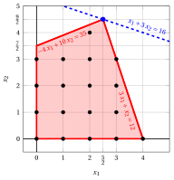{ .fig .ovale caricamento=lazy style="width:71%" }

    - <strong>Iterazione 1</strong>

        - **a)** <strong>Fase di generazione del taglio</strong>

            Abbiamo il seguente dizionario del simplesso associato a una soluzione di base ammissibile frazionaria del problema $LP_1$ in forma standard:

            \begin{equation*}
            \begin{cases}
            \begin{array}{rrrrrrrrrrrrr}
            {x_1=\dfrac{5}{2}} & {+} & {\dfrac{1}{34}} \, {x_3} & {-} & {\dfrac{5}{17}}\, {x_4} \\[2ex]
            {x_2=\dfrac{9}{2}} & {-} & {\dfrac{3}{34}}\, {x_3} & {-} & {\dfrac{2}{17}}\, {x_4} \\[2ex]
            {z= 16} & {-} & {\dfrac{4}{17}} \, {x_3} & {-} & {\dfrac{11}{17}} \, {x_4}
            \end{array}
            \end{casi}
            \fine{equazione*}

            dove

            \begin{equation*}
            { \bar{\boldsymbol A}}=
            \begin{pmatrix}
            -\dfrac{1}{34} & \dfrac{5}{17} \\[2ex]
            \dfrac{3}{34} & \dfrac{2}{17}
            \end{pmatrix}
            \qquad
            { ar{oldsymbol b}}=
            \begin{pmatrix}
            \dfrac{5}{2} \\[2ex]
            \dfrac{9}{2}
            \end{pmatrix}
            \fine{equazione*}

            - Il taglio frazionario di Gomory generato dalla prima riga è:

                \begin{align*}
                \underbrace{\left(-\dfrac{1}{34} - \left\lfloor -\dfrac{1}{34} \right\rfloor \right)}_{-\dfrac{1}{34}-(-1)=\dfrac{33}{34}} \; x_3 + \underbrace{\left(\dfrac{5}{17} - \left\lfloor \dfrac{5}{17} \right\rfloor \right)}_{\dfrac{5}{17}-0=\dfrac{5}{17}} \; x_4 \ge \underbrace{\left(\dfrac{5}{2} - \left\lfloor \dfrac{5}{2} \right\rfloor \right)}_{\dfrac{5}{2} -2=\dfrac{1}{2}}
                \end{align*}

                \begin{align*}
                \dfrac{33}{34}\;x_3 + \dfrac{5}{17} \;x_4 \ge \dfrac{1}{2}
                \quad \Rightarrow \quad
                33 \;x_3 + 10 \;x_4 \ge 17
                \end{align*}

                Sottraendo una variabile di surplus, otteniamo il taglio frazionario di Gomory in forma standard:

                $$
                \dfrac{33}{34}\;x_3 + \dfrac{5}{17} \;x_4 -x_5 = \dfrac{1}{2}
                \quad \Rightarrow \quad
                33 \;x_3 + 10 \;x_4 - 34\;x_5 = 17
                $$

                Dalla forma standard del problema $LP_1$, abbiamo:

                $$
                x_3=35+4\;x_1-10\;x_2,
                \qquad
                x_4=12-3\;x_1-x_2.
                $$

                Sostituendo nel taglio frazionario di Gomory, possiamo esprimerlo in termini delle variabili originali del problema ILP:

                $$
                33\;(35+4\:x_1-10\:x_2)+10\;(12-3\:x_1-x_2)\ge 17
                \quad \Rightarrow \quad
                -3\;x_1+10\;x_2\le 37
                $$

                Effetto del taglio frazionario di Gomory generato dalla prima riga sul problema $LP_1$ in forma canonica:

                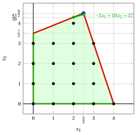{ .fig .ovale caricamento=lazy style="width:71%" }

            - Il taglio frazionario di Gomory generato dalla seconda riga è:

                \begin{align*}
                \underbrace{\left(\dfrac{3}{34} - \left\lfloor \dfrac{3}{34} \right\rfloor \right)}_{\dfrac{3}{34}-0=\dfrac{3}{34}} \; x_3 + \underbrace{\left(\dfrac{2}{17} - \left\lfloor \dfrac{2}{17} \right\rfloor \right)}_{\dfrac{2}{17}-0=\dfrac{2}{17}} \; x_4 \ge \underbrace{\left(\dfrac{9}{2} - \left\lfloor \dfrac{9}{2} \right\rfloor \right)}_{\dfrac{9}{2} -4=\dfrac{1}{2}}
                \end{align*}

                \begin{align*}
                \dfrac{3}{34}\;x_3 + \dfrac{2}{17} \;x_4 \ge \dfrac{1}{2}
                \quad \Rightarrow \quad
                3\;x_3 + 4 \;x_4 \ge 17
                \end{align*}

                Sottraendo una variabile in eccesso, otteniamo il taglio frazionario di Gomory in forma standard:

                $$
                \dfrac{3}{34}\;x_3 + \dfrac{2}{17} \;x_4 - x_5 = \dfrac{1}{2}
                \quad \Rightarrow \quad
                3\;x_3 + 4 \;x_4 - 34\;x_5 = 17
                $$

                Dalla forma standard del problema $LP_1$, abbiamo:

                $$
                x_3=35+4\;x_1-10\;x_2,
                \qquad
                x_4=12-3\;x_1-x_2.
                $$

                Sostituendo nel taglio frazionario di Gomory, possiamo esprimerlo in termini delle variabili originali del problema ILP:

                $$
                3\;(35+4\:x_1-10\:x_2)+4\;(12-3\:x_1-x_2)\ge 17
                \quad \Rightarrow \quad
                x_2\le 4
                $$

                Effetto del taglio frazionario di Gomory generato dalla seconda riga sul problema $LP_1$ in forma canonica:

                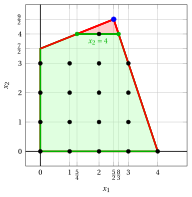{ .fig .ovale loading=lazy style="width:71%" }

            Entrambi i tagli frazionari di Gomory hanno lo stesso lato destro, uguale a $\dfrac{1}{2}$. Selezioniamo il taglio frazionario di Gomory generato dalla seconda riga e creiamo il problema $LP_2$ aggiungendolo al problema $LP_1$.

        - **b)** <strong>Fase di riottimizzazione LP</strong>

            Consideriamo il problema $LP_2$ nella forma standard:

            $$
            \begin{array}{rrrrrrrrrrrrr}
            {\max} & \, {x_1} & {+} & 3 \, {x_2} \\[2ex]
            & {- 4} \, {x_1} & {+} & {10} \, {x_2} & {+} & {x_3} &  &  &  &  & {=} & {35} \\[2ex]
            & 3 \, {x_1} & {+} & \, {x_2} &  &  & {+} & \, {x_4} &  &  & {=} & 12 \\[2ex]
            &  &  & {x_2} &  &  &  &  & {+} & {x_5} & {=} & {4} \\[2ex]
            & {x_1,} &  & {x_2,} &  & {x_3,} &  & {x_4,} &  & {x_5} & { \ge } & { 0 }
            \end{array}
            $$

            Per il taglio frazionario di Gomory aggiunto abbiamo:

            $$
            3\;x_3 + 4 \;x_4 - 34\;x_5 = 17 \quad \quad \Rightarrow \quad    x_5 = -\dfrac{1}{2} + \dfrac{3}{34}\;x_3 + \dfrac{2}{17} \;x_4
            $$

            Aggiungiamo quindi questa equazione al precedente dizionario ottimale e otteniamo il seguente dizionario:

            \begin{equation*}
            \begin{cases}
            \begin{array}{rrrrrrrrrrrrr}
            {x_1=\dfrac{5}{2}} & {+} & {\dfrac{1}{34}} \, {x_3} & {-} & {\dfrac{5}{17}}\, {x_4} \\[2ex]
            {x_2=\dfrac{9}{2}} & {-} & {\dfrac{3}{34}}\, {x_3} & {-} & {\dfrac{2}{17}}\, {x_4} \\[2ex]
            {x_5=-\dfrac{1}{2}} & {+} & {\dfrac{3}{34}}\, {x_3} & {+} & {\dfrac{2}{17}}\, {x_4} \\[2ex]
            {z= 16} & {-} & {\dfrac{4}{17}} \, {x_3} & {-} & {\dfrac{11}{17}} \, {x_4}
            \end{array}
            \end{casi}
            \fine{equazione*}

            dove $\pazocal{B}=\{1,2,5\}$ e $\pazocal{N}=\{3,4\}$ e

            - la soluzione primale di base inammissibile è:

                $$
                \bar x_1=\dfrac{5}{2},~~
                \bar x_2=\dfrac{9}{2},~~
                \bar x_5=-\dfrac{1}{2},~~~~~~
                \bar x_3=0,~~
                \bar x_4=0~~
                \text{  of value   }16
                $$

            - la soluzione duale di base fattibile è:

                $$
                \bar \pi_1=0,~~
                \bar \pi_2=0,~~
                \bar \pi_5=0,~~~~~~
                \bar \pi_3=\dfrac{4}{17},~~
                \bar \pi_4=\dfrac{11}{17}~~
                \text{  of value   }16
                $$

            Se aumentiamo il valore di $\pi_5$, possiamo ottenere una migliore soluzione duale. Abbiamo:

            $$
            \begin{cases}
            \pi_3 &= \dfrac{4}{17} - \dfrac{3}{34}\,\pi_5 \\[2ex]
            \pi_4 &= \dfrac{11}{17} - \dfrac{2}{17}\,\pi_5
            \end{cases}
            \qquad
            \qquad
            \begin{cases}
            \underbrace{ \dfrac{4}{17} - \dfrac{3}{34}\,\pi_5 \ge 0}_{\pi_3 \ge 0} \\[2ex]
            \underbrace{  \dfrac{11}{17} - \dfrac{2}{17}\,\pi_5 \ge 0}_{\pi_4 \ge 0}
            \end{cases}
            \qquad
            \qquad
            \begin{cases}
            \pi_5 &\le  \dfrac{8}{3} \\[2ex]
            \pi_5 &\le  \dfrac{11}{2}
            \end{cases}
            $$

            Aumentando il valore di $\pi_5$ a $\min \left\{\dfrac{8}{3}, \dfrac{11}{2}\right\}=\dfrac{8}{3}$, il valore di $\pi_3$ diminuisce a 0. Allora abbiamo che:

            - $\pi_5$ diventa una variabile di base doppia e di conseguenza $x_5$ diventa una variabile non di base primale

            - $\pi_3$ diventa una variabile non di base doppia e di conseguenza $x_3$ diventa una variabile basica primale

            Abbiamo:

            $$
            x_5 = -\dfrac{1}{2} + \dfrac{3}{34}\,  x_3 + \dfrac{2}{17}\, x_4 \text{    then     } x_3= \dfrac{17}{3} - \dfrac{4}{3} x_4 + \dfrac{34}{3} x_5.
            $$

            Sostituendo nelle altre equazioni del dizionario primale, otteniamo:

            $$
            x_1 = \dfrac{5}{2} +  \dfrac{1}{34}  \left( \dfrac{17}{3} - \dfrac{4}{3} x_4 + \dfrac{34}{3} x_5  \right) -  \dfrac{5}{17} x_4= \dfrac{8}{3} -\dfrac{1}{3} x_4 + \dfrac{1}{3} x_5
            $$

            $$
            x_2 = \dfrac{9}{2} -  \dfrac{3}{34}   \left(  \dfrac{17}{3} - \dfrac{4}{3} x_4 + \dfrac{34}{3} x_5 \right) -  \dfrac{2}{17} x_4=  4 -  x_5
            $$

            $$
            z = 16 -  \dfrac{4}{17}   \left(  \dfrac{17}{3} - \dfrac{4}{3} x_4 + \dfrac{34}{3} x_5 \right) -  \dfrac{11}{17} x_4=   \dfrac{44}{3} - \dfrac{1}{3} x_4 - \dfrac{8}{3} x_5
            $$

            Di conseguenza, abbiamo ora il seguente dizionario primale ottimale:

            \begin{equation*}
            \begin{cases}
            \begin{array}{rrrrrrrrrrrrr}
            {x_1=\dfrac{8}{3}} & {-} & {\dfrac{1}{3}} \, {x_4} & {+} & {\dfrac{1}{3}}\, {x_5} \\[2ex]
            {x_2=4} &  &  & {-} & {x_5} \\[2ex]
            {x_3=\dfrac{17}{3}} & {-} & {\dfrac{4}{3}}\, {x_4} & {+} & {\dfrac{34}{3}}\, {x_5} \\[2ex]
            {z= \dfrac{44}{3}} & {-} & {\dfrac{1}{3}} \, {x_4} & {-} & {\dfrac{8}{3}} \, {x_5}
            \end{array}
            \end{casi}
            \fine{equazione*}

            dove $\pazocal{B}=\{1,2,3\}$ e $\pazocal{N}=\{4,5\}$ e

            - la soluzione ottimale primale di base è:

                $$
                \tilde x_1=\dfrac{8}{3},~~
                \tilde x_2=4,~~
                \tilde x_3=\dfrac{17}{3},~~~~~~
                \tilde x_4=0,~~
                \tilde x_5=0~~
                \text{  of value   }\dfrac{44}{3}
                $$

            - la soluzione duale ottimale di base è:

                $$
                \tilde \pi_1=0,~~
                \tilde \pi_2=0,~~
                \tilde \pi_3=0,~~~~~~
                \tilde \pi_4=\dfrac{1}{3},~~
                \tilde \pi_5=\dfrac{8}{3}~~
                \text{  of value   }\dfrac{44}{3}
                $$

            La soluzione ottimale ${ \tilde{ \boldsymbol x}}(\,LP_2\,)$ è <strong>frazionaria</strong> e il problema $LP_2$ è <strong>fattibile</strong>.

            Abbiamo il limite superiore sul valore ottimale del problema ILP:

            $$
            z(~ILP~) ~~\le~~  \underbrace{\left\lfloor \dfrac{44}{3} \right\rfloor}_{=14}
            $$

            Per il problema $LP_2$ in forma canonica, abbiamo:

            $$
            \begin{array}{rrrrrrrrrrrrr}
            {\max} & \, {x_1} & {+} & 3 \, {x_2} \\[2ex]
            & {- 4} \, {x_1} & {+} & {10} \, {x_2} & {\le} & {35} \\[2ex]
            & 3 \, {x_1} & {+} & \, {x_2} & {\le} & 12 \\[2ex]
            &  &  & \, {x_2} & {\le} & 4 \\[2ex]
            & {x_1,} &  & {x_2} & { \ge } & { 0 }
            \end{array}
            $$

            Una soluzione ottimale ${ \tilde{ \boldsymbol x}}(\,LP_2\,)$ è:

            $$
            \tilde{x}_1=\dfrac{8}{3},\qquad \tilde{x}_2=4
            $$

            Il valore ottimale è:

            $$
            z(~LP_2~)=\dfrac{44}{3}
            $$

            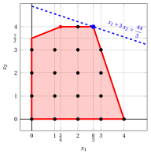{ .fig .ovale caricamento=lazy style="width:71%" }

    - <strong>Iterazione 2</strong>

        - **a)** <strong>Fase di generazione del taglio</strong>

            Abbiamo il seguente dizionario del simplesso associato a una soluzione di base ammissibile frazionaria del problema $LP_2$ in forma standard:

            \begin{equation*}
            \begin{cases}
            \begin{array}{rrrrrrrrrrrrr}
            {x_1} & {=} & {\dfrac{8}{3}} & {-} & {\dfrac{1}{3}}\, {x_4} & {+} & {\dfrac{1}{3}}\, {x_5} \\[2ex]
            {x_2} & {=} & {4} &  &  & {-} & {x_5} \\[2ex]
            {x_3} & {=} & {\dfrac{17}{3}} & {-} & {\dfrac{4}{3}}\, {x_4} & {+} & {\dfrac{34}{3}}\, {x_5} \\[2ex]
            {z} & {=} & {\dfrac{44}{3}} & {-} & {\dfrac{1}{3}}\, {x_4} & {-} & {\dfrac{8}{3}}\, {x_5}
            \end{array}
            \end{casi}
            \fine{equazione*}

            dove

            \begin{equation*}
            { \bar{\boldsymbol A}}=
            \begin{pmatrix}
            \dfrac{1}{3} & -\dfrac{1}{3}\\[2ex]
            0 & 1\\[2ex]
            \dfrac{4}{3} & -\dfrac{34}{3}
            \end{pmatrix}
            \qquad
            { ar{oldsymbol b}}=
            \begin{pmatrix}
            \dfrac{8}{3}\\[2ex]
            4\\[2ex]
            \dfrac{17}{3}
            \end{pmatrix}
            \fine{equazione*}

            - Il taglio frazionario di Gomory generato dalla prima riga è:

                \begin{align*}
                \underbrace{\left(\dfrac{1}{3} - \left\lfloor \dfrac{1}{3} \right\rfloor \right)}_{\dfrac{1}{3}-0=\dfrac{1}{3}} \; x_4
                + \underbrace{\left(-\dfrac{1}{3} - \left\lfloor -\dfrac{1}{3} \right\rfloor \right)}_{-\dfrac{1}{3}+1=\dfrac{2}{3}} \; x_5
                \ge \underbrace{\left(\dfrac{8}{3} - \left\lfloor \dfrac{8}{3} \right\rfloor \right)}_{\dfrac{8}{3} -2=\dfrac{2}{3}}
                \end{align*}

                \begin{align*}
                \dfrac{1}{3}\;x_4 + \dfrac{2}{3} \;x_5 \ge \dfrac{2}{3}
                \quad \Rightarrow \quad
                x_4 + 2 \;x_5 \ge 2
                \end{align*}

                Sottraendo una variabile in eccesso, otteniamo il taglio frazionario di Gomory in forma standard:

                $$
                \dfrac{1}{3}\;x_4 + \dfrac{2}{3} \;x_5 - x_6 = \dfrac{2}{3}
                \quad \Rightarrow \quad
                x_4 + 2 \;x_5 - 3\;x_6 = 2
                $$

                Dalla forma standard del problema $LP_2$, abbiamo:

                $$
                x_4=12-3\;x_1-x_2,
                \qquad
                x_5=4-x_2.
                $$

                Sostituendo nel taglio frazionario di Gomory, possiamo esprimerlo in termini delle variabili originali del problema ILP:

                $$
                (12-3\;x_1-x_2)+2\;(4-x_2)\ge 2
                \quad \Rightarrow \quad
                x_1+x_2\le 6.
                $$

                Effetto del taglio frazionario di Gomory generato dalla prima riga sul problema $LP_2$ in forma canonica:

                { .fig .ovale caricamento=lazy style="width:71%" }

            - Il taglio frazionario di Gomory generato dalla terza riga è:

                \begin{align*}
                \underbrace{\left(\dfrac{4}{3} - \left\lfloor \dfrac{4}{3} \right\rfloor \right)}_{\dfrac{4}{3}-1=\dfrac{1}{3}} \; x_4
                + \underbrace{\left(-\dfrac{34}{3} - \left\lfloor -\dfrac{34}{3} \right\rfloor \right)}_{-\dfrac{34}{3}+12=\dfrac{2}{3}} \; x_5
                \ge \underbrace{\left(\dfrac{17}{3} - \left\lfloor \dfrac{17}{3} \right\rfloor \right)}_{\dfrac{17}{3} -5=\dfrac{2}{3}}
                \end{align*}

                \begin{align*}
                \dfrac{1}{3}\;x_4 + \dfrac{2}{3} \;x_5 \ge \dfrac{2}{3}
                \quad \Rightarrow \quad
                x_4 + 2 \;x_5 \ge 2
                \end{align*}

                Questa è la stessa tagliata frazionaria di Gomory ottenuta con la prima riga generatrice.

            Selezioniamo il taglio frazionario di Gomory con il lato destro più grande e creiamo il problema $LP_3$ aggiungendolo al problema $LP_2$.

        - **b)** <strong>Fase di riottimizzazione LP</strong>

            Consideriamo il problema $LP_3$ nella forma standard:

            $$
            \begin{array}{rrrrrrrrrrrrrrrrr}
            {\max} & \, {x_1} & {+} & 3 \, {x_2} \\[2ex]
            & {- 4} \, {x_1} & {+} & {10} \, {x_2} & {+} & {x_3} &  &  &  &  &  &  & {=} & {35} \\[2ex]
            & 3 \, {x_1} & {+} & \, {x_2} &  &  & {+} & \, {x_4} &  &  &  &  & {=} & 12 \\[2ex]
            &  &  & {x_2} &  &  &  &  & {+} & {x_5} &  &  & {=} & {4} \\[2ex]
            & \, {x_1} & {+} & \, {x_2} &  &  &  &  &  &  & {+} & {x_6} & {=} & {6} \\[2ex]
            & {x_1,} &  & {x_2,} &  & {x_3,} &  & {x_4,} &  & {x_5,} &  & {x_6} & { \ge } & { 0 }
            \end{array}
            $$

            Per il taglio frazionario di Gomory aggiunto abbiamo:

            $$
            x_4 + 2 \;x_5 - 3\;x_6 = 2   \quad \quad \Rightarrow \quad    x_6 = -\dfrac{2}{3} + \dfrac{1}{3} x_4 + \dfrac{2}{3} \;x_5
            $$

            Aggiungiamo quindi questa equazione al precedente dizionario ottimale e otteniamo il seguente dizionario:

            \begin{equation*}
            \begin{cases}
            \begin{array}{rrrrrrrrrrrrr}
            {x_1=\dfrac{8}{3}} & {-} & {\dfrac{1}{3}} \, {x_4} & {+} & {\dfrac{1}{3}}\, {x_5} \\[2ex]
            {x_2=4} &  &  & {-} & {x_5} \\[2ex]
            {x_3=\dfrac{17}{3}} & {-} & {\dfrac{4}{3}}\, {x_4} & {+} & {\dfrac{34}{3}}\, {x_5} \\[2ex]
            {x_6=-\dfrac{2}{3}} & {+} & {\dfrac{1}{3}}\, {x_4} & {+} & {\dfrac{2}{3}}\, {x_5} \\[2ex]
            {z= \dfrac{44}{3}} & {-} & {\dfrac{1}{3}} \, {x_4} & {-} & {\dfrac{8}{3}} \, {x_5}
            \end{array}
            \end{casi}
            \fine{equazione*}

            dove $\pazocal{B}=\{1,2,3,6\}$ e $\pazocal{N}=\{4,5\}$ e

            - la soluzione di base primale non realizzabile è:

                $$
                \bar x_1=\dfrac{8}{3},~~
                \bar x_2=4,~~
                \bar x_3=\dfrac{17}{3},~~
                \bar x_6=-\dfrac{2}{3},~~~~~~
                \bar x_4=0,~~
                \bar x_5=0~~
                \text{  of value   } \dfrac{44}{3}
                $$

            - la soluzione duale di base fattibile è:

                $$
                \bar \pi_1=0,~~
                \bar \pi_2=0,~~
                \bar \pi_3=0,~~
                \bar \pi_6=0,~~~~~~
                \bar \pi_4=\dfrac{1}{3},~~
                \bar \pi_5=\dfrac{8}{3}~~
                \text{  of value   }\dfrac{44}{3}
                $$

            Se aumentiamo il valore di $\pi_6$, possiamo ottenere una migliore soluzione duale. Abbiamo:

            $$
            \begin{cases}
            \pi_4 &= \dfrac{1}{3} - \dfrac{1}{3}\pi_6 \\[2ex]
            \pi_5 &= \dfrac{8}{3} - \dfrac{2}{3}\,\pi_6
            \end{cases}
            \qquad
            \qquad
            \begin{cases}
            \underbrace{ \dfrac{1}{3} - \dfrac{1}{3} \pi_6 \ge 0}_{\pi_4 \ge 0} \\[2ex]
            \underbrace{  \dfrac{8}{3} - \dfrac{2}{3}\,\pi_6 \ge 0}_{\pi_5 \ge 0}
            \end{cases}
            \qquad
            \qquad
            \begin{cases}
            \pi_6 &\le  1 \\[2ex]
            \pi_6 &\le  4
            \end{cases}
            $$

            Aumentando il valore di $\pi_6$ a $\min \left\{1, 4\right\}=1$, il valore di $\pi_4$ diminuisce a 0. Allora abbiamo che:

            - $\pi_6$ diventa una variabile di base doppia e di conseguenza $x_6$ diventa una variabile primale non di base

            - $\pi_4$ diventa una variabile non di base doppia e di conseguenza $x_4$ diventa una variabile di base primale

            Abbiamo:

            $$
            x_6 = -\dfrac{2}{3} + \dfrac{1}{3} x_4 + \dfrac{2}{3} \;x_5 \text{    then     } x_4= 2 - 2 x_5 + 3 x_6.
            $$

            Sostituendo nelle altre equazioni del dizionario primale, otteniamo:

            $$
            x_1 = \dfrac{8}{3}  -  \dfrac{1}{3}  \left( 2 - 2 x_5 + 3 x_6 \right) +  \dfrac{1}{3} x_5 = 2 +  x_5 -  x_6
            $$

            $$
            x_3 = \dfrac{17}{3}  -  \dfrac{4}{3}  \left( 2 - 2 x_5 + 3 x_6 \right) +  \dfrac{34}{3} x_5 =  3 + 14 x_5 - 4 x_6
            $$

            $$
            z  = \dfrac{44}{3}  -  \dfrac{1}{3}  \left( 2 - 2 x_5 + 3 x_6 \right) -  \dfrac{8}{3} x_5 =  14 - 2 x_5 -  x_6
            $$

            Di conseguenza, abbiamo ora il seguente dizionario primale ottimale:

            \begin{equation*}
            \begin{cases}
            \begin{array}{rrrrrrrrrrrrr}
            {x_1=2} & {+} & {x_5} & {-} & {x_6} \\[2ex]
            {x_2=4} & {-} & {x_5} &  &  \\[2ex]
            {x_3=3} & {+} & {14} \, {x_5} & {-} & {4}\, {x_6} \\[2ex]
            {x_4=2} & {-} & {2} \, {x_5} & {+} & {3}\, {x_6} \\[2ex]
            {z= 14} & {-} & {2} \, {x_5} & {-} & {x_6}
            \end{array}
            \end{casi}
            \fine{equazione*}

            dove $\pazocal{B}=\{1,2,3,4\}$ e $\pazocal{N}=\{5,6\}$ e

            - la soluzione ottimale primale di base è:

                $$
                \tilde x_1=2,~~
                \tilde x_2=4,~~
                \tilde x_3=3,~~
                \tilde x_4=2,~~~~~~
                \tilde x_5=0,~~
                \tilde x_6=0~~
                \text{  of value   } 14
                $$

            - la soluzione duale ottimale di base è:

                $$
                \tilde \pi_1=0,~~
                \tilde \pi_2=0,~~
                \tilde \pi_3=0,~~
                \tilde \pi_4=0,~~~~~~
                \tilde \pi_5=2~~
                \tilde \pi_6=1~~
                \text{  of value   } 14
                $$

            !!! chiave ""
                La soluzione ottimale ${ \tilde{ \boldsymbol x}}(\,LP_3\,)$ è <strong>intera</strong>. Di conseguenza, una soluzione ottimale ${ \tilde{ \boldsymbol x}}(\,ILP\,)$ è:

                $$
                \tilde{x}_1=2,~~\tilde{x}_2=4
                $$

                Il valore ottimale $z(~ILP~)$ è $14$.

            Per il problema $LP_3$ in forma canonica, abbiamo:

            $$
            \begin{array}{rrrrrrrrrrrrr}
            {\max} & \, {x_1} & {+} & 3 \, {x_2} \\[2ex]
            & {- 4} \, {x_1} & {+} & {10} \, {x_2} & {\le} & {35} \\[2ex]
            & 3 \, {x_1} & {+} & \, {x_2} & {\le} & 12 \\[2ex]
            &  &  & \, {x_2} & {\le} & 4 \\[2ex]
            & {x_1} & {+} & \, {x_2} & {\le} & 6 \\[2ex]
            & {x_1,} &  & {x_2} & { \ge } & { 0 }
            \end{array}
            $$

            Una soluzione ottimale ${ \tilde{ \boldsymbol x}}(\,LP_3\,)$ è:

            $$
            \tilde{x}_1=2,\qquad \tilde{x}_2=4
            $$

            Il valore ottimale è:

            $$
            z(~LP_3~)=14
            $$

            { .fig .ovale caricamento=lazy style="width:71%" }

!!! esercizio "Esercizio 6.3: Algoritmo del piano di taglio (P3)"
    Considera il seguente problema ILP in forma canonica di massimizzazione con $n=2$ variabili intere e $m=2$ vincoli:

    $$
    \begin{array}{rrrrrrrrrrrrr}
    {\max} & {2}\, {x_1} & {+} & {4}\, {x_2} \\[2ex]
    & {-} \, {x_1} & {+} & \, {x_2} & {\le} & {2} \\[2ex]
    & {8} \, {x_1} & {+} & {2} \, {x_2} & {\le} & {19} \\[2ex]
    & {x_1,} &  & {x_2} & { \in } & { \Z_{\ge 0} }
    \end{array}
    $$

    e un dizionario ottimale del suo rilassamento LP in forma standard:

    \begin{equation*}
    \begin{cases}
    \begin{array}{rrrrrrrrrrrrr}
    {x_1} & {=} & {\dfrac{3}{2}} & {+} & {\dfrac{1}{5}} \, {x_3} & {-} & {\dfrac{1}{10}}\, {x_4} \\[2ex]
    {x_2} & {=} & {\dfrac{7}{2}} & {-} & {\dfrac{4}{5}}\, {x_3} & {-} & {\dfrac{1}{10}}\, {x_4} \\[2ex]
    {z} & {=} & {17} & {-} & {\dfrac{14}{5}} \, {x_3} & {-} & {\dfrac{3}{5}} \, {x_4}
    \end{array}
    \end{casi}
    \fine{equazione*}

    **Domande**

    1. Esegui l'algoritmo del piano di taglio basato sui tagli frazionari di Gomory utilizzando:

        1. un taglio frazionario di Gomory a ogni iterazione;

        2. il lato destro più grande come strategia di selezione del taglio.

        Risolvi i problemi di PL dopo aver aggiunto il taglio frazionario di Gomory utilizzando l'algoritmo del simplesso duale. Mostra graficamente la soluzione ottimale del problema LP a ogni iterazione.

    2. Mostra graficamente l'effetto di ciascun taglio frazionario di Gomory sulil rilassamento LP del problema ILP in forma canonica.

    !!! nota ""
        Data una riga $i \in \pazocal{B}$ di un dizionario del simplesso associato a una soluzione di base ammissibile tale che $\bar{b}_i$ sia frazionaria, l'inequazione lineare

        \begin{equation*}
        \sum_{j \in \pazocal{N}}
        \left(
        \bar{a}_{ij}
        -
        \left\lfloor \bar{a}_{ij}\right\rfloor
        \right)x_j
        \ge
        \bar{b}_i - \left\lfloor \bar{b}_i \right\rfloor
        \end{equation*}

        è chiamato il <strong>taglio frazionario di Gomory</strong> generato dalla riga $i$.

??? soluzione "Soluzione"

    Esecuzione dell'algoritmo del piano di taglio per risolvere il problema ILP.

    - <strong>Inizializzazione</strong>

        Consideriamo il problema $LP_1$ nella forma standard:

        $$
        \begin{array}{rrrrrrrrrrrrr}
        {\max} & {2} \, {x_1} & {+} & {4} \, {x_2} \\[1.5ex]
        & {-} \, {x_1} & {+} & \, {x_2} & {+} & {x_3} &  &  & {=} & {2} \\[2ex]
        & {8} \, {x_1} & {+} & {2} \, {x_2} &  &  & {+} & {x_4} & {=} & {19} \\[2ex]
        & {x_1,} &  & {x_2,} &  & {x_3,} &  & {x_4} & { \ge} & { 0 }
        \end{array}
        $$

        e il suo dizionario del simplesso ottimale:

        \begin{equation*}
        \begin{cases}
        \begin{array}{rrrrrrrrrrrrr}
        {x_1} & {=} & {\dfrac{3}{2}} & {+} & {\dfrac{1}{5}} \, {x_3} & {-} & {\dfrac{1}{10}}\, {x_4} \\[2ex]
        {x_2} & {=} & {\dfrac{7}{2}} & {-} & {\dfrac{4}{5}}\, {x_3} & {-} & {\dfrac{1}{10}}\, {x_4} \\[2ex]
        {z} & {=} & {17} & {-} & {\dfrac{14}{5}} \, {x_3} & {-} & {\dfrac{3}{5}} \, {x_4}
        \end{array}
        \end{casi}
        \fine{equazione*}

        La soluzione ottimale ${ \tilde{ \boldsymbol x}}(\,LP_1\,)$ è <strong>frazionaria</strong> e il problema $LP_1$ è <strong>fattibile</strong>.

        Abbiamo il limite superiore sul valore ottimale del problema ILP:

        $$
        z(~ILP~) ~~\le~~ 17
        $$

        Per il problema $LP_1$ in forma canonica, abbiamo:

        $$
        \begin{array}{rrrrrrrrrrrrr}
        {\max} & {2}\, {x_1} & {+} & {4}\, {x_2} \\[2ex]
        & {-} \, {x_1} & {+} & \, {x_2} & {\le} & {2} \\[2ex]
        & {8} \, {x_1} & {+} & {2} \, {x_2} & {\le} & {19} \\[2ex]
        & {x_1,} &  & {x_2} & { \ge } & {0}
        \end{array}
        $$

        Una soluzione ottimale ${ \tilde{ \boldsymbol x}}(\,LP_1\,)$ è:

        $$
        \tilde{x}_1=\dfrac{3}{2},\qquad \tilde{x}_2=\dfrac{7}{2}
        $$

        Il valore ottimale è:

        $$
        z(~LP_1~)=17
        $$

        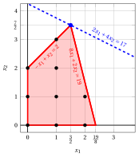{ .fig .ovale caricamento=lazy style="width:71%" }

    - <strong>Iterazione 1</strong>

        - **a)** <strong>Fase di generazione dei tagli</strong>

            Abbiamo il seguente dizionario del simplesso associato a una soluzione di base ammissibile frazionaria del problema $LP_1$ in forma standard:

            \begin{equation*}
            \begin{cases}
            \begin{array}{rrrrrrrrrrrrr}
            {x_1} & {=} & {\dfrac{3}{2}} & {+} & {\dfrac{1}{5}} \, {x_3} & {-} & {\dfrac{1}{10}}\, {x_4} \\[2ex]
            {x_2} & {=} & {\dfrac{7}{2}} & {-} & {\dfrac{4}{5}}\, {x_3} & {-} & {\dfrac{1}{10}}\, {x_4} \\[2ex]
            {z} & {=} & {17} & {-} & {\dfrac{14}{5}} \, {x_3} & {-} & {\dfrac{3}{5}} \, {x_4}
            \end{array}
            \end{casi}
            \fine{equazione*}

            dove

            \begin{equation*}
            { \bar{\boldsymbol A}}=
            \begin{pmatrix}
            -\dfrac{1}{5} & \dfrac{1}{10} \\[2ex]
            \dfrac{4}{5} & \dfrac{1}{10}
            \end{pmatrix}
            \qquad
            { \bar{\boldsymbol b}}=
            \begin{pmatrix}
            \dfrac{3}{2}\\[2ex]
            \dfrac{7}{2}
            \end{pmatrix}
            \fine{equazione*}

            - Il taglio frazionario di Gomory generato dalla prima riga è:

                \begin{align*}
                \underbrace{\left(-\dfrac{1}{5} - \left\lfloor -\dfrac{1}{5} \right\rfloor \right)}_{-\dfrac{1}{5}-(-1)=\dfrac{4}{5}} \; x_3
                + \underbrace{\left(\dfrac{1}{10} - \left\lfloor \dfrac{1}{10} \right\rfloor \right)}_{\dfrac{1}{10}-0=\dfrac{1}{10}} \; x_4
                \ge \underbrace{\left(\dfrac{3}{2} - \left\lfloor \dfrac{3}{2} \right\rfloor \right)}_{\dfrac{3}{2} -1=\dfrac{1}{2}}
                \end{align*}

                \begin{align*}
                \dfrac{4}{5}\;x_3 + \dfrac{1}{10}\;x_4 \ge \dfrac{1}{2}
                \quad \Rightarrow \quad
                8\;x_3+x_4 \ge 5
                \end{align*}

                Sottraendo una variabile in eccesso, otteniamo il taglio frazionario di Gomory in forma standard:

                $$
                \dfrac{4}{5}\;x_3 + \dfrac{1}{10}\;x_4 - x_5 = \dfrac{1}{2}
                \quad \Rightarrow \quad
                8\;x_3+x_4-10\;x_5=5
                $$

                Dalla forma standard del problema $LP_1$, abbiamo:

                $$
                x_3=2+x_1-x_2,
                \qquad
                x_4=19-8\;x_1-2\;x_2.
                $$

                Sostituendo nel taglio frazionario di Gomory, possiamo esprimerlo in termini delle variabili originali del problema ILP:

                $$
                8\;(2+x_1-x_2)+(19-8\;x_1-2\;x_2)\ge 5
                \quad \Rightarrow \quad
                x_2\le 3.
                $$

                Effetto del taglio frazionario di Gomory generato dalla prima riga sul problema $LP_1$ in forma canonica:

                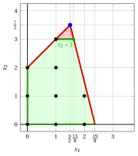{ .fig .ovale loading=lazy style="width:71%" }

            - Il taglio frazionario di Gomory generato dalla seconda riga è:

                \begin{align*}
                \underbrace{\left(\dfrac{4}{5} - \left\lfloor \dfrac{4}{5} \right\rfloor \right)}_{\dfrac{4}{5}-0=\dfrac{4}{5}} \; x_3
                + \underbrace{\left(\dfrac{1}{10} - \left\lfloor \dfrac{1}{10} \right\rfloor \right)}_{\dfrac{1}{10}-0=\dfrac{1}{10}} \; x_4
                \ge \underbrace{\left(\dfrac{7}{2} - \left\lfloor \dfrac{7}{2} \right\rfloor \right)}_{\dfrac{7}{2} -3=\dfrac{1}{2}}
                \end{align*}

                \begin{align*}
                \dfrac{4}{5}\;x_3 + \dfrac{1}{10}\;x_4 \ge \dfrac{1}{2}
                \quad \Rightarrow \quad
                8\;x_3+x_4 \ge 5
                \end{align*}

                Questa è la stessa tagliata frazionaria di Gomory ottenuta con la prima riga generatrice.

            Selezioniamo il taglio frazionario di Gomory con il lato destro più grande e creiamo il problema $LP_2$ aggiungendolo al problema $LP_1$.

        - **b)** <strong>Fase di riottimizzazione del simplesso duale</strong>

            Consideriamo il problema $LP_2$ nella forma standard:

            $$
            \begin{array}{rrrrrrrrrrrrr}
            {\max} & {2} \, {x_1} & {+} & {4} \, {x_2} \\[1.5ex]
            & {-} \, {x_1} & {+} & \, {x_2} & {+} & {x_3} &  &  &  &  & {=} & {2} \\[2ex]
            & {8} \, {x_1} & {+} & {2} \, {x_2} &  &  & {+} & {x_4} &  &  & {=} & {19} \\[2ex]
            &  &  & {x_2} &  &  &  &  & {+} & {x_5} & {=} & {3} \\[2ex]
            & {x_1,} &  & {x_2,} &  & {x_3,} &  & {x_4,} &  & {x_5} & { \ge} & { 0 }
            \end{array}
            $$

            Per il taglio frazionario di Gomory aggiunto abbiamo:

            $$
            8\;x_3+x_4-10\;x_5=5
            \quad \Rightarrow \quad
            x_5=-\dfrac{1}{2}+\dfrac{4}{5}\;x_3+\dfrac{1}{10}\;x_4
            $$

            Aggiungiamo quindi questa equazione al precedente dizionario ottimale e otteniamo il seguente dizionario :

            \begin{equation*}
            \begin{cases}
            \begin{array}{rrrrrrrrrrrrr}
            {x_1} & {=} & {\dfrac{3}{2}} & {+} & {\dfrac{1}{5}} \, {x_3} & {-} & {\dfrac{1}{10}}\, {x_4} \\[2ex]
            {x_2} & {=} & {\dfrac{7}{2}} & {-} & {\dfrac{4}{5}}\, {x_3} & {-} & {\dfrac{1}{10}}\, {x_4} \\[2ex]
            {x_5} & {=} & {-\dfrac{1}{2}} & {+} & {\dfrac{4}{5}}\, {x_3} & {+} & {\dfrac{1}{10}}\, {x_4} \\[2ex]
            {z} & {=} & {17} & {-} & {\dfrac{14}{5}} \, {x_3} & {-} & {\dfrac{3}{5}} \, {x_4}
            \end{array}
            \end{casi}
            \fine{equazione*}

            dove $\pazocal{B}=\{1,2,5\}$ e $\pazocal{N}=\{3,4\}$ e

            - la soluzione primale di base inammissibile è:

                $$
                \bar x_1=\dfrac{3}{2},~~
                \bar x_2=\dfrac{7}{2},~~
                \bar x_5=-\dfrac{1}{2},~~~~~~
                \bar x_3=0,~~
                \bar x_4=0~~
                \text{  of value   }17
                $$

            - la soluzione duale di base fattibile è:

                $$
                \bar \pi_1=0,~~
                \bar \pi_2=0,~~
                \bar \pi_5=0,~~~~~~
                \bar \pi_3=\dfrac{14}{5},~~
                \bar \pi_4=\dfrac{3}{5}~~
                \text{  of value   }17
                $$

            Se aumentiamo il valore di $\pi_5$, possiamo ottenere una migliore soluzione duale. Abbiamo:

            $$
            \begin{cases}
            \pi_3 &= \dfrac{14}{5} - \dfrac{4}{5} \,\pi_5 \\[2ex]
            \pi_4 &= \dfrac{3}{5} - \dfrac{1}{10}\,\pi_5
            \end{cases}
            \qquad
            \qquad
            \begin{cases}
            \underbrace{ \dfrac{14}{5} - \dfrac{4}{5}\,\pi_5 \ge 0}_{\pi_3 \ge 0} \\[2ex]
            \underbrace{  \dfrac{3}{5} - \dfrac{1}{10} \,\pi_5 \ge 0}_{\pi_4 \ge 0}
            \end{cases}
            \qquad
            \qquad
            \begin{cases}
            \pi_5 &\le  \dfrac{7}{2} \\[2ex]
            \pi_5 &\le 6
            \end{cases}
            $$

            Aumentando il valore di $\pi_5$ a $\min \left\{\dfrac{7}{2}, 6\right\}=\dfrac{7}{2}$, il valore di $\pi_3$ diminuisce a 0. Allora abbiamo che:

            - $\pi_5$ diventa una variabile di base doppia e di conseguenza $x_5$ diventa una variabile primale non di base

            - $\pi_3$ diventa una variabile non di base doppia e di conseguenza $x_3$ diventa una variabile basica primale

            Abbiamo:

            $$
            x_5 = -\dfrac{1}{2} + \dfrac{4}{5}\,x_3 + \dfrac{1}{10}\,x_4
            \quad \Longrightarrow \quad
            x_3= \dfrac{5}{8} - \dfrac{1}{8} x_4 + \dfrac{5}{4} x_5.
            $$

            Sostituendo nelle altre equazioni del dizionario primale, otteniamo:

            $$
            x_1 = \dfrac{3}{2} +  \dfrac{1}{5}  \left( \dfrac{5}{8} - \dfrac{1}{8} x_4 + \dfrac{5}{4} x_5  \right) -  \dfrac{1}{10} x_4
            = \dfrac{13}{8} - \dfrac{1}{8} x_4 + \dfrac{1}{4} x_5
            $$

            $$
            x_2 = \dfrac{7}{2} -  \dfrac{4}{5}   \left(  \dfrac{5}{8} - \dfrac{1}{8} x_4 + \dfrac{5}{4} x_5 \right) -  \dfrac{1}{10} x_4
            = 3 - x_5
            $$

            $$
            z = 17 -  \dfrac{14}{5}   \left(  \dfrac{5}{8} - \dfrac{1}{8} x_4 + \dfrac{5}{4} x_5 \right) -  \dfrac{3}{5} x_4
            =   \dfrac{61}{4} - \dfrac{1}{4} x_4 - \dfrac{7}{2} x_5
            $$

            Di conseguenza, abbiamo ora il seguente dizionario primale ottimale:

            \begin{equation*}
            \begin{cases}
            \begin{array}{rrrrrrrrrrrrr}
            {x_1} & {=} & {\dfrac{13}{8}} & {-} & {\dfrac{1}{8}}\, {x_4} & {+} & {\dfrac{1}{4}}\, {x_5} \\[2ex]
            {x_2} & {=} & {3} &  &  & {-} & \, {x_5} \\[2ex]
            {x_3} & {=} & {\dfrac{5}{8}} & {-} & {\dfrac{1}{8}} \, {x_4} & {+} & {\dfrac{5}{4}} \, {x_5} \\[2ex]
            {z} & {=} & {\dfrac{61}{4}} & {-} & {\dfrac{1}{4}}\, {x_4} & {-} & {\dfrac{7}{2}} \, {x_5}
            \end{array}
            \end{casi}
            \fine{equazione*}

            La soluzione ottimale ${ \tilde{ \boldsymbol x}}(\,LP_2\,)$ è <strong>frazionaria</strong> e il problema $LP_2$ è <strong>fattibile</strong>.

            Abbiamo il limite superiore sul valore ottimale del problema ILP:

            $$
            z(~ILP~) ~~\le~~  \underbrace{\left\lfloor \dfrac{61}{4} \right\rfloor}_{=15}
            $$

            Per il problema $LP_2$ in forma canonica, abbiamo:

            $$
            \begin{array}{rrrrrrrrrrrrr}
            {\max} & {2}\, {x_1} & {+} & {4}\, {x_2} \\[2ex]
            & {-} \, {x_1} & {+} & \, {x_2} & {\le} & {2} \\[2ex]
            & {8} \, {x_1} & {+} & {2} \, {x_2} & {\le} & {19} \\[2ex]
            &  &  & \, {x_2} & {\le} & {3} \\[2ex]
            & {x_1,} &  & {x_2} & { \ge } & {0}
            \end{array}
            $$

            Una soluzione ottimale ${ \tilde{ \boldsymbol x}}(\,LP_2\,)$ è:

            $$
            \tilde{x}_1=\dfrac{13}{8},\qquad \tilde{x}_2=3
            $$

            Il valore ottimale è:

            $$
            z(~LP_2~)=\dfrac{61}{4}
            $$

            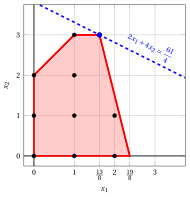{ .fig .ovale caricamento=lazy style="width:71%" }

    - <strong>Iterazione 2</strong>

        - **a)** <strong>Fase di generazione dei tagli</strong>

            Abbiamo il seguente dizionario del simplesso associato a una soluzione di base ammissibile frazionaria del problema $LP_2$ in forma standard:

            \begin{equation*}
            \begin{cases}
            \begin{array}{rrrrrrrrrrrrr}
            {x_1} & {=} & {\dfrac{13}{8}} & {-} & {\dfrac{1}{8}}\, {x_4} & {+} & {\dfrac{1}{4}}\, {x_5} \\[2ex]
            {x_2} & {=} & {3} &  &  & {-} & \, {x_5} \\[2ex]
            {x_3} & {=} & {\dfrac{5}{8}} & {-} & {\dfrac{1}{8}} \, {x_4} & {+} & {\dfrac{5}{4}} \, {x_5} \\[2ex]
            {z} & {=} & {\dfrac{61}{4}} & {-} & {\dfrac{1}{4}}\, {x_4} & {-} & {\dfrac{7}{2}} \, {x_5}
            \end{array}
            \end{casi}
            \fine{equazione*}

            dove

            \begin{equation*}
            { \bar{\boldsymbol A}}=
            \begin{pmatrix}
            \dfrac{1}{8} & -\dfrac{1}{4} \\[2ex]
            0 & 1 \\[2ex]
            \dfrac{1}{8} & -\dfrac{5}{4}
            \end{pmatrix}
            \qquad
            { ar{oldsymbol b}}=
            \begin{pmatrix}
            \dfrac{13}{8}\\[2ex]
            3\\[2ex]
            \dfrac{5}{8}
            \end{pmatrix}
            \fine{equazione*}

            - Il taglio frazionario di Gomory generato dalla prima riga è:

                \begin{align*}
                \underbrace{\left(\dfrac{1}{8} - \left\lfloor \dfrac{1}{8} \right\rfloor \right)}_{\dfrac{1}{8}-0=\dfrac{1}{8}} \; x_4
                + \underbrace{\left(-\dfrac{1}{4} - \left\lfloor -\dfrac{1}{4} \right\rfloor \right)}_{-\dfrac{1}{4}-(-1)=\dfrac{3}{4}} \; x_5
                \ge \underbrace{\left(\dfrac{13}{8} - \left\lfloor \dfrac{13}{8} \right\rfloor \right)}_{\dfrac{13}{8} -1=\dfrac{5}{8}}
                \end{align*}

                \begin{align*}
                \dfrac{1}{8}\;x_4 + \dfrac{3}{4}\;x_5 \ge \dfrac{5}{8}
                \quad \Rightarrow \quad
                x_4+6\;x_5 \ge 5
                \end{align*}

                Sottraendo una variabile in eccesso, otteniamo il taglio frazionario di Gomory in forma standard:

                $$
                \dfrac{1}{8}\;x_4 + \dfrac{3}{4}\;x_5 - x_6 = \dfrac{5}{8}
                \quad \Rightarrow \quad
                x_4+6\;x_5-8\;x_6=5
                $$

                Dalla forma standard del problema $LP_2$, abbiamo:

                $$
                x_4=19-8\;x_1-2\;x_2,
                \qquad
                x_5=3-x_2.
                $$

                Sostituendo nel taglio frazionario di Gomory, possiamo esprimerlo in termini delle variabili originali del problema ILP:

                $$
                (19-8\;x_1-2\;x_2)+6\;(3-x_2)\ge 5
                \quad \Rightarrow \quad
                x_1+x_2\le 4.
                $$

                Effetto del taglio frazionario di Gomory generato dalla prima riga sul problema $LP_2$ in forma canonica:

                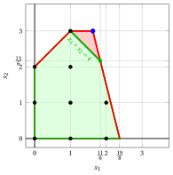{ .fig .ovale caricamento=lazy style="width:71%" }

            - Il taglio frazionario di Gomory generato dalla terza riga è:

                \begin{align*}
                \underbrace{\left(\dfrac{1}{8} - \left\lfloor \dfrac{1}{8} \right\rfloor \right)}_{\dfrac{1}{8}-0=\dfrac{1}{8}} \; x_4
                + \underbrace{\left(-\dfrac{5}{4} - \left\lfloor -\dfrac{5}{4} \right\rfloor \right)}_{-\dfrac{5}{4}+2=\dfrac{3}{4}} \; x_5
                \ge \underbrace{\left(\dfrac{5}{8} - \left\lfloor \dfrac{5}{8} \right\rfloor \right)}_{\dfrac{5}{8} -0=\dfrac{5}{8}}
                \end{align*}

                \begin{align*}
                \dfrac{1}{8}\;x_4 + \dfrac{3}{4}\;x_5 \ge \dfrac{5}{8}
                \quad \Rightarrow \quad
                x_4+6\;x_5 \ge 5
                \end{align*}

                Questa è la stessa tagliata frazionaria di Gomory ottenuta con la prima riga generatrice.

            Selezioniamo il taglio frazionario di Gomory con il lato destro più grande e creiamo il problema $LP_3$ aggiungendolo al problema $LP_2$.

        - **b)** <strong>Fase di riottimizzazione del simplesso duale</strong>

            Consideriamo il problema $LP_3$ nella forma standard:

            $$
            \begin{array}{rrrrrrrrrrrrrrrrr}
            {\max} & {2} \, {x_1} & {+} & {4} \, {x_2} \\[2ex]
            & {-} \, {x_1} & {+} & \, {x_2} & {+} & {x_3} &  &  &  &  &  &  & {=} & {2} \\[2ex]
            & {8} \, {x_1} & {+} & {2} \, {x_2} &  &  & {+} & \, {x_4} &  &  &  &  & {=} & {19} \\[2ex]
            &  &  & {x_2} &  &  &  &  & {+} & {x_5} &  &  & {=} & {3} \\[2ex]
            & \, {x_1} & {+} & \, {x_2} &  &  &  &  &  &  & {+} & {x_6} & {=} & {4} \\[2ex]
            & {x_1,} &  & {x_2,} &  & {x_3,} &  & {x_4,} &  & {x_5,} &  & {x_6} & { \ge } & {0}
            \end{array}
            $$

            Per il taglio frazionario di Gomory aggiunto abbiamo:

            $$
            x_4+6\;x_5-8\;x_6=5
            \quad \Rightarrow \quad
            x_6=-\dfrac{5}{8}+\dfrac{1}{8}\;x_4+\dfrac{3}{4}\;x_5
            $$

            Aggiungiamo quindi questa equazione al precedente dizionario ottimale e otteniamo il seguente dizionario :

            \begin{equation*}
            \begin{cases}
            \begin{array}{rrrrrrrrrrrrr}
            {x_1} & {=} & {\dfrac{13}{8}} & {-} & {\dfrac{1}{8}}\, {x_4} & {+} & {\dfrac{1}{4}}\, {x_5} \\[2ex]
            {x_2} & {=} & {3} &  &  & {-} & \, {x_5} \\[2ex]
            {x_3} & {=} & {\dfrac{5}{8}} & {-} & {\dfrac{1}{8}} \, {x_4} & {+} & {\dfrac{5}{4}} \, {x_5} \\[2ex]
            {x_6} & {=} & {-\dfrac{5}{8}} & {+} & {\dfrac{1}{8}} \, {x_4} & {+} & {\dfrac{3}{4}} \, {x_5} \\[2ex]
            {z} & {=} & {\dfrac{61}{4}} & {-} & {\dfrac{1}{4}}\, {x_4} & {-} & {\dfrac{7}{2}} \, {x_5}
            \end{array}
            \end{casi}
            \fine{equazione*}

            dove $\pazocal{B}=\{1,2,3,6\}$ e $\pazocal{N}=\{4,5\}$ e

            - la soluzione di base primaria inammissibile è:

                $$
                \bar x_1=\dfrac{13}{8},~~
                \bar x_2=3,~~
                \bar x_3=\dfrac{5}{8},~~
                \bar x_6=-\dfrac{5}{8},~~~~~~
                \bar x_4=0,~~
                \bar x_5=0~~
                \text{  of value   }\dfrac{61}{4}
                $$

            - la soluzione duale di base fattibile è:

                $$
                \bar \pi_1=0,~~
                \bar \pi_2=0,~~
                \bar \pi_3=0,~~
                \bar \pi_6=0,~~~~~~
                \bar \pi_4=\dfrac{1}{4},~~
                \bar \pi_5=\dfrac{7}{2}~~
                \text{  of value   }\dfrac{61}{4}
                $$

            Se aumentiamo il valore di $\pi_6$, possiamo ottenere una migliore soluzione duale. Abbiamo:

            $$
            \begin{cases}
            \pi_4 &= \dfrac{1}{4} - \dfrac{1}{8} \,\pi_6 \\[2ex]
            \pi_5 &= \dfrac{7}{2} - \dfrac{3}{4}\,\pi_6
            \end{cases}
            \qquad
            \qquad
            \begin{cases}
            \underbrace{ \dfrac{1}{4} - \dfrac{1}{8}\,\pi_6 \ge 0}_{\pi_4 \ge 0} \\[2ex]
            \underbrace{  \dfrac{7}{2} - \dfrac{3}{4} \,\pi_6 \ge 0}_{\pi_5 \ge 0}
            \end{cases}
            \qquad
            \qquad
            \begin{cases}
            \pi_6 &\le  2 \\[2ex]
            \pi_6 &\le \dfrac{14}{3}
            \end{cases}
            $$

            Aumentando il valore di $\pi_6$ a $\min \left\{2, \dfrac{14}{3}\right\}=2$, il valore di $\pi_4$ diminuisce a 0. Allora abbiamo che:

            - $\pi_6$ diventa una variabile di base doppia e di conseguenza $x_6$ diventa una variabile primale non di base

            - $\pi_4$ diventa una variabile non di base doppia e di conseguenza $x_4$ diventa una variabile basica primale

            Abbiamo:

            $$
            x_6 = - \dfrac{5}{8} + \dfrac{1}{8} \;x_4 + \dfrac{3}{4} \;x_5
            \quad \Longrightarrow \quad
            x_4= 5 - 6 x_5 + 8  x_6.
            $$

            Sostituendo nelle altre equazioni del dizionario primale, otteniamo:

            $$
            x_1 = \dfrac{13}{8} -  \dfrac{1}{8}  \left( 5 - 6 x_5 + 8  x_6  \right) +  \dfrac{1}{4} x_5
            = 1 +  x_5 -  x_6
            $$

            $$
            x_3 = \dfrac{5}{8} -  \dfrac{1}{8}   \left(  5 - 6 x_5 + 8  x_6 \right) +  \dfrac{5}{4} x_5
            =  2\; x_5 -  x_6
            $$

            $$
            z = \dfrac{61}{4} -  \dfrac{1}{4}   \left(  5 - 6 x_5 + 8  x_6 \right) -  \dfrac{7}{2} x_5
            =   14 - 2 x_5 - 2 x_6
            $$

            Di conseguenza, abbiamo ora il seguente dizionario primale ottimale:

            \begin{equation*}
            \begin{cases}
            \begin{array}{rrrrrrrrrrrrr}
            {x_1} & {=} & {1} & {+} & {x_5} & {-} & {x_6} \\[2ex]
            {x_2} & {=} & {3} & {-} & {x_5} &  &  \\[2ex]
            {x_3} & {=} & {0} & {+} & {2} \, {x_5} & {-} & {x_6} \\[2ex]
            {x_4} & {=} & {5} & {-} & {6} \, {x_5} & {+} & {8} \, {x_6} \\[2ex]
            {z} & {=} & {14} & {-} & {2}\, {x_5} & {-} & {2} \, {x_6}
            \end{array}
            \end{casi}
            \fine{equazione*}

            dove $\pazocal{B}=\{1,2,3,4\}$ e $\pazocal{N}=\{5,6\}$ e

            - la soluzione ottimale primale di base è:

                $$
                \tilde x_1=1,~~
                \tilde x_2=3,~~
                \tilde x_3=0,~~
                \tilde x_4=5,~~~~~~
                \tilde x_5=0,~~
                \tilde x_6=0~~
                \text{  of value   }14
                $$

            - la soluzione duale ottimale di base è:

                $$
                \tilde \pi_1=0,~~
                \tilde \pi_2=0,~~
                \tilde \pi_3=0,~~
                \tilde \pi_4=0,~~~~~~
                \tilde \pi_5=2,~~
                \tilde \pi_6=2~~
                \text{  of value   }14
                $$

            La soluzione ottimale ${ \tilde{ \boldsymbol x}}(\,LP_3\,)$ è <strong>intera</strong> e il problema $LP_3$ è <strong>fattibile</strong>.

            Abbiamo il limite superiore sul valore ottimale del problema ILP:

            $$
            z(~ILP~) ~~\le~~ 14
            $$

            Per il problema $LP_3$ in forma canonica, abbiamo:

            $$
            \begin{array}{rrrrrrrrrrrrr}
            {\max} & {2}\, {x_1} & {+} & {4}\, {x_2} \\[2ex]
            & {-} \, {x_1} & {+} & \, {x_2} & {\le} & {2} \\[2ex]
            & {8} \, {x_1} & {+} & {2} \, {x_2} & {\le} & {19} \\[2ex]
            &  &  & \, {x_2} & {\le} & {3} \\[2ex]
            & {x_1} & {+} & \, {x_2} & {\le} & {4} \\[2ex]
            & {x_1,} &  & {x_2} & { \ge } & {0}
            \end{array}
            $$

            Una soluzione ottimale ${ \tilde{ \boldsymbol x}}(\,LP_3\,)$ è:

            $$
            \tilde{x}_1=1,\qquad \tilde{x}_2=3
            $$

            Il valore ottimale è:

            $$
            z(~LP_3~)=14
            $$

            !!! chiave ""
                La soluzione ottimale ${ \tilde{ \boldsymbol x}}(\,LP_3\,)=(1,3)$ è <strong>intera</strong>. Pertanto, è anche una soluzione ottimale del problema ILP.

                $$
                z(~ILP~)=14.
                $$

            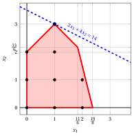{ .fig .ovale caricamento=lazy style="width:71%" }

!!! esercizio "Esercizio 6.4: Algoritmo del piano di taglio (P4)"
    Considera il seguente problema ILP in forma canonica di massimizzazione con $n=2$ variabili intere e $m=2$ vincoli:

    $$
    \begin{array}{rrrrrrrrrrrrr}
    {\max} & 5 \, {x_1} & {+} & 3 \, {x_2} \\[2ex]
    & {2} \, {x_1} & {+} & \, {x_2} & {\le} & {14} \\[2ex]
    & \, {x_1} & {+} & 8 \, {x_2} & {\le} & 32 \\[2ex]
    & {x_1,} &  & {x_2} & { \in } & { \Z_{\ge 0} }
    \end{array}
    $$

    e il seguente dizionario ottimale del suo rilassamento LP in forma standard:

    \begin{equation*}
    \begin{cases}
    \begin{array}{rrrrrrrrrrrrr}
    {x_1} & {=} & {\dfrac{16}{3}} & {-} & {\dfrac{8}{15}} \, {x_3} & {+} & {\dfrac{1}{15}}\, {x_4} \\[2ex]
    {x_2} & {=} & {\dfrac{10}{3}} & {+} & {\dfrac{1}{15}}\, {x_3} & {-} & {\dfrac{2}{15}}\, {x_4} \\[2ex]
    {z} & {=} & {\dfrac{110}{3}} & {-} & {\dfrac{37}{15}} \, {x_3} & {-} & {\dfrac{1}{15}} \, {x_4}
    \end{array}
    \end{casi}
    \fine{equazione*}

    **Domande**

    1. Esegui l'algoritmo del piano di taglio basato sui tagli frazionari di Gomory utilizzando:

        1. un taglio frazionario di Gomory a ogni iterazione;

        2. il lato destro più grande come strategia di selezione del taglio.

        Risolvi i problemi di PL dopo aver aggiunto il taglio frazionario di Gomory utilizzando l'algoritmo del simplesso duale. Mostra graficamente la soluzione ottimale del problema LP a ogni iterazione.

    2. Mostra graficamente l'effetto di ogni taglio frazionario di Gomory sulil rilassamento LP del problema ILP in forma canonica.

    !!! nota ""
        Data una riga $i \in \pazocal{B}$ di un dizionario del simplesso associato a una soluzione di base fattibile tale che $\bar{b}_i$ è frazionaria, la disuguaglianza lineare

        \begin{equation*}
        \sum_{j \in \pazocal{N}}
        \left(
        \bar{a}_{ij}
        -
        \left\lfloor \bar{a}_{ij}\right\rfloor
        \right)x_j
        \ge
        \bar{b}_i - \left\lfloor \bar{b}_i \right\rfloor
        \end{equation*}

        è chiamato il <strong>taglio frazionario di Gomory</strong> generato dalla riga $i$.

??? soluzione "Soluzione"

    Esecuzione dell'algoritmo del piano di taglio per risolvere il problema ILP.

    - <strong>Inizializzazione</strong>

        Consideriamo il problema $LP_1$ nella forma standard:

        $$
        \begin{array}{rrrrrrrrrr}
        {\max} & 5 \, {x_1} & {+} & 3 \, {x_2} &  &  &  &  \\[2ex]
        & {2} \, {x_1} & {+} & \, {x_2} & {+} & {x_3} &  &  & {=} & {14} \\[2ex]
        & \, {x_1} & {+} & 8 \, {x_2} &  &  & {+} & {x_4} & {=} & 32 \\[2ex]
        & {x_1,} &  & {x_2,} &  & {x_3,} &  & {x_4} & { \ge } & { 0 }
        \end{array}
        $$

        e il suo dizionario del simplesso ottimale:

        \begin{equation*}
        \begin{cases}
        \begin{array}{rrrrrrrrrrrrr}
        {x_1} & {=} & {\dfrac{16}{3}} & {-} & {\dfrac{8}{15}} \, {x_3} & {+} & {\dfrac{1}{15}}\, {x_4} \\[2ex]
        {x_2} & {=} & {\dfrac{10}{3}} & {+} & {\dfrac{1}{15}}\, {x_3} & {-} & {\dfrac{2}{15}}\, {x_4} \\[2ex]
        {z} & {=} & {\dfrac{110}{3}} & {-} & {\dfrac{37}{15}} \, {x_3} & {-} & {\dfrac{1}{15}} \, {x_4}
        \end{array}
        \end{casi}
        \fine{equazione*}

        La soluzione ottimale ${ \tilde{ \boldsymbol x}}(\,LP_1\,)$ è <strong>frazionaria</strong> e il problema $LP_1$ è <strong>fattibile</strong>.

        Abbiamo il limite superiore sul valore ottimale del problema ILP:

        $$
        z(~ILP~) ~~\le~~  \underbrace{\left\lfloor \dfrac{110}{3} \right\rfloor}_{=36}
        $$

        Per il problema $LP_1$ in forma canonica, abbiamo:

        $$
        \begin{array}{rrrrrrrrrrrrr}
        {\max} & 5 \, {x_1} & {+} & 3 \, {x_2} \\[2ex]
        & {2} \, {x_1} & {+} & \, {x_2} & {\le} & {14} \\[2ex]
        & \, {x_1} & {+} & 8 \, {x_2} & {\le} & 32 \\[2ex]
        & {x_1,} &  & {x_2} & { \ge } & { 0 }
        \end{array}
        $$

        Una soluzione ottimale ${ \tilde{ \boldsymbol x}}(\,LP_1\,)$ è:

        $$
        \tilde{x}_1=\dfrac{16}{3},\qquad \tilde{x}_2=\dfrac{10}{3}
        $$

        Il valore ottimale è:

        $$
        z(~LP_1~)=\dfrac{110}{3}
        $$

        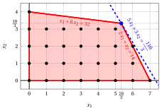{ .fig .ovale loading=lazy style="width:82%" }

    - <strong>Iterazione 1</strong>

        - **a)** <strong>Fase di generazione dei tagli</strong>

            Abbiamo il seguente dizionario del simplesso associato a una soluzione di base ammissibile frazionaria del problema $LP_1$ in forma standard:

            \begin{equation*}
            \begin{cases}
            \begin{array}{rrrrrrrrrrrrr}
            {x_1} & {=} & {\dfrac{16}{3}} & {-} & {\dfrac{8}{15}} \, {x_3} & {+} & {\dfrac{1}{15}}\, {x_4} \\[2ex]
            {x_2} & {=} & {\dfrac{10}{3}} & {+} & {\dfrac{1}{15}}\, {x_3} & {-} & {\dfrac{2}{15}}\, {x_4} \\[2ex]
            {z} & {=} & {\dfrac{110}{3}} & {-} & {\dfrac{37}{15}} \, {x_3} & {-} & {\dfrac{1}{15}} \, {x_4}
            \end{array}
            \end{casi}
            \fine{equazione*}

            dove

            \begin{equation*}
            { \bar{\boldsymbol A}}=
            \begin{pmatrix}
            \dfrac{8}{15} & -\dfrac{1}{15} \\[2ex]
            -\dfrac{1}{15} & \dfrac{2}{15}
            \end{pmatrix}
            \qquad
            { ar{oldsymbol b}}=
            \begin{pmatrix}
            \dfrac{16}{3}\\[2ex]
            \dfrac{10}{3}
            \end{pmatrix}
            \fine{equazione*}

            - Il taglio frazionario di Gomory generato dalla prima riga è:

                \begin{align*}
                \underbrace{\left(\dfrac{8}{15} - \left\lfloor \dfrac{8}{15} \right\rfloor \right)}_{\dfrac{8}{15}-0=\dfrac{8}{15}} \; x_3 + \underbrace{\left(-\dfrac{1}{15} - \left\lfloor -\dfrac{1}{15} \right\rfloor \right)}_{-\dfrac{1}{15}-(-1)=\dfrac{14}{15}} \; x_4 \ge \underbrace{\left(\dfrac{16}{3} - \left\lfloor \dfrac{16}{3} \right\rfloor \right)}_{\dfrac{16}{3} -5=\dfrac{1}{3}}
                \end{align*}

                \begin{align*}
                \dfrac{8}{15}\;x_3 + \dfrac{14}{15} \;x_4 \ge \dfrac{1}{3}
                \quad \Rightarrow \quad
                8 \;x_3 + 14 \;x_4 \ge 5
                \end{align*}

                Dalla forma standard del problema $LP_1$, abbiamo:

                $$
                x_3=14-2\;x_1-x_2,
                \qquad
                x_4=32-x_1-8\;x_2.
                $$

                Sostituendo nel taglio frazionario di Gomory, possiamo esprimerlo in termini delle variabili originali del problema ILP:

                $$
                8\;(14-2\:x_1-x_2)+14\;(32-x_1-8\:x_2)\ge 5
                \quad \Rightarrow \quad
                2\;x_1+8\;x_2\le 37
                $$

                Dividendo per il massimo comune divisore $2$ dei coefficienti e arrotondando per difetto il lato destro, otteniamo il taglio in forma primitiva:

                $$
                x_1+4\;x_2\le \left\lfloor \dfrac{37}{2} \right\rfloor = 18
                $$

                Effetto del taglio frazionario di Gomory generato dalla prima riga sul problema $LP_1$ in forma canonica:

                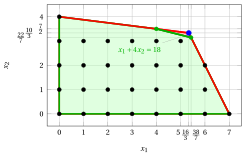{ .fig .ovale caricamento=lazy style="width:82%" }

            - Il taglio frazionario di Gomory generato dalla seconda riga è:

                \begin{align*}
                \underbrace{\left(-\dfrac{1}{15} - \left\lfloor -\dfrac{1}{15} \right\rfloor \right)}_{-\dfrac{1}{15}-(-1)=\dfrac{14}{15}} \; x_3 + \underbrace{\left(\dfrac{2}{15} - \left\lfloor \dfrac{2}{15} \right\rfloor \right)}_{\dfrac{2}{15}-0=\dfrac{2}{15}} \; x_4 \ge \underbrace{\left(\dfrac{10}{3} - \left\lfloor \dfrac{10}{3} \right\rfloor \right)}_{\dfrac{10}{3} -3=\dfrac{1}{3}}
                \end{align*}

                \begin{align*}
                \dfrac{14}{15}\;x_3 + \dfrac{2}{15} \;x_4 \ge \dfrac{1}{3}
                \quad \Rightarrow \quad
                14\;x_3 + 2 \;x_4 \ge 5
                \end{align*}

                Dalla forma standard del problema $LP_1$, abbiamo:

                $$
                x_3=14-2\;x_1-x_2,
                \qquad
                x_4=32-x_1-8\;x_2.
                $$

                Sostituendo nel taglio frazionario di Gomory, possiamo esprimerlo in termini delle variabili originali del problema ILP:

                $$
                14\;(14-2\:x_1-x_2)+2\;(32-x_1-8\:x_2)\ge 5
                \quad \Rightarrow \quad
                2\;x_1+2\;x_2\le 17
                $$

                Dividendo per il massimo comune divisore $2$ dei coefficienti e arrotondando per difetto il lato destro, otteniamo il taglio in forma primitiva:

                $$
                x_1+x_2\le \left\lfloor \dfrac{17}{2} \right\rfloor = 8
                $$

                Effetto del taglio frazionario di Gomory generato dalla seconda riga sul problema $LP_1$ in forma canonica:

                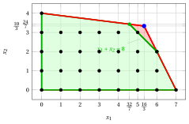{ .fig .ovale caricamento=lazy style="width:82%" }

            Entrambi i tagli frazionari di Gomory hanno lo stesso lato destro, uguale a $\dfrac{1}{3}$. Selezioniamo il taglio frazionario di Gomory generato dalla seconda riga e creiamo il problema $LP_2$ aggiungendolo al problema $LP_1$.

        - **b)** <strong>Fase di riottimizzazione del simplesso duale</strong>

            Consideriamo il problema $LP_2$ nella forma standard:

            $$
            \begin{array}{rrrrrrrrrrrr}
            {\max} & 5 \, {x_1} & {+} & 3 \, {x_2} &  &  &  &  &  &  \\[2ex]
            & {2}\, {x_1} & {+} & \, {x_2} & {+} & {x_3} &  &  &  &  & {=} & {14} \\[2ex]
            & \, {x_1} & {+} & {8}\, {x_2} &  &  & {+} & {x_4} &  &  & {=} & {32} \\[2ex]
            & \, {x_1} & {+} & \, {x_2} &  &  &  &  & {+} & {x_5} & {=} & {8} \\[2ex]
            & {x_1,} &  & {x_2,} &  & {x_3,} &  & {x_4,} &  & {x_5} & {\ge} & {0}
            \end{array}
            $$

            La variabile slack del taglio primitivo aggiunto è $x_5 = 8 - x_1 - x_2$. Sostituendo le righe di $x_1$ e $x_2$ del precedente dizionario ottimale, otteniamo:

            $$
            x_5 = 8 - \left(\dfrac{16}{3} - \dfrac{8}{15}\;x_3 + \dfrac{1}{15}\;x_4\right) - \left(\dfrac{10}{3} + \dfrac{1}{15}\;x_3 - \dfrac{2}{15}\;x_4\right)
            = -\dfrac{2}{3} + \dfrac{7}{15}\;x_3 + \dfrac{1}{15} \;x_4
            $$

            Aggiungiamo quindi questa equazione al precedente dizionario ottimale e otteniamo il seguente dizionario:

            \begin{equation*}
            \begin{cases}
            \begin{array}{rrrrrrrrrrrrr}
            {x_1} & {=} & {\dfrac{16}{3}} & {-} & {\dfrac{8}{15}} \, {x_3} & {+} & {\dfrac{1}{15}}\, {x_4} \\[2ex]
            {x_2} & {=} & {\dfrac{10}{3}} & {+} & {\dfrac{1}{15}}\, {x_3} & {-} & {\dfrac{2}{15}}\, {x_4} \\[2ex]
            {x_5} & {=} & {-\dfrac{2}{3}} & {+} & {\dfrac{7}{15}}\, {x_3} & {+} & {\dfrac{1}{15}}\, {x_4} \\[2ex]
            {z} & {=} & {\dfrac{110}{3}} & {-} & {\dfrac{37}{15}} \, {x_3} & {-} & {\dfrac{1}{15}} \, {x_4}
            \end{array}
            \end{casi}
            \fine{equazione*}

            dove $\pazocal{B}=\{1,2,5\}$ e $\pazocal{N}=\{3,4\}$ e

            - la soluzione primale di base inammissibile è:

                $$
                \bar x_1=\dfrac{16}{3},~~
                \bar x_2=\dfrac{10}{3},~~
                \bar x_5=-\dfrac{2}{3},~~~~~~
                \bar x_3=0,~~
                \bar x_4=0~~
                \text{  of value   }\dfrac{110}{3}
                $$

            - la soluzione duale di base fattibile è:

                $$
                \bar \pi_1=0,~~
                \bar \pi_2=0,~~
                \bar \pi_5=0,~~~~~~
                \bar \pi_3=\dfrac{37}{15},~~
                \bar \pi_4=\dfrac{1}{15}~~
                \text{  of value   }\dfrac{110}{3}
                $$

            Se aumentiamo il valore di $\pi_5$, possiamo ottenere una migliore soluzione duale. Abbiamo:

            $$
            \begin{cases}
            \pi_3 &= \dfrac{37}{15} - \dfrac{7}{15}\,\pi_5 \\[2ex]
            \pi_4 &= \dfrac{1}{15} - \dfrac{1}{15}\,\pi_5
            \end{cases}
            \qquad
            \qquad
            \begin{cases}
            \underbrace{ \dfrac{37}{15} - \dfrac{7}{15}\,\pi_5 \ge 0}_{\pi_3 \ge 0} \\[2ex]
            \underbrace{  \dfrac{1}{15} - \dfrac{1}{15}\,\pi_5 \ge 0}_{\pi_4 \ge 0}
            \end{cases}
            \qquad
            \qquad
            \begin{cases}
            \pi_5 &\le  \dfrac{37}{7} \\[2ex]
            \pi_5 &\le  1
            \end{cases}
            $$

            Aumentando il valore di $\pi_5$ a $\min \left\{\dfrac{37}{7}, 1\right\}=1$, il valore di $\pi_4$ diminuisce a 0. Allora abbiamo che:

            - $\pi_5$ diventa una variabile di base doppia e di conseguenza $x_5$ diventa una variabile primale non di base

            - $\pi_4$ diventa una variabile non di base doppia e di conseguenza $x_4$ diventa una variabile basica primale

            Abbiamo:

            $$
            x_5 = -\dfrac{2}{3} + \dfrac{7}{15}\,  x_3 + \dfrac{1}{15}\, x_4 \quad \Rightarrow \quad x_4= 10 - 7\, x_3 + 15\, x_5.
            $$

            Sostituendo nelle altre equazioni del dizionario primale, otteniamo:

            $$
            x_1 = \dfrac{16}{3} -  \dfrac{8}{15}  x_3 + \dfrac{1}{15} \left( 10 - 7 x_3 + 15 x_5 \right)= 6 - x_3 + x_5
            $$

            $$
            x_2 = \dfrac{10}{3} + \dfrac{1}{15} x_3 -  \dfrac{2}{15} \left( 10 - 7 x_3 + 15 x_5 \right) =  2 + x_3 - 2\, x_5
            $$

            $$
            z = \dfrac{110}{3} -  \dfrac{37}{15} x_3 -  \dfrac{1}{15} \left( 10 - 7 x_3 + 15 x_5 \right) =   36 - 2 x_3 - x_5
            $$

            Di conseguenza, abbiamo ora il seguente dizionario primale ottimale:

            \begin{equation*}
            \begin{cases}
            \begin{array}{rrrrrrrrrrrrr}
            {x_1} & {=} & {6} & {-} & {x_3} & {+} & {x_5} \\[2ex]
            {x_2} & {=} & {2} & {+} & {x_3} & {-} & {2} \, {x_5} \\[2ex]
            {x_4} & {=} & {10} & {-} & {7} \, {x_3} & {+} & {15}\, {x_5} \\[2ex]
            {z} & {=} & {36} & {-} & {2} \, {x_3} & {-} & {x_5}
            \end{array}
            \end{casi}
            \fine{equazione*}

            dove $\pazocal{B}=\{1,2,4\}$ e $\pazocal{N}=\{3,5\}$ e

            - la soluzione ottimale primale di base è:

                $$
                \tilde x_1=6,~~
                \tilde x_2=2,~~
                \tilde x_4=10,~~~~~~
                \tilde x_3=0,~~
                \tilde x_5=0~~
                \text{  of value   } 36
                $$

            - la soluzione duale ottimale di base è:

                $$
                \tilde \pi_1=0,~~
                \tilde \pi_2=0,~~
                \tilde \pi_4=0,~~~~~~
                \tilde \pi_3=2,~~
                \tilde \pi_5=1~~
                \text{  of value   } 36
                $$

            !!! chiave ""
                La soluzione ottimale ${ \tilde{ \boldsymbol x}}(\,LP_2\,)=(6,2)$ è <strong>intera</strong>. Pertanto, è anche una soluzione ottimale del problema ILP.

                $$
                z(~ILP~)=36.
                $$

            Per il problema $LP_2$ in forma canonica, abbiamo:

            $$
            \begin{array}{rrrrrrrrrrrrr}
            {\max} & 5 \, {x_1} & {+} & 3 \, {x_2} \\[2ex]
            & {2} \, {x_1} & {+} & \, {x_2} & {\le} & {14} \\[2ex]
            & \, {x_1} & {+} & 8 \, {x_2} & {\le} & 32 \\[2ex]
            & \, {x_1} & {+} & \, {x_2} & {\le} & 8 \\[2ex]
            & {x_1,} &  & {x_2} & { \ge } & { 0 }
            \end{array}
            $$

            Una soluzione ottimale ${ \tilde{ \boldsymbol x}}(\,LP_2\,)$ è:

            $$
            \tilde{x}_1=6,\qquad \tilde{x}_2=2
            $$

            Il valore ottimale è:

            $$
            z(~LP_2~)=36
            $$

            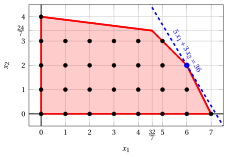{ .fig .ovale caricamento=lazy style="width:82%" }

!!! esercizio "Esercizio 6.5: Algoritmo del piano di taglio (P7)"
    Considera il seguente problema ILP nella forma canonica di massimizzazione con $n=2$ variabili intere e $m=2$ vincoli lineari:

    $$
    \begin{array}{rrrrrr}
    {\max} & {3\,x_1} & {+} & {x_2} &  &  \\[2ex]
    & {x_1} & {+} & {4\,x_2} & {\le} & {12} \\[2ex]
    & {2\,x_1} & {+} & {x_2} & {\le} & {5} \\[2ex]
    & {x_1,} &  & {x_2} & {\in} & {\Z_{\ge 0}}
    \end{array}
    $$

    e il seguente dizionario ottimale del suo rilassamento LP in forma standard:

    \begin{equation*}
    \begin{cases}
    \begin{array}{rrrrrrrrrrrrr}
    {x_1} & {=} & {\dfrac{5}{2}} & {-} & {\dfrac{1}{2}}\, {x_2} & {-} & {\dfrac{1}{2}}\, {x_4} \\[2ex]
    {x_3} & {=} & {\dfrac{19}{2}} & {-} & {\dfrac{7}{2}}\, {x_2} & {+} & {\dfrac{1}{2}}\, {x_4} \\[2ex]
    {z} & {=} & {\dfrac{15}{2}} & {-} & {\dfrac{1}{2}}\, {x_2} & {-} & {\dfrac{3}{2}}\, {x_4}
    \end{array}
    \end{casi}
    \fine{equazione*}

    **Domande**

    1. Esegui l'algoritmo del piano di taglio basato sui tagli frazionari di Gomory utilizzando:

        1. un taglio frazionario di Gomory a ogni iterazione;

        2. il lato destro più grande come strategia di selezione del taglio.

        Risolvi i problemi di PL dopo aver aggiunto il taglio frazionario di Gomory utilizzando l'algoritmo del simplesso duale. Mostra graficamente la soluzione ottimale del problema LP a ogni iterazione.

    2. Mostra graficamente l'effetto di ciascun taglio frazionario di Gomory sulil rilassamento LP del problema ILP in forma canonica.

    !!! nota ""
        Data una riga $i \in \pazocal{B}$ di un dizionario del simplesso associato a una soluzione di base ammissibile tale che $\bar{b}_i$ sia frazionaria, l'inequazione lineare

        \begin{equation*}
        \sum_{j \in \pazocal{N}}
        \left(
        \bar{a}_{ij}
        -
        \left\lfloor \bar{a}_{ij}\right\rfloor
        \right)x_j
        \ge
        \bar{b}_i - \left\lfloor \bar{b}_i \right\rfloor
        \end{equation*}

        è chiamato il <strong>taglio frazionario di Gomory</strong> generato dalla riga $i$.

??? soluzione "Soluzione"

    Esecuzione dell'algoritmo del piano di taglio per risolvere il problema ILP.

    - <strong>Inizializzazione</strong>

        Consideriamo il problema $LP_1$ nella forma standard:

        $$
        \begin{array}{rrrrrrrrrr}
        {\max} & {3\,x_1} & {+} & {x_2} &  &  &  &  \\[2ex]
        & {x_1} & {+} & {4\,x_2} & {+} & {x_3} &  &  & {=} & {12} \\[2ex]
        & {2\,x_1} & {+} & {x_2} &  &  & {+} & {x_4} & {=} & {5} \\[2ex]
        & {x_1,} &  & {x_2,} &  & {x_3,} &  & {x_4} & {\ge} & {0}
        \end{array}
        $$

        e il suo dizionario del simplesso ottimale:

        \begin{equation*}
        \begin{cases}
        \begin{array}{rrrrrrrrrrrrr}
        {x_1} & {=} & {\dfrac{5}{2}} & {-} & {\dfrac{1}{2}}\, {x_2} & {-} & {\dfrac{1}{2}}\, {x_4} \\[2ex]
        {x_3} & {=} & {\dfrac{19}{2}} & {-} & {\dfrac{7}{2}}\, {x_2} & {+} & {\dfrac{1}{2}}\, {x_4} \\[2ex]
        {z} & {=} & {\dfrac{15}{2}} & {-} & {\dfrac{1}{2}}\, {x_2} & {-} & {\dfrac{3}{2}}\, {x_4}
        \end{array}
        \end{casi}
        \fine{equazione*}

        La soluzione ottimale ${ \tilde{ \boldsymbol x}}(\,LP_1\,)$ è <strong>frazionaria</strong> e il problema $LP_1$ è <strong>fattibile</strong>.

        Abbiamo il limite superiore sul valore ottimale del problema ILP:

        $$
        z(~ILP~) ~~\le~~  \underbrace{\left\lfloor \dfrac{15}{2} \right\rfloor}_{=7}
        $$

        Per il problema $LP_1$ in forma canonica, abbiamo:

        $$
        \begin{array}{rrrrrr}
        {\max} & {3\,x_1} & {+} & {x_2} &  &  \\[2ex]
        & {x_1} & {+} & {4\,x_2} & {\le} & {12} \\[2ex]
        & {2\,x_1} & {+} & {x_2} & {\le} & {5} \\[2ex]
        & {x_1,} &  & {x_2} & {\ge} & {0}
        \end{array}
        $$

        Una soluzione ottimale ${ \tilde{ \boldsymbol x}}(\,LP_1\,)$ è:

        $$
        \tilde{x}_1=\dfrac{5}{2},\qquad \tilde{x}_2=0
        $$

        Il valore ottimale è:

        $$
        z(~LP_1~)=\dfrac{15}{2}
        $$

        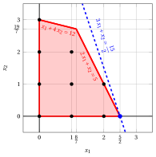{ .fig .ovale caricamento=lazy style="width:71%" }

    - <strong>Iterazione 1</strong>

        - **a)** <strong>Fase di generazione dei tagli</strong>

            Abbiamo il seguente dizionario del simplesso associato a una soluzione di base ammissibile frazionaria del problema $LP_1$ in forma standard:

            \begin{equation*}
            \begin{cases}
            \begin{array}{rrrrrrrrrrrrr}
            {x_1} & {=} & {\dfrac{5}{2}} & {-} & {\dfrac{1}{2}}\, {x_2} & {-} & {\dfrac{1}{2}}\, {x_4} \\[2ex]
            {x_3} & {=} & {\dfrac{19}{2}} & {-} & {\dfrac{7}{2}}\, {x_2} & {+} & {\dfrac{1}{2}}\, {x_4} \\[2ex]
            {z} & {=} & {\dfrac{15}{2}} & {-} & {\dfrac{1}{2}}\, {x_2} & {-} & {\dfrac{3}{2}}\, {x_4}
            \end{array}
            \end{casi}
            \fine{equazione*}

            dove

            \begin{equation*}
            { \bar{\boldsymbol A}}=
            \begin{pmatrix}
            \frac{1}{2} & \frac{1}{2} \\[2ex]
            \frac{7}{2} & -\frac{1}{2}
            \end{pmatrix}
            \qquad
            { \bar{\boldsymbol b}}=
            \begin{pmatrix}
            \frac{5}{2}\\[2ex]
            \frac{19}{2}
            \end{pmatrix}
            \fine{equazione*}

            - Il taglio frazionario di Gomory generato dalla prima riga è:

                \begin{align*}
                \underbrace{\left(\frac{1}{2} - \left\lfloor \frac{1}{2} \right\rfloor \right)}_{\frac{1}{2}-0=\frac{1}{2}} \; x_2 + \underbrace{\left(\frac{1}{2} - \left\lfloor \frac{1}{2} \right\rfloor \right)}_{\frac{1}{2}-0=\frac{1}{2}} \; x_4
                \ge \underbrace{\left(\frac{5}{2} - \left\lfloor \frac{5}{2} \right\rfloor \right)}_{\frac{5}{2} -2=\frac{1}{2}}
                \end{align*}

                \begin{align*}
                \frac{1}{2}\;x_2 + \frac{1}{2}\;x_4 \ge \frac{1}{2}
                \quad \Rightarrow \quad
                x_2 + x_4 \ge 1
                \end{align*}

                Sottraendo una variabile in eccesso, otteniamo il taglio frazionario di Gomory in forma standard:

                $$
                \frac{1}{2}\;x_2 + \frac{1}{2}\;x_4 - x_5 = \frac{1}{2}
                \quad \Rightarrow \quad
                x_2 + x_4 - 2\;x_5 = 1
                $$

                Dalla forma standard del problema $LP_1$, abbiamo:

                $$
                x_4= 5 - 2 \;x_1 - x_2.
                $$

                Sostituendo nel taglio frazionario di Gomory, possiamo esprimerlo in termini delle variabili originali del problema ILP:

                $$
                x_2 + (5 - 2\;x_1 - x_2) \ge 1
                \quad \Rightarrow \quad
                x_1 \le 2
                $$

                Effetto del taglio frazionario di Gomory generato dalla prima riga sul problema $LP_1$ in forma canonica:

                { .fig .ovale caricamento=lazy style="width:71%" }

            - Il taglio frazionario di Gomory generato dalla seconda riga è:

                \begin{align*}
                \underbrace{\left(\frac{7}{2} - \left\lfloor \frac{7}{2} \right\rfloor \right)}_{\frac{7}{2}-3=\frac{1}{2}} \; x_2
                + \underbrace{\left(-\frac{1}{2} - \left\lfloor -\frac{1}{2} \right\rfloor \right)}_{-\frac{1}{2}-(-1)=\frac{1}{2}} \; x_4
                \ge \underbrace{\left(\frac{19}{2} - \left\lfloor \frac{19}{2} \right\rfloor \right)}_{\frac{19}{2} -9=\frac{1}{2}}
                \end{align*}

                \begin{align*}
                \frac{1}{2}\;x_2 + \frac{1}{2}\;x_4 \ge \frac{1}{2}
                \quad \Rightarrow \quad
                x_2 + x_4 \ge 1
                \end{align*}

                Questo taglio frazionario di Gomory è lo stesso di quello generato dalla prima riga.

                Selezioniamo il taglio frazionario di Gomory con il lato destro più grande e creiamo il problema $LP_2$ aggiungendolo al problema $LP_1$.

        - **b)** <strong>Fase di riottimizzazione LP</strong>

            Consideriamo il problema $LP_2$ nella forma standard:

            $$
            \begin{array}{rrrrrrrrrrrr}
            {\max} & {3\,x_1} & {+} & {x_2} &  &  &  &  &  &  &  &  \\[2ex]
            & {x_1} & {+} & {4\,x_2} & {+} & {x_3} &  &  &  &  & {=} & {12} \\[2ex]
            & {2\,x_1} & {+} & {x_2} &  &  & {+} & {x_4} &  &  & {=} & {5} \\[2ex]
            & {x_1} &  &  &  &  &  &  & {+} & {x_5} & {=} & {2} \\[2ex]
            & {x_1,} &  & {x_2,} &  & {x_3,} &  & {x_4,} &  & {x_5} & {\ge} & {0}
            \end{array}
            $$

            Per il taglio frazionario di Gomory aggiunto abbiamo:

            $$
            x_2 + x_4 - 2\;x_5 = 1
            \quad \Rightarrow \quad
            x_5 = -\dfrac{1}{2} + \dfrac{1}{2}\;x_2 + \dfrac{1}{2}\;x_4
            $$

            Aggiungiamo quindi questa equazione al precedente dizionario ottimale e otteniamo il seguente dizionario :

            \begin{equation*}
            \begin{cases}
            \begin{array}{rrrrrrrrrrrrr}
            {x_1} & {=} & {\dfrac{5}{2}} & {-} & {\dfrac{1}{2}}\, {x_2} & {-} & {\dfrac{1}{2}}\, {x_4} \\[2ex]
            {x_3} & {=} & {\dfrac{19}{2}} & {-} & {\dfrac{7}{2}}\, {x_2} & {+} & {\dfrac{1}{2}}\, {x_4} \\[2ex]
            {x_5} & {=} & {-\dfrac{1}{2}} & {+} & {\dfrac{1}{2}}\, {x_2} & {+} & {\dfrac{1}{2}}\, {x_4} \\[2ex]
            {z} & {=} & {\dfrac{15}{2}} & {-} & {\dfrac{1}{2}}\, {x_2} & {-} & {\dfrac{3}{2}}\, {x_4}
            \end{array}
            \end{casi}
            \fine{equazione*}

            dove $\pazocal{B}=\{1,3,5\}$ e $\pazocal{N}=\{2,4\}$ e

            - la soluzione primale di base inammissibile è:

                $$
                \bar x_1=\dfrac{5}{2},~~
                \bar x_3=\dfrac{19}{2},~~
                \bar x_5=-\dfrac{1}{2},~~~~~~
                \bar x_2=0,~~
                \bar x_4=0~~
                \text{  of value   }\dfrac{15}{2}
                $$

            - la soluzione duale di base fattibile è:

                $$
                \bar \pi_1=0,~~
                \bar \pi_3=0,~~
                \bar \pi_5=0,~~~~~~
                \bar \pi_2=\dfrac{1}{2},~~
                \bar \pi_4=\dfrac{3}{2}~~
                \text{  of value   }\dfrac{15}{2}
                $$

            Se aumentiamo il valore di $\pi_5$, possiamo ottenere una migliore soluzione duale. Abbiamo:

            $$
            \begin{cases}
            \pi_2 &= \dfrac{1}{2} - \dfrac{1}{2}\,\pi_5 \\[2ex]
            \pi_4 &= \dfrac{3}{2} - \dfrac{1}{2}\,\pi_5
            \end{cases}
            \qquad
            \qquad
            \begin{cases}
            \underbrace{ \dfrac{1}{2} - \dfrac{1}{2}\,\pi_5 \ge 0}_{\pi_2 \ge 0} \\[2ex]
            \underbrace{  \dfrac{3}{2} - \dfrac{1}{2}\,\pi_5 \ge 0}_{\pi_4 \ge 0}
            \end{cases}
            \qquad
            \qquad
            \begin{cases}
            \pi_5 &\le  1 \\[2ex]
            \pi_5 &\le  3
            \end{cases}
            $$

            Aumentando il valore di $\pi_5$ a $\min \left\{1, 3\right\}=1$, il valore di $\pi_2$ diminuisce a 0. Allora abbiamo che:

            - $\pi_5$ diventa una variabile di base doppia e di conseguenza $x_5$ diventa una variabile primale non di base

            - $\pi_2$ diventa una variabile non di base doppia e di conseguenza $x_2$ diventa una variabile basica primale

            Abbiamo:

            $$
            x_5 = -\dfrac{1}{2} + \dfrac{1}{2}\, x_2 + \dfrac{1}{2}\, x_4
            \quad \Longrightarrow \quad
            x_2 = 1 - x_4 + 2\,x_5
            $$

            Sostituendo nelle altre equazioni del dizionario primale, otteniamo:

            $$
            x_1 = \dfrac{5}{2}  -  \dfrac{1}{2} \left( 1 - x_4 + 2\,x_5   \right) -  \dfrac{1}{2} x_4
            = 2 - x_5
            $$

            $$
            x_3 = \dfrac{19}{2}  -  \dfrac{7}{2} \left( 1 - x_4 + 2\,x_5   \right) +  \dfrac{1}{2} x_4
            = 6 + 4\,x_4 - 7\,x_5
            $$

            $$
            z = \dfrac{15}{2}  -  \dfrac{1}{2} \left( 1 - x_4 + 2\,x_5   \right) -  \dfrac{3}{2} x_4
            = 7 - x_4 - x_5
            $$

            Di conseguenza, abbiamo ora il seguente dizionario primale ottimale:

            \begin{equation*}
            \begin{cases}
            \begin{array}{rrrrrrrrrrrrr}
            {x_1} & {=} & {2} &  &  & {-} & {x_5} \\[2ex]
            {x_2} & {=} & {1} & {-} & {x_4} & {+} & {2}\, {x_5} \\[2ex]
            {x_3} & {=} & {6} & {+} & {4}\, {x_4} & {-} & {7}\, {x_5} \\[2ex]
            {z} & {=} & {7} & {-} & {x_4} & {-} & {x_5}
            \end{array}
            \end{casi}
            \fine{equazione*}

            dove $\pazocal{B}=\{1,2,3\}$ e $\pazocal{N}=\{4,5\}$.

            - la soluzione ottimale primale di base è:

                $$
                \tilde x_1 = 2,~~
                \tilde x_2 = 1,~~
                \tilde x_3 = 6,~~
                \tilde x_4 = 0,~~
                \tilde x_5 = 0
                \qquad
                \text{of value  }  7
                $$

            - la soluzione duale ottimale di base è:

                $$
                \tilde \pi_1 = 0,~~
                \tilde \pi_2 = 0,~~
                \tilde \pi_3 = 0,~~
                \tilde \pi_4 = 1,~~
                \tilde \pi_5 = 1
                \qquad
                \text{of value  }  7
                $$

            !!! chiave ""
                La soluzione ottimale ${ \tilde{ \boldsymbol x}}(\,LP_2\,)$ è <strong>intera</strong>. Di conseguenza, una soluzione ottimale ${ \tilde{ \boldsymbol x}}(\,ILP\,)$ è:

                $$
                \tilde{x}_1=2,~~\tilde{x}_2=1
                $$

                Il valore ottimale $z(~ILP~)$ è $7$.

            Per il problema $LP_2$ in forma canonica, abbiamo:

            $$
            \begin{array}{rrrrrr}
            {\max} & {3\,x_1} & {+} & {x_2} &  &  \\[2ex]
            & {x_1} & {+} & {4\,x_2} & {\le} & {12} \\[2ex]
            & {2\,x_1} & {+} & {x_2} & {\le} & {5} \\[2ex]
            & {x_1} &  &  & {\le} & {2} \\[2ex]
            & {x_1,} &  & {x_2} & {\ge} & {0}
            \end{array}
            $$

            Una soluzione ottimale ${ \tilde{ \boldsymbol x}}(\,LP_2\,)$ è:

            $$
            \tilde{x}_1=2,\qquad \tilde{x}_2=1
            $$

            Il valore ottimale è:

            $$
            z(~LP_2~)=7
            $$

            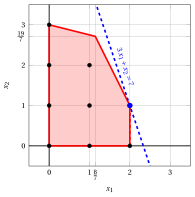{ .fig .ovale caricamento=lazy style="width:71%" }

!!! esercizio "Esercizio 6.6: Algoritmo del piano di taglio (P8)"
    Considera il seguente problema ILP nella forma canonica di massimizzazione con $n=2$ variabili intere e $m=2$ vincoli lineari:

    $$
    \begin{array}{rrrrrr}
    {\max} & {x_1} & {+} & {2\,x_2} &  &  \\[2ex]
    & {-x_1} & {+} & {2\,x_2} & {\le} & {2} \\[2ex]
    & {x_1} & {+} & {x_2} & {\le} & {3} \\[2ex]
    & {x_1,} &  & {x_2} & {\in} & {\Z_{\ge 0}}
    \end{array}
    $$

    e il seguente dizionario ottimale del suo rilassamento LP in forma standard:

    \begin{equation*}
    \begin{cases}
    \begin{array}{rrrrrrrrrrrrr}
    {x_1} & {=} & {\dfrac{4}{3}} & {+} & {\dfrac{1}{3}}\, {x_3} & {-} & {\dfrac{2}{3}}\, {x_4} \\[2ex]
    {x_2} & {=} & {\dfrac{5}{3}} & {-} & {\dfrac{1}{3}}\, {x_3} & {-} & {\dfrac{1}{3}}\, {x_4} \\[2ex]
    {z} & {=} & {\dfrac{14}{3}} & {-} & {\dfrac{1}{3}}\, {x_3} & {-} & {\dfrac{4}{3}}\, {x_4}
    \end{array}
    \end{casi}
    \fine{equazione*}

    **Domande**

    1. Esegui l'algoritmo del piano di taglio basato sui tagli frazionari di Gomory utilizzando:

        1. un taglio frazionario di Gomory a ogni iterazione;

        2. il lato destro più grande come strategia di selezione del taglio.

        Risolvi i problemi di PL dopo aver aggiunto il taglio frazionario di Gomory utilizzando l'algoritmo del simplesso duale. Mostra graficamente la soluzione ottimale del problema LP a ogni iterazione.

    2. Mostra graficamente l'effetto di ciascun taglio frazionario di Gomory sulil rilassamento LP del problema ILP in forma canonica.

    !!! nota ""
        Data una riga $i \in \pazocal{B}$ di un dizionario del simplesso associato a una soluzione di base fattibile tale che $\bar{b}_i$ è frazionaria, la disuguaglianza lineare

        \begin{equation*}
        \sum_{j \in \pazocal{N}}
        \left(
        \bar{a}_{ij}
        -
        \left\lfloor \bar{a}_{ij}\right\rfloor
        \right)x_j
        \ge
        \bar{b}_i - \left\lfloor \bar{b}_i \right\rfloor
        \end{equation*}

        è chiamato il <strong>taglio frazionario di Gomory</strong> generato dalla riga $i$.

??? soluzione "Soluzione"

    Esecuzione dell'algoritmo del piano di taglio per risolvere il problema ILP.

    - <strong>Inizializzazione</strong>

        Consideriamo il problema $LP_1$ nella forma standard:

        $$
        \begin{array}{rrrrrrrrrr}
        {\max} & {x_1} & {+} & {2\,x_2} &  &  &  &  \\[2ex]
        & {-x_1} & {+} & {2\,x_2} & {+} & {x_3} &  &  & {=} & {2} \\[2ex]
        & {x_1} & {+} & {x_2} &  &  & {+} & {x_4} & {=} & {3} \\[2ex]
        & {x_1,} &  & {x_2,} &  & {x_3,} &  & {x_4} & {\ge} & {0}
        \end{array}
        $$

        e il suo dizionario del simplesso ottimale:

        \begin{equation*}
        \begin{cases}
        \begin{array}{rrrrrrrrrrrrr}
        {x_1} & {=} & {\dfrac{4}{3}} & {+} & {\dfrac{1}{3}}\, {x_3} & {-} & {\dfrac{2}{3}}\, {x_4} \\[2ex]
        {x_2} & {=} & {\dfrac{5}{3}} & {-} & {\dfrac{1}{3}}\, {x_3} & {-} & {\dfrac{1}{3}}\, {x_4} \\[2ex]
        {z} & {=} & {\dfrac{14}{3}} & {-} & {\dfrac{1}{3}}\, {x_3} & {-} & {\dfrac{4}{3}}\, {x_4}
        \end{array}
        \end{casi}
        \fine{equazione*}

        La soluzione ottimale ${ \tilde{ \boldsymbol x}}(\,LP_1\,)$ è <strong>frazionaria</strong> e il problema $LP_1$ è <strong>fattibile</strong>.

        Abbiamo il limite superiore sul valore ottimale del problema ILP:

        $$
        z(~ILP~) ~~\le~~  \underbrace{\left\lfloor \dfrac{14}{3} \right\rfloor}_{=4}
        $$

        Per il problema $LP_1$ in forma canonica, abbiamo:

        $$
        \begin{array}{rrrrrr}
        {\max} & {x_1} & {+} & {2\,x_2} &  &  \\[2ex]
        & {-x_1} & {+} & {2\,x_2} & {\le} & {2} \\[2ex]
        & {x_1} & {+} & {x_2} & {\le} & {3} \\[2ex]
        & {x_1,} &  & {x_2} & {\ge} & {0}
        \end{array}
        $$

        Una soluzione ottimale ${ \tilde{ \boldsymbol x}}(\,LP_1\,)$ è:

        $$
        \tilde{x}_1=\dfrac{4}{3},\qquad \tilde{x}_2=\dfrac{5}{3}
        $$

        Il valore ottimale è:

        $$
        z(~LP_1~)=\dfrac{14}{3}
        $$

        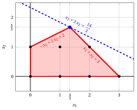{ .fig .ovale caricamento=lazy style="width:71%" }

    - <strong>Iterazione 1</strong>

        - **a)** <strong>Fase di generazione del taglio</strong>

            Abbiamo il seguente dizionario del simplesso associato a una soluzione di base ammissibile frazionaria del problema $LP_1$ in forma standard:

            \begin{equation*}
            \begin{cases}
            \begin{array}{rrrrrrrrrrrrr}
            {x_1} & {=} & {\dfrac{4}{3}} & {+} & {\dfrac{1}{3}}\, {x_3} & {-} & {\dfrac{2}{3}}\, {x_4} \\[2ex]
            {x_2} & {=} & {\dfrac{5}{3}} & {-} & {\dfrac{1}{3}}\, {x_3} & {-} & {\dfrac{1}{3}}\, {x_4} \\[2ex]
            {z} & {=} & {\dfrac{14}{3}} & {-} & {\dfrac{1}{3}}\, {x_3} & {-} & {\dfrac{4}{3}}\, {x_4}
            \end{array}
            \end{casi}
            \fine{equazione*}

            dove

            \begin{equation*}
            { \bar{\boldsymbol A}}=
            \begin{pmatrix}
            -\frac{1}{3} & \frac{2}{3} \\[2ex]
            \frac{1}{3} & \frac{1}{3}
            \end{pmatrix}
            \qquad
            { ar{oldsymbol b}}=
            \begin{pmatrix}
            \frac{4}{3}\\[2ex]
            \frac{5}{3}
            \end{pmatrix}
            \fine{equazione*}

            - Il taglio frazionario di Gomory generato dalla prima riga è:

                \begin{align*}
                \underbrace{\left(-\frac{1}{3} - \left\lfloor -\frac{1}{3} \right\rfloor \right)}_{-\frac{1}{3}-(-1)=\frac{2}{3}} \; x_3
                + \underbrace{\left(\frac{2}{3} - \left\lfloor \frac{2}{3} \right\rfloor \right)}_{\frac{2}{3}-0=\frac{2}{3}} \; x_4
                \ge \underbrace{\left(\frac{4}{3} - \left\lfloor \frac{4}{3} \right\rfloor \right)}_{\frac{4}{3} -1=\frac{1}{3}}
                \end{align*}

                \begin{align*}
                \frac{2}{3}\;x_3 + \frac{2}{3}\;x_4 \ge \frac{1}{3}
                \quad \Rightarrow \quad
                2\;x_3 + 2\;x_4 \ge 1
                \end{align*}

                Dalla forma standard del problema $LP_1$, abbiamo:

                $$
                x_3= 2 + x_1 - 2\;x_2, \qquad x_4= 3 - x_1 - x_2.
                $$

                Sostituendo nel taglio frazionario di Gomory, possiamo esprimerlo in termini delle variabili originali del problema ILP:

                $$
                2\;(2 + x_1 - 2\;x_2) + 2\;(3 - x_1 - x_2) \ge 1
                \quad \Rightarrow \quad
                6\;x_2 \le 9
                $$

                Dividendo per il massimo comune divisore $6$ dei coefficienti e arrotondando per difetto il lato destro, otteniamo il taglio in forma primitiva, la stessa disuguaglianza del taglio generato dalla seconda riga:

                $$
                x_2 \le \left\lfloor \frac{9}{6} \right\rfloor = 1
                $$

                Effetto del taglio frazionario di Gomory generato dalla prima riga sul problema $LP_1$ in forma canonica:

                { .fig .ovale loading=lazy style="width:71%" }

            - Il taglio frazionario di Gomory generato dalla seconda riga è:

                \begin{align*}
                \underbrace{\left(\frac{1}{3} - \left\lfloor \frac{1}{3} \right\rfloor \right)}_{\frac{1}{3}-0=\frac{1}{3}} \; x_3
                + \underbrace{\left(\frac{1}{3} - \left\lfloor \frac{1}{3} \right\rfloor \right)}_{\frac{1}{3}-0=\frac{1}{3}} \; x_4
                \ge \underbrace{\left(\frac{5}{3} - \left\lfloor \frac{5}{3} \right\rfloor \right)}_{\frac{5}{3} -1=\frac{2}{3}}
                \end{align*}

                \begin{align*}
                \frac{1}{3}\;x_3 + \frac{1}{3}\;x_4 \ge \frac{2}{3}
                \quad \Rightarrow \quad
                x_3 + x_4 \ge 2
                \end{align*}

                Sottraendo una variabile di surplus, otteniamo il taglio frazionario di Gomory in forma standard:

                $$
                \frac{1}{3}\;x_3 + \frac{1}{3}\;x_4 - x_5 = \frac{2}{3}
                \quad \Rightarrow \quad
                x_3 + x_4 - 3\;x_5 = 2
                $$

                Dalla forma standard del problema $LP_1$, abbiamo:

                $$
                x_3= 2 + x_1 - 2\;x_2, \qquad x_4= 3 - x_1 - x_2.
                $$

                Sostituendo nel taglio frazionario di Gomory, possiamo esprimerlo in termini delle variabili originali del problema ILP:

                $$
                (2 + x_1 - 2\;x_2) + (3 - x_1 - x_2) \ge 2
                \quad \Rightarrow \quad
                x_2 \le 1
                $$

                Effetto del taglio frazionario di Gomory generato dalla seconda riga sul problema $LP_1$ in forma canonica:

                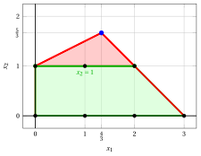{ .fig .ovale caricamento=lazy style="width:71%" }

                Selezioniamo il taglio frazionario di Gomory con il lato destro più grande e creiamo il problema $LP_2$ aggiungendolo al problema $LP_1$.

        - **b)** <strong>Fase di riottimizzazione LP</strong>

            Consideriamo il problema $LP_2$ nella forma standard:

            $$
            \begin{array}{rrrrrrrrrrrr}
            {\max} & {x_1} & {+} & {2\,x_2} &  &  &  &  &  &  &  &  \\[2ex]
            & {-x_1} & {+} & {2\,x_2} & {+} & {x_3} &  &  &  &  & {=} & {2} \\[2ex]
            & {x_1} & {+} & {x_2} &  &  & {+} & {x_4} &  &  & {=} & {3} \\[2ex]
            &  &  & {x_2} &  &  &  &  & {+} & {x_5} & {=} & {1} \\[2ex]
            & {x_1,} &  & {x_2,} &  & {x_3,} &  & {x_4,} &  & {x_5} & {\ge} & {0}
            \end{array}
            $$

            Per il taglio frazionario di Gomory aggiunto abbiamo:

            $$
            x_3 + x_4 - 3\;x_5 = 2
            \quad \Rightarrow \quad
            x_5 = -\dfrac{2}{3} + \dfrac{1}{3}\;x_3 + \dfrac{1}{3}\;x_4
            $$

            Aggiungiamo quindi questa equazione al precedente dizionario ottimale e otteniamo il seguente dizionario :

            \begin{equation*}
            \begin{cases}
            \begin{array}{rrrrrrrrrrrrr}
            {x_1} & {=} & {\dfrac{4}{3}} & {+} & {\dfrac{1}{3}}\, {x_3} & {-} & {\dfrac{2}{3}}\, {x_4} \\[2ex]
            {x_2} & {=} & {\dfrac{5}{3}} & {-} & {\dfrac{1}{3}}\, {x_3} & {-} & {\dfrac{1}{3}}\, {x_4} \\[2ex]
            {x_5} & {=} & {-\dfrac{2}{3}} & {+} & {\dfrac{1}{3}}\, {x_3} & {+} & {\dfrac{1}{3}}\, {x_4} \\[2ex]
            {z} & {=} & {\dfrac{14}{3}} & {-} & {\dfrac{1}{3}}\, {x_3} & {-} & {\dfrac{4}{3}}\, {x_4}
            \end{array}
            \end{casi}
            \fine{equazione*}

            dove $\pazocal{B}=\{1,2,5\}$ e $\pazocal{N}=\{3,4\}$ e

            - la soluzione primale di base inammissibile è:

                $$
                \bar x_1=\dfrac{4}{3},~~
                \bar x_2=\dfrac{5}{3},~~
                \bar x_5=-\dfrac{2}{3},~~~~~~
                \bar x_3=0,~~
                \bar x_4=0~~
                \text{  of value   }\dfrac{14}{3}
                $$

            - la soluzione duale di base fattibile è:

                $$
                \bar \pi_1=0,~~
                \bar \pi_2=0,~~
                \bar \pi_5=0,~~~~~~
                \bar \pi_3=\dfrac{1}{3},~~
                \bar \pi_4=\dfrac{4}{3}~~
                \text{  of value   }\dfrac{14}{3}
                $$

            Se aumentiamo il valore di $\pi_5$, possiamo ottenere una migliore soluzione duale. Abbiamo:

            $$
            \begin{cases}
            \pi_3 &= \dfrac{1}{3} - \dfrac{1}{3}\,\pi_5 \\[2ex]
            \pi_4 &= \dfrac{4}{3} - \dfrac{1}{3}\,\pi_5
            \end{cases}
            \qquad
            \qquad
            \begin{cases}
            \underbrace{ \dfrac{1}{3} - \dfrac{1}{3}\,\pi_5 \ge 0}_{\pi_3 \ge 0} \\[2ex]
            \underbrace{  \dfrac{4}{3} - \dfrac{1}{3}\,\pi_5 \ge 0}_{\pi_4 \ge 0}
            \end{cases}
            \qquad
            \qquad
            \begin{cases}
            \pi_5 &\le  1 \\[2ex]
            \pi_5 &\le  4
            \end{cases}
            $$

            Aumentando il valore di $\pi_5$ a $\min \left\{1, 4\right\}=1$, il valore di $\pi_3$ diminuisce a 0. Allora abbiamo che:

            - $\pi_5$ diventa una variabile di base doppia e di conseguenza $x_5$ diventa una variabile primale non di base

            - $\pi_3$ diventa una variabile non di base doppia e di conseguenza $x_3$ diventa una variabile basica primale

            Abbiamo:

            $$
            x_5 = -\dfrac{2}{3} + \dfrac{1}{3}\, x_3 + \dfrac{1}{3}\, x_4
            \quad \Longrightarrow \quad
            x_3 = 2 - x_4 + 3\,x_5
            $$

            Sostituendo nelle altre equazioni del dizionario primale, otteniamo:

            $$
            x_1 = \dfrac{4}{3}  +  \dfrac{1}{3} \left( 2 - x_4 + 3\,x_5   \right) -  \dfrac{2}{3} x_4
            = 2 - x_4 + x_5
            $$

            $$
            x_2 = \dfrac{5}{3}  -  \dfrac{1}{3} \left( 2 - x_4 + 3\,x_5   \right) -  \dfrac{1}{3} x_4
            = 1 - x_5
            $$

            $$
            z = \dfrac{14}{3}  -  \dfrac{1}{3} \left( 2 - x_4 + 3\,x_5   \right) -  \dfrac{4}{3} x_4
            = 4 - x_4 - x_5
            $$

            Di conseguenza, abbiamo ora il seguente dizionario primale ottimale:

            \begin{equation*}
            \begin{cases}
            \begin{array}{rrrrrrrrrrrrr}
            {x_1} & {=} & {2} & {-} & {x_4} & {+} & {x_5} \\[2ex]
            {x_2} & {=} & {1} &  &  & {-} & {x_5} \\[2ex]
            {x_3} & {=} & {2} & {-} & {x_4} & {+} & {3}\, {x_5} \\[2ex]
            {z} & {=} & {4} & {-} & {x_4} & {-} & {x_5}
            \end{array}
            \end{casi}
            \fine{equazione*}

            dove $\pazocal{B}=\{1,2,3\}$ e $\pazocal{N}=\{4,5\}$.

            - la soluzione ottimale primale di base è:

                $$
                \tilde x_1 = 2,~~
                \tilde x_2 = 1,~~
                \tilde x_3 = 2,~~
                \tilde x_4 = 0,~~
                \tilde x_5 = 0
                \qquad
                \text{of value  }  4
                $$

            - la soluzione duale ottimale di base è:

                $$
                \tilde \pi_1 = 0,~~
                \tilde \pi_2 = 0,~~
                \tilde \pi_3 = 0,~~
                \tilde \pi_4 = 1,~~
                \tilde \pi_5 = 1
                \qquad
                \text{of value  }  4
                $$

            !!! chiave ""
                La soluzione ottimale ${ \tilde{ \boldsymbol x}}(\,LP_2\,)$ è <strong>intera</strong>. Di conseguenza, una soluzione ottimale ${ \tilde{ \boldsymbol x}}(\,ILP\,)$ è:

                $$
                \tilde{x}_1=2,~~\tilde{x}_2=1
                $$

                Il valore ottimale $z(~ILP~)$ è $4$.

            Per il problema $LP_2$ in forma canonica, abbiamo:

            $$
            \begin{array}{rrrrrr}
            {\max} & {x_1} & {+} & {2\,x_2} &  &  \\[2ex]
            & {-x_1} & {+} & {2\,x_2} & {\le} & {2} \\[2ex]
            & {x_1} & {+} & {x_2} & {\le} & {3} \\[2ex]
            &  &  & {x_2} & {\le} & {1} \\[2ex]
            & {x_1,} &  & {x_2} & {\ge} & {0}
            \end{array}
            $$

            Una soluzione ottimale ${ \tilde{ \boldsymbol x}}(\,LP_2\,)$ è:

            $$
            \tilde{x}_1=2,\qquad \tilde{x}_2=1
            $$

            Il valore ottimale è:

            $$
            z(~LP_2~)=4
            $$

            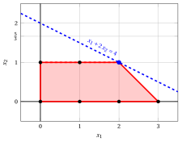{ .fig .ovale caricamento=lazy style="width:71%" }

!!! esercizio "Esercizio 6.7: Algoritmo del piano di taglio (P10)"
    Considera il seguente problema ILP nella forma canonica di massimizzazione con $n=2$ variabili intere e $m=3$ vincoli lineari:

    $$
    \begin{array}{rrrrrr}
    {\max} & {5\,x_1} & {+} & {2\,x_2} &  &  \\[2ex]
    & {-x_1} & {+} & {3\,x_2} & {\le} & {12} \\[2ex]
    & {x_1} & {+} & {2\,x_2} & {\le} & {12} \\[2ex]
    & {3\,x_1} & {-} & {2\,x_2} & {\le} & {8} \\[2ex]
    & {x_1,} &  & {x_2} & {\in} & {\Z_{\ge 0}}
    \end{array}
    $$

    e il seguente dizionario ottimale del suo rilassamento LP in forma standard:

    \begin{equation*}
    \begin{cases}
    \begin{array}{rrrrrrrrrrrrr}
    {x_1} & {=} & {5} & {-} & {\dfrac{1}{4}}\, {x_4} & {-} & {\dfrac{1}{4}}\, {x_5} \\[2ex]
    {x_2} & {=} & {\dfrac{7}{2}} & {-} & {\dfrac{3}{8}}\, {x_4} & {+} & {\dfrac{1}{8}}\, {x_5} \\[2ex]
    {x_3} & {=} & {\dfrac{13}{2}} & {+} & {\dfrac{7}{8}}\, {x_4} & {-} & {\dfrac{5}{8}}\, {x_5} \\[2ex]
    {z} & {=} & {32} & {-} & {2}\, {x_4} & {-} & {x_5}
    \end{array}
    \end{casi}
    \fine{equazione*}

    **Domande**

    1. Esegui l'algoritmo del piano di taglio basato sui tagli frazionari di Gomory utilizzando:

        1. un taglio frazionario di Gomory a ogni iterazione;

        2. il lato destro più grande come strategia di selezione del taglio.

        Risolvi i problemi di PL dopo aver aggiunto il taglio frazionario di Gomory utilizzando l'algoritmo del simplesso duale. Mostra graficamente la soluzione ottimale del problema LP a ogni iterazione.

    2. Mostra graficamente l'effetto di ciascun taglio frazionario di Gomory sulil rilassamento LP del problema ILP in forma canonica.

    !!! nota ""
        Data una riga $i \in \pazocal{B}$ di un dizionario del simplesso associato a una soluzione di base fattibile tale che $\bar{b}_i$ è frazionaria, la disuguaglianza lineare

        \begin{equation*}
        \sum_{j \in \pazocal{N}}
        \left(
        \bar{a}_{ij}
        -
        \left\lfloor \bar{a}_{ij}\right\rfloor
        \right)x_j
        \ge
        \bar{b}_i - \left\lfloor \bar{b}_i \right\rfloor
        \end{equation*}

        è chiamato il <strong>taglio frazionario di Gomory</strong> generato dalla riga $i$.

??? soluzione "Soluzione"

    Esecuzione dell'algoritmo del piano di taglio per risolvere il problema ILP.

    - <strong>Inizializzazione</strong>

        Consideriamo il problema $LP_1$ nella forma standard:

        $$
        \begin{array}{rrrrrrrrrrrr}
        {\max} & {5\,x_1} & {+} & {2\,x_2} &  &  &  &  &  &  &  &  \\[2ex]
        & {-x_1} & {+} & {3\,x_2} & {+} & {x_3} &  &  &  &  & {=} & {12} \\[2ex]
        & {x_1} &  &  & {+} & {2\,x_2} & {+} & {x_4} &  &  & {=} & {12} \\[2ex]
        & {3\,x_1} & {-} & {2\,x_2} &  &  &  &  & {+} & {x_5} & {=} & {8} \\[2ex]
        & {x_1,} &  & {x_2,} &  & {x_3,} &  & {x_4,} &  & {x_5} & {\ge} & {0}
        \end{array}
        $$

        e il suo dizionario del simplesso ottimale:

        \begin{equation*}
        \begin{cases}
        \begin{array}{rrrrrrrrrrrrr}
        {x_1} & {=} & {5} & {-} & {\dfrac{1}{4}}\, {x_4} & {-} & {\dfrac{1}{4}}\, {x_5} \\[2ex]
        {x_2} & {=} & {\dfrac{7}{2}} & {-} & {\dfrac{3}{8}}\, {x_4} & {+} & {\dfrac{1}{8}}\, {x_5} \\[2ex]
        {x_3} & {=} & {\dfrac{13}{2}} & {+} & {\dfrac{7}{8}}\, {x_4} & {-} & {\dfrac{5}{8}}\, {x_5} \\[2ex]
        {z} & {=} & {32} & {-} & {2}\, {x_4} & {-} & {x_5}
        \end{array}
        \end{casi}
        \fine{equazione*}

        La soluzione ottimale ${ \tilde{ \boldsymbol x}}(\,LP_1\,)$ è <strong>frazionaria</strong> e il problema $LP_1$ è <strong>fattibile</strong>.

        Abbiamo il limite superiore sul valore ottimale del problema ILP:

        $$
        z(~ILP~) ~~\le~~  32
        $$

        Per il problema $LP_1$ in forma canonica, abbiamo:

        $$
        \begin{array}{rrrrrr}
        {\max} & {5\,x_1} & {+} & {2\,x_2} &  &  \\[2ex]
        & {-x_1} & {+} & {3\,x_2} & {\le} & {12} \\[2ex]
        & {x_1} & {+} & {2\,x_2} & {\le} & {12} \\[2ex]
        & {3\,x_1} & {-} & {2\,x_2} & {\le} & {8} \\[2ex]
        & {x_1,} &  & {x_2} & {\ge} & {0}
        \end{array}
        $$

        Una soluzione ottimale ${ \tilde{ \boldsymbol x}}(\,LP_1\,)$ è:

        $$
        \tilde{x}_1=5,\qquad \tilde{x}_2=\dfrac{7}{2}
        $$

        Il valore ottimale è:

        $$
        z(~LP_1~)=32
        $$

        { .fig .ovale caricamento=lazy style="width:71%" }

    - <strong>Iterazione 1</strong>

        - **a)** <strong>Fase di generazione dei tagli</strong>

            Abbiamo il seguente dizionario del simplesso associato a una soluzione di base ammissibile frazionaria del problema $LP_1$ in forma standard:

            \begin{equation*}
            \begin{cases}
            \begin{array}{rrrrrrrrrrrrr}
            {x_1} & {=} & {5} & {-} & {\dfrac{1}{4}}\, {x_4} & {-} & {\dfrac{1}{4}}\, {x_5} \\[2ex]
            {x_2} & {=} & {\dfrac{7}{2}} & {-} & {\dfrac{3}{8}}\, {x_4} & {+} & {\dfrac{1}{8}}\, {x_5} \\[2ex]
            {x_3} & {=} & {\dfrac{13}{2}} & {+} & {\dfrac{7}{8}}\, {x_4} & {-} & {\dfrac{5}{8}}\, {x_5} \\[2ex]
            {z} & {=} & {32} & {-} & {2}\, {x_4} & {-} & {x_5}
            \end{array}
            \end{casi}
            \fine{equazione*}

            dove

            \begin{equation*}
            { \bar{\boldsymbol A}}=
            \begin{pmatrix}
            \frac{1}{4} & \frac{1}{4} \\[2ex]
            \frac{3}{8} & -\frac{1}{8} \\[2ex]
            -\frac{7}{8} & \frac{5}{8}
            \end{pmatrix}
            \qquad
            { \bar{\boldsymbol b}}=
            \begin{pmatrix}
            5\\[2ex]
            \frac{7}{2}\\[2ex]
            \frac{13}{2}
            \end{pmatrix}
            \fine{equazione*}

            - Il taglio frazionario di Gomory generato dalla seconda riga è:

                \begin{align*}
                \underbrace{\left(\frac{3}{8} - \left\lfloor \frac{3}{8} \right\rfloor \right)}_{\frac{3}{8}-0=\frac{3}{8}} \; x_4
                + \underbrace{\left(-\frac{1}{8} - \left\lfloor -\frac{1}{8} \right\rfloor \right)}_{-\frac{1}{8}-(-1)=\frac{7}{8}} \; x_5
                \ge \underbrace{\left(\frac{7}{2} - \left\lfloor \frac{7}{2} \right\rfloor \right)}_{\frac{7}{2} -3=\frac{1}{2}}
                \end{align*}

                \begin{align*}
                \frac{3}{8}\;x_4 + \frac{7}{8}\;x_5 \ge \frac{1}{2}
                \quad \Rightarrow \quad
                3\;x_4 + 7\;x_5 \ge 4
                \end{align*}

                Sottraendo una variabile di surplus, otteniamo il taglio frazionario di Gomory in forma standard:

                $$
                \frac{3}{8}\;x_4 + \frac{7}{8}\;x_5 - x_6 = \frac{1}{2}
                \quad \Rightarrow \quad
                3\;x_4 + 7\;x_5 - 8\;x_6 = 4
                $$

                Dalla forma standard del problema $LP_1$, abbiamo:

                $$
                x_4= 12 - x_1 - 2\;x_2, \qquad x_5= 8 - 3\;x_1 + 2\;x_2.
                $$

                Sostituendo nel taglio frazionario di Gomory, possiamo esprimerlo in termini delle variabili originali del problema ILP:

                $$
                3\,(12 - x_1 - 2\;x_2) + 7\,(8 - 3\;x_1 + 2\;x_2) \ge 4
                \quad \Rightarrow \quad
                3\;x_1 - x_2 \le 11
                $$

                Effetto del taglio frazionario di Gomory generato dalla seconda riga sul problema $LP_1$ in forma canonica:

                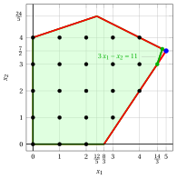{ .fig .ovale caricamento=lazy style="width:71%" }

            - Il taglio frazionario di Gomory generato dalla terza riga è:

                \begin{align*}
                \underbrace{\left(-\frac{7}{8} - \left\lfloor -\frac{7}{8} \right\rfloor \right)}_{-\frac{7}{8}-(-1)=\frac{1}{8}} \; x_4
                + \underbrace{\left(\frac{5}{8} - \left\lfloor \frac{5}{8} \right\rfloor \right)}_{\frac{5}{8}-0=\frac{5}{8}} \; x_5
                \ge \underbrace{\left(\frac{13}{2} - \left\lfloor \frac{13}{2} \right\rfloor \right)}_{\frac{13}{2} -6=\frac{1}{2}}
                \end{align*}

                \begin{align*}
                \frac{1}{8}\;x_4 + \frac{5}{8}\;x_5 \ge \frac{1}{2}
                \quad \Rightarrow \quad
                x_4 + 5\;x_5 \ge 4
                \end{align*}

                Sottraendo una variabile di surplus, otteniamo il taglio frazionario di Gomory in forma standard:

                $$
                \frac{1}{8}\;x_4 + \frac{5}{8}\;x_5 - x_6 = \frac{1}{2}
                \quad \Rightarrow \quad
                x_4 + 5\;x_5 - 8\;x_6 = 4
                $$

                Dalla forma standard del problema $LP_1$, abbiamo:

                $$
                x_4= 12 - x_1 - 2\;x_2, \qquad x_5= 8 - 3\;x_1 + 2\;x_2.
                $$

                Sostituendo nel taglio frazionario di Gomory, possiamo esprimerlo in termini delle variabili originali del problema ILP:

                $$
                (12 - x_1 - 2\;x_2) + 5\,(8 - 3\;x_1 + 2\;x_2) \ge 4
                \quad \Rightarrow \quad
                2\;x_1 - x_2 \le 6
                $$

                Effetto del taglio frazionario di Gomory generato dalla terza riga sul problema $LP_1$ in forma canonica:

                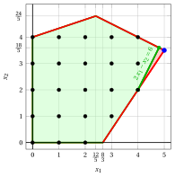{ .fig .ovale caricamento=lazy style="width:71%" }

                Entrambi i tagli frazionari di Gomory hanno lo stesso lato destro, uguale a $\dfrac{1}{2}$. Selezioniamo il taglio frazionario di Gomory generato dalla terza riga e creiamo il problema $LP_2$ aggiungendolo al problema $LP_1$.

        - **b)** <strong>Fase di riottimizzazione LP</strong>

            Consideriamo il problema $LP_2$ nella forma standard:

            $$
            \begin{array}{rrrrrrrrrrrrrr}
            {\max} & {5\,x_1} & {+} & {2\,x_2} &  &  &  &  &  &  &  &  &  &  \\[2ex]
            & {-x_1} & {+} & {3\,x_2} & {+} & {x_3} &  &  &  &  &  &  & {=} & {12} \\[2ex]
            & {x_1} &  &  & {+} & {2\,x_2} & {+} & {x_4} &  &  &  &  & {=} & {12} \\[2ex]
            & {3\,x_1} & {-} & {2\,x_2} &  &  &  &  & {+} & {x_5} &  &  & {=} & {8} \\[2ex]
            & {2\,x_1} & {-} & {x_2} &  &  &  &  &  &  & {+} & {x_6} & {=} & {6} \\[2ex]
            & {x_1,} &  & {x_2,} &  & {x_3,} &  & {x_4,} &  & {x_5,} &  & {x_6} & {\ge} & {0}
            \end{array}
            $$

            Per il taglio frazionario di Gomory aggiunto abbiamo:

            $$
            x_4 + 5\;x_5 - 8\;x_6 = 4
            \quad \Rightarrow \quad
            x_6 = -\dfrac{1}{2} + \dfrac{1}{8}\;x_4 + \dfrac{5}{8}\;x_5
            $$

            Aggiungiamo quindi questa equazione al precedente dizionario ottimale e otteniamo il seguente dizionario:

            \begin{equation*}
            \begin{cases}
            \begin{array}{rrrrrrrrrrrrr}
            {x_1} & {=} & {5} & {-} & {\dfrac{1}{4}}\, {x_4} & {-} & {\dfrac{1}{4}}\, {x_5} \\[2ex]
            {x_2} & {=} & {\dfrac{7}{2}} & {-} & {\dfrac{3}{8}}\, {x_4} & {+} & {\dfrac{1}{8}}\, {x_5} \\[2ex]
            {x_3} & {=} & {\dfrac{13}{2}} & {+} & {\dfrac{7}{8}}\, {x_4} & {-} & {\dfrac{5}{8}}\, {x_5} \\[2ex]
            {x_6} & {=} & {-\dfrac{1}{2}} & {+} & {\dfrac{1}{8}}\, {x_4} & {+} & {\dfrac{5}{8}}\, {x_5} \\[2ex]
            {z} & {=} & {32} & {-} & {2}\, {x_4} & {-} & {x_5}
            \end{array}
            \end{cases}
            \fine{equazione*}

            dove $\pazocal{B}=\{1,2,3,6\}$ e $\pazocal{N}=\{4,5\}$ e

            - la soluzione primale di base inammissibile è:

                $$
                \bar x_1=5,~~
                \bar x_2=\dfrac{7}{2},~~
                \bar x_3=\dfrac{13}{2},~~
                \bar x_6=-\dfrac{1}{2},~~~~~~
                \bar x_4=0,~~
                \bar x_5=0~~
                \text{  of value   }32
                $$

            - la soluzione duale di base fattibile è:

                $$
                \bar \pi_1=0,~~
                \bar \pi_2=0,~~
                \bar \pi_3=0,~~
                \bar \pi_6=0,~~~~~~
                \bar \pi_4=2,~~
                \bar \pi_5=1~~
                \text{  of value   }32
                $$

            Se aumentiamo il valore di $\pi_6$, possiamo ottenere una migliore soluzione duale. Abbiamo:

            $$
            \begin{cases}
            \pi_4 &= 2 - \dfrac{1}{8}\,\pi_6 \\[2ex]
            \pi_5 &= 1 - \dfrac{5}{8}\,\pi_6
            \end{cases}
            \qquad
            \qquad
            \begin{cases}
            \underbrace{ 2 - \dfrac{1}{8}\,\pi_6 \ge 0}_{\pi_4 \ge 0} \\[2ex]
            \underbrace{  1 - \dfrac{5}{8}\,\pi_6 \ge 0}_{\pi_5 \ge 0}
            \end{cases}
            \qquad
            \qquad
            \begin{cases}
            \pi_6 &\le  16 \\[2ex]
            \pi_6 &\le  \dfrac{8}{5}
            \end{cases}
            $$

            Aumentando il valore di $\pi_6$ a $\min \left\{16, \dfrac{8}{5}\right\}=\dfrac{8}{5}$, il valore di $\pi_5$ diminuisce a 0. Allora abbiamo che:

            - $\pi_6$ diventa una variabile di base doppia e di conseguenza $x_6$ diventa una variabile non di base primale

            - $\pi_5$ diventa una variabile non di base doppia e di conseguenza $x_5$ diventa una variabile basica primale

            Abbiamo:

            $$
            x_6 = -\dfrac{1}{2} + \dfrac{1}{8}\, x_4 + \dfrac{5}{8}\, x_5
            \quad \Longrightarrow \quad
            x_5 = \dfrac{4}{5} - \dfrac{1}{5}\,x_4 + \dfrac{8}{5}\,x_6
            $$

            Sostituendo nelle altre equazioni del dizionario primale, otteniamo:

            $$
            x_1 = 5  -  \dfrac{1}{4} x_4 -  \dfrac{1}{4} \left( \dfrac{4}{5} - \dfrac{1}{5}\,x_4 + \dfrac{8}{5}\,x_6   \right)
            = \dfrac{24}{5} - \dfrac{1}{5}\,x_4 - \dfrac{2}{5}\,x_6
            $$

            $$
            x_2 = \dfrac{7}{2}  -  \dfrac{3}{8} x_4 +  \dfrac{1}{8} \left( \dfrac{4}{5} - \dfrac{1}{5}\,x_4 + \dfrac{8}{5}\,x_6   \right)
            = \dfrac{18}{5} - \dfrac{2}{5}\,x_4 + \dfrac{1}{5}\,x_6
            $$

            $$
            x_3 = \dfrac{13}{2}  +  \dfrac{7}{8} x_4 -  \dfrac{5}{8} \left( \dfrac{4}{5} - \dfrac{1}{5}\,x_4 + \dfrac{8}{5}\,x_6   \right)
            = 6 + x_4 - x_6
            $$

            $$
            z = 32  -  2 x_4 -  \left( \dfrac{4}{5} - \dfrac{1}{5}\,x_4 + \dfrac{8}{5}\,x_6   \right)
            = \dfrac{156}{5} - \dfrac{9}{5}\,x_4 - \dfrac{8}{5}\,x_6
            $$

            Di conseguenza, abbiamo ora il seguente dizionario primale ottimale:

            \begin{equation*}
            \begin{cases}
            \begin{array}{rrrrrrrrrrrrr}
            {x_1} & {=} & {\dfrac{24}{5}} & {-} & {\dfrac{1}{5}}\, {x_4} & {-} & {\dfrac{2}{5}}\, {x_6} \\[2ex]
            {x_2} & {=} & {\dfrac{18}{5}} & {-} & {\dfrac{2}{5}}\, {x_4} & {+} & {\dfrac{1}{5}}\, {x_6} \\[2ex]
            {x_3} & {=} & {6} & {+} & {x_4} & {-} & {x_6} \\[2ex]
            {x_5} & {=} & {\dfrac{4}{5}} & {-} & {\dfrac{1}{5}}\, {x_4} & {+} & {\dfrac{8}{5}}\, {x_6} \\[2ex]
            {z} & {=} & {\dfrac{156}{5}} & {-} & {\dfrac{9}{5}}\, {x_4} & {-} & {\dfrac{8}{5}}\, {x_6}
            \end{array}
            \end{casi}
            \fine{equazione*}

            dove $\pazocal{B}=\{1,2,3,5\}$ e $\pazocal{N}=\{4,6\}$.

            - la soluzione ottimale primale di base è:

                $$
                \tilde x_1 = \dfrac{24}{5},~~
                \tilde x_2 = \dfrac{18}{5},~~
                \tilde x_3 = 6,~~
                \tilde x_5 = \dfrac{4}{5},~~
                \tilde x_4 = 0,~~
                \tilde x_6 = 0
                \qquad
                \text{of value  }  \dfrac{156}{5}
                $$

            - la soluzione duale ottimale di base è:

                $$
                \tilde \pi_1 = 0,~~
                \tilde \pi_2 = 0,~~
                \tilde \pi_3 = 0,~~
                \tilde \pi_5 = 0,~~
                \tilde \pi_4 = \dfrac{9}{5},~~
                \tilde \pi_6 = \dfrac{8}{5}
                \qquad
                \text{of value  }  \dfrac{156}{5}
                $$

            La soluzione ottimale ${ \tilde{ \boldsymbol x}}(\,LP_2\,)$ è <strong>frazionaria</strong> e il problema $LP_2$ è <strong>fattibile</strong>.

            Abbiamo il limite superiore sul valore ottimale del problema ILP:

            $$
            z(~ILP~) ~~\le~~  \underbrace{\left\lfloor \dfrac{156}{5} \right\rfloor}_{=31}
            $$

            Per il problema $LP_2$ in forma canonica, abbiamo:

            $$
            \begin{array}{rrrrrr}
            {\max} & {5\,x_1} & {+} & {2\,x_2} &  &  \\[2ex]
            & {-x_1} & {+} & {3\,x_2} & {\le} & {12} \\[2ex]
            & {x_1} & {+} & {2\,x_2} & {\le} & {12} \\[2ex]
            & {3\,x_1} & {-} & {2\,x_2} & {\le} & {8} \\[2ex]
            & {2\,x_1} & {-} & {x_2} & {\le} & {6} \\[2ex]
            & {x_1,} &  & {x_2} & {\ge} & {0}
            \end{array}
            $$

            Una soluzione ottimale ${ \tilde{ \boldsymbol x}}(\,LP_2\,)$ è:

            $$
            \tilde{x}_1=\dfrac{24}{5},\qquad \tilde{x}_2=\dfrac{18}{5}
            $$

            Il valore ottimale è:

            $$
            z(~LP_2~)=\dfrac{156}{5}
            $$

            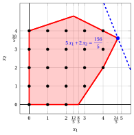{ .fig .ovale loading=lazy style="width:71%" }

    - <strong>Iterazione 2</strong>

        - **a)** <strong>Fase di generazione dei tagli</strong>

            Abbiamo il seguente dizionario del simplesso associato a una soluzione di base ammissibile frazionaria del problema $LP_2$ in forma standard:

            \begin{equation*}
            \begin{cases}
            \begin{array}{rrrrrrrrrrrrr}
            {x_1} & {=} & {\dfrac{24}{5}} & {-} & {\dfrac{1}{5}}\, {x_4} & {-} & {\dfrac{2}{5}}\, {x_6} \\[2ex]
            {x_2} & {=} & {\dfrac{18}{5}} & {-} & {\dfrac{2}{5}}\, {x_4} & {+} & {\dfrac{1}{5}}\, {x_6} \\[2ex]
            {x_3} & {=} & {6} & {+} & {x_4} & {-} & {x_6} \\[2ex]
            {x_5} & {=} & {\dfrac{4}{5}} & {-} & {\dfrac{1}{5}}\, {x_4} & {+} & {\dfrac{8}{5}}\, {x_6} \\[2ex]
            {z} & {=} & {\dfrac{156}{5}} & {-} & {\dfrac{9}{5}}\, {x_4} & {-} & {\dfrac{8}{5}}\, {x_6}
            \end{array}
            \end{casi}
            \fine{equazione*}

            dove

            \begin{equation*}
            { \bar{\boldsymbol A}}=
            \begin{pmatrix}
            \frac{1}{5} & \frac{2}{5} \\[2ex]
            \frac{2}{5} & -\frac{1}{5} \\[2ex]
            -1 & 1 \\[2ex]
            \frac{1}{5} & -\frac{8}{5}
            \end{pmatrix}
            \qquad
            { ar{oldsymbol b}}=
            \begin{pmatrix}
            \frac{24}{5}\\[2ex]
            \frac{18}{5}\\[2ex]
            6\\[2ex]
            \frac{4}{5}
            \end{pmatrix}
            \fine{equazione*}

            - Il taglio frazionario di Gomory generato dalla prima riga è:

                \begin{align*}
                \underbrace{\left(\frac{1}{5} - \left\lfloor \frac{1}{5} \right\rfloor \right)}_{\frac{1}{5}-0=\frac{1}{5}} \; x_4
                + \underbrace{\left(\frac{2}{5} - \left\lfloor \frac{2}{5} \right\rfloor \right)}_{\frac{2}{5}-0=\frac{2}{5}} \; x_6
                \ge \underbrace{\left(\frac{24}{5} - \left\lfloor \frac{24}{5} \right\rfloor \right)}_{\frac{24}{5} -4=\frac{4}{5}}
                \end{align*}

                \begin{align*}
                \frac{1}{5}\;x_4 + \frac{2}{5}\;x_6 \ge \frac{4}{5}
                \quad \Rightarrow \quad
                x_4 + 2\;x_6 \ge 4
                \end{align*}

                Sottraendo una variabile in eccesso, otteniamo il taglio frazionario di Gomory in forma standard:

                $$
                \frac{1}{5}\;x_4 + \frac{2}{5}\;x_6 - x_7 = \frac{4}{5}
                \quad \Rightarrow \quad
                x_4 + 2\;x_6 - 5\;x_7 = 4
                $$

                Dalla forma standard del problema $LP_1$ e dal taglio aggiunto, abbiamo:

                $$
                x_4= 12 - x_1 - 2\;x_2, \qquad x_6= 6 - 2\;x_1 + x_2.
                $$

                Sostituendo nel taglio frazionario di Gomory, possiamo esprimerlo in termini delle variabili originali del problema ILP:

                $$
                (12 - x_1 - 2\;x_2) + 2\,(6 - 2\;x_1 + x_2) \ge 4
                \quad \Rightarrow \quad
                x_1 \le 4
                $$

                Effetto del taglio frazionario di Gomory generato dalla prima riga sul problema $LP_2$ in forma canonica:

                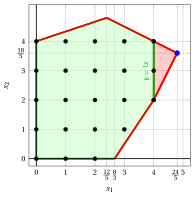{ .fig .ovale caricamento=lazy style="width:71%" }

            - Il taglio frazionario di Gomory generato dalla seconda riga è:

                \begin{align*}
                \underbrace{\left(\frac{2}{5} - \left\lfloor \frac{2}{5} \right\rfloor \right)}_{\frac{2}{5}-0=\frac{2}{5}} \; x_4
                + \underbrace{\left(-\frac{1}{5} - \left\lfloor -\frac{1}{5} \right\rfloor \right)}_{-\frac{1}{5}-(-1)=\frac{4}{5}} \; x_6
                \ge \underbrace{\left(\frac{18}{5} - \left\lfloor \frac{18}{5} \right\rfloor \right)}_{\frac{18}{5} -3=\frac{3}{5}}
                \end{align*}

                \begin{align*}
                \frac{2}{5}\;x_4 + \frac{4}{5}\;x_6 \ge \frac{3}{5}
                \quad \Rightarrow \quad
                2\;x_4 + 4\;x_6 \ge 3
                \end{align*}

                Dalla forma standard del problema $LP_1$ e dal taglio aggiunto, abbiamo:

                $$
                x_4= 12 - x_1 - 2\;x_2, \qquad x_6= 6 - 2\;x_1 + x_2.
                $$

                Sostituendo nel taglio frazionario di Gomory, possiamo esprimerlo in termini delle variabili originali del problema ILP:

                $$
                2\,(12 - x_1 - 2\;x_2) + 4\,(6 - 2\;x_1 + x_2) \ge 3
                \quad \Rightarrow \quad
                10\;x_1 \le 45
                $$

                Dividendo per il massimo comune divisore $10$ dei coefficienti e arrotondando per difetto il lato destro, otteniamo il taglio in forma primitiva, la stessa disuguaglianza del taglio generato dalla prima riga:

                $$
                x_1 \le \left\lfloor \frac{45}{10} \right\rfloor = 4
                $$

                Effetto del taglio frazionario di Gomory generato dalla seconda riga sul problema $LP_2$ in forma canonica:

                { .fig .ovale caricamento=lazy style="width:71%" }

            - Il taglio frazionario di Gomory generato dalla quarta riga è:

                \begin{align*}
                \underbrace{\left(\frac{1}{5} - \left\lfloor \frac{1}{5} \right\rfloor \right)}_{\frac{1}{5}-0=\frac{1}{5}} \; x_4
                + \underbrace{\left(-\frac{8}{5} - \left\lfloor -\frac{8}{5} \right\rfloor \right)}_{-\frac{8}{5}-(-2)=\frac{2}{5}} \; x_6
                \ge \underbrace{\left(\frac{4}{5} - \left\lfloor \frac{4}{5} \right\rfloor \right)}_{\frac{4}{5} -0=\frac{4}{5}}
                \end{align*}

                \begin{align*}
                \frac{1}{5}\;x_4 + \frac{2}{5}\;x_6 \ge \frac{4}{5}
                \quad \Rightarrow \quad
                x_4 + 2\;x_6 \ge 4
                \end{align*}

                Questo taglio frazionario di Gomory è lo stesso di quello generato dalla prima riga.

                Selezioniamo il taglio frazionario di Gomory con il lato destro più grande e creiamo il problema $LP_3$ aggiungendolo al problema $LP_2$.

        - **b)** <strong>Fase di riottimizzazione LP</strong>

            Consideriamo il problema $LP_3$ nella forma standard:

            $$
            \begin{array}{rrrrrrrrrrrrrrrr}
            {\max} & {5\,x_1} & {+} & {2\,x_2} &  &  &  &  &  &  &  &  &  &  &  &  \\[2ex]
            & {-x_1} & {+} & {3\,x_2} & {+} & {x_3} &  &  &  &  &  &  &  &  & {=} & {12} \\[2ex]
            & {x_1} &  &  & {+} & {2\,x_2} & {+} & {x_4} &  &  &  &  &  &  & {=} & {12} \\[2ex]
            & {3\,x_1} & {-} & {2\,x_2} &  &  &  &  & {+} & {x_5} &  &  &  &  & {=} & {8} \\[2ex]
            & {2\,x_1} & {-} & {x_2} &  &  &  &  &  &  & {+} & {x_6} &  &  & {=} & {6} \\[2ex]
            & {x_1} &  &  &  &  &  &  &  &  &  &  & {+} & {x_7} & {=} & {4} \\[2ex]
            & {x_1,} &  & {x_2,} &  & {x_3,} &  & {x_4,} &  & {x_5,} &  & {x_6,} &  & {x_7} & {\ge} & {0}
            \end{array}
            $$

            Per il taglio frazionario di Gomory aggiunto abbiamo:

            $$
            x_4 + 2\;x_6 - 5\;x_7 = 4
            \quad \Rightarrow \quad
            x_7 = -\dfrac{4}{5} + \dfrac{1}{5}\;x_4 + \dfrac{2}{5}\;x_6
            $$

            Aggiungiamo quindi questa equazione al precedente dizionario ottimale e otteniamo il seguente dizionario :

            \begin{equation*}
            \begin{cases}
            \begin{array}{rrrrrrrrrrrrr}
            {x_1} & {=} & {\dfrac{24}{5}} & {-} & {\dfrac{1}{5}}\, {x_4} & {-} & {\dfrac{2}{5}}\, {x_6} \\[2ex]
            {x_2} & {=} & {\dfrac{18}{5}} & {-} & {\dfrac{2}{5}}\, {x_4} & {+} & {\dfrac{1}{5}}\, {x_6} \\[2ex]
            {x_3} & {=} & {6} & {+} & {x_4} & {-} & {x_6} \\[2ex]
            {x_5} & {=} & {\dfrac{4}{5}} & {-} & {\dfrac{1}{5}}\, {x_4} & {+} & {\dfrac{8}{5}}\, {x_6} \\[2ex]
            {x_7} & {=} & {-\dfrac{4}{5}} & {+} & {\dfrac{1}{5}}\, {x_4} & {+} & {\dfrac{2}{5}}\, {x_6} \\[2ex]
            {z} & {=} & {\dfrac{156}{5}} & {-} & {\dfrac{9}{5}}\, {x_4} & {-} & {\dfrac{8}{5}}\, {x_6}
            \end{array}
            \end{casi}
            \fine{equazione*}

            dove $\pazocal{B}=\{1,2,3,5,7\}$ e $\pazocal{N}=\{4,6\}$ e

            - la soluzione primale di base inammissibile è:

                $$
                \begin{gathered}
                \bar x_1=\dfrac{24}{5},~~
                \bar x_2=\dfrac{18}{5},~~
                \bar x_3=6,~~
                \bar x_5=\dfrac{4}{5},~~
                \bar x_7=-\dfrac{4}{5},\\[1ex]
                \bar x_4=0,~~
                \bar x_6=0~~
                \text{  of value   }\dfrac{156}{5}
                \end{gathered}
                $$

            - la soluzione duale di base fattibile è:

                $$
                \begin{gathered}
                \bar \pi_1=0,~~
                \bar \pi_2=0,~~
                \bar \pi_3=0,~~
                \bar \pi_5=0,~~
                \bar \pi_7=0,\\[1ex]
                \bar \pi_4=\dfrac{9}{5},~~
                \bar \pi_6=\dfrac{8}{5}~~
                \text{  of value   }\dfrac{156}{5}
                \end{gathered}
                $$

            Se aumentiamo il valore di $\pi_7$, possiamo ottenere una migliore soluzione duale. Abbiamo:

            $$
            \begin{cases}
            \pi_4 &= \dfrac{9}{5} - \dfrac{1}{5}\,\pi_7 \\[2ex]
            \pi_6 &= \dfrac{8}{5} - \dfrac{2}{5}\,\pi_7
            \end{cases}
            \qquad
            \qquad
            \begin{cases}
            \underbrace{ \dfrac{9}{5} - \dfrac{1}{5}\,\pi_7 \ge 0}_{\pi_4 \ge 0} \\[2ex]
            \underbrace{  \dfrac{8}{5} - \dfrac{2}{5}\,\pi_7 \ge 0}_{\pi_6 \ge 0}
            \end{cases}
            \qquad
            \qquad
            \begin{cases}
            \pi_7 &\le  9 \\[2ex]
            \pi_7 &\le  4
            \end{cases}
            $$

            Aumentando il valore di $\pi_7$ a $\min \left\{9, 4\right\}=4$, il valore di $\pi_6$ diminuisce a 0. Allora abbiamo che:

            - $\pi_7$ diventa una variabile di base doppia e di conseguenza $x_7$ diventa una variabile non di base primale

            - $\pi_6$ diventa una variabile non di base doppia e di conseguenza $x_6$ diventa una variabile basica primale

            Abbiamo:

            $$
            x_7 = -\dfrac{4}{5} + \dfrac{1}{5}\, x_4 + \dfrac{2}{5}\, x_6
            \quad \Longrightarrow \quad
            x_6 = 2 - \dfrac{1}{2}\,x_4 + \dfrac{5}{2}\,x_7
            $$

            Sostituendo nelle altre equazioni del dizionario primale, otteniamo:

            $$
            x_1 = \dfrac{24}{5}  -  \dfrac{1}{5} x_4 -  \dfrac{2}{5} \left( 2 - \dfrac{1}{2}\,x_4 + \dfrac{5}{2}\,x_7   \right)
            = 4 - x_7
            $$

            $$
            x_2 = \dfrac{18}{5}  -  \dfrac{2}{5} x_4 +  \dfrac{1}{5} \left( 2 - \dfrac{1}{2}\,x_4 + \dfrac{5}{2}\,x_7   \right)
            = 4 - \dfrac{1}{2}\,x_4 + \dfrac{1}{2}\,x_7
            $$

            $$
            x_3 = 6  +  x_4 -  \left( 2 - \dfrac{1}{2}\,x_4 + \dfrac{5}{2}\,x_7   \right)
            = 4 + \dfrac{3}{2}\,x_4 - \dfrac{5}{2}\,x_7
            $$

            $$
            x_5 = \dfrac{4}{5}  -  \dfrac{1}{5} x_4 +  \dfrac{8}{5} \left( 2 - \dfrac{1}{2}\,x_4 + \dfrac{5}{2}\,x_7   \right)
            = 4 - x_4 + 4\,x_7
            $$

            $$
            z = \dfrac{156}{5}  -  \dfrac{9}{5} x_4 -  \dfrac{8}{5} \left( 2 - \dfrac{1}{2}\,x_4 + \dfrac{5}{2}\,x_7   \right)
            = 28 - x_4 - 4\,x_7
            $$

            Di conseguenza, abbiamo ora il seguente dizionario primale ottimale:

            \begin{equation*}
            \begin{cases}
            \begin{array}{rrrrrrrrrrrrr}
            {x_1} & {=} & {4} &  &  & {-} & {x_7} \\[2ex]
            {x_2} & {=} & {4} & {-} & {\dfrac{1}{2}}\, {x_4} & {+} & {\dfrac{1}{2}}\, {x_7} \\[2ex]
            {x_3} & {=} & {4} & {+} & {\dfrac{3}{2}}\, {x_4} & {-} & {\dfrac{5}{2}}\, {x_7} \\[2ex]
            {x_5} & {=} & {4} & {-} & {x_4} & {+} & {4}\, {x_7} \\[2ex]
            {x_6} & {=} & {2} & {-} & {\dfrac{1}{2}}\, {x_4} & {+} & {\dfrac{5}{2}}\, {x_7} \\[2ex]
            {z} & {=} & {28} & {-} & {x_4} & {-} & {4}\, {x_7}
            \end{array}
            \end{casi}
            \fine{equazione*}

            dove $\pazocal{B}=\{1,2,3,5,6\}$ e $\pazocal{N}=\{4,7\}$.

            - la soluzione ottimale primale di base è:

                $$
                \begin{gathered}
                \tilde x_1 = 4,~~
                \tilde x_2 = 4,~~
                \tilde x_3 = 4,~~
                \tilde x_5 = 4,~~
                \tilde x_6 = 2,~~
                \tilde x_4 = 0,~~
                \tilde x_7 = 0\\[1ex]
                \text{of value  }  28
                \end{gathered}
                $$

            - la soluzione duale ottimale di base è:

                $$
                \begin{gathered}
                \tilde \pi_1 = 0,~~
                \tilde \pi_2 = 0,~~
                \tilde \pi_3 = 0,~~
                \tilde \pi_5 = 0,~~
                \tilde \pi_6 = 0,~~
                \tilde \pi_4 = 1,~~
                \tilde \pi_7 = 4\\[1ex]
                \text{of value  }  28
                \end{gathered}
                $$

            !!! chiave ""
                La soluzione ottimale ${ \tilde{ \boldsymbol x}}(\,LP_3\,)$ è <strong>intera</strong>. Di conseguenza, una soluzione ottimale ${ \tilde{ \boldsymbol x}}(\,ILP\,)$ è:

                $$
                \tilde{x}_1=4,~~\tilde{x}_2=4
                $$

                Il valore ottimale $z(~ILP~)$ è $28$.

            Per il problema $LP_3$ in forma canonica, abbiamo:

            $$
            \begin{array}{rrrrrr}
            {\max} & {5\,x_1} & {+} & {2\,x_2} &  &  \\[2ex]
            & {-x_1} & {+} & {3\,x_2} & {\le} & {12} \\[2ex]
            & {x_1} & {+} & {2\,x_2} & {\le} & {12} \\[2ex]
            & {3\,x_1} & {-} & {2\,x_2} & {\le} & {8} \\[2ex]
            & {2\,x_1} & {-} & {x_2} & {\le} & {6} \\[2ex]
            & {x_1} &  &  & {\le} & {4} \\[2ex]
            & {x_1,} &  & {x_2} & {\ge} & {0}
            \end{array}
            $$

            Una soluzione ottimale ${ \tilde{ \boldsymbol x}}(\,LP_3\,)$ è:

            $$
            \tilde{x}_1=4,\qquad \tilde{x}_2=4
            $$

            Il valore ottimale è:

            $$
            z(~LP_3~)=28
            $$

            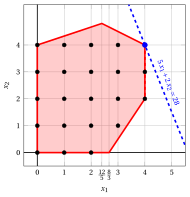{ .fig .ovale loading=lazy style="width:71%" }

!!! esercizio "Esercizio 6.8: Algoritmo del piano di taglio (P21)"
    Considera il seguente problema ILP nella forma canonica di massimizzazione con $n=2$ variabili intere e $m=3$ vincoli lineari:

    $$
    \begin{array}{rrrrrr}
    {\max} & {x_1} & {+} & {2\,x_2} &  &  \\[2ex]
    & {-x_1} & {-} & {x_2} & {\le} & {-2} \\[2ex]
    & {4\,x_1} & {-} & {2\,x_2} & {\le} & {7} \\[2ex]
    & {x_1} & {+} & {5\,x_2} & {\le} & {21} \\[2ex]
    & {x_1,} &  & {x_2} & {\in} & {\Z_{\ge 0}}
    \end{array}
    $$

    e il seguente dizionario ottimale del suo rilassamento LP in forma standard:

    \begin{equation*}
    \begin{cases}
    \begin{array}{rrrrrrrrrrrrr}
    {x_1} & {=} & {\dfrac{7}{2}} & {-} & {\dfrac{5}{22}}\, {x_4} & {-} & {\dfrac{1}{11}}\, {x_5} \\[2ex]
    {x_2} & {=} & {\dfrac{7}{2}} & {+} & {\dfrac{1}{22}}\, {x_4} & {-} & {\dfrac{2}{11}}\, {x_5} \\[2ex]
    {x_3} & {=} & {5} & {-} & {\dfrac{2}{11}}\, {x_4} & {-} & {\dfrac{3}{11}}\, {x_5} \\[2ex]
    {z} & {=} & {\dfrac{21}{2}} & {-} & {\dfrac{3}{22}}\, {x_4} & {-} & {\dfrac{5}{11}}\, {x_5}
    \end{array}
    \end{casi}
    \fine{equazione*}

    **Domande**

    1. Esegui l'algoritmo del piano di taglio basato sui tagli frazionari di Gomory utilizzando:

        1. un taglio frazionario di Gomory a ogni iterazione;

        2. il lato destro più grande come strategia di selezione del taglio.

        Risolvi i problemi di programmazione lineare dopo aver aggiunto il taglio frazionario di Gomory utilizzando l'algoritmo del simplesso duale. Mostra graficamente la soluzione ottimale del problema di programmazione lineare a ogni iterazione.

    2. Mostra graficamente l'effetto di ciascun taglio frazionario di Gomory sulil rilassamento LP del problema ILP in forma canonica.

    !!! nota ""
        Data una riga $i \in \pazocal{B}$ di un dizionario del simplesso associato a una soluzione di base ammissibile tale che $\bar{b}_i$ sia frazionaria, l'inequazione lineare

        \begin{equation*}
        \sum_{j \in \pazocal{N}}
        \left(
        \bar{a}_{ij}
        -
        \left\lfloor \bar{a}_{ij}\right\rfloor
        \right)x_j
        \ge
        \bar{b}_i - \left\lfloor \bar{b}_i \right\rfloor
        \end{equation*}

        è chiamato il <strong>taglio frazionario di Gomory</strong> generato dalla riga $i$.

??? soluzione "Soluzione"

    Esecuzione dell'algoritmo del piano di taglio per risolvere il problema ILP.

    - <strong>Inizializzazione</strong>

        Consideriamo il problema $LP_1$ nella forma standard:

        $$
        \begin{array}{rrrrrrrrrrrr}
        {\max} & {x_1} & {+} & {2\,x_2} &  &  &  &  &  &  &  &  \\[2ex]
        & {-x_1} & {-} & {x_2} & {+} & {x_3} &  &  &  &  & {=} & {-2} \\[2ex]
        & {4\,x_1} & {-} & {2\,x_2} &  &  & {+} & {x_4} &  &  & {=} & {7} \\[2ex]
        & {x_1} & {+} & {5\,x_2} &  &  &  &  & {+} & {x_5} & {=} & {21} \\[2ex]
        & {x_1,} &  & {x_2,} &  & {x_3,} &  & {x_4,} &  & {x_5} & {\ge} & {0}
        \end{array}
        $$

        e il suo dizionario del simplesso ottimale:

        \begin{equation*}
        \begin{cases}
        \begin{array}{rrrrrrrrrrrrr}
        {x_1} & {=} & {\dfrac{7}{2}} & {-} & {\dfrac{5}{22}}\, {x_4} & {-} & {\dfrac{1}{11}}\, {x_5} \\[2ex]
        {x_2} & {=} & {\dfrac{7}{2}} & {+} & {\dfrac{1}{22}}\, {x_4} & {-} & {\dfrac{2}{11}}\, {x_5} \\[2ex]
        {x_3} & {=} & {5} & {-} & {\dfrac{2}{11}}\, {x_4} & {-} & {\dfrac{3}{11}}\, {x_5} \\[2ex]
        {z} & {=} & {\dfrac{21}{2}} & {-} & {\dfrac{3}{22}}\, {x_4} & {-} & {\dfrac{5}{11}}\, {x_5}
        \end{array}
        \end{casi}
        \fine{equazione*}

        La soluzione ottimale ${ \tilde{ \boldsymbol x}}(\,LP_1\,)$ è <strong>frazionaria</strong> e il problema $LP_1$ è <strong>fattibile</strong>.

        Abbiamo il limite superiore sul valore ottimale del problema ILP:

        $$
        z(~ILP~) ~~\le~~  \underbrace{\left\lfloor \dfrac{21}{2} \right\rfloor}_{=10}
        $$

        Per il problema $LP_1$ in forma canonica, abbiamo:

        $$
        \begin{array}{rrrrrr}
        {\max} & {x_1} & {+} & {2\,x_2} &  &  \\[2ex]
        & {-x_1} & {-} & {x_2} & {\le} & {-2} \\[2ex]
        & {4\,x_1} & {-} & {2\,x_2} & {\le} & {7} \\[2ex]
        & {x_1} & {+} & {5\,x_2} & {\le} & {21} \\[2ex]
        & {x_1,} &  & {x_2} & {\ge} & {0}
        \end{array}
        $$

        Una soluzione ottimale ${ \tilde{ \boldsymbol x}}(\,LP_1\,)$ è:

        $$
        \tilde{x}_1=\dfrac{7}{2},\qquad \tilde{x}_2=\dfrac{7}{2}
        $$

        Il valore ottimale è:

        $$
        z(~LP_1~)=\dfrac{21}{2}
        $$

        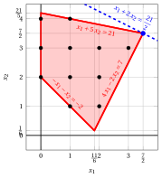{ .fig .ovale caricamento=lazy style="width:71%" }

    - <strong>Iterazione 1</strong>

        - **a)** <strong>Fase di generazione dei tagli</strong>

            Abbiamo il seguente dizionario del simplesso associato a una soluzione di base ammissibile frazionaria del problema $LP_1$ in forma standard:

            \begin{equation*}
            \begin{cases}
            \begin{array}{rrrrrrrrrrrrr}
            {x_1} & {=} & {\dfrac{7}{2}} & {-} & {\dfrac{5}{22}}\, {x_4} & {-} & {\dfrac{1}{11}}\, {x_5} \\[2ex]
            {x_2} & {=} & {\dfrac{7}{2}} & {+} & {\dfrac{1}{22}}\, {x_4} & {-} & {\dfrac{2}{11}}\, {x_5} \\[2ex]
            {x_3} & {=} & {5} & {-} & {\dfrac{2}{11}}\, {x_4} & {-} & {\dfrac{3}{11}}\, {x_5} \\[2ex]
            {z} & {=} & {\dfrac{21}{2}} & {-} & {\dfrac{3}{22}}\, {x_4} & {-} & {\dfrac{5}{11}}\, {x_5}
            \end{array}
            \end{casi}
            \fine{equazione*}

            dove

            \begin{equation*}
            { \bar{\boldsymbol A}}=
            \begin{pmatrix}
            \frac{5}{22} & \frac{1}{11} \\[2ex]
            -\frac{1}{22} & \frac{2}{11} \\[2ex]
            \frac{2}{11} & \frac{3}{11}
            \end{pmatrix}
            \qquad
            { ar{oldsymbol b}}=
            \begin{pmatrix}
            \frac{7}{2}\\[2ex]
            \frac{7}{2}\\[2ex]
            5
            \end{pmatrix}
            \fine{equazione*}

            - Il taglio frazionario di Gomory generato dalla prima riga è:

                \begin{align*}
                \underbrace{\left(\frac{5}{22} - \left\lfloor \frac{5}{22} \right\rfloor \right)}_{\frac{5}{22}-0=\frac{5}{22}} \; x_4
                + \underbrace{\left(\frac{1}{11} - \left\lfloor \frac{1}{11} \right\rfloor \right)}_{\frac{1}{11}-0=\frac{1}{11}} \; x_5
                \ge \underbrace{\left(\frac{7}{2} - \left\lfloor \frac{7}{2} \right\rfloor \right)}_{\frac{7}{2} -3=\frac{1}{2}}
                \end{align*}

                \begin{align*}
                \frac{5}{22}\;x_4 + \frac{1}{11}\;x_5 \ge \frac{1}{2}
                \quad \Rightarrow \quad
                5\;x_4 + 2\;x_5 \ge 11
                \end{align*}

                Sottraendo una variabile di surplus, otteniamo il taglio frazionario di Gomory in forma standard:

                $$
                \frac{5}{22}\;x_4 + \frac{1}{11}\;x_5 - x_6 = \frac{1}{2}
                \quad \Rightarrow \quad
                5\;x_4 + 2\;x_5 - 22\;x_6 = 11
                $$

                Dalla forma standard del problema $LP_1$, abbiamo:

                $$
                x_4= 7 - 4\;x_1 + 2\;x_2, \qquad x_5= 21 - x_1 - 5\;x_2.
                $$

                Sostituendo nel taglio frazionario di Gomory, possiamo esprimerlo in termini delle variabili originali del problema ILP:

                $$
                5\,(7 - 4\;x_1 + 2\;x_2) + 2\,(21 - x_1 - 5\;x_2) \ge 11
                \quad \Rightarrow \quad
                x_1 \le 3
                $$

                Effetto del taglio frazionario di Gomory generato dalla prima riga sul problema $LP_1$ in forma canonica:

                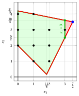{ .fig .ovale caricamento=lazy style="width:71%" }

            - Il taglio frazionario di Gomory generato dalla seconda riga è:

                \begin{align*}
                \underbrace{\left(-\frac{1}{22} - \left\lfloor -\frac{1}{22} \right\rfloor \right)}_{-\frac{1}{22}-(-1)=\frac{21}{22}} \; x_4
                + \underbrace{\left(\frac{2}{11} - \left\lfloor \frac{2}{11} \right\rfloor \right)}_{\frac{2}{11}-0=\frac{2}{11}} \; x_5
                \ge \underbrace{\left(\frac{7}{2} - \left\lfloor \frac{7}{2} \right\rfloor \right)}_{\frac{7}{2} -3=\frac{1}{2}}
                \end{align*}

                \begin{align*}
                \frac{21}{22}\;x_4 + \frac{2}{11}\;x_5 \ge \frac{1}{2}
                \quad \Rightarrow \quad
                21\;x_4 + 4\;x_5 \ge 11
                \end{align*}

                Sottraendo una variabile in eccesso, otteniamo il taglio frazionario di Gomory in forma standard:

                $$
                \frac{21}{22}\;x_4 + \frac{2}{11}\;x_5 - x_6 = \frac{1}{2}
                \quad \Rightarrow \quad
                21\;x_4 + 4\;x_5 - 22\;x_6 = 11
                $$

                Dalla forma standard del problema $LP_1$, abbiamo:

                $$
                x_4= 7 - 4\;x_1 + 2\;x_2, \qquad x_5= 21 - x_1 - 5\;x_2.
                $$

                Sostituendo nel taglio frazionario di Gomory, possiamo esprimerlo in termini delle variabili originali del problema ILP:

                $$
                21\,(7 - 4\;x_1 + 2\;x_2) + 4\,(21 - x_1 - 5\;x_2) \ge 11
                \quad \Rightarrow \quad
                4\;x_1 - x_2 \le 10
                $$

                Effetto del taglio frazionario di Gomory generato dalla seconda riga sul problema $LP_1$ in forma canonica:

                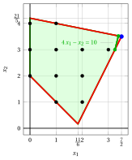{ .fig .ovale loading=lazy style="width:71%" }

                Entrambi i tagli frazionari di Gomory hanno lo stesso lato destro, uguale a $\dfrac{1}{2}$. Selezioniamo il taglio frazionario di Gomory generato dalla prima riga e creiamo il problema $LP_2$ aggiungendolo al problema $LP_1$.

        - **b)** <strong>Fase di riottimizzazione LP</strong>

            Consideriamo il problema $LP_2$ nella forma standard:

            $$
            \begin{array}{rrrrrrrrrrrrrr}
            {\max} & {x_1} & {+} & {2\,x_2} &  &  &  &  &  &  &  &  &  &  \\[2ex]
            & {-x_1} & {-} & {x_2} & {+} & {x_3} &  &  &  &  &  &  & {=} & {-2} \\[2ex]
            & {4\,x_1} & {-} & {2\,x_2} &  &  & {+} & {x_4} &  &  &  &  & {=} & {7} \\[2ex]
            & {x_1} & {+} & {5\,x_2} &  &  &  &  & {+} & {x_5} &  &  & {=} & {21} \\[2ex]
            & {x_1} &  &  &  &  &  &  &  &  & {+} & {x_6} & {=} & {3} \\[2ex]
            & {x_1,} &  & {x_2,} &  & {x_3,} &  & {x_4,} &  & {x_5,} &  & {x_6} & {\ge} & {0}
            \end{array}
            $$

            Per il taglio frazionario di Gomory aggiunto abbiamo:

            $$
            5\;x_4 + 2\;x_5 - 22\;x_6 = 11
            \quad \Rightarrow \quad
            x_6 = -\dfrac{1}{2} + \dfrac{5}{22}\;x_4 + \dfrac{1}{11}\;x_5
            $$

            Aggiungiamo quindi questa equazione al precedente dizionario ottimale e otteniamo il seguente dizionario:

            \begin{equation*}
            \begin{cases}
            \begin{array}{rrrrrrrrrrrrr}
            {x_1} & {=} & {\dfrac{7}{2}} & {-} & {\dfrac{5}{22}}\, {x_4} & {-} & {\dfrac{1}{11}}\, {x_5} \\[2ex]
            {x_2} & {=} & {\dfrac{7}{2}} & {+} & {\dfrac{1}{22}}\, {x_4} & {-} & {\dfrac{2}{11}}\, {x_5} \\[2ex]
            {x_3} & {=} & {5} & {-} & {\dfrac{2}{11}}\, {x_4} & {-} & {\dfrac{3}{11}}\, {x_5} \\[2ex]
            {x_6} & {=} & {-\dfrac{1}{2}} & {+} & {\dfrac{5}{22}}\, {x_4} & {+} & {\dfrac{1}{11}}\, {x_5} \\[2ex]
            {z} & {=} & {\dfrac{21}{2}} & {-} & {\dfrac{3}{22}}\, {x_4} & {-} & {\dfrac{5}{11}}\, {x_5}
            \end{array}
            \end{casi}
            \fine{equazione*}

            dove $\pazocal{B}=\{1,2,3,6\}$ e $\pazocal{N}=\{4,5\}$ e

            - la soluzione primale di base inammissibile è:

                $$
                \bar x_1=\dfrac{7}{2},~~
                \bar x_2=\dfrac{7}{2},~~
                \bar x_3=5,~~
                \bar x_6=-\dfrac{1}{2},~~~~~~
                \bar x_4=0,~~
                \bar x_5=0~~
                \text{  of value   }\dfrac{21}{2}
                $$

            - la soluzione duale di base fattibile è:

                $$
                \bar \pi_1=0,~~
                \bar \pi_2=0,~~
                \bar \pi_3=0,~~
                \bar \pi_6=0,~~~~~~
                \bar \pi_4=\dfrac{3}{22},~~
                \bar \pi_5=\dfrac{5}{11}~~
                \text{  of value   }\dfrac{21}{2}
                $$

            Se aumentiamo il valore di $\pi_6$, possiamo ottenere una migliore soluzione duale. Abbiamo:

            $$
            \begin{cases}
            \pi_4 &= \dfrac{3}{22} - \dfrac{5}{22}\,\pi_6 \\[2ex]
            \pi_5 &= \dfrac{5}{11} - \dfrac{1}{11}\,\pi_6
            \end{cases}
            \qquad
            \qquad
            \begin{cases}
            \underbrace{ \dfrac{3}{22} - \dfrac{5}{22}\,\pi_6 \ge 0}_{\pi_4 \ge 0} \\[2ex]
            \underbrace{  \dfrac{5}{11} - \dfrac{1}{11}\,\pi_6 \ge 0}_{\pi_5 \ge 0}
            \end{cases}
            \qquad
            \qquad
            \begin{cases}
            \pi_6 &\le  \dfrac{3}{5} \\[2ex]
            \pi_6 &\le  5
            \end{cases}
            $$

            Aumentando il valore di $\pi_6$ a $\min \left\{\dfrac{3}{5}, 5\right\}=\dfrac{3}{5}$, il valore di $\pi_4$ diminuisce a 0. Allora abbiamo che:

            - $\pi_6$ diventa una variabile di base doppia e di conseguenza $x_6$ diventa una variabile primale non di base

            - $\pi_4$ diventa una variabile non di base doppia e di conseguenza $x_4$ diventa una variabile basica primale

            Abbiamo:

            $$
            x_6 = -\dfrac{1}{2} + \dfrac{5}{22}\, x_4 + \dfrac{1}{11}\, x_5
            \quad \Longrightarrow \quad
            x_4 = \dfrac{11}{5} - \dfrac{2}{5}\,x_5 + \dfrac{22}{5}\,x_6
            $$

            Sostituendo nelle altre equazioni del dizionario primale, otteniamo:

            $$
            x_1 = \dfrac{7}{2}  -  \dfrac{5}{22} \left( \dfrac{11}{5} - \dfrac{2}{5}\,x_5 + \dfrac{22}{5}\,x_6   \right) -  \dfrac{1}{11} x_5
            = 3 - x_6
            $$

            $$
            x_2 = \dfrac{7}{2}  +  \dfrac{1}{22} \left( \dfrac{11}{5} - \dfrac{2}{5}\,x_5 + \dfrac{22}{5}\,x_6   \right) -  \dfrac{2}{11} x_5
            = \dfrac{18}{5} - \dfrac{1}{5}\,x_5 + \dfrac{1}{5}\,x_6
            $$

            $$
            x_3 = 5  -  \dfrac{2}{11} \left( \dfrac{11}{5} - \dfrac{2}{5}\,x_5 + \dfrac{22}{5}\,x_6   \right) -  \dfrac{3}{11} x_5
            = \dfrac{23}{5} - \dfrac{1}{5}\,x_5 - \dfrac{4}{5}\,x_6
            $$

            $$
            z = \dfrac{21}{2}  -  \dfrac{3}{22} \left( \dfrac{11}{5} - \dfrac{2}{5}\,x_5 + \dfrac{22}{5}\,x_6   \right) -  \dfrac{5}{11} x_5
            = \dfrac{51}{5} - \dfrac{2}{5}\,x_5 - \dfrac{3}{5}\,x_6
            $$

            Di conseguenza, abbiamo ora il seguente dizionario primale ottimale:

            \begin{equation*}
            \begin{cases}
            \begin{array}{rrrrrrrrrrrrr}
            {x_1} & {=} & {3} &  &  & {-} & {x_6} \\[2ex]
            {x_2} & {=} & {\dfrac{18}{5}} & {-} & {\dfrac{1}{5}}\, {x_5} & {+} & {\dfrac{1}{5}}\, {x_6} \\[2ex]
            {x_3} & {=} & {\dfrac{23}{5}} & {-} & {\dfrac{1}{5}}\, {x_5} & {-} & {\dfrac{4}{5}}\, {x_6} \\[2ex]
            {x_4} & {=} & {\dfrac{11}{5}} & {-} & {\dfrac{2}{5}}\, {x_5} & {+} & {\dfrac{22}{5}}\, {x_6} \\[2ex]
            {z} & {=} & {\dfrac{51}{5}} & {-} & {\dfrac{2}{5}}\, {x_5} & {-} & {\dfrac{3}{5}}\, {x_6}
            \end{array}
            \end{casi}
            \fine{equazione*}

            dove $\pazocal{B}=\{1,2,3,4\}$ e $\pazocal{N}=\{5,6\}$.

            - la soluzione ottimale primale di base è:

                $$
                \tilde x_1 = 3,~~
                \tilde x_2 = \dfrac{18}{5},~~
                \tilde x_3 = \dfrac{23}{5},~~
                \tilde x_4 = \dfrac{11}{5},~~
                \tilde x_5 = 0,~~
                \tilde x_6 = 0
                \qquad
                \text{of value  }  \dfrac{51}{5}
                $$

            - la soluzione duale ottimale di base è:

                $$
                \tilde \pi_1 = 0,~~
                \tilde \pi_2 = 0,~~
                \tilde \pi_3 = 0,~~
                \tilde \pi_4 = 0,~~
                \tilde \pi_5 = \dfrac{2}{5},~~
                \tilde \pi_6 = \dfrac{3}{5}
                \qquad
                \text{of value  }  \dfrac{51}{5}
                $$

            La soluzione ottimale ${ \tilde{ \boldsymbol x}}(\,LP_2\,)$ è <strong>frazionaria</strong> e il problema $LP_2$ è <strong>fattibile</strong>.

            Abbiamo il limite superiore sul valore ottimale del problema ILP:

            $$
            z(~ILP~) ~~\le~~  \underbrace{\left\lfloor \dfrac{51}{5} \right\rfloor}_{=10}
            $$

            Per il problema $LP_2$ in forma canonica, abbiamo:

            $$
            \begin{array}{rrrrrr}
            {\max} & {x_1} & {+} & {2\,x_2} &  &  \\[2ex]
            & {-x_1} & {-} & {x_2} & {\le} & {-2} \\[2ex]
            & {4\,x_1} & {-} & {2\,x_2} & {\le} & {7} \\[2ex]
            & {x_1} & {+} & {5\,x_2} & {\le} & {21} \\[2ex]
            & {x_1} &  &  & {\le} & {3} \\[2ex]
            & {x_1,} &  & {x_2} & {\ge} & {0}
            \end{array}
            $$

            Una soluzione ottimale ${ \tilde{ \boldsymbol x}}(\,LP_2\,)$ è:

            $$
            \tilde{x}_1=3,\qquad \tilde{x}_2=\dfrac{18}{5}
            $$

            Il valore ottimale è:

            $$
            z(~LP_2~)=\dfrac{51}{5}
            $$

            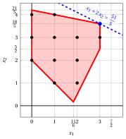{ .fig .ovale caricamento=lazy style="width:71%" }

    - <strong>Iterazione 2</strong>

        - **a)** <strong>Fase di generazione del taglio</strong>

            Abbiamo il seguente dizionario del simplesso associato a una soluzione di base ammissibile frazionaria del problema $LP_2$ in forma standard:

            \begin{equation*}
            \begin{cases}
            \begin{array}{rrrrrrrrrrrrr}
            {x_1} & {=} & {3} &  &  & {-} & {x_6} \\[2ex]
            {x_2} & {=} & {\dfrac{18}{5}} & {-} & {\dfrac{1}{5}}\, {x_5} & {+} & {\dfrac{1}{5}}\, {x_6} \\[2ex]
            {x_3} & {=} & {\dfrac{23}{5}} & {-} & {\dfrac{1}{5}}\, {x_5} & {-} & {\dfrac{4}{5}}\, {x_6} \\[2ex]
            {x_4} & {=} & {\dfrac{11}{5}} & {-} & {\dfrac{2}{5}}\, {x_5} & {+} & {\dfrac{22}{5}}\, {x_6} \\[2ex]
            {z} & {=} & {\dfrac{51}{5}} & {-} & {\dfrac{2}{5}}\, {x_5} & {-} & {\dfrac{3}{5}}\, {x_6}
            \end{array}
            \end{casi}
            \fine{equazione*}

            dove

            \begin{equation*}
            { \bar{\boldsymbol A}}=
            \begin{pmatrix}
            0 & 1 \\[2ex]
            \frac{1}{5} & -\frac{1}{5} \\[2ex]
            \frac{1}{5} & \frac{4}{5} \\[2ex]
            \frac{2}{5} & -\frac{22}{5}
            \end{pmatrix}
            \qquad
            { ar{oldsymbol b}}=
            \begin{pmatrix}
            3\\[2ex]
            \frac{18}{5}\\[2ex]
            \frac{23}{5}\\[2ex]
            \frac{11}{5}
            \end{pmatrix}
            \fine{equazione*}

            - Il taglio frazionario di Gomory generato dalla seconda riga è:

                \begin{align*}
                \underbrace{\left(\frac{1}{5} - \left\lfloor \frac{1}{5} \right\rfloor \right)}_{\frac{1}{5}-0=\frac{1}{5}} \; x_5
                + \underbrace{\left(-\frac{1}{5} - \left\lfloor -\frac{1}{5} \right\rfloor \right)}_{-\frac{1}{5}-(-1)=\frac{4}{5}} \; x_6
                \ge \underbrace{\left(\frac{18}{5} - \left\lfloor \frac{18}{5} \right\rfloor \right)}_{\frac{18}{5} -3=\frac{3}{5}}
                \end{align*}

                \begin{align*}
                \frac{1}{5}\;x_5 + \frac{4}{5}\;x_6 \ge \frac{3}{5}
                \quad \Rightarrow \quad
                x_5 + 4\;x_6 \ge 3
                \end{align*}

                Sottraendo una variabile di surplus, otteniamo il taglio frazionario di Gomory in forma standard:

                $$
                \frac{1}{5}\;x_5 + \frac{4}{5}\;x_6 - x_7 = \frac{3}{5}
                \quad \Rightarrow \quad
                x_5 + 4\;x_6 - 5\;x_7 = 3
                $$

                Dalla forma standard del problema $LP_1$ e dal taglio aggiunto, abbiamo:

                $$
                x_5= 21 - x_1 - 5\;x_2, \qquad x_6= 3 - x_1.
                $$

                Sostituendo nel taglio frazionario di Gomory, possiamo esprimerlo in termini delle variabili originali del problema ILP:

                $$
                (21 - x_1 - 5\;x_2) + 4\,(3 - x_1) \ge 3
                \quad \Rightarrow \quad
                x_1 + x_2 \le 6
                $$

                Effetto del taglio frazionario di Gomory generato dalla seconda riga sul problema $LP_2$ in forma canonica:

                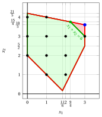{ .fig .ovale caricamento=lazy style="width:71%" }

            - Il taglio frazionario di Gomory generato dalla terza riga è:

                \begin{align*}
                \underbrace{\left(\frac{1}{5} - \left\lfloor \frac{1}{5} \right\rfloor \right)}_{\frac{1}{5}-0=\frac{1}{5}} \; x_5
                + \underbrace{\left(\frac{4}{5} - \left\lfloor \frac{4}{5} \right\rfloor \right)}_{\frac{4}{5}-0=\frac{4}{5}} \; x_6
                \ge \underbrace{\left(\frac{23}{5} - \left\lfloor \frac{23}{5} \right\rfloor \right)}_{\frac{23}{5} -4=\frac{3}{5}}
                \end{align*}

                \begin{align*}
                \frac{1}{5}\;x_5 + \frac{4}{5}\;x_6 \ge \frac{3}{5}
                \quad \Rightarrow \quad
                x_5 + 4\;x_6 \ge 3
                \end{align*}

                Questo taglio frazionario di Gomory è lo stesso di quello generato dalla seconda riga.

            - Il taglio frazionario di Gomory generato dalla quarta riga è:

                \begin{align*}
                \underbrace{\left(\frac{2}{5} - \left\lfloor \frac{2}{5} \right\rfloor \right)}_{\frac{2}{5}-0=\frac{2}{5}} \; x_5
                + \underbrace{\left(-\frac{22}{5} - \left\lfloor -\frac{22}{5} \right\rfloor \right)}_{-\frac{22}{5}-(-5)=\frac{3}{5}} \; x_6
                \ge \underbrace{\left(\frac{11}{5} - \left\lfloor \frac{11}{5} \right\rfloor \right)}_{\frac{11}{5} -2=\frac{1}{5}}
                \end{align*}

                \begin{align*}
                \frac{2}{5}\;x_5 + \frac{3}{5}\;x_6 \ge \frac{1}{5}
                \quad \Rightarrow \quad
                2\;x_5 + 3\;x_6 \ge 1
                \end{align*}

                Sottraendo una variabile di surplus, otteniamo il taglio frazionario di Gomory in forma standard:

                $$
                \frac{2}{5}\;x_5 + \frac{3}{5}\;x_6 - x_7 = \frac{1}{5}
                \quad \Rightarrow \quad
                2\;x_5 + 3\;x_6 - 5\;x_7 = 1
                $$

                Dalla forma standard del problema $LP_1$ e dal taglio aggiunto, abbiamo:

                $$
                x_5= 21 - x_1 - 5\;x_2, \qquad x_6= 3 - x_1.
                $$

                Sostituendo nel taglio frazionario di Gomory, possiamo esprimerlo in termini delle variabili originali del problema ILP:

                $$
                2\,(21 - x_1 - 5\;x_2) + 3\,(3 - x_1) \ge 1
                \quad \Rightarrow \quad
                x_1 + 2\;x_2 \le 10
                $$

                Effetto del taglio frazionario di Gomory generato dalla quarta riga sul problema $LP_2$ in forma canonica:

                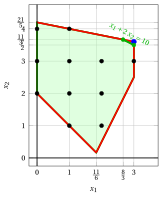{ .fig .ovale caricamento=lazy style="width:71%" }

                Selezioniamo il taglio frazionario di Gomory con il lato destro più grande e creiamo il problema $LP_3$ aggiungendolo al problema $LP_2$.

        - **b)** <strong>Fase di riottimizzazione LP</strong>

            Consideriamo il problema $LP_3$ nella forma standard:

            $$
            \begin{array}{rrrrrrrrrrrrrrrr}
            {\max} & {x_1} & {+} & {2\,x_2} &  &  &  &  &  &  &  &  &  &  &  &  \\[2ex]
            & {-x_1} & {-} & {x_2} & {+} & {x_3} &  &  &  &  &  &  &  &  & {=} & {-2} \\[2ex]
            & {4\,x_1} & {-} & {2\,x_2} &  &  & {+} & {x_4} &  &  &  &  &  &  & {=} & {7} \\[2ex]
            & {x_1} & {+} & {5\,x_2} &  &  &  &  & {+} & {x_5} &  &  &  &  & {=} & {21} \\[2ex]
            & {x_1} &  &  &  &  &  &  &  &  & {+} & {x_6} &  &  & {=} & {3} \\[2ex]
            & {x_1} & {+} & {x_2} &  &  &  &  &  &  &  &  & {+} & {x_7} & {=} & {6} \\[2ex]
            & {x_1,} &  & {x_2,} &  & {x_3,} &  & {x_4,} &  & {x_5,} &  & {x_6,} &  & {x_7} & {\ge} & {0}
            \end{array}
            $$

            Per il taglio frazionario di Gomory aggiunto abbiamo:

            $$
            x_5 + 4\;x_6 - 5\;x_7 = 3
            \quad \Rightarrow \quad
            x_7 = -\dfrac{3}{5} + \dfrac{1}{5}\;x_5 + \dfrac{4}{5}\;x_6
            $$

            Aggiungiamo quindi questa equazione al precedente dizionario ottimale e otteniamo il seguente dizionario:

            \begin{equation*}
            \begin{cases}
            \begin{array}{rrrrrrrrrrrrr}
            {x_1} & {=} & {3} &  &  & {-} & {x_6} \\[2ex]
            {x_2} & {=} & {\dfrac{18}{5}} & {-} & {\dfrac{1}{5}}\, {x_5} & {+} & {\dfrac{1}{5}}\, {x_6} \\[2ex]
            {x_3} & {=} & {\dfrac{23}{5}} & {-} & {\dfrac{1}{5}}\, {x_5} & {-} & {\dfrac{4}{5}}\, {x_6} \\[2ex]
            {x_4} & {=} & {\dfrac{11}{5}} & {-} & {\dfrac{2}{5}}\, {x_5} & {+} & {\dfrac{22}{5}}\, {x_6} \\[2ex]
            {x_7} & {=} & {-\dfrac{3}{5}} & {+} & {\dfrac{1}{5}}\, {x_5} & {+} & {\dfrac{4}{5}}\, {x_6} \\[2ex]
            {z} & {=} & {\dfrac{51}{5}} & {-} & {\dfrac{2}{5}}\, {x_5} & {-} & {\dfrac{3}{5}}\, {x_6}
            \end{array}
            \end{casi}
            \fine{equazione*}

            dove $\pazocal{B}=\{1,2,3,4,7\}$ e $\pazocal{N}=\{5,6\}$ e

            - la soluzione primale di base inammissibile è:

                $$
                \begin{gathered}
                \bar x_1=3,~~
                \bar x_2=\dfrac{18}{5},~~
                \bar x_3=\dfrac{23}{5},~~
                \bar x_4=\dfrac{11}{5},~~
                \bar x_7=-\dfrac{3}{5},\\[1ex]
                \bar x_5=0,~~
                \bar x_6=0~~
                \text{  of value   }\dfrac{51}{5}
                \end{gathered}
                $$

            - la soluzione duale di base fattibile è:

                $$
                \begin{gathered}
                \bar \pi_1=0,~~
                \bar \pi_2=0,~~
                \bar \pi_3=0,~~
                \bar \pi_4=0,~~
                \bar \pi_7=0,\\[1ex]
                \bar \pi_5=\dfrac{2}{5},~~
                \bar \pi_6=\dfrac{3}{5}~~
                \text{  of value   }\dfrac{51}{5}
                \end{gathered}
                $$

            Se aumentiamo il valore di $\pi_7$, possiamo ottenere una migliore soluzione duale. Abbiamo:

            $$
            \begin{cases}
            \pi_5 &= \dfrac{2}{5} - \dfrac{1}{5}\,\pi_7 \\[2ex]
            \pi_6 &= \dfrac{3}{5} - \dfrac{4}{5}\,\pi_7
            \end{cases}
            \qquad
            \qquad
            \begin{cases}
            \underbrace{ \dfrac{2}{5} - \dfrac{1}{5}\,\pi_7 \ge 0}_{\pi_5 \ge 0} \\[2ex]
            \underbrace{  \dfrac{3}{5} - \dfrac{4}{5}\,\pi_7 \ge 0}_{\pi_6 \ge 0}
            \end{cases}
            \qquad
            \qquad
            \begin{cases}
            \pi_7 &\le  2 \\[2ex]
            \pi_7 &\le  \dfrac{3}{4}
            \end{cases}
            $$

            Aumentando il valore di $\pi_7$ a $\min \left\{2, \dfrac{3}{4}\right\}=\dfrac{3}{4}$, il valore di $\pi_6$ diminuisce a 0. Allora abbiamo che:

            - $\pi_7$ diventa una variabile di base doppia e di conseguenza $x_7$ diventa una variabile primale non di base

            - $\pi_6$ diventa una variabile non di base doppia e di conseguenza $x_6$ diventa una variabile basica primale

            Abbiamo:

            $$
            x_7 = -\dfrac{3}{5} + \dfrac{1}{5}\, x_5 + \dfrac{4}{5}\, x_6
            \quad \Longrightarrow \quad
            x_6 = \dfrac{3}{4} - \dfrac{1}{4}\,x_5 + \dfrac{5}{4}\,x_7
            $$

            Sostituendo nelle altre equazioni del dizionario primale, otteniamo:

            $$
            x_1 = 3 - \left( \dfrac{3}{4} - \dfrac{1}{4}\,x_5 + \dfrac{5}{4}\,x_7   \right)
            = \dfrac{9}{4} + \dfrac{1}{4}\,x_5 - \dfrac{5}{4}\,x_7
            $$

            $$
            x_2 = \dfrac{18}{5}  -  \dfrac{1}{5} x_5 +  \dfrac{1}{5} \left( \dfrac{3}{4} - \dfrac{1}{4}\,x_5 + \dfrac{5}{4}\,x_7   \right)
            = \dfrac{15}{4} - \dfrac{1}{4}\,x_5 + \dfrac{1}{4}\,x_7
            $$

            $$
            x_3 = \dfrac{23}{5}  -  \dfrac{1}{5} x_5 -  \dfrac{4}{5} \left( \dfrac{3}{4} - \dfrac{1}{4}\,x_5 + \dfrac{5}{4}\,x_7   \right)
            = 4 - x_7
            $$

            $$
            x_4 = \dfrac{11}{5}  -  \dfrac{2}{5} x_5 +  \dfrac{22}{5} \left( \dfrac{3}{4} - \dfrac{1}{4}\,x_5 + \dfrac{5}{4}\,x_7   \right)
            = \dfrac{11}{2} - \dfrac{3}{2}\,x_5 + \dfrac{11}{2}\,x_7
            $$

            $$
            z = \dfrac{51}{5}  -  \dfrac{2}{5} x_5 -  \dfrac{3}{5} \left( \dfrac{3}{4} - \dfrac{1}{4}\,x_5 + \dfrac{5}{4}\,x_7   \right)
            = \dfrac{39}{4} - \dfrac{1}{4}\,x_5 - \dfrac{3}{4}\,x_7
            $$

            Di conseguenza, abbiamo ora il seguente dizionario primale ottimale:

            \begin{equation*}
            \begin{cases}
            \begin{array}{rrrrrrrrrrrrr}
            {x_1} & {=} & {\dfrac{9}{4}} & {+} & {\dfrac{1}{4}}\, {x_5} & {-} & {\dfrac{5}{4}}\, {x_7} \\[2ex]
            {x_2} & {=} & {\dfrac{15}{4}} & {-} & {\dfrac{1}{4}}\, {x_5} & {+} & {\dfrac{1}{4}}\, {x_7} \\[2ex]
            {x_3} & {=} & {4} &  &  & {-} & {x_7} \\[2ex]
            {x_4} & {=} & {\dfrac{11}{2}} & {-} & {\dfrac{3}{2}}\, {x_5} & {+} & {\dfrac{11}{2}}\, {x_7} \\[2ex]
            {x_6} & {=} & {\dfrac{3}{4}} & {-} & {\dfrac{1}{4}}\, {x_5} & {+} & {\dfrac{5}{4}}\, {x_7} \\[2ex]
            {z} & {=} & {\dfrac{39}{4}} & {-} & {\dfrac{1}{4}}\, {x_5} & {-} & {\dfrac{3}{4}}\, {x_7}
            \end{array}
            \end{casi}
            \fine{equazione*}

            dove $\pazocal{B}=\{1,2,3,4,6\}$ e $\pazocal{N}=\{5,7\}$.

            - la soluzione ottimale primale di base è:

                $$
                \begin{gathered}
                \tilde x_1 = \dfrac{9}{4},~~
                \tilde x_2 = \dfrac{15}{4},~~
                \tilde x_3 = 4,~~
                \tilde x_4 = \dfrac{11}{2},~~
                \tilde x_6 = \dfrac{3}{4},~~
                \tilde x_5 = 0,~~
                \tilde x_7 = 0\\[1ex]
                \text{of value  }  \dfrac{39}{4}
                \end{gathered}
                $$

            - la soluzione duale ottimale di base è:

                $$
                \begin{gathered}
                \tilde \pi_1 = 0,~~
                \tilde \pi_2 = 0,~~
                \tilde \pi_3 = 0,~~
                \tilde \pi_4 = 0,~~
                \tilde \pi_6 = 0,~~
                \tilde \pi_5 = \dfrac{1}{4},~~
                \tilde \pi_7 = \dfrac{3}{4}\\[1ex]
                \text{of value  }  \dfrac{39}{4}
                \end{gathered}
                $$

            La soluzione ottimale ${ \tilde{ \boldsymbol x}}(\,LP_3\,)$ è <strong>frazionaria</strong> e il problema $LP_3$ è <strong>fattibile</strong>.

            Abbiamo il limite superiore sul valore ottimale del problema ILP:

            $$
            z(~ILP~) ~~\le~~  \underbrace{\left\lfloor \dfrac{39}{4} \right\rfloor}_{=9}
            $$

            Per il problema $LP_3$ in forma canonica, abbiamo:

            $$
            \begin{array}{rrrrrr}
            {\max} & {x_1} & {+} & {2\,x_2} &  &  \\[2ex]
            & {-x_1} & {-} & {x_2} & {\le} & {-2} \\[2ex]
            & {4\,x_1} & {-} & {2\,x_2} & {\le} & {7} \\[2ex]
            & {x_1} & {+} & {5\,x_2} & {\le} & {21} \\[2ex]
            & {x_1} &  &  & {\le} & {3} \\[2ex]
            & {x_1} & {+} & {x_2} & {\le} & {6} \\[2ex]
            & {x_1,} &  & {x_2} & {\ge} & {0}
            \end{array}
            $$

            Una soluzione ottimale ${ \tilde{ \boldsymbol x}}(\,LP_3\,)$ è:

            $$
            \tilde{x}_1=\dfrac{9}{4},\qquad \tilde{x}_2=\dfrac{15}{4}
            $$

            Il valore ottimale è:

            $$
            z(~LP_3~)=\dfrac{39}{4}
            $$

            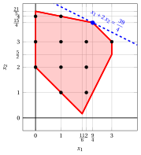{ .fig .ovale caricamento=lazy style="width:71%" }

    - <strong>Iterazione 3</strong>

        - **a)** <strong>Fase di generazione dei tagli</strong>

            Abbiamo il seguente dizionario del simplesso associato a una soluzione di base ammissibile frazionaria del problema $LP_3$ in forma standard:

            \begin{equation*}
            \begin{cases}
            \begin{array}{rrrrrrrrrrrrr}
            {x_1} & {=} & {\dfrac{9}{4}} & {+} & {\dfrac{1}{4}}\, {x_5} & {-} & {\dfrac{5}{4}}\, {x_7} \\[2ex]
            {x_2} & {=} & {\dfrac{15}{4}} & {-} & {\dfrac{1}{4}}\, {x_5} & {+} & {\dfrac{1}{4}}\, {x_7} \\[2ex]
            {x_3} & {=} & {4} &  &  & {-} & {x_7} \\[2ex]
            {x_4} & {=} & {\dfrac{11}{2}} & {-} & {\dfrac{3}{2}}\, {x_5} & {+} & {\dfrac{11}{2}}\, {x_7} \\[2ex]
            {x_6} & {=} & {\dfrac{3}{4}} & {-} & {\dfrac{1}{4}}\, {x_5} & {+} & {\dfrac{5}{4}}\, {x_7} \\[2ex]
            {z} & {=} & {\dfrac{39}{4}} & {-} & {\dfrac{1}{4}}\, {x_5} & {-} & {\dfrac{3}{4}}\, {x_7}
            \end{array}
            \end{casi}
            \fine{equazione*}

            dove

            \begin{equation*}
            { \bar{\boldsymbol A}}=
            \begin{pmatrix}
            -\frac{1}{4} & \frac{5}{4} \\[2ex]
            \frac{1}{4} & -\frac{1}{4} \\[2ex]
            0 & 1 \\[2ex]
            \frac{3}{2} & -\frac{11}{2} \\[2ex]
            \frac{1}{4} & -\frac{5}{4}
            \end{pmatrix}
            \qquad
            { ar{oldsymbol b}}=
            \begin{pmatrix}
            \frac{9}{4}\\[2ex]
            \frac{15}{4}\\[2ex]
            4\\[2ex]
            \frac{11}{2}\\[2ex]
            \frac{3}{4}
            \end{pmatrix}
            \end{equation*}

            - Il taglio frazionario di Gomory generato dalla prima riga è:

                \begin{align*}
                \underbrace{\left(-\frac{1}{4} - \left\lfloor -\frac{1}{4} \right\rfloor \right)}_{-\frac{1}{4}-(-1)=\frac{3}{4}} \; x_5
                + \underbrace{\left(\frac{5}{4} - \left\lfloor \frac{5}{4} \right\rfloor \right)}_{\frac{5}{4}-1=\frac{1}{4}} \; x_7
                \ge \underbrace{\left(\frac{9}{4} - \left\lfloor \frac{9}{4} \right\rfloor \right)}_{\frac{9}{4} -2=\frac{1}{4}}
                \end{align*}

                \begin{align*}
                \frac{3}{4}\;x_5 + \frac{1}{4}\;x_7 \ge \frac{1}{4}
                \quad \Rightarrow \quad
                3\;x_5 + x_7 \ge 1
                \end{align*}

                Sottraendo una variabile di surplus, otteniamo il taglio frazionario di Gomory in forma standard:

                $$
                \frac{3}{4}\;x_5 + \frac{1}{4}\;x_7 - x_8 = \frac{1}{4}
                \quad \Rightarrow \quad
                3\;x_5 + x_7 - 4\;x_8 = 1
                $$

                Dalla forma standard del problema $LP_1$ e dal taglio aggiunto all'iterazione 2 (il problema $LP_3$), abbiamo:

                $$
                x_5= 21 - x_1 - 5\;x_2, \qquad x_7= 6 - x_1 - x_2.
                $$

                Sostituendo nel taglio frazionario di Gomory, possiamo esprimerlo in termini delle variabili originali del problema ILP:

                $$
                3\,(21 - x_1 - 5\;x_2) + (6 - x_1 - x_2) \ge 1
                \quad \Rightarrow \quad
                x_1 + 4\;x_2 \le 17
                $$

                Effetto del taglio frazionario di Gomory generato dalla prima riga sul problema $LP_3$ in forma canonica:

                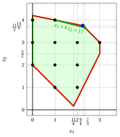{ .fig .ovale caricamento=lazy style="width:71%" }

            - Il taglio frazionario di Gomory generato dalla seconda riga è:

                \begin{align*}
                \underbrace{\left(\frac{1}{4} - \left\lfloor \frac{1}{4} \right\rfloor \right)}_{\frac{1}{4}-0=\frac{1}{4}} \; x_5
                + \underbrace{\left(-\frac{1}{4} - \left\lfloor -\frac{1}{4} \right\rfloor \right)}_{-\frac{1}{4}-(-1)=\frac{3}{4}} \; x_7
                \ge \underbrace{\left(\frac{15}{4} - \left\lfloor \frac{15}{4} \right\rfloor \right)}_{\frac{15}{4} -3=\frac{3}{4}}
                \end{align*}

                \begin{align*}
                \frac{1}{4}\;x_5 + \frac{3}{4}\;x_7 \ge \frac{3}{4}
                \quad \Rightarrow \quad
                x_5 + 3\;x_7 \ge 3
                \end{align*}

                Sottraendo una variabile in eccesso, otteniamo il taglio frazionario di Gomory in forma standard:

                $$
                \frac{1}{4}\;x_5 + \frac{3}{4}\;x_7 - x_8 = \frac{3}{4}
                \quad \Rightarrow \quad
                x_5 + 3\;x_7 - 4\;x_8 = 3
                $$

                Dalla forma standard del problema $LP_1$ e dal taglio aggiunto all'iterazione 2 (il problema $LP_3$), abbiamo:

                $$
                x_5= 21 - x_1 - 5\;x_2, \qquad x_7= 6 - x_1 - x_2.
                $$

                Sostituendo nel taglio frazionario di Gomory, possiamo esprimerlo in termini delle variabili originali del problema ILP:

                $$
                (21 - x_1 - 5\;x_2) + 3\,(6 - x_1 - x_2) \ge 3
                \quad \Rightarrow \quad
                x_1 + 2\;x_2 \le 9
                $$

                Effetto del taglio frazionario di Gomory generato dalla seconda riga sul problema $LP_3$ in forma canonica:

                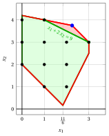{ .fig .ovale caricamento=lazy style="width:71%" }

            - Il taglio frazionario di Gomory generato dalla quarta riga è:

                \begin{align*}
                \underbrace{\left(\frac{3}{2} - \left\lfloor \frac{3}{2} \right\rfloor \right)}_{\frac{3}{2}-1=\frac{1}{2}} \; x_5
                + \underbrace{\left(-\frac{11}{2} - \left\lfloor -\frac{11}{2} \right\rfloor \right)}_{-\frac{11}{2}-(-6)=\frac{1}{2}} \; x_7
                \ge \underbrace{\left(\frac{11}{2} - \left\lfloor \frac{11}{2} \right\rfloor \right)}_{\frac{11}{2} -5=\frac{1}{2}}
                \end{align*}

                \begin{align*}
                \frac{1}{2}\;x_5 + \frac{1}{2}\;x_7 \ge \frac{1}{2}
                \quad \Rightarrow \quad
                x_5 + x_7 \ge 1
                \end{align*}

                Sottraendo una variabile di surplus, otteniamo il taglio frazionario di Gomory in forma standard:

                $$
                \frac{1}{2}\;x_5 + \frac{1}{2}\;x_7 - x_8 = \frac{1}{2}
                \quad \Rightarrow \quad
                x_5 + x_7 - 2\;x_8 = 1
                $$

                Dalla forma standard del problema $LP_1$ e dal taglio aggiunto all'iterazione 2 (il problema $LP_3$), abbiamo:

                $$
                x_5= 21 - x_1 - 5\;x_2, \qquad x_7= 6 - x_1 - x_2.
                $$

                Sostituendo nel taglio frazionario di Gomory, possiamo esprimerlo in termini delle variabili originali del problema ILP:

                $$
                (21 - x_1 - 5\;x_2) + (6 - x_1 - x_2) \ge 1
                \quad \Rightarrow \quad
                x_1 + 3\;x_2 \le 13
                $$

                Effetto del taglio frazionario di Gomory generato dalla quarta riga sul problema $LP_3$ in forma canonica:

                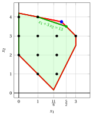{ .fig .ovale caricamento=lazy style="width:71%" }

            - Il taglio frazionario di Gomory generato dalla quinta riga è:

                \begin{align*}
                \underbrace{\left(\frac{1}{4} - \left\lfloor \frac{1}{4} \right\rfloor \right)}_{\frac{1}{4}-0=\frac{1}{4}} \; x_5
                + \underbrace{\left(-\frac{5}{4} - \left\lfloor -\frac{5}{4} \right\rfloor \right)}_{-\frac{5}{4}-(-2)=\frac{3}{4}} \; x_7
                \ge \underbrace{\left(\frac{3}{4} - \left\lfloor \frac{3}{4} \right\rfloor \right)}_{\frac{3}{4} -0=\frac{3}{4}}
                \end{align*}

                \begin{align*}
                \frac{1}{4}\;x_5 + \frac{3}{4}\;x_7 \ge \frac{3}{4}
                \quad \Rightarrow \quad
                x_5 + 3\;x_7 \ge 3
                \end{align*}

                Questo taglio frazionario di Gomory è lo stesso di quello generato dalla seconda riga.

                Selezioniamo il taglio frazionario di Gomory con il lato destro più grande e creiamo il problema $LP_4$ aggiungendolo al problema $LP_3$.

        - **b)** <strong>Fase di riottimizzazione LP</strong>

            Consideriamo il problema $LP_4$ nella forma standard:

            $$
            \begin{array}{rrrrrrrrrrrrrrrrrr}
            {\max} & {x_1} & {+} & {2\,x_2} &  &  &  &  &  &  &  &  &  &  &  &  &  &  \\[2ex]
            & {-x_1} & {-} & {x_2} & {+} & {x_3} &  &  &  &  &  &  &  &  &  &  & {=} & {-2} \\[2ex]
            & {4\,x_1} & {-} & {2\,x_2} &  &  & {+} & {x_4} &  &  &  &  &  &  &  &  & {=} & {7} \\[2ex]
            & {x_1} & {+} & {5\,x_2} &  &  &  &  & {+} & {x_5} &  &  &  &  &  &  & {=} & {21} \\[2ex]
            & {x_1} &  &  &  &  &  &  &  &  & {+} & {x_6} &  &  &  &  & {=} & {3} \\[2ex]
            & {x_1} & {+} & {x_2} &  &  &  &  &  &  &  &  & {+} & {x_7} &  &  & {=} & {6} \\[2ex]
            & {x_1} & {+} & {2\,x_2} &  &  &  &  &  &  &  &  &  &  & {+} & {x_8} & {=} & {9} \\[2ex]
            & {x_1,} &  & {x_2,} &  & {x_3,} &  & {x_4,} &  & {x_5,} &  & {x_6,} &  & {x_7,} &  & {x_8} & {\ge} & {0}
            \end{array}
            $$

            Per il taglio frazionario di Gomory aggiunto abbiamo:

            $$
            x_5 + 3\;x_7 - 4\;x_8 = 3
            \quad \Rightarrow \quad
            x_8 = -\dfrac{3}{4} + \dfrac{1}{4}\;x_5 + \dfrac{3}{4}\;x_7
            $$

            Aggiungiamo quindi questa equazione al precedente dizionario ottimale e otteniamo il seguente dizionario :

            \begin{equation*}
            \begin{cases}
            \begin{array}{rrrrrrrrrrrrr}
            {x_1} & {=} & {\dfrac{9}{4}} & {+} & {\dfrac{1}{4}}\, {x_5} & {-} & {\dfrac{5}{4}}\, {x_7} \\[2ex]
            {x_2} & {=} & {\dfrac{15}{4}} & {-} & {\dfrac{1}{4}}\, {x_5} & {+} & {\dfrac{1}{4}}\, {x_7} \\[2ex]
            {x_3} & {=} & {4} &  &  & {-} & {x_7} \\[2ex]
            {x_4} & {=} & {\dfrac{11}{2}} & {-} & {\dfrac{3}{2}}\, {x_5} & {+} & {\dfrac{11}{2}}\, {x_7} \\[2ex]
            {x_6} & {=} & {\dfrac{3}{4}} & {-} & {\dfrac{1}{4}}\, {x_5} & {+} & {\dfrac{5}{4}}\, {x_7} \\[2ex]
            {x_8} & {=} & {-\dfrac{3}{4}} & {+} & {\dfrac{1}{4}}\, {x_5} & {+} & {\dfrac{3}{4}}\, {x_7} \\[2ex]
            {z} & {=} & {\dfrac{39}{4}} & {-} & {\dfrac{1}{4}}\, {x_5} & {-} & {\dfrac{3}{4}}\, {x_7}
            \end{array}
            \end{casi}
            \fine{equazione*}

            dove $\pazocal{B}=\{1,2,3,4,6,8\}$ e $\pazocal{N}=\{5,7\}$ e

            - la soluzione primale di base inammissibile è:

                $$
                \begin{gathered}
                \bar x_1=\dfrac{9}{4},~~
                \bar x_2=\dfrac{15}{4},~~
                \bar x_3=4,~~
                \bar x_4=\dfrac{11}{2},~~
                \bar x_6=\dfrac{3}{4},~~
                \bar x_8=-\dfrac{3}{4},\\[1ex]
                \bar x_5=0,~~
                \bar x_7=0~~
                \text{  of value   }\dfrac{39}{4}
                \end{gathered}
                $$

            - la soluzione duale di base fattibile è:

                $$
                \begin{gathered}
                \bar \pi_1=0,~~
                \bar \pi_2=0,~~
                \bar \pi_3=0,~~
                \bar \pi_4=0,~~
                \bar \pi_6=0,~~
                \bar \pi_8=0,\\[1ex]
                \bar \pi_5=\dfrac{1}{4},~~
                \bar \pi_7=\dfrac{3}{4}~~
                \text{  of value   }\dfrac{39}{4}
                \end{gathered}
                $$

            Se aumentiamo il valore di $\pi_8$, possiamo ottenere una migliore soluzione duale. Abbiamo:

            $$
            \begin{cases}
            \pi_5 &= \dfrac{1}{4} - \dfrac{1}{4}\,\pi_8 \\[2ex]
            \pi_7 &= \dfrac{3}{4} - \dfrac{3}{4}\,\pi_8
            \end{cases}
            \qquad
            \qquad
            \begin{cases}
            \underbrace{ \dfrac{1}{4} - \dfrac{1}{4}\,\pi_8 \ge 0}_{\pi_5 \ge 0} \\[2ex]
            \underbrace{  \dfrac{3}{4} - \dfrac{3}{4}\,\pi_8 \ge 0}_{\pi_7 \ge 0}
            \end{cases}
            \qquad
            \qquad
            \begin{cases}
            \pi_8 &\le  1 \\[2ex]
            \pi_8 &\le  1
            \end{cases}
            $$

            Aumentando il valore di $\pi_8$ a $\min \left\{1, 1\right\}=1$, i valori di $\pi_5$ e $\pi_7$ diminuiscono a 0 <strong>allo stesso tempo</strong>: il test del rapporto è in parità. Scegliamo di far entrare $x_5$ nella base primale (la scelta di $x_7$ invece porterebbe all'altro vertice ottimale $(1,4)$, anch'esso con valore $9$: il problema ILP ha due soluzioni ottimali, $(3,3)$ e $(1,4)$). Poi abbiamo che:

            - $\pi_8$ diventa una variabile di base doppia e di conseguenza $x_8$ diventa una variabile primale non di base

            - $\pi_5$ diventa una variabile non di base doppia e di conseguenza $x_5$ diventa una variabile basica primale

            Abbiamo:

            $$
            x_8 = -\dfrac{3}{4} + \dfrac{1}{4}\, x_5 + \dfrac{3}{4}\, x_7
            \quad \Longrightarrow \quad
            x_5 = 3 - 3\,x_7 + 4\,x_8
            $$

            Sostituendo nelle altre equazioni del dizionario primale, otteniamo:

            $$
            x_1 = \dfrac{9}{4} + \dfrac{1}{4} \left( 3 - 3\,x_7 + 4\,x_8 \right) - \dfrac{5}{4}\,x_7
            = 3 - 2\,x_7 + x_8
            $$

            $$
            x_2 = \dfrac{15}{4} - \dfrac{1}{4} \left( 3 - 3\,x_7 + 4\,x_8 \right) + \dfrac{1}{4}\,x_7
            = 3 + x_7 - x_8
            $$

            $$
            x_3 = 4 - x_7
            $$

            $$
            x_4 = \dfrac{11}{2} - \dfrac{3}{2} \left( 3 - 3\,x_7 + 4\,x_8 \right) + \dfrac{11}{2}\,x_7
            = 1 + 10\,x_7 - 6\,x_8
            $$

            $$
            x_6 = \dfrac{3}{4} - \dfrac{1}{4} \left( 3 - 3\,x_7 + 4\,x_8 \right) + \dfrac{5}{4}\,x_7
            = 2\,x_7 - x_8
            $$

            $$
            z = \dfrac{39}{4} - \dfrac{1}{4} \left( 3 - 3\,x_7 + 4\,x_8 \right) - \dfrac{3}{4}\,x_7
            = 9 - x_8
            $$

            Di conseguenza, abbiamo ora il seguente dizionario primale ottimale:

            \begin{equation*}
            \begin{cases}
            \begin{array}{rrrrrrrrrrrrr}
            {x_1} & {=} & {3} & {-} & {2}\, {x_7} & {+} & {x_8} \\[2ex]
            {x_2} & {=} & {3} & {+} & {x_7} & {-} & {x_8} \\[2ex]
            {x_3} & {=} & {4} & {-} & {x_7} &  &  \\[2ex]
            {x_4} & {=} & {1} & {+} & {10}\, {x_7} & {-} & {6}\, {x_8} \\[2ex]
            {x_5} & {=} & {3} & {-} & {3}\, {x_7} & {+} & {4}\, {x_8} \\[2ex]
            {x_6} & {=} & {0} & {+} & {2}\, {x_7} & {-} & {x_8} \\[2ex]
            {z} & {=} & {9} &  &  & {-} & {x_8}
            \end{array}
            \end{casi}
            \fine{equazione*}

            dove $\pazocal{B}=\{1,2,3,4,5,6\}$ e $\pazocal{N}=\{7,8\}$.

            - la soluzione ottimale primale di base è:

                $$
                \begin{gathered}
                \tilde x_1 = 3,~~
                \tilde x_2 = 3,~~
                \tilde x_3 = 4,~~
                \tilde x_4 = 1,~~
                \tilde x_5 = 3,~~
                \tilde x_6 = 0,~~
                \tilde x_7 = 0,~~
                \tilde x_8 = 0\\[1ex]
                \text{of value  }  9
                \end{gathered}
                $$

            - la soluzione duale ottimale di base è:

                $$
                \begin{gathered}
                \tilde \pi_1 = 0,~~
                \tilde \pi_2 = 0,~~
                \tilde \pi_3 = 0,~~
                \tilde \pi_4 = 0,~~
                \tilde \pi_5 = 0,~~
                \tilde \pi_6 = 0,~~
                \tilde \pi_7 = 0,~~
                \tilde \pi_8 = 1\\[1ex]
                \text{of value  }  9
                \end{gathered}
                $$

            !!! chiave ""
                La soluzione ottimale ${ \tilde{ \boldsymbol x}}(\,LP_4\,)$ è <strong>intera</strong>. Di conseguenza, una soluzione ottimale ${ \tilde{ \boldsymbol x}}(\,ILP\,)$ è:

                $$
                \tilde{x}_1=3,~~\tilde{x}_2=3
                $$

                Il valore ottimale $z(~ILP~)$ è $9$.

            Per il problema $LP_4$ in forma canonica, abbiamo:

            $$
            \begin{array}{rrrrrr}
            {\max} & {x_1} & {+} & {2\,x_2} &  &  \\[2ex]
            & {-x_1} & {-} & {x_2} & {\le} & {-2} \\[2ex]
            & {4\,x_1} & {-} & {2\,x_2} & {\le} & {7} \\[2ex]
            & {x_1} & {+} & {5\,x_2} & {\le} & {21} \\[2ex]
            & {x_1} &  &  & {\le} & {3} \\[2ex]
            & {x_1} & {+} & {x_2} & {\le} & {6} \\[2ex]
            & {x_1} & {+} & {2\,x_2} & {\le} & {9} \\[2ex]
            & {x_1,} &  & {x_2} & {\ge} & {0}
            \end{array}
            $$

            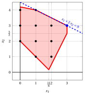{ .fig .ovale caricamento=lazy style="width:71%" }
