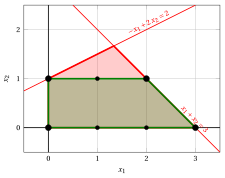
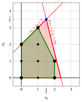
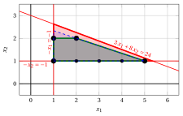
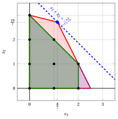

# Esercizi · Formulazioni ideali

**Esercizi · Capitolo 3** · ogni soluzione si apre con un clic · [:material-book-open-variant: Capitolo 3: Formulazioni ideali](../formulations/ideal-formulations.md) · [:material-file-pdf-box: Esercizi, volume 1 (PDF)](../pdf/exercises-1-models-bounds-formulations.pdf)

!!! esercizio "Esercizio 3.1: Inviluppo convesso e formulazione ideale (P8)"
    !!! nota ""
        Considera il seguente problema ILP in forma canonica di massimizzazione con $n=2$ variabili intere e $m=2$ vincoli:

        $$
        \begin{array}{rrrrrrr}
        {\max} & {x_1} & {+} & {2}\, {x_2} \\[1.5ex]
        & {-}{x_1} & {+} & {2}\, {x_2} & {\le} & {2} \\[1.5ex]
        & {x_1} & {+} & {x_2} & {\le} & {3} \\[1.5ex]
        & {x_1,} &  & {x_2} & {\in} & {\Z_{\ge 0}}
        \end{array}
        $$

    **Domande**

    1. Elenca le soluzioni ammissibili e calcola l'inviluppo convesso $\mathrm{conv}(F)$ della regione ammissibile. Classifica le soluzioni ammissibili come vertici, punti del bordo o punti interni dell'inviluppo.

    2. Descrivi $\mathrm{conv}(F)$ con disuguaglianze lineari e scrivi la formulazione ideale corrispondente.

    3. Risolvi il rilassamento LP della formulazione data e il problema LP sulla formulazione ideale, e confronta i due limiti superiori.

??? soluzione "Soluzione"

    1. Per $x_2 = 0$ i vincoli danno $x_1 \le 3$, per $x_2 = 1$ danno $x_1 \le 2$, e per $x_2 = 2$ richiedono $x_1 \ge 2$ e $x_1 \le 1$. La regione fattibile ha i punti $7$

        $$
        (0,0), \quad (1,0), \quad (2,0), \quad (3,0), \quad (0,1), \quad (1,1), \quad (2,1).
        $$

        Graficamente, abbiamo:

        { .fig .ovale loading=lazy  }

        <em>Il poliedro della formulazione (rosso) e l'inviluppo convesso dei punti interi (verde): i vertici dell'inviluppo come quadrati neri, gli altri punti interi come punti neri.</em>

        L'inviluppo convesso $\mathrm{conv}(F)$ è il quadrilatero con

        - i vertici $(0,0)$, $(3,0)$, $(0,1)$, $(2,1)$ del $4$

        - $3$ punti sul confine, $(1,0)$, $(2,0)$, $(1,1)$;

        - nessun punto nell'interno.

    2. I bordi dello scafo giacciono sulle linee

        $$
        x_1 + x_2 = 3,\qquad x_2 = 1,
        $$

        insieme agli assi $x_1 = 0$ e $x_2 = 0$. La formulazione ideale è quindi

        $$
        \begin{array}{rrrrrrr}
        {\max} & {x_1} & {+} & {2}\, {x_2} \\[1.5ex]
        & {x_1} & {+} & {x_2} & {\le} & {3} \\[1.5ex]
        &  &  & {x_2} & {\le} & {1} \\[1.5ex]
        & {x_1,} &  & {x_2} & {\ge} & {0}
        \end{array}
        $$

        I suoi punti interi sono gli stessi punti $7$ di $F$, e il suo poliedro ha solo vertici interi.

    3. Per la formulazione data, il vertice ottimale è l'intersezione delle linee dei vincoli 1 e 2:

        $$
        \begin{cases}
        -x_1 + 2\,x_2 = 2 \\
        x_1 + x_2 = 3
        \end{cases}
        \qquad\Longrightarrow\qquad x_1 = \dfrac{4}{3}, \quad x_2 = \dfrac{5}{3}
        $$

        con $z(\LP) = \dfrac{14}{3}$ e il vincolato $\lfloor z(\LP) \rfloor = 4$. Sulla formulazione ideale il vertice ottimale è il punto intero $(2,1)$, con valore $4$.

        !!! chiave ""
            Il problema LP sulla formulazione ideale dà $z = 4 = z(\ILP)$ al vertice intero $(2,1)$; la formulazione data dà solo il limite $z(\LP) = \dfrac{14}{3}$, arrotondato per difetto a $4$.

!!! esercizio "Esercizio 3.2: Formulazione ideale (P3)"
    !!! nota ""
        Considera il seguente problema ILP in forma canonica di massimizzazione con $n=2$ variabili intere e $m=2$ vincoli:

        $$
        \begin{array}{rrrrrrr}
        {\max} & {2}\, {x_1} & {+} & {4}\, {x_2} \\[1.5ex]
        & {-}{x_1} & {+} & {x_2} & {\le} & {2} \\[1.5ex]
        & {8}\, {x_1} & {+} & {2}\, {x_2} & {\le} & {19} \\[1.5ex]
        & {x_1,} &  & {x_2} & {\in} & {\Z_{\ge 0}}
        \end{array}
        $$

    **Domande**

    1. Calcola l'inviluppo convesso $\mathrm{conv}(F)$ della regione ammissibile e classifica le soluzioni ammissibili come vertici, punti sul bordo o punti interni.

    2. Scrivi una formulazione ideale del problema ILP.

    3. La soluzione ottimale del rilassamento LP della formulazione data è $\tilde{\vet x}(\LP) = (\tfrac{3}{2},\tfrac{7}{2})$. Mostra che non appartiene a $\mathrm{conv}(F)$ e concludi che la formulazione data non è ideale.

    4. Confronta i limiti superiori delle due formulazioni.

??? soluzione "Soluzione"

    1. La regione fattibile ha $9$ punti. Graficamente, abbiamo:

        { .fig .ovale loading=lazy  }

        <em>Il poliedro della formulazione data (rosso), l'inviluppo convesso dei punti interi (verde) con i suoi vertici (quadrati neri), e la soluzione ottimale del rilassamento LP (blu), al di fuori dell'inviluppo.</em>

        L'inviluppo convesso $\mathrm{conv}(F)$ è un poligono con

        - i $5$ <strong>vertici</strong> $(0,0)$, $(2,0)$, $(2,1)$, $(0,2)$, $(1,3)$;

        - $2$ punti sul confine, $(1,0)$, $(0,1)$;

        - $2$ punti all'interno, $(1,1)$, $(1,2)$.

    2. I bordi dello scafo giacciono sulle linee $x_1 = 2$, $2\,x_1 + x_2 = 5$, $-x_1 + x_2 = 2$ e sugli assi. La formulazione ideale è

        $$
        \begin{array}{rrrrrrr}
        {\max} & {2}\, {x_1} & {+} & {4}\, {x_2} \\[1.5ex]
        & {x_1} &  &  & {\le} & {2} \\[1.5ex]
        & {2}\, {x_1} & {+} & {x_2} & {\le} & {5} \\[1.5ex]
        & {-}{x_1} & {+} & {x_2} & {\le} & {2} \\[1.5ex]
        & {x_1,} &  & {x_2} & {\ge} & {0}
        \end{array}
        $$

    3. Il punto $(\tfrac{3}{2},\tfrac{7}{2})$ viola la disuguaglianza $2\,x_1 + x_2 \le 5$ dell'inviluppo: $2 \cdot \tfrac{3}{2} + 1 \cdot \tfrac{7}{2} = \tfrac{13}{2} > 5$. Ogni punto di $\mathrm{conv}(F)$ soddisfa questa disuguaglianza, quindi $\tilde{\vet x}(\LP) \notin \mathrm{conv}(F)$ e $\mathrm{conv}(F) \subsetneq P$: la formulazione data <strong>non è ideale</strong>.

    4. La formulazione fornita dà $z(\LP) = 17$, quindi $z(\ILP) \le 17$. La formulazione ideale ha il vertice ottimale $(1,3)$, con valore $14$.

        !!! chiave ""
            La formulazione ideale fornisce il valore esatto $z(\ILP) = 14$, raggiunto al vertice intero $(1,3)$; la formulazione data fornisce il vincolo più debole $17$.

!!! esercizio "Esercizio 3.3: Confronto delle formulazioni (P23)"
    !!! nota ""
        Considera il problema ILP nella forma canonica di massimizzazione

        $$
        \begin{array}{rrrrrrr}
        {\max} & {x_1} & {+} & {4}\, {x_2} \\[1.5ex]
        & {3}\, {x_1} & {+} & {8}\, {x_2} & {\le} & {24} \\[1.5ex]
        & {-}{x_1} &  &  & {\le} & {-1} \\[1.5ex]
        &  &  & {-}{x_2} & {\le} & {-1} \\[1.5ex]
        & {x_1,} &  & {x_2} & {\in} & {\Z_{\ge 0}}
        \end{array}
        $$

        e i due poliedri (entrambi con $x_1, x_2 \ge 0$)

        $$
        \begin{aligned}
        P_A &= \{\, 3\,x_1 + 8\,x_2 \le 24,~ x_1 \ge 1,~ x_2 \ge 1 \,\}, \\
        P_B &= \{\, x_1 + 3\,x_2 \le 8,~ x_1 \le 5,~ x_1 \ge 1,~ x_2 \ge 1 \,\}.
        \end{aligned}
        $$

    **Domande**

    1. Dimostra che $P_A$ e $P_B$ sono due formulazioni dello stesso problema LPI.

    2. Calcola i vertici di $P_A$ e $P_B$, e decidi quale formulazione è più forte.

    3. Confronta i limiti superiori forniti dai rilassamenti LP delle due formulazioni.

    4. $P_B$ è una formulazione ideale?

??? soluzione "Soluzione"

    1. In entrambi i poliedri $x_1 \ge 1$ e $x_2 \ge 1$. In $P_A$, $x_2 = 1$ dà $3\,x_1 \le 16$, cioè $x_1 \le 5$, e $x_2 = 2$ dà $x_1 \le 2$; $x_2 \ge 3$ è impossibile. In $P_B$, $x_2 = 1$ dà $x_1 \le 5$, e $x_2 = 2$ dà $x_1 \le 2$; $x_2 \ge 3$ è impossibile. Entrambi contengono esattamente $7$ punti interi

        $$
        (1,1), \quad (2,1), \quad (3,1), \quad (4,1), \quad (5,1), \quad (1,2), \quad (2,2),
        $$

        quindi $P_A \cap \Z^2 = P_B \cap \Z^2 = F$.

    2. I vertici sono

        $$
        P_A:~ (1,1),~ (1,\tfrac{21}{8}),~ (\tfrac{16}{3},1), \qquad P_B:~ (1,1),~ (1,\tfrac{7}{3}),~ (5,1).
        $$

        Ogni vertice di $P_B$ soddisfa i vincoli di $P_A$, quindi $P_B \subseteq P_A$ (entrambi sono convessi). Il vertice $(1,\tfrac{21}{8})$ di $P_A$ viola $x_1 + 3\,x_2 \le 8~~(1 \cdot 1 + 3 \cdot \tfrac{21}{8} = \tfrac{71}{8} > 8)$, quindi $P_B \subsetneq P_A$: <strong>$P_B$ è più forte</strong>.

        Graficamente, abbiamo:

        { .fig .ovale loading=lazy  }

        <em>La formulazione $P_A$ (rosso), la formulazione $P_B$ (blu, tratteggiato) e l'inviluppo convesso dei punti interi (verde), con i suoi vertici (quadrati neri).</em>

    3. Le rilassamenti LP danno $\tilde{\vet x} = (1,\tfrac{21}{8})$ con $z = \dfrac{23}{2}$ su $P_A$, e $\tilde{\vet x} = (1,\tfrac{7}{3})$ con $z = \dfrac{31}{3}$ su $P_B$. I limiti arrotondati sono $11$ e $10$. Il punto ammissibile $(2,2)$ ha valore $10$, quindi $P_B$ certifica che è ottimale, mentre $P_A$ lascia un gap.

    4. No: il vertice $(1,\tfrac{7}{3})$ di $P_B$ è frazionario. L'inviluppo convesso ha i vertici $(1,1)$, $(5,1)$, $(2,2)$, $(1,2)$ e i lati su $x_2 \ge 1$, $x_1 + 3\,x_2 \le 8$, $x_2 \le 2$, $x_1 \ge 1$.

        !!! chiave ""
            $P_B \subsetneq P_A$: la formulazione $P_B$ è più forte e il suo vincolo $\lfloor \dfrac{31}{3} \rfloor = 10$ certifica $z(\ILP) = 10$, ma non è ideale.

!!! esercizio "Esercizio 3.4: Riconoscere una formulazione ideale"
    !!! nota ""
        Considera i tre poliedri (tutti con $x_1, x_2 \ge 0$)

        $$
        \begin{aligned}
        P_C &= \{\, x_1 + x_2 \le 3,~ x_1 \le 2 \,\}, \\
        P_D &= \{\, x_1 + 4\,x_2 \le 12,~ 2\,x_1 + x_2 \le 5 \,\}, \\
        P_E &= \{\, x_1 + x_2 \le 3,~ 2\,x_1 + x_2 \le 5 \,\}.
        \end{aligned}
        $$

    **Domande**

    1. Mostra che $P_C$, $P_D$ e $P_E$ contengono gli stessi punti interi, quindi sono formulazioni dello stesso problema ILP.

    2. Calcola i vertici dei tre poliedri. Quale formulazione è ideale? Ordina le formulazioni dalla più forte alla più debole.

    3. Con la funzione obiettivo $x_1 + 5\,x_2$, il problema LP su $P_D$ ha una soluzione ottimale intera. Ciò dimostra che $P_D$ è ideale? Usa la funzione obiettivo $x_1 + x_2$ per rispondere.

??? soluzione "Soluzione"

    1. Un punto intero di uno qualsiasi dei tre poliedri ha $x_1 \le 2$ ($x_1 \le 2$ in $P_C$, $2\,x_1 \le 5$ in $P_D$ e $P_E$). Per $x_1 = 0, 1, 2$ il valore intero massimo di $x_2$ è

        $$
        \begin{aligned}
        P_C&:~ 3 - x_1 = 3,~ 2,~ 1, \\
        P_D&:~ \min\{\lfloor (12 - x_1)/4 \rfloor,~ 5 - 2\,x_1\} = 3,~ 2,~ 1, \\
        P_E&:~ \min\{3 - x_1,~ 5 - 2\,x_1\} = 3,~ 2,~ 1.
        \end{aligned}
        $$

        Le tre formulazioni hanno gli stessi punti interi $9$

        $$
        (0,0), \quad (0,1), \quad (0,2), \quad (0,3), \quad (1,0), \quad (1,1), \quad (1,2), \quad (2,0), \quad (2,1).
        $$

    2. I vertici sono

        $$
        \begin{aligned}
        P_C&:~ (0,0),~ (0,3),~ (2,0),~ (2,1) \\
        P_D&:~ (0,0),~ (0,3),~ (\tfrac{8}{7},\tfrac{19}{7}),~ (\tfrac{5}{2},0) \\
        P_E&:~ (0,0),~ (0,3),~ (2,1),~ (\tfrac{5}{2},0)
        \end{aligned}
        $$

        Solo $P_C$ ha tutti i suoi vertici interi: $P_C = \mathrm{conv}(F)$ è la formulazione <strong>ideale</strong>. Ogni vertice di $P_C$ appartiene a $P_E$ e ogni vertice di $P_E$ appartiene a $P_D$, quindi

        $$
        \mathrm{conv}(F) = P_C ~\subsetneq~ P_E ~\subsetneq~ P_D,
        $$

        e l'ordine dalla formulazione più forte a quella più debole è $P_C$, $P_E$, $P_D$. Graficamente, abbiamo:

        { .fig .ovale loading=lazy  }

        <em>Le formulazioni $P_D$ (rosso), $P_E$ (blu, tratteggiato) e $P_C$ (verde), i punti interi $9$ (nero) e la soluzione ottimale $(\frac{8}{7},\frac{19}{7})$ del problema di programmazione lineare su $P_D$ con l'obiettivo $x_1 + x_2$ (blu), con la sua linea obiettivo (tratteggiata).</em>

    3. Con $x_1 + 5\,x_2$ il vertice ottimale di $P_D$ è $(0,3)$, di valore $15$: è un intero. Con $x_1 + x_2$, invece, il vertice ottimale di $P_D$ è $(\tfrac{8}{7},\tfrac{19}{7})$, di valore $\dfrac{27}{7}$, mentre il miglior punto intero ha valore $3$.

        !!! chiave ""
            Un ottimo intero LP per una funzione obiettivo <strong>non</strong> dimostra che una formulazione è ideale: $P_D$ ha il vertice frazionario $(\frac{8}{7},\frac{19}{7})$, ottimale per $x_1 + x_2$. Solo $P_C$ fornisce un vertice ottimale intero per ogni funzione obiettivo.

!!! esercizio "Esercizio 3.5: Una formulazione ideale in tre dimensioni (P43)"
    !!! nota ""
        Considera il seguente problema ILP in forma canonica di massimizzazione con $n=3$ variabili intere e $m=2$ vincoli:

        $$
        \begin{array}{rrrrrrrrr}
        {\max} & {x_1} & {+} & {2}\, {x_2} & {+} & {7}\, {x_3} \\[1.5ex]
        & {x_1} &  &  & {+} & {2}\, {x_3} & {\le} & {2} \\[1.5ex]
        &  &  & {x_2} & {+} & {2}\, {x_3} & {\le} & {2} \\[1.5ex]
        & {x_1,} &  & {x_2,} &  & {x_3} & {\in} & {\Z_{\ge 0}}
        \end{array}
        $$

    **Domande**

    1. Calcola tutti i vertici del poliedro $P$ del rilassamento LP.

    2. La formulazione è ideale? Cosa implica questo per il rilassamento LP con qualsiasi funzione obiettivo?

    3. Risolvi il rilassamento LP con la funzione obiettivo data e fornisci $z(\ILP)$.

??? soluzione "Soluzione"

    1. Un vertice di $P \subseteq \R^3$ è un punto ammissibile in cui $3$ vincoli linearmente indipendenti (tra i vincoli $2$ e i vincoli di non negatività $3$) sono soddisfatti con uguaglianza. Risolvendo tutti i sistemi $3 \times 3$ e mantenendo le soluzioni ammissibili si ottengono i vertici

        $$
        (0,0,0),\quad (0,0,1),\quad (0,2,0),\quad (2,0,0),\quad (2,2,0).
        $$

        Per esempio, $x_1 = 0$, $x_1 + 2\,x_3 = 2$ e $x_2 + 2\,x_3 = 2$ danno $(0,0,1)$. I sistemi che sono incoerenti, o la cui soluzione viola un vincolo, non danno alcun vertice.

    2. Tutti i vertici sono interi e appartengono a $F$. Il poliedro $P$ è limitato, quindi è l'inviluppo convesso dei suoi vertici: $P = \mathrm{conv}(\text{vertices}) \subseteq \mathrm{conv}(F) \subseteq P$, quindi $P = \mathrm{conv}(F)$ e la formulazione è <strong>ideale</strong>. Per ogni funzione obiettivo, il rilassamento LP ha un vertice ottimale intero, ad esempio:

        
<table>
        <tr>
        <th>Funzione obiettivo</th>
        <th>vertice ottimale</th>
        <th>valore ottimale</th>
        </tr>
        <tr>
        <td>\(x_1 + 2\,x_2 + 7\,x_3\)</td>
        <td>\((0,0,1)\)</td>
        <td>\(7\)</td>
        </tr>
        <tr>
        <td>\(x_1 + x_2 + 3\,x_3\)</td>
        <td>\((2,2,0)\)</td>
        <td>\(4\)</td>
        </tr>
        <tr>
        <td>\(3\,x_1 + 2\,x_2 + 9\,x_3\)</td>
        <td>\((2,2,0)\)</td>
        <td>\(10\)</td>
        </tr>
        <tr>
        <td>\(x_1 + x_2 + x_3\)</td>
        <td>\((2,2,0)\)</td>
        <td>\(4\)</td>
        </tr>
        </table>

        e l'enumerazione completa dà gli stessi valori.

    3. I valori di $x_1 + 2\,x_2 + 7\,x_3$ ai cinque vertici sono $0$, $7$, $4$, $2$, $6$: il vertice ottimale è $(0,0,1)$, con valore $7$.

        !!! chiave ""
            La formulazione è ideale: il vertice ottimale $(0,0,1)$ del rilassamento LP è intero, e $z(\LP) = z(\ILP) = 7$.
