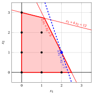
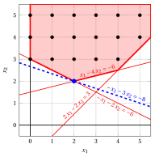
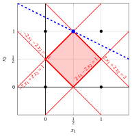
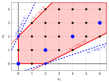

# Esercizi · Programmazione lineare intera

**Esercizi · Capitolo 1** · ogni soluzione si apre con un clic · [:material-book-open-variant: Capitolo 1: Programmazione lineare intera](../models-and-bounds/ilp.md) · [:material-file-pdf-box: Esercizi, volume 1 (PDF)](../pdf/exercises-1-models-bounds-formulations.pdf)

!!! esercizio "Esercizio 1.1: Programmazione lineare intera (P7)"
    !!! nota ""
        Considera i seguenti dati di input di un problema ILP con $n=2$ variabili e $m=2$ vincoli:

        $$
        \vet c = \begin{pmatrix}
        3 \\[1ex]
        1
        \end{pmatrix} \qquad \boldsymbol A = \begin{pmatrix}
        1 & 4 \\[1ex]
        2 & 1
        \end{pmatrix} \qquad \vet b = \begin{pmatrix}
        12 \\[1ex]
        5
        \end{pmatrix}
        $$

    **Domande**

    1. Scrivi il problema ILP in forma canonica di massimizzazione.

    2. Disegna la regione ammissibile del problema ILP e elenca tutte le sue soluzioni ammissibili.

    3. Trova una soluzione ottimale graficamente e verificala mediante enumerazione completa.

??? soluzione "Soluzione"

    1. Il problema ILP in forma canonica di massimizzazione con variabili intere non negative $n=2$ e vincoli lineari minore o uguale a $m=2$ si legge come segue:

        $$
        \begin{array}{rrrrrrr}
        {\max} & {3}\, {x_1} & {+} & {x_2} \\[1.5ex]
        & {x_1} & {+} & {4}\, {x_2} & {\le} & {12} \\[1.5ex]
        & {2}\, {x_1} & {+} & {x_2} & {\le} & {5} \\[1.5ex]
        & {x_1,} &  & {x_2} & {\in} & {\Z_{\ge 0}}
        \end{array}
        $$

    2. Entrambi i vincoli hanno coefficienti non negativi, quindi ogni soluzione ammissibile soddisfa $x_1 \le \lfloor \frac{5}{2} \rfloor = 2$ (vincolo 2). Per ogni valore di $x_1$, i vincoli forniscono i valori interi di $x_2$:

        
<table>
        <tr>
        <th>\(x_1\)</th>
        <th>limiti su \(x_2\)</th>
        <th>punti ammissibili</th>
        </tr>
        <tr>
        <td>\(0\)</td>
        <td>\(x_2 \le 3,~~x_2 \le 5\)</td>
        <td>\((0,0)\), \((0,1)\), \((0,2)\), \((0,3)\)</td>
        </tr>
        <tr>
        <td>\(1\)</td>
        <td>\(x_2 \le \tfrac{11}{4},~~x_2 \le 3\)</td>
        <td>\((1,0)\), \((1,1)\), \((1,2)\)</td>
        </tr>
        <tr>
        <td>\(2\)</td>
        <td>\(x_2 \le \tfrac{5}{2},~~x_2 \le 1\)</td>
        <td>\((2,0)\), \((2,1)\)</td>
        </tr>
        </table>

        La regione ammissibile $F$ è composta dai punti neri $9$ della figura, i punti interi del poliedro $P$ (rossi):

        { .fig .ovale loading=lazy  }

        <em>Regione fattibile del problema ILP: i punti interi (neri) all'interno del politopo dei vincoli (rossi). La soluzione ottimale $(2,1)$ è blu, con la linea dell'obiettivo $3\,x_1 + x_2 = 7$ (tratteggiata).</em>

    3. Il gradiente della funzione obiettivo è $\nabla f = (3,1)$. Spostando la linea di livello $3\,x_1 + x_2 = z$ nella direzione di $\nabla f$, l'ultimo punto di $F$ raggiunto è $(2,1)$, sulla linea tratteggiata $3\,x_1 + x_2 = 7$ della figura; nessun altro punto di $F$ giace su questa linea.

        La enumerazione completa delle soluzioni ammissibili $9$ lo conferma (l'ottimo in grassetto):

        $$
        \begin{array}{ccc|ccc|ccc}
        \hline {x_1} & {x_2} & {z} & {x_1} & {x_2} & {z} & {x_1} & {x_2} & {z} \\
        \hline {0} & {0} & {0} & {0} & {3} & {3} & {1} & {2} & {5} \\
        {0} & {1} & {1} & {1} & {0} & {3} & {2} & {0} & {6} \\
        {0} & {2} & {2} & {1} & {1} & {4} & {\mathbf{2}} & {\mathbf{1}} & {\mathbf{7}} \\
        \hline
        \end{array}
        $$

        !!! chiave ""
            Il problema ILP ha la <strong>soluzione</strong> ottimale unica $\tilde{\vet x}(\ILP) = (2,1)$, con valore ottimale $z(\ILP) = 7$.

!!! esercizio "Esercizio 1.2: Forma canonica di massimizzazione (P13)"
    !!! nota ""
        Considera il seguente problema ILP con variabili intere $n=2$:

        $$
        \begin{array}{rrrrrrr}
        {\min} & {x_1} & {+} & {3}\, {x_2} \\[1.5ex]
        & {x_1} & {+} & {2}\, {x_2} & {\ge} & {6} \\[1.5ex]
        & {-}{x_1} & {+} & {4}\, {x_2} & {\ge} & {6} \\[1.5ex]
        & {2}\, {x_1} & {-} & {2}\, {x_2} & {\le} & {3} \\[1.5ex]
        & {x_1,} &  & {x_2} & {\in} & {\Z_{\ge 0}}
        \end{array}
        $$

    **Domande**

    1. Scrivi il problema ILP in forma canonica di massimizzazione e fornisci i suoi dati $\vet c$, $\boldsymbol A$ e $\vet b$.

    2. Disegna la regione ammissibile. È un insieme finito?

    3. Spiega perché il problema di ILP ha una soluzione ottimale e trovala graficamente.

??? soluzione "Soluzione"

    1. La minimizzazione di $x_1 + 3\,x_2$ è la massimizzazione di $-x_1 - 3\,x_2$, con $\min \{x_1 + 3\,x_2\} = -\max\{-x_1 - 3\,x_2\}$. Ogni vincolo $\ge$ è moltiplicato per $-1$:

        $$
        x_1 + 2\,x_2 \ge 6 \iff -x_1 - 2\,x_2 \le -6, \qquad -x_1 + 4\,x_2 \ge 6 \iff x_1 - 4\,x_2 \le -6.
        $$

        Il problema ILP nella forma canonica di massimizzazione (problema $P13$ del catalogo) è

        $$
        \begin{array}{rrrrrrr}
        {\max} & {-}{x_1} & {-} & {3}\, {x_2} \\[1.5ex]
        & {-}{x_1} & {-} & {2}\, {x_2} & {\le} & {-6} \\[1.5ex]
        & {x_1} & {-} & {4}\, {x_2} & {\le} & {-6} \\[1.5ex]
        & {2}\, {x_1} & {-} & {2}\, {x_2} & {\le} & {3} \\[1.5ex]
        & {x_1,} &  & {x_2} & {\in} & {\Z_{\ge 0}}
        \end{array}
        $$

        con dati

        $$
        \vet c = \begin{pmatrix}
        -1 \\[1ex]
        -3
        \end{pmatrix} \qquad \boldsymbol A = \begin{pmatrix}
        -1 & -2 \\[1ex]
        1 & -4 \\[1ex]
        2 & -2
        \end{pmatrix} \qquad \vet b = \begin{pmatrix}
        -6 \\[1ex]
        -6 \\[1ex]
        3
        \end{pmatrix}
        $$

    2. Il poliedro delle restrizioni è disegnato in rosso all'interno della scatola $0 \le x_1, x_2 \le 5$; continua verso l'alto senza limiti.

        { .fig .ovale loading=lazy  }

        <em>Regione ammissibile di $P13$ all'interno della scatola (rossa), i suoi punti interi (neri) e la soluzione ottimale $(2,2)$ (blu), con la linea dell'obiettivo $-x_1 - 3\,x_2 = -8$ (tratteggiata).</em>

        La regione ammissibile <strong>non è finita</strong>: per ogni numero intero $k \ge 3$ il punto $(0,k)$ soddisfa $-2k \le -6$, $-4k \le -6$ e $-2k \le 3$, quindi appartiene a $F$.

    3. Tutti i costi del problema di massimizzazione sono negativi e $x_1, x_2 \ge 0$, quindi $-x_1 - 3\,x_2 \le 0$ su $F$: la funzione obiettivo è limitata superiormente. Il punto ammissibile $(0,3)$ ha valore $-9$, e solo i punti finiti con $x_1 + 3\,x_2 < 9$ possono fare meglio: esiste una soluzione ottimale.

        Il gradiente è $\nabla f = (-1,-3)$: la linea di livello si muove verso l'origine. L'ultimo punto di $F$ raggiunto è $(2,2)$, sulla linea tratteggiata $-x_1 - 3\,x_2 = -8$. La riga $x_2 = 1$ non contiene punti ammissibili, perché $x_1 + 2 \ge 6$ richiede $x_1 \ge 4$ e $-x_1 + 4 \ge 6$ richiede $x_1 \le -2$.

        !!! chiave ""
            Il problema ILP ha la <strong>unica</strong> soluzione ottimale $\tilde{\vet x}(\ILP) = (2,2)$, con valore ottimale $z(\ILP) = -8$ in forma canonica di massimizzazione, cioè un valore minimo $x_1 + 3\,x_2 = 8$ del problema originale.

!!! esercizio "Esercizio 1.3: Enumerazione completa (P43)"
    !!! nota ""
        Considera i seguenti dati di input di un problema ILP con $n=3$ variabili e $m=2$ vincoli:

        $$
        \vet c = \begin{pmatrix}
        1 \\[1ex]
        2 \\[1ex]
        7
        \end{pmatrix} \qquad \boldsymbol A = \begin{pmatrix}
        1 & 0 & 2 \\[1ex]
        0 & 1 & 2
        \end{pmatrix} \qquad \vet b = \begin{pmatrix}
        2 \\[1ex]
        2
        \end{pmatrix}
        $$

    **Domande**

    1. Scrivi il problema ILP in forma canonica di massimizzazione.

    2. Ottieni un limite superiore su ciascuna variabile dai vincoli e elenca tutte le soluzioni ammissibili.

    3. Trova una soluzione ottimale mediante enumerazione completa. È unica?

??? soluzione "Soluzione"

    1. Il problema ILP in forma canonica di massimizzazione con $n=3$ variabili intere non negative e $m=2$ vincoli lineari di tipo minore o uguale si presenta come segue:

        $$
        \begin{array}{rrrrrrrrr}
        {\max} & {x_1} & {+} & {2}\, {x_2} & {+} & {7}\, {x_3} \\[1.5ex]
        & {x_1} &  &  & {+} & {2}\, {x_3} & {\le} & {2} \\[1.5ex]
        &  &  & {x_2} & {+} & {2}\, {x_3} & {\le} & {2} \\[1.5ex]
        & {x_1,} &  & {x_2,} &  & {x_3} & {\in} & {\Z_{\ge 0}}
        \end{array}
        $$

    2. Tutti i coefficienti sono non negativi, quindi ogni variabile è al massimo il lato destro diviso per il suo coefficiente, arrotondato per difetto:

        $$
        x_1 \le \lfloor 2/1 \rfloor = 2, \qquad x_2 \le \lfloor 2/1 \rfloor = 2, \qquad x_3 \le \min\left\{ \lfloor 2/2 \rfloor, \lfloor 2/2 \rfloor \right\} = 1.
        $$

        - Se $x_3 = 1$, i vincoli diventano $x_1 \le 0$ e $x_2 \le 0$: l'unico punto è $(0,0,1)$.

        - Se $x_3 = 0$, i vincoli diventano $x_1 \le 2$ e $x_2 \le 2$: i punti $9$ $(x_1,x_2,0)$ con $x_1, x_2 \in \{0,1,2\}$.

        La regione fattibile ha $10$ punti.

    3. I valori della funzione obiettivo $x_1 + 2\,x_2 + 7\,x_3$ sono (l'ottimo in grassetto):

        $$
        \begin{array}{cccc|cccc}
        \hline {x_1} & {x_2} & {x_3} & {z} & {x_1} & {x_2} & {x_3} & {z} \\
        \hline {0} & {0} & {0} & {0} & {1} & {2} & {0} & {5} \\
        {0} & {1} & {0} & {2} & {2} & {0} & {0} & {2} \\
        {0} & {2} & {0} & {4} & {2} & {1} & {0} & {4} \\
        {1} & {0} & {0} & {1} & {2} & {2} & {0} & {6} \\
        {1} & {1} & {0} & {3} & {\mathbf{0}} & {\mathbf{0}} & {\mathbf{1}} & {\mathbf{7}} \\
        \hline
        \end{array}
        $$

        Il miglior punto con $x_3 = 0$ è $(2,2,0)$, di valore $6$: è peggiore di $(0,0,1)$, di valore $7$.

        !!! chiave ""
            La enumerazione completa fornisce la <strong>unica</strong> soluzione ottimale $\tilde{\vet x}(\ILP) = (0,0,1)$, con valore ottimale $z(\ILP) = 7$.

!!! esercizio "Esercizio 1.4: Possibili risultati: un problema ILP irrealizzabile"
    !!! nota ""
        Considera il seguente problema ILP in forma canonica di massimizzazione con $n=2$ variabili intere e $m=4$ vincoli:

        $$
        \begin{array}{rrrrrrr}
        {\max} & {x_1} & {+} & {2}\, {x_2} \\[1.5ex]
        & {2}\, {x_1} & {-} & {2}\, {x_2} & {\le} & {1} \\[1.5ex]
        & {-}{2}\, {x_1} & {+} & {2}\, {x_2} & {\le} & {1} \\[1.5ex]
        & {-}{2}\, {x_1} & {-} & {2}\, {x_2} & {\le} & {-1} \\[1.5ex]
        & {2}\, {x_1} & {+} & {2}\, {x_2} & {\le} & {3} \\[1.5ex]
        & {x_1,} &  & {x_2} & {\in} & {\Z_{\ge 0}}
        \end{array}
        $$

    **Domande**

    1. Disegna il poliedro $P$ dei vincoli e decidi se il problema di programmazione lineare con gli stessi dati (con $x_1, x_2 \ge 0$ al posto di $x_1, x_2 \in \Z_{\ge 0}$) è ammissibile.

    2. Decidi l'esito del problema ILP.

    3. Trova una soluzione ottimale del problema di programmazione lineare con gli stessi dati.

soluzione "Solution"

    1. I quattro vincoli sono $-\frac{1}{2} \le x_1 - x_2 \le \frac{1}{2}$ e $\frac{1}{2} \le x_1 + x_2 \le \frac{3}{2}$: il poliedro $P$ è il quadrato con vertici $(0,\dfrac{1}{2})$, $(\dfrac{1}{2},0)$, $(\dfrac{1}{2},1)$, $(1,\dfrac{1}{2})$.

        { .fig .ovale loading=lazy  }

        <em>Il poliedro $P$ (rosso) non contiene nessun punto intero: i quattro punti interi più vicini ad esso (neri) sono all'esterno. La soluzione ottimale $(\frac{1}{2},1)$ del problema LP è blu, con la retta obiettivo $x_1 + 2\,x_2 = \frac{5}{2}$ (tratteggiata).</em>

        Il punto $(\frac{1}{2},\frac{1}{2})$ soddisfa tutti i vincoli, quindi il problema di programmazione lineare è <strong>fattibile</strong>.

    2. - Dai primi due vincoli, un punto intero ha $x_1 - x_2 \in \Z$ e $|x_1 - x_2| \le \frac{1}{2}$, quindi $x_1 = x_2$.

        - Con $x_1 = x_2$ le ultime due restrizioni leggono $1 \le 4\,x_1 \le 3$, cioè $\frac{1}{4} \le x_1 \le \frac{3}{4}$: nessun valore intero di $x_1$ le soddisfa.

        !!! chiave ""
            La regione fattibile $F = P \cap \Z^2$ è vuota: il problema ILP è <strong>infattibile</strong>, anche se il problema LP con gli stessi dati è ammissibile.

    3. Il poliedro $P$ è limitato e non vuoto, quindi il problema LP ha un vertice ottimale. I valori di $x_1 + 2\,x_2$ ai quattro vertici sono

        $$
        (0,\tfrac{1}{2}) \mapsto 1,\qquad (\tfrac{1}{2},0) \mapsto \dfrac{1}{2},\qquad (\tfrac{1}{2},1) \mapsto \dfrac{5}{2},\qquad (1,\tfrac{1}{2}) \mapsto 2
        $$

        quindi la soluzione ottimale è $\tilde{\vet x}(\LP) = (\frac{1}{2},1)$, con $z(\LP) = \frac{5}{2}$ (vedi la figura).

!!! esercizio "Esercizio 1.5: Possibili risultati: una regione ammissibile illimitata"
    !!! nota ""
        Considera i vincoli

        $$
        \begin{array}{rrrrrrr}
        & {-}{x_1} & {+} & {x_2} & {\le} & {2} \\[1.5ex]
        & {x_1} & {-} & {2}\, {x_2} & {\le} & {2} \\[1.5ex]
        & {x_1,} &  & {x_2} & {\in} & {\Z_{\ge 0}}
        \end{array}
        $$

        e i tre problemi ILP in forma canonica di massimizzazione con questi vincoli e le funzioni obiettivo

        $$
        \text{(a)}~~\max~ x_1 + x_2, \qquad \text{(b)}~~\max~ -2\,x_1 + x_2, \qquad \text{(c)}~~\max~ x_1 - 3\,x_2.
        $$

    **Domande**

    1. Disegna la regione ammissibile. È un insieme finito?

    2. Decidi l'esito di ciascuno dei tre problemi ILP (a), (b) e (c), e fornisci una soluzione ottimale quando esiste.

??? soluzione "Soluzione"

    1. La regione fattibile <strong>non è finita</strong>: per ogni $k \in \Z_{\ge 0}$ il punto $(2k,k)$ soddisfa $-2k + k = -k \le 2$ e $2k - 2k = 0 \le 2$.

        { .fig .ovale loading=lazy  }

        <em>Regione ammissibile all'interno della scatola $0 \le x_1 \le 6$, $0 \le x_2 \le 4$ (rosso), i suoi punti interi (nero), i punti $(2k,k)$ (cerchi blu) e le soluzioni ottimali $(0,2)$ di (b) e $(2,0)$ di (c) (blu) con le loro linee obiettivo (tratteggiate).</em>

    2. - <strong>(a)</strong> I punti $(2k,k)$ sono ammissibili con valore $3k$, che cresce senza limiti: il problema ILP (a) è <strong>illimitato</strong>.

        - <strong>(b)</strong> Per ogni punto ammissibile, $-2\,x_1 + x_2 = (-x_1 + x_2) - x_1 \le 2 - x_1 \le 2$. Il valore $2$ richiede $x_1 = 0$ e $-x_1 + x_2 = 2$, cioè, il punto $(0,2)$, che è ammissibile: la soluzione <strong>unica</strong> ottimale è $(0,2)$, con valore ottimale $2$.

        - <strong>(c)</strong> Per ogni punto ammissibile, $x_1 - 3\,x_2 = (x_1 - 2\,x_2) - x_2 \le 2 - x_2 \le 2$. Il valore $2$ richiede $x_2 = 0$ e $x_1 - 2\,x_2 = 2$, cioè, il punto $(2,0)$: la <strong>soluzione ottimale</strong> unica è $(2,0)$, con valore ottimale $2$.

        !!! chiave ""
            Con la stessa regione fattibile illimitata, il problema (a) è <strong>illimitato</strong>, mentre i problemi (b) e (c) hanno una <strong>soluzione ottimale</strong>: $(0,2)$ e $(2,0)$, entrambi di valore $2$.
