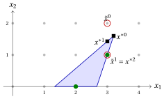
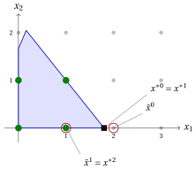

# Esercizi · Euristiche MIP

**Esercizi · Capitolo 10** · ogni soluzione si apre con un clic · [:material-book-open-variant: Capitolo 10: euristiche MIP](../mip-heuristics/mip-heuristics.md) · [:material-file-pdf-box: Esercizi, volume 4 (PDF)](../pdf/exercises-4-mip-heuristics.pdf)

## Arrotondamento e diving

!!! esercizio "Esercizio 10.1: Arrotondamento e divisione (P5)"
    !!! nota ""
        Considera il seguente problema ILP in forma canonica di massimizzazione con $n=2$ variabili intere e $m=2$ vincoli:

        $$
        \begin{array}{rrrrrrr}
        {\max} & {2}\, {x_1} & {+} & {3}\, {x_2} \\[2ex]
        & {6}\, {x_1} & {+} & {21}\, {x_2} & {\le} & {77} \\[2ex]
        & {8}\, {x_1} & {+} & {3}\, {x_2} & {\le} & {36} \\[2ex]
        & {x_1,} &  & {x_2} & {\in} & {\Z_{\ge 0}}
        \end{array}
        $$

    **Domande**

    1. Calcola la soluzione ottimale $\tilde{\vet x}$ del rilassamento LP e il suo valore $z(\LP)$.

    2. Applica l'arrotondamento: arrotonda $\tilde{\vet x}$ al punto intero più vicino, verifica se è ammissibile, e poi arrotondalo per difetto.

    3. Applica il fractional diving: a ogni passaggio risolvi il rilassamento LP con le variabili finora fissate, fissa la variabile meno frazionaria al suo intero più vicino (in caso di parità: indice minore) e ripeti finché la soluzione LP non è intera.

    4. Calcola il gap di ottimalità della soluzione del diving rispetto al limite superiore $\lfloor z(\LP)\rfloor$ e dimostra che la soluzione è ottimale esaminando i possibili valori di $x_2$.

??? soluzione "Soluzione"

    1. I due vincoli sono vincolanti al vertice ottimale: da $8x_1+3x_2=36$ otteniamo $x_2=12-\frac83x_1$, e $6x_1+21x_2=77$ diventa $6x_1+252-56x_1=77$, cioè $x_1=\frac72$ e $x_2=\frac83$:

        $$
        \tilde{\vet x}=\Big(\frac72,\frac83\Big),\qquad z(\LP)=7+8=15 .
        $$

    2. $\big(\rnd{\frac72},\rnd{\frac83}\big)=(4,3)$ viola il secondo vincolo: $8\cdot4+3\cdot3=41>36$. <strong>Arrotondamento fallito.</strong> Arrotondare per difetto dà $(3,2)$: $60\le77$ e $30\le36$, fattibili, di valore $12$.

    3. <strong>Passo 1.</strong> Le distanze dal numero intero più vicino sono $\frac12$ per $x_1$ e $\frac13$ per $x_2$: correggi $x_2:=3$.

        <strong>Fase 2.</strong> Con $x_2=3$ i vincoli diventano $6x_1\le14$ e $8x_1\le27$, quindi $\tilde{\vet x}=\big(\frac73,3\big)$, di valore $\frac{14}{3}+9=\frac{41}{3}$. Correggi $x_1:=\rnd{\frac73}=2$.

        <strong>Passo 3.</strong> La soluzione LP $(2,3)$, di valore $13$, è intera: il diving restituisce $(2,3)$.

    4. Il limite superiore è $\lfloor15\rfloor=15$, quindi il gap è $\frac{15-13}{13}\approx15.4\%$. Per dimostrare l'ottimalità, lasciamo variare $x_2$: $x_2\ge4$ è inammissibile ($21\cdot4=84>77$); $x_2=3$ dà $x_1\le2$, valore al massimo $13$; $x_2=2$ dà $x_1\le3$, valore al massimo $12$; $x_2=1$ dà $x_1\le4$, valore al massimo $11$; $x_2=0$ dà $x_1\le4$, valore al massimo $8$. Pertanto $z(\ILP)=13$ e $(2,3)$ è <strong>ottimale</strong>.

!!! esercizio "Esercizio 10.2: Arrotondamento e diving (P3)"
    !!! nota ""
        Considera il seguente problema ILP in forma canonica di massimizzazione con $n=2$ variabili intere e $m=2$ vincoli:

        $$
        \begin{array}{rrrrrrr}
        {\max} & {2}\, {x_1} & {+} & {4}\, {x_2} \\[2ex]
        & {-} {x_1} & {+} & {x_2} & {\le} & {2} \\[2ex]
        & {8}\, {x_1} & {+} & {2}\, {x_2} & {\le} & {19} \\[2ex]
        & {x_1,} &  & {x_2} & {\in} & {\Z_{\ge 0}}
        \end{array}
        $$

    **Domande**

    1. Calcola la soluzione ottimale $\tilde{\vet x}$ del rilassamento LP e il suo valore $z(\LP)$.

    2. Arrotonda $\tilde{\vet x}$ al numero intero più vicino: è ammissibile? Arrotondalo invece per difetto e fornisci il valore.

    3. Applica la divisione frazionaria (pari: indice più piccolo). Restituisce una soluzione?

    4. Ripeti il diving prendendo la decisione opposta al primo passo e continua con la regola del diving frazionario. Poi dimostra che la soluzione è ottimale esaminando i possibili valori di $x_1$.

??? soluzione "Soluzione"

    1. Entrambe le restrizioni sono vincolanti al vertice ottimale: $x_2=2+x_1$ e $8x_1+2x_2=19$ danno $10x_1=15$:

        $$
        \tilde{\vet x}=\Big(\frac32,\frac72\Big),\qquad z(\LP)=3+14=17 .
        $$

    2. $\big(\rnd{\frac32},\rnd{\frac72}\big)=(2,4)$ soddisfa il primo vincolo ($2\le2$) ma viola il secondo: $16+8=24>19$. <strong>Arrotondamento fallito.</strong> Arrotondare verso il basso dà $(1,3)$: $2\le2$ e $14\le19$, fattibili, di valore $14$.

    3. <strong>Fase 1.</strong> Entrambe le variabili sono alla distanza $\frac12$: fissa $x_1:=\rnd{\frac32}=2$.

        <strong>Fase 2.</strong> Con $x_1=2$ i vincoli diventano $x_2\le4$ e $2x_2\le3$, quindi $\tilde{\vet x}=\big(2,\frac32\big)$, di valore $10$. Fissare $x_2:=\rnd{\frac32}=2$.

        <strong>Passo 3.</strong> Con $x_1=2$ e $x_2=2$ il secondo vincolo è $16+4=20>19$: l’LP è inammissibile, <strong>il diving fallisce</strong>.

    4. <strong>Passo 1.</strong> Correggi $x_1:=1$ invece di $2$. I vincoli diventano $x_2\le3$ e $2x_2\le11$, quindi $\tilde{\vet x}=(1,3)$, di valore $14$, che è un intero: il diving restituisce $(1,3)$. La prima decisione del primo diving, $\rnd{\frac32}=2$, è stata quella sbagliata.

        Ottimalità: il secondo vincolo dà $x_1\le2$. Per $x_1=0$ è $x_2\le2$, valore al massimo $8$; per $x_1=1$ è $x_2\le3$, valore al massimo $14$; per $x_1=2$ è $x_2\le1$, valore al massimo $8$. Pertanto $z(\ILP)=14$ e $(1,3)$ sono <strong>ottimali</strong>.

## Pompa di fattibilità

!!! esercizio "Esercizio 10.3: Pompa di fattibilità 1"
    Considera il programma intero

    \begin{align*}
    && \max ~~ x_1 + x_2 & & \\[0.5ex]
    && \text{soggetto a} \quad 6\,x_1 - 2\,x_2 &\le 16 & \\[0.5ex]
    && 6\,x_1 - 7\,x_2 &\ge 8 & \\[0.5ex]
    && x_1 &\in \{0,1,\dots,5\} & \\[0.5ex]
    && x_2 &\in \{0,1,\dots,5\} &
    \end{align*}

    (Ricorda che la distanza $L_1$ da un punto a un segmento che non è né orizzontale, né verticale, né con pendenza $\pm1$ è minimizzata a un estremo o dove il segmento incrocia la linea orizzontale o verticale che passa per il punto.)

    **Domande**

    1. Disegna la regione $\mathcal{L}$ del rilassamento LP e i suoi punti interi, e calcola la soluzione ottimale $x^{*0}$ del rilassamento LP.

    2. Arrotonda $x^{*0}$ al numero intero più vicino $\tilde x^0$ e verifica se è ammissibile.

    3. Applica la pompa di fattibilità: a ciascuna iterazione calcola la proiezione $x^{*k}$, cioè il punto di $\mathcal{L}$ che minimizza la distanza $L_1$ da $\Delta(x,\tilde x^{k-1})$, arrotondalo e, se l'arrotondamento restituisce lo stesso punto intero, sposta la componente con la distanza $|x^{*k}_j-\tilde x^{k-1}_j|$ più grande di un'unità verso $x^{*k}_j$. Interrompi quando la distanza è $0$.

    4. La soluzione trovata dalla pompa è ottimale? Confronta il suo valore con il limite LP.

??? soluzione "Soluzione"

    1. Il vincolo $6x_1-7x_2\ge 8$ con $x_2\ge0$ richiede $x_1\ge\frac43$, e $6x_1-2x_2\le16$ con $x_2\ge 0$ dà $x_1\le\frac83$ sull'asse. $\mathcal{L}$ è il triangolo con vertici $\big(\frac43,0\big)$, $\big(\frac83,0\big)$ e l'intersezione delle due linee, $\big(\frac{16}{5},\frac85\big)$. I suoi punti interi sono $(2,0)$ e $(3,1)$. L'obiettivo $x_1+x_2$ è massimizzato al vertice

        $$
        x^{*0}=\Big(\frac{16}{5},\frac85\Big),\qquad z_{LP}(I)=\frac{24}{5}=4.8 .
        $$

        { .fig loading=lazy  }

    2. $\tilde x^0=\big(\rnd{3.2},\rnd{1.6}\big)=(3,2)$: $6\cdot3-2\cdot2=14\le16$, ma $6\cdot3-7\cdot2=4<8$: infattibile.

    3. <strong>Iterazione 1.</strong> Proiezione di $(3,2)$. La linea verticale $x_1=3$ attraversa $\mathcal{L}$ per $18-2x_2\le16$ e $18-7x_2\ge8$, cioè tra $(3,1)$ e $\big(3,\frac{10}{7}\big)$: la più vicina è $\big(3,\frac{10}7\big)$, a distanza $2-\frac{10}{7}=\frac47$. La linea orizzontale $x_2=2$ non attraversa $\mathcal{L}$ ($x_1\le\frac{10}3$ e $x_1\ge\frac{11}{3}$). Il vertice $\big(\frac{16}5,\frac85\big)$ si trova a distanza $\frac15+\frac25=\frac35>\frac47$, gli altri vertici sono più lontani. Quindi $x^{*1}=\big(3,\frac{10}7\big)$, $\Delta=\frac47$ e $\tilde x^1=\rnd{x^{*1}}=(3,1)$, un nuovo punto.

        <strong>Iterazione 2.</strong> $(3,1)\in\mathcal{L}$ ($16\le16$, $11\ge8$): $\Delta=0$, la pompa si ferma con $(3,1)$, di valore $4$, dopo due proiezioni.

    4. L'altro punto intero $(2,0)$ ha valore $2$, quindi $(3,1)$ è <strong>ottimale</strong>. Il vincolo LP fornisce anche $z(I)\le\lfloor 4.8\rfloor=4$, il che certifica l'ottimalità senza enumerare i punti interi.

!!! esercizio "Esercizio 10.4: Pompa di fattibilità 2"
    Considera il programma intero

    \begin{align*}
    && \max ~~ 4\,x_1 + 4\,x_2 & & \\[0.5ex]
    && \text{soggetto a} \quad -3\,x_1 + 5\,x_2 &\le 11 & \\[0.5ex]
    && 4\,x_1 - 3\,x_2 &\le -1 & \\[0.5ex]
    && x_1 &\in \{0,1,\dots,5\} & \\[0.5ex]
    && x_2 &\in \{0,1,\dots,5\} &
    \end{align*}

    (Ricorda che la distanza $L_1$ da un punto a un segmento che non è né orizzontale, né verticale, né di pendenza $\pm1$ è minimizzata a un estremo o dove il segmento attraversa la linea orizzontale o verticale attraverso il punto.)

    **Domande**

    1. Disegna la regione $\mathcal{L}$ del rilassamento LP e i suoi punti interi, e calcola la soluzione ottimale $x^{*0}$ del rilassamento LP.

    2. Arrotonda $x^{*0}$ al numero intero più vicino $\tilde x^0$ e verifica se è ammissibile.

    3. Applica la pompa di fattibilità: a ciascuna iterazione calcola la proiezione $x^{*k}$, cioè il punto di $\mathcal{L}$ che minimizza la distanza $L_1$ da $\Delta(x,\tilde x^{k-1})$, arrotondalo e, se l'arrotondamento restituisce lo stesso punto intero, sposta la componente con il più grande $|x^{*k}_j-\tilde x^{k-1}_j|$ di un'unità verso $x^{*k}_j$. Ferma quando la distanza è $0$.

    4. Quante volte la pompa ha bisogno di essere capovolta? La soluzione trovata è ottimale?

??? soluzione "Soluzione"

    1. Con $x_1\ge0$, $\mathcal{L}$ è il triangolo con vertici $\big(0,\frac13\big)$ e $\big(0,\frac{11}5\big)$, sull'asse $x_1=0$, e l'intersezione delle due linee, $\big(\frac{28}{11},\frac{41}{11}\big)$. I suoi punti interi sono $(0,1)$, $(0,2)$, $(1,2)$, $(2,3)$. L'obiettivo è massimizzato a

        $$
        x^{*0}=\Big(\frac{28}{11},\frac{41}{11}\Big),\qquad z_{LP}(I)=\frac{276}{11}\approx 25.09 .
        $$

        { .fig loading=lazy  }

    2. $\tilde x^0=\big(\rnd{2.55},\rnd{3.73}\big)=(3,4)$: $-9+20=11\le11$, ma $12-12=0>-1$: infattibile.

    3. <strong>Iterazione 1.</strong> Proiezione di $(3,4)$. La linea verticale $x_1=3$ avrebbe bisogno di $x_2\ge\frac{13}3$ e $x_2\le4$: nessun incrocio. La linea orizzontale $x_2=4$ avrebbe bisogno di $x_1\ge3$ e $x_1\le\frac{11}4$: nessun incrocio. Il punto più vicino è il vertice $x^{*1}=\big(\frac{28}{11},\frac{41}{11}\big)$, alla distanza $\frac5{11}+\frac3{11}=\frac8{11}$. Il suo arrotondamento è ancora $(3,4)$: un <strong>ciclo breve</strong>. La differenza maggiore è su $x_1$ ($\frac{5}{11}>\frac3{11}$), che si muove verso $\frac{28}{11}$: $\tilde x^1=(2,4)$.

        <strong>Iterazione 2.</strong> Proiezione di $(2,4)$. La linea verticale $x_1=2$ attraversa $\mathcal{L}$ per $x_2\ge3$ e $x_2\le\frac{17}{5}$: il punto più vicino è $\big(2,\frac{17}5\big)$, alla distanza di $\frac35$. La linea orizzontale $x_2=4$ non attraversa $\mathcal{L}$, e il vertice $\big(\frac{28}{11},\frac{41}{11}\big)$ si trova alla distanza di $\frac6{11}+\frac3{11}=\frac9{11}>\frac35$. Pertanto $x^{*2}=\big(2,\frac{17}5\big)$ e $\tilde x^2=(2,3)$.

        <strong>Iterazione 3.</strong> $(2,3)\in\mathcal{L}$ ($-6+15=9\le11$, $8-9=-1\le-1$): $\Delta=0$, la pompa si ferma con $(2,3)$, di valore $20$.

    4. La pompa ha bisogno di <strong>un colpo</strong>: senza di esso, oscillerebbe all'infinito tra $(3,4)$ e il vertice $x^{*0}$. I valori dei punti interi sono $4$, $8$, $12$, $20$: $(2,3)$ è <strong>ottimale</strong>.

!!! esercizio "Esercizio 10.5: Pompa di fattibilità 3"
    Considera il programma intero

    \begin{align*}
    && \max ~~ 4\,x_1 + 2\,x_2 & & \\[0.5ex]
    && \text{soggetto a} \quad 5\,x_1 + 4\,x_2 &\le 9 & \\[0.5ex]
    && -7\,x_1 + 3\,x_2 &\le 5 & \\[0.5ex]
    && x_1 &\in \{0,1,\dots,5\} & \\[0.5ex]
    && x_2 &\in \{0,1,\dots,5\} &
    \end{align*}

    (Ricorda che la distanza $L_1$ da un punto a un segmento che non è né orizzontale, né verticale, né di pendenza $\pm1$ è minimizzata a un estremo o dove il segmento incrocia la linea orizzontale o verticale che passa per il punto.)

    **Domande**

    1. Disegna la regione $\mathcal{L}$ del rilassamento LP e i suoi punti interi, e calcola la soluzione ottimale $x^{*0}$ del rilassamento LP.

    2. Arrotonda $x^{*0}$ al numero intero più vicino $\tilde x^0$ e verifica se è ammissibile.

    3. Applica la pompa di fattibilità: a ciascuna iterazione calcola la proiezione $x^{*k}$, cioè il punto di $\mathcal{L}$ che minimizza la distanza $L_1$ da $\Delta(x,\tilde x^{k-1})$, arrotondalo e, se l'arrotondamento restituisce lo stesso punto intero, sposta la componente con la più grande $|x^{*k}_j-\tilde x^{k-1}_j|$ di un'unità verso $x^{*k}_j$. Ferma quando la distanza è $0$.

    4. Trova la soluzione ottimale esaminando i punti interi e calcola il gap della soluzione della pompa rispetto al limite LP. Perché la pompa manca l'ottimo?

??? soluzione "Soluzione"

    1. $\mathcal{L}$ è il quadrilatero con vertici $(0,0)$, $\big(\frac95,0\big)$, $\big(\frac{7}{43},\frac{88}{43}\big)$ (intersezione delle due linee) e $\big(0,\frac53\big)$. I suoi punti interi sono $(0,0)$, $(1,0)$, $(0,1)$, $(1,1)$. I valori obiettivo dei vertici sono $0$, $\frac{36}5$, $\frac{204}{43}\approx4.74$, $\frac{10}3$, quindi

        $$
        x^{*0}=\Big(\frac95,0\Big),\qquad z_{LP}(I)=\frac{36}{5}=7.2 .
        $$

        { .fig loading=lazy  }

    2. $\tilde x^0=(\rnd{1.8},0)=(2,0)$: $10>9$, infattibile.

    3. <strong>Iterazione 1.</strong> Con $\tilde x^0=(2,0)$, $\Delta(x,\tilde x^0)=|x_1-2|+x_2$. La linea verticale $x_1=2$ non attraversa $\mathcal{L}$; la linea orizzontale $x_2=0$ la attraversa sul segmento da $(0,0)$ a $\big(\frac95,0\big)$, il cui punto più vicino è $\big(\frac95,0\big)$, alla distanza $\frac15$; gli altri vertici sono più lontani. Quindi $x^{*1}=\big(\frac95,0\big)=x^{*0}$, il cui arrotondamento è di nuovo $(2,0)$: un ciclo breve. Il ribaltamento muove $x_1$ verso $\frac95$: $\tilde x^1=(1,0)$.

        <strong>Iterazione 2.</strong> $(1,0)\in\mathcal{L}$: $\Delta=0$, la pompa si ferma con $(1,0)$, di valore $4$.

    4. I valori dei punti interi sono $0$, $4$, $2$, $6$: l'ottimo è $(1,1)$, con $z(I)=6$ ($5+4=9\le9$, $-7+3\le5$). Rispetto al limite LP $\lfloor7.2\rfloor=7$, il gap della soluzione della pompa è $\frac{7-4}{7}\approx42.9\%$ (il suo vero errore relativo è $\frac{6-4}{6}\approx33.3\%$). La pompa considera solo la distanza da $\mathcal{L}$, mai l'obiettivo dopo il primo LP: si ferma al primo punto fattibile che incontra. Migliorarla è compito di metodi come il local branching o la ricerca di prossimità.

## RINS e ramificazione locale

!!! esercizio "Esercizio 10.6: RINS, branching locale e ricerca di prossimità (P23)"
    !!! nota ""
        Considera il seguente problema ILP in forma canonica di massimizzazione con $n=2$ variabili intere e $m=3$ vincoli:

        $$
        \begin{array}{rrrrrrr}
        {\max} & {x_1} & {+} & {4}\, {x_2} \\[2ex]
        & {3}\, {x_1} & {+} & {8}\, {x_2} & {\le} & {24} \\[2ex]
        & {-} {x_1} &  &  & {\le} & {-1} \\[2ex]
        &  &  & {-} & {x_2} & {\le} & {-1} \\[2ex]
        & {x_1,} &  & {x_2} & {\in} & {\Z_{\ge 0}}
        \end{array}
        $$

        La soluzione attuale è $\bar{\vet x}=(1,2)$.

    **Domande**

    1. Calcola il valore dell'incumbent, la soluzione ottimale $\tilde{\vet x}$ del rilassamento LP e il limite superiore $\lfloor z(\LP)\rfloor$.

    2. Applica RINS con $\theta=1$: elenca le variabili che sono fissate, scrivi il sotto-MIP con il vincolo di cutoff e risolvilo.

    3. Applica il branching locale con $k=1$, $k_{\max}=3$, $k_{step}=1$ e $\theta=1$. Scrivi esplicitamente i vincoli del branching locale.

    4. Applica la ricerca di prossimità con $\theta=1$. Confronta i tre metodi e indica quale di essi dimostra l'ottimalità della soluzione trovata.

??? soluzione "Soluzione"

    1. L'attuale è ammissibile ($3+16=19\le24$), di valore $1+8=9$. L'ottimo LP è $x_1=1$ (il suo limite inferiore) e $x_2=\frac{21}{8}$:

        $$
        \tilde{\vet x}=\Big(1,\frac{21}{8}\Big),\qquad z(\LP)=1+\frac{21}{2}=\frac{23}{2},\qquad \lfloor z(\LP)\rfloor=11 .
        $$

    2. $\tilde x_1=1=\bar x_1$, mentre $\tilde x_2=\frac{21}8\neq2=\bar x_2$: RINS corregge $x_1:=1$. Il sub-MIP è

        $$
        \max~ 1+4\,x_2 \quad\text{s.t.}\quad 3+8\,x_2\le 24,\quad 1+4\,x_2\ge 10,\quad x_2\in\Z_{\ge1} .
        $$

        Il primo vincolo dà $x_2\le2$, il cutoff $x_2\ge3$: il sotto-MIP è infattibile e RINS restituisce l'incumbent, di valore $9$.

    3. Con $\bar{\vet x}^1=(1,2)$ il vincolo $\Delta(\vet x,\bar{\vet x}^1)\le1$ legge $|x_1-1|+|x_2-2|\le1$, con le variabili ausiliarie $d_1\ge x_1-1$, $d_1\ge1-x_1$, $d_2\ge x_2-2$, $d_2\ge2-x_2$, $d_1+d_2\le1$; il limite è $x_1+4x_2\ge10$.

        <strong>$k=1$.</strong> I vicini a distanza $1$ sono $(2,2)$, $(0,2)$, $(1,3)$, $(1,1)$. Solo $(2,2)$ è ammissibile e ha valore $10$: $\bar{\vet x}^2=(2,2)$. Aggiungi $\Delta(\vet x,\bar{\vet x}^1)\ge2$.

        <strong>$k=1,2,3$, intorno a $\bar{\vet x}^2$.</strong> Il cutoff è $x_1+4x_2\ge11$. Per $x_2=2$ il primo vincolo dà $x_1\le\frac83$, valore al massimo $10$; per $x_2\ge3$ è violato; per $x_2=1$ il cutoff necessita $x_1\ge7$, che lo viola. Nessuna soluzione: il metodo si arresta con $(2,2)$, di valore $10$.

    4. <strong>Iterazione 1.</strong> Cutoff $x_1+4x_2\ge10$: la soluzione più vicina è $(2,2)$, a distanza $1$, di valore $10$.

        <strong>Iterazione 2.</strong> Cutoff $x_1+4x_2\ge11$: impossibile, come mostrato nella domanda 3. Secondo la proposizione sulla ricerca di prossimità (Capitolo 10), $10$ è <strong>ottimale</strong>.

        Confronto: RINS fallisce, perché la variabile $x_1$ su cui LP e l'incumbent concordano è quella che deve cambiare; il branching locale trova l'ottimo con $k=1$ ma, fermandosi a $k_{\max}$, non lo dimostra; la ricerca di prossimità lo trova e lo dimostra. Il bound $\lfloor z(\LP)\rfloor=11$ da solo non lo dimostra.

!!! esercizio "Esercizio 10.7: RINS, branching locale e ricerca di prossimità (P4)"
    !!! nota ""
        Considera il seguente problema ILP in forma canonica di massimizzazione con $n=2$ variabili intere e $m=2$ vincoli:

        $$
        \begin{array}{rrrrrrr}
        {\max} & {5}\, {x_1} & {+} & {3}\, {x_2} \\[2ex]
        & {2}\, {x_1} & {+} & {x_2} & {\le} & {14} \\[2ex]
        & {x_1} & {+} & {8}\, {x_2} & {\le} & {32} \\[2ex]
        & {x_1,} &  & {x_2} & {\in} & {\Z_{\ge 0}}
        \end{array}
        $$

        La soluzione attuale è $\bar{\vet x}=(5,3)$.

    **Domande**

    1. Calcola il valore dell'incumbent, la soluzione ottimale $\tilde{\vet x}$ del rilassamento LP e il limite superiore $\lfloor z(\LP)\rfloor$.

    2. Applica RINS con $\theta=1$: quali variabili sono fissate e cosa restituisce il sotto-MIP?

    3. Applica il ramificazione locale con $k=1$ e poi, dopo aver aggiunto il vincolo inverso, con $k=2$.

    4. Applica la ricerca di prossimità con $\theta=1$. Quali metodi dimostrano l'ottimalità della soluzione trovata?

??? soluzione "Soluzione"

    1. L'incumbent è ammissibile ($13\le14$, $29\le32$), di valore $34$. Entrambi i vincoli sono vincolanti all'ottimo LP: $x_2=14-2x_1$ e $x_1+8x_2=32$ danno $15x_1=80$:

        $$
        \tilde{\vet x}=\Big(\frac{16}{3},\frac{10}{3}\Big),\qquad z(\LP)=\frac{80}{3}+10=\frac{110}{3},\qquad \lfloor z(\LP)\rfloor=36 .
        $$

    2. $\frac{16}3\neq5$ e $\frac{10}3\neq3$: nessuna variabile è fissata, il sotto-MIP è l'intero problema con il cutoff $5x_1+3x_2\ge35$. La sua soluzione è $(6,2)$ ($12+2=14$, $6+16=22$), di valore $36$. Poiché $36=\lfloor z(\LP)\rfloor$, la soluzione è <strong>ottimale</strong>.

    3. $\bar{\vet x}^1=(5,3)$. <strong>$k=1$.</strong> I vicini alla distanza $1$ sono $(4,3)$, $(6,3)$, $(5,2)$, $(5,4)$: $(6,3)$ viola il primo vincolo ($15>14$), $(5,4)$ il secondo ($37>32$), e $(4,3)$, $(5,2)$ hanno valori $29$ e $31<35$. Nessuna soluzione; aggiungere $\Delta(\vet x,\bar{\vet x}^1)\ge2$ e impostare $k=2$.

        <strong>$k=2$.</strong> La soluzione $(6,2)$, alla distanza $2$, ha valore $36\ge35$: $\bar{\vet x}^2=(6,2)$. Non esiste alcuna soluzione di valore almeno $37$, poiché $37>\lfloor z(\LP)\rfloor$: il metodo continua fino a $k_{\max}$ e si ferma con $36$.

    4. <strong>Iterazione 1.</strong> Soglia $5x_1+3x_2\ge35$: nessuna soluzione alla distanza $1$ (domanda 3), e $(6,2)$ è alla distanza $2$: viene restituita, di valore $36$.

        <strong>Iterazione 2.</strong> Soglia $\ge37$: irragiungibile. Secondo la proposizione sulla ricerca di prossimità (Capitolo 10), $36$ è <strong>ottimale</strong>.

        RINS e la ricerca di prossimità trovano l'ottimo in un passaggio; il vincolo $\lfloor z(\LP)\rfloor=36$ lo dimostra anche, qui senza alcun lavoro aggiuntivo. Il branching locale lo trova con $k=2$ e non ha bisogno di dimostrarlo: il quartiere di raggio $1$ non è sufficiente.

!!! esercizio "Esercizio 10.8: Ricerca per prossimità (P3)"
    !!! nota ""
        Considera il seguente problema ILP in forma canonica di massimizzazione con $n=2$ variabili intere e $m=2$ vincoli:

        $$
        \begin{array}{rrrrrrr}
        {\max} & {2}\, {x_1} & {+} & {4}\, {x_2} \\[2ex]
        & {-} {x_1} & {+} & {x_2} & {\le} & {2} \\[2ex]
        & {8}\, {x_1} & {+} & {2}\, {x_2} & {\le} & {19} \\[2ex]
        & {x_1,} &  & {x_2} & {\in} & {\Z_{\ge 0}}
        \end{array}
        $$

        La soluzione attuale è $\bar{\vet x}=(0,0)$. Tra le soluzioni del sub-MIP di prossimità alla stessa distanza, scegli quella di valore maggiore.

    **Domande**

    1. Calcola il valore dell'incumbent e del limite superiore $\lfloor z(\LP)\rfloor$ (l'ottimo LP è $\big(\frac32,\frac72\big)$).

    2. Applica la prima iterazione della ricerca di prossimità con $\theta=1$.

    3. Applica le seguenti iterazioni fino a quando il sotto-MIP non è inammissibile.

    4. Concludere: l'ultima soluzione è ottimale? Quanti sotto-MIP sono stati risolti?

??? soluzione "Soluzione"

    1. L'incumbent ha il valore $0$. Il valore LP è $z(\LP)=3+14=17$, quindi $\lfloor z(\LP)\rfloor=17$.

    2. <strong>Iterazione 1.</strong> Punto di interruzione $2x_1+4x_2\ge1$. Due punti fattibili si trovano a distanza $1$ da $(0,0)$: $(1,0)$, di valore $2$, e $(0,1)$, di valore $4$. Scegli $(0,1)$.

    3. <strong>Iterazione 2.</strong> Cutoff $2x_1+4x_2\ge5$, intorno a $(0,1)$. A distanza $1$: $(0,2)$, di valore $8$, e $(1,1)$, di valore $6$. Scegliere $(0,2)$.

        <strong>Iterazione 3.</strong> Taglio $\ge9$, intorno a $(0,2)$. A distanza $1$: $(0,3)$ viola $-x_1+x_2\le2$; $(1,2)$ ha valore $10$ ed è ammissibile ($1\le2$, $12\le19$). Restituire $(1,2)$.

        <strong>Iterazione 4.</strong> Cutoff $\ge11$, attorno a $(1,2)$. Alla distanza $1$: $(2,2)$ viola il secondo vincolo ($20>19$); $(1,3)$ ha valore $14$ ed è ammissibile ($2\le2$, $14\le19$). Restituisci $(1,3)$.

        <strong>Iterazione 5.</strong> Cutoff $\ge15$, intorno a $(1,3)$. Il secondo vincolo dà $x_1\le2$, e per $x_1=0,1,2$ i valori sono al massimo $8$, $14$, $8$: inammissibile.

    4. L'ultima soluzione $(1,3)$, di valore $14$, è <strong>ottimale</strong> secondo la proposizione sulla ricerca per prossimità (Capitolo 10): sono stati risolti $5$ sub-MIP, quattro dei quali con una soluzione. Il vincolo $17$ da solo lascia un gap di $\frac{17-14}{14}\approx21.4\%$. Ogni passo si muove di un'unità perché il cutoff è piccolo: un più grande $\theta$ richiederebbe spostamenti maggiori e meno iterazioni.
