# Disuguaglianze di copertura

**Parte 2 · Rafforzamento della formulazione · Capitolo 5** · [:material-file-pdf-box: Appunti del corso, volume 1 (PDF)](../pdf/lecture-notes-1-models-bounds-formulations.pdf) · [:material-pencil: Esercizi: Disuguaglianze di copertura](../exercises/cover.md)

\(\newcommand{\LPcov}{\mathrm{LP}^{\mathrm{cov}}} \newcommand{\CSP}{\mathrm{ILP}_{\mathrm{CSP}}} \newcommand{\CSPKP}{\mathrm{ILP}^{2}_{\mathrm{CSP}}}\)

!!! nota "Prerequisiti"
    - Da questo modulo, [Capitolo 1 «Programmazione lineare intera»](https://fabiofurini.github.io/programmazione-lineare-intera/models-and-bounds/ilp/) e [Capitolo 2 «Rilassamento LP»](https://fabiofurini.github.io/programmazione-lineare-intera/models-and-bounds/lp-relaxation/): problemi ILP, il rilassamento LP e il limite superiore fornito dal rilassamento LP.

    - Da questo modulo, [Capitolo 3 «Formulazioni ideali»](https://fabiofurini.github.io/programmazione-lineare-intera/formulations/ideal-formulations/) e [Capitolo 4 «Disuguaglianze valide»](https://fabiofurini.github.io/programmazione-lineare-intera/formulations/valid-inequalities/): l'inviluppo convesso delle soluzioni intere, disuguaglianze valide e tagli che rimuovono punti frazionari.

    - Il rilassamento LP di un problema binario con un vincolo, risolto inserendo le variabili in ordine non decrescente del rapporto $c_j/a_j$ tra i coefficienti dell'obiettivo e del vincolo (regola di Dantzig).

!!! chiave "Obiettivi"
    Alla fine di questo capitolo sarai in grado di:

    - scrivere le disuguaglianze di copertura di un vincolo $\le$ con coefficienti positivi di un MIP binario e dimostrare che sono valide;
    - elencare le coperture e le coperture minime di un'istanza, e descrivere la chiusura delle coperture;

    - separare una disuguaglianza di copertura da un punto frazionario risolvendo un problema di separazione delle coperture, esattamente o con l'algoritmo euristico greedy;

    - rafforzare una disuguaglianza di copertura in una disuguaglianza di copertura estesa;

    - calcolare la violazione di una disuguaglianza di copertura e la distanza di un punto da essa.

## 5.1 Un vincolo con coefficienti positivi e il suo rilassamento LP

!!! definizione "Definizione 5.1: vincolo con coefficienti positivi di un MIP binario"
    Date le variabili binarie $x_j$, per $j \in \mathscr{I} = \{1,2,\ldots,n\}$, coefficienti interi $a_j \in \Z_{\ge 1}$ e un lato destro $b \in \Z_{\ge 1}$, considerare il vincolo

    

    \begin{align*}
    \sum_{j\in\mathscr{I}}a_jx_j&\le b, \label{eq:main} \tag{5.1a}\\
    x_j&\in\{0,1\}, &\forall j\in\mathscr{I}. \label{eq:binary} \tag{5.1b}
    \end{align*}

    Il suo insieme di soluzioni ammissibili è

    \begin{equation*}
    \label{eq:binary-feasible-set}
    X=\left\{\vet x\in\{0,1\}^n:
    \sum_{j\in\mathscr{I}}a_jx_j\le b\right\}, \tag{5.2}
    \end{equation*}

    e il suo rilassamento LP è

    \begin{equation*}
    \label{eq:relaxation}
    P=\left\{\vet x\in[0,1]^n:
    \sum_{j\in\mathscr{I}}a_jx_j\le b\right\}. \tag{5.3}
    \end{equation*}

- I vincoli di questo tipo sono chiamati <strong>vincoli di zaino</strong> o <strong>vincoli di bilancio</strong>.

- Supponiamo che

    $$
    a_j \le b ~~~~\text{for all}~~~~ j \in \mathscr{I} ~~~~~~~\text{e}~~~~~~~ \sum_{j \in \mathscr{I}} a_j>b.
    $$

    La prima ipotesi garantisce che ogni variabile possa essere impostata su $1$, la seconda che non possano tutte essere impostate su $1$ insieme.

- $X$ è un insieme finito di punti binari, e una descrizione esatta del suo inviluppo convesso $\operatorname{conv}(X)$ è generalmente difficile da ottenere. L'obiettivo è rafforzare $P$ rimuovendo punti frazionari senza rimuovere alcun punto di $X$.

- Un MIP può contenere diversi vincoli di questo tipo e ulteriori vincoli. Le disuguaglianze valide per $X$ rimangono valide quando vengono imposti altri vincoli.

!!! chiave ""
    Con coefficienti obiettivo $c_j$, massimizzare $\sum_{j\in\mathscr{I}}c_jx_j$ su $P$ fornisce un limite superiore sul problema di massimizzazione intera; disuguaglianze valide per $X$ possono migliorare questo limite superiore.

## 5.2 Coperture e disuguaglianze di copertura

!!! definizione "Definizione 5.2: copertura e insieme delle coperture"
    Una <em>copertura</em> (cover) è un sottoinsieme $C\subseteq\mathscr{I}$ il cui coefficiente totale $\sum_{j\in C}a_j$ supera il lato destro $b$. L'insieme di tutte le coperture è

    \begin{equation*}
    \label{eq:covers}
    \mathcal{C}=\left\{C\subseteq\mathscr{I}:
    \sum_{j\in C}a_j>b\right\}. \tag{5.4}
    \end{equation*}

    Poiché i coefficienti e il termine noto sono interi, la condizione è equivalente a $\sum_{j\in C}a_j\ge b+1$.

!!! definizione "Definizione 5.3: Disuguaglianza di copertura"
    Dato $C\in\mathcal{C}$, la <em>disuguaglianza di copertura</em> associata è

    \begin{equation*}
    \label{eq:cover-cut}
    \sum_{j\in C}x_j\le |C|-1. \tag{5.5}
    \end{equation*}

!!! teorema "Proposizione 5.4"
    Per ogni copertura $C\in\mathcal{C}$, la disuguaglianza di copertura $\eqref{eq:cover-cut}$ è valida per $X$.

??? dimostrazione "Dimostrazione"

    Supponiamo che un punto $\vet x\in X$ violi $\eqref{eq:cover-cut}$. La somma di $|C|$ variabili binarie è quindi maggiore di $|C|-1$, quindi $x_j=1$ per ogni $j\in C$. Poiché tutti i coefficienti sono positivi,

    $$
    \sum_{j\in\mathscr{I}}a_jx_j\ge\sum_{j\in C}a_j>b.
    $$

    Ciò contraddice il vincolo $\eqref{eq:main}$: al massimo $|C|-1$ variabili di $C$ possono essere uguali a $1$ insieme. □

### 5.2.1 Coperture minime

!!! definizione "Definizione 5.5: Copertura minimale"
    Una copertura $C$ è <em>minimale</em> se nessun sottoinsieme proprio di $C$ è una copertura. Equivalentemente,

    \begin{equation*}
    \label{eq:minimal}
    \sum_{j\in C}a_j>b,\qquad
    \sum_{j\in C}a_j-a_i\le b\quad\forall i\in C. \tag{5.6}
    \end{equation*}

- Poiché i coefficienti sono positivi, basta rimuovere una variabile alla volta: se ciascuno di questi sottoinsiemi $|C|$ soddisfa il vincolo, anche ogni sottoinsieme più piccolo lo soddisfa.

!!! teorema "Proposizione 5.6"
    Le disuguaglianze delle coperture minime, insieme ai limiti superiori $x_j\le1$ per tutti i $j\in\mathscr{I}$, implicano ogni disuguaglianza di copertura.

??? dimostrazione "Dimostrazione"

    Partendo da una cover $C$, rimuovere le variabili finché l'insieme rimanente è ancora una cover: questo dà una cover minimale $D\subseteq C$. Aggiungere la disuguaglianza di copertura di $D$ e i limiti superiori delle variabili in $C\setminus D$ dà

    $$
    \sum_{j\in C}x_j
    =\sum_{j\in D}x_j+\sum_{j\in C\setminus D}x_j
    \le |D|-1+|C\setminus D|=|C|-1.\qedhere
    $$

    
□

### 5.2.2 La chiusura del coperchio

!!! definizione "Definizione 5.7: Chiusura di copertura"
    La <em>chiusura delle coperture</em> di $P$ è il poliedro

    \begin{equation*}
    \label{eq:closure}
    P^{\mathrm{cov}}=
    \left\{\vet x\in P:
    \sum_{j\in C}x_j\le |C|-1\quad\forall C\in\mathcal{C}\right\}. \tag{5.7}
    \end{equation*}

- Poiché tutte le disuguaglianze di copertura sono valide,

    $$
    \operatorname{conv}(X)\subseteq P^{\mathrm{cov}}\subseteq P,
    $$

    e in generale la prima inclusione è stretta.

- Secondo [Proposizione 5.6](#box-6-prop-minimal-covers-suffice), le disuguaglianze delle coperture minime sono sufficienti a descrivere $P^{\mathrm{cov}}$.

- Il numero di coperture può essere esponenziale in $n$. Ad esempio, se $a_j=1$ per tutti $j\in\mathscr{I}$ e $b=1$, ogni sottoinsieme con almeno due indici è una copertura, cioè ci sono $2^n-n-1$ coperture. Anche le coperture minime possono essere esponenzialmente molte: per $a_j=1$ per tutti $j\in\mathscr{I}$, $n=2m$ e $b=m$, esse sono i sottoinsiemi $\binom{2m}{m+1}$ di $m+1$ indici.

- Pertanto, le disuguaglianze di copertura non vengono aggiunte tutte in una volta: vengono aggiunte solo quando vengono violate, cioè vengono <em>separate</em> (Sezione [5.4](#sez-sec-separation)).

!!! esempio "Esempio 5.1: Un problema binario con un vincolo di questa forma"
    Considera $\mathscr{I}=\{1,2,3,4\}$, lato destro $b=9$, e i seguenti coefficienti obiettivo $c_j$ e coefficienti di vincolo $a_j$.

    $$
    \begin{array}{l|rrrr}
    \hline {j} & 1 & 2 & 3 & 4 \\
    \hline {c_j} & 6 & 5 & 8 & 9 \\
    {a_j} & 2 & 3 & 6 & 7 \\
    \hline
    \end{array}
    $$

    Il modello $\LP$ associato è:

    $$
    \begin{array}{rrcrcrcrcl}
    {\max} & {6\,x_1} & {+} & {5\,x_2} & {+} & {8\,x_3} & {+} & {9\,x_4} &  &  \\[1ex]
    \text{soggetto a} & {2\,x_1} & {+} & {3\,x_2} & {+} & {6\,x_3} & {+} & {7\,x_4} & {\le} & {9} \\[1ex]
    & {x_1} &  &  &  &  &  &  & {\le} & {1} \\[0.5ex]
    &  &  & {x_2} &  &  &  &  & {\le} & {1} \\[0.5ex]
    &  &  &  &  & {x_3} &  &  & {\le} & {1} \\[0.5ex]
    &  &  &  &  &  &  & {x_4} & {\le} & {1} \\[0.5ex]
    & {x_1,} &  & {x_2,} &  & {x_3,} &  & {x_4} & {\ge} & {0}
    \end{array}
    $$

    I rapporti $c_j/a_j$ sono $3,5/3,4/3,9/7$, in ordine non decrescente. La regola di Dantzig imposta a $1$ le variabili in questo ordine, finché il vincolo è soddisfatto, e assegna alla prima variabile che lo violerebbe il più grande valore frazionario consentito: questo fornisce una soluzione ottimale di $\LP$. Una soluzione ottimale $\tilde{\vet x}(\LP)$ è:

    $$
    \tilde{x}_1=\tilde{x}_2=1,\qquad
    \tilde{x}_3=\frac23,\qquad \tilde{x}_4=0.
    $$

    Il valore ottimale $z(\LP)$ è $6+5+8(2/3)=49/3$.

!!! esempio "Esempio 5.2: La chiusura delle coperture dell'istanza a quattro variabili"
    L'istanza di [Esempio 5.1](#box-8-ex-guide) ha le seguenti sette coperture.

    
<table>
    <tr>
    <th>\(C\)</th>
    <th>\(\sum_{j\in C}a_j\)</th>
    <th>\(|C|\)</th>
    <th>Copertura della disuguaglianza</th>
    <th>Minimale</th>
    </tr>
    <tr>
    <td>\(\{2,4\}\)</td>
    <td>\(10\)</td>
    <td>\(2\)</td>
    <td>\(x_2+x_4\le 1\)</td>
    <td>sì</td>
    </tr>
    <tr>
    <td>\(\{3,4\}\)</td>
    <td>\(13\)</td>
    <td>\(2\)</td>
    <td>\(x_3+x_4\le 1\)</td>
    <td>sì</td>
    </tr>
    <tr>
    <td>\(\{1,2,3\}\)</td>
    <td>\(11\)</td>
    <td>\(3\)</td>
    <td>\(x_1+x_2+x_3\le 2\)</td>
    <td>sì</td>
    </tr>
    <tr>
    <td>\(\{1,2,4\}\)</td>
    <td>\(12\)</td>
    <td>\(3\)</td>
    <td>\(x_1+x_2+x_4\le 2\)</td>
    <td>no</td>
    </tr>
    <tr>
    <td>\(\{1,3,4\}\)</td>
    <td>\(15\)</td>
    <td>\(3\)</td>
    <td>\(x_1+x_3+x_4\le 2\)</td>
    <td>no</td>
    </tr>
    <tr>
    <td>\(\{2,3,4\}\)</td>
    <td>\(16\)</td>
    <td>\(3\)</td>
    <td>\(x_2+x_3+x_4\le 2\)</td>
    <td>no</td>
    </tr>
    <tr>
    <td>\(\{1,2,3,4\}\)</td>
    <td>\(18\)</td>
    <td>\(4\)</td>
    <td>\(x_1+x_2+x_3+x_4\le 3\)</td>
    <td>no</td>
    </tr>
    </table>

    Solo le prime tre coperture sono minime; le loro disuguaglianze descrivono già la chiusura delle coperture. Denotiamo con $\LPcov$ l’LP ottenuto aggiungendole a $\LP$. Una soluzione ottimale $\tilde{\vet x}(\LPcov)$ è:

    $$
    \tilde{x}_1=1,\qquad \tilde{x}_2=\frac35,\qquad
    \tilde{x}_3=\frac25,\qquad \tilde{x}_4=\frac25.
    $$

    Il valore ottimale è $z(\LPcov)=79/5<z(\LP)=49/3$.

## 5.3 Interpretazione geometrica { #sez-sec-geometry }

- Tutte le coordinate nelle figure sono i valori effettivi delle variabili. I segni sulle tacche indicano le coordinate del punto blu e dei vertici principali; alcuni vertici non hanno tacche, per mantenere leggibili gli assi. In 3D, i bordi tratteggiati sono nascosti dietro le facce visibili.

- Ogni passaggio è illustrato sia in due che in tre dimensioni, con gli stessi colori in tutte le figure: la regione rossa è la regione continua in considerazione; il verde identifica una disuguaglianza di copertura (un bordo in 2D, una faccia in 3D); i punti neri sono i punti binari fattibili; il punto blu è il punto frazionario discusso nel testo.

- Considera prima solo il dominio, $[0,1]^2$ o $[0,1]^3$: nessun vincolo oltre ai limiti è imposto nei due esempi successivi.

!!! esempio "Esempio 5.3: Una disuguaglianza di copertura nel quadrato unitario"
    In $[0,1]^2$, la disuguaglianza $x_1+x_2\le1$ rimuove solo il punto binario $(1,1)$ e preserva i punti binari $(0,0)$, $(1,0)$ e $(0,1)$.

    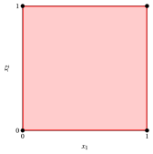{ .fig .ovale loading=lazy  }

    Quadrato unitario: solo dominio.

    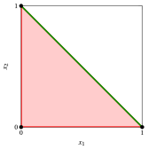{ .fig .ovale loading=lazy  }

    Dominio con $x_1+x_2\le1$.

!!! esempio "Esempio 5.4: Disuguaglianze di copertura nel cubo unitario"
    - In $[0,1]^3$, la disuguaglianza $x_1+x_2\le1$ è indipendente da $x_3$; il suo confine è parallelo all'asse $x_3$. Allo stesso modo, il confine di $x_1+x_3\le1$ è parallelo all'asse $x_2$.

    - I due semispazi rimuovono porzioni diverse del cubo. La loro intersezione preserva esattamente i punti binari $(0,0,0),(1,0,0),(0,1,0),(0,0,1),(0,1,1)$.

    - La disuguaglianza $x_1+x_2+x_3\le2$ rimuove solo il punto binario $x_1=x_2=x_3=1$.

    { .fig .ovale loading=lazy  }

    Dominio con $x_1+x_2\le1$.

    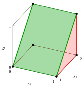{ .fig .ovale loading=lazy  }

    Dominio con $x_1+x_3\le1$.

    { .fig .ovale loading=lazy  }

    Dominio con entrambe le disuguaglianze.

    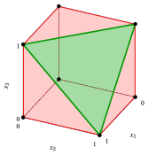{ .fig .ovale loading=lazy  }

    Dominio con $x_1+x_2+x_3\le2$.

!!! esempio "Esempio 5.5: Una copertura in due dimensioni"
    Per $\mathscr{I}=\{1,2\}$, considera

    $$
    P_2=\{\vet x\in[0,1]^2:10x_1+5x_2\le12\}.
    $$

    La copertura $C=\{1,2\}$ dà $x_1+x_2\le1$. Il punto $\tilde{x}_1=1$, $\tilde{x}_2=2/5$ soddisfa il vincolo all'uguaglianza, ma viola la copertura di $2/5$. Il poligono originale ha vertici

    $$
    (0,0),\ (1,0),\ (1,2/5),\ (7/10,1),\ (0,1).
    $$

    Dopo aver aggiunto il taglio, la regione è il triangolo con vertici $(0,0),(1,0),(0,1)$. Pertanto tutti e tre i punti binari ammissibili sono preservati, e il vincolo diventa ridondante, poiché $10x_1+5x_2\le10<12$ si trova sul triangolo.

    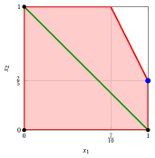{ .fig .ovale loading=lazy  }

    $P_2$ originale e il confine $x_1+x_2=1$.

    { .fig .ovale loading=lazy  }

    $P_2\cap\{x_1+x_2\le1\}$: il punto blu è stato rimosso.

!!! esempio "Esempio 5.6: Tagli di copertura successivi"
    Per $\mathscr{I}=\{1,2,3\}$, lascia

    $$
    P_A=\{\vet x\in[0,1]^3:10x_1+5x_2+6x_3\le12\}.
    $$

    Ci sono esattamente tre coperture:

    $$
    \begin{array}{ccl}
    \{1,2,3\}&:&x_1+x_2+x_3\le2,\\
    \{1,3\}&:&x_1+x_3\le1,\\
    \{1,2\}&:&x_1+x_2\le1.
    \end{array}
    $$

    Solo gli ultimi due sono minimi. Il punto blu $\tilde{x}_1=1$, $\tilde{x}_2=2/5$, $\tilde{x}_3=0$ si trova in $P_A$. Soddisfa la prima disuguaglianza ed è sul confine della seconda; la terza è violata da $2/5$, esattamente come in [Esempio 5.5](#box-12-ex-2d). A differenza dei pannelli precedenti che includevano solo il dominio, ogni pannello successivo include il vincolo $10x_1+5x_2+6x_3\le12$.

    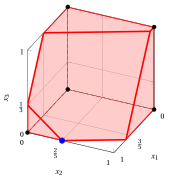{ .fig .ovale loading=lazy  }

    Originale $P_A$.

    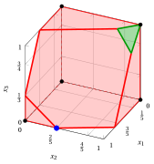{ .fig .ovale loading=lazy  }

    Aggiungi $x_1+x_2+x_3\le2$.

    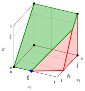{ .fig .ovale loading=lazy  }

    Aggiungi anche $x_1+x_3\le1$.

    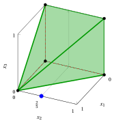{ .fig .ovale loading=lazy  }

    Aggiungi anche $x_1+x_2\le1$: la chiusura del coperchio.

    - Per l'obiettivo $\max\,40x_1+15x_2+12x_3$, la soluzione ottimale su $P_A$ è $\tilde{\vet x}=(1,2/5,0)$, con valore $46$. Sulla chiusura delle coperture, la soluzione ottimale è $(1,0,0)$, con valore $40$, che è anche ottimale per il problema binario.

    - In questo caso la chiusura delle coperture coincide con $\operatorname{conv}(X)$: i suoi vertici, mostrati nell'ultimo pannello, sono tutti binari. Questa è una proprietà di questo caso specifico, non di ogni chiusura di copertura.

!!! esempio "Esempio 5.7: Una diversa restrizione"
    Per $\mathscr{I}=\{1,2,3\}$, considera ora l'istanza

    $$
    P_B=\{\vet x\in[0,1]^3:5x_1+4x_2+6x_3\le12\}.
    $$

    Ogni coppia di variabili soddisfa il vincolo, mentre i tre coefficienti sommano a $15>12$. Pertanto, l'unica copertura è $\{1,2,3\}$ ed è minima. La sua disuguaglianza è $x_1+x_2+x_3\le2$. Il punto blu $\tilde{x}_1=\tilde{x}_2=1$, $\tilde{x}_3=1/2$ ha il lato sinistro $12$ e viola questo taglio di $1/2$.

    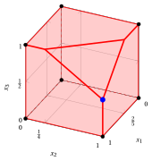{ .fig .ovale loading=lazy  }

    Originale $P_B$.

    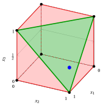{ .fig .ovale loading=lazy  }

    $P_B\cap\{x_1+x_2+x_3\le2\}$.

    - Il piano del vincolo interseca i bordi del cubo in $(1,1,1/2)$, $(1,1/4,1)$ e $(2/5,1,1)$.

    - La copertura rimuove questi vertici frazionari preservando tutti e sette i punti binari fattibili. Come nell'esempio 2D, dopo il taglio il vincolo è ridondante: la somma dei due coefficienti più grandi è $6+5=11<12$.

    - Il poliedro $P_B\cap\{x_1+x_2+x_3\le2\}$ ha solo vertici binari (ultimo pannello): qui una singola disuguaglianza di copertura dà $\operatorname{conv}(X)$.

## 5.4 Separazione delle disuguaglianze di copertura { #sez-sec-separation }

!!! chiave ""
    Dato un punto $\tilde{\vet x}\in P$, il <strong>problema di separazione delle coperture</strong> (CSP) consiste nel trovare una disuguaglianza di copertura violata da $\tilde{\vet x}$, o nel dimostrare che $\tilde{\vet x}$ soddisfa tutte le disuguaglianze di copertura.

    Formalmente, il CSP chiede di trovare una copertura

    $$
    C\in\mathcal{C}:\qquad \sum_{j\in C}\tilde{x}_j>|C|-1,
    $$

    o per dimostrare che

    $$
    \sum_{j\in C}\tilde{x}_j\le|C|-1\qquad\forall\, C\in\mathcal{C}.
    $$

- Tipicamente, $\tilde{\vet x}$ è una soluzione ottimale del rilassamento LP attuale, ma qualsiasi punto di $P$ può essere separato.

- Per una cover $C$, la disuguaglianza della copertura è violata da $\tilde{\vet x}$ se

    \begin{equation*}
    \label{eq:violated}
    \sum_{j\in C}\tilde{x}_j>|C|-1. \tag{5.8}
    \end{equation*}

    Spostando $\sum_{j\in C}\tilde{x}_j$ sul lato destro e $1$ sul lato sinistro, e scrivendo $|C|=\sum_{j\in C}1$, otteniamo le condizioni equivalenti:

    \begin{align*}
    |C|-\sum_{j\in C}\tilde{x}_j&<1, \\
    \sum_{j\in C}1-\sum_{j\in C}\tilde{x}_j&<1, \\
    \sum_{j\in C}(1-\tilde{x}_j)&<1. \label{eq:cost-test} \tag{5.9}
    \end{align*}

- Assegnando a ciascun indice $j$ il costo $q_j=1-\tilde{x}_j\ge0$, il CSP consiste nel trovare una copertura di <em>costo minimo</em>: esiste una disuguaglianza di copertura violata se e solo se questo costo minimo è inferiore a $1$.

### 5.4.1 Una formulazione ILP per il CSP

- Introdurre variabili binarie $n$ $z_j$: $z_j=1$ se $j$ appartiene alla copertura e $z_j=0$ altrimenti.

- L'obiettivo minimizza il costo totale della copertura; il vincolo singolo costringe l'insieme selezionato a essere una copertura.

!!! chiave ""
    

    \begin{align*}
    (\CSP)\qquad
    \min\quad\sum_{j\in\mathscr{I}}(1-\tilde{x}_j)z_j
    \label{eq:csp-obj} \tag{5.10a}\\
    \text{soggetto a}\quad\sum_{j\in\mathscr{I}}a_jz_j&\ge b+1,
    \label{eq:csp-constraint} \tag{5.10b}\\
    z_j&\in\{0,1\},&\forall j\in\mathscr{I}.
    \label{eq:csp-domain} \tag{5.10c}
    \end{align*}

!!! teorema "Proposizione 5.8"
    Esiste una disuguaglianza di copertura violata da $\tilde{\vet x}$ se e solo se $z(\CSP)<1$.

??? dimostrazione "Dimostrazione"

    Ogni assegnazione fattibile delle variabili binarie $z_j$ rappresenta una copertura $C=\{j:z_j=1\}$, e il suo obiettivo è $\sum_{j\in C}(1-\tilde{x}_j)$. Per $\eqref{eq:cost-test}$, questo è minore di $1$ esattamente quando il taglio corrispondente è violato. Prendere il minimo su tutte le coperture dimostra entrambe le implicazioni. Il CSP è ammissibile perché $\mathscr{I}$ stesso è una copertura. □

!!! chiave ""
    Sia $\tilde{z}_1,\tilde{z}_2,\dots,\tilde{z}_n$ una soluzione ottimale di $\CSP$. Se $z(\CSP)<1$, la copertura

    $$
    \tilde{C}=\big\{j\in\mathscr{I}:\ \tilde{z}_j=1\big\}
    $$

    è associato con la disuguaglianza di copertura $\sum_{j\in\tilde{C}}x_j\le|\tilde{C}|-1$ massimamente violata da $\tilde{\vet x}$. Altrimenti, nessuna disuguaglianza di copertura è violata da $\tilde{\vet x}$.

- Per trovare una disuguaglianza di copertura violata, non è necessario risolvere $\CSP$ in modo ottimale: qualsiasi soluzione ammissibile $\bar{z}_1,\dots,\bar{z}_n$ di costo inferiore a $1$ fornisce la copertura $\bar{C}=\{j\in\mathscr{I}:\ \bar{z}_j=1\}$, la cui disuguaglianza di copertura è violata da $\tilde{\vet x}$.

- Al contrario, una soluzione ammissibile di costo almeno $1$ <em>non</em> dimostra che non esiste alcuna disuguaglianza di copertura violata: questo richiede il valore ottimale (o un limite inferiore) di $\CSP$.

- Se $z(\CSP)<1$, la massima violazione di una disuguaglianza di copertura in $\tilde{\vet x}$ è $1-z(\CSP)$.

!!! esempio "Esempio 5.8: Separazione delle disuguaglianze di copertura"
    Consideriamo di nuovo [Esempio 5.1](#box-8-ex-guide). Le disuguaglianze di copertura vengono separate in modo iterativo: ad ogni iterazione, l’LP corrente viene risolto, lo $\CSP$ viene risolto per la sua soluzione ottimale $\tilde{\vet x}$, e viene aggiunta la disuguaglianza di copertura massimamente violata, fino a quando nessuna disuguaglianza di copertura è violata.

    <strong>Iterazione 1.</strong> Una soluzione ottimale di $\LP$ è

    $$
    \tilde{x}_1=1,\qquad \tilde{x}_2=1,\qquad \tilde{x}_3=\frac23,\qquad
    \tilde{x}_4=0,\qquad z(\LP)=\frac{49}{3}.
    $$

    Lo $\CSP$ associato è:

    $$
    \begin{array}{rrcrcrcrcl}
    {\min} &  &  &  &  & {\frac{1}{3}\,z_3} & {+} & {z_4} &  &  \\[1ex]
    \text{soggetto a} & {2\,z_1} & {+} & {3\,z_2} & {+} & {6\,z_3} & {+} & {7\,z_4} & {\ge} & {10} \\[1ex]
    & {z_1,} &  & {z_2,} &  & {z_3,} &  & {z_4} & {\in} & {\{0,1\}}
    \end{array}
    $$

    Una soluzione ottimale di $\CSP$ è $\tilde{z}_1=\tilde{z}_2=\tilde{z}_3=1$, $\tilde{z}_4=0$, con valore $z(\CSP)=\frac13<1$. Di conseguenza, $\tilde{C}=\{j\in\mathscr{I}:\tilde{z}_j=1\}=\{1,2,3\}$ è la copertura associata alla disuguaglianza di copertura massimamente violata da $\tilde{\vet x}$:

    $$
    x_1+x_2+x_3\le 2,
    \qquad\text{since}\qquad
    \tilde{x}_1+\tilde{x}_2+\tilde{x}_3=1+1+\frac23=\frac83>2.
    $$

    <strong>Iterazione 2.</strong> Aggiungendo questa disuguaglianza di copertura a $\LP$, otteniamo il seguente LP, denominato $\LP_1$:

    $$
    \begin{array}{rrcrcrcrcl}
    {\max} & {6\,x_1} & {+} & {5\,x_2} & {+} & {8\,x_3} & {+} & {9\,x_4} &  &  \\[1ex]
    \text{soggetto a} & {2\,x_1} & {+} & {3\,x_2} & {+} & {6\,x_3} & {+} & {7\,x_4} & {\le} & {9} \\[1ex]
    & {x_1} & {+} & {x_2} & {+} & {x_3} &  &  & {\le} & {2} \\[1ex]
    & {x_1} &  &  &  &  &  &  & {\le} & {1} \\[0.5ex]
    &  &  & {x_2} &  &  &  &  & {\le} & {1} \\[0.5ex]
    &  &  &  &  & {x_3} &  &  & {\le} & {1} \\[0.5ex]
    &  &  &  &  &  &  & {x_4} & {\le} & {1} \\[0.5ex]
    & {x_1,} &  & {x_2,} &  & {x_3,} &  & {x_4} & {\ge} & {0}
    \end{array}
    $$

    Una soluzione ottimale di $\LP_1$ è

    $$
    \tilde{x}_1=1,\qquad \tilde{x}_2=1,\qquad \tilde{x}_3=0,\qquad
    \tilde{x}_4=\frac47,\qquad z(\LP_1)=\frac{113}{7}.
    $$

    Lo $\CSP$ associato è:

    $$
    \begin{array}{rrcrcrcrcl}
    {\min} &  &  &  &  & {z_3} & {+} & {\frac{3}{7}\,z_4} &  &  \\[1ex]
    \text{soggetto a} & {2\,z_1} & {+} & {3\,z_2} & {+} & {6\,z_3} & {+} & {7\,z_4} & {\ge} & {10} \\[1ex]
    & {z_1,} &  & {z_2,} &  & {z_3,} &  & {z_4} & {\in} & {\{0,1\}}
    \end{array}
    $$

    Una soluzione ottimale di $\CSP$ è $\tilde{z}_1=0$, $\tilde{z}_2=1$, $\tilde{z}_3=0$, $\tilde{z}_4=1$, con valore $z(\CSP)=\frac37<1$ (la copertura $\{1,2,4\}$ ha lo stesso costo; scegliamo la copertura minima). Di conseguenza, $\tilde{C}=\{j\in\mathscr{I}:\tilde{z}_j=1\}=\{2,4\}$ e la disuguaglianza di copertura massimamente violata è

    $$
    x_2+x_4\le 1,
    \qquad\text{since}\qquad
    \tilde{x}_2+\tilde{x}_4=1+\frac47=\frac{11}{7}>1.
    $$

    <strong>Iterazione 3.</strong> Aggiungendo questa disuguaglianza di copertura a $\LP_1$, otteniamo il seguente LP, denominato $\LP_2$:

    $$
    \begin{array}{rrcrcrcrcl}
    {\max} & {6\,x_1} & {+} & {5\,x_2} & {+} & {8\,x_3} & {+} & {9\,x_4} &  &  \\[1ex]
    \text{soggetto a} & {2\,x_1} & {+} & {3\,x_2} & {+} & {6\,x_3} & {+} & {7\,x_4} & {\le} & {9} \\[1ex]
    & {x_1} & {+} & {x_2} & {+} & {x_3} &  &  & {\le} & {2} \\[1ex]
    &  &  & {x_2} &  &  & {+} & {x_4} & {\le} & {1} \\[1ex]
    & {x_1} &  &  &  &  &  &  & {\le} & {1} \\[0.5ex]
    &  &  & {x_2} &  &  &  &  & {\le} & {1} \\[0.5ex]
    &  &  &  &  & {x_3} &  &  & {\le} & {1} \\[0.5ex]
    &  &  &  &  &  &  & {x_4} & {\le} & {1} \\[0.5ex]
    & {x_1,} &  & {x_2,} &  & {x_3,} &  & {x_4} & {\ge} & {0}
    \end{array}
    $$

    Una soluzione ottimale di $\LP_2$ è

    $$
    \tilde{x}_1=1,\qquad \tilde{x}_2=\frac35,\qquad \tilde{x}_3=\frac25,\qquad
    \tilde{x}_4=\frac25,\qquad z(\LP_2)=\frac{79}{5}.
    $$

    Lo $\CSP$ associato è:

    $$
    \begin{array}{rrcrcrcrcl}
    {\min} &  &  & {\frac{2}{5}\,z_2} & {+} & {\frac{3}{5}\,z_3} & {+} & {\frac{3}{5}\,z_4} &  &  \\[1ex]
    \text{soggetto a} & {2\,z_1} & {+} & {3\,z_2} & {+} & {6\,z_3} & {+} & {7\,z_4} & {\ge} & {10} \\[1ex]
    & {z_1,} &  & {z_2,} &  & {z_3,} &  & {z_4} & {\in} & {\{0,1\}}
    \end{array}
    $$

    Una soluzione ottimale di $\CSP$ è $\tilde{z}_1=0$, $\tilde{z}_2=1$, $\tilde{z}_3=0$, $\tilde{z}_4=1$, con valore $z(\CSP)=1$ (le coperture $\{1,2,3\}$ e $\{1,2,4\}$ hanno lo stesso costo): <strong>nessuna</strong> disuguaglianza di copertura è violata da $\tilde{\vet x}$, e la separazione si interrompe.

    Il valore finale $z(\LP_2)=\frac{79}{5}$ coincide con il valore $z(\LPcov)$ della chiusura delle coperture ([Esempio 5.2](#box-9-ex-guide-closure)): la separazione raggiunge il limite della chiusura delle coperture aggiungendo solo $2$ delle disuguaglianze di copertura $7$.

    La soluzione $\tilde{\vet x}$ è ancora <strong>frazionaria</strong>, sebbene soddisfi tutte le disuguaglianze di copertura: la chiusura di copertura non coincide, in generale, con l'inviluppo convesso delle soluzioni intere.

## 5.5 Trasformare il CSP in un problema complementare

- Considera un assegnamento fattibile delle variabili CSP $z_j$. Definisci le variabili binarie complementari $y_j$ mediante

    $$
    y_j=1-z_j\qquad\forall j\in\mathscr{I}.
    $$

    Quindi $y_j=1$ se $j$ è al di fuori della copertura, mentre $y_j=0$ se $j$ appartiene alla copertura.

- Il vincolo diventa

    $$
    \sum_{j\in\mathscr{I}}a_j(1-y_j)\ge b+1
    \quad\Longleftrightarrow\quad
    \sum_{j\in\mathscr{I}}a_jy_j\le\sum_{j\in\mathscr{I}}a_j-(b+1).
    $$

    Secondo l'assunzione $\sum_{j\in\mathscr{I}}a_j>b$, questo membro destro è non negativo.

- L'obiettivo può essere scritto come

    $$
    \sum_{j\in\mathscr{I}}(1-\tilde{x}_j)(1-y_j)
    =n-\sum_{j\in\mathscr{I}}\tilde{x}_j
    -\sum_{j\in\mathscr{I}}(1-\tilde{x}_j)y_j.
    $$

    Poiché i primi due termini sono costanti, minimizzarlo è equivalente al seguente problema, chiamato <em>problema complementare</em>, con coefficienti obiettivo non negativi (eventualmente zero) $1-\tilde{x}_j$.

!!! chiave ""
    

    \begin{align*}
    (\CSPKP)\qquad
    \max\quad\sum_{j\in\mathscr{I}}(1-\tilde{x}_j)y_j
    \label{eq:complement-obj} \tag{5.11a}\\
    \text{soggetto a}\quad\sum_{j\in\mathscr{I}}a_jy_j&\le\sum_{j\in\mathscr{I}}a_j-(b+1),
    \label{eq:complement-constraint} \tag{5.11b}\\
    y_j&\in\{0,1\},&\forall j\in\mathscr{I}.
    \label{eq:complement-domain} \tag{5.11c}
    \end{align*}

- La complementazione è una corrispondenza biunivoca tra soluzioni ammissibili, quindi

    \begin{equation*}
    \label{eq:values}
    z(\CSP)
    =n-\sum_{j\in\mathscr{I}}\tilde{x}_j-z(\CSPKP). \tag{5.12}
    \end{equation*}

!!! chiave ""
    Sia $\tilde{y}_1,\tilde{y}_2,\dots,\tilde{y}_n$ una soluzione ottimale di $\CSPKP$. Se $n-\sum_{j\in\mathscr{I}}\tilde{x}_j-z(\CSPKP)<1$, la copertura

    $$
    \tilde{C}=\big\{j\in\mathscr{I}:\ \tilde{y}_j=0\big\}
    $$

    è associato con la disuguaglianza di copertura $\sum_{j\in\tilde{C}}x_j\le|\tilde{C}|-1$ massimamente violata da $\tilde{\vet x}$. Altrimenti, nessuna disuguaglianza di copertura è violata da $\tilde{\vet x}$.

- Qualsiasi soluzione ammissibile $\bar{y}_1,\dots,\bar{y}_n$ di $\CSPKP$ fornisce la copertura $\bar{C}=\{j\in\mathscr{I}:\ \bar{y}_j=0\}$, con costo $n-\sum_{j\in\mathscr{I}}\tilde{x}_j-\sum_{j\in\mathscr{I}}(1-\tilde{x}_j)\bar{y}_j$: se questo costo è inferiore a $1$, la disuguaglianza di copertura di $\bar{C}$ è violata da $\tilde{\vet x}$.

### 5.5.1 Un’euristica di separazione avido

La seguente procedura golosa costruisce valori fattibili $\bar{y}_j$ per il problema complementare.

1. Imposta $\bar{y}_j=0$ per tutti $j\in\mathscr{I}$ e il lato destro residuo $r=\sum_{j\in\mathscr{I}}a_j-(b+1)$. Ordina gli indici secondo il rapporto non crescente $q_j/a_j=(1-\tilde{x}_j)/a_j$, risolvendo i pareggi per indice crescente.

2. Scansiona gli indici in questo ordine. Se $q_j>0$ e $a_j\le r$, imposta $\bar{y}_j=1$ e $r:=r-a_j$; altrimenti saltalo.

3. Ricostruisci la copertura $C=\{j:\bar{y}_j=0\}$ e valuta il suo costo. Se desiderato, riducila a una copertura minima rimuovendo gli indici finché $\sum_{j\in C}a_j$ supera $b$.

- Gli indici con $q_j=0$ ($\tilde{x}_j=1$) non vengono mai selezionati: rimangono nella copertura, che potrebbe quindi non essere minimale.

- Rimuovere un indice da una copertura ne diminuisce il costo di $q_j\ge0$: ridurre una copertura violata a una minimale non può diminuire la sua violazione.

- L'algoritmo goloso è un'<em>euristica</em> per il problema complementare: se non trova una disuguaglianza di copertura violata, non possiamo concludere che non ne esista nessuna.

!!! esempio "Esempio 5.9: Problema complementare e scansione greedy"
    Per il punto $\tilde{\vet x}=(1,1,\frac23,0)$ dell'Iterazione 1 in [Esempio 5.8](#box-16-ex-guide-csp),

    \begin{align*}
    4-\sum_{j\in\mathscr{I}}\tilde{x}_j&=4-1-1-\frac23=\frac43,\\
    \sum_{j\in\mathscr{I}}a_j-(b+1)&=2+3+6+7-(9+1)=8.
    \end{align*}

    Il problema complementare è

    $$
    \begin{array}{rrcrcrcrcl}
    {\max} &  &  &  &  & {\frac{1}{3}\,y_3} & {+} & {y_4} &  &  \\[1ex]
    \text{soggetto a} & {2\,y_1} & {+} & {3\,y_2} & {+} & {6\,y_3} & {+} & {7\,y_4} & {\le} & {8} \\[1ex]
    & {y_1,} &  & {y_2,} &  & {y_3,} &  & {y_4} & {\in} & {\{0,1\}}
    \end{array}
    $$

    
<table>
    <tr>
    <th>\(j\)</th>
    <th>\(q_j\)</th>
    <th>\(a_j\)</th>
    <th>\(q_j/a_j\)</th>
    <th>Decisione</th>
    <th>Residuo</th>
    </tr>
    <tr>
    <td>\(4\)</td>
    <td>\(1\)</td>
    <td>\(7\)</td>
    <td>\(\frac{1}{7}\)</td>
    <td>\(\bar{y}_j=1\)</td>
    <td>\(1\)</td>
    </tr>
    <tr>
    <td>\(3\)</td>
    <td>\(\frac{1}{3}\)</td>
    <td>\(6\)</td>
    <td>\(\frac{1}{18}\)</td>
    <td>\(\bar{y}_j=0\)</td>
    <td>\(1\)</td>
    </tr>
    <tr>
    <td>\(1\)</td>
    <td>\(0\)</td>
    <td>\(2\)</td>
    <td>\(0\)</td>
    <td>\(q_j=0\), \(\bar{y}_j=0\)</td>
    <td>\(1\)</td>
    </tr>
    <tr>
    <td>\(2\)</td>
    <td>\(0\)</td>
    <td>\(3\)</td>
    <td>\(0\)</td>
    <td>\(q_j=0\), \(\bar{y}_j=0\)</td>
    <td>\(1\)</td>
    </tr>
    </table>

    La scansione fornisce $\bar{y}_1=\bar{y}_2=\bar{y}_3=0$ e $\bar{y}_4=1$, di valore $1$. Gli indici $3$ e $4$ non possono essere presi insieme; le uniche alternative con coefficiente obiettivo positivo hanno valori $1/3$ e $1$. Pertanto, anche questa soluzione greedy è ottimale, e

    $$
    z(\CSP)
    =4-\sum_{j\in\mathscr{I}}\tilde{x}_j-z(\CSPKP)
    =\frac43-1=\frac13.
    $$

    La copertura è $\tilde{C}=\{j\in\mathscr{I}:\tilde{y}_j=0\}=\{1,2,3\}$, come trovato nella Iterazione 1 di [Esempio 5.8](#box-16-ex-guide-csp).

## 5.6 Disuguaglianze di copertura estese

- Una disuguaglianza di copertura può essere rafforzata considerando anche le variabili al di fuori della copertura i cui coefficienti sono almeno grandi quanto ogni coefficiente della copertura. Sia

    $$
    \widehat{a}(C)=\max_{j\in C}a_j
    $$

    sia il coefficiente massimo delle variabili in $C$.

!!! definizione "Definizione 5.9: Disuguaglianza di copertura estesa"
    Per una copertura $C$, lascia

    $$
    E(C)=C\cup\{j\in\mathscr{I}\setminus C:a_j\ge\widehat{a}(C)\}.
    $$

    La <em>disuguaglianza di copertura estesa</em> associata è

    \begin{equation*}
    \label{eq:extended}
    \sum_{j\in E(C)}x_j\le |C|-1. \tag{5.13}
    \end{equation*}

    Il lato destro dipende da $|C|$, non da $|E(C)|$.

!!! teorema "Proposizione 5.10"
    Per ogni copertura $C\in\mathcal{C}$, la disuguaglianza estesa della copertura $\eqref{eq:extended}$ è valida per $X$.

??? dimostrazione "Dimostrazione"

    Sia $k=|C|$ e prendi qualsiasi insieme $S\subseteq E(C)$ con $|S|=k$. Gli insiemi $S\setminus C$ e $C\setminus S$ hanno lo stesso numero di variabili, e ogni coefficiente $a_j$ con $j\in S\setminus C$ è almeno $\widehat{a}(C)$, cioè almeno grande quanto ciascun coefficiente con $j\in C\setminus S$. Sostituire gli indici di $C\setminus S$ con quelli di $S\setminus C$ dà

    $$
    \sum_{j\in S}a_j\ge\sum_{j\in C}a_j>b.
    $$

    Pertanto nessun punto $\vet x\in X$ può avere $k$ variabili di $E(C)$ uguali a $1$: al massimo $k-1$ di esse possono essere uguali a $1$ insieme. □

- Poiché $C\subseteq E(C)$ e il lato destro sono gli stessi, la disuguaglianza della copertura estesa domina la disuguaglianza della copertura di $C$.

- Può essere visto come un <em>sollevamento</em> dei coefficienti delle variabili in $E(C)\setminus C$ da $0$ a $1$. Non vieta a una variabile con un grande coefficiente di essere uguale a $1$ insieme a variabili di $C$: limita a $|C|-1$ il numero di variabili dell'intero insieme $E(C)$ uguali a $1$.

!!! esempio "Esempio 5.10: Rafforzare la copertura dell'istanza a quattro variabili"
    In [Esempio 5.1](#box-8-ex-guide), considera la copertura $C=\{1,2,3\}$. Poi $\widehat{a}(C)=6$, e il coefficiente di $x_4$ è $7\ge6$, quindi

    $$
    E(C)=\{1,2,3,4\},\qquad x_1+x_2+x_3+x_4\le2.
    $$

    Il LP rinforzato, indicato come $\LP_{\mathrm{ext}}$, è

    $$
    \begin{array}{rrcrcrcrcl}
    {\max} & {6\,x_1} & {+} & {5\,x_2} & {+} & {8\,x_3} & {+} & {9\,x_4} &  &  \\[1ex]
    \text{soggetto a} & {2\,x_1} & {+} & {3\,x_2} & {+} & {6\,x_3} & {+} & {7\,x_4} & {\le} & {9} \\[1ex]
    & {x_1} & {+} & {x_2} & {+} & {x_3} & {+} & {x_4} & {\le} & {2} \\[1ex]
    & {x_1} &  &  &  &  &  &  & {\le} & {1} \\[0.5ex]
    &  &  & {x_2} &  &  &  &  & {\le} & {1} \\[0.5ex]
    &  &  &  &  & {x_3} &  &  & {\le} & {1} \\[0.5ex]
    &  &  &  &  &  &  & {x_4} & {\le} & {1} \\[0.5ex]
    & {x_1,} &  & {x_2,} &  & {x_3,} &  & {x_4} & {\ge} & {0}
    \end{array}
    $$

    Una soluzione ottimale di $\LP_{\mathrm{ext}}$ è $\tilde{\vet x}=(1,0,0,1)$, con valore $z(\LP_{\mathrm{ext}})=6+9=15$. Poiché è binaria, $\tilde{\vet x}$ è anche ottimale per il problema binario. Abbiamo $z(\LP_{\mathrm{ext}})=15<z(\LPcov)=79/5$: in questo caso, una disuguaglianza di copertura estesa è più forte di tutte le disuguaglianze di copertura insieme.

## 5.7 Violazione e distanza da una disuguaglianza di copertura

- Sia $C\subseteq\mathscr{I}$ una copertura. La sua disuguaglianza di copertura è

    $$
    \sum_{j\in C}x_j\le |C|-1,
    $$

    e il suo iperpiano di confine è

    $$
    H_C=\left\{\vet x\in\mathbb{R}^n:
    \sum_{j\in C}x_j=|C|-1\right\}.
    $$

- La violazione della disuguaglianza di copertura in un punto $\tilde{\vet x}$ è

    \begin{equation*}
    \label{eq:violation}
    v_C(\tilde{\vet x})
    =\max\left\{0,
    \sum_{j\in C}\tilde{x}_j-(|C|-1)\right\}. \tag{5.14}
    \end{equation*}

    Il punto viola la disuguaglianza di copertura precisamente quando $v_C(\tilde{\vet x})>0$.

- I coefficienti della disuguaglianza di copertura sono $1$ per $j\in C$ e $0$ altrimenti, quindi la loro norma euclidea è $\sqrt{|C|}$. Pertanto, la distanza euclidea di $\tilde{\vet x}$ da $H_C$ è

    \begin{equation*}
    \label{eq:distance}
    d(\tilde{\vet x},H_C)
    =\frac{\left|\sum_{j\in C}\tilde{x}_j-(|C|-1)\right|}
    {\sqrt{|C|}}. \tag{5.15}
    \end{equation*}

    Se la disuguaglianza di copertura è violata,

    $$
    d(\tilde{\vet x},H_C)=\frac{v_C(\tilde{\vet x})}{\sqrt{|C|}}.
    $$

- La proiezione ortogonale $\vet x^{\perp}$ di $\tilde{\vet x}$ su $H_C$ ha componenti

    \begin{equation*}
    \label{eq:projection}
    x_j^{\perp}
    =\begin{cases}
    \displaystyle
    \tilde{x}_j-
    \dfrac{\sum_{k\in C}\tilde{x}_k-(|C|-1)}{|C|},
    &j\in C,\\[2ex]
    \tilde{x}_j,&j\in\mathscr{I}\setminus C.
    \end{cases} 	ag{5.16}
    \fine{equazione*}

    Infatti, la sostituzione dà $\sum_{j\in C}x_j^{\perp}=|C|-1$.

- Il CSP massimizza la violazione, non la distanza: quando le coperture hanno cardinalità diverse, i due criteri possono classificarle in modo diverso. Ad esempio, al punto $\tilde{\vet x}=(1/10,1,1)$ di $P_A$ ([Esempio 5.6](#box-13-ex-3d-a)), le coperture $\{1,2\}$, $\{1,3\}$ e $\{1,2,3\}$ hanno tutte la violazione $1/10$, ma le loro distanze sono rispettivamente $1/(10\sqrt2)$, $1/(10\sqrt2)$ e $1/(10\sqrt3)$.

!!! esempio "Esempio 5.11: Proiezione ortogonale in due dimensioni"
    Prendi il vertice $\tilde{x}_1=7/10$, $\tilde{x}_2=1$ di $P_2$ in [Esempio 5.5](#box-12-ex-2d) e la copertura $C=\{1,2\}$. La sua disuguaglianza di copertura è $x_1+x_2\le1$ e $|C|=2$. Poi

    $$
    v_C(\tilde{\vet x})=\frac7{10},\qquad
    x_1^{\perp}=\frac7{20},\qquad
    x_2^{\perp}=\frac{13}{20},
    \qquad d(\tilde{\vet x},H_C)=\frac7{10\sqrt2}.
    $$

    La regione rossa è $P_2$ e il bordo verde è il confine $H_C$. Il segmento blu tratteggiato è perpendicolare a $H_C$ e il punto arancione è la proiezione ortogonale.

    { .fig .ovale loading=lazy  }

!!! esempio "Esempio 5.12: Proiezione ortogonale in tre dimensioni"
    Prendi il punto $\tilde{x}_1=1$, $\tilde{x}_2=2/5$, $\tilde{x}_3=0$ di $P_A$ in [Esempio 5.6](#box-13-ex-3d-a) e la copertura $C=\{1,2\}$. La sua disuguaglianza di copertura è $x_1+x_2\le1$ e $|C|=2$. Quindi

    $$
    v_C(\tilde{\vet x})=\frac25,\qquad
    x_1^{\perp}=\frac45,\qquad
    x_2^{\perp}=\frac15,\qquad
    x_3^{\perp}=0,
    \qquad d(\tilde{\vet x},H_C)=\frac{2}{5\sqrt2}.
    $$

    La regione rossa è $P_A$ e il rettangolo verde tratteggiato è $H_C$ limitato al cubo unitario. Poiché $3\notin C$, la proiezione non cambia $\tilde{x}_3$.

    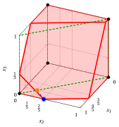{ .fig .ovale loading=lazy  }

## 5.8 Errori tipici

!!! attenzione "Avviso"
    - <strong>Usare un insieme che non è una copertura.</strong> La disuguaglianza $\sum_{j\in C}x_j\le|C|-1$ è valida solo se il coefficiente totale $\sum_{j\in C}a_j$ supera il lato destro $b$; controlla i coefficienti prima di scriverla.

    - <strong>Utilizzo di $|E(C)|-1$ per una copertura estesa.</strong> Il lato destro della disuguaglianza della copertura estesa è $|C|-1$, dove $C$ è la copertura, non $|E(C)|-1$.

    - <strong>Rimuovere tutti gli indici con $q_j=0$ da una copertura.</strong> Per ottenere una copertura minima, rimuovere gli indici uno alla volta finché l'insieme rimanente è ancora una copertura: rimuoverli tutti potrebbe lasciare un insieme che non è una copertura.

    - <strong>Interrompere la separazione in caso di fallimento euristico.</strong> Se l'algoritmo euristico goloso non trova alcuna disuguaglianza di copertura violata, non possiamo concludere che nessuna esista: solo il valore ottimale del problema di separazione lo dimostra.

    - <strong>Confondere violazione e distanza.</strong> Il problema della separazione delle coperture massimizza la violazione; le coperture con la stessa violazione possono avere distanze differenti dal punto.

    - <strong>Credere che la chiusura delle coperture coincida con l'inviluppo convesso.</strong> Un punto può soddisfare tutte le disuguaglianze di copertura e comunque essere frazionario ([Esempio 5.8](#box-16-ex-guide-csp)).

## 5.9 In sintesi

!!! chiave "In sintesi"
    - Una copertura è un insieme di variabili il cui coefficiente totale supera il lato destro; la sua disuguaglianza di copertura consente al massimo $|C|-1$ delle sue variabili di essere uguali a $1$, ed è valida per $X$.

    - Le coperture minime sono sufficienti: le loro disuguaglianze implicano tutte le altre, ma il loro numero può essere esponenziale; perciò si cercano solo quando servono.

    - Separare una disuguaglianza di copertura significa trovare una copertura a costo minimo $\sum_{j\in C}(1-\tilde{x}_j)$: esiste una disuguaglianza violata se e solo se il costo minimo è inferiore a $1$; questo è un problema 0–1 con un vincolo $\le$, definito nel capitolo.

    - Una disuguaglianza di copertura estesa domina la disuguaglianza di copertura della stessa copertura.

    - La chiusura delle coperture è più vicina a $\operatorname{conv}(X)$ rispetto al rilassamento LP, ma in generale non gli è uguale.

    <strong>Cruscotto dell'istanza a quattro variabili.</strong> I limiti inferiori e superiori sul valore ottimale del problema binario di [Esempio 5.1](#box-8-ex-guide). I coefficienti dell'obiettivo sono interi, quindi il limite superiore è il valore arrotondato per difetto del rilassamento LP.

    
<table>
    <tr>
    <th>Sorgente</th>
    <th>Limite inferiore</th>
    <th>Limite superiore</th>
    <th>Da</th>
    </tr>
    <tr>
    <td>Rilassamento LP</td>
    <td>\(11\)</td>
    <td>\(16\)</td>
    <td>soluzione greedy \((1,1,0,0)\), \(\lfloor z(\LP)\rfloor\) con \(z(\LP)=\tfrac{49}{3}\)</td>
    </tr>
    <tr>
    <td>Chiusura del coperchio</td>
    <td>\(11\)</td>
    <td>\(15\)</td>
    <td>\(\lfloor z(\LPcov)\rfloor\) con \(z(\LPcov)=\tfrac{79}{5}\), \(2\) coperture separate</td>
    </tr>
    <tr>
    <td>Copertura estesa</td>
    <td>\(15\)</td>
    <td>\(15\)</td>
    <td>\(z(\LP_{\mathrm{ext}})=15\), soluzione ottimale \((1,0,0,1)\)</td>
    </tr>
    </table>

---

**Esercizi su questo capitolo:** [:material-pencil: Disuguaglianze di copertura](../exercises/cover.md)
