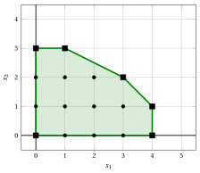
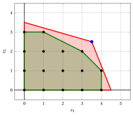
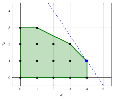

# Formulazioni ideali

**Parte 2 · Rafforzamento della formulazione · Capitolo 3** · [:material-file-pdf-box: Appunti delle lezioni, volume 1 (PDF)](../pdf/lecture-notes-1-models-bounds-formulations.pdf) · [:material-pencil: Esercizi: Formulazioni ideali](../exercises/ideal-formulations.md)

!!! nota "Prerequisiti"
    - Da questo modulo, i capitoli «Programmazione lineare intera» e «Vincoli primali e duali»: la regione ammissibile di un problema ILP, il rilassamento LP e il suo vincolo, e l'esempio dell'auto.

    - Dal modulo <em>Programmazione Lineare</em>, [Capitolo 15 «La geometria della Programmazione Lineare»](https://fabiofurini.github.io/programmazione-lineare/metodi-avanzati/15-geometria/): vertici di un poliedro, e il fatto che un problema LP con una soluzione ottimale abbia un vertice ottimale.

    - Dal modulo <em>Ottimizzazione convessa</em>, [Capitolo 1 «Insiemi convessi»](https://fabiofurini.github.io/ottimizzazione-convessa/preliminari/01-insiemi-convessi/): combinazioni convesse e involucri convessi. Un breve riepilogo è fornito in questo capitolo.

!!! chiave "Obiettivi"
    Alla fine di questo capitolo sarai in grado di:

    - calcolare l'inviluppo convesso delle soluzioni ammissibili di un piccolo problema ILP, e classificare i suoi punti come vertici, punti sul bordo o punti interni;

    - definire una formulazione di un problema ILP e decidere se è ideale;

    - spiega perché un problema di programmazione lineare su una formulazione ideale risolve il problema ILP;

    - confrontare due formulazioni dello stesso problema attraverso le loro rilassamenti LP;

    - spiegare perché le formulazioni ideali esistono ma sono difficili da trovare.

!!! nota "Dove eravamo"
    Nell'esempio dell'auto abbiamo il limite inferiore $14$ e il limite superiore $\lfloor z(\LP) \rfloor = 15$. Il divario di $\frac{1}{14}$ è dovuto al politopo dei vincoli, che contiene punti frazionari al di fuori dell'inviluppo convesso dei punti interi. Questo capitolo definisce il politopo che non genera alcun divario.

## 3.1 L'inviluppo convesso

!!! definizione "Definizione 3.1: di involucro convesso"
    Data un insieme $S \subseteq \R^n$, una <strong>combinazione convessa</strong> di punti $\vet s^1, \vet s^2, \dots, \vet s^k \in S$ è un punto $\sum_{h=1}^k \lambda_h \, \vet s^h$ con $\lambda_h \ge 0$ e $\sum_{h=1}^k \lambda_h = 1$. L'<strong'inviluppo convesso</strong> di $S$, denotato da $\mathrm{conv}(S)$, è l'insieme di tutte le combinazioni convesse dei punti di $S$.

- L'involucro convesso è il più piccolo insieme convesso contenente $S$. Se $S$ è un insieme finito di punti, l'involucro convesso è un poliedro limitato (un <strong>poliedro</strong>), e i suoi <strong>vertici</strong> sono punti di $S$. Gli altri punti di $S$ si trovano o sul bordo del poliedro, o all'interno di esso: non sono necessari per descriverlo.

- Per un problema LPI prendiamo $S = F$, l'insieme delle soluzioni ammissibili. I vertici di $\mathrm{conv}(F)$ sono soluzioni ammissibili intere.

!!! esempio "Esempio 3.1: involucro convesso dell'esempio dell'auto"
    Il guscio convesso dei punti interi $16$ dell'esempio dell'auto ha $6$ vertici:

    $$
    (0,0), \quad (4,0), \quad (4,1), \quad (3,2), \quad (1,3), \quad (0,3).
    $$

    Degli altri punti $10$, cinque si trovano sul suo confine, ossia $(0,1)$, $(0,2)$, $(1,0)$, $(2,0)$ e $(3,0)$, e cinque nel suo interno, ossia $(1,1)$, $(2,1)$, $(3,1)$, $(1,2)$ e $(2,2)$.

    { .fig .ovale loading=lazy  }

    <em>Il guscio convesso dei punti interi $16$ dell'esempio dell'auto (verde). I suoi vertici $6$ (quadri neri) sono punti interi; cinque altri punti si trovano sul suo bordo e cinque nel suo interno.</em>

## 3.2 Formulazioni e formulazioni ideali

!!! definizione "Definizione 3.2: di formulazione"
    Una <strong>formulazione</strong> di un problema ILP con regione ammissibile $F$ è un politopo $P = \{ \vet x \in \R^n : \sum_{j} a_{ij} \, x_j \le b_i,~ \forall i,~ x_j \ge 0,~ \forall j \}$ tale che $P \cap \Z^n = F$. La <strong>rilassamento LP della formulazione</strong> è il problema di massimizzare $\sum_j c_j \, x_j$ su $P$.

- Un problema ILP ha molte formulazioni: condividono i punti interi e differiscono nei punti frazionari. Poiché $P$ è convesso e contiene $F$, ogni formulazione contiene l'inviluppo convesso:

    $$
    \mathrm{conv}(F) ~\subseteq~ P.
    $$

!!! definizione "Definizione 3.3: di formulazione ideale"
    Una formulazione $P$ di un problema ILP è <strong>ideale</strong> se $P = \mathrm{conv}(F)$, cioè se la regione ammissibile del suo rilassamento LP è esattamente l'inviluppo convesso delle soluzioni intere ammissibili.

!!! teorema "Teorema 3.4: LP su una formulazione ideale"
    Sia $P$ una formulazione ideale di un problema ILP con $F \ne \emptyset$ e $P$ limitati. Allora il rilassamento LP ha un vertice ottimale, ogni vertice ottimale è una soluzione ottimale del problema ILP, e $z(\LP) = z(\ILP)$.

??? dimostrazione "Proof"

    Il poliedro $P = \mathrm{conv}(F)$ è non vuoto e limitato, quindi il problema LP ha un vertice ottimale $P$. I vertici di $\mathrm{conv}(F)$ appartengono a $F$, quindi questo vertice è una soluzione ILP ammissibile, il cui valore è $z(\LP)$. Poiché $z(\ILP) \le z(\LP)$, il vertice è ottimale per il problema ILP. □

- L'algoritmo del simplesso restituisce un vertice ottimale, quindi con una formulazione ideale restituisce una soluzione intera. Se il problema di programmazione lineare ha diverse soluzioni ottimali, un metodo che non restituisce vertici può dare un punto frazionario sulla faccia ottimale: ecco perché il teorema parla di un vertice ottimale.

!!! chiave ""
    Con una formulazione ideale, un problema ILP si risolve come un problema LP: un vertice ottimale del rilassamento LP è una soluzione ILP ottimale.

!!! esempio "Esempio 3.2: la formulazione dell'esempio dell'auto non è ideale"
    Il punto $(\frac{7}{2},\frac{5}{2})$ appartiene al poliedro $P$ dell'esempio dell'auto ma non a $\mathrm{conv}(F)$, perché viola $x_1 + x_2 \le 5$, che tutti i vertici dell'involucro di [Esempio 3.1](#box-2-ex-hull-car) soddisfano: $\mathrm{conv}(F) \subsetneq P$.

    { .fig .ovale loading=lazy  }

    <em>L'esempio dell'auto: il poliedro del rilassamento LP (rosso) contiene l'inviluppo convesso dei punti interi (verde), e la soluzione ottimale del rilassamento LP (blu) è fuori dall'inviluppo.</em>

!!! esempio "Esempio 3.3: una formulazione ideale dell'esempio dell'auto"
    L'inviluppo convesso dell'esempio dell'auto è descritto dalle seguenti quattro disuguaglianze e dai vincoli di non negatività:

    $$
    \begin{array}{rrrrrrr}
    {\max} & {3}\, {x_1} & {+} & {2}\, {x_2} \\[1ex]
    \text{soggetto a} & {x_1} & {+} & {x_2} & {\le} & {5} \\[1ex]
    & {x_1} & {+} & {2}\, {x_2} & {\le} & {7} \\[1ex]
    & {x_1} &  &  & {\le} & {4} \\[1ex]
    &  &  & {x_2} & {\le} & {3} \\[1ex]
    & {x_1,} &  & {x_2} & {\ge} & {0}
    \end{array}
    $$

    Queste disuguaglianze definiscono esattamente i vertici $6$ del guscio e gli stessi punti interi $16$. Il rilassamento LP di questa <strong>formulazione ideale</strong> ha la soluzione ottimale $(4,1)$, che è intera, con $z(\LP) = 14 = z(\ILP)$.

    { .fig .ovale loading=lazy  }

    <em>La formulazione ideale dell'esempio dell'auto: la sua regione fattibile (verde) è l'inviluppo convesso dei punti interi. La soluzione ottimale del problema LP è il punto intero $(4,1)$ (blu).</em>

## 3.3 Confronto tra le formulazioni

!!! definizione "Definizione 3.5: formulazione più forte"
    Date due formulazioni $P_1$ e $P_2$ dello stesso problema ILP, $P_1$ è <strong>più forte</strong> di $P_2$ se $P_1 \subseteq P_2$.

- Una formulazione più forte non dà mai un limite superiore peggiore: il massimo su un insieme più piccolo non è maggiore, quindi

    $$
    P_1 \subseteq P_2 \quad \Longrightarrow \quad z(\ILP) ~\le~ z(\LP_1) ~\le~ z(\LP_2).
    $$

- La formulazione ideale è la più forte di tutte, perché è contenuta in ogni formulazione. Nell'esempio dell'auto, la formulazione originale fornisce il limite $\lfloor \frac{31}{2} \rfloor = 15$, e quella ideale di [Esempio 3.3](#box-7-ex-car-ideal) fornisce il limite $14$.

!!! chiave ""
    Tra le formulazioni dello stesso problema ILP, preferiamo quelle con il poliedro più piccolo: le loro rilassamenti LP forniscono i migliori limiti superiori, e la formulazione ideale dà il valore ottimale.

## 3.4 Esistenza di formulazioni ideali

- Esiste una formulazione ideale per ogni problema ILP il cui insieme ammissibile è limitato o, più in generale, i cui dati sono razionali (teorema di Meyer; in questo modulo i dati sono interi). L'inviluppo convesso dei punti interi è un poliedro, quindi è descritto da un numero finito di disuguaglianze lineari.

- Trovare la formulazione ideale è in generale molto difficile. Può richiedere un numero esponenziale di disuguaglianze, e trovare quelle necessarie è spesso tanto difficile quanto risolvere il problema ILP stesso.

- In pratica manteniamo la formulazione che abbiamo e aggiungiamo, passo dopo passo, disuguaglianze soddisfatte da tutti i punti interi e che eliminano punti frazionari: le <strong>disuguaglianze valide</strong> del capitolo successivo.

## 3.5 Errori tipici

!!! attenzione "Avviso"
    - <strong>Credendo che i punti che non sono vertici si trovino strettamente all'interno dell'inviluppo.</strong> Possono trovarsi sul suo confine, come $(0,1)$ e $(3,0)$ nell'esempio dell'auto.

    - <strong>Controllo solo della soluzione ottimale.</strong> Una formulazione può restituire una soluzione ottimale intera senza essere ideale: l'ottimo LP può essere intero per una funzione obiettivo e frazionario per un'altra.

    - <strong>Credere che ogni formulazione sia ideale.</strong> La formulazione dell'esempio dell'auto ha i punti interi corretti ma contiene punti frazionari all'esterno dell'inviluppo.

    - <strong>Aggiunta di disuguaglianze che rimuovono punti interi.</strong> Una formulazione deve mantenere tutti i punti di $F$: il poliedro può restringersi solo fino all'inviluppo convesso, mai al di sotto di esso.

## 3.6 In sintesi

!!! chiave "In sintesi"
    - L'involucro convesso delle soluzioni ammissibili è il più piccolo poliedro che le contiene, e i suoi vertici sono soluzioni ammissibili intere.

    - Una formulazione è ideale se il suo poliedro è l'inviluppo convesso; allora un vertice ottimale del rilassamento LP è una soluzione ILP ottimale.

    - Una formulazione più forte, con un poliedro più piccolo, non fornisce mai un limite peggiore.

    - L'esempio dell'auto ha una formulazione ideale con disuguaglianze $4$, che dà $z(\LP) = 14 = z(\ILP)$.

    - Esistono formulazioni ideali per dati razionali, ma in generale richiedono un numero esponenziale di disuguaglianze e sono difficili da trovare.

    <strong>Cruscotto dell'esempio di auto.</strong> I limiti su $z(\ILP)$ trovati finora in questo modulo:

    
<table>
    <tr>
    <th>Capitolo</th>
    <th>Limite inferiore</th>
    <th>Limite superiore</th>
    <th>Da</th>
    </tr>
    <tr>
    <td>Bound primali e bound duali</td>
    <td>\(14\)</td>
    <td>\(15\)</td>
    <td>soluzione euristica \((4, 1)\), e \(\lfloor z(\LP) \rfloor\) con \(z(\LP) = \tfrac{31}{2}\)</td>
    </tr>
    <tr>
    <td>Formulazioni ideali</td>
    <td>\(14\)</td>
    <td>\(14\)</td>
    <td>formulazione ideale, vertice ottimale \((4,1)\)</td>
    </tr>
    </table>

---

**Esercizi su questo capitolo:** [:material-pencil: Formulazioni ideali](../exercises/ideal-formulations.md)
