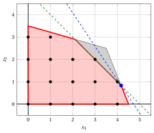
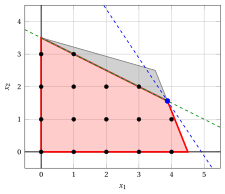

# Disuguaglianze valide

**Parte 2 · Rafforzare la formulazione · Capitolo 4** · [:material-file-pdf-box: Dispensa, volume 1 (PDF)](../pdf/dispensa-1-modelli-bound-formulazioni.pdf) · [:material-pencil: Esercizi: Disuguaglianze valide](../esercizi/valid-inequalities.md) · [:material-gesture-tap: App: Disuguaglianze valide e involucro convesso](../laboratorio/involucro-convesso.md)

!!! nota "Prerequisiti"

    - Da questo modulo, il capitolo «Bound primali e bound duali»: il rilassamento lineare, il bound arrotondato $\lfloor z(\LP) \rfloor$, e i bound ottenuti con moltiplicatori non negativi dei vincoli.

    - Da questo modulo, il capitolo «Formulazioni ideali»: le formulazioni, l'inviluppo convesso e il confronto tra formulazioni attraverso i loro poliedri.

!!! chiave "Obiettivi"

    Alla fine di questo capitolo sarai in grado di:

    - definire una disuguaglianza valida, e dire quando taglia un punto frazionario;

    - ricavare una disuguaglianza valida da moltiplicatori non negativi dei vincoli, arrotondando per difetto;

    - migliorare una disuguaglianza valida finché non tocca un punto intero ammissibile;

    - misurare l'effetto di una disuguaglianza valida sul valore ottimo del rilassamento lineare e sull'upper bound;

    - spiegare perché le disuguaglianze valide sono il modo pratico per avvicinarsi a una formulazione ideale.

!!! nota "Dove eravamo"

    Nell'esempio dell'auto la formulazione ideale dà l'upper bound $14$, uguale al lower bound, e quindi certifica che $(4,1)$ è ottima. Ma abbiamo trovato le sue quattro disuguaglianze guardando l'inviluppo convesso, cosa che in generale non è possibile. Ora impariamo a <strong>ricavare</strong> queste disuguaglianze dai vincoli.

## 4.1 Disuguaglianze valide

!!! definizione "Definizione 4.1: disuguaglianza valida"

    Una disuguaglianza $\sum_{j=1}^n \alpha_j \, x_j \le \beta$ è una <strong>disuguaglianza valida</strong> per un problema PLI con regione ammissibile $F$ se è soddisfatta da tutti i punti di $F$.

!!! definizione "Definizione 4.2: punto tagliato e disuguaglianza valida saturata"

    Sia $\sum_{j=1}^n \alpha_j \, x_j \le \beta$ una disuguaglianza valida per un problema PLI con regione ammissibile $F$.

    - La disuguaglianza <strong>taglia</strong> un punto $\vet x^* \in \R^n$ se $\sum_{j=1}^n \alpha_j \, x^*_j > \beta$.

    - La disuguaglianza è <strong>saturata</strong> se almeno un punto di $F$ la soddisfa all'uguaglianza.

- Una disuguaglianza valida non taglia nessun punto di $F$, ma può tagliare punti frazionari del rilassamento lineare. Il termine noto di una disuguaglianza saturata non si può diminuire senza perdere una soluzione ammissibile.

- Aggiungere una disuguaglianza valida alla formulazione non cambia $F$, e restringe il poliedro $P$. La nuova formulazione è più forte, quindi il suo rilassamento lineare dà un upper bound non peggiore.

- Una disuguaglianza valida è soddisfatta dai punti di $F$ se e solo se è soddisfatta dal loro inviluppo convesso, quindi è valida per $\mathrm{conv}(F)$. Le disuguaglianze della formulazione ideale sono disuguaglianze valide.

!!! chiave ""

    Una disuguaglianza valida elimina punti frazionari e mai una soluzione intera ammissibile. Aggiungere disuguaglianze valide rende la formulazione più forte e l'upper bound migliore.

!!! esempio "Esempio 4.1: disuguaglianze valide dell'esempio dell'auto"

    Le disuguaglianze $x_1 \le 4$ e $x_2 \le 3$ dei capitoli precedenti sono disuguaglianze valide dell'esempio dell'auto. Non tagliano la soluzione ottima $(\frac{7}{2},\frac{5}{2})$ del rilassamento lineare, quindi non migliorano l'upper bound $15$.

## 4.2 Ricavare disuguaglianze valide per arrotondamento

- Combiniamo i vincoli con moltiplicatori non negativi, come per i bound duali; poiché le variabili sono intere, il termine noto della combinazione si può arrotondare per difetto.

!!! teorema "Proposizione 4.3: disuguaglianze valide per arrotondamento"

    Siano $\pi_1, \pi_2, \dots, \pi_m \ge 0$ moltiplicatori tali che $\sum_{i=1}^m \pi_i \, a_{ij} \ge \alpha_j$, con $\alpha_j \in \Z$, per ogni $j \in \{1,2,\dots,n\}$. Allora la disuguaglianza

    \begin{equation*}
    \label{rounding}
    \sum_{j=1}^n \alpha_j \, x_j ~\le~ \left\lfloor \sum_{i=1}^m \pi_i \, b_i \right\rfloor \tag{4.1}
    \end{equation*}

    è valida per il problema PLI.

??? dimostrazione "Dimostrazione"

    Per ogni soluzione ammissibile, $\sum_j \alpha_j \, x_j \le \sum_j \big( \sum_i \pi_i \, a_{ij} \big) x_j \le \sum_i \pi_i \, b_i$, per $x_j \ge 0$ e per i vincoli moltiplicati per $\pi_i \ge 0$. Il membro sinistro è intero, perché $\alpha_j$ e $x_j$ sono interi, quindi è al più la parte intera del membro destro. □

- La proposizione richiede che tutte le variabili siano intere e non negative. Con una variabile continua il membro sinistro non è intero, e il termine noto non si può arrotondare.

!!! esempio "Esempio 4.2: arrotondamento con moltiplicatore $\frac{1}{2}$"

    Nell'esempio dell'auto moltiplichiamo il primo vincolo per $\frac{1}{2}$: otteniamo $5\,x_1 + 2\,x_2 \le \frac{45}{2}$. Poiché il membro sinistro è intero, otteniamo la disuguaglianza valida

    $$
    5\,x_1 + 2\,x_2 \le 22.
    $$

    Moltiplicando il secondo vincolo per $\frac{1}{2}$ otteniamo $2\,x_1 + 7\,x_2 \le \frac{49}{2}$, quindi

    $$
    2\,x_1 + 7\,x_2 \le 24.
    $$

    Entrambe le disuguaglianze tagliano la soluzione ottima $(\frac{7}{2},\frac{5}{2})$ del rilassamento lineare: $5 \cdot \frac{7}{2} + 2 \cdot \frac{5}{2} = \frac{45}{2} > 22$ e $2 \cdot \frac{7}{2} + 7 \cdot \frac{5}{2} = \frac{49}{2} > 24$. I nuovi rilassamenti lineari danno:

    
<table>
    <tr>
    <th>Disuguaglianza aggiunta</th>
    <th>\(\tilde{\vet x}(\LP)\)</th>
    <th>\(z(\LP)\)</th>
    <th>\(\lfloor z(\LP) \rfloor\)</th>
    </tr>
    <tr>
    <td>nessuna</td>
    <td>\((\frac{7}{2},\frac{5}{2})\)</td>
    <td>\(\frac{31}{2}\)</td>
    <td>\(15\)</td>
    </tr>
    <tr>
    <td>\(5\,x_1 + 2\,x_2 \le 22\)</td>
    <td>\((\frac{105}{31},\frac{157}{62})\)</td>
    <td>\(\frac{472}{31}\)</td>
    <td>\(15\)</td>
    </tr>
    <tr>
    <td>\(2\,x_1 + 7\,x_2 \le 24\)</td>
    <td>\((\frac{219}{62},\frac{75}{31})\)</td>
    <td>\(\frac{957}{62}\)</td>
    <td>\(15\)</td>
    </tr>
    </table>

    L'ottimo del rilassamento lineare si sposta, ma l'upper bound non migliora: $\lfloor \frac{472}{31} \rfloor = \lfloor \frac{957}{62} \rfloor = 15$.

!!! chiave ""

    Una disuguaglianza valida che taglia la soluzione ottima del rilassamento lineare non sempre migliora l'upper bound. La scelta dei moltiplicatori conta: cerchiamo disuguaglianze che tocchino i punti interi.

## 4.3 Migliorare una disuguaglianza valida

- Dati i coefficienti $\alpha_j$, la disuguaglianza valida più forte ha il termine noto più piccolo possibile, che è il massimo di $\sum_j \alpha_j \, x_j$ su $F$. Lo troviamo abbassando il termine noto $\beta$ della $\eqref{rounding}$ finché un punto intero ammissibile non lo raggiunge.

!!! algoritmo "Algoritmo"

    - <strong>Input:</strong> Un problema PLI in forma canonica di massimizzazione con $F \ne \emptyset$, e coefficienti interi $\alpha_1, \alpha_2, \dots, \alpha_n$.

    - <strong>Output:</strong> Una disuguaglianza valida saturata $\sum_{j=1}^n \alpha_j \, x_j \le \beta$.

    - **Passo 0:** <strong>Bound grossolano</strong>

        Trovare moltiplicatori $\pi_i \ge 0$ con $\sum_{i} \pi_i \, a_{ij} \ge \alpha_j$ per ogni $j$, e porre $\beta \leftarrow \lfloor \sum_{i} \pi_i \, b_i \rfloor$.

    - **Passo 1:** <strong>Verifica del termine noto</strong>

        Se nessun punto intero ammissibile soddisfa $\sum_{j} \alpha_j \, x_j = \beta$, porre $\beta \leftarrow \beta - 1$ e ripetere il Passo 1.

    - **Passo 2:** <strong>Disuguaglianza saturata</strong>

        Un punto intero ammissibile soddisfa $\sum_{j} \alpha_j \, x_j = \beta$, quindi $\sum_{j} \alpha_j \, x_j \le \beta$ è valida e saturata. <code>STOP</code>.

- Nel Passo 0 i moltiplicatori si possono scegliere liberamente: migliori sono, meno ripetizioni del Passo 1 servono. Nel Passo 1, con due variabili, sostituiamo una variabile usando l'equazione e limitiamo l'altra con i vincoli: se i limiti si contraddicono, il punto non esiste.

!!! esempio "Esempio 4.3: la disuguaglianza $x_1 + x_2 \le 5$"

    Cerchiamo una disuguaglianza valida con $\alpha = (1,1)$.

    - <strong>Passo 0.</strong> Con i moltiplicatori $(\frac{1}{14},\frac{1}{14})$ la somma dei vincoli, divisa per $14$, è $x_1 + \frac{9}{7}\,x_2 \le \frac{47}{7}$. I coefficienti sono almeno $(1,1)$, quindi $x_1 + x_2 \le \lfloor \frac{47}{7} \rfloor = 6$, e poniamo $\beta = 6$.

    - <strong>Passo 1, $\beta = 6$.</strong> Sia $x_1 + x_2 = 6$, cioè $x_2 = 6 - x_1$. Il primo vincolo diventa $6\,x_1 + 24 \le 45$, cioè $x_1 \le \frac{7}{2}$, quindi $x_1 \le 3$. Il secondo diventa $84 - 10\,x_1 \le 49$, cioè $x_1 \ge \frac{7}{2}$, quindi $x_1 \ge 4$. I limiti si contraddicono: nessun punto ammissibile ha $x_1 + x_2 = 6$, e poniamo $\beta = 5$.

    - <strong>Passo 1, $\beta = 5$.</strong> Sia $x_2 = 5 - x_1$. I vincoli diventano $x_1 \le \frac{25}{6}$, quindi $x_1 \le 4$, e $x_1 \ge \frac{21}{10}$, quindi $x_1 \ge 3$. Non c'è contraddizione, e i punti $(3,2)$ e $(4,1)$ sono ammissibili con $x_1 + x_2 = 5$.

    - <strong>Passo 2.</strong> La disuguaglianza $x_1 + x_2 \le 5$ è valida e saturata.

    Taglia $(\frac{7}{2},\frac{5}{2})$ (la somma è $6$). Il nuovo rilassamento lineare ha la soluzione ottima $(\frac{25}{6},\frac{5}{6})$ con $z(\LP) = \frac{85}{6}$, quindi l'upper bound è $\lfloor \frac{85}{6} \rfloor = 14$.

    { .fig .ovale loading=lazy  }

    <em>La disuguaglianza valida $x_1 + x_2 \le 5$ (verde) taglia il triangolo grigio, che non contiene punti interi, e la soluzione ottima del rilassamento lineare precedente. La nuova soluzione ottima è $(\frac{25}{6},\frac{5}{6})$ (blu), con $z = \frac{85}{6}$ (linea tratteggiata).</em>

!!! esempio "Esempio 4.4: la disuguaglianza $x_1 + 2\,x_2 \le 7$"

    Cerchiamo una disuguaglianza valida con $\alpha = (1,2)$.

    - <strong>Passo 0.</strong> Con i moltiplicatori $(\frac{3}{62},\frac{4}{31})$ la combinazione dei vincoli è $x_1 + 2\,x_2 \le \frac{17}{2}$, perché $\frac{3 \cdot 10}{62} + \frac{4 \cdot 4}{31} = 1$, $\frac{3 \cdot 4}{62} + \frac{4 \cdot 14}{31} = 2$ e $\frac{3 \cdot 45}{62} + \frac{4 \cdot 49}{31} = \frac{17}{2}$. Quindi $x_1 + 2\,x_2 \le \lfloor \frac{17}{2} \rfloor = 8$, e poniamo $\beta = 8$.

    - <strong>Passo 1, $\beta = 8$.</strong> Sia $x_1 = 8 - 2\,x_2$. Il primo vincolo diventa $80 - 16\,x_2 \le 45$, quindi $x_2 \ge 3$; il secondo diventa $32 + 6\,x_2 \le 49$, quindi $x_2 \le 2$. I due limiti si contraddicono, e poniamo $\beta = 7$.

    - <strong>Passo 1, $\beta = 7$.</strong> Sia $x_1 = 7 - 2\,x_2$: i vincoli diventano $70 - 16\,x_2 \le 45$, quindi $x_2 \ge 2$, e $28 + 6\,x_2 \le 49$, quindi $x_2 \le 3$. I punti $(3,2)$ e $(1,3)$ sono ammissibili con $x_1 + 2\,x_2 = 7$.

    - <strong>Passo 2.</strong> La disuguaglianza $x_1 + 2\,x_2 \le 7$ è valida e saturata.

    Il nuovo rilassamento lineare ha la soluzione ottima $(\frac{31}{8},\frac{25}{16})$ con $z(\LP) = \frac{59}{4}$, quindi l'upper bound è $\lfloor \frac{59}{4} \rfloor = 14$.

    { .fig .ovale loading=lazy  }

    <em>La disuguaglianza valida $x_1 + 2\,x_2 \le 7$ (verde) taglia il triangolo grigio, che non contiene punti interi. La nuova soluzione ottima è $(\frac{31}{8},\frac{25}{16})$ (blu), con $z = \frac{59}{4}$ (linea tratteggiata).</em>

!!! chiave ""

    Con la disuguaglianza valida $x_1 + x_2 \le 5$, oppure con $x_1 + 2\,x_2 \le 7$, l'upper bound scende da $15$ a $14$. È uguale al lower bound dato da $(4,1)$: <strong>la soluzione $(4,1)$ è certificata ottima</strong>, e il gap è zero.

- Le due disuguaglianze, insieme a $x_1 \le 4$ e $x_2 \le 3$, sono esattamente le quattro disuguaglianze della formulazione ideale del capitolo precedente. Per l'esempio dell'auto abbiamo raggiunto l'inviluppo convesso con disuguaglianze valide ricavate dai vincoli.

## 4.4 Famiglie di disuguaglianze valide e tagli

- Con due variabili le direzioni $\alpha$ si scelgono guardando la figura. In generale, le disuguaglianze valide vengono da due fonti.

- Famiglie di disuguaglianze per strutture specifiche dei vincoli, come le <strong>disuguaglianze di copertura</strong> di un vincolo a coefficienti positivi di un problema binario (prossimo capitolo).

- L'arrotondamento di questo capitolo, applicato in modo sistematico alle righe del dizionario ottimo del rilassamento lineare: i <strong>tagli frazionari di Gomory</strong> dell'algoritmo dei piani di taglio, e poi l'algoritmo <strong>branch-and-cut</strong>.

## 4.5 Errori tipici

!!! attenzione "Attenzione"

    - <strong>Arrotondare quando una variabile è continua.</strong> L'arrotondamento della $\eqref{rounding}$ richiede variabili intere e coefficienti $\alpha_j$ interi.

    - <strong>Arrotondare per eccesso invece che per difetto.</strong> Il termine noto si arrotonda <u>per difetto</u>. Arrotondare per eccesso dà una disuguaglianza che non è valida, e può eliminare soluzioni intere.

    - <strong>Credere che ogni disuguaglianza valida migliori il bound.</strong> Le disuguaglianze $5\,x_1 + 2\,x_2 \le 22$ e $2\,x_1 + 7\,x_2 \le 24$ tagliano l'ottimo del rilassamento lineare, ma lasciano il bound a $15$.

    - <strong>Usare moltiplicatori non abbastanza grandi.</strong> I coefficienti combinati devono essere almeno $\alpha_j$ per ogni $j$, e i moltiplicatori devono essere non negativi.

    - <strong>Fermarsi a un termine noto grossolano.</strong> La disuguaglianza $x_1 + x_2 \le 6$ è valida, ma non taglia l'ottimo del rilassamento lineare dell'esempio dell'auto (la sua somma è $6$); la disuguaglianza saturata $x_1 + x_2 \le 5$ lo taglia.

## 4.6 In sintesi

!!! chiave "In sintesi"

    - Una disuguaglianza valida è soddisfatta da tutte le soluzioni intere ammissibili; può tagliare punti frazionari del rilassamento lineare, e rende la formulazione più forte.

    - Moltiplicatori non negativi dei vincoli, con il termine noto arrotondato per difetto, danno disuguaglianze valide per i problemi PLI.

    - Abbassare il termine noto finché un punto intero non tocca la retta dà una disuguaglianza saturata.

    - Una disuguaglianza valida serve solo se taglia l'ottimo del rilassamento lineare e migliora il bound arrotondato.

    - Nell'esempio dell'auto, $x_1 + x_2 \le 5$ oppure $x_1 + 2\,x_2 \le 7$ abbassa l'upper bound da $15$ a $14$, e certifica che $(4,1)$ è ottima.

    <strong>Cruscotto dell'esempio dell'auto.</strong> I bound su $z(\ILP)$ trovati finora in questo modulo:

    
<table>
    <tr>
    <th>Capitolo</th>
    <th>Lower bound</th>
    <th>Upper bound</th>
    <th>Da</th>
    </tr>
    <tr>
    <td>Bound primali e bound duali</td>
    <td>\(14\)</td>
    <td>\(15\)</td>
    <td>soluzione euristica \((4, 1)\), e \(\lfloor z(\LP) \rfloor\) con \(z(\LP) = \tfrac{31}{2}\)</td>
    </tr>
    <tr>
    <td>Formulazioni ideali</td>
    <td>\(14\)</td>
    <td>\(14\)</td>
    <td>formulazione ideale, vertice ottimo \((4,1)\)</td>
    </tr>
    <tr>
    <td>Disuguaglianze valide</td>
    <td>\(14\)</td>
    <td>\(14\)</td>
    <td>\(x_1 + x_2 \le 5\) dà \(z(\LP) = \tfrac{85}{6}\)</td>
    </tr>
    </table>

---

**Esercizi su questo capitolo:** [:material-pencil: Disuguaglianze valide](../esercizi/valid-inequalities.md)

<!-- laboratorio-interattivo: sezione generata da interattivi.py -->

## Laboratorio interattivo { #laboratorio-interattivo }

Le idee del capitolo, da toccare con mano: muovi i cursori e trascina i punti.
Ogni app si apre anche a tutta pagina nel [laboratorio interattivo](../laboratorio/index.md): [Disuguaglianze valide e involucro convesso](../laboratorio/involucro-convesso.md).

