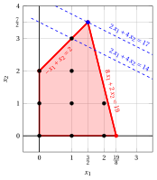
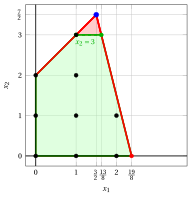
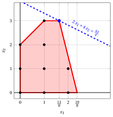
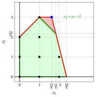
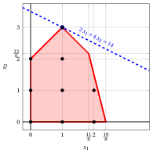

# L'algoritmo dei piani di taglio con i tagli frazionari di Gomory

**Parte 3 · Metodi esatti · Capitolo 6** · [:material-file-pdf-box: Dispensa, volume 2 (PDF)](../pdf/dispensa-2-metodi-esatti.pdf) · [:material-pencil: Esercizi: Piani di taglio](../esercizi/gomory.md) · [:material-gesture-tap: App: Tagli di Gomory sul piano](../laboratorio/tagli-di-gomory.md)

!!! nota "Prerequisiti"

    - Dal modulo <em>Programmazione lineare</em>, [Capitolo 10 «Algoritmo del simplesso duale»](https://fabiofurini.github.io/linear-programming/duality/10-dual-simplex/): dizionari del simplesso, basi duali ammissibili e operazioni di pivot duali. Un breve richiamo è dato in questo capitolo.

    - Da questo modulo, i capitoli «Programmazione lineare intera» e «Bound primali e bound duali»: problemi PLI, il rilassamento lineare e l'upper bound dato dal rilassamento lineare.

    - Da questo modulo, il capitolo «Disuguaglianze valide»: disuguaglianze valide e tagli che eliminano punti frazionari.

!!! chiave "Obiettivi"

    Alla fine di questo capitolo sarai in grado di:

    - generare un taglio frazionario di Gomory da una riga di un dizionario del simplesso, e dimostrare che è valido e che elimina la soluzione di base corrente;

    - inserire un taglio nel dizionario e riottimizzare con l'algoritmo del simplesso duale;

    - eseguire a mano un algoritmo dei piani di taglio, con la strategia di selezione del termine noto più grande e le sue regole per i pareggi;

    - calcolare l'upper bound a ogni iterazione e spiegare perché l'algoritmo può richiedere molti tagli;

    - spiegare perché questi tagli sono validi solo per problemi PLI con dati interi.

## 6.1 Tagli frazionari di Gomory

!!! definizione "Definizione 6.1: piano di taglio"

    Dato un problema PLI e una soluzione ottima frazionaria $\tilde{\vet x}(\LP)$ del suo rilassamento lineare, un <strong>piano di taglio</strong> (o <strong>taglio</strong>) è una disuguaglianza valida per il problema PLI che elimina $\tilde{\vet x}(\LP)$.

!!! chiave ""

    I tagli frazionari di Gomory sono disuguaglianze valide che eliminano soluzioni di base ammissibili frazionarie del rilassamento lineare di un problema PLI senza escludere alcuna soluzione intera ammissibile.

- <strong>Consideriamo problemi PLI in forma canonica di massimo con dati interi</strong>. Per questi problemi, anche le variabili di scarto introdotte nel rilassamento lineare in forma standard assumono valori interi in ogni soluzione intera ammissibile del problema PLI.

- I tagli frazionari di Gomory sono validi <u>solo</u> se tutte le variabili, comprese le variabili di scarto, sono intere. Per i problemi MIP con variabili continue possono eliminare soluzioni ammissibili, e serve una famiglia diversa di tagli.

- Ricordiamo che un dizionario del simplesso del rilassamento lineare in forma standard ha la forma seguente

    $$
    \begin{cases}
    \displaystyle
    x_i=\bar b_i-\sum_{j\in\pazocal N}\bar a_{ij}x_j,
    \qquad \forall i\in\pazocal B,\\[4ex]
    \displaystyle
    z=\bar z+\sum_{j\in\pazocal N}\bar c_jx_j.
    \end{cases}
    $$

    dove $\pazocal{B}$ è l'insieme degli indici delle variabili in base e $\pazocal{N}$ è l'insieme degli indici delle variabili fuori base. Se $\bar{b}_i \ge 0$ per ogni $i \in \pazocal{B}$, il dizionario è associato alla seguente soluzione di base ammissibile:

    $$
    x_i = \bar{b}_i, \quad \forall i \in \pazocal{B},
    \qquad
    x_j = 0, \quad \forall j \in \pazocal{N}.
    $$

    Se, inoltre, almeno un $\bar{b}_i$ è frazionario, questa soluzione di base ammissibile è frazionaria.

- I tagli frazionari di Gomory si ottengono dalle righe di un dizionario del simplesso associato a una soluzione di base ammissibile frazionaria del rilassamento lineare in forma standard di un problema PLI.

    

    !!! definizione "Definizione 6.2: taglio frazionario di Gomory"

        Data una riga $i \in \pazocal{B}$ di un dizionario del simplesso associato a una soluzione di base ammissibile tale che $\bar{b}_i$ sia frazionario, la disuguaglianza lineare

        \begin{equation*}
        \sum_{j \in \pazocal{N}}
        \left(
        \bar{a}_{ij}
        -
        \left\lfloor \bar{a}_{ij}\right\rfloor
        \right)x_j
        \ge
        \bar{b}_i - \left\lfloor \bar{b}_i \right\rfloor
        \label{GFC} \tag{6.1}
        \end{equation*}

        si chiama <strong>taglio frazionario di Gomory</strong> generato dalla riga $i$.

- Dimostreremo che un taglio frazionario di Gomory non elimina alcuna soluzione intera ammissibile del problema PLI e che elimina la soluzione di base ammissibile frazionaria.

!!! esempio "Esempio 6.1: Problema PLI in forma canonica, rilassamento lineare in forma standard e dizionari"

    Consideriamo il seguente problema PLI in forma canonica di massimo con $2$ variabili intere e $2$ vincoli lineari (detto Esempio 1):

    $$
    \begin{array}{rrrrrrrrrrrrrr}
    {\max} & 2 \, {x_1} & {+} & 4 \, {x_2} \\[2ex]
    & {-} \, {x_1} & {+} & \, {x_2} & {\le} & {2} \\[2ex]
    & {8} \, {x_1} & {+} & {2} \, {x_2} & {\le} & {19} \\[2ex]
    & {x_1,} &  & {x_2} & { \in} & {\Z_{\ge 0} }
    \end{array}
    $$

    Il rilassamento lineare in forma standard, con $4$ variabili non negative (2 variabili di scarto) e $2$ vincoli lineari, è il seguente:

    $$
    \begin{array}{rrrrrrrrrr}
    {\max} & 2 \, {x_1} & {+} & 4 \, {x_2} &  &  &  &  &  &  \\[2ex]
    & {-} \, {x_1} & {+} & \, {x_2} & {+} & {x_3} &  &  & {=} & {2} \\[2ex]
    & {8} \, {x_1} & {+} & {2} \, {x_2} &  &  & {+} & {x_4} & {=} & {19} \\[2ex]
    & {x_1,} &  & {x_2,} &  & {x_3,} &  & {x_4} & {\ge} & {0 }
    \end{array}
    $$

    Come esempio, consideriamo il seguente dizionario del simplesso associato a una soluzione di base ammissibile frazionaria del rilassamento lineare in forma standard del problema PLI:

    \begin{equation*}
    \begin{cases}
    \begin{array}{rrrrrrrrrrrrr}
    {x_1=\frac{3}{2}} & {+} & {\frac{1}{5}} \, {x_3} & {-} & {\frac{1}{10}}\, {x_4} \\[2ex]
    {x_2=\frac{7}{2}} & {-} & {\frac{4}{5}}\, {x_3} & {-} & {\frac{1}{10}}\, {x_4} \\[2ex]
    {z= 17} & {-} & {\frac{14}{5}} \, {x_3} & {-} & {\frac{3}{5}} \, {x_4}
    \end{array}
    \end{cases}
    \quad
    \text{dove}
    \quad
    \bar{\mat A}=
    \begin{pmatrix}
    -\frac{1}{5} & \frac{1}{10} \\[2ex]
    \frac{4}{5} & \frac{1}{10} \\
    \end{pmatrix}
    \quad
    \bar{\vet b}=
    \begin{pmatrix}
    \frac{3}{2} \\[2ex]
    \frac{7}{2} \\
    \end{pmatrix}
    \end{equation*}

    con $\pazocal{B}=\{1,2\}$ e $\pazocal{N}=\{3,4\}$. La soluzione di base ammissibile frazionaria associata è:

    $$
    \bar x_1=\dfrac{3}{2},~~
    \bar x_2=\dfrac{7}{2},~~~~
    \bar x_3=0,~~
    \bar x_4=0
    ~~~\text{di valore   } \bar z = 17
    $$

!!! esempio "Esempio 6.2: Tagli frazionari di Gomory"

    Consideriamo di nuovo il problema PLI dell'Esempio 1, in forma canonica di massimo con $2$ variabili intere e $2$ vincoli lineari:

    $$
    \begin{array}{rrrrrrrrrrrrr}
    {\max} & 2 \, {x_1} & {+} & 4 \, {x_2} \\[2ex]
    & {-} \, {x_1} & {+} & \, {x_2} & {\le} & {2} \\[2ex]
    & {8} \, {x_1} & {+} & {2} \, {x_2} & {\le} & {19} \\[2ex]
    & {x_1,} &  & {x_2} & { \in} & {\Z_{\ge 0} }
    \end{array}
    $$

    e il suo rilassamento lineare in forma canonica con $2$ variabili non negative e $2$ vincoli lineari:

    $$
    \begin{array}{rrrrrrrrrrrrr}
    {\max} & 2 \, {x_1} & {+} & 4 \, {x_2} \\[2ex]
    & {-} \, {x_1} & {+} & \, {x_2} & {\le} & {2} \\[2ex]
    & {8} \, {x_1} & {+} & {2} \, {x_2} & {\le} & {19} \\[2ex]
    & {x_1,} &  & {x_2} & { \ge} & {0}
    \end{array}
    $$

    { .fig .ovale loading=lazy style="width:44%" }

    Una soluzione ottima $\tilde{\vet x}(\ILP)$ del problema PLI è

    $$
    \tilde{x}_1=1,~~\tilde{x}_2=3
    $$

    Il valore ottimo è $z(\ILP) = 14$.  Una soluzione ottima $\tilde{\vet x}(\LP)$ del rilassamento lineare è

    $$
    \tilde{x}_1=\frac{3}{2},~~\tilde{x}_2=\frac{7}{2}
    $$

    Il valore ottimo è $z(\LP) = 17$.

    Consideriamo il seguente dizionario del simplesso associato a una soluzione di base ammissibile frazionaria del rilassamento lineare in forma standard del problema PLI dell'Esempio 1:

    \begin{equation*}
    \begin{cases}
    \begin{array}{rrrrrrrrrrrrr}
    {x_1=\frac{3}{2}} & {+} & {\frac{1}{5}} \, {x_3} & {-} & {\frac{1}{10}}\, {x_4} \\[2ex]
    {x_2=\frac{7}{2}} & {-} & {\frac{4}{5}}\, {x_3} & {-} & {\frac{1}{10}}\, {x_4} \\[2ex]
    {z= 17} & {-} & {\frac{14}{5}} \, {x_3} & {-} & {\frac{3}{5}} \, {x_4}
    \end{array}
    \end{cases}
    \quad
    \text{dove}
    \quad
    \bar{\mat A}=
    \begin{pmatrix}
    -\frac{1}{5} & \frac{1}{10} \\[2ex]
    \frac{4}{5} & \frac{1}{10} \\
    \end{pmatrix}
    \quad
    \bar{\vet b}=
    \begin{pmatrix}
    \frac{3}{2} \\[2ex]
    \frac{7}{2} \\
    \end{pmatrix}
    \end{equation*}

    - Il taglio frazionario di Gomory generato dalla prima riga è:

        \begin{align*}
        \underbrace{\left(-\frac{1}{5} - \left\lfloor -\frac{1}{5} \right\rfloor \right)}_{-\frac{1}{5}-(-1)=\frac{4}{5}} \; x_3 + \underbrace{\left(\frac{1}{10} - \left\lfloor \frac{1}{10} \right\rfloor \right)}_{\frac{1}{10}-0=\frac{1}{10}} \; x_4
        \ge \underbrace{\left(\frac{3}{2} - \left\lfloor \frac{3}{2} \right\rfloor \right)}_{\frac{3}{2} -1=\frac{1}{2}}
        \end{align*}

        \begin{align*}
        \frac{4}{5}\;x_3 + \frac{1}{10}\;x_4 \ge \frac{1}{2}
        \quad \Rightarrow \quad
        8\;x_3 + x_4 \ge 5
        \end{align*}

        Dalla forma standard del rilassamento lineare abbiamo:

        $$
        x_3= 2 + x_1 -x_2 {\rm ~~~~e~~~~}
        x_4= 19 - 8 \;x_1 - 2\;x_2
        $$

        Sostituendo nel taglio frazionario di Gomory, possiamo esprimerlo nelle variabili originali del problema PLI:

        $$
        8\; (2 + x_1 -x_2) + (19 - 8 \:x_1 - 2\:x_2) \ge 5
        \quad \Rightarrow \quad
        x_2 \le 3
        $$

    - Il taglio frazionario di Gomory generato dalla seconda riga è:

        \begin{align*}
        \underbrace{\left(\frac{4}{5} - \left\lfloor \frac{4}{5} \right\rfloor \right)}_{\frac{4}{5}-0=\frac{4}{5}} \; x_3 + \underbrace{\left(\frac{1}{10} - \left\lfloor \frac{1}{10} \right\rfloor \right)}_{\frac{1}{10}-0=\frac{1}{10}} \; x_4
        \ge \underbrace{\left(\frac{7}{2} - \left\lfloor \frac{7}{2} \right\rfloor \right)}_{\frac{7}{2} -3=\frac{1}{2}}
        \end{align*}

        \begin{align*}
        \frac{4}{5}\;x_3 + \frac{1}{10}\;x_4 \ge \frac{1}{2}
        \quad \Rightarrow \quad
        8\;x_3 + x_4 \ge 5
        \end{align*}

        Questo taglio frazionario di Gomory coincide con quello generato dalla prima riga.

    Effetto del taglio frazionario di Gomory sulla regione ammissibile del rilassamento lineare in forma canonica.

    { .fig .ovale loading=lazy style="width:59%" }

!!! chiave ""

    Un taglio frazionario di Gomory si può generare anche dalla riga della funzione obiettivo del dizionario del simplesso.

- Consideriamo la riga della funzione obiettivo di un dizionario del simplesso:

    $$
    z=\bar z+\sum_{j \in \pazocal{N}}\bar c_j x_j
    $$

    Questa riga si può riscrivere nella stessa forma delle altre righe del dizionario:

    $$
    z=\bar z-\sum_{j \in \pazocal{N}}(-\bar c_j)x_j
    $$

    Il taglio frazionario di Gomory generato dalla riga della funzione obiettivo è

    \begin{equation*}
    \sum_{j \in \pazocal{N}}
    \left(
    -\bar c_j
    -
    \left\lfloor -\bar c_j \right\rfloor
    \right)x_j
    \ge
    \bar z - \left\lfloor \bar z \right\rfloor
    \label{GFC_OBJ} \tag{6.2}
    \end{equation*}

!!! esempio "Esempio 6.3: Tagli frazionari di Gomory"

    Consideriamo il seguente dizionario del simplesso associato a una soluzione di base ammissibile frazionaria del rilassamento lineare in forma standard del problema PLI dell'Esempio 1:

    \begin{equation*}
    \begin{cases}
    \begin{array}{rrrrrrrrrrrrr}
    {x_1=\dfrac{19}{8}} & {-} & {\dfrac{1}{4}} \, {x_2} & {-} & {\dfrac{1}{8}}\, {x_4} \\[2ex]
    {x_3=\dfrac{35}{8}} & {-} & {\dfrac{5}{4}}\, {x_2} & {-} & {\dfrac{1}{8}}\, {x_4} \\[2ex]
    {z =\dfrac{19}{4}} & {+} & {\dfrac{7}{2}} \, {x_2} & {-} & {\dfrac{1}{4}} \, {x_4}
    \end{array}
    \end{cases}
    \quad
    \text{dove}
    \quad
    \bar{\mat A}=
    \begin{pmatrix}
    \frac{1}{4} & \frac{1}{8} \\[2ex]
    \frac{5}{4} & \frac{1}{8} \\
    \end{pmatrix}
    \quad
    \bar{\vet b}=
    \begin{pmatrix}
    \frac{19}{8} \\[2ex]
    \frac{35}{8} \\
    \end{pmatrix}
    \end{equation*}

    - Questo dizionario non è ottimo ($\bar c_2 = \frac{7}{2} > 0$): un taglio frazionario di Gomory si può generare da qualsiasi dizionario con una soluzione di base frazionaria, ottimo o no. Nella figura la soluzione di base $(\frac{19}{8},0)$ è un vertice della regione ammissibile, non l'ottimo del rilassamento lineare.

    - Il taglio frazionario di Gomory generato dalla prima riga è:

        \begin{align*}
        \underbrace{\left(\frac{1}{4} - \left\lfloor \frac{1}{4} \right\rfloor \right)}_{\frac{1}{4}-0=\frac{1}{4}} \; x_2 + \underbrace{\left(\frac{1}{8} - \left\lfloor \frac{1}{8} \right\rfloor \right)}_{\frac{1}{8}-0=\frac{1}{8}} \; x_4
        \ge \underbrace{\left(\frac{19}{8} - \left\lfloor \frac{19}{8} \right\rfloor \right)}_{\frac{19}{8} -2=\frac{3}{8}}
        \end{align*}

        \begin{align*}
        \frac{1}{4}\;x_2 + \frac{1}{8}\;x_4 \ge \frac{3}{8}
        \quad \Rightarrow \quad
        2\;x_2 + x_4 \ge 3
        \end{align*}

        Dalla forma standard del rilassamento lineare abbiamo:

        $$
        x_4= 19 - 8 \;x_1 - 2\;x_2
        $$

        Sostituendo nel taglio frazionario di Gomory, possiamo esprimerlo nelle variabili originali del problema PLI:

        $$
        2\;x_2 + (19 - 8 \:x_1 - 2\:x_2) \ge 3
        \quad \Rightarrow \quad
        x_1 \le 2
        $$

    - Il taglio frazionario di Gomory generato dalla seconda riga è:

        \begin{align*}
        \underbrace{\left(\frac{5}{4} - \left\lfloor \frac{5}{4} \right\rfloor \right)}_{\frac{5}{4}-1=\frac{1}{4}} \; x_2 + \underbrace{\left(\frac{1}{8} - \left\lfloor \frac{1}{8} \right\rfloor \right)}_{\frac{1}{8}-0=\frac{1}{8}} \; x_4
        \ge \underbrace{\left(\frac{35}{8} - \left\lfloor \frac{35}{8} \right\rfloor \right)}_{\frac{35}{8} -4=\frac{3}{8}}
        \end{align*}

        \begin{align*}
        \frac{1}{4}\;x_2 + \frac{1}{8}\;x_4 \ge \frac{3}{8}
        \quad \Rightarrow \quad
        2\;x_2 + x_4 \ge 3
        \end{align*}

        Questo taglio frazionario di Gomory coincide con quello generato dalla prima riga.

    - Il taglio frazionario di Gomory generato dalla riga della funzione obiettivo è:

        \begin{align*}
        \underbrace{\left(-\frac{7}{2} - \left\lfloor -\frac{7}{2} \right\rfloor \right)}_{-\frac{7}{2}-(-4)=\frac{1}{2}} \; x_2 + \underbrace{\left(\frac{1}{4} - \left\lfloor \frac{1}{4} \right\rfloor \right)}_{\frac{1}{4}-0=\frac{1}{4}} \; x_4
        \ge \underbrace{\left(\frac{19}{4} - \left\lfloor \frac{19}{4} \right\rfloor \right)}_{\frac{19}{4} -4=\frac{3}{4}}
        \end{align*}

        \begin{align*}
        \frac{1}{2}\;x_2 + \frac{1}{4}\;x_4 \ge \frac{3}{4}
        \quad \Rightarrow \quad
        2\;x_2 + x_4 \ge 3
        \end{align*}

        Questo taglio frazionario di Gomory coincide con quello generato dalla prima riga.

    Effetto del taglio frazionario di Gomory sulla regione ammissibile del rilassamento lineare in forma canonica.

    { .fig .ovale loading=lazy style="width:59%" }

### 6.1.1 Validità dei tagli frazionari di Gomory

!!! teorema "Osservazione 6.3"

    Ogni taglio frazionario di Gomory elimina la soluzione di base ammissibile frazionaria associata al dizionario del simplesso da cui è generato.

!!! nota ""

    ??? dimostrazione "Dimostrazione"

        Nella soluzione di base ammissibile associata al dizionario tutte le variabili fuori base valgono zero:

        $$
        x_j = 0, \quad \forall j \in \pazocal{N}.
        $$

        Consideriamo ora la riga $i \in \pazocal{B}$ da cui è generato il taglio frazionario di Gomory. Per definizione, $\bar{b}_i$ è frazionario. Il corrispondente taglio frazionario di Gomory è

        $$
        \sum_{j \in \pazocal{N}}
        \left(
        \bar{a}_{ij}
        -
        \left\lfloor \bar{a}_{ij} \right\rfloor
        \right)x_j
        \ge
        \bar{b}_i - \left\lfloor \bar{b}_i \right\rfloor .
        $$

        Nella soluzione di base ammissibile il membro sinistro vale zero, perché $x_j=0$ per ogni $j \in \pazocal{N}$. D'altra parte,

        $$
        \bar{b}_i - \left\lfloor \bar{b}_i \right\rfloor > 0,
        $$

        perché $\bar{b}_i$ è frazionario. Quindi, nella soluzione di base ammissibile corrente, il taglio diventa

        $$
        0
        \not\ge
        \bar{b}_i - \left\lfloor \bar{b}_i \right\rfloor .
        $$

        Pertanto il taglio frazionario di Gomory elimina la soluzione di base ammissibile associata al dizionario da cui è generato. □

!!! teorema "Osservazione 6.4"

    Ogni soluzione intera ammissibile del problema PLI soddisfa ogni taglio frazionario di Gomory generato dalle righe di un dizionario del simplesso.

!!! nota ""

    ??? dimostrazione "Dimostrazione"

        Consideriamo un taglio frazionario di Gomory generato dalla seguente riga $i \in \pazocal{B}$ di un dizionario del simplesso:

        \begin{equation*}
        \tag{A}
        x_i
        =
        \bar{b}_i
        -
        \sum_{j \in \pazocal{N}}
        \bar{a}_{ij}x_j .
        \end{equation*}

        Dimostriamo che ogni soluzione intera ammissibile del problema PLI che soddisfa questa riga soddisfa anche il corrispondente taglio frazionario di Gomory. 

        Poiché $x_j \ge 0$ per ogni $j \in \pazocal{N}$ e $\left\lfloor \bar{a}_{ij} \right\rfloor \le \bar{a}_{ij},$ da (A) otteniamo

        $$
        x_i
        \le
        \bar{b}_i
        -
        \sum_{j \in \pazocal{N}}
        \left\lfloor \bar{a}_{ij} \right\rfloor x_j .
        $$

        Equivalentemente,

        $$
        x_i
        +
        \sum_{j \in \pazocal{N}}
        \left\lfloor \bar{a}_{ij} \right\rfloor x_j
        \le
        \bar{b}_i .
        $$

        Il membro sinistro è intero, perché la soluzione è intera: le variabili che compaiono nella riga assumono valori interi e i coefficienti $\left\lfloor \bar{a}_{ij} \right\rfloor$ sono interi. Quindi,

        $$
        x_i
        +
        \sum_{j \in \pazocal{N}}
        \left\lfloor \bar{a}_{ij} \right\rfloor x_j
        \le
        \left\lfloor \bar{b}_i \right\rfloor .
        $$

        Usando (A), sostituiamo

        $$
        x_i
        =
        \bar{b}_i
        -
        \sum_{j \in \pazocal{N}}
        \bar{a}_{ij}x_j
        $$

        nella disuguaglianza precedente e otteniamo

        $$
        \bar{b}_i
        -
        \sum_{j \in \pazocal{N}}
        \bar{a}_{ij}x_j
        +
        \sum_{j \in \pazocal{N}}
        \left\lfloor \bar{a}_{ij} \right\rfloor x_j
        \le
        \left\lfloor \bar{b}_i \right\rfloor .
        $$

        Riordinando i termini si ottiene

        $$
        \sum_{j \in \pazocal{N}}
        \left(
        \bar{a}_{ij}
        -
        \left\lfloor \bar{a}_{ij} \right\rfloor
        \right)x_j
        \ge
        \bar{b}_i - \left\lfloor \bar{b}_i \right\rfloor .
        $$

        Questo è esattamente il taglio frazionario di Gomory generato dalla riga $i$. Pertanto la soluzione intera ammissibile soddisfa questo taglio.

        Poiché sia la soluzione intera ammissibile sia il taglio frazionario di Gomory sono stati scelti arbitrariamente, ogni soluzione intera ammissibile del problema PLI soddisfa ogni taglio frazionario di Gomory generato dalle righe del dizionario. □

- Lo stesso ragionamento vale per il taglio frazionario di Gomory generato dalla riga della funzione obiettivo. Infatti, la riga della funzione obiettivo si può scrivere come

    $$
    z
    =
    \bar z
    +
    \sum_{j \in \pazocal{N}}\bar c_j x_j
    =
    \bar z
    -
    \sum_{j \in \pazocal{N}}(-\bar c_j)x_j .
    $$

    Se $\bar z$ è frazionario, il corrispondente taglio frazionario di Gomory è

    $$
    \sum_{j \in \pazocal{N}}
    \left(
    -\bar c_j
    -
    \left\lfloor -\bar c_j \right\rfloor
    \right)x_j
    \ge
    \bar z - \left\lfloor \bar z \right\rfloor .
    $$

- Questo taglio elimina la soluzione di base ammissibile corrente: in quella soluzione tutte le variabili fuori base valgono zero, e quindi il membro sinistro è zero, mentre

    $$
    \bar z - \left\lfloor \bar z \right\rfloor > 0.
    $$

- Il taglio è valido per ogni soluzione intera ammissibile del problema PLI. Infatti, se la funzione obiettivo originale ha coefficienti interi, $z$ assume valori interi in ogni soluzione intera ammissibile. Inoltre,

    $$
    z
    +
    \sum_{j \in \pazocal{N}}
    \left\lfloor -\bar c_j \right\rfloor x_j
    \le
    \bar z .
    $$

    Poiché il membro sinistro è intero, segue che

    $$
    z
    +
    \sum_{j \in \pazocal{N}}
    \left\lfloor -\bar c_j \right\rfloor x_j
    \le
    \left\lfloor \bar z \right\rfloor .
    $$

    Sostituendo

    $$
    z
    =
    \bar z
    +
    \sum_{j \in \pazocal{N}}\bar c_j x_j
    $$

    e riordinando i termini si ottiene esattamente

    $$
    \sum_{j \in \pazocal{N}}
    \left(
    -\bar c_j
    -
    \left\lfloor -\bar c_j \right\rfloor
    \right)x_j
    \ge
    \bar z - \left\lfloor \bar z \right\rfloor .
    $$

### 6.1.2 Inserimento dei tagli frazionari di Gomory nel dizionario del simplesso

- Un taglio frazionario di Gomory si ottiene da una riga del dizionario del simplesso corrente. In generale, sia i suoi coefficienti sia il suo termine noto sono frazionari.

- Per inserire il taglio nel dizionario del simplesso procediamo in tre passi:

    1. sostituendo le definizioni delle variabili di scarto, riscriviamo il taglio nelle variabili originali come una disuguaglianza $\sum_{j=1}^{n} a_j x_j \le b$ con $a_j$ e $b$ interi;

    2. lo rendiamo <strong>primitivo</strong>: lo dividiamo per il massimo comun divisore $g$ di $a_1, \dots, a_n$ e arrotondiamo per difetto il termine noto,

        $$
        \sum_{j=1}^{n} \frac{a_j}{g} \, x_j \le \left\lfloor \frac{b}{g} \right\rfloor ;
        $$

    3. solo allora aggiungiamo la variabile di scarto non negativa $s = \lfloor b/g \rfloor - \sum_{j=1}^{n} (a_j/g) \, x_j$, e sostituiamo le righe correnti del dizionario per ottenere la riga di $s$.

- L'arrotondamento è valido: il membro sinistro è intero per ogni $\vet x$ intero. La variabile di scarto $s$ è intera in ogni soluzione intera ammissibile del problema PLI.

!!! chiave ""

    Prima il taglio si rende primitivo, poi si aggiunge la sua variabile di scarto. Una variabile di surplus aggiunta direttamente al taglio frazionario corrisponde alla disuguaglianza prima dell'arrotondamento, che è più debole quando $g$ non divide $b$.

!!! esempio "Esempio 6.4: Taglio frazionario di Gomory"

    Consideriamo il problema PLI dell'Esempio 1.

    - Il primo taglio frazionario di Gomory nello spazio delle variabili originali è la seguente disuguaglianza, già primitiva ($g = 1$):

        \begin{align*}
        x_2 \le 3.
        \end{align*}

        Aggiungendo una variabile di scarto non negativa si ottiene

        \begin{align*}
        x_2+x_5=3,
        \qquad x_5\ge 0.
        \end{align*}

        Dal dizionario del simplesso corrente abbiamo

        \begin{align*}
        x_2
        =
        \frac{7}{2}
        -
        \frac{4}{5}\;x_3
        -
        \frac{1}{10}\;x_4.
        \end{align*}

        Sostituendo e risolvendo rispetto alla nuova variabile $x_5$, la riga corrispondente del dizionario è

        \begin{align*}
        x_5
        =
        -\frac{1}{2}
        +
        \frac{4}{5}\;x_3
        +
        \frac{1}{10}\;x_4.
        \end{align*}

    - Il secondo taglio frazionario di Gomory nello spazio delle variabili originali è la seguente disuguaglianza, già primitiva ($g = 1$):

        \begin{align*}
        x_1 \le 2.
        \end{align*}

        Aggiungendo una variabile di scarto non negativa si ottiene

        \begin{align*}
        x_1+x_5=2,
        \qquad x_5\ge 0.
        \end{align*}

        Dal dizionario del simplesso corrente abbiamo

        \begin{align*}
        x_1
        =
        \frac{19}{8}
        -
        \frac{1}{4}\;x_2
        -
        \frac{1}{8}\;x_4.
        \end{align*}

        Sostituendo e risolvendo rispetto alla nuova variabile $x_5$, la riga corrispondente del dizionario è

        \begin{align*}
        x_5
        =
        -\frac{3}{8}
        +
        \frac{1}{4}\;x_2
        +
        \frac{1}{8}\;x_4.
        \end{align*}

- Nell'Esempio 1 i coefficienti non hanno divisori comuni e non si arrotonda nulla. Nell'esempio dell'auto delle sezioni finali il secondo taglio nelle variabili originali è $6\,x_1 + 14\,x_2 \le 55$: con $g = 2$ la disuguaglianza primitiva è $3\,x_1 + 7\,x_2 \le \lfloor 55/2 \rfloor = 27$, e la sua variabile di scarto è $27 - 3\,x_1 - 7\,x_2$.

## 6.2 Un algoritmo dei piani di taglio basato sui tagli frazionari di Gomory

!!! definizione "Definizione 6.5: algoritmo dei piani di taglio basato sui tagli frazionari di Gomory"

    Un <strong>algoritmo dei piani di taglio basato sui tagli frazionari di Gomory</strong> è un metodo esatto per risolvere problemi PLI basato sulla risoluzione ripetuta di rilassamenti lineari. Partendo dal rilassamento lineare del problema PLI, l'algoritmo aggiunge progressivamente tagli frazionari di Gomory con l'obiettivo di eliminare le soluzioni ottime frazionarie dei problemi LP mantenendo tutte le soluzioni intere ammissibili:

    $$
    \rightsquigarrow~\textbf{operazioni di generazione dei tagli}
    $$

    Dopo ogni passo di generazione dei tagli, il nuovo rilassamento lineare, più stringente, viene risolto di nuovo:

    $$
    \rightsquigarrow~\textbf{operazioni di riottimizzazione LP}
    $$

- L'algoritmo alterna generazione dei tagli e riottimizzazione LP finché non trova una soluzione intera ottima, se esiste.

- Consideriamo problemi PLI in <strong>forma canonica di massimo con dati interi</strong>.

### 6.2.1 Operazioni di generazione dei tagli

- Le <strong>operazioni di generazione dei tagli</strong> producono una sequenza di rilassamenti lineari sempre più stringenti:

    $$
    \LP_1,\ \LP_2,\ \LP_3,\dots
    $$

    Ogni problema LP si ottiene dal precedente aggiungendo uno o più <strong><em>tagli frazionari di Gomory</em></strong>.

- Per $k=1$ abbiamo il primo problema LP, indicato con $\LP_1$, che è il rilassamento lineare del problema PLI originale. Per $k\ge 2$, il problema $\LP_k$ si ottiene da $\LP_{k-1}$ aggiungendo i tagli frazionari di Gomory generati all'iterazione $k-1$.

!!! chiave ""

    Per ogni iterazione $k$, se il problema $\LP_k$ ha una soluzione ottima, il suo valore ottimo si indica con $z(\LP_k)$ e una soluzione ottima con $\tilde{\vet x}(\LP_k).$

- A ogni iterazione, il rilassamento lineare corrente contiene tutte le soluzioni intere ammissibili del problema PLI originale. Di conseguenza abbiamo il seguente upper bound $\UB$ sul valore ottimo del problema PLI:

    $$
    z(\ILP) ~~\le~~  \underbrace{\left \lfloor z(\LP_k) \right \rfloor}_{\UB}
    $$

    Quando si aggiunge un taglio frazionario di Gomory, la regione ammissibile del rilassamento lineare si riduce o resta invariata.

- L'algoritmo può eliminare punti ammissibili per il rilassamento lineare, ma non elimina alcuna soluzione intera ammissibile del problema PLI originale. In questo senso, ogni nuovo taglio rende più stringente il rilassamento lineare corrente senza escludere alcuna soluzione intera ammissibile del problema PLI originale.

### 6.2.2 Pseudocodice ad alto livello

!!! algoritmo "Algoritmo"

    - <strong>Input:</strong> Un problema PLI in forma canonica di massimo con dati interi.

    - <strong>Output:</strong> Una soluzione ottima del problema PLI (se esiste) oppure un certificato di inammissibilità/illimitatezza.

    - **Passo 0:** <strong>Inizializzazione</strong>

        Rilassare i vincoli di integralità e risolvere il problema $\LP_1$. Porre il contatore delle iterazioni $k \leftarrow 1$.

        - **1.** se $\tilde{\vet x}(\LP_1)$ è <strong>intera</strong>, è una soluzione ottima e $z(\LP_1)$ è il valore ottimo del problema PLI. <code>STOP</code>.

        - **2.** se il problema $\LP_1$ è <strong>inammissibile</strong>, il problema PLI è inammissibile. <code>STOP</code>.

        - **3.** se il problema $\LP_1$ è <strong>illimitato</strong>, il problema PLI è inammissibile oppure illimitato. <code>STOP</code>.

    - **Passo 1:** <strong>Generazione dei tagli</strong>

        1. Selezionare una o più righe $i \in \pazocal{B}$ del dizionario del simplesso ottimo del problema $\LP_k$ con $\bar{b}_i$ frazionario e generare i corrispondenti <strong>tagli frazionari di Gomory:</strong>

            $$
            \sum_{j \in \pazocal{N}}
            \left(
            \bar{a}_{ij}
            -
            \left\lfloor \bar{a}_{ij} \right\rfloor
            \right)x_j
            \ge
            \bar{b}_i
            -
            \left\lfloor \bar{b}_i \right\rfloor .
            $$

        2. Riscrivere ogni taglio nelle variabili originali in forma primitiva, aggiungere la sua variabile di scarto e aggiungerlo al problema $\LP_k$: si ottiene il nuovo rilassamento lineare $\LP_{k+1}$. Aggiornare il contatore delle iterazioni $k \leftarrow k+1.$

    - **Passo 2:** <strong>Test di ottimalità</strong>

        1. Risolvere il problema $\LP_k$.

        2. Se il problema $\LP_k$ è <strong>inammissibile</strong>, il problema PLI è inammissibile. <code>STOP</code>.

        3. Sia $\tilde{\vet x}(\LP_k)$ una soluzione ottima del problema $\LP_k$ e sia $z(\LP_k)$ il suo valore ottimo.  Se $\tilde{\vet x}(\LP_k)$ è <strong>intera</strong>, è una soluzione ottima del problema PLI e $z(\LP_k)$ è il valore ottimo del problema PLI. <code>STOP</code>. Altrimenti, andare al Passo 1.

- Nel passo di generazione dei tagli si può generare più di un taglio frazionario di Gomory: selezionando più righe del dizionario del simplesso ottimo con $\bar{b}_i$ frazionario, oppure la riga della funzione obiettivo.

- Lo pseudocodice non dice come si riottimizzano i problemi LP dopo l'inserimento dei tagli: la sezione seguente spiega l'uso dell'algoritmo del simplesso duale.

### 6.2.3 Riottimizzazione con l'algoritmo del simplesso duale

- Il nuovo problema differisce dal precedente problema $\LP_k$ per <u>un</u> vincolo, quindi non lo risolviamo da zero: partiamo dal <strong>dizionario ottimo</strong> del problema $\LP_k$ e lo riottimizziamo con l'<strong>algoritmo del simplesso duale</strong>.

- Il taglio fornisce una nuova riga, con la variabile di scarto $x_s$ della disuguaglianza primitiva in base. Il suo valore nella soluzione di base corrente è negativo, perché il taglio elimina questa soluzione. I costi ridotti non cambiano.

!!! chiave ""

    Dopo l'inserimento di un taglio il dizionario è <strong>duale ammissibile</strong> ma non primale ammissibile: questo è esattamente il punto di partenza dell'algoritmo del simplesso duale.

!!! nota ""

    <strong>Operazione di pivot duale</strong> su un dizionario $x_i = \bar b_i - \sum_{j \in \pazocal{N}} \bar a_{ij} \, x_j$, per $i \in \pazocal{B}$, e $z = \bar z + \sum_{j \in \pazocal{N}} \bar c_j \, x_j$, con $\bar c_j \le 0$ per ogni $j \in \pazocal{N}$:

    - **a.** la <strong>riga pivot</strong> è quella della variabile in base con valore negativo di indice minimo:

        $$
        r = \min \left\{~ i \in \pazocal{B} : \bar b_i < 0 ~\right\};
        $$

    - **b.** se $\bar a_{rj} \ge 0$ per ogni $j \in \pazocal{N}$, il problema LP è <strong>inammissibile</strong>;

    - **c.** altrimenti la <strong>colonna pivot</strong> $x_p$ realizza il rapporto minimo (pareggi: indice minimo)

        $$
        \frac{\bar c_p}{\bar a_{rp}} = s_m = \min \left\{~ \frac{\bar c_j}{\bar a_{rj}} : j \in
        \pazocal{N},~ \bar a_{rj} < 0 ~\right\};
        $$

    - **d.** dopo l'operazione di pivot il valore dell'obiettivo è $\bar z + s_m \, \bar b_r \le \bar z$.

    L'algoritmo si ferma quando tutte le variabili in base sono non negative: il dizionario è allora ottimo.

- Se il nuovo problema $\LP_{k+1}$ è inammissibile, l'algoritmo del simplesso duale lo rileva al passo b, e il problema PLI è inammissibile. Di solito bastano una o due operazioni di pivot.

!!! esempio "Esempio 6.5: algoritmo dei piani di taglio"

    Descriviamo ora l'esecuzione dell'algoritmo dei piani di taglio per il problema PLI dell'Esempio 1 usando:

    1. un taglio frazionario di Gomory a ogni iterazione;

    2. il termine noto più grande come strategia di selezione dei tagli, con le regole per i pareggi della sezione sulla selezione dei tagli (indice minimo della variabile in base, riga della funzione obiettivo per ultima);

    3. ogni problema $\LP_k$ viene riottimizzato con l'algoritmo del simplesso duale.

    <strong>Inizializzazione</strong>

    Per il problema $\LP_1$ in forma canonica abbiamo:

    $$
    \begin{array}{rrrrrrrrrrrrr}
    {\max} & 2 \, {x_1} & {+} & 4 \, {x_2} \\[2ex]
    & {-} \, {x_1} & {+} & \, {x_2} & {\le} & {2} \\[2ex]
    & {8} \, {x_1} & {+} & {2} \, {x_2} & {\le} & {19} \\[2ex]
    & {x_1,} &  & {x_2} & { \ge} & {0}
    \end{array}
    $$

    Una soluzione ottima $\tilde{\vet x}(\LP_1)$ è:

    $$
    \tilde{x}_1=\frac{3}{2},~~\tilde{x}_2=\frac{7}{2}
    $$

    Il valore ottimo è:

    $$
    z(~\LP_1~)  = 17
    $$

    { .fig .ovale loading=lazy style="width:56%" }

    La soluzione ottima $\tilde{\vet x}(\LP_1)$ è <strong>frazionaria</strong> e il problema $\LP_1$ è <strong>ammissibile</strong>.

    Abbiamo l'upper bound sul valore ottimo del problema PLI:

    $$
    z(\ILP) ~~\le~~  17
    $$

    <strong>Iterazione 1</strong>

    - **a)** <strong>Fase di generazione dei tagli</strong> 

        Consideriamo il seguente dizionario del simplesso associato a una soluzione di base ammissibile frazionaria del problema $\LP_1$ in forma standard:

        \begin{equation*}
        \begin{cases}
        \begin{array}{rrrrrrrrrrrrr}
        {x_1=\dfrac{3}{2}} & {+} & {\dfrac{1}{5}} \, {x_3} & {-} & {\dfrac{1}{10}}\, {x_4} \\[2ex]
        {x_2=\dfrac{7}{2}} & {-} & {\dfrac{4}{5}}\, {x_3} & {-} & {\dfrac{1}{10}}\, {x_4} \\[2ex]
        {z= 17} & {-} & {\dfrac{14}{5}} \, {x_3} & {-} & {\dfrac{3}{5}} \, {x_4}
        \end{array}
        \end{cases}
        \quad
        \text{dove}
        \quad
        \bar{\mat A}=
        \begin{pmatrix}
        -\frac{1}{5} & \frac{1}{10} \\[1.5ex]
        \frac{4}{5} & \frac{1}{10}
        \end{pmatrix}
        \quad
        \bar{\vet b}=
        \begin{pmatrix}
        \frac{3}{2} \\[1.5ex]
        \frac{7}{2}
        \end{pmatrix}
        \end{equation*}

        - Il taglio frazionario di Gomory generato dalla prima riga è:

            \begin{align*}
            \underbrace{\left(-\frac{1}{5} - \left\lfloor -\frac{1}{5} \right\rfloor \right)}_{-\frac{1}{5}-(-1)=\frac{4}{5}} \; x_3
            + \underbrace{\left(\frac{1}{10} - \left\lfloor \frac{1}{10} \right\rfloor \right)}_{\frac{1}{10}-0=\frac{1}{10}} \; x_4
            \ge
            \underbrace{\left(\frac{3}{2} - \left\lfloor \frac{3}{2} \right\rfloor \right)}_{\frac{3}{2}-1=\frac{1}{2}}
            \end{align*}

            $$
            \frac{4}{5}\;x_3 + \frac{1}{10}\;x_4 \ge \frac{1}{2}
            \quad \Rightarrow \quad
            8\;x_3 + x_4 \ge 5
            $$

            Dalla forma standard del problema $\LP_1$ abbiamo:

            $$
            x_3= 2 + x_1 -x_2 {\rm ~~~~e~~~~}
            x_4= 19 - 8 \;x_1 - 2\;x_2
            $$

            Sostituendo nel taglio frazionario di Gomory, possiamo esprimerlo nelle variabili originali del problema PLI:

            $$
            8\; (2 + x_1 -x_2) + (19 - 8 \:x_1 - 2\:x_2) \ge 5
            \quad \Rightarrow \quad
            x_2 \le 3
            $$

    Effetto del taglio frazionario di Gomory generato dalla prima riga sulla regione ammissibile del problema $\LP_1$ in forma canonica:

    { .fig .ovale loading=lazy style="width:56%" }

    - Il taglio frazionario di Gomory generato dalla seconda riga è:

        \begin{align*}
        \underbrace{\left(\frac{4}{5} - \left\lfloor \frac{4}{5} \right\rfloor \right)}_{\frac{4}{5}-0=\frac{4}{5}} \; x_3
        + \underbrace{\left(\frac{1}{10} - \left\lfloor \frac{1}{10} \right\rfloor \right)}_{\frac{1}{10}-0=\frac{1}{10}} \; x_4
        \ge
        \underbrace{\left(\frac{7}{2} - \left\lfloor \frac{7}{2} \right\rfloor \right)}_{\frac{7}{2}-3=\frac{1}{2}}
        \end{align*}

        \begin{align*}
        \frac{4}{5}\;x_3 + \frac{1}{10}\;x_4 \ge \frac{1}{2}
        \quad \Rightarrow \quad
        8\;x_3 + x_4 \ge 5
        \end{align*}

        Questo taglio frazionario di Gomory coincide con quello generato dalla prima riga.

    I due tagli coincidono e hanno il termine noto più grande, $\frac{1}{2}$. Selezioniamo quello generato dalla riga di $x_1$ (indice minimo) e otteniamo il problema $\LP_2$ aggiungendolo al problema $\LP_1$.

    - **b)** <strong>Fase di riottimizzazione LP</strong>

        Per il problema $\LP_2$ in forma canonica abbiamo:

        $$
        \begin{array}{rrrrrrrrrrrrr}
        {\max} & {2}\, {x_1} & {+} & {4}\, {x_2} \\[2ex]
        & {-}\, {x_1} & {+} & {x_2} & {\le} & {2} \\[2ex]
        & {8}\, {x_1} & {+} & {2}\, {x_2} & {\le} & {19} \\[2ex]
        &  &  & {x_2} & {\le} & {3} \\[2ex]
        & {x_1,} &  & {x_2} & {\ge} & {0}
        \end{array}
        $$

        - Nelle variabili originali il taglio è $x_2 \le 3$, già primitivo (i suoi coefficienti non hanno divisori comuni).

        - Aggiungiamo la variabile di scarto $x_5 = 3 - x_2 \ge 0$ della disuguaglianza primitiva. Sostituendo le righe correnti del dizionario, la nuova riga è

            $$
            x_5 = -\dfrac{1}{2} + \dfrac{4}{5} \, x_3 + \dfrac{1}{10} \, x_4.
            $$

        - Il dizionario seguente è <strong>duale ammissibile</strong> (i costi ridotti non cambiano) ma non primale ammissibile, poiché $\bar b_{5} = -\dfrac{1}{2} < 0$:

        \begin{equation*}
        \begin{cases}
        \begin{array}{rrrrrrr}
        {x_1} & {=} & {\dfrac{3}{2}} & {+} & {\dfrac{1}{5}}\, {x_3} & {-} & {\dfrac{1}{10}}\, {x_4} \\[2ex]
        {x_2} & {=} & {\dfrac{7}{2}} & {-} & {\dfrac{4}{5}}\, {x_3} & {-} & {\dfrac{1}{10}}\, {x_4} \\[2ex]
        {x_5} & {=} & {-\dfrac{1}{2}} & {+} & {\dfrac{4}{5}}\, {x_3} & {+} & {\dfrac{1}{10}}\, {x_4} \\[2ex]
        {z} & {=} & {17} & {-} & {\dfrac{14}{5}}\, {x_3} & {-} & {\dfrac{3}{5}}\, {x_4}
        \end{array}
        \end{cases}
        \end{equation*}

        - <strong>Operazione di pivot duale.</strong> La riga pivot è $x_5$, l'unica variabile in base con valore negativo. I rapporti $\bar c_j / \bar a_{5j}$ delle variabili fuori base con $\bar a_{5j} < 0$ sono

            $$
            \frac{\bar c_{3}}{\bar a_{5,3}} = \frac{-\tfrac{14}{5}}{-\tfrac{4}{5}} = \dfrac{7}{2},\qquad \frac{\bar c_{4}}{\bar a_{5,4}} = \frac{-\tfrac{3}{5}}{-\tfrac{1}{10}} = 6.
            $$

        - La colonna pivot è $x_3$, con $s_m = \dfrac{7}{2}$, e il valore dell'obiettivo diventa $\bar z + s_m \, \bar b_{5} = 17 + \dfrac{7}{2} \cdot \left(-\dfrac{1}{2}\right) = \dfrac{61}{4}$. Il nuovo dizionario è primale e duale ammissibile, quindi ottimo:

        \begin{equation*}
        \begin{cases}
        \begin{array}{rrrrrrr}
        {x_1} & {=} & {\dfrac{13}{8}} & {-} & {\dfrac{1}{8}}\, {x_4} & {+} & {\dfrac{1}{4}}\, {x_5} \\[2ex]
        {x_2} & {=} & {3} &  &  & {-} & {x_5} \\[2ex]
        {x_3} & {=} & {\dfrac{5}{8}} & {-} & {\dfrac{1}{8}}\, {x_4} & {+} & {\dfrac{5}{4}}\, {x_5} \\[2ex]
        {z} & {=} & {\dfrac{61}{4}} & {-} & {\dfrac{1}{4}}\, {x_4} & {-} & {\dfrac{7}{2}}\, {x_5}
        \end{array}
        \end{cases}
        \end{equation*}

        Una soluzione ottima $\tilde{\vet x}(\LP_2)$ è:

        $$
        \tilde{x}_1=\frac{13}{8},~~\tilde{x}_2=3
        $$

        Il valore ottimo è:

        $$
        z(~\LP_2~)=\frac{61}{4}
        $$

        { .fig .ovale loading=lazy style="width:56%" }

        Abbiamo l'upper bound sul valore ottimo del problema PLI:

        $$
        z(\ILP) ~~\le~~   \underbrace{\left \lfloor  \frac{61}{4} \right \rfloor}_{=15}
        $$

    <strong>Iterazione 2</strong>

    - **a)** <strong>Fase di generazione dei tagli</strong> 

        Abbiamo il seguente dizionario del simplesso associato a una soluzione di base ammissibile frazionaria del problema $\LP_2$ in forma standard:

        \begin{equation*}
        \begin{cases}
        \begin{array}{rrrrrrrrrrrrr}
        {x_1} & {=} & {\dfrac{13}{8}} & {-} & {\dfrac{1}{8}} \, {x_4} & {+} & {\dfrac{1}{4}}\, {x_5} \\[1.5ex]
        {x_2} & {=} & {3} &  &  & {-} & {x_5} \\[1.5ex]
        {x_3} & {=} & {\dfrac{5}{8}} & {-} & {\dfrac{1}{8}}\, {x_4} & {+} & {\dfrac{5}{4}}\, {x_5} \\[1.5ex]
        {z} & {=} & { \dfrac{61}{4}} & {-} & {\dfrac{1}{4}} \, {x_4} & {-} & {\dfrac{7}{2}} \, {x_5}
        \end{array}
        \end{cases}
        \quad
        \text{dove}
        \quad
        \bar{\mat A}=
        \begin{pmatrix}
        \frac{1}{8} & -\frac{1}{4} \\[1.5ex]
        0 & 1 \\[1.5ex]
        \frac{1}{8} & -\frac{5}{4}
        \end{pmatrix}
        \quad
        \bar{\vet b}=
        \begin{pmatrix}
        \frac{13}{8} \\[1.5ex]
        3 \\[1.5ex]
        \frac{5}{8}
        \end{pmatrix}
        \end{equation*}

    - Il taglio frazionario di Gomory generato dalla prima riga è:

        \begin{align*}
        \underbrace{\left(\frac{1}{8} - \left\lfloor \frac{1}{8} \right\rfloor \right)}_{\frac{1}{8}-0=\frac{1}{8}} \; x_4
        + \underbrace{\left(-\frac{1}{4} - \left\lfloor -\frac{1}{4} \right\rfloor \right)}_{-\frac{1}{4}-(-1)=\frac{3}{4}} \; x_5
        \ge
        \underbrace{\left(\frac{13}{8} - \left\lfloor \frac{13}{8} \right\rfloor \right)}_{\frac{13}{8}-1=\frac{5}{8}}
        \end{align*}

        \begin{align*}
        \frac{1}{8}\;x_4 + \frac{3}{4}\;x_5 \ge \frac{5}{8}
        \quad \Rightarrow \quad
        x_4 + 6\;x_5 \ge 5
        \end{align*}

        Dalla forma standard del problema $\LP_2$ abbiamo:

        $$
        x_4=19-8x_1-2x_2
        \qquad {\rm e} \qquad
        x_5=3-x_2 .
        $$

        Sostituendo nel taglio frazionario di Gomory, possiamo esprimerlo nelle variabili originali del problema PLI:

        $$
        (19-8x_1-2x_2)+6(3-x_2)\ge 5
        \quad \Rightarrow \quad
        x_1+x_2\le 4 .
        $$

    Effetto del taglio frazionario di Gomory generato dalla prima riga sulla regione ammissibile del problema $\LP_2$ in forma canonica:

    { .fig .ovale loading=lazy style="width:56%" }

    - Il taglio frazionario di Gomory generato dalla terza riga è:

        \begin{align*}
        \underbrace{\left(\frac{1}{8} - \left\lfloor \frac{1}{8} \right\rfloor \right)}_{\frac{1}{8}-0=\frac{1}{8}} \; x_4
        + \underbrace{\left(-\frac{5}{4} - \left\lfloor -\frac{5}{4} \right\rfloor \right)}_{-\frac{5}{4}-(-2)=\frac{3}{4}} \; x_5
        \ge
        \underbrace{\left(\frac{5}{8} - \left\lfloor \frac{5}{8} \right\rfloor \right)}_{\frac{5}{8}-0=\frac{5}{8}}
        \end{align*}

        \begin{align*}
        \frac{1}{8}\;x_4 + \frac{3}{4}\;x_5 \ge \frac{5}{8}
        \quad \Rightarrow \quad
        x_4 + 6\;x_5 \ge 5
        \end{align*}

        Questo taglio frazionario di Gomory coincide con quello generato dalla prima riga.

    - Il taglio frazionario di Gomory generato dalla riga della funzione obiettivo è:

        \begin{align*}
        \underbrace{\left(\frac{1}{4} - \left\lfloor \frac{1}{4} \right\rfloor \right)}_{\frac{1}{4}-0=\frac{1}{4}} \; x_4
        + \underbrace{\left(\frac{7}{2} - \left\lfloor \frac{7}{2} \right\rfloor \right)}_{\frac{7}{2}-3=\frac{1}{2}} \; x_5
        \ge
        \underbrace{\left(\frac{61}{4} - \left\lfloor \frac{61}{4} \right\rfloor \right)}_{\frac{61}{4}-15=\frac{1}{4}}
        \end{align*}

        \begin{align*}
        \frac{1}{4}\;x_4 + \frac{1}{2}\;x_5 \ge \frac{1}{4}
        \quad \Rightarrow \quad
        x_4 + 2\;x_5 \ge 1
        \end{align*}

        Dalla forma standard del problema $\LP_2$ abbiamo:

        $$
        x_4=19-8x_1-2x_2
        \qquad {\rm e} \qquad
        x_5=3-x_2 .
        $$

        Sostituendo nel taglio frazionario di Gomory, possiamo esprimerlo nelle variabili originali del problema PLI:

        $$
        (19-8x_1-2x_2)+2(3-x_2)\ge 1
        \quad \Rightarrow \quad
        2x_1+x_2\le 6 .
        $$

    Effetto del taglio frazionario di Gomory generato dalla riga della funzione obiettivo sulla regione ammissibile del problema $\LP_2$ in forma canonica:

    { .fig .ovale loading=lazy style="width:56%" }

    I tagli delle righe di $x_1$ e $x_3$ coincidono e hanno il termine noto più grande, $\frac{5}{8}$ (la riga della funzione obiettivo dà $\frac{1}{4}$). Selezioniamo quello generato dalla riga di $x_1$ (indice minimo) e otteniamo il problema $\LP_3$ aggiungendolo al problema $\LP_2$.

    - **b)** <strong>Fase di riottimizzazione LP</strong>

        Per il problema $\LP_3$ in forma canonica abbiamo:

        $$
        \begin{array}{rrrrrrrrrrrrr}
        {\max} & {2}\, {x_1} & {+} & {4}\, {x_2} \\[1.5ex]
        & {-}\, {x_1} & {+} & {x_2} & {\le} & {2} \\[1.5ex]
        & {8}\, {x_1} & {+} & {2}\, {x_2} & {\le} & {19} \\[1.5ex]
        &  &  & {x_2} & {\le} & {3} \\[1.5ex]
        & {x_1} & {+} & {x_2} & {\le} & {4} \\[1.5ex]
        & {x_1,} &  & {x_2} & {\ge} & {0}
        \end{array}
        $$

        - Nelle variabili originali il taglio è $x_1 + x_2 \le 4$, già primitivo (i suoi coefficienti non hanno divisori comuni).

        - Aggiungiamo la variabile di scarto $x_6 = 4 - \left(x_1 + x_2\right) \ge 0$ della disuguaglianza primitiva. Sostituendo le righe correnti del dizionario, la nuova riga è

            $$
            x_6 = -\dfrac{5}{8} + \dfrac{1}{8} \, x_4 + \dfrac{3}{4} \, x_5.
            $$

        - Il dizionario seguente è <strong>duale ammissibile</strong> (i costi ridotti non cambiano) ma non primale ammissibile, poiché $\bar b_{6} = -\dfrac{5}{8} < 0$:

        \begin{equation*}
        \begin{cases}
        \begin{array}{rrrrrrr}
        {x_1} & {=} & {\dfrac{13}{8}} & {-} & {\dfrac{1}{8}}\, {x_4} & {+} & {\dfrac{1}{4}}\, {x_5} \\[2ex]
        {x_2} & {=} & {3} &  &  & {-} & {x_5} \\[2ex]
        {x_3} & {=} & {\dfrac{5}{8}} & {-} & {\dfrac{1}{8}}\, {x_4} & {+} & {\dfrac{5}{4}}\, {x_5} \\[2ex]
        {x_6} & {=} & {-\dfrac{5}{8}} & {+} & {\dfrac{1}{8}}\, {x_4} & {+} & {\dfrac{3}{4}}\, {x_5} \\[2ex]
        {z} & {=} & {\dfrac{61}{4}} & {-} & {\dfrac{1}{4}}\, {x_4} & {-} & {\dfrac{7}{2}}\, {x_5}
        \end{array}
        \end{cases}
        \end{equation*}

        - <strong>Operazione di pivot duale.</strong> La riga pivot è $x_6$, l'unica variabile in base con valore negativo. I rapporti $\bar c_j / \bar a_{6j}$ delle variabili fuori base con $\bar a_{6j} < 0$ sono

            $$
            \frac{\bar c_{4}}{\bar a_{6,4}} = \frac{-\tfrac{1}{4}}{-\tfrac{1}{8}} = 2,\qquad \frac{\bar c_{5}}{\bar a_{6,5}} = \frac{-\tfrac{7}{2}}{-\tfrac{3}{4}} = \dfrac{14}{3}.
            $$

        - La colonna pivot è $x_4$, con $s_m = 2$, e il valore dell'obiettivo diventa $\bar z + s_m \, \bar b_{6} = \dfrac{61}{4} + 2 \cdot \left(-\dfrac{5}{8}\right) = 14$. Il nuovo dizionario è primale e duale ammissibile, quindi ottimo:

        \begin{equation*}
        \begin{cases}
        \begin{array}{rrrrrrr}
        {x_1} & {=} & {1} & {+} & {x_5} & {-} & {x_6} \\[2ex]
        {x_2} & {=} & {3} & {-} & {x_5} &  &  \\[2ex]
        {x_3} & {=} & {0} & {+} & {2}\, {x_5} & {-} & {x_6} \\[2ex]
        {x_4} & {=} & {5} & {-} & {6}\, {x_5} & {+} & {8}\, {x_6} \\[2ex]
        {z} & {=} & {14} & {-} & {2}\, {x_5} & {-} & {2}\, {x_6}
        \end{array}
        \end{cases}
        \end{equation*}

        Una soluzione ottima $\tilde{\vet x}(\LP_3)$ è:

        $$
        \tilde{x}_1=1,~~\tilde{x}_2=3
        $$

        Il valore ottimo è:

        $$
        z(~\LP_3~)=14
        $$

        { .fig .ovale loading=lazy style="width:56%" }

    La soluzione ottima $\tilde{\vet x}(\LP_3)$ è <strong>intera</strong>. Di conseguenza, una soluzione ottima $\tilde{\vet x}(\ILP)$ è:

    $$
    \tilde{x}_1=1,~~\tilde{x}_2=3
    $$

    Il valore ottimo $z(\ILP)$ è $14$.

### 6.2.4 Strategie di selezione dei tagli

- Nella fase di generazione dei tagli si possono generare più tagli frazionari di Gomory da aggiungere al rilassamento lineare. La <strong>strategia di selezione dei tagli</strong> decide quali.

!!! chiave ""

    La <strong>strategia di selezione del termine noto più grande</strong> seleziona il taglio frazionario di Gomory il cui termine noto frazionario è massimo fra tutti i tagli candidati.

- I tagli candidati sono generati dalle righe $i \in \pazocal{B}$ del dizionario con $\bar{b}_i$ frazionario; il termine noto del taglio della riga $i$ è

    $$
    \bar{b}_i - \left\lfloor \bar{b}_i \right\rfloor .
    $$

- Se il valore dell'obiettivo $\bar{z}$ è frazionario, anche la riga della funzione obiettivo è candidata, con termine noto $\bar{z} - \left\lfloor \bar{z} \right\rfloor$.

- <strong>Pareggi.</strong> Tagli con lo stesso termine noto possono essere diversi, quindi la scelta va fissata per rendere l'esecuzione riproducibile: selezioniamo la riga della variabile in base di <u>indice minimo</u>, e la riga della funzione obiettivo si considera <u>per ultima</u>.

### 6.2.5 Inizializzazione euristica

!!! chiave ""

    Prima di eseguire un algoritmo dei piani di taglio si può eseguire un <strong>algoritmo euristico</strong> con l'obiettivo di trovare una soluzione ammissibile di buona qualità del problema PLI. Questa soluzione euristica fornisce un lower bound iniziale $\LB$ sul valore ottimo del problema PLI.

- A ogni iterazione il valore ottimo del rilassamento lineare corrente fornisce un <strong>upper bound</strong>

    $$
    \UB = \left \lfloor z(\LP_k) \right \rfloor
    $$

    sul valore ottimo del problema PLI. Man mano che si aggiungono tagli validi, questo upper bound migliora progressivamente.

- Disporre di una soluzione intera ammissibile permette di monitorare il gap fra upper bound e lower bound:

    $$
    \frac{\UB - \LB}{|\LB|}
    $$

    L'algoritmo dei piani di taglio si può fermare quando questo gap è zero: la soluzione euristica è allora dimostrata ottima.

### 6.2.6 Osservazioni aggiuntive

- La terminazione finita di un algoritmo dei piani di taglio con tagli frazionari di Gomory è garantita solo con regole precise (un algoritmo del simplesso duale lessicografico e una scelta opportuna delle righe). Con regole arbitrarie l'algoritmo può richiedere un numero molto grande di iterazioni.

- I tagli frazionari di Gomory sono di solito molto efficaci nelle prime iterazioni, ma la loro efficacia diminuisce man mano che l'algoritmo procede (<strong>tailing off</strong>); la sezione seguente ne mostra un esempio.

- Per questo motivo i tagli frazionari di Gomory si usano spesso per rafforzare i rilassamenti lineari risolti nei nodi di un albero di branch-and-bound: il metodo che si ottiene è un <strong>algoritmo di branch-and-cut</strong>.

## 6.3 L'esempio dell'auto

- Risolviamo l'esempio dell'auto con l'algoritmo dei piani di taglio e le stesse regole dell'Esempio 1: un taglio per iterazione, termine noto più grande, pareggi risolti con l'indice minimo della variabile in base e la riga della funzione obiettivo per ultima.

- La tabella riporta, per ogni taglio, la disuguaglianza nelle variabili originali prima dell'arrotondamento (quando $g > 1$) e in forma primitiva, la soluzione e il valore del problema LP successivo, e l'upper bound $\UB = \lfloor z(\LP_{k+1}) \rfloor$.

<table>
<tr>
<th>Taglio</th>
<th>Prima dell'arrotondamento</th>
<th>Taglio primitivo</th>
<th>\(\tilde{\vet x}(\LP_{k+1})\)</th>
<th>\(z(\LP_{k+1})\)</th>
<th>\(\UB\)</th>
</tr>
<tr>
<td>1</td>
<td>—</td>
<td>\(5\,x_1 + 14\,x_2 \le 52\)</td>
<td>\((\tfrac{211}{60}, \tfrac{59}{24})\)</td>
<td>\(\tfrac{232}{15}\)</td>
<td>\(15\)</td>
</tr>
<tr>
<td>2</td>
<td>\(6\,x_1 + 14\,x_2 \le 55\)</td>
<td>\(3\,x_1 + 7\,x_2 \le 27\)</td>
<td>\((\tfrac{207}{58}, \tfrac{135}{58})\)</td>
<td>\(\tfrac{891}{58}\)</td>
<td>\(15\)</td>
</tr>
<tr>
<td>3</td>
<td>—</td>
<td>\(4\,x_1 + 7\,x_2 \le 30\)</td>
<td>\((\tfrac{65}{18}, \tfrac{20}{9})\)</td>
<td>\(\tfrac{275}{18}\)</td>
<td>\(15\)</td>
</tr>
<tr>
<td>4</td>
<td>\(7\,x_1 + 7\,x_2 \le 40\)</td>
<td>\(x_1 + x_2 \le 5\)</td>
<td>\((\tfrac{25}{6}, \tfrac{5}{6})\)</td>
<td>\(\tfrac{85}{6}\)</td>
<td>\(14\)</td>
</tr>
<tr>
<td>5</td>
<td>—</td>
<td>\(9\,x_1 + 4\,x_2 \le 40\)</td>
<td>\((4, 1)\)</td>
<td>\(14\)</td>
<td>\(14\)</td>
</tr>
</table>

- L'algoritmo richiede $5$ tagli. L'upper bound resta a $15$ per i primi $3$ tagli, e la soluzione intera si trova solo all'ultimo taglio.

- Nei tagli 2 e 4 i coefficienti hanno un divisore comune: il taglio primitivo è più forte della disuguaglianza prima dell'arrotondamento.

- La soluzione ottima è $\tilde{\vet x} = (4, 1)$, di valore $z(\ILP) = 14$.

## 6.4 Errori tipici

!!! attenzione "Attenzione"

    - <strong>Usare il taglio per problemi con variabili continue.</strong> Il taglio frazionario è valido solo se tutte le variabili e i dati sono interi: con una variabile continua può eliminare soluzioni ammissibili.

    - <strong>Prendere la parte intera inferiore di un coefficiente o di un termine noto.</strong> Il taglio usa le parti frazionarie: $\bar a_{ij} - \lfloor \bar a_{ij} \rfloor$ è sempre in $[0,1)$, anche per un $\bar a_{ij}$ negativo.

    - <strong>Dimenticare la riga della funzione obiettivo.</strong> Dà un taglio candidato se $\bar z$ è frazionario; con la strategia del termine noto più grande può essere quello selezionato.

    - <strong>Aggiungere la variabile di surplus prima di rendere primitivo il taglio.</strong> Il taglio nelle variabili originali va prima diviso per il massimo comun divisore dei suoi coefficienti, arrotondando per difetto il termine noto; solo allora si aggiunge la sua variabile di scarto. Altrimenti il taglio è più debole.

    - <strong>Scegliere fra termini noti uguali senza una regola.</strong> Scelte diverse danno esecuzioni diverse; si usa l'indice minimo della variabile in base, e la riga della funzione obiettivo per ultima.

    - <strong>Risolvere ogni problema $\LP_k$ da zero.</strong> Il risultato è lo stesso, ma molto più lento: il dizionario con la nuova riga è duale ammissibile, e l'algoritmo del simplesso duale parte da lì.

    - <strong>Fermarsi quando l'upper bound smette di migliorare.</strong> L'algoritmo si ferma solo quando la soluzione del problema $\LP_k$ è intera.

## 6.5 In sintesi

!!! chiave "In sintesi"

    - Un taglio frazionario di Gomory si genera da una riga del dizionario con $\bar b_i$ frazionario; elimina la soluzione di base corrente e nessuna soluzione intera ammissibile del problema PLI.

    - Il taglio è valido solo per problemi PLI con dati interi, in cui le variabili di scarto e di surplus sono intere.

    - Dopo ogni taglio il problema LP viene riottimizzato con l'algoritmo del simplesso duale, partendo dal dizionario del problema precedente.

    - L'upper bound è $\lfloor z(\LP_k) \rfloor$; l'algoritmo termina quando la soluzione del problema LP è intera.

    - Ogni taglio si riscrive nelle variabili originali, si rende primitivo (diviso per il massimo comun divisore dei suoi coefficienti, termine noto arrotondato per difetto) e solo allora si aggiunge la sua variabile di scarto.

    - I tagli funzionano bene all'inizio e poi perdono efficacia: nell'esempio dell'auto ne servono $5$.

    <strong>Cruscotto dell'esempio dell'auto.</strong> I lower bound e gli upper bound su $z(\ILP)$ trovati finora in questo modulo:

    
<table>
    <tr>
    <th>Capitolo</th>
    <th>Lower bound</th>
    <th>Upper bound</th>
    <th>Da</th>
    </tr>
    <tr>
    <td>Bound primali e bound duali</td>
    <td>\(14\)</td>
    <td>\(15\)</td>
    <td>soluzione euristica \((4, 1)\), e \(\lfloor z(\LP) \rfloor\) con \(z(\LP) = \tfrac{31}{2}\)</td>
    </tr>
    <tr>
    <td>Questo capitolo</td>
    <td>\(14\)</td>
    <td>\(14\)</td>
    <td>\(5\) tagli frazionari di Gomory</td>
    </tr>
    </table>

---

**Esercizi su questo capitolo:** [:material-pencil: Piani di taglio](../esercizi/gomory.md)

<!-- laboratorio-interattivo: sezione generata da interattivi.py -->

## Laboratorio interattivo { #laboratorio-interattivo }

Le idee del capitolo, da toccare con mano: muovi i cursori e trascina i punti.
Ogni app si apre anche a tutta pagina nel [laboratorio interattivo](../laboratorio/index.md): [Cutting plane con i tagli di Gomory](../laboratorio/tagli-di-gomory.md).

