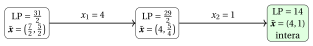
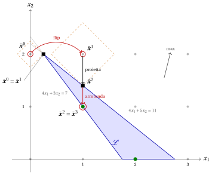
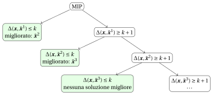

# Euristiche MIP

<div class="info-capitolo" markdown>

**Parte 5 · Euristiche MIP · Capitolo 10** · [:material-file-pdf-box: Appunti delle lezioni, volume 4 (PDF)](../pdf/lecture-notes-4-mip-heuristics.pdf) · [:material-pencil: Esercizi: Euristiche MIP](../exercises/mip-heuristics.md)

</div>

<span class="arithmatex">\(\newcommand{\rnd}[1]{\left[\,#1\,\right]}\)</span>

!!! nota "Prerequisiti"
    - Da questo modulo, i capitoli «Bound primali e bound duali» e «Algoritmi branch-and-bound basati su LP»: il rilassamento LP, i limiti inferiori e superiori, il divario di ottimalità e le operazioni di branching.

    - Da questo modulo, il capitolo «Risolutori MIP: cosa fanno»: la soluzione corrente, i sotto-problemi risolti da un risolutore e le euristiche al suo interno.

    - Dal modulo <em>Programmazione Lineare</em>: l’[algoritmo del simplesso duale (Capitolo 10)](https://fabiofurini.github.io/programmazione-lineare/dualita/10-simplesso-duale/), che riottimizza un LP dopo una modifica di un vincolo.

!!! chiave "Obiettivi"
    Alla fine di questo capitolo sarai in grado di:

    - spiega come un algoritmo euristico utilizza il rilassamento LP e un risolutore MIP;

    - eseguire a mano l'arrotondamento, il diving, la feasibility pump, RINS, il local branching e la proximity search su un piccolo MIP;

    - eseguire relax-and-fix e fix-and-optimize su un MIP le cui variabili sono suddivise in blocchi;

    - decidere quale metodo usare quando manca una soluzione ammissibile o quando una soluzione corrente deve essere migliorata;

    - calcolare il divario di una soluzione euristica quando è disponibile un vincolo duale.

## 10.1 Euristiche basate su MIP { #sez-sec-intro }

<a id="box-1-def-mip"></a>

!!! definizione "Definizione 10.1: MIP in forma generale"
    Un <strong>MIP</strong> con variabili $N$ $\vet x=(x_1,x_2,\dots,x_N)$ legge

    <a id="eq-eq-mip"></a>

    \begin{align*}
    && \min ~~ f(\vet x) \label{eq:mip-obj} \tag{10.1a}\\[1ex]
    && \text{soggetto a} \quad A\,\vet x &\le b, & \label{eq:mip-cons} \tag{10.1b}\\[1ex]
    && l_j \le x_j &\le u_j, & \forall j \in \{1,2,\dots,N\}, \label{eq:mip-bounds} \tag{10.1c}\\[1ex]
    && x_j &\in \Z, & \forall j \in \mathscr{D}, \label{eq:mip-int} \tag{10.1d}
    \end{align*}

    dove $f$ è una funzione lineare e $\mathscr{D}\subseteq\{1,2,\dots,N\}$ è l'insieme degli indici delle <strong>variabili intere</strong>. La regione ammissibile del <strong>rilassamento LP</strong> è

    $$
    \mathcal{L} = \big\{\vet x\in\R^N : A\,\vet x\le b,~ l\le \vet x\le u\big\},
    $$

    e $z(\LP)=\min\{f(\vet x): \vet x\in\mathcal{L}\}$ è il valore del rilassamento LP.

- Un problema di massimizzazione, come l'esempio dell'auto, viene gestito nello stesso modo, scambiando $\min$ e $\max$, $\le$ e $\ge$ nei confronti dei valori obiettivi.

<a id="box-2-def-mipheur"></a>

!!! definizione "Definizione 10.2: euristica basata su MIP"
    Un <strong>algoritmo euristico</strong> restituisce una soluzione ammissibile di un problema MIP [(10.1)](#eq-eq-mip) senza alcuna garanzia di ottimalità. È <strong>basato su MIP</strong> (un <strong>matheuristico</strong>) se utilizza il rilassamento LP e un risolutore MIP per cercare la soluzione.

- Un’euristica fornisce un bound primale (un limite superiore per un problema di minimizzazione, un limite inferiore per un problema di massimizzazione), mai un bound duale. L'algoritmo branch-and-bound di questo modulo trova la soluzione incumbent solo per caso, come foglia dell'albero.

- La soluzione ottimale del <strong>rilassamento LP</strong> indica <em>dove guardare</em>: è la soluzione di un problema più semplice, spesso vicina alle buone soluzioni di quello originale.

- Il <strong>risolutore MIP</strong> esplora <em>esattamente</em> un insieme di soluzioni troppo grande per essere enumerato, a condizione che l'insieme sia descritto da vincoli lineari.

<a id="box-3-def-incumbent"></a>

!!! definizione "Definizione 10.3: incumbent, arrotondamento e completamento"
    - Una soluzione ammissibile $\bar{\vet x}$ del MIP [(10.1)](#eq-eq-mip), la migliore conosciuta, è l'<strong>incumbent</strong>, e $f(\bar{\vet x})$ è il suo valore.

    - L'<strong>approssimazione</strong> di un numero reale $v$ all'intero più vicino è $\rnd{v} = \big\lfloor v + \frac12 \big\rfloor$, in modo che un valore $\frac12$ venga arrotondato per eccesso.

    - Un punto $\bar{\vet x}$ con $\bar x_j \in \Z$ per tutti i $j \in \mathscr{D}$ è <strong>completato</strong> fissando le variabili intere ai valori $\bar x_j$ e risolvendo l’LP sulle variabili continue.

- In tutto il capitolo, $\tilde{\vet x}$ indica una soluzione ottimale di un rilassamento LP, e $\bar{\vet x}$ un punto i cui componenti $\bar x_j$, $j\in\mathscr{D}$, sono interi.

- Se l’LP del completamento ha una soluzione ottimale, $\bar{\vet x}$ viene trasformato in una soluzione ammissibile del MIP; se è infeasible, anche $\bar{\vet x}$ lo è. Quando tutte le variabili sono intere, il completamento controlla semplicemente i vincoli.

- I metodi si basano su cinque idee, una o due per sezione.

<div class="tabella" markdown="0"><table>
<tr>
<th>idea</th>
<th>metodi</th>
</tr>
<tr>
<td>intorno al rilassamento</td>
<td>arrotondamento; diving (fissare una variabile, risolvere di nuovo, ripetere)</td>
</tr>
<tr>
<td>inseguire la fattibilità</td>
<td>la pompa di fattibilità</td>
</tr>
<tr>
<td>correggere dove rilassamento e incumbent concordano</td>
<td>RISCIACQUO</td>
</tr>
<tr>
<td>limitarono la distanza dal incumbent</td>
<td>ramificazione locale; ricerca di prossimità</td>
</tr>
<tr>
<td>scomporre in blocchi di variabili</td>
<td>rilassare-e-riparare; riparare-e-ottimizzare</td>
</tr>
</table></div>

- Gli esempi sono risolti con il risolutore MIP Gurobi, utilizzato da Python tramite <code>gurobipy</code>; il modulo <em>Modellazione MIP</em> ([<u>fabiofurini.github.io/modellazione-mip</u>](https://fabiofurini.github.io/modellazione-mip/), [capitolo 3 «Dal modello a Python/Gurobi»](https://fabiofurini.github.io/modellazione-mip/modellazione-3/)) spiega come usarlo. Quando un LP ha diverse soluzioni ottimali, il testo riporta quella restituita dal risolutore; tutti i codici sono nell'ultima sezione.

## 10.2 Gli esempi del capitolo { #sez-sec-modelli }

- I metodi sono illustrati sull'<strong>esempio dell'auto</strong> di questo modulo e su quattro piccoli problemi del <strong>catalogo dei problemi MIP</strong>. Tutti sono problemi ILP in forma canonica di massimizzazione, con dati interi e $x_j\in\Z_{\ge 0}$ per ogni $j$, in modo che $\mathscr{D}=\{1,2,\dots,N\}$.

- L'<strong>esempio dell'auto</strong> legge

    $$
    \max~ 3\,x_1+2\,x_2 \quad\text{s.t.}\quad 10\,x_1+4\,x_2\le 45,\quad 4\,x_1+14\,x_2\le 49,\quad x_1,x_2\in\Z_{\ge 0}
    $$

<div class="tabella" markdown="0"><table>
<tr>
<th>problema</th>
<th>obiettivo <span class="arithmatex">\(\max\)</span></th>
<th>vincoli</th>
</tr>
<tr>
<td><span class="arithmatex">\(P7\)</span></td>
<td><span class="arithmatex">\(3x_1+x_2\)</span></td>
<td><span class="arithmatex">\(x_1+4x_2\le 12\)</span>, <span class="arithmatex">\(2x_1+x_2\le 5\)</span></td>
</tr>
<tr>
<td><span class="arithmatex">\(P42\)</span></td>
<td><span class="arithmatex">\(3x_1+2x_2+4x_3\)</span></td>
<td><span class="arithmatex">\(x_1+x_2+2x_3\le 4\)</span>,  <span class="arithmatex">\(2x_1+3x_3\le 5\)</span>,  <span class="arithmatex">\(2x_1+x_2+3x_3\le 7\)</span></td>
</tr>
<tr>
<td><span class="arithmatex">\(P46\)</span></td>
<td><span class="arithmatex">\(5x_1+6x_2+10x_3\)</span></td>
<td><span class="arithmatex">\(9x_1+2x_2+2x_3\le 11\)</span>, <span class="arithmatex">\(2x_1+6x_2+6x_3\le 16\)</span>, <span class="arithmatex">\(4x_1+2x_2+7x_3\le 10\)</span></td>
</tr>
<tr>
<td><span class="arithmatex">\(P72\)</span></td>
<td><span class="arithmatex">\(7x_1+6x_2+5x_3-2x_4+3x_5\)</span></td>
<td><span class="arithmatex">\(x_1+3x_2+5x_3-2x_4+2x_5\le 4\)</span>,  <span class="arithmatex">\(4x_1+2x_2-2x_3+x_4+x_5\le 3\)</span>,</td>
</tr>
<tr>
<td></td>
<td></td>
<td><span class="arithmatex">\(2x_1+4x_2+4x_3-2x_4+5x_5\le 5\)</span>, <span class="arithmatex">\(3x_1+x_2+2x_3-x_4-2x_5\le 1\)</span></td>
</tr>
</table></div>

- La tabella seguente riporta il valore $z(\LP)$ del rilassamento LP, il limite superiore $\lfloor z(\LP)\rfloor$ (l'obiettivo assume valori interi) e il valore ottimale $z(\ILP)$, tutti calcolati con l'algoritmo simplesso esatto e verificati con Gurobi.

<div class="tabella" markdown="0"><table>
<tr>
<th>problema</th>
<th>variabili</th>
<th>vincoli</th>
<th><span class="arithmatex">\(z(\LP)\)</span></th>
<th><span class="arithmatex">\(\lfloor z(\LP)\rfloor\)</span></th>
<th><span class="arithmatex">\(z(\ILP)\)</span></th>
</tr>
<tr>
<td>auto</td>
<td><span class="arithmatex">\(2\)</span></td>
<td><span class="arithmatex">\(2\)</span></td>
<td><span class="arithmatex">\(\frac{31}{2}\)</span></td>
<td><span class="arithmatex">\(15\)</span></td>
<td><span class="arithmatex">\(14\)</span></td>
</tr>
<tr>
<td><span class="arithmatex">\(P7\)</span></td>
<td><span class="arithmatex">\(2\)</span></td>
<td><span class="arithmatex">\(2\)</span></td>
<td><span class="arithmatex">\(\frac{15}{2}\)</span></td>
<td><span class="arithmatex">\(7\)</span></td>
<td><span class="arithmatex">\(7\)</span></td>
</tr>
<tr>
<td><span class="arithmatex">\(P42\)</span></td>
<td><span class="arithmatex">\(3\)</span></td>
<td><span class="arithmatex">\(3\)</span></td>
<td><span class="arithmatex">\(\frac{21}{2}\)</span></td>
<td><span class="arithmatex">\(10\)</span></td>
<td><span class="arithmatex">\(10\)</span></td>
</tr>
<tr>
<td><span class="arithmatex">\(P46\)</span></td>
<td><span class="arithmatex">\(3\)</span></td>
<td><span class="arithmatex">\(3\)</span></td>
<td><span class="arithmatex">\(\frac{499}{25}\)</span></td>
<td><span class="arithmatex">\(19\)</span></td>
<td><span class="arithmatex">\(16\)</span></td>
</tr>
<tr>
<td><span class="arithmatex">\(P72\)</span></td>
<td><span class="arithmatex">\(5\)</span></td>
<td><span class="arithmatex">\(4\)</span></td>
<td><span class="arithmatex">\(\frac{507}{59}\)</span></td>
<td><span class="arithmatex">\(8\)</span></td>
<td><span class="arithmatex">\(7\)</span></td>
</tr>
</table></div>

<a id="box-4-ex-lpsol"></a>

!!! esempio "Esempio 10.1: Le soluzioni LP degli esempi"
    <div class="tabella" markdown="0"><table>
    <tr>
    <th>problema</th>
    <th>soluzione ottimale <span class="arithmatex">\(\tilde{\vet x}\)</span> del rilassamento LP</th>
    </tr>
    <tr>
    <td>auto</td>
    <td><span class="arithmatex">\(\big(\frac72,\frac52\big)\)</span></td>
    </tr>
    <tr>
    <td><span class="arithmatex">\(P7\)</span></td>
    <td><span class="arithmatex">\(\big(\frac52,0\big)\)</span></td>
    </tr>
    <tr>
    <td><span class="arithmatex">\(P42\)</span></td>
    <td><span class="arithmatex">\(\big(\frac52,\frac32,0\big)\)</span></td>
    </tr>
    <tr>
    <td><span class="arithmatex">\(P46\)</span></td>
    <td><span class="arithmatex">\(\big(\frac{17}{25},\frac{49}{25},\frac{12}{25}\big)\)</span></td>
    </tr>
    <tr>
    <td><span class="arithmatex">\(P72\)</span></td>
    <td><span class="arithmatex">\(\big(\frac{39}{59},0,\frac{91}{59},\frac{166}{59},\frac{37}{59}\big)\)</span></td>
    </tr>
    </table></div>

    Le prime tre soluzioni hanno al massimo due componenti frazionarie, con parte frazionaria $\frac12$; le ultime due sono gli esempi in cui i metodi hanno più margine di errore.

## 10.3 Arrotondamento { #sez-sec-rounding }

<a id="box-5-def-rounding"></a>

!!! definizione "Definizione 10.4: arrotondamento"
    <em>Arrotondamento</em> è l'euristica basata su MIP più semplice. Risolve il rilassamento LP, arrotonda ogni variabile intera della soluzione LP all'intero più vicino e completa le variabili continue. Restituisce una soluzione ammissibile, oppure fallisce se il punto arrotondato viola un vincolo.

- Il pseudo-codice dell'arrotondamento è il seguente:

!!! algoritmo "Algoritmo: Arrotondamento"
    <strong>Input:</strong> MIP [(10.1)](#eq-eq-mip) con variabili intere $\mathscr{D}$
    <strong>Output:</strong> Soluzione fattibile $\bar{\vet x}$, oppure FALLIMENTO
    <strong>funzione</strong> Rounding(MIP)
    &emsp;&emsp;$\tilde{\vet x} :=$ soluzione ottimale del rilassamento LP&emsp;*// $\min\{f(\vet x): \vet x\in\mathcal{L}\}$*
    &emsp;&emsp;<strong>per</strong> $j\in\mathscr{D}$ <strong>fai</strong>
    &emsp;&emsp;&emsp;&emsp;$\bar x_j \leftarrow \rnd{\tilde x_j}$&emsp;*// arrotonda al numero intero più vicino*
    &emsp;&emsp;fissare $x_j:=\bar x_j$ per tutti $j\in\mathscr{D}$ e risolvere l’LP sulle variabili continue
    &emsp;&emsp;<strong>se</strong> l’LP è ammissibile <strong>allora</strong>
    &emsp;&emsp;&emsp;&emsp;<strong>ritorno</strong> $\bar{\vet x}$ completato con la parte continua della soluzione LP
    &emsp;&emsp;<strong>else</strong>
    &emsp;&emsp;&emsp;&emsp;<strong>return</strong> FAIL&emsp;*// il punto arrotondato viola un vincolo*

- <strong>Perché può funzionare.</strong> Quando la formulazione è forte, la soluzione LP è vicina a una soluzione intera ottimale, e molte delle sue variabili intere sono già intere: l'arrotondamento ne cambia solo poche, di meno di $\frac12$ ciascuna.

- <strong>Perché può fallire.</strong> L'arrotondamento tratta le variabili una alla volta, mentre i vincoli le collegano. Un vincolo con tutti i coefficienti non negativi e lato destro $b_i\ge0$ rimane soddisfatto se le variabili vengono arrotondate <em>per difetto</em>, e uno della forma $\ge$ se vengono arrotondate <em>per eccesso</em>.

- Un vincolo di <strong>uguaglianza</strong> è quasi sempre violato dagli arrotondamenti indipendenti: due valori frazionari che sommano a $1$ diventano, per esempio, $1$ e $1$.

<a id="box-6-obs-rounddown"></a>

!!! teorema "Osservazione 10.5"
    Siano tutti i coefficienti di $A$ non negativi, $b\ge 0$ e $l=0$. Se $\tilde{\vet x}\in\mathcal{L}$, allora il punto $\lfloor \tilde{\vet x}\rfloor$, ottenuto arrotondando per difetto ogni variabile intera, appartiene a $\mathcal{L}$.

??? dimostrazione "Proof"

    Per ogni $j$, $0\le\lfloor \tilde x_j\rfloor\le \tilde x_j\le u_j$, quindi i limiti sono validi. Per ogni riga $i$, dato che $a_{ij}\ge0$, $\sum_j a_{ij}\lfloor \tilde x_j\rfloor\le\sum_j a_{ij}\tilde x_j\le b_i$. <span class="qed">□</span>

- L'esempio dell'auto soddisfa le assunzioni dell'osservazione: arrotondare per difetto è sempre fattibile e, in generale, non ottimale.

<a id="box-7-ex-rounding"></a>

!!! esempio "Esempio 10.2: Arrotondamento sull'esempio dell'auto e su $P42$"
    <strong>Esempio di auto.</strong> La soluzione LP $\tilde{\vet x}=\big(\frac72,\frac52\big)$ viene arrotondata a $\bar{\vet x}=(4,3)$, il che viola il primo vincolo:

    $$
    10\cdot 4+4\cdot 3=52>45 .
    $$

    <strong>Arrotondamento fallito.</strong> Arrotondare per difetto invece dà $(3,2)$: $38\le45$, $40\le49$, di valore $13$, mentre $z(\ILP)=14$.

    <strong>$P42$.</strong> La soluzione LP $\big(\frac52,\frac32,0\big)$ viene arrotondata a $(3,2,0)$, che viola il secondo vincolo: $2\cdot3=6>5$. <strong>L'arrotondamento fallisce.</strong> Arrotondare per difetto dà $(2,1,0)$, di valore $8$, mentre $z(\ILP)=10$.

    <strong>$P72$.</strong> La soluzione LP viene arrotondata a $(1,0,2,3,1)$, il che viola il primo vincolo: $1+10-6+2=7>4$. <strong>L'arrotondamento fallisce.</strong>

- I due esempi riassumono il metodo: l'arrotondamento al numero intero più vicino fallisce quando diverse variabili sono frazionarie allo stesso tempo e i vincoli sono rigidi; l'arrotondamento verso il basso è sicuro, ma lascia parte del valore dell’LP sul tavolo.

## 10.4 Diving { #sez-sec-diving }

- L'arrotondamento prende tutte le sue decisioni contemporaneamente, sulla base di una singola soluzione LP. <strong>Diving</strong> le prende una alla volta, e dopo ogni decisione interroga nuovamente l'LP: la soluzione LP viene ricalcolata con le decisioni prese fino a quel momento, e si adatta a esse.

<a id="box-8-def-diving"></a>

!!! definizione "Definizione 10.6: euristica di diving"
    L’<em>euristica di diving</em> risolve ripetutamente il rilassamento LP, seleziona una variabile intera con un valore frazionario, la fissa a un valore intero e risolve di nuovo l’LP. Si ferma con una soluzione ammissibile quando la soluzione LP è intera su tutte le variabili intere, e fallisce quando l’LP diventa impossibile. Una <em>regola</em> decide quale variabile viene fissata e a quale valore.

- Il pseudocodice dell’euristica di diving è il seguente:

!!! algoritmo "Algoritmo: Diving"
    <strong>Input:</strong> MIP [(10.1)](#eq-eq-mip); una regola; per diving guidate, un incumbent $\bar{\vet x}$
    <strong>Output:</strong> Soluzione ammissibile, o FALLIMENTO
    <strong>funzione</strong> Diving(MIP, regola)
    &emsp;&emsp;<strong>mentre</strong> vero <strong>fai</strong>
    &emsp;&emsp;&emsp;&emsp;risolvere il rilassamento LP con i limiti attuali $l,u$
    &emsp;&emsp;&emsp;&emsp;<strong>se</strong> l’LP è irrealizzabile <strong>allora</strong>
    &emsp;&emsp;&emsp;&emsp;&emsp;&emsp;<strong>return</strong> FALLIMENTO&emsp;*// il diving termina quando il problema LP diventa inammissibile*
    &emsp;&emsp;&emsp;&emsp;$\tilde{\vet x} :=$ soluzione ottimale dell’LP
    &emsp;&emsp;&emsp;&emsp;$F := \{j\in\mathscr{D} : \tilde x_j\notin\Z\}$&emsp;*// variabili intere frazionarie*
    &emsp;&emsp;&emsp;&emsp;<strong>se</strong> $F=\emptyset$ <strong>allora</strong>
    &emsp;&emsp;&emsp;&emsp;&emsp;&emsp;<strong>restituisci</strong> $\tilde{\vet x}$&emsp;*// intero su $\mathscr{D}$: fattibile*
    &emsp;&emsp;&emsp;&emsp;seleziona $j\in F$ e un valore $v\in\Z$ secondo la regola
    &emsp;&emsp;&emsp;&emsp;$l_j\leftarrow v$;   $u_j\leftarrow v$&emsp;*// correggi $x_j:=v$*

- <strong>Diving frazionario.</strong> Seleziona la variabile che è <em>meno</em> frazionaria, cioè la $j\in F$ che minimizza $\big|\tilde x_j-\rnd{\tilde x_j}\big|$, e fissala a $v=\rnd{\tilde x_j}$. L'LP è quasi sicuro su questa variabile, quindi il fissaggio cambia la soluzione dell'LP il meno possibile. Nei codici di questo capitolo, i pareggi vengono risolti a favore della variabile con l'indice più piccolo.

- <strong>Diving guidato</strong> [\[3\]](#ref-DRL05). Con un incumbent $\bar{\vet x}$, selezionare il $j\in F$ che minimizza $|\tilde x_j-\bar x_j|$ e fissarlo a $v=\bar x_j$. L’incumbent guida il diving verso una regione di buone soluzioni, e l’LP decide in quale ordine i suoi valori vengono adottati.

- Esistono molte altre regole: <em>coefficient diving</em> fissa la variabile che appare nel minor numero di vincoli che possono essere violati arrotondandola; <em>pseudo-cost diving</em> utilizza la storia dell'albero branch-and-bound; <em>vector-length diving</em> è progettato per i vincoli di set covering. I solver moderni ne eseguono diversi.

- <strong>Diving e branch-and-bound.</strong> Fissare $x_j:=\rnd{\tilde x_j}$ è una decisione di ramificazione. Il diving segue un unico percorso dalla radice dell'albero branch-and-bound a una foglia, prendendo sempre uno dei due figli, senza mai tornare indietro: ricerca in profondità senza backtracking.

- <strong>Costo.</strong> Ogni passo risolve un LP che differisce dal precedente per un singolo vincolo, quindi l'algoritmo del simplesso duale lo riottimizza partendo dalla base precedente in poche iterazioni. Il diving con $|\mathscr{D}|$ variabili intere richiede al massimo $|\mathscr{D}|$ LP, di solito molti meno, poiché una soluzione LP ha già molte componenti intere.

- <strong>Fallimento.</strong> Il programma lineare diventa irrealizzabile quando le fissazioni fatte finora sono incompatibili. Le implementazioni quindi annullano l'ultima fissazione e provano l'altro valore (un singolo backtracking), oppure rinunciano.

<a id="box-9-ex-divecar"></a>

!!! esempio "Esempio 10.3: Diving frazionario sull'esempio dell'auto"
    <strong>Fase 1.</strong> La soluzione LP è $\tilde{\vet x}=\big(\frac72,\frac52\big)$, di valore $\frac{31}{2}$. Entrambe le variabili sono a distanza $\frac12$ dall'intero più vicino; il pareggio viene risolto dall'indice: $x_1:=\rnd{\frac72}=4$.

    <strong>Passo 2.</strong> Con $x_1=4$ i vincoli diventano $4x_2\le5$ e $14x_2\le33$, quindi la soluzione LP è $\tilde{\vet x}=\big(4,\frac54\big)$, di valore $12+\frac52=\frac{29}{2}$. Fissa $x_2:=\rnd{\frac54}=1$.

    <strong>Passo 3.</strong> La soluzione LP $(4,1)$, di valore $14$, è intera: il diving restituisce $(4,1)$, che è la soluzione <strong>ottimale</strong> del problema ILP.

    { .fig loading=lazy  }

<a id="box-10-ex-guided"></a>

!!! esempio "Esempio 10.4: Diving guidato sull'esempio dell'auto e su $P7$"
    <strong>Esempio di auto.</strong> L’incumbent è $\bar{\vet x}=(3,2)$, di valore $13$ (arrotondato per difetto). Nella soluzione LP $\big(\frac72,\frac52\big)$ entrambe le variabili sono a distanza $\frac12$ da $\bar{\vet x}$; fissa $x_1:=3$. La nuova soluzione LP è $\big(3,\frac{37}{14}\big)$, di valore $\frac{100}{7}$; fissa $x_2:=\bar x_2=2$. La soluzione LP $(3,2)$ è intera, di valore $13$: il diving <strong>restituisce l’incumbent</strong>, senza migliorarlo.

    <strong>$P7$.</strong> Il candidato attuale è $\bar{\vet x}=(2,0)$, di valore $6$ (arrotondato per difetto da $\big(\frac52,0\big)$). L'unica variabile frazionaria è $x_1$: fissare $x_1:=2$. La soluzione LP $(2,1)$, di valore $7$, è intera: la discesa guidata trova la soluzione <strong>ottimale</strong> dopo un fissaggio, anche se il candidato attuale ha $\bar x_2=0$, perché l'LP ricostruisce le variabili che non sono fissate.

- L'incumbent decide solo i <em>valori</em> delle variabili fisse: nell'esempio dell'auto entrambi i valori fissi sono d'accordo con l'incumbent scarso, su $P7$ il valore fisso è quello giusto.

<a id="box-11-ex-divefail"></a>

!!! esempio "Esempio 10.5: Il diving che fallisce su $P42$ e su $P72$"
    <strong>$P42$.</strong> La soluzione LP è $\big(\frac52,\frac32,0\big)$; $x_1$ e $x_2$ sono alla distanza $\frac12$, e il pareggio viene risolto dall'indice: $x_1:=\rnd{\frac52}=3$. La secondo vincolo dà $2\cdot3+3x_3\le5$, che è violato per ogni $x_3\ge0$: l'LP è inammissibile, <strong>il diving fallisce al primo passo</strong>.

    <strong>$P72$.</strong> Le parti frazionarie della soluzione LP sono $\frac{39}{59},\frac{91}{59},\frac{166}{59},\frac{37}{59}$ (per $x_1,x_3,x_4,x_5$), e la frazionaria minore è $x_4$, a distanza $\frac{11}{59}$ da $3$: $x_4:=3$. La nuova LP ha valore $\frac{728}{85}$ e soluzione $\big(\frac{56}{85},0,\frac{138}{85},3,\frac{52}{85}\big)$; la variabile frazionaria minore è $x_1$, arrotondata a $1$. Fissare $x_1:=1$ e $x_4:=3$ rende la LP <strong>inammissibile</strong>.

- In entrambi i casi le prime fissazioni seguono l'LP, che non vede che i vincoli, insieme, non lasciano alcuno spazio. Un diving che fallisce non dà alcuna soluzione: questa è la ragione della pompa di fattibilità della sezione successiva.

## 10.5 La pompa di fattibilità { #sez-sec-fp }

- L'arrotondamento e il diving falliscono su $P42$ e su $P72$, e su molte MIP falliscono la maggior parte del tempo: per una MIP generale, persino <em>decidere se esiste una soluzione ammissibile</em> è NP-completo. Il <strong>feasibility pump</strong> di Fischetti, Glover e Lodi [\[4\]](#ref-FGL05) rinuncia alla funzione obiettivo e si concentra su un unico obiettivo: trovare una soluzione ammissibile.

- L'idea è lavorare con due punti contemporaneamente. Un punto di $\mathcal{L}$ soddisfa tutti i vincoli lineari, ma può essere frazionario; un punto a coordinate intere può violare i vincoli. Una soluzione ammissibile soddisfa entrambe le condizioni. La pompa fa sì che i due punti si inseguano fino a coincidere, e per farlo ha bisogno di misurare quanto sono distanti l'uno dall'altro.

<a id="box-12-def-distance"></a>

!!! definizione "Definizione 10.7: Distanza da un punto intero"
    Sia $\bar{\vet x}$ un punto con $\bar x_j\in\Z$ per tutti $j\in\mathscr{D}$. La <strong>distanza</strong> di un punto $\vet x\in\R^N$ da $\bar{\vet x}$ è

    $$
    \Delta(\vet x,\bar{\vet x}) = \sum_{j\in\mathscr{D}} |x_j-\bar x_j| ,
    $$

    La distanza $L_1$ calcolata solo sulle variabili intere.

- Quando tutte le variabili intere sono <strong>binari</strong>, $|x_j-\bar x_j|$ è uguale a $x_j$ se $\bar x_j=0$ e $1-x_j$ se $\bar x_j=1$, per ogni $x_j\in[0,1]$. La distanza è quindi una funzione <em>lineare</em> di $\vet x$:

!!! chiave ""
    $$
    \Delta(\vet x,\bar{\vet x}) \;=\; \sum_{j\in\mathscr{D}:\ \bar x_j=0} x_j \;+\; \sum_{j\in\mathscr{D}:\ \bar x_j=1} (1-x_j)
    \qquad \text{for binary variables}
    $$

- Per una variabile intera generale vale lo stesso se $\bar x_j=l_j$ (il termine è $x_j-l_j$) o $\bar x_j=u_j$ (il termine è $u_j-x_j$). Altrimenti $|x_j-\bar x_j|$ è sostituito da una variabile ausiliaria $d_j$ con i due vincoli $d_j\ge x_j-\bar x_j$ e $d_j\ge \bar x_j-x_j$; almeno, $d_j=|x_j-\bar x_j|$. In tutti i casi, il punto di $\mathcal{L}$ più vicino a $\bar{\vet x}$ viene calcolato risolvendo <strong>un LP</strong>.

<a id="box-13-def-fp"></a>

!!! definizione "Definizione 10.8: pompa di fattibilità"
    La <em>feasibility pump</em> costruisce due sequenze di punti: punti $\tilde{\vet x}^{0},\tilde{\vet x}^{1},\tilde{\vet x}^{2},\dots$ di $\mathcal{L}$, che soddisfano i vincoli lineari, e punti interi $\bar{\vet x}^0,\bar{\vet x}^1,\bar{\vet x}^2,\dots$, che soddisfano i vincoli di integrità. Inizia dalla soluzione LP $\tilde{\vet x}^{0}$; ogni punto intero è il <em>rounding</em> dell'ultimo punto di $\mathcal{L}$, e ogni punto di $\mathcal{L}$ è la <em>proiezione</em> dell'ultimo punto intero, cioè il punto di $\mathcal{L}$ alla minima distanza da esso. Si ferma quando la distanza è $0$: i due punti coincidono e sono una soluzione ammissibile. Quando il rounding restituisce un punto intero già visitato, la pump lo <em>perturba</em>.

- Il pseudo-codice della pompa di fattibilità è il seguente:

!!! algoritmo "Algoritmo: Pompa di fattibilità"
    <strong>Input:</strong> MIP [(10.1)](#eq-eq-mip); numero massimo di iterazioni $maxIter$; seme dei numeri casuali
    <strong>Output:</strong> Soluzione ammissibile, o FALLIMENTO
    <strong>funzione</strong> FeasibilityPump(MIP, $maxIter$, $seed$)
    &emsp;&emsp;$\tilde{\vet x} :=$ soluzione ottimale del rilassamento LP
    &emsp;&emsp;<strong>se</strong> $\tilde x_j\in\Z$ per tutti $j\in\mathscr{D}$ <strong>allora</strong>
    &emsp;&emsp;&emsp;&emsp;<strong>ritorna</strong> $\tilde{\vet x}$
    &emsp;&emsp;$\bar{\vet x} \leftarrow \rnd{\tilde{\vet x}}$&emsp;*// arrotonda le componenti intere*
    &emsp;&emsp;<strong>per</strong> $it := 1$ <strong>a</strong> $maxIter$ <strong>fare</strong>
    &emsp;&emsp;&emsp;&emsp;$\tilde{\vet x} \leftarrow \arg\min\{\Delta(\vet x,\bar{\vet x}) : \vet x\in\mathcal{L}\}$&emsp;*// proiezione: un LP*
    &emsp;&emsp;&emsp;&emsp;<strong>se</strong> $\Delta(\tilde{\vet x},\bar{\vet x})=0$ <strong>allora</strong>
    &emsp;&emsp;&emsp;&emsp;&emsp;&emsp;<strong>ritorna</strong> $\tilde{\vet x}$&emsp;*// $\tilde{\vet x}$ è intero su $\mathscr{D}$: fattibile*
    &emsp;&emsp;&emsp;&emsp;$\hat{\vet x} \leftarrow \rnd{\tilde{\vet x}}$
    &emsp;&emsp;&emsp;&emsp;<strong>se</strong> $\hat x_j=\bar x_j$ per tutti $j\in\mathscr{D}$ <strong>allora</strong>&emsp;*// ciclo breve*
    &emsp;&emsp;&emsp;&emsp;&emsp;&emsp;$j \leftarrow \arg\max_{k\in\mathscr{D}} |\tilde x_k-\bar x_k|$
    &emsp;&emsp;&emsp;&emsp;&emsp;&emsp;sposta $\hat x_j$ di un'unità verso $\tilde x_j$&emsp;*// capovolgi*
    &emsp;&emsp;&emsp;&emsp;<strong>se</strong> $\hat{\vet x}$ è uguale a uno degli ultimi punti $3$ $\bar{\vet x}$ <strong>allora</strong>&emsp;*// ciclo lungo*
    &emsp;&emsp;&emsp;&emsp;&emsp;&emsp;<strong>per</strong> $j\in\mathscr{D}$ <strong>fai</strong>
    &emsp;&emsp;&emsp;&emsp;&emsp;&emsp;&emsp;&emsp;$\rho_j \leftarrow$ numero casuale uniforme in $[-0.3,\,0.7]$
    &emsp;&emsp;&emsp;&emsp;&emsp;&emsp;&emsp;&emsp;<strong>se</strong> $|\tilde x_j-\hat x_j|+\max\{\rho_j,0\}>\frac12$ <strong>allora</strong>
    &emsp;&emsp;&emsp;&emsp;&emsp;&emsp;&emsp;&emsp;&emsp;&emsp;$\hat x_j\leftarrow 1-\hat x_j$&emsp;*// riavvia*
    &emsp;&emsp;&emsp;&emsp;$\bar{\vet x}\leftarrow\hat{\vet x}$
    &emsp;&emsp;<strong>ritorna</strong> FALLISCE

- <strong>Perché la pompa funziona.</strong> Ogni proiezione sposta il punto di $\mathcal{L}$ verso l'ultimo punto intero, e ogni arrotondamento sposta il punto intero a quello più vicino. La distanza tra le due sequenze tende a diminuire, e i punti vengono <em>pompati</em> verso una regione in cui $\mathcal{L}$ contiene punti interi. Ogni iterazione costa un LP e un arrotondamento.

- <strong>Cicli brevi.</strong> Se l'arrotondamento della proiezione restituisce lo stesso punto intero, la pompa ripeterebbe gli stessi due punti all'infinito. Cambia quindi le componenti di $\bar{\vet x}$ su cui $\tilde{\vet x}$ è più incerto, quelle con il maggiore $|\tilde x_j-\bar x_j|$.

- La pompa originale inverte un numero casuale di componenti tra $10$ e $30$. Sulle piccole istanze di queste note, un'inversione è sufficiente: il codice inverte il singolo componente con il più grande $|\tilde x_j-\bar x_j|$ (il primo, in caso di parità).

- <strong>Cicli lunghi.</strong> La pompa può anche ciclicare tra diversi punti interi. Quando il nuovo punto intero è uguale a uno degli ultimi, la pompa originale fa un <strong>riavvio</strong>: un componente binario viene invertito quando $|\tilde x_j-\hat x_j|+\max\{\rho_j,0\}>\frac12$, con $\rho_j$ uniformemente casuale in $[-0.3,0.7]$, in modo che i componenti dove $\tilde x_j$ è lontano da $\hat x_j$ vengano invertiti con alta probabilità.

- <strong>Numeri casuali.</strong> Nei codici di questo capitolo, i numeri casuali sono prodotti dal generatore <em>standard minimo</em> di Park e Miller, con aritmetica intera su bit $64$:

    $$
    seed \leftarrow (16807\cdot seed) \bmod (2^{31}-1), \qquad u = \frac{seed}{2^{31}-1}\in(0,1),
    $$

    e nella pompa $\rho_j=u-0.3$. Fissare il seme iniziale rende ogni esecuzione riproducibile.

- <strong>L'obiettivo.</strong> Dopo il primo LP, l'obiettivo originale $f$ viene ignorato: la pompa trova una soluzione ammissibile, ma non necessariamente buona. La <em>pompa di fattibilità dell'obiettivo</em> di Achterberg e Berthold [\[1\]](#ref-AB07) minimizza una combinazione $(1-\alpha)\,\Delta(\vet x,\bar{\vet x})+\alpha\, f(\vet x)$ con un peso $\alpha$ che diminuisce a ogni iterazione: le soluzioni trovate sono molto migliori, al prezzo di qualche iterazione in più.

- <strong>Variabili intere generali.</strong> La pompa è stata progettata per variabili binarie, dove il flip cambia $\bar x_j$ in $1-\bar x_j$; per variabili intere generali sposta $\bar x_j$ di una unità verso $\tilde x_j$, e la distanza utilizza le variabili ausiliarie $d_j$ [\[2\]](#ref-BFL07).

<a id="box-14-ex-fp2"></a>

!!! esempio "Esempio 10.6: La pompa di fattibilità in due variabili"
    Considera il programma intero

    \begin{align*}
    && \max ~~ x_1 + 4\,x_2 & & \\[0.5ex]
    && \text{soggetto a} \quad 4\,x_1 + 3\,x_2 &\ge 7 & \\[0.5ex]
    && 4\,x_1 + 5\,x_2 &\le 11 & \\[0.5ex]
    && x_1 &\in \{0,1,\dots,5\} & \\[0.5ex]
    && x_2 &\in \{0,1,\dots,5\} &
    \end{align*}

    La regione $\mathcal{L}$ è il triangolo con vertici $\big(\frac14,2\big)$, $\big(\frac74,0\big)$, $\big(\frac{11}{4},0\big)$, che contiene solo due punti interi, $(1,1)$ e $(2,0)$. La figura mostra le due sequenze di punti: quadrati per i punti di $\mathcal{L}$, cerchi per i punti interi e diamanti $\{\vet x:\Delta(\vet x,\bar{\vet x})\le r\}$ delle due proiezioni.

    { .fig loading=lazy  }

    Le iterazioni sono le seguenti.

    <div class="tabella" markdown="0"><table>
    <tr>
    <th><span class="arithmatex">\(k\)</span></th>
    <th>punto intero</th>
    <th>proiezione <span class="arithmatex">\(\tilde{\vet x}^{k}\)</span></th>
    <th><span class="arithmatex">\(\Delta\big(\tilde{\vet x}^{k},\bar{\vet x}^{k-1}\big)\)</span></th>
    <th>prossimo punto intero</th>
    </tr>
    <tr>
    <td><span class="arithmatex">\(0\)</span></td>
    <td>—</td>
    <td>Ottimo LP <span class="arithmatex">\(\big(\frac14,2\big)\)</span></td>
    <td>—</td>
    <td>arrotondamento: <span class="arithmatex">\(\bar{\vet x}^0=(0,2)\)</span></td>
    </tr>
    <tr>
    <td><span class="arithmatex">\(1\)</span></td>
    <td><span class="arithmatex">\(\bar{\vet x}^0=(0,2)\)</span></td>
    <td><span class="arithmatex">\(\big(\frac14,2\big)\)</span></td>
    <td><span class="arithmatex">\(\frac14\)</span></td>
    <td><span class="arithmatex">\(\rnd{\tilde{\vet x}^{1}}=\bar{\vet x}^0\)</span>: cambia <span class="arithmatex">\(x_1\)</span>, <span class="arithmatex">\(\bar{\vet x}^1=(1,2)\)</span></td>
    </tr>
    <tr>
    <td><span class="arithmatex">\(2\)</span></td>
    <td><span class="arithmatex">\(\bar{\vet x}^1=(1,2)\)</span></td>
    <td><span class="arithmatex">\(\big(1,\frac{7}{5}\big)\)</span></td>
    <td><span class="arithmatex">\(\frac35\)</span></td>
    <td>arrotondamento: <span class="arithmatex">\(\bar{\vet x}^2=(1,1)\)</span></td>
    </tr>
    <tr>
    <td><span class="arithmatex">\(3\)</span></td>
    <td><span class="arithmatex">\(\bar{\vet x}^2=(1,1)\)</span></td>
    <td><span class="arithmatex">\((1,1)\)</span></td>
    <td><span class="arithmatex">\(0\)</span></td>
    <td>fermata: fattibile</td>
    </tr>
    </table></div>

    <strong>Iterazione 0.</strong> L'ottimo LP è il vertice $\big(\frac14,2\big)$, di valore $\frac{33}{4}$. Il suo arrotondamento $(0,2)$ viola il primo vincolo: $4\cdot0+3\cdot2=6<7$.

    <strong>Iterazione 1.</strong> Con $\bar{\vet x}^0=(0,2)$, $x_1$ è al suo limite inferiore e $\Delta(\vet x,\bar{\vet x}^0)=x_1+|x_2-2|$. La distanza L$_1$ da un punto a un segmento che non è né orizzontale, né verticale né di pendenza $\pm1$ è minima in un estremo o dove il segmento incrocia la linea orizzontale o verticale attraverso il punto; quindi i candidati sono i tre vertici e questi incroci. La linea orizzontale $x_2=2$ tocca $\mathcal{L}$ solo nel vertice $\big(\frac14,2\big)$, e la linea verticale $x_1=0$ lo manca; il punto più vicino è $\tilde{\vet x}^{1}=\big(\frac14,2\big)$, alla distanza $\frac14$. Il suo arrotondamento è di nuovo $(0,2)=\bar{\vet x}^0$: un ciclo breve.Il componente con il maggiore $|\tilde x^{1}_j-\bar x^0_j|$ è $x_1$ ($\frac14$ contro $0$), che si sposta di un'unità verso $\frac14$: $\bar{\vet x}^1=(1,2)$.

    <strong>Iterazione 2.</strong> Il punto $(1,2)$ viola il secondo vincolo ($14>11$). La linea verticale $x_1=1$ attraversa $\mathcal{L}$ tra $(1,1)$ e $\big(1,\frac75\big)$, a distanze $1$ e $\frac35$ da $(1,2)$; la linea orizzontale $x_2=2$ dà $\big(\frac14,2\big)$, a distanza $\frac34$; gli altri due vertici sono più lontani. Pertanto $\tilde{\vet x}^{2}=\big(1,\frac75\big)$, e il suo arrotondamento $(1,1)$ è un nuovo punto.

    <strong>Iterazione 3.</strong> Il punto $(1,1)$ appartiene a $\mathcal{L}$ ($4+3=7\ge7$ e $4+5=9\le 11$): la sua distanza da $\mathcal{L}$ è $0$, e la pompa restituisce $(1,1)$, di valore $5$. È ottimale, poiché l'altro punto intero $(2,0)$ ha valore $2$.

<a id="box-15-ex-fpcar"></a>

!!! esempio "Esempio 10.7: La pompa di fattibilità sull'esempio dell'auto e su $P72$"
    <strong>Esempio di auto.</strong> Approssimare la soluzione LP dà $\bar{\vet x}^0=(4,3)$, che è inammissibile.

    <div class="tabella" markdown="0"><table>
    <tr>
    <th><span class="arithmatex">\(k\)</span></th>
    <th>proiezione <span class="arithmatex">\(\tilde{\vet x}^{k}\)</span></th>
    <th><span class="arithmatex">\(\Delta\big(\tilde{\vet x}^{k},\bar{\vet x}^{k-1}\big)\)</span></th>
    <th>prossimo punto intero</th>
    </tr>
    <tr>
    <td><span class="arithmatex">\(1\)</span></td>
    <td><span class="arithmatex">\(\big(\frac72,\frac52\big)\)</span></td>
    <td><span class="arithmatex">\(1\)</span></td>
    <td><span class="arithmatex">\(\rnd{\tilde{\vet x}^1}=\bar{\vet x}^0\)</span>: inverti <span class="arithmatex">\(x_1\)</span>, <span class="arithmatex">\(\bar{\vet x}^1=(3,3)\)</span></td>
    </tr>
    <tr>
    <td><span class="arithmatex">\(2\)</span></td>
    <td><span class="arithmatex">\(\big(3,\frac{37}{14}\big)\)</span></td>
    <td><span class="arithmatex">\(\frac{5}{14}\)</span></td>
    <td><span class="arithmatex">\(\rnd{\tilde{\vet x}^2}=\bar{\vet x}^1\)</span>: flip <span class="arithmatex">\(x_2\)</span>, <span class="arithmatex">\(\bar{\vet x}^2=(3,2)\)</span></td>
    </tr>
    <tr>
    <td><span class="arithmatex">\(3\)</span></td>
    <td><span class="arithmatex">\((3,2)\)</span></td>
    <td><span class="arithmatex">\(0\)</span></td>
    <td>fermata: fattibile</td>
    </tr>
    </table></div>

    All'iterazione $1$ i due componenti di $\tilde{\vet x}^1$ sono alla stessa distanza $\frac12$ da $\bar{\vet x}^0$, e il flip prende il primo. La pompa necessita di <strong>due flip</strong> e restituisce $(3,2)$, di valore $13$: è ammissibile, ma non ottimale ($z(\ILP)=14$), perché dopo il primo LP l'obiettivo viene ignorato.

    <strong>$P72$.</strong> L'arrotondamento e il diving falliscono (Esempi [10.2](#box-7-ex-rounding), [Esempio 10.5](#box-11-ex-divefail)). La pompa arrotonda la soluzione LP a $\bar{\vet x}^0=(1,0,2,3,1)$, il che viola il primo vincolo, e richiede tre proiezioni e un ribaltamento (di $x_3$, da $2$ a $1$) per raggiungere la soluzione ammissibile

    $$
    \bar{\vet x}=(0,0,1,3,1), \qquad f(\bar{\vet x})=2 ,
    $$

    molto lontano da $z(\ILP)=7$ e dal limite superiore $8$.

- La pompa è un metodo per trovare una <em>prima</em> soluzione ammissibile, e lo fa bene. La qualità della soluzione è compito dei metodi di miglioramento delle sezioni successive, che partono da una soluzione già esistente.

## 10.6 Migliorare un incumbent con un sub-MIP { #sez-sec-submip }

- I metodi delle sezioni precedenti costruiscono una soluzione a partire dal rilassamento LP. I tre metodi di questa sezione partono da un <strong>incumbent</strong> $\bar{\vet x}$, calcolato mediante qualsiasi euristica — arrotondamento, diving, feasibility pump — e cercano di migliorarla.

- Seguono tutti lo stesso schema: aggiungere al MIP alcune restrizioni che lo limitano a un insieme di soluzioni <em>relative a</em> $\bar{\vet x}$, e risolvere il problema ristretto, chiamato <strong>sub-MIP</strong>, con il solver MIP.

- Il sub-MIP è un quartiere di $\bar{\vet x}$, ma molto grande, esplorato esattamente dal risolutore piuttosto che per enumerazione. È l'idea di <strong>ricerca in grandi quartieri</strong>, con il risolutore come metodo di riparazione.

- Sono di interesse solo le soluzioni <em>migliori</em> dell'attuale. Con un passo di miglioramento $\theta>0$, il sotto-MIP contiene il <strong>vincolo di soglia</strong>

!!! chiave ""
    $$
    f(\vet x)\;\le\; f(\bar{\vet x})-\theta \qquad\text{(minimization)},\qquad\qquad
    f(\vet x)\;\ge\; f(\bar{\vet x})+\theta \qquad\text{(maximization)}.
    $$

- Quando $f$ assume valori interi su tutte le soluzioni ammissibili, come per tutti gli esempi di questo capitolo, $\theta=1$ esclude esattamente le soluzioni che non sono migliori di $\bar{\vet x}$. Se il sub-MIP con il cutoff è irrealizzabile, il vicinato non contiene soluzioni migliori: il risolutore ha <em>dimostrato</em> che $\bar{\vet x}$ è un ottimo locale per quel vicinato.

- I metodi differiscono in <em>quali</em> vincoli definiscono il vicinato: RINS fissa le variabili (<strong>fissaggio rigido</strong>), il local branching e la proximity search limitano il numero di variabili che cambiano (<strong>fissaggio morbido</strong>).

### 10.6.1 RISCIACQUO { #sez-sec-rins }

<a id="box-16-def-rins"></a>

!!! definizione "Definizione 10.9: RINS"
    <em>RINS</em> (Ricerca di Quartiere Indotta dal Rilassamento) [\[3\]](#ref-DRL05) confronta l'attuale $\bar{\vet x}$ con la soluzione $\tilde{\vet x}$ del rilassamento LP. Le variabili intere sulle quali le due soluzioni <em>sono d'accordo</em> vengono fissate al loro valore comune; il sotto-MIP sulle variabili rimanenti, con il vincolo di cutoff, viene risolto dal risolutore MIP.

- Il pseudo-codice di RINS è il seguente:

!!! algoritmo "Algoritmo: RINS"
    <strong>Input:</strong> MIP [(10.1)](#eq-eq-mip); incumbent $\bar{\vet x}$; passo di miglioramento $\theta$
    <strong>Output:</strong> Una soluzione almeno buona quanto $\bar{\vet x}$
    <strong>funzione</strong> RINS(MIP, $\bar{\vet x}$, $\theta$)
    &emsp;&emsp;$\tilde{\vet x} :=$ soluzione ottimale del rilassamento LP
    &emsp;&emsp;<strong>per</strong> $j\in\mathscr{D}$ <strong>fai</strong>
    &emsp;&emsp;&emsp;&emsp;<strong>se</strong> $\tilde x_j=\bar x_j$ <strong>allora</strong>
    &emsp;&emsp;&emsp;&emsp;&emsp;&emsp;correggi $x_j:=\bar x_j$&emsp;*// LP e incumbent sono d'accordo*
    &emsp;&emsp;aggiungi il vincolo di cutoff $f(\vet x)\le f(\bar{\vet x})-\theta$
    &emsp;&emsp;ripristinare il sub-MIP con il risolutore MIP (con un limite di nodi)
    &emsp;&emsp;<strong>se</strong> il sub-MIP ha una soluzione ammissibile $\vet x'$ <strong>allora</strong>
    &emsp;&emsp;&emsp;&emsp;<strong>return</strong> $\vet x'$&emsp;*// meglio di $\bar{\vet x}$*
    &emsp;&emsp;<strong>else</strong>
    &emsp;&emsp;&emsp;&emsp;<strong>return</strong> $\bar{\vet x}$&emsp;*// nessuna soluzione migliore nel quartiere*

- <strong>Perché l'accordo.</strong> La soluzione LP è ottimistica e possibilmente inammissibile, l'incumbent è ammissibile e possibilmente scarsa: due consulenti con difetti opposti. Dove sono d'accordo, il valore è probabilmente corretto anche nelle buone soluzioni; dove non sono d'accordo, c'è qualcosa da decidere, e la decisione è lasciata al risolutore.

- <strong>La dimensione del quartiere non è scelta.</strong> È il numero di variabili sulle quali $\tilde{\vet x}$ e $\bar{\vet x}$ non sono d'accordo: piccolo se l'incumbent è già vicino alla soluzione LP, grande altrimenti. Per questo motivo il sub-MIP viene risolto con un limite sul numero di nodi.

- <strong>RINS all'interno del branch-and-bound.</strong> Danna, Rothberg e Le Pape applicano RINS ai nodi dell'albero di branch-and-bound, con la soluzione LP del nodo: nodi più profondi hanno soluzioni LP diverse, quindi vicinanze diverse dello stesso incumbent. Ogni moderno risolutore MIP esegue RINS in questo modo.

- <strong>Blocco rigido.</strong> Una variabile fissata non può cambiare nel sub-MIP. Se una soluzione migliore necessita di modificare una variabile su cui $\tilde{\vet x}$ e $\bar{\vet x}$ sono d'accordo, RINS non può trovarla.

<a id="box-17-ex-rins"></a>

!!! esempio "Esempio 10.8: RINS su $P7$ e su $P42$"
    <strong>$P7$.</strong> L'incumbent è $\bar{\vet x}=(2,0)$, di valore $6$ (arrotondato per difetto), e la soluzione LP è $\tilde{\vet x}=\big(\frac52,0\big)$. Concordano su $x_2=0$, che è fisso. Il sub-MIP

    $$
    \max~ 3\,x_1 \quad\text{soggetto a}\quad x_1\le 12,\quad 2\,x_1\le 5,\quad 3\,x_1\ge 7,\quad x_1\in\Z_{\ge 0}
    $$

    è impossibile: il secondo vincolo dà $x_1\le2$, il limite $x_1\ge3$. RINS restituisce l'incumbent. La soluzione ottimale $(2,1)$ ha $x_2=1$, ma $x_2$ è fissato a $0$ perché l'LP e l'incumbent sono d'accordo su di esso.

    <strong>$P42$.</strong> L'incumbent è $\bar{\vet x}=(2,1,0)$, di valore $8$ (arrotondato per difetto), e $\tilde{\vet x}=\big(\frac52,\frac32,0\big)$. Concordano solo su $x_3=0$. Il sub-MIP su $x_1,x_2$ con il cutoff $3x_1+2x_2\ge 9$ è risolto da Gurobi, che restituisce $(2,2,0)$, di valore $10$: <strong>RINS trova una soluzione ottimale</strong>.

- Su $P7$ la variabile che deve cambiare è esattamente quella su cui LP e l'incumbent sono d'accordo; su $P42$ l'accordo riguarda una variabile che non necessita di cambiare, e il quartiere contiene l'ottimo.

### 10.6.2 Ramificazione locale { #sez-sec-lb }

- RINS decide <em>quali</em> variabili possono cambiare. Ramificazione locale [\[5\]](#ref-FL03) decide solo <em>quanti</em> di essi possono cambiare, e lascia la scelta di quali al risolutore. Per un MIP le cui variabili intere sono binarie (o, con le variabili ausiliarie $d_j$ della distanza, interi generali), il <strong>vincolo di branching locale</strong> con raggio $k\in\Z_{\ge1}$ è

!!! chiave ""
    $$
    \Delta(\vet x,\bar{\vet x}) \;=\; \sum_{j\in\mathscr{D}:\ \bar x_j=1} (1-x_j) \;+\; \sum_{j\in\mathscr{D}:\ \bar x_j=0} x_j \;\le\; k
    $$

- $\Delta(\vet x,\bar{\vet x})$ è la distanza di [Definizione 10.7](#box-12-def-distance) per variabili binarie: sui punti binari, conta le variabili il cui valore differisce dall'incumbent. Il vincolo è lineare, quindi può essere aggiunto al MIP come qualsiasi altro vincolo.

<a id="box-18-def-lb"></a>

!!! definizione "Definizione 10.10: ramificazione locale"
    <em>Local branching</em> risolve, con il risolutore MIP, il sub-MIP costituito dal MIP, dal vincolo di cutoff e dal vincolo di local branching $\Delta(\vet x,\bar{\vet x})\le k$. Se trova una soluzione migliore, la nuova soluzione diventa incumbent e il quartiere è centrato su di essa. Se dimostra che il quartiere non contiene soluzioni migliori, il raggio $k$ viene aumentato. In entrambi i casi, il quartiere esplorato è escluso dai successivi sub-MIP tramite il vincolo <em>reverse</em> $\Delta(\vet x,\bar{\vet x})\ge k+1$.

!!! algoritmo "Algoritmo: ramificazione locale"
    <strong>Input:</strong> MIP [(10.1)](#eq-eq-mip); incumbent $\bar{\vet x}$; raggio $k$; raggio massimo $k_{\max}$; passo $k_{step}$; passo di miglioramento $\theta$
    <strong>Output:</strong> Una soluzione almeno buona quanto $\bar{\vet x}$
    <strong>funzione</strong> LocalBranching(MIP, $\bar{\vet x}$, $k$, $k_{\max}$, $k_{step}$, $\theta$)
    &emsp;&emsp;$\mathscr{R} := \emptyset$&emsp;*// vincoli inversi aggiunti finora*
    &emsp;&emsp;<strong>mentre</strong> $k\le k_{\max}$ <strong>fai</strong>
    &emsp;&emsp;&emsp;&emsp;risolvi il MIP con i vincoli $\mathscr{R}$, $\Delta(\vet x,\bar{\vet x})\le k$ e $f(\vet x)\le f(\bar{\vet x})-\theta$
    &emsp;&emsp;&emsp;&emsp;$\mathscr{R} \leftarrow \mathscr{R}\cup\big\{\Delta(\vet x,\bar{\vet x})\ge k+1\big\}$&emsp;*// non esplorarlo mai più*
    &emsp;&emsp;&emsp;&emsp;<strong>se</strong> viene trovata una soluzione ammissibile $\vet x'$ <strong>allora</strong>
    &emsp;&emsp;&emsp;&emsp;&emsp;&emsp;$\bar{\vet x} \leftarrow \vet x'$&emsp;*// rie-centra il quartiere*
    &emsp;&emsp;&emsp;&emsp;<strong>altrimenti</strong>
    &emsp;&emsp;&emsp;&emsp;&emsp;&emsp;$k \leftarrow k+k_{step}$&emsp;*// nessuna soluzione migliore entro la distanza $k$*
    &emsp;&emsp;<strong>ritorna</strong> $\bar{\vet x}$

- <strong>Correzione morbida.</strong> Con variabili binarie $|\mathscr{D}|$, il vicinato $\Delta(\vet x,\bar{\vet x})\le k$ contiene punti binari $\sum_{i=0}^{k}\binom{|\mathscr{D}|}{i}$: per $k$ piccolo è molto più piccolo dell'intero spazio, ma non si impegna su alcuna variabile particolare. Qualsiasi variabile $k$ può cambiare.

- <strong>Uno schema ramificato.</strong> Il nome deriva dall'uso originale del vincolo come <em>regola di ramificazione</em>: prima viene risolta la ramificazione sinistra $\Delta(\vet x,\bar{\vet x})\le k$, e la ramificazione destra $\Delta(\vet x,\bar{\vet x})\ge k+1$ contiene il resto del problema. Se la ramificazione sinistra migliora l'incumbent, la ramificazione destra viene suddivisa di nuovo attorno al nuovo incumbent; l'albero è una lunga catena di rami destri:

{ .fig loading=lazy  }

- <strong>Il raggio.</strong> $k$ deve essere abbastanza piccolo da permettere la risoluzione rapida del sub-MIP, e abbastanza grande da permettere al quartiere di contenere soluzioni migliori. Il metodo originale utilizza valori piccoli rispetto a $|\mathscr{D}|$, un limite di tempo su ciascun sub-MIP, e <em>diversificazione</em> — un $k$ più grande, o un salto a una soluzione diversa — quando non viene trovato alcun miglioramento.

- <strong>Diramazione locale e ricerca locale.</strong> Con $k=1$ il vicinato contiene i punti ottenuti da $\bar{\vet x}$ modificando una singola variabile intera di un'unità (una variabile binaria si inverte); con $k$ più grande contiene i punti che differiscono da $\bar{\vet x}$ in diverse variabili, o per diverse unità. È una ricerca locale il cui vicinato viene esplorato esattamente dal risolutore.

<a id="box-19-ex-lb"></a>

!!! esempio "Esempio 10.9: Ramificazione locale su $P7$ e su $P72$"
    <strong>$P7$.</strong> Inizia da $\bar{\vet x}^1=(2,0)$, di valore $6$, con $k=1$, $k_{\max}=3$, $k_{step}=1$ e $\theta=1$.

    <strong>$k=1$.</strong> Il sub-MIP con $\Delta(\vet x,\bar{\vet x}^1)\le1$ e il cutoff $3x_1+x_2\ge7$ restituisce $(2,1)$, di valore $7$: il nuovo incumbent $\bar{\vet x}^2$, trovato a distanza $1$ (la variabile $x_2$ cambia di un'unità). Aggiungi $\Delta(\vet x,\bar{\vet x}^1)\ge2$.

    <strong>$k=1,2,3$, intorno a $\bar{\vet x}^2$.</strong> Nessuna soluzione di valore almeno $8$: $k$ diventa $4>k_{\max}$ e il metodo si ferma con $(2,1)$, l'ottimo. Dove RINS ha fallito, il branching locale permette al risolutore di scegliere che $x_2$ cambi.

    <strong>$P72$.</strong> Parti dalla soluzione della pompa di fattibilità, $\bar{\vet x}^1=(0,0,1,3,1)$, di valore $2$, con gli stessi parametri.

    <div class="tabella" markdown="0"><table>
    <tr>
    <th><span class="arithmatex">\(k\)</span></th>
    <th>intorno</th>
    <th>soluzione restituita</th>
    <th>valore</th>
    </tr>
    <tr>
    <td><span class="arithmatex">\(1\)</span></td>
    <td><span class="arithmatex">\(\bar{\vet x}^1\)</span></td>
    <td><span class="arithmatex">\(\bar{\vet x}^2=(0,0,1,2,1)\)</span>, a distanza <span class="arithmatex">\(1\)</span></td>
    <td><span class="arithmatex">\(4\)</span></td>
    </tr>
    <tr>
    <td><span class="arithmatex">\(1\)</span></td>
    <td><span class="arithmatex">\(\bar{\vet x}^2\)</span></td>
    <td>nessuna soluzione di valore <span class="arithmatex">\(\ge5\)</span></td>
    <td>—</td>
    </tr>
    <tr>
    <td><span class="arithmatex">\(2\)</span></td>
    <td><span class="arithmatex">\(\bar{\vet x}^2\)</span></td>
    <td><span class="arithmatex">\(\bar{\vet x}^3=(0,1,1,2,0)\)</span>, a distanza <span class="arithmatex">\(2\)</span></td>
    <td><span class="arithmatex">\(7\)</span></td>
    </tr>
    <tr>
    <td><span class="arithmatex">\(2,3\)</span></td>
    <td><span class="arithmatex">\(\bar{\vet x}^3\)</span></td>
    <td>nessuna soluzione di valore <span class="arithmatex">\(\ge8\)</span></td>
    <td>—</td>
    </tr>
    </table></div>

    Con $k_{\max}=3$ il metodo si ferma con il valore $7$, l'ottimo, dopo due miglioramenti. Il raggio è aumentato da $1$ a $2$ perché il miglioramento di $x_2$ e $x_5$ insieme richiede due unità di distanza.

- Il branching locale esegue una ricerca locale con un vicinato la cui dimensione è controllata da $k$, esplorato esattamente dal risolutore, e amplia il vicinato quando si blocca — esattamente l’idea della ricerca a vicinato variabile, con il risolutore che fa l’esplorazione.

### 10.6.3 Ricerca per prossimità { #sez-sec-ps }

- Il branching locale mantiene l'obiettivo e vincola la distanza. <strong>Ricerca di prossimità</strong> di Fischetti e Monaci [\[6\]](#ref-FM14) fa il contrario: mantiene il limite come vincolo e <em>minimizza</em> la distanza.

<a id="box-20-def-ps"></a>

!!! definizione "Definizione 10.11: ricerca per prossimità"
    Il <strong>sotto-MIP di prossimità</strong> intorno all'attuale $\bar{\vet x}$ legge

    \begin{align*}
    && \min ~~ \Delta(\vet x,\bar{\vet x}) & & \\[1ex]
    && \text{soggetto a} \quad A\,\vet x &\le b, & \\[1ex]
    && l_j\le x_j &\le u_j, & \forall j\in\{1,2,\dots,N\}, \\[1ex]
    && f(\vet x) &\le f(\bar{\vet x})-\theta, & \\[1ex]
    && x_j &\in\Z, & \forall j\in\mathscr{D}.
    \end{align*}

    <em>La ricerca di prossimità</em> la risolve, sostituisce l'incumbent con la sua soluzione e ripete, fino a quando il sotto-MIP di prossimità diventa impossibile.

!!! algoritmo "Algoritmo: ricerca di prossimità"
    <strong>Input:</strong> MIP [(10.1)](#eq-eq-mip); incumbent $\bar{\vet x}$; passo di miglioramento $\theta$
    <strong>Output:</strong> Una soluzione almeno buona quanto $\bar{\vet x}$
    <strong>funzione</strong> ProximitySearch(MIP, $\bar{\vet x}$, $\theta$)
    &emsp;&emsp;<strong>mentre</strong> vero <strong>fai</strong>
    &emsp;&emsp;&emsp;&emsp;risolvi $\min\{\Delta(\vet x,\bar{\vet x}) : \vet x \text{ feasible for the MIP},~ f(\vet x)\le f(\bar{\vet x})-\theta\}$
    &emsp;&emsp;&emsp;&emsp;<strong>se</strong> il sotto-MIP di prossimità è inammissibile <strong>allora</strong>
    &emsp;&emsp;&emsp;&emsp;&emsp;&emsp;<strong>return</strong> $\bar{\vet x}$&emsp;*// nessuna soluzione migliore di $f(\bar{\vet x})-\theta$*
    &emsp;&emsp;&emsp;&emsp;$\vet x' :=$ la sua soluzione ottimale
    &emsp;&emsp;&emsp;&emsp;correggi $x_j:=x'_j$ in $j\in\mathscr{D}$ e riorganizza $f$ sulle variabili continue
    &emsp;&emsp;&emsp;&emsp;$\bar{\vet x}\leftarrow \vet x'$&emsp;*// la soluzione migliorativa più vicina*

- <strong>Perché minimizzare la distanza.</strong> L'obiettivo originale è spesso ciò che rende un MIP difficile: il suo rilassamento LP spinge il risolutore verso punti frazionari lontani dalle soluzioni ammissibili. Nel sub-MIP di prossimità, l'obiettivo è la distanza, e la soluzione LP resta vicina a $\bar{\vet x}$, che è quasi ammissibile: le euristiche del risolutore funzionano bene e una soluzione ammissibile viene solitamente trovata rapidamente.

- In pratica il sotto-MIP di prossimità non viene risolto in modo ottimale: qualsiasi soluzione ammissibile rappresenta un miglioramento.

- <strong>Nessun raggio da scegliere.</strong> La dimensione dello spostamento è decisa dal sub-MIP stesso: la più piccola modifica che migliora l'obiettivo di almeno $\theta$.

- <strong>Riottimizzazione della parte continua.</strong> La soluzione del sub-MIP ha la parte intera corretta, ma le sue variabili continue sono state scelte per minimizzare la distanza, non $f$. Fissando le variabili intere e risolvendo l’LP sulle variabili continue si ottiene il valore reale del nuovo incumbent.

- <strong>Il passo $\theta$.</strong> Un grande $\theta$ richiede grandi miglioramenti, quindi grandi spostamenti e sub-MIP difficili; un piccolo $\theta$ fornisce sub-MIP facili e molte iterazioni. Con $\theta=1$ e valori obiettivo interi, il metodo dimostra anche l’ottimalità.

<a id="box-21-prop-ps"></a>

!!! teorema "Proposizione 10.12"
    Se $f$ assume valori interi su tutte le soluzioni ammissibili del MIP e il sottoprogamma di prossimità intorno a $\bar{\vet x}$ con $\theta=1$ è irrealizzabile, allora $f(\bar{\vet x})=z(I)$.

??? dimostrazione "Proof"

    La regione fattibile del sub-MIP di prossimità è l'insieme delle soluzioni ammissibili $\vet x$ del MIP con $f(\vet x)\le f(\bar{\vet x})-1$; non dipende dall'obiettivo $\Delta$. Se è vuota, ogni soluzione ammissibile ha $f(\vet x)>f(\bar{\vet x})-1$, quindi $f(\vet x)\ge f(\bar{\vet x})$ poiché entrambi i valori sono interi. Quindi $\bar{\vet x}$ è ottimale. <span class="qed">□</span>

<a id="box-22-ex-ps"></a>

!!! esempio "Esempio 10.10: Ricerca per prossimità su $P7$ e su $P72$"
    <strong>$P7$.</strong> Da $\bar{\vet x}=(2,0)$, di valore $6$: la soluzione più vicina di valore almeno $7$ è $(2,1)$, a distanza $1$. Intorno ad essa, nessuna soluzione ha valore almeno $8$ (il limite LP è $\frac{15}{2}$): secondo [Proposizione 10.12](#box-21-prop-ps), $(2,1)$ è <strong>ottimale</strong>.

    <strong>$P72$.</strong> Dalla soluzione della pompa di fattibilità, di valore $2$:

    <div class="tabella" markdown="0"><table>
    <tr>
    <th>iterazione</th>
    <th>limite</th>
    <th><span class="arithmatex">\(\min\Delta\)</span></th>
    <th>soluzione restituita</th>
    <th>valore</th>
    </tr>
    <tr>
    <td><span class="arithmatex">\(1\)</span></td>
    <td><span class="arithmatex">\(f(\vet x)\ge 3\)</span></td>
    <td><span class="arithmatex">\(1\)</span></td>
    <td><span class="arithmatex">\((0,0,1,2,1)\)</span></td>
    <td><span class="arithmatex">\(4\)</span></td>
    </tr>
    <tr>
    <td><span class="arithmatex">\(2\)</span></td>
    <td><span class="arithmatex">\(f(\vet x)\ge 5\)</span></td>
    <td><span class="arithmatex">\(2\)</span></td>
    <td><span class="arithmatex">\((0,1,1,2,0)\)</span></td>
    <td><span class="arithmatex">\(7\)</span></td>
    </tr>
    <tr>
    <td><span class="arithmatex">\(3\)</span></td>
    <td><span class="arithmatex">\(f(\vet x)\ge 8\)</span></td>
    <td>—</td>
    <td>inammissibile</td>
    <td>—</td>
    </tr>
    </table></div>

    Alla terza iterazione il sub-MIP è irrealizzabile, e [Proposizione 10.12](#box-21-prop-ps) dimostra che $7$ è ottimale, anche se il limite superiore $\lfloor z(\LP)\rfloor=8$ della radice non lo è.

- La prova di ottimalità viene dal risolutore, che dimostra l'infattibilità dell'ultimo sub-MIP con i propri bound duali: la ricerca per prossimità, usata con $\theta=1$, è un metodo esatto che migliora l'incumbent lungo il percorso.

## 10.7 Rilassare-e-riparare e riparare-e-ottimizzare { #sez-sec-rf }

- Le variabili di molti MIP si presentano in <strong>blocchi</strong> con un ordine naturale, ad esempio perché sono indicizzate da una sequenza, e le decisioni di un blocco interagiscono principalmente con quelle dei blocchi vicini. I due metodi di questa sezione sfruttano una partizione delle variabili intere in blocchi: risolvono una sequenza di piccoli MIP invece di uno grande.

- Una volta fissate le variabili intere, il resto è un LP: le decisioni difficili sono le variabili intere, e il rilassamento LP è lo strumento che stima l'effetto delle decisioni non ancora prese.

### 10.7.1 Rilassare-e-fissare

<a id="box-23-def-rf"></a>

!!! definizione "Definizione 10.13: rilassare-e-fissare"
    <em>Relax-and-fix</em> suddivide le variabili intere in blocchi $B_1,B_2,\dots,B_p$, in un ordine dato. Al passo $r$ risolve il MIP in cui le variabili di $B_r$ sono intere, quelle di $B_1,\dots,B_{r-1}$ sono fissate ai valori decisi nei passaggi precedenti, e quelle di $B_{r+1},\dots,B_p$ sono <em>rilassate</em> (continue). Poi fissa le variabili di $B_r$ ai loro valori e passa al blocco successivo. La soluzione dell'ultimo passo è ammissibile.

!!! algoritmo "Algoritmo: Rilassa-e-ripara"
    <strong>Input:</strong> MIP [(10.1)](#eq-eq-mip); partizione $B_1,B_2,\dots,B_p$ di $\mathscr{D}$, in un ordine dato
    <strong>Output:</strong> Soluzione ammissibile, o FALLIMENTO
    <strong>funzione</strong> RelaxAndFix(MIP, $B_1,\dots,B_p$)
    &emsp;&emsp;<strong>per</strong> $r := 1$ <strong>a</strong> $p$ <strong>fare</strong>
    &emsp;&emsp;&emsp;&emsp;risolvi l'MIP con: $x_j$ fissato per $j\in B_1\cup\dots\cup B_{r-1}$, $x_j$ intero per $j\in B_r$, $x_j$ continuo per $j\in B_{r+1}\cup\dots\cup B_p$
    &emsp;&emsp;&emsp;&emsp;<strong>se</strong> è inammissibile <strong>allora</strong>
    &emsp;&emsp;&emsp;&emsp;&emsp;&emsp;<strong>restituisci</strong> FAIL
    &emsp;&emsp;&emsp;&emsp;$\vet x' :=$ la sua soluzione ottimale
    &emsp;&emsp;&emsp;&emsp;correggi $x_j:=x'_j$ per tutti $j\in B_r$
    &emsp;&emsp;<strong>return</strong> $\vet x'$&emsp;*// tutte le variabili intere sono integer*

- <strong>Perché.</strong> Le decisioni dei primi blocchi vengono prese con attenzione (intero), mentre gli altri sono solo stimati (rallentati). Ogni MIP ha le variabili intere di un singolo blocco, quindi è piccolo.

- <strong>Miopia.</strong> I blocchi rilassati sono ottimistici: il rilassamento può prendere una decisione solo in parte, pagando solo una frazione del relativo costo. Una decisione che sembra buona perché il resto è economico può rivelarsi cattiva quando il resto diventa intero. Le decisioni fissate possono persino rendere un passo successivo non realizzabile.

- <strong>Varianti.</strong> Blocchi più grandi danno soluzioni migliori e MIP più difficili; i blocchi <em>sovrapposti</em> risolvono $B_r\cup B_{r+1}$ come intero ma fissano solo $B_r$, per vedere un po' più avanti.

<a id="box-24-ex-rf"></a>

!!! esempio "Esempio 10.11: Rilassa-e-fissa su $P46$"
    Le variabili intere sono $x_1,x_2,x_3$. Il rilassamento LP ha valore $\frac{499}{25}$, il limite superiore è $19$ e $z(\ILP)=16$, raggiunto da $(0,1,1)$.

    <strong>Una variabile per blocco, $B_1=\{x_1\}$, $B_2=\{x_2\}$, $B_3=\{x_3\}$.</strong>

    <div class="tabella" markdown="0"><table>
    <tr>
    <th>step <span class="arithmatex">\(r\)</span></th>
    <th>valore del MIP del passo <span class="arithmatex">\(r\)</span></th>
    <th>soluzione del MIP</th>
    <th>riparazione</th>
    </tr>
    <tr>
    <td><span class="arithmatex">\(1\)</span></td>
    <td><span class="arithmatex">\(\frac{296}{15}\approx19,73\)</span></td>
    <td><span class="arithmatex">\(\big(0,\frac{26}{15},\frac{14}{15}\big)\)</span></td>
    <td><span class="arithmatex">\(x_1:=0\)</span></td>
    </tr>
    <tr>
    <td><span class="arithmatex">\(2\)</span></td>
    <td><span class="arithmatex">\(\frac{56}{3}\approx18,67\)</span></td>
    <td><span class="arithmatex">\(\big(0,2,\frac23\big)\)</span></td>
    <td><span class="arithmatex">\(x_2:=2\)</span></td>
    </tr>
    <tr>
    <td><span class="arithmatex">\(3\)</span></td>
    <td><span class="arithmatex">\(12\)</span></td>
    <td><span class="arithmatex">\((0,2,0)\)</span></td>
    <td><span class="arithmatex">\(x_3:=0\)</span></td>
    </tr>
    </table></div>

    Il risultato è $(0,2,0)$, di valore $12$, con un divario di $\frac{19-12}{12}\approx58.3\%$. La decisione sbagliata viene presa al passo $2$: con $x_3$ rilassato, $x_2=2$ dà $\frac{56}{3}\approx18.67$ e $x_2=1$ dà $\frac{122}{7}\approx17.43$, quindi $x_2:=2$; ma poi il secondo vincolo lascia spazio solo per $x_3\le\frac23$, e $x_3$ diventa $0$ quando è intero.

    <strong>Blocchi più grandi, $B_1=\{x_1\}$, $B_2=\{x_2,x_3\}$.</strong> Il passo $1$ è lo stesso. Al passo $2$ il MIP su $x_2,x_3$ viene risolto con entrambe le variabili intere: restituisce $(0,1,1)$, di valore $16$, il <strong>ottimo</strong>.

- La dimensione dei blocchi scambia la qualità della soluzione con la difficoltà dei MIP: il blocco più grande vede l'interazione tra $x_2$ e $x_3$ che i blocchi a variabile singola non colgono.

### 10.7.2 Riparare e ottimizzare

<a id="box-25-def-fo"></a>

!!! definizione "Definizione 10.14: fissare e ottimizzare"
    <em>Fix-and-optimize</em> migliora un $\bar{\vet x}$ esistente. Considera una sequenza di <em>finestre</em> $W_1,W_2,\dots,W_q\subseteq\mathscr{D}$, tipicamente periodi consecutivi. Per ogni finestra, fissa tutte le variabili intere <em>al di fuori</em> della finestra ai loro valori in $\bar{\vet x}$ e risolve il sub-MIP sulle variabili della finestra, con il vincolo di cutoff. Una soluzione migliore diventa la nuova soluzione corrente. I passaggi sulle finestre vengono ripetuti fino a quando un intero passaggio non produce miglioramenti.

!!! algoritmo "Algoritmo: Fissa e ottimizza"
    <strong>Input:</strong> MIP [(10.1)](#eq-eq-mip); incumbent $\bar{\vet x}$; finestre $W_1,\dots,W_q$; passaggio di miglioramento $\theta$
    <strong>Output:</strong> Una soluzione almeno buona quanto $\bar{\vet x}$
    <strong>funzione</strong> FixAndOptimize(MIP, $\bar{\vet x}$, $W_1,\dots,W_q$, $\theta$)
    &emsp;&emsp;$improved :=$ vero
    &emsp;&emsp;<strong>mentre</strong> $improved$ <strong>fai</strong>
    &emsp;&emsp;&emsp;&emsp;$improved \leftarrow$ falso
    &emsp;&emsp;&emsp;&emsp;<strong>per</strong> $r := 1$ <strong>a</strong> $q$ <strong>fai</strong>
    &emsp;&emsp;&emsp;&emsp;&emsp;&emsp;risolvi il MIP con $x_j:=\bar x_j$ per $j\in\mathscr{D}\setminus W_r$ e $f(\vet x)\le f(\bar{\vet x})-\theta$
    &emsp;&emsp;&emsp;&emsp;&emsp;&emsp;<strong>se</strong> viene trovata una soluzione ammissibile $\vet x'$ <strong>allora</strong>
    &emsp;&emsp;&emsp;&emsp;&emsp;&emsp;&emsp;&emsp;$\bar{\vet x}\leftarrow \vet x'$;   $improved\leftarrow$ vero
    &emsp;&emsp;<strong>ritorna</strong> $\bar{\vet x}$

<a id="box-26-ex-fo"></a>

!!! esempio "Esempio 10.12: Sistema e ottimizza su $P46$ e su $P72$"
    <strong>$P46$.</strong> Parti dalla soluzione di relax-and-fix, $\bar{\vet x}=(0,2,0)$, di valore $12$, con le finestre $W_1=\{x_1\}$ e $W_2=\{x_2,x_3\}$ e $\theta=1$.

    <div class="tabella" markdown="0"><table>
    <tr>
    <th>finestra</th>
    <th>incumbent dopo la finestra</th>
    <th></th>
    </tr>
    <tr>
    <td><span class="arithmatex">\(\{x_1\}\)</span></td>
    <td><span class="arithmatex">\(12\)</span></td>
    <td>nessun miglioramento (<span class="arithmatex">\(x_1=1\)</span> viola il primo vincolo)</td>
    </tr>
    <tr>
    <td><span class="arithmatex">\(\{x_2,x_3\}\)</span></td>
    <td><span class="arithmatex">\(16\)</span></td>
    <td><span class="arithmatex">\(\bar{\vet x}=(0,1,1)\)</span></td>
    </tr>
    <tr>
    <td>secondo passaggio, entrambe le finestre</td>
    <td><span class="arithmatex">\(16\)</span></td>
    <td>nessun miglioramento: fermarsi</td>
    </tr>
    </table></div>

    Con le tre finestre di una variabile ciascuna, $\{x_1\}$, $\{x_2\}$, $\{x_3\}$, nessuna finestra migliora $(0,2,0)$: è un ottimo locale per quelle finestre. La finestra $\{x_2,x_3\}$ rivede la decisione errata di relax-and-fix e raggiunge l'ottimo $16$.

    <strong>$P72$.</strong> Partire dalla soluzione della feasibility pump, $(0,0,1,3,1)$, di valore $2$, con le finestre $\{x_1,x_2\}$, $\{x_3,x_4\}$, $\{x_5\}$. La prima finestra non dà miglioramenti; la seconda dà $(0,0,2,4,1)$, di valore $5$; la terza e il secondo passaggio non danno nulla. Il metodo si ferma con $5<7=z(\ILP)$: un ottimo locale rispetto a queste finestre, poiché la soluzione ottimale $(0,1,1,2,0)$ differisce da essa in $x_2$, $x_3$, $x_4$ e $x_5$, più variabili di quante ne contenga qualsiasi finestra.

- Fix-and-optimize è una <strong>ricerca locale</strong> le cui mosse cambiano tutte le variabili intere di una finestra contemporaneamente, esplorata esattamente dal risolutore: l'equivalente di programmazione intera dei vicinati della ricerca locale. Si ferma in un ottimo locale rispetto a tutte le finestre.

- Rilassa-e-ripara e ripara-e-ottimizza sono partner naturali: il primo costruisce una soluzione blocco dopo blocco, il secondo ripara le decisioni miopi guardando insieme diversi blocchi.

## 10.8 Euristiche all'interno del risolutore { #sez-sec-gurobi }

- Un moderno risolutore MIP non è solo un algoritmo branch-and-bound: esegue, automaticamente, la maggior parte delle euristiche di questo capitolo (il capitolo «Risolutori MIP: cosa fanno» mostra registri reali). In Gurobi:

    - <em>prima della LP radice</em>, le euristiche che non necessitano di rilassamento cercano una prima soluzione;

    - <em>alla radice</em>, dopo l'LP, vengono eseguiti l'arrotondamento, diverse euristiche di diving e la pompa di fattibilità;

    - <em>durante il branch-and-bound</em>, RINS e altre euristiche sub-MIP vengono eseguite su alcuni nodi, con la soluzione LP del nodo, e i nuovi incumbent vengono riportati nel log da una riga che inizia con <code>H</code> (euristica) invece di <code>*</code> (soluzione LP intera di un nodo).

- Lo sforzo dedicato alle euristiche è controllato dai parametri. I più importanti sono:

<div class="tabella" markdown="0"><table>
<tr>
<th>parametro</th>
<th>predefinito</th>
<th>significato</th>
</tr>
<tr>
<td><code>euristiche</code></td>
<td><span class="arithmatex">\(0.05\)</span></td>
<td>fraction of the work spent in the heuristics (<span class="arithmatex">\(0\)</span> to <span class="arithmatex">\(1\)</span>)</td>
</tr>
<tr>
<td><code>MIPFocus</code></td>
<td><span class="arithmatex">\(0\)</span></td>
<td><span class="arithmatex">\(1\)</span>: concentrarsi sul trovare soluzioni ammissibili e buone piuttosto che sul limite</td>
</tr>
<tr>
<td><code>RISCIACQUA</code></td>
<td><span class="arithmatex">\(-1\)</span></td>
<td>frequenza di RINS (ogni <span class="arithmatex">\(n\)</span> nodi; <span class="arithmatex">\(-1\)</span> automatico, <span class="arithmatex">\(0\)</span> disattivato)</td>
</tr>
<tr>
<td><code>PassaggiPompa</code></td>
<td><span class="arithmatex">\(-1\)</span></td>
<td>passaggi della pompa di fattibilità alla radice (<span class="arithmatex">\(-1\)</span> automatico)</td>
</tr>
<tr>
<td><code>SubMIPNodes</code></td>
<td><span class="arithmatex">\(500\)</span></td>
<td>limite dei nodi dei sub-MIP di RINS e euristiche simili</td>
</tr>
<tr>
<td><code>NoRelHeurWork</code></td>
<td><span class="arithmatex">\(0\)</span></td>
<td>lavoro svolto nell'euristica senza rilassamento prima della radice</td>
</tr>
<tr>
<td><code>MiglioraInizioGap</code></td>
<td><span class="arithmatex">\(0\)</span></td>
<td>quando il divario raggiunge questo valore, passare a migliorare solo l'incumbent</td>
</tr>
</table></div>

- Una soluzione euristica calcolata al di fuori del risolutore — con uno qualsiasi dei metodi di questo capitolo — può essere passata ad esso come <strong>start MIP</strong> (l'attributo <code>Start</code> delle variabili): il risolutore parte da essa come incumbent, la utilizza per il pruning e per RINS, e non restituisce mai nulla di peggiore.

- I numeri dipendono dall'istanza, dalla versione del risolutore e dalla macchina; una singola istanza non prova nulla. La lezione è di tipo qualitativo: quando il limite è forte, il tempo per risolvere è il tempo per trovare una buona soluzione, e le euristiche del risolutore — o un buon inizio MIP — lo decidono.

## 10.9 Quali euristiche basate su MIP forniscono { #sez-sec-give }

- Un’euristica fornisce solo un lato del divario e senza un vincolo duale non si può dire nulla sulla qualità della sua soluzione. Un'euristica basata su MIP lavora con un modello MIP, e il modello include il suo rilassamento LP; eseguita all'interno di un risolutore MIP, include anche il vincolo duale del branch-and-bound. L'euristica <strong>sa quanto è lontana dall'ottimo</strong> mentre viene eseguita: il divario di ottimalità

    $$
    \text{optimality gap} = \frac{\UB - \LB}{|\LB|}
    $$

    viene calcolato in ogni momento, e quando è $0$ la soluzione è <em>dimostrata</em> ottimale.

<div class="tabella" markdown="0"><table>
<tr>
<th>istanza</th>
<th>soluzione</th>
<th><span class="arithmatex">\(\LB\)</span></th>
<th><span class="arithmatex">\(\UB=\lfloor z(\LP)\rfloor\)</span></th>
<th>divario</th>
<th>certificato da</th>
</tr>
<tr>
<td>auto, arrotondando per difetto</td>
<td><span class="arithmatex">\((3,2)\)</span></td>
<td><span class="arithmatex">\(13\)</span></td>
<td><span class="arithmatex">\(15\)</span></td>
<td><span class="arithmatex">\(15.4\%\)</span></td>
<td>—</td>
</tr>
<tr>
<td>auto, diving</td>
<td><span class="arithmatex">\((4,1)\)</span></td>
<td><span class="arithmatex">\(14\)</span></td>
<td><span class="arithmatex">\(15\)</span></td>
<td><span class="arithmatex">\(7.1\%\)</span></td>
<td>ricerca di prossimità da <span class="arithmatex">\((3,2)\)</span></td>
</tr>
<tr>
<td><span class="arithmatex">\(P7\)</span>, arrotondando per difetto</td>
<td><span class="arithmatex">\((2,0)\)</span></td>
<td><span class="arithmatex">\(6\)</span></td>
<td><span class="arithmatex">\(7\)</span></td>
<td><span class="arithmatex">\(16.7\%\)</span></td>
<td>—</td>
</tr>
<tr>
<td><span class="arithmatex">\(P7\)</span>, ramificazione locale</td>
<td><span class="arithmatex">\((2,1)\)</span></td>
<td><span class="arithmatex">\(7\)</span></td>
<td><span class="arithmatex">\(7\)</span></td>
<td><span class="arithmatex">\(0\%\)</span></td>
<td>il confine</td>
</tr>
<tr>
<td><span class="arithmatex">\(P42\)</span>, RINS</td>
<td><span class="arithmatex">\((2,2,0)\)</span></td>
<td><span class="arithmatex">\(10\)</span></td>
<td><span class="arithmatex">\(10\)</span></td>
<td><span class="arithmatex">\(0\%\)</span></td>
<td>il confine</td>
</tr>
<tr>
<td><span class="arithmatex">\(P46\)</span>, rilassa-e-fissa</td>
<td><span class="arithmatex">\((0,2,0)\)</span></td>
<td><span class="arithmatex">\(12\)</span></td>
<td><span class="arithmatex">\(19\)</span></td>
<td><span class="arithmatex">\(58.3\%\)</span></td>
<td>—</td>
</tr>
<tr>
<td><span class="arithmatex">\(P46\)</span>, fissa e ottimizza</td>
<td><span class="arithmatex">\((0,1,1)\)</span></td>
<td><span class="arithmatex">\(16\)</span></td>
<td><span class="arithmatex">\(19\)</span></td>
<td><span class="arithmatex">\(18.8\%\)</span></td>
<td>ricerca di prossimità</td>
</tr>
<tr>
<td><span class="arithmatex">\(P72\)</span>, pompa di fattibilità</td>
<td><span class="arithmatex">\((0,0,1,3,1)\)</span></td>
<td><span class="arithmatex">\(2\)</span></td>
<td><span class="arithmatex">\(8\)</span></td>
<td><span class="arithmatex">\(300\%\)</span></td>
<td>—</td>
</tr>
<tr>
<td><span class="arithmatex">\(P72\)</span>, ramificazione locale</td>
<td><span class="arithmatex">\((0,1,1,2,0)\)</span></td>
<td><span class="arithmatex">\(7\)</span></td>
<td><span class="arithmatex">\(8\)</span></td>
<td><span class="arithmatex">\(14,3\%\)</span></td>
<td>ricerca di prossimità</td>
</tr>
</table></div>

- Su $P7$ e $P42$ l'arrotondamento intero del valore LP è già il valore ottimale: la difficoltà è trovare una soluzione che raggiunga il limite, non dimostrarlo. Negli altri casi il limite $\lfloor z(\LP)\rfloor$ non è stretto, e il certificato proviene dalla ricerca per prossimità ([Proposizione 10.12](#box-21-prop-ps)) o dal branch-and-bound del risolutore.

!!! chiave ""
    Un’euristica basato su MIP non trova soltanto soluzioni: all'interno di un risolutore MIP lavora con un vincolo duale, quindi il divario della sua soluzione è sempre noto, e un divario pari a $0$ certifica l'ottimalità.

- I metodi di questo capitolo, in sintesi:

<div class="tabella" markdown="0"><table>
<tr>
<th>metodo</th>
<th>necessita di LP</th>
<th>necessita dell'incumbent</th>
<th>riparazione</th>
<th>idea</th>
</tr>
<tr>
<td>arrotondamento</td>
<td>sì</td>
<td>no</td>
<td>—</td>
<td>arrotonda la soluzione LP</td>
</tr>
<tr>
<td>diving</td>
<td>sì</td>
<td>guidato: sì</td>
<td>uno alla volta</td>
<td>fissare una variabile, risolvere di nuovo l’LP, ripetere</td>
</tr>
<tr>
<td>pompa di fattibilità</td>
<td>sì</td>
<td>no</td>
<td>—</td>
<td>arrotondamento alternato e proiezione fino a incontrarsi</td>
</tr>
<tr>
<td>RISCIACQUO</td>
<td>sì</td>
<td>sì</td>
<td>duro</td>
<td>fissare dove LP e incumbent sono d'accordo, risolvere il sub-MIP</td>
</tr>
<tr>
<td>ramificazione locale</td>
<td>no</td>
<td>sì</td>
<td>morbido</td>
<td>sub-MIP con <span class="arithmatex">\(\Delta(\vet x,\bar{\vet x})\le k\)</span></td>
</tr>
<tr>
<td>ricerca di prossimità</td>
<td>no</td>
<td>sì</td>
<td>morbido</td>
<td>minimizzare <span class="arithmatex">\(\Delta(\vet x,\bar{\vet x})\)</span> soggetto al cutoff</td>
</tr>
<tr>
<td>rilassati-e-ripara</td>
<td>sì</td>
<td>no</td>
<td>a blocchi</td>
<td>intero ora, rilassato dopo, poi correggi</td>
</tr>
<tr>
<td>correggi-e-ottimizza</td>
<td>no</td>
<td>sì</td>
<td>per finestre</td>
<td>riottimizzare una finestra, il resto fisso</td>
</tr>
</table></div>

## 10.10 Implementazione <code>Python</code> { #sez-sec-python }

- I codici utilizzano Python 3 e <code>gurobipy</code>. Le variabili di un modello vengono accessate tramite la loro posizione $j$ in <code>m.getVars()</code>, e la lista <code>I</code> delle posizioni delle variabili intere è l'insieme $\mathscr{D}$; gli indici partono da $0$.

- Il modulo <code>common.py</code> contiene l'ambiente del risolutore e le operazioni utilizzate da tutti i metodi: il rilassamento LP, l'arrotondamento $\rnd{\cdot}$, il completamento di un punto, la distanza $\Delta$ e il vincolo di cutoff.

```python
importa math
importa gurobipy come gp
da gurobipy import GRB

EPS = 1e-6                                   # tolleranza per integrità e confronto

ENV = gp.Env(empty=True)                     # un ambiente silenzioso, a thread singolo (deterministico)
ENV.setParam("OutputFlag", 0)
ENV.setParam("Threads", 1)
ENV.start()

def indice_intero(m):
    posizioni j (in m.getVars()) delle variabili intere e binarie: l'insieme I
    restituisci [j per j, v in enumerate(m.getVars()) se v.VType != GRB.CONTINUOUS]

def più_vicino(v):
    "[v] = floor(v + 1/2): arrotondamento all'intero più vicino, 1/2 arrotondato per eccesso"
    return math.floor(v + 0.5 + EPS)

def è_integrale(v):
    return abs(v - round(v)) <= EPS

def risolvi_lp(m):
    soluzione ottimale del rilassamento LP di m (con i suoi limiti attuali), None se inammissibile
    m.aggiorna()
    r = m.rilassati()
    r.optimize()
    se r.Status != GRB.OPTIMAL:
        restituisci None
    return [v.X per v in r.getVars()]

def obj_di(m, x):
    valore della funzione obiettivo di m nel punto x
    e = m.getObjective()
    return e.getConstant() + sum(e.getCoeff(k) * x[e.getVar(k).index] for k in range(e.size()))

def arrotonda_punto(x_star, I):
    "x_tilde = [x*]: arrotonda le componenti intere, copia quelle continue"
    x_tilde = list(x_star)
    per j in I:
        x_tilde[j] = nearest(x_star[j])
    restituisci x_tilde

def valuta(m, x_int):
    fissare le variabili intere a x_int e ottimizzare quelle continue:
       restituisce (valore, x), o None se il punto non può essere completato in una soluzione ammissibile
    f = m.copy()
    V = f.getVars()
    per j in int_index(f):
        V[j].LB = V[j].UB = x_int[j]
    f.optimize()
    se f.Status != GRB.OPTIMAL:
        restituisci None
    return f.ObjVal, [v.X per v in V]

def risolvi_mip(m):
    valore ottimale e soluzione del MIP m, None se è inammissibile
    m.optimize()
    se m.SolCount == 0:
        restituisci None
    return m.ObjVal, [v.X for v in m.getVars()]

def distanza(m, x_tilde, I):
    l'espressione lineare Delta(x, x_tilde) = sum_{j in I} |x_j - x_tilde_j| nelle variabili di m:
       x_j - l_j se x_tilde_j è al suo limite inferiore, u_j - x_j se è al suo limite superiore,
       altrimenti una variabile ausiliaria d_j >= |x_j - x_tilde_j|
    V = m.getVars()
    expr = gp.LinExpr()
    per j in I:
        se x_tilde[j] == V[j].LB:
            expr += V[j] - x_tilde[j]
        elif x_tilde[j] == V[j].UB:
            expr += x_tilde[j] - V[j]
        altro:
            d = m.addVar(name=f"d[{j}]")
            m.addConstr(d >= V[j] - x_tilde[j])
            m.addConstr(d >= x_tilde[j] - V[j])
            expr += d
    restituisci expr

def delta(x, x_tilde, I):
    valore di Delta(x, x_tilde)
    ritorna la somma(abs(x[j] - x_tilde[j]) per j in I)

def aggiungi_taglio(m, z, theta):
    richiedere una soluzione migliore di z di almeno theta
    obj = m.getObjective()
    se m.ModelSense == GRB.MINIMIZE:
        m.addConstr(obj <= z - theta, name="cutoff")
    altro:
        m.addConstr(obj >= z + theta, name="cutoff")

def nota(traccia, *elementi):
    registrare un passaggio dell'algoritmo (usato per stampare gli esempi delle note)
    se trace non è None:
        trace.append(items)
```

- Il modello degli esempi (<code>models.py</code>): <code>max c x</code> soggetto a <code>A x &lt;= b</code>, con variabili intere in $\Z_{\ge0}$ e limiti superiori opzionali.

```python
da common importa *

def build_mip(c, A, b, ub=None, name="MIP"):
    "massimizzare c x soggetto a A x <= b, 0 <= x <= ub, x intero"
    m = gp.Model(nome, env=ENV)
    n = len(c)
    x = m.addVars(n, lb=0, ub=GRB.INFINITO se ub è None altrimenti ub, vtype=GRB.INTERO, name="x")
    m.setObjective(gp.quicksum(c[j] * x[j] per j in range(n)), GRB.MAXIMIZE)
    per i in range(len(b)):
        m.addConstr(gp.quicksum(A[i][j] * x[j] per j in range(n)) <= b[i], name=f"c{i}")
    m.aggiorna()
    restituisci m
```

- Arrotondamento e diving:

```python
def rounding(m, trace=None):
    I = int_index(m)
    x_star = solve_lp(m)                       # optimal solution of the LP relaxation
    note(trace, "LP", x_star)
    x_tilde = round_point(x_star, I)           # x_tilde_j = [x*_j] for every integer variable
    note(trace, "rounded", x_tilde)
    return evaluate(m, x_tilde)                # (value, x) if feasible, None otherwise
```

```python
def diving(m, rule="fractional", x_inc=None, trace=None):
    d = m.copy()                               # the bounds of the copy are changed, not those of m
    V = d.getVars()
    I = int_index(d)
    while True:
        x_star = solve_lp(d)                   # LP relaxation with the current bounds
        if x_star is None:
            note(trace, "LP infeasible")
            return None                        # il diving fallisce
        F = [j for j in I if not is_integral(x_star[j])]
        note(trace, "LP", obj_of(d, x_star), x_star)
        if not F:
            return evaluate(m, round_point(x_star, I))
        if rule == "fractional":               # the least fractional variable, to its nearest integer
            j = min(F, key=lambda k: round(abs(x_star[k] - nearest(x_star[k])), 9))
            v = nearest(x_star[j])
        else:                                  # guided: the variable closest to the incumbent, to its value
            j = min(F, key=lambda k: round(abs(x_star[k] - x_inc[k]), 9))
            v = x_inc[j]
        note(trace, "fix", V[j].VarName, v)
        V[j].LB = V[j].UB = v                  # fix x_j := v
```

- La pompa di fattibilità:

```python
def proiezione(m, x_tilde, I):
    "x* = argmin { Delta(x, x_tilde) : x in P }, P il rilassamento LP di m"
    p = m.rilassati()
    p.setObjective(distance(p, x_tilde, I), GRB.MINIMIZE)
    p.optimize()
    return [v.X for v in p.getVars()][:m.NumVars]

def pompa_di_fattibilità(m, max_iter=100, seed=1, trace=None):
    I = indice_int(m)
    x_star = solve_lp(m)                       # x* = soluzione ottimale del rilassamento LP
    nota(traccia, "LP", x_star)
    se tutti(is_integral(x_star[j]) per j in I):
        restituisci valuta(m, x_star)
    x_tilde = round_point(x_star, I)           # x_tilde = [x*]
    nota(trace, "round", x_tilde)
    history = [x_tilde]                        # i punti x_tilde visitati finora
    per it in range(1, max_iter + 1):
        x_star = proiezione(m, x_tilde, I)     # il punto di P più vicino a x_tilde
        dist = delta(x_star, x_tilde, I)
        nota(traccia, "progetto", x_star, dist)
        se dist <= EPS:                        # x* = x_tilde è intero e fattibile
            restituisci valuta(m, x_tilde)
        x_nuovo = arrotonda_punto(x_stella, I)
        se tutti(x_new[j] == x_tilde[j] per j in I):          # ciclo breve: [x*] = x_tilde
            j = max(I, key=lambda k: (round(abs(x_star[k] - x_tilde[k]), 9), -k))
            x_new[j] += 1 se x_star[j] > x_tilde[j] altrimenti -1  # capovolgi il componente più incerto
            nota(traccia, "capovolgi", x_nuovo, j)
        altro:
            nota(traccia, "round", x_nuovo)
        if any(all(x_new[j] == y[j] for j in I) for y in history[-3:]):   # ciclo lungo
            per j in I:                        # riavvio: flip casuali (variabili binarie)
                seed = (16807 * seed) % 2147483647
                rho = seed / 2147483647 - 0.3  # rho_j uniforme in [-0.3, 0.7]
                se abs(x_star[j] - x_new[j]) + max(rho, 0) > 0.5:
                    x_new[j] = 1 - x_new[j]
            nota(traccia, "riavvia", x_nuovo)
        x_tilde = x_nuovo
        storia.append(x_tilde)
    return None                                # nessuna soluzione ammissibile trovata
```

- RINS, ramificazione locale e ricerca di prossimità:

```python
def rins(m, x_tilde, theta=1, trace=None):
    I = int_index(m)
    z_tilde = obj_of(m, x_tilde)               # value of the incumbent
    x_star = solve_lp(m)                       # optimal solution of the LP relaxation
    s = m.copy()
    V = s.getVars()
    fixed = []
    for j in I:
        if abs(x_star[j] - x_tilde[j]) <= EPS:     # LP and incumbent agree on x_j
            V[j].LB = V[j].UB = x_tilde[j]
            fixed.append(j)
    note(trace, "LP", x_star, "fixed", [V[j].VarName for j in fixed])
    add_cutoff(s, z_tilde, theta)              # look only for better solutions
    res = solve_mip(s)                         # the sub-MIP on the free variables
    if res is None:
        note(trace, "sub-MIP infeasible")
        return z_tilde, x_tilde
    note(trace, "sub-MIP", res[0])
    return res
```

```python
def local_branching(m, x_tilde, k, k_max, k_step, theta=1, trace=None):
    I = int_index(m)
    w = m.copy()                               # the master MIP, which receives the reverse constraints
    z_tilde = obj_of(m, x_tilde)
    while k <= k_max:
        s = w.copy()
        s.addConstr(distance(s, x_tilde, I) <= k, name="local_branch")    # Delta(x, x_tilde) <= k
        add_cutoff(s, z_tilde, theta)
        res = solve_mip(s)
        w.addConstr(distance(w, x_tilde, I) >= k + 1)                     # never explore it again
        if res is not None:                    # better solution: re-center the neighbourhood
            note(trace, "improved", k, res[0], res[1])
            z_tilde, x_tilde = res
        else:                                  # no better solution within distance k: enlarge it
            note(trace, "no improvement", k)
            k += k_step
    return z_tilde, x_tilde
```

```python
def proximity_search(m, x_tilde, theta=1, trace=None):
    I = int_index(m)
    z_tilde = obj_of(m, x_tilde)
    while True:
        p = m.copy()
        add_cutoff(p, z_tilde, theta)          # better than the incumbent by at least theta
        p.setObjective(distance(p, x_tilde, I), GRB.MINIMIZE)   # as close as possible to it
        res = solve_mip(p)
        if res is None:                        # no solution better than z_tilde - theta exists
            note(trace, "infeasible")
            return z_tilde, x_tilde
        z_new, x_new = evaluate(m, res[1])     # value of the new solution, continuous part re-optimized
        note(trace, "found", res[0], z_new, x_new)
        z_tilde, x_tilde = z_new, x_new
```

- Rilassa-e-ripara e ripara-e-ottimizza:

```python
def relax_and_fix(m, blocks, trace=None):
    r = m.copy()
    V = {v.VarName: v for v in r.getVars()}
    vtype = {name: V[name].VType for B in blocks for name in B}
    for B in blocks:                           # at first, all the blocks are relaxed
        for name in B:
            V[name].VType = GRB.CONTINUOUS
    for B in blocks:
        for name in B:                         # the current block is integer again
            V[name].VType = vtype[name]
        res = solve_mip(r)
        if res is None:
            note(trace, "infeasible")
            return None
        note(trace, "block", B, res[0], {n: V[n].X for BB in blocks for n in BB})
        for name in B:                         # fix the current block to its value
            V[name].LB = V[name].UB = round(V[name].X)
    return res
```

```python
def fix_and_optimize(m, x_tilde, windows, theta=1, trace=None):
    I = int_index(m)
    names = [v.VarName for v in m.getVars()]
    z_tilde = obj_of(m, x_tilde)
    improved = True
    while improved:                            # one pass over all the windows
        improved = False
        for W in windows:
            s = m.copy()
            V = s.getVars()
            for j in I:
                if names[j] not in W:          # outside the window: fixed to the incumbent
                    V[j].LB = V[j].UB = x_tilde[j]
            add_cutoff(s, z_tilde, theta)
            res = solve_mip(s)
            if res is not None:
                z_tilde, x_tilde = res
                improved = True
            note(trace, "window", W, z_tilde)
    return z_tilde, x_tilde
```

- Tutte le funzioni di questa sezione si trovano nella cartella <code>MIP\_HEUR\_CODE</code>, insieme a <code>instances.py</code>, che contiene le istanze del capitolo e degli esercizi. Il comando <code>python3 run\_tests.py</code> esegue tutti gli esempi del capitolo e tutte le istanze degli esercizi, verificando ciascun valore rispetto al risultato atteso indicato nel file.

## 10.11 Errori tipici { #sez-sec-mistakes }

!!! attenzione "Avviso"
    - <strong>Arrotondamento di un problema con vincoli di uguaglianza.</strong> Gli arrotondamenti indipendenti delle variabili di un vincolo di uguaglianza quasi mai lo soddisfano: l'arrotondamento fallisce, ed è necessario un diving.

    - <strong>Credere che il diving possa annullare una decisione.</strong> Il diving è un percorso dell'albero, senza ripensamenti: una correzione errata non viene mai rivista e una correzione che rende l’LP inammissibile termina il diving.

    - <strong>Usare la pompa di fattibilità per ottenere una buona soluzione.</strong> Dopo il primo LP, la pompa ignora l'obiettivo: su $P72$ restituisce una soluzione di valore $2$, rispetto al valore ottimale $7$.

    - <strong>Fidarsi della risoluzione fissa.</strong> RINS fissa le variabili su cui l'LP e l'incumbent sono d'accordo, quindi non può trovare una soluzione migliore che le cambi ($P7$).

    - <strong>Dimenticando il vincolo di cutoff.</strong> Senza $f(\vet x)\le f(\bar{\vet x})-\theta$ il sub-MIP restituisce di nuovo la soluzione corrente; con esso, un sub-MIP inammissibile dimostra un ottimo locale.

    - <strong>Affermare l'ottimalità senza le condizioni.</strong> [Proposizione 10.12](#box-21-prop-ps) richiede $\theta=1$ e valori interi dell'obiettivo su tutte le soluzioni ammissibili.

    - <strong>Ignorando la miopia del rilassare-e-correggere.</strong> I blocchi rilassati sono ottimisti: una decisione che sembra economica può costringere a una cattiva scelta in seguito ($P46$).

    - <strong>Generalizzare da un singolo caso o da un singolo esecuzione del risolutore.</strong> I percorsi e i tempi dipendono dalla versione del risolutore e dalle regole di pareggio, quindi le lezioni sono qualitative.

## 10.12 In sintesi { #sez-sec-summary }

!!! chiave "In sintesi"
    - Le euristiche basate su MIP utilizzano il rilassamento LP per decidere dove cercare e un risolutore MIP per esplorare esattamente un vasto vicinato.

    - Il rounding e il diving costruiscono una soluzione dall'LP; la feasibility pump cerca solo la fattibilità; RINS, il local branching e la proximity search migliorano una soluzione incumbent con un sub-MIP.

    - Relax-and-fix costruisce una soluzione blocco per blocco, fix-and-optimize la migliora finestra per finestra.

    - All'interno di un risolutore MIP, il bound duale è disponibile: il divario della soluzione euristica è noto e un divario pari a $0$ certifica l'ottimalità.

    <strong>Cruscotto dell'esempio di auto.</strong> I limiti inferiori e superiori su $z(\ILP)$ trovati finora in questo modulo:

    <div class="tabella" markdown="0"><table>
    <tr>
    <th>Capitolo</th>
    <th>Limite inferiore</th>
    <th>Limite superiore</th>
    <th>Da</th>
    </tr>
    <tr>
    <td>Programmazione lineare intera</td>
    <td><span class="arithmatex">\(12\)</span>, <span class="arithmatex">\(14\)</span></td>
    <td>–</td>
    <td>soluzioni euristiche <span class="arithmatex">\((4, 0)\)</span> e <span class="arithmatex">\((4, 1)\)</span></td>
    </tr>
    <tr>
    <td>Rilassamento LP e bound duali</td>
    <td>–</td>
    <td><span class="arithmatex">\(15\)</span></td>
    <td><span class="arithmatex">\(\lfloor z(\LP) \rfloor\)</span>, con <span class="arithmatex">\(z(\LP) = \tfrac{31}{2}\)</span></td>
    </tr>
    <tr>
    <td>Algoritmo del piano di taglio</td>
    <td><span class="arithmatex">\(14\)</span></td>
    <td><span class="arithmatex">\(14\)</span></td>
    <td><span class="arithmatex">\(5\)</span> tagli frazionari di Gomory</td>
    </tr>
    <tr>
    <td>Branch-and-bound basato su LP</td>
    <td><span class="arithmatex">\(14\)</span></td>
    <td><span class="arithmatex">\(14\)</span></td>
    <td><span class="arithmatex">\(6\)</span> problemi di PL risolti</td>
    </tr>
    <tr>
    <td>Questo capitolo, arrotondando per difetto</td>
    <td><span class="arithmatex">\(13\)</span></td>
    <td><span class="arithmatex">\(15\)</span></td>
    <td><span class="arithmatex">\((3,2)\)</span></td>
    </tr>
    <tr>
    <td>Questo capitolo, diving</td>
    <td><span class="arithmatex">\(14\)</span></td>
    <td><span class="arithmatex">\(15\)</span></td>
    <td><span class="arithmatex">\((4,1)\),</span> certificato ottimale tramite ricerca di prossimità</td>
    </tr>
    </table></div>

## Riferimenti

<a id="ref-AB07"></a>**[1]** T. Achterberg, T. Berthold, Migliorare la feasibility pump, <em>Discrete Optimization</em> 4 (2007) 77–86.

<a id="ref-BFL07"></a>**[2]** L. Bertacco, M. Fischetti, A. Lodi, Un’euristica della pompa di fattibilità per problemi misti interi generali, <em>Discrete Optimization</em> 4 (2007) 63–76.

<a id="ref-DRL05"></a>**[3]** E. Danna, E. Rothberg, C. Le Pape, Esplorazione dei quartieri indotti dal rilassamento per migliorare le soluzioni MIP, <em>Mathematical Programming</em> 102 (2005) 71–90.

<a id="ref-FGL05"></a>**[4]** M. Fischetti, F. Glover, A. Lodi, The feasibility pump, <em>Mathematical Programming</em> 104 (2005) 91–104.

<a id="ref-FL03"></a>**[5]** M. Fischetti, A. Lodi, Local branching, <em>Mathematical Programming</em> 98 (2003) 23–47.

<a id="ref-FM14"></a>**[6]** M. Fischetti, M. Monaci, Ricerca di prossimità per la programmazione convessa mista intera 0-1, <em>Journal of Heuristics</em> 20 (2014) 709–731.

---

**Esercizi su questo capitolo:** [:material-pencil: euristiche MIP](../exercises/mip-heuristics.md)
