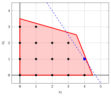
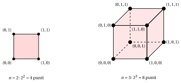

# La programmazione lineare intera

**Parte 1 · Modelli e bound · Capitolo 1** · [:material-file-pdf-box: Dispensa, volume 1 (PDF)](../pdf/dispensa-1-modelli-bound-formulazioni.pdf) · [:material-pencil: Esercizi: La programmazione lineare intera](../esercizi/ilp.md)

!!! nota "Prerequisiti"

    - Dal modulo <em>Programmazione Lineare</em>: [Capitolo 2 «Semispazi e poliedri»](https://fabiofurini.github.io/linear-programming/lp-problems/02-polyhedra/) e [Capitolo 4 «Problemi di programmazione lineare»](https://fabiofurini.github.io/linear-programming/lp-problems/04-lp-problems/) (la forma canonica di massimizzazione, la regione ammissibile, le soluzioni ottime e il valore ottimo), e [Capitolo 5 «Esiti possibili e formulazioni equivalenti»](https://fabiofurini.github.io/linear-programming/lp-problems/05-outcomes-equivalences/) (problemi inammissibili, illimitati e con soluzione ottima).

!!! chiave "Obiettivi"

    Alla fine di questo capitolo sarai in grado di:

    - scrivere un problema PLI in forma canonica di massimizzazione e distinguere i problemi PLI, BIP e MIP;

    - disegnare la regione ammissibile di un piccolo problema PLI e trovare graficamente una soluzione ottima;

    - spiegare perché la regione ammissibile non è convessa e quali sono i tre esiti possibili di un problema PLI;

    - spiegare perché l'enumerazione completa fallisce e quanto costa;

    - spiegare perché servono bound sul valore ottimo per evitare l'enumerazione.

## 1.1 Forma canonica di massimizzazione

!!! definizione "Definizione 1.1: Problemi di Programmazione Lineare Intera in forma canonica di massimizzazione"

    Dati:

    1. un vettore dei costi $\vet c \in \Z^{n}$

    2. una matrice dei vincoli $\mat A \in \Z^{m \times n}$

    3. un vettore dei termini noti (RHS) $\vet b \in \Z^{m}$ con $m$ righe

        $$
        \underbrace{
        \begin{pmatrix}
        c_{1} \\
        c_{2} \\
        \vdots \\
        c_{n} \\
        \end{pmatrix}
        }_{\vet c} \in \Z^{n}
        \qquad \qquad
        \underbrace{
        \begin{pmatrix}
        a_{11} & a_{12} & \dots & a_{1n}\\
        a_{21} & a_{22} & \dots & a_{2n}\\
        \vdots & \vdots & \ddots & \vdots \\
        a_{m1} & a_{m2} & \dots & a_{mn}\\
        \end{pmatrix}
        }_{\mat A} \in \Z^{m \times n}
        \qquad \qquad
        \underbrace{
        \begin{pmatrix}
        b_{1} \\
        b_{2} \\
        \vdots \\
        b_{m} \\
        \end{pmatrix}
        }_{\vet b} \in \Z^{m}
        $$

    un <strong>problema di Programmazione Lineare Intera</strong> (PLI) in <strong>forma canonica di massimizzazione</strong> con $n$ <u>variabili intere non negative</u>

    $$
    \underbrace{
    \begin{pmatrix}
    x_{1} \\
    x_{2} \\
    \vdots \\
    x_{n} \\
    \end{pmatrix}
    }_{\vet x} \in \Z^{n}_{\ge 0}
    $$

    e $m$ <u>vincoli lineari di minore o uguale</u> è il seguente problema di ottimizzazione:

    

    \begin{align*}
    \label{ObjFunc}  &&   \max \;\; \underbrace{\sum_{j =1}^n c_j \, x_j}_{\vet c\T \vet x}  \qquad \qquad \qquad \qquad \qquad \qquad  \tag{1.1a}\\[1ex]
    \label{Cons}     && \text{soggetto a} \quad \underbrace{\sum_{j =1}^n a_{ij} \, x_j  \le b_i, \qquad   \forall i \in \{1,2,\dots,m\}}_{\mat A\,\vet x  \le \vet b},  \tag{1.1b}\\[1ex]
    \label{integrality}&& \underbrace{x_j \in \Z_{\ge 0}, \qquad \forall j \in \{1,2,\dots,n\}}_{\vet x \in \Z^n_{\ge 0}}. \tag{1.1c}
    \end{align*}

- I dati $\vet c$, $\mat A$ e $\vet b$ sono <strong>interi</strong>, come in tutto il modulo.

- Con un leggero abuso di notazione, scriviamo il problema PLI [(1.1)](#eq-ILP) in forma compatta come

    $$
    \max \big\{\, \vet c\T \vet x ~:~ \mat A\,\vet x \le \vet b,~ \vet x \in \Z^n_{\ge 0} \,\big\}.
    $$

- L'insieme $\Z^n$ dei punti di $\R^n$ con componenti intere si chiama <strong>reticolo intero</strong>.

!!! chiave ""

    Un problema PLI [(1.1)](#eq-ILP) è un problema LP in forma canonica di massimizzazione con il requisito aggiuntivo $\vet x \in \Z^n$: la funzione lineare $\vet c\T \vet x$ viene massimizzata sui punti del <strong>reticolo intero</strong> che soddisfano i vincoli.

- Se tutte le variabili sono ristrette a $\{0,1\}$, il problema è un problema di <strong>programmazione lineare intera binaria</strong> (BIP). Se solo alcune delle variabili sono intere, il problema è un problema di <strong>programmazione lineare intera mista</strong> (MIP).

- I vincoli $\ge$ e $=$, e i problemi di minimizzazione, si riportano alla forma canonica di massimizzazione come nella programmazione lineare.

!!! esempio "Esempio 1.1: Problema PLI in forma canonica di massimizzazione"

    Consideriamo i seguenti dati di un problema PLI con $n=2$ e $m=2$:

    $$
    \vet c=
    \begin{pmatrix}
    3 \\[1ex]
    2\\
    \end{pmatrix}
    \qquad
    \mat A=
    \begin{pmatrix}
    10 & 4 \\[1ex]
    4 & 14 \\
    \end{pmatrix}
    \qquad
    \vet b=
    \begin{pmatrix}
    45 \\[1ex]
    49\\
    \end{pmatrix}
    $$

    Le componenti numeriche dei due vettori colonna e della matrice sono

    $$
    c_1=3,~c_2=2,~a_{11}=10,~a_{12}=4,~a_{21}=4,~a_{22}=14,~b_1=45,~b_2=49.
    $$

    Il problema PLI associato in forma canonica di massimizzazione, con $n=2$ variabili intere non negative e $m=2$ vincoli lineari di minore o uguale, è il seguente:

    $$
    \begin{array}{rrrrrrr}
    {\max} & {3}\, {x_1} & {+} & {2}\, {x_2} \\[1ex]
    \text{soggetto a} & {10}\, {x_1} & {+} & {4}\, {x_2} & {\le} & {45} \\[1ex]
    & {4}\, {x_1} & {+} & {14}\, {x_2} & {\le} & {49} \\[1ex]
    & {x_1,} &  & {x_2} & {\in} & {\Z_{\ge 0}}
    \end{array}
    $$

    Le variabili $x_1$ e $x_2$ si possono leggere come il numero di auto di due tipi da produrre: questo problema PLI è l'<strong>esempio dell'auto</strong>, l'esempio guida del modulo.

### 1.1.1 Regione ammissibile e funzione obiettivo

!!! definizione "Definizione 1.2: regione ammissibile e funzione obiettivo"

    - La <strong>regione ammissibile</strong> di un problema PLI [(1.1)](#eq-ILP) è l'insieme $F$ così definito:

        \begin{equation*}
        \label{FeasibleRegion}
        \begin{split}
        F = \left\{~
        \underbrace{
        \begin{pmatrix}
        x_{1} \\
        x_{2} \\
        \vdots \\
        x_{n} \\
        \end{pmatrix}}_{\vet x}  \in \Z^n : \right.
        ~~ & \underbrace{\sum_{j=1}^n a_{ij} \, x_j \le b_i,~~\forall i \in \{1,2,\dots,m\}}_{\mat A\,\vet x \le \vet b}, \\[1ex]
        & \left. \vphantom{\begin{pmatrix} x_{1} \\ x_{2} \\ \vdots \\ x_{n} \end{pmatrix}}
        \underbrace{x_j \ge 0,~~\forall j \in \{1,2,\dots,n\}}_{\vet x \ge \vet 0}
        ~\right\}.
        \end{split} \tag{1.2}
        \end{equation*}

    - La <strong>funzione obiettivo</strong> $\eqref{ObjFunc}$ di un problema PLI [(1.1)](#eq-ILP) da massimizzare è la <strong>funzione lineare</strong> (scalare) $f$ così definita:

        \begin{equation*}
        \label{ObjectiveFunction}
        f: \Z^{n} \rightarrow \R,
        \qquad
        f :
        \underbrace{\begin{pmatrix}
        x_1 \\
        x_2 \\
        \vdots \\
        x_n
        \end{pmatrix}}_{\vet x}
        \mapsto
        \underbrace{\sum_{j=1}^n c_j x_j}_{\vet c\T \vet x} \tag{1.3}
        \end{equation*}

- Sia $P = \{\, \vet x \in \R^n : \mat A\,\vet x \le \vet b,~ \vet x \ge \vet 0 \,\}$ il poliedro dei vincoli, cioè la regione ammissibile del problema LP con gli stessi dati. La regione ammissibile del problema PLI è

    $$
    F = P \cap \Z^n.
    $$

- L'insieme $F$ è fatto di punti isolati del reticolo, quindi <strong>non è convesso</strong>.

!!! esempio "Esempio 1.2: regione ammissibile"

    Consideriamo il problema PLI dell'[Esempio 1.1](#box-2-exILPCanonical). La regione ammissibile $F$ è l'insieme dei $16$ punti neri della figura seguente, i punti del reticolo $\Z^2$ nel poliedro $P$ (rosso).

    { .fig .ovale loading=lazy  }

    <em>L'esempio dell'auto: la regione ammissibile del problema PLI è l'insieme dei suoi $16$ punti interi (neri) dentro il poliedro (rosso). La soluzione ottima $(4,1)$ è in blu, con la retta obiettivo $3\,x_1 + 2\,x_2 = 14$ (tratteggiata).</em>

    Il punto $\bar{\vet x} = (2,2)$ appartiene a $F$, perché $10 \cdot 2 + 4 \cdot 2 = 28 \le 45$ e $4 \cdot 2 + 14 \cdot 2 = 36 \le 49$. Il punto $(4,2)$ non appartiene a $F$, perché $10 \cdot 4 + 4 \cdot 2 = 48 > 45$. Il punto $(\frac{7}{2},\frac{5}{2})$ appartiene a $P$ ma non a $F$, perché non è intero.

### 1.1.2 Soluzione ottima e valore ottimo

!!! definizione "Definizione 1.3: soluzione ottima e valore ottimo"

    - Un punto $\tilde{\vet x}(\ILP) \in F$ è una <strong>soluzione ottima</strong> del problema PLI [(1.1)](#eq-ILP) se

        $$
        \tilde{\vet x}(\ILP) \in \argmax \big\{\, \vet c\T \vet x ~:~ \vet x \in F \,\big\}.
        $$

    - Il valore

        $$
        z(\ILP) = \underbrace{\max \big\{\, \vet c\T \vet x ~:~ \vet x \in F \,\big\}}_{=\vet c\T \tilde{\vet x}(\ILP)}
        $$

        è il <strong>valore ottimo</strong> del problema PLI [(1.1)](#eq-ILP).

- Un punto $\bar{\vet x} \in F$ è una <strong>soluzione ammissibile</strong> del problema PLI. Una soluzione ottima è una soluzione ammissibile con il valore più alto della funzione obiettivo.

!!! chiave ""

    L'obiettivo di un problema PLI [(1.1)](#eq-ILP) è <strong>trovare una soluzione ottima</strong> $\tilde{\vet x}(\ILP)$, quando esiste, e non soltanto determinare il valore ottimo $z(\ILP)$.

### 1.1.3 Metodo grafico

!!! chiave ""

    Una soluzione ottima di un problema PLI [(1.1)](#eq-ILP) con due variabili si può determinare graficamente spostando la linea di livello della funzione obiettivo nella direzione del suo gradiente, fino a raggiungere l'ultimo punto del reticolo nel poliedro $P$.

!!! esempio "Esempio 1.3: Metodo grafico"

    Consideriamo il problema PLI dell'[Esempio 1.1](#box-2-exILPCanonical). Il gradiente della funzione obiettivo è $\nabla f = (3,2)$. Spostando la linea di livello $3\,x_1 + 2\,x_2 = z$ nella direzione di $\nabla f$, l'ultimo punto di $F$ raggiunto è $(4,1)$, sulla linea tratteggiata $3\,x_1 + 2\,x_2 = 14$ della figura dell'[Esempio 1.2](#box-4-exFeasRegILP). Nessun altro punto di $F$ giace su questa linea.

    L'esempio dell'auto ha l'<strong>unica</strong> soluzione ottima $\tilde{\vet x}(\ILP) = (4,1)$, con valore ottimo $z(\ILP) = 14$.

## 1.2 Esiti possibili

- Come nella programmazione lineare, un problema PLI ha esattamente uno di tre <strong>esiti</strong>: è <strong>inammissibile</strong> ($F = \emptyset$), <strong>illimitato</strong> (la funzione obiettivo non è limitata superiormente su $F$) oppure ha una <strong>soluzione ottima</strong>.

- Se il poliedro $P$ è limitato, allora $F$ è un <strong>insieme finito</strong>, e una soluzione ottima esiste non appena $F \neq \emptyset$.

!!! esempio "Esempio 1.4: un problema PLI inammissibile con un problema LP ammissibile"

    Il problema PLI

    $$
    \max \big\{\, x_1 ~:~ 2\,x_1 \le 1,~ -2\,x_1 \le -1,~ x_1 \in \Z_{\ge 0} \,\big\}
    $$

    è inammissibile, perché i vincoli richiedono $x_1 = \frac{1}{2}$. Il problema LP con gli stessi dati è ammissibile, con l'unica soluzione ammissibile $x_1 = \frac{1}{2}$.

!!! esempio "Esempio 1.5: un problema PLI illimitato"

    Il problema PLI

    $$
    \max \big\{\, x_1 + x_2 ~:~ x_1 - x_2 \le 1,~ x_1, x_2 \in \Z_{\ge 0} \,\big\}
    $$

    è illimitato: i punti $(k,k)$, $k \in \Z_{\ge 0}$, sono ammissibili, con valore $2k$.

## 1.3 Enumerazione completa

- Quando la regione ammissibile è un insieme finito, possiamo trovare una soluzione ottima per <strong>enumerazione completa</strong>: calcoliamo la funzione obiettivo per ogni soluzione ammissibile e teniamo la migliore. Per l'esempio dell'auto ci sono $16$ punti:

$$
\begin{array}{ccc|ccc}
\hline {x_1} & {x_2} & {z} & {x_1} & {x_2} & {z} \\
\hline {0} & {0} & {0} & {3} & {1} & {11} \\
{1} & {0} & {3} & {\mathbf{4}} & {\mathbf{1}} & {\mathbf{14}} \\
{2} & {0} & {6} & {0} & {2} & {4} \\
{3} & {0} & {9} & {1} & {2} & {7} \\
{4} & {0} & {12} & {2} & {2} & {10} \\
{0} & {1} & {2} & {3} & {2} & {13} \\
{1} & {1} & {5} & {0} & {3} & {6} \\
{2} & {1} & {8} & {1} & {3} & {9} \\
\hline
\end{array}
$$

- Il valore migliore è $14$, in $(4,1)$ (in grassetto). Qui il metodo funziona, perché il modello è minuscolo.

- Consideriamo ora il caso più semplice: $n$ <strong>variabili binarie</strong> e nessun altro vincolo. Ogni variabile assume $2$ valori, quindi ci sono $2^n$ soluzioni: i vertici di un ipercubo $n$-dimensionale.

{ .fig .ovale loading=lazy  }

<em>Le soluzioni di $n$ variabili binarie senza altri vincoli: i $2^n$ vertici di un ipercubo $n$-dimensionale, per $n=2$ (un quadrato) e $n=3$ (un cubo).</em>

- Il numero $2^n$ esplode. Con $n = 80$ variabili ci sono circa $1.2 \cdot 10^{24}$ soluzioni, un numero paragonabile a quello stimato delle stelle dell'universo, e con $n = 266$ variabili circa $1.2 \cdot 10^{80}$, paragonabile al numero stimato di atomi dell'universo osservabile.

- Supponiamo che un computer esamini $10^{9}$ soluzioni al secondo, e poi un computer $1000$ volte più veloce, $10^{12}$ soluzioni al secondo. Il tempo necessario per enumerare $2^n$ soluzioni è:

<table>
<tr>
<th>\(n\)</th>
<th>\(2^n\)</th>
<th>a \(10^{9}\) soluzioni/s</th>
<th>a \(10^{12}\) soluzioni/s</th>
</tr>
<tr>
<td>20</td>
<td>\(\approx 1.05 \cdot 10^{6}\)</td>
<td>\(\approx 1.05\,\mathrm{ms}\)</td>
<td>\(\approx 1.05\,\mu\mathrm{s}\)</td>
</tr>
<tr>
<td>30</td>
<td>\(\approx 1.07 \cdot 10^{9}\)</td>
<td>\(\approx 1.07\,\mathrm{s}\)</td>
<td>\(\approx 1.07\,\mathrm{ms}\)</td>
</tr>
<tr>
<td>40</td>
<td>\(\approx 1.10 \cdot 10^{12}\)</td>
<td>\(\approx 18.3\,\mathrm{min}\)</td>
<td>\(\approx 1.10\,\mathrm{s}\)</td>
</tr>
<tr>
<td>50</td>
<td>\(\approx 1.13 \cdot 10^{15}\)</td>
<td>\(\approx 13.0\,\mathrm{days}\)</td>
<td>\(\approx 18.8\,\mathrm{min}\)</td>
</tr>
<tr>
<td>60</td>
<td>\(\approx 1.15 \cdot 10^{18}\)</td>
<td>\(\approx 36.5\,\mathrm{years}\)</td>
<td>\(\approx 13.3\,\mathrm{days}\)</td>
</tr>
<tr>
<td>70</td>
<td>\(\approx 1.18 \cdot 10^{21}\)</td>
<td>\(\approx 374\,\mathrm{centuries}\)</td>
<td>\(\approx 37.4\,\mathrm{years}\)</td>
</tr>
<tr>
<td>80</td>
<td>\(\approx 1.21 \cdot 10^{24}\)</td>
<td>\(\approx 3.8 \cdot 10^{5}\,\mathrm{centuries}\)</td>
<td>\(\approx 383\,\mathrm{centuries}\)</td>
</tr>
</table>

!!! chiave ""

    L'enumerazione completa è impraticabile già per modelli di dimensione moderata. Un computer $1000$ volte più veloce guadagna solo circa $10$ variabili, perché $2^{10} = 1024 \approx 1000$.

- La via d'uscita è <strong>evitare di enumerare</strong>. Se conosciamo un lower bound e un upper bound sul valore ottimo, possiamo escludere intere regioni di soluzioni ammissibili senza visitarle. I due bound vengono da due fonti diverse, le soluzioni ammissibili e i rilassamenti: sono l'argomento del capitolo successivo, «Bound primali e bound duali».

## 1.4 Errori tipici

!!! attenzione "Attenzione"

    - <strong>Credere che la regione ammissibile sia convessa.</strong> È l'insieme dei punti interi di un poliedro, non il poliedro. Il punto medio di due soluzioni ammissibili può essere inammissibile.

    - <strong>Credere che la regione ammissibile sia sempre finita.</strong> È finita solo se il poliedro è limitato; altrimenti il problema PLI può essere illimitato.

    - <strong>Credere che un problema LP ammissibile dia un problema PLI ammissibile.</strong> Il problema LP può avere soluzioni mentre nessun punto intero soddisfa i vincoli.

    - <strong>Prendere una buona soluzione ammissibile per ottima.</strong> Senza un bound dall'altro lato (capitolo successivo) non c'è alcun certificato di ottimalità.

## 1.5 In sintesi

!!! chiave "In sintesi"

    - Un problema PLI massimizza una funzione lineare sui punti interi di un poliedro; la sua regione ammissibile non è convessa, ed è finita quando il poliedro è limitato.

    - Gli esiti sono inammissibile, illimitato oppure con soluzione ottima, e un problema LP ammissibile può avere una versione PLI inammissibile.

    - L'enumerazione completa costa $2^n$ valutazioni per $n$ variabili binarie: non è praticabile oltre i modelli molto piccoli.

    - Per evitare l'enumerazione servono bound su $z(\ILP)$ da entrambi i lati: soluzioni ammissibili e rilassamenti, l'argomento del capitolo successivo.

    <strong>Cruscotto dell'esempio dell'auto.</strong> Ancora nessun bound: il capitolo successivo fornisce i primi lower bound e upper bound.

---

**Esercizi su questo capitolo:** [:material-pencil: La programmazione lineare intera](../esercizi/ilp.md)
