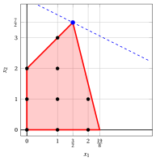
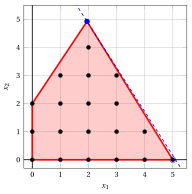
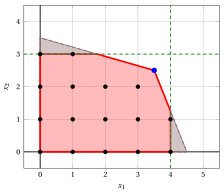
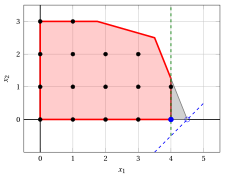

# Bound primali e bound duali

**Parte 1 · Modelli e limiti · Capitolo 2** · [:material-file-pdf-box: Appunti delle lezioni, volume 1 (PDF)](../pdf/lecture-notes-1-models-bounds-formulations.pdf) · [:material-pencil: Esercizi: Bound primali e bound duali](../exercises/lp-relaxation.md) · [:material-gesture-tap: App: Punti interi e il rilassamento LP](../lab/integer-points.md)

!!! nota "Prerequisiti"
    - Da questo modulo, il capitolo «Programmazione lineare intera»: problemi ILP, soluzioni ammissibili e ottimali, enumerazione completa, e l'esempio dell'auto.

    - Dal modulo <em>Programmazione Lineare</em>, [Capitolo 9 «Teoria della dualità»](https://fabiofurini.github.io/programmazione-lineare/dualita/09-dualita/): il problema duale, dualità debole e dualità forte.

    - Dallo stesso modulo, [Capitolo 6 «Algoritmo del simplesso»](https://fabiofurini.github.io/programmazione-lineare/simplesso/06-simplesso/): un problema LP che ha una soluzione ottimale ha un vertice ottimale.

!!! chiave "Obiettivi"
    Alla fine di questo capitolo sarai in grado di:

    - ottenere un vincolo primale (un limite inferiore) sul valore ottimale a partire da una soluzione ammissibile, anche con un semplice algoritmo euristico;

    - costruire il rilassamento LP di un problema ILP e utilizzare il suo valore ottimale come vincolo duale (un limite superiore), arrotondato per difetto quando è valido;

    - calcolare il divario di ottimalità a partire da un bound primale e un bound duale;

    - spiega perché arrotondare una soluzione ottimale di LP fornisce al massimo una soluzione ammissibile;

    - derivare limiti superiori sulle variabili dai vincoli e dire quando sono utili;

    - ottenere un vincolo duale dai moltiplicatori non negativi dei vincoli e riconoscere il problema duale come il problema dei migliori moltiplicatori.

!!! nota "Dove eravamo"
    Nel capitolo precedente abbiamo visto che l'enumerazione completa non è un'opzione e che abbiamo bisogno di limiti sul valore ottimale da entrambe le parti. Ora li otteniamo: <strong>bound primali</strong> dalle soluzioni ammissibili e <strong>bound duali</strong> dai rilassamenti.

## 2.1 Bound primali e bound duali

!!! definizione "Definizione 2.1: bound primale, bound duale e divario di ottimalità"
    Considera un problema ILP in forma canonica di massimizzazione, con regione fattibile $F$ e valore ottimale $z(\ILP)$.

    - Data una soluzione ammissibile $\bar{\vet x} \in F$, il suo valore $\LB(\bar{\vet x}) = \sum_{j=1}^n c_j \, \bar{x}_j$ è un <strong>bound primale</strong> su $z(\ILP)$.

    - Un valore $\UB$ tale che $\sum_{j=1}^n c_j \, x_j \le \UB$ per ogni $\vet x \in F$ è un <strong>bound duale</strong> su $z(\ILP)$.

    - Dato un bound primale $\LB \ne 0$ e un bound duale $\UB$, il <strong>gap di ottimalità</strong> è

        \begin{equation*}
        \label{gap}
        \text{optimality gap} = \frac{\UB - \LB}{|\LB|} . \tag{2.1}
        \end{equation*}

- In un problema di massimizzazione, i bound primali sono <strong>limiti inferiori</strong> e i bound duali sono <strong>limiti superiori</strong>. Un bound primale deriva da una soluzione ammissibile; un bound duale è un'affermazione su <u>tutte</u> le soluzioni ammissibili contemporaneamente.

!!! chiave ""
    Per ogni soluzione ammissibile $\bar{\vet x}$ e ogni bound duale $\UB$:

    $$
    \LB(\bar{\vet x}) ~\le~ z(\ILP) ~\le~ \UB .
    $$

    Una soluzione ammissibile è <strong>certificata ottimale</strong> quando il divario di ottimalità è zero.

!!! definizione "Definizione 2.2: rilassamento"
    Dato un problema ILP $\max \{ \vet c\T \vet x : \vet x \in F \}$, il problema $\max \{ \vet c\T \vet x : \vet x \in R \}$ è un <strong>rilassamento</strong> del problema ILP se $F \subseteq R$. Denotiamo il suo valore ottimale con $z(R)$.

- Una massimizzazione su una regione più ampia non può dare un valore più piccolo: il valore ottimale di un rilassamento è un bound duale, $z(\ILP) \le z(R)$.

## 2.2 Bound primali: soluzioni euristiche { #sez-sec-primal }

!!! definizione "Definizione 2.3: algoritmo euristico"
    Un <strong>algoritmo euristico</strong> è un metodo che trova soluzioni ammissibili rapidamente, senza garanzia di ottimalità. Il valore di ogni soluzione che trova è un bound primale.

!!! chiave ""
    Una buona soluzione ammissibile è un buon bound primale.

!!! esempio "Esempio 2.1: bound primale"
    Per la soluzione ammissibile $(2,2)$ dell'esempio dell'auto otteniamo $\LB = 3 \cdot 2 + 2 \cdot 2 = 10$, quindi $z(\ILP) \ge 10$.

!!! definizione "Definizione 2.4: della parte intera di un numero"
    Dati $y \in \R$, la <strong>parte intera</strong> di $y$ è $\lfloor y \rfloor = \max \{ q \in \Z : q \le y \}$.

!!! esempio "Esempio 2.2: due algoritmi euristici per l'esempio dell'auto"
    - L'<strong>euristica a una variabile</strong> imposta una singola variabile al suo valore massimo, con l'altra pari a $0$, e mantiene la migliore delle due soluzioni.

        1. Solo $x_1$ ($x_2 = 0$): $\bar{x}_1 = \min\{\lfloor \frac{45}{10} \rfloor, \lfloor \frac{49}{4} \rfloor\} = \min\{4, 12\} = 4$, quindi $\bar{\vet x} = (4,0)$ e $\LB = 12$.

        2. Solo $x_2$ ($x_1 = 0$): $\bar{x}_2 = \min\{\lfloor \frac{45}{4} \rfloor, \lfloor \frac{49}{14} \rfloor\} = \min\{11, 3\} = 3$, quindi $\bar{\vet x} = (0,3)$ e $\LB = 6$.

    - L'<strong>euristica in due fasi</strong> imposta prima una variabile al suo valore massimo e poi l'altra al suo valore massimo con i <strong>termini noti residui</strong>. Mantiene la soluzione migliore delle due.

        1. $x_1$ prima: $\bar{x}_1 = 4$ usa $40$ e $16$, lasciando $5$ e $33$. Poi $\bar{x}_2 = \min\{\lfloor \frac{5}{4} \rfloor, \lfloor \frac{33}{14} \rfloor\} = \min\{1, 2\} = 1$, quindi $\bar{\vet x} = (4,1)$ e $\LB = 14$.

        2. $x_2$ prima: $\bar{x}_2 = 3$ usa $12$ e $42$, lasciando $33$ e $7$. Poi $\bar{x}_1 = \min\{\lfloor \frac{33}{10} \rfloor, \lfloor \frac{7}{4} \rfloor\} = \min\{3, 1\} = 1$, quindi $\bar{\vet x} = (1,3)$ e $\LB = 9$.

    
<table>
    <tr>
    <th> euristica </th>
    <th>Ordine</th>
    <th>\(\bar{x}_1\)</th>
    <th>\(\bar{x}_2\)</th>
    <th>\(\LB\)</th>
    </tr>
    <tr>
    <td>a variabile singola</td>
    <td>\(x_1\)</td>
    <td>\(4\)</td>
    <td>\(0\)</td>
    <td>\(12\)</td>
    </tr>
    <tr>
    <td>a una variabile</td>
    <td>\(x_2\)</td>
    <td>\(0\)</td>
    <td>\(3\)</td>
    <td>\(6\)</td>
    </tr>
    <tr>
    <td>a due fasi</td>
    <td>\(x_1\) prima</td>
    <td>\(4\)</td>
    <td>\(1\)</td>
    <td>\(14\)</td>
    </tr>
    <tr>
    <td>a due fasi</td>
    <td>\(x_2\) prima</td>
    <td>\(1\)</td>
    <td>\(3\)</td>
    <td>\(9\)</td>
    </tr>
    </table>

- L'euristica a due fasi fornisce un vincolo primale migliore, ma richiede più calcolo. Questo compromesso tra la qualità della soluzione e lo sforzo computazionale è tipico degli algoritmi euristici.

- Qui il miglior bound primale è $\LB = 14$, in $(4,1)$. Un bound primale da solo non è una certificazione di ottimalità: è necessaria una soglia duale.

## 2.3 Il rilassamento LP

!!! definizione "Definizione 2.5: rilassamento LP"
    La <strong>relassazione della programmazione lineare (LP)</strong> di un problema ILP nella forma canonica di massimizzazione è il problema LP ottenuto sostituendo i vincoli di integrità $x_j \in \Z_{\ge 0}$ con i vincoli di non negatività $x_j \ge 0$, per tutti $j \in \{1,2,\dots,n\}$:

    

    \begin{align*}
    &&   \max \;\;{\sum_{j =1}^n c_j \, x_j}                               \label{ObjFunc_LP}  \tag{2.2a}\\[2ex]
    && \text{soggetto a} \quad  {\sum_{j =1}^n a_{ij} \, x_j}  &\leq b_i,   & \forall i \in \{1,2,\dots,m\},                    \label{Cons_LP}  \tag{2.2b}\\[2ex]
    &&x_j                        &\ge  0, & \forall j \in \{1,2,\dots,n\}. \label{non_negativity_LP} \tag{2.2c}
    \end{align*}

- Indichiamo con $z(\LP)$ il valore ottimale del rilassamento LP, e con $\tilde{\vet x}(\LP)$ una soluzione ottimale. Scriviamo sempre l'argomento, perché nello stesso esempio $\tilde{\vet x}(\ILP)$ e $\tilde{\vet x}(\LP)$ sono punti diversi.

!!! teorema "Proposizione 2.6: limite superiore dal rilassamento LP"
    Ogni soluzione ammissibile del problema ILP è ammissibile per il suo rilassamento LP, quindi

    \begin{equation*}
    z(\ILP) \le z(\LP). \label{LP_BOUND} \tag{2.3}
    \end{equation*}

    Inoltre, se una soluzione ottimale del rilassamento LP è intera, allora essa è una soluzione ottimale del problema ILP.

??? dimostrazione "Proof"

    La regione ammissibile $F$ del problema ILP è contenuta nel politopo del rilassamento LP, e la funzione obiettivo è la stessa. Il massimo su un insieme più grande non è minore del massimo su un sottoinsieme. Se $\tilde{\vet x}(\LP)$ è intero, appartiene a $F$ e ha valore $z(\LP) \ge z(\ILP)$: è ottimale per il problema ILP. □

- Il valore di una soluzione ammissibile può essere un numero intero, e al massimo è $z(\LP)$: allora è al massimo il più grande numero intero non superiore a $z(\LP)$.

!!! teorema "Osservazione 2.7: arrotondamento del limite superiore"
    Se tutte le variabili sono intere e tutti i costi $c_j$ sono interi, allora

    \begin{equation*}
    z(\ILP) \le \lfloor z(\LP) \rfloor. \label{LP_BOUND_2} \tag{2.4}
    \end{equation*}

    In tutti gli altri casi il vincolo $\lfloor z(\LP) \rfloor$ <u>non</u> è valido.

- In questo modulo tutti i problemi ILP hanno dati interi, quindi il vincolo $\eqref{LP_BOUND_2}$ è sempre valido. In un problema MIP con una variabile continua il valore di una soluzione ammissibile non è necessariamente un intero, e il vincolo non può essere arrotondato.

!!! esempio "Esempio 2.3: il rilassamento LP dell'esempio dell'auto"
    - Il rilassamento LP dell'esempio dell'auto ha la soluzione ottimale

        $$
        \tilde{x}_1 = \frac{7}{2}, \quad \tilde{x}_2 = \frac{5}{2}, \qquad z(\LP) = \frac{31}{2},
        $$

        ed è frazionario: è inammissibile per il problema ILP.

    - Poiché i costi sono interi, abbiamo il limite superiore $\lfloor z(\LP) \rfloor = 15$. Insieme al bound primale $14$ della soluzione ammissibile $(4,1)$ di [Esempio 2.2](#box-6-ex-heur-car):

        $$
        14 ~\le~ z(\ILP) ~\le~ 15.
        $$

    { .fig .ovale loading=lazy  }

    <em>Il rilassamento LP dell'esempio dell'auto: la regione ammissibile (rossa), i suoi punti interi $16$ (neri) e la soluzione ottimale $(\frac{7}{2},\frac{5}{2})$ del rilassamento LP (blu), con la linea obiettivo $3\,x_1 + 2\,x_2 = \frac{31}{2}$ attraverso di essa (tratteggiata). La linea grigia tratteggiata è la linea obiettivo della soluzione ILP ottimale.</em>

    - Il valore ottimale è $14$ o $15$. Con $\UB = 15$ e $\LB = 14$ il divario di ottimalità $\eqref{gap}$ è $\frac{1}{14} \approx 7.1\%$: la soluzione $(4,1)$ non è ancora certificata come ottimale.

## 2.4 Arrotondamento della soluzione del rilassamento LP

!!! chiave ""
    Le soluzioni ILP fattibili possono generalmente essere ottenute arrotondando una soluzione ottimale del rilassamento LP. Ma nessuna tecnica di arrotondamento garantisce di trovare una soluzione ILP ottimale.

!!! esempio "Esempio 2.4: arrotondamento nell'esempio dell'auto"
    - La soluzione ottimale del rilassamento LP è $\tilde{\vet x}(\LP) = (\frac{7}{2},\frac{5}{2})$. Arrotondando al numero intero più vicino si ottiene $(4,3)$, che è inammissibile: $10 \cdot 4 + 4 \cdot 3 = 52 > 45$.

    - Arrotondando verso il basso entrambe le componenti si ottiene la soluzione ammissibile $\bar{\vet x} = (3,2)$, con $\LB = 3 \cdot 3 + 2 \cdot 2 = 13$. La soluzione ILP ottimale è $\tilde{\vet x}(\ILP) = (4,1)$, con $z(\ILP) = 14$: l'arrotondamento non dà l'ottimo, e i limiti sono $13 \le z(\ILP) \le 15$.

!!! esempio "Esempio 2.5: l'arrotondamento funziona, ma il limite non è stretto"
    Considera il seguente problema ILP; il suo rilassamento LP ha $x_1, x_2 \ge 0$ invece dei vincoli di integralità:

    $$
    \begin{array}{rrrrrrr}
    {\max} & {2}\, {x_1} & {+} & {4}\, {x_2} \\[1ex]
    \text{soggetto a} & {-}\, {x_1} & {+} & \, {x_2} & {\le} & {2} \\[1ex]
    & {8}\, {x_1} & {+} & {2}\, {x_2} & {\le} & {19} \\[1ex]
    & {x_1,} &  & {x_2} & {\in} & {\Z_{\ge 0}}
    \end{array}
    $$

    - La soluzione ottimale del rilassamento LP è $\tilde{\vet x}(\LP) = (\frac{3}{2},\frac{7}{2})$, con $z(\LP) = 17$ e $\lfloor z(\LP) \rfloor = 17$, quindi $z(\ILP) \le 17$.

    - Arrotondando per difetto entrambe le componenti otteniamo la soluzione ammissibile $\bar{\vet x} = (\lfloor \frac{3}{2} \rfloor, \lfloor \frac{7}{2} \rfloor) = (1,3)$, con $\LB = 2 \cdot 1 + 4 \cdot 3 = 14$.

    - La soluzione ILP ottimale è $\tilde{\vet x}(\ILP) = (1,3)$, con $z(\ILP) = 14$: la soluzione arrotondata è ottimale. Ma i limiti $14 \le z(\ILP) \le 17$ non lo dimostrano.

    { .fig .ovale loading=lazy  }

    <em>Il secondo esempio: la regione ammissibile del rilassamento LP (rossa), i punti interi (neri) e la soluzione ottimale del rilassamento LP (blu), con la linea obiettivo $2\,x_1 + 4\,x_2 = 17$ (tratteggiata).</em>

!!! esempio "Esempio 2.6: l'arrotondamento fallisce"
    Considera il seguente problema ILP:

    $$
    \begin{array}{rrrrrrr}
    {\max} & {25}\, {x_1} & {+} & {16}\, {x_2} \\[1ex]
    \text{soggetto a} & {50}\, {x_1} & {+} & {31}\, {x_2} & {\le} & {250} \\[1ex]
    & {-3}\, {x_1} & {+} & {2}\, {x_2} & {\le} & {4} \\[1ex]
    & {x_1,} &  & {x_2} & {\in} & {\Z_{\ge 0}}
    \end{array}
    $$

    - La soluzione ottimale del rilassamento LP è $\tilde{\vet x}(\LP) = (\frac{376}{193}, \frac{950}{193}) \approx (1.94, 4.92)$, con $z(\LP) = \frac{24600}{193} \approx 127.46$. Pertanto $z(\ILP) \le \lfloor z(\LP) \rfloor = 127$.

    - Arrotondando all'intero più vicino si ottiene $(2,5)$, che non è realizzabile: $50 \cdot 2 + 31 \cdot 5 = 255 > 250$. Arrotondando $\tilde{x}_1$ verso l'alto e $\tilde{x}_2$ verso il basso si ottiene la soluzione ammissibile $\bar{\vet x} = (2,4)$, con $\LB = 25 \cdot 2 + 16 \cdot 4 = 114$.

    - La soluzione ILP ottimale è $\tilde{\vet x}(\ILP) = (5,0)$, con $z(\ILP) = 125$. È lontana da $\tilde{\vet x}(\LP)$, e nessun arrotondamento di $\tilde{\vet x}(\LP)$ la trova.

    { .fig .ovale loading=lazy  }

    <em>Il terzo esempio: i punti interi (neri) sono lontani dalla soluzione ottimale $(\frac{376}{193},\frac{950}{193})$ del rilassamento LP (blu). La soluzione ottimale ILP è $(5,0)$ (cerchio blu). La linea tratteggiata è la linea obiettivo $25\,x_1 + 16\,x_2 = \frac{24600}{193}$.</em>

!!! chiave ""
    Le soluzioni ILP ottimali possono essere abbastanza lontane dalle soluzioni ottimali del rilassamento LP. Il valore del rilassamento LP, invece, è spesso un buon limite: qui $125 \le z(\LP) \approx 127.46$.

## 2.5 Limiti superiori sulle variabili

!!! teorema "Proposizione 2.8: limiti superiori sulle variabili"
    Sia $\sum_{j=1}^n a_{ij} \, x_j \le b_i$ un vincolo con $a_{ij} \ge 0$ per tutti $j$. Allora ogni soluzione ammissibile del problema ILP soddisfa

    \begin{equation*}
    \label{vub}
    x_j \le \left\lfloor \frac{b_i}{a_{ij}} \right\rfloor, \qquad \forall j \text{ such that } a_{ij} > 0. \tag{2.5}
    \end{equation*}

??? dimostrazione "Proof"

    Dato che tutte le variabili sono non negative e tutti i coefficienti sono non negativi, $a_{ij} \, x_j \le \sum_{k=1}^n a_{ik} \, x_k \le b_i$, quindi $x_j \le \frac{b_i}{a_{ij}}$. La variabile è intera, quindi non supera la parte intera di $\frac{b_i}{a_{ij}}$. □

- Se diversi vincoli forniscono un limite su $x_j$, manteniamo il più piccolo. I limiti tagliano parti del poliedro del rilassamento LP, e nessun punto intero.

!!! chiave ""
    I limiti superiori sulle variabili migliorano il rilassamento LP solo se escludono la sua soluzione ottimale.

!!! esempio "Esempio 2.7: limiti superiori sulle variabili dell'esempio dell'auto"
    Entrambi i vincoli dell'esempio dell'auto hanno coefficienti non negativi:

    \begin{align*}
    x_1 &\le \min \left\{ \left\lfloor \tfrac{45}{10} \right\rfloor, \left\lfloor \tfrac{49}{4} \right\rfloor \right\}
    = \min\{4, 12\} = 4,\\
    x_2 &\le \min \left\{ \left\lfloor \tfrac{45}{4} \right\rfloor, \left\lfloor \tfrac{49}{14} \right\rfloor \right\}
    = \min\{11, 3\} = 3.
    \end{align*}

    - Le disuguaglianze $x_1 \le 4$ e $x_2 \le 3$ sono soddisfatte da tutti i punti interi dell'esempio dell'auto, e possono essere aggiunte al modello. Esse tagliano due regioni del poliedro, e nessun punto intero.

    { .fig .ovale loading=lazy  }

    <em>I limiti superiori variabili $x_1 \le 4$ e $x_2 \le 3$ (verdi) tagliano le due regioni grigie del rilassamento LP (rosso) e nessun punto intero. La soluzione ottimale del rilassamento LP (blu) non è tagliata.</em>

    - La soluzione ottimale del rilassamento LP, $(\frac{7}{2},\frac{5}{2})$, soddisfa entrambe le disuguaglianze. Non viene esclusa, quindi il valore ottimale del rilassamento LP non cambia, e il limite superiore è ancora $15$.

!!! esempio "Esempio 2.8: limiti superiori che eliminano l'ottimo LP"
    - Considera la funzione obiettivo $x_1 - x_2$ sui vincoli dell'esempio dell'auto, la cui soluzione ILP ottimale è $(4,0)$ con $z(\ILP) = 4$. Prima dei limiti, la soluzione ottimale del rilassamento LP è $(\frac{9}{2},0)$ con $z(\LP) = \frac{9}{2}$; dopo $x_1 \le 4$ è $(4,0)$ con $z(\LP) = 4$, che è intera e quindi ottimale.

    { .fig .ovale loading=lazy  }

    <em>L'obiettivo $x_1 - x_2$: il vincolo superiore variabile $x_1 \le 4$ (verde) taglia il triangolo grigio e la soluzione ottimale $(\frac{9}{2},0)$ del rilassamento LP (cerchio blu). La nuova soluzione ottimale $(4,0)$ (blu) è intera. La linea tratteggiata è $x_1 - x_2 = \frac{9}{2}$.</em>

    - Il valore del rilassamento LP migliora da $\frac{9}{2}$ a $4$. Il vincolo arrotondato $\lfloor \frac{9}{2} \rfloor = 4$ era già $4$: una formulazione migliore non migliora sempre il vincolo arrotondato.

## 2.6 Bordi duali

- Un vincolo duale può essere ottenuto anche senza risolvere il rilassamento LP, combinando i vincoli con <strong>moltiplicatori non negativi</strong> $\pi_i$, uno per ciascun vincolo.

!!! definizione "Definizione 2.9: problema duale del rilassamento LP"
    Il <strong>problema duale</strong> D(LP) del rilassamento LP [(2.2)](#eq-LP) è il seguente problema LP, con valore ottimale $z(\mathrm{D(LP)})$:

    

    \begin{align*}
    &&   \min \;\;{\sum_{i =1}^m b_i \, \pi_i}                               \label{ObjFunc_D}  \tag{2.6a}\\[2ex]
    && \text{soggetto a} \quad  {\sum_{i =1}^m a_{ij} \, \pi_i}  &\geq c_j,   & \forall j \in \{1,2,\dots,n\},                    \label{Cons_D}  \tag{2.6b}\\[2ex]
    &&\pi_i                        &\ge  0, & \forall i \in \{1,2,\dots,m\}. \label{non_negativity_D} \tag{2.6c}
    \end{align*}

- Moltiplicando il vincolo $i$ per $\pi_i \ge 0$ e sommando, otteniamo un'ineguaglianza i cui coefficienti sono almeno i costi, secondo $\eqref{Cons_D}$. I moltiplicatori devono essere non negativi: un moltiplicatore negativo invertirebbe l'ineguaglianza.

!!! teorema "Proposizione 2.10: vincoli duali"
    Per ogni soluzione ammissibile $\bar{\vet \pi}$ del problema duale [(2.6)](#eq-DLP),

    $$
    z(\ILP) ~\le~ z(\LP) ~\le~ \sum_{i=1}^m b_i \, \bar{\pi}_i .
    $$

    Per la forte dualità, $z(\mathrm{D(LP)}) = z(\LP)$: i migliori moltiplicatori danno esattamente il valore del rilassamento LP.

??? dimostrazione "Proof"

    Sia $\vet x$ fattibile per il rilassamento LP. Moltiplicando il vincolo $i$ per $\bar{\pi}_i \ge 0$ e sommando, $\sum_{j=1}^n \big( \sum_{i=1}^m a_{ij} \, \bar{\pi}_i \big) x_j \le \sum_{i=1}^m b_i \, \bar{\pi}_i$. Per $\eqref{Cons_D}$ e $x_j \ge 0$, il lato sinistro è almeno $\sum_{j=1}^n c_j \, x_j$. Da ciò segue $\sum_{j=1}^n c_j \, x_j \le \sum_{i=1}^m b_i \, \bar{\pi}_i$ per ogni $\vet x$ fattibile. □

!!! chiave ""
    Ogni soluzione ammissibile del problema duale è un certificato di un limite superiore, trovato senza risolvere il rilassamento LP. Il miglior certificato è una soluzione duale ottimale, e ha lo stesso valore del rilassamento LP.

!!! esempio "Esempio 2.9: moltiplicatori per l'esempio dell'auto"
    - Una soluzione ammissibile del rilassamento LP non fornisce un vincolo duale: il suo valore non è né un limite inferiore né un limite superiore su $z(\ILP)$.

    
<table>
    <tr>
    <th>\((x_1, x_2)\)</th>
    <th>fattibile per il rilassamento LP</th>
    <th>intero</th>
    <th>\(3\,x_1 + 2\,x_2\)</th>
    </tr>
    <tr>
    <td>\((4, \frac{5}{4})\)</td>
    <td>sì</td>
    <td>no</td>
    <td>\(\frac{29}{2} > 14\)</td>
    </tr>
    <tr>
    <td>\((2, \frac{5}{2})\)</td>
    <td>sì</td>
    <td>no</td>
    <td>\(11 < 14\)</td>
    </tr>
    </table>

    - Moltiplicando il primo vincolo dell'esempio dell'auto per $\frac{3}{4}$ otteniamo

        $$
        \frac{15}{2}\,x_1 + 3\,x_2 \le \frac{135}{4}.
        $$

        Poiché $x_1, x_2 \ge 0$ e i coefficienti $\frac{15}{2}$ e $3$ sono almeno i costi $3$ e $2$, abbiamo $3\,x_1 + 2\,x_2 \le \frac{15}{2}\,x_1 + 3\,x_2 \le \frac{135}{4}$: un limite superiore di $\frac{135}{4}$.

    - Con i moltiplicatori $\pi_1, \pi_2 \ge 0$ dei due vincoli, i coefficienti della somma devono essere almeno i costi:

        \begin{align*}
        (10\,\pi_1 + 4\,\pi_2)\,x_1 + (4\,\pi_1 + 14\,\pi_2)\,x_2 &\le 45\,\pi_1 + 49\,\pi_2,\\
        10\,\pi_1 + 4\,\pi_2 \ge 3, \qquad 4\,\pi_1 + 14\,\pi_2 &\ge 2.
        \end{align*}

    
<table>
    <tr>
    <th>\((\pi_1, \pi_2)\)</th>
    <th>moltiplicatori validi</th>
    <th>limite superiore \(45\,\pi_1 + 49\,\pi_2\)</th>
    </tr>
    <tr>
    <td>\((\frac{3}{4}, 0)\)</td>
    <td>sì</td>
    <td>\(\frac{135}{4}\)</td>
    </tr>
    <tr>
    <td>\((0, \frac{3}{4})\)</td>
    <td>sì</td>
    <td>\(\frac{147}{4}\)</td>
    </tr>
    <tr>
    <td>\((\frac{1}{5}, \frac{1}{4})\)</td>
    <td>sì</td>
    <td>\(\frac{85}{4}\)</td>
    </tr>
    <tr>
    <td>\((\frac{1}{2}, 0)\)</td>
    <td>sì</td>
    <td>\(\frac{45}{2}\)</td>
    </tr>
    <tr>
    <td>\((\frac{1}{5}, 0)\)</td>
    <td>no: \(10 \cdot \frac{1}{5} = 2 < 3\)</td>
    <td>–</td>
    </tr>
    </table>

    - I migliori moltiplicatori, con il valore più piccolo $45\,\pi_1 + 49\,\pi_2$, risolvono il problema duale [(2.6)](#eq-DLP) dell'esempio dell'auto:

    $$
    \begin{array}{rrrrrrr}
    {\min} & {45}\, {\pi_1} & {+} & {49}\, {\pi_2} \\[1ex]
    \text{soggetto a} & {10}\, {\pi_1} & {+} & {4}\, {\pi_2} & {\ge} & {3} \\[1ex]
    & {4}\, {\pi_1} & {+} & {14}\, {\pi_2} & {\ge} & {2} \\[1ex]
    & {\pi_1,} &  & {\pi_2} & {\ge} & {0}
    \end{array}
    $$

!!! esempio "Esempio 2.10: soluzione duale ottimale dell'esempio dell'auto"
    La soluzione ottimale del problema duale di [Esempio 2.9](#box-19-ex-mult-car) è $\tilde{\vet \pi}(\mathrm{D(LP)}) = (\frac{17}{62},\frac{2}{31})$, e

    $$
    z(\mathrm{D(LP)}) = 45 \cdot \frac{17}{62} + 49 \cdot \frac{2}{31} = \frac{765}{62} +
    \frac{98}{31} = \frac{31}{2} = z(\LP).
    $$

    Gli altri due vertici della regione ammissibile duale forniscono i limiti $\frac{45}{2}$ e $\frac{147}{4}$.

    { .fig .ovale loading=lazy  }

    <em>La regione ammissibile del problema LP duale (rossa, illimitata) e la sua soluzione ottimale $(\frac{17}{62},\frac{2}{31})$ (blu), con la linea obiettivo $45\,\pi_1 + 49\,\pi_2 = \frac{31}{2}$ (tratteggiata). Gli altri vertici (neri) forniscono i limiti $\frac{45}{2}$ e $\frac{147}{4}$.</em>

### 2.6.1 Riepilogo della notazione

- <strong>Problema ILP</strong>: soluzione ottimale $\tilde{\vet x}(\ILP)$, valore ottimale $z(\ILP)$.

- <strong>Bound primale</strong>: soluzione ammissibile $\bar{\vet x}$ con $\LB(\bar{\vet x}) = \sum_{j} c_j \, \bar{x}_j \le z(\ILP)$.

- <strong>Rilassamento LP</strong>: soluzione ottimale $\tilde{\vet x}(\LP)$, valore ottimale $z(\LP)$, limite superiore $z(\ILP) \le z(\LP)$.

- <strong>Problema duale</strong>: soluzione ottimale $\tilde{\vet \pi}(\mathrm{D(LP)})$, valore ottimale $z(\mathrm{D(LP)}) = z(\LP)$, e $z(\ILP) \le \sum_i b_i \, \bar{\pi}_i$ per ogni duale ammissibile $\bar{\vet \pi}$.

## 2.7 Errori tipici

!!! attenzione "Avviso"
    - <strong>Considerare una soluzione euristica come ottimale.</strong> Una soluzione ammissibile fornisce solo un bound primale. Senza un bound duale dello stesso valore non esiste alcun certificato di ottimalità.

    - <strong>Arrotondamento del limite quando non è valido.</strong> Il limite $\lfloor z(\LP) \rfloor$ richiede che tutte le variabili e tutti i costi siano interi. In un problema MIP il limite è $z(\LP)$.

    - <strong>Arrotondare la soluzione e chiamarla ottimale.</strong> Una soluzione arrotondata è al massimo fattibile e, in generale, non ottimale. Può essere anche inammissibile, come il punto intero più vicino $(2,5)$ di [Esempio 2.6](#box-13-ex-round-bad).

    - <strong>Usare il valore di una soluzione LP fattibile come limite.</strong> Solo il valore ottimale del rilassamento LP, o il valore di una soluzione duale ammissibile, è un limite superiore.

    - <strong>Moltiplicatori con segno negativo.</strong> I moltiplicatori dei vincoli $\le$ devono essere non negativi e i coefficienti combinati devono essere almeno pari ai costi.

    - <strong>Derivare un vincolo su una variabile da un vincolo con coefficienti negativi.</strong> La dimostrazione di $\eqref{vub}$ richiede che tutti i coefficienti siano non negativi.

    - <strong>Credere che una formulazione più forte migliori sempre il vincolo.</strong> I vincoli $x_1 \le 4$ e $x_2 \le 3$ lasciano invariato il vincolo $15$ dell'esempio dell'auto.

## 2.8 In sintesi

!!! chiave "In sintesi"
    - Ogni soluzione ammissibile è un bound primale (un limite inferiore) su $z(\ILP)$, e gli algoritmi euristici trovano rapidamente buone soluzioni ammissibili.

    - Il rilassamento LP elimina l'integralità, quindi $z(\ILP) \le z(\LP)$; con variabili intere e costi interi questo bound duale (un limite superiore) può essere arrotondato per difetto a $\lfloor z(\LP) \rfloor$.

    - Il vincolo primale e duale definiscono il margine di ottimalità; l'ottimalità è certificata quando il margine è zero.

    - Arrotondare una soluzione ottimale di LP fornisce al massimo una soluzione ammissibile, mai una certificazione.

    - I limiti superiori sulle variabili $x_j \le \lfloor b_i / a_{ij} \rfloor$ derivano da vincoli con coefficienti non negativi e sono utili solo se eliminano l'ottimo dell’LP.

    - I moltiplicatori non negativi dei vincoli forniscono bound duali; i migliori risolvono il problema duale, il cui valore ottimale è $z(\LP)$.

    <strong>Cruscotto dell'esempio dell'auto.</strong> I vincoli su $z(\ILP)$ trovati finora in questo modulo (vincolo primale: inferiore; vincolo duale: superiore):

    
<table>
    <tr>
    <th>Capitolo</th>
    <th>Limite inferiore</th>
    <th>Limite superiore</th>
    <th>Da</th>
    </tr>
    <tr>
    <td>Bound primali e bound duali</td>
    <td>\(14\)</td>
    <td>\(15\)</td>
    <td>soluzione euristica \((4, 1)\), e \(\lfloor z(\LP) \rfloor\) con \(z(\LP) = \tfrac{31}{2}\)</td>
    </tr>
    </table>

---

**Esercizi su questo capitolo:** [:material-pencil: Bound primali e bound duali](../exercises/lp-relaxation.md)

<!-- laboratorio-interattivo: sezione generata da interattivi.py -->

## Laboratorio interattivo { #interactive-lab }

Le idee del capitolo, pratica: muovi i cursori e trascina i punti.
Ogni app apre anche una pagina completa nel [laboratorio interattivo](../lab/index.md): [Punti interi e il rilassamento LP](../lab/integer-points.md).

