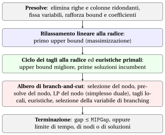

# Solver MIP: cosa fanno

<div class="info-capitolo" markdown>

**Parte 4 · Risolutori MIP · Capitolo 9** · [:material-file-pdf-box: Appunti del corso, volume 3 (PDF)](../pdf/lecture-notes-3-mip-solvers.pdf) · [:material-pencil: Esercizi: Risolutori MIP](../exercises/mip-solvers.md)

</div>

!!! nota "Prerequisiti"
    - Da questo modulo, i capitoli «Algoritmi branch-and-bound basati su LP» e «Algoritmi branch-and-cut»: le operazioni di branching, bounding e pruning, i tagli e la soluzione incumbent.

    - Da questo modulo, il capitolo «Bound primali e bound duali»: i limiti inferiori e superiori e il divario di ottimalità.

    - Per imparare a usare Gurobi nella pratica, vedi il modulo «Modellazione MIP» ([<u>fabiofurini.github.io/modellazione-mip</u>](https://fabiofurini.github.io/modellazione-mip/)), [capitolo 3 «Dal modello a Python/Gurobi»](https://fabiofurini.github.io/modellazione-mip/modellazione-3/).

!!! chiave "Obiettivi"
    Alla fine di questo capitolo sarai in grado di:

    - nomina i componenti di un risolutore MIP e indica su quale lato dei vincoli agisce ciascuno di essi;

    - spiega presolve, tagli, euristiche primali, regole di branching, tolleranze e il gap;

    - leggi il registro di Gurobi e segui i due limiti, la soluzione corrente e l'albero;

    - spiega perché un risolutore può fermarsi con una soluzione che non è ottimale.

## 9.1 Dall'algoritmo branch-and-cut a un risolutore MIP

<a id="box-1-def-solver"></a>

!!! definizione "Definizione 9.1: Risolutore MIP"
    Un <strong>risolutore MIP</strong> (Gurobi, CPLEX, Xpress, HiGHS, SCIP) è un programma informatico che calcola soluzioni ottimali per problemi MIP. Il suo nucleo è l'algoritmo branch-and-cut del capitolo precedente.

- Intorno al nucleo, il risolutore aggiunge diversi componenti. Ognuno di essi agisce su un lato dei vincoli su $z(\ILP)$, qui per un problema di massimizzazione:

    $$
    \underbrace{\LB}_{\text{lato primale}} ~~\le~~ z(\ILP) ~~\le~~ \underbrace{\UB}_{\text{lato duale}}
    $$

- I componenti sono gli stessi in tutti i risolutori. I dettagli (quali tagli, quali euristiche, quali regole) differiscono da risolutore a risolutore e da versione a versione, e sono solo parzialmente documentati.

!!! chiave ""
    Un risolutore MIP esegue il presolve, poi il nodo radice (rilassamento LP, tagli, euristiche primali), poi l'albero branch-and-cut, e si ferma quando il divario tra i limiti è al di sotto di una tolleranza o viene raggiunto un limite.

{ .fig loading=lazy  }

### 9.1.1 Dizionario tra le note e il risolutore

<div class="tabella" markdown="0"><table>
<tr>
<th>Nei appunti (B&amp;B, B&amp;C)</th>
<th>Nel log di Gurobi</th>
</tr>
<tr>
<td>Limite inferiore <span class="arithmatex">\(\LB\)</span> (max), soluzione incumbent <span class="arithmatex">\(\bar{\vet x}\)</span></td>
<td><code>Detentore</code></td>
</tr>
<tr>
<td>limite superiore <span class="arithmatex">\(\UB\)</span> (max)</td>
<td><code>BestBd</code> (miglior limite)</td>
</tr>
<tr>
<td>divario di ottimalità</td>
<td><code>Divario</code></td>
</tr>
<tr>
<td>list <span class="arithmatex">\(L\)</span> dei problemi LP per il ramificamento</td>
<td><code>Unexpl</code> (nodi inesplorati)</td>
</tr>
<tr>
<td>Problemi di programmazione lineare già elaborati</td>
<td><code>Expl</code> (nodi esplorati)</td>
</tr>
<tr>
<td><span class="arithmatex">\(z(\LP_k)\)</span> del nodo di ramificazione corrente</td>
<td><code>Oggetto</code></td>
</tr>
<tr>
<td>livello del nodo nell'albero</td>
<td><code>Profondità</code></td>
</tr>
<tr>
<td>variabili intere frazionarie in <span class="arithmatex">\(\tilde{\vet x}(\LP_k)\)</span></td>
<td><code>IntInf</code></td>
</tr>
</table></div>

- In un problema di <u>minimizzazione</u> i ruoli sono scambiati: <code>Incumbent</code> è un limite superiore e <code>BestBd</code> è un limite inferiore.

## 9.2 I componenti di un risolutore MIP

### 9.2.1 Pre-risoluzione

<a id="box-2-def-presolve"></a>

!!! definizione "Definizione 9.2: presolve"
    Il <strong>presolve</strong> trasforma un problema MIP in uno equivalente: stesso valore ottimale, e una soluzione ottimale del problema originale può essere ricavata da una di quello nuovo.

- Il nuovo problema è più piccolo e, possibilmente, ha un rilassamento LP più forte. Le operazioni tipiche sono tre:

    1. rimuovere <strong>vincoli ridondanti</strong> e <strong>fissare variabili</strong> il cui valore è implicito;

    2. <strong>stringere i vincoli</strong>: derivare limiti superiori più piccoli e limiti inferiori più grandi sulle variabili;

    3. <strong>irrigidimento dei coefficienti</strong>: modificare i coefficienti di un vincolo in modo che le soluzioni intere rimangano le stesse, mentre il rilassamento LP diventa più piccolo.

<a id="box-3-ex-solver-presolve"></a>

!!! esempio "Esempio 9.1: irrigidimento dei coefficienti"
    Considera il problema con tre variabili binarie

    $$
    \max~ x_1 + x_2 + x_3 \qquad \text{soggetto a} \qquad 6\,x_1 + 6\,x_2 + 3\,x_3 \le 10, \qquad
    x_1, x_2, x_3 \in \{0,1\}.
    $$

    - Il vincolo è soddisfatto dagli stessi sei punti binari del vincolo

        $$
        7\,x_1 + 7\,x_2 + 3\,x_3 \le 10 .
        $$

        In effetti, $x_1 = x_2 = 1$ viola sia ($12 > 10$ che $14 > 10$), mentre ogni altro punto soddisfa entrambi (i lati sinistri più grandi sono $9$ e $10$).

    - Il rilassamento LP del primo vincolo ha valore ottimale $z(\LP) = \frac{13}{6}$, ottenuto ad esempio in $\tilde{\vet x} = (1,\frac{1}{6},1)$: è frazionario, e $x_1 + x_2 = \frac{7}{6}$.

    - Il rilassamento LP del secondo vincolo ha valore ottimale $2 = z(\ILP)$: il limite superiore diminuisce da $\frac{13}{6}$ a $2$ senza modificare le soluzioni intere e le dimensioni del modello.

- Lo stesso ragionamento può essere applicato a ogni nodo di diramazione (<strong>node presolve</strong>, o <strong>propagazione del dominio</strong>): un vincolo di diramazione $x_j \le 0$ può implicare che altre variabili possano essere fissate.

### 9.2.2 Piani di taglio

- Nel nodo radice il risolutore esegue diverse <strong>serie di tagli</strong>. Alla fine, il registro riporta quanti tagli di ciascuna famiglia sono stati aggiunti.

- Le famiglie che compaiono nei nostri registri sono <code>Gomory</code> (tagli di Gomory), <code>MIR</code> (tagli di arrotondamento misto intero, che generalizzano i tagli di Gomory ai problemi MIP), <code>StrongCG</code> (tagli di Chvátal–Gomory) e <code>Lift-and-project</code>.

- Anche nell'albero vengono generate delle separazioni, meno frequentemente che alla radice (branch-and-cut).

### 9.2.3 Euristiche primali { #sez-sec-solver-heuristics }

- <strong>Le euristiche primali</strong> cercano buone soluzioni intere ammissibili: forniscono la soluzione attuale e il limite $\LB$ (massimizzazione). Esempi includono l'arrotondamento della soluzione LP, il <strong>diving</strong> e la ricerca locale attorno alla soluzione attuale (capitolo «Euristiche MIP»).

- Nel registro, una riga che inizia con <code>H</code> segnala una nuova soluzione corrente trovata da un’euristica. Una riga che inizia con <code>*</code> segnala una soluzione trovata come soluzione ottimale intera di un problema LP di un nodo (potatura per integrità).

- La linea <code>Found heuristic solution</code> segnala una soluzione trovata prima della LP di radice.

### 9.2.4 Selezione della variabile di ramificazione e del nodo di ramificazione

- Le strategie di selezione della variabile di branching del capitolo B&amp;B (massima infeasibilità, strong branching, pseudocosti) sono tutte disponibili in un solver. Lo strong branching produce alberi piccoli ma è costoso; i pseudocosti sono economici ma inaffidabili all'inizio.

- I risolutori li combinano nel <strong>ramificazione di affidabilità</strong>: ramificazione forte su una variabile fino a quando i suoi pseudocosti sono stati osservati abbastanza volte.

- In Gurobi il parametro <code>VarBranch</code> seleziona la strategia: $-1$ automatica (predefinita), $0$ pseudocosto ridotto, $1$ pseudo-prezzo ombra, $2$ massima infeasibilità, $3$ ramificazione forte.

- La selezione dei nodi combina <strong>best bound</strong> (seleziona il nodo con il più grande $z(\LP_k)$, che diminuisce $\UB$) e <strong>depth first</strong> (che trova rapidamente soluzioni intere).

### 9.2.5 Tolleranze e gioco

- Un risolutore MIP lavora con <strong>aritmetica a virgola mobile</strong>: un valore è intero, un vincolo è soddisfatto, un costo ridotto è non positivo, fino a una <strong>tolleranza</strong>. I valori predefiniti in Gurobi 13 sono:

<div class="tabella" markdown="0"><table>
<tr>
<th>Parametro</th>
<th>Predefinito</th>
<th>Significato</th>
</tr>
<tr>
<td><code>IntFeasTol</code></td>
<td><span class="arithmatex">\(10^{-5}\)</span></td>
<td>Una variabile è intera se rientra in <span class="arithmatex">\(10^{-5}\)</span> di un intero</td>
</tr>
<tr>
<td><code>FeasibilityTol</code></td>
<td><span class="arithmatex">\(10^{-6}\)</span></td>
<td>massima violazione di un vincolo</td>
</tr>
<tr>
<td><code>OptimalityTol</code></td>
<td><span class="arithmatex">\(10^{-6}\)</span></td>
<td>tolleranza sui costi ridotti (ottimalità LP)</td>
</tr>
<tr>
<td><code>MIPGap</code></td>
<td><span class="arithmatex">\(10^{-4}\)</span></td>
<td>gap relativo al quale il risolutore si ferma</td>
</tr>
<tr>
<td><code>MIPGapAssoluto</code></td>
<td><span class="arithmatex">\(10^{-10}\)</span></td>
<td>gap assoluto al quale il risolutore si ferma</td>
</tr>
</table></div>

!!! chiave ""
    “<code>Soluzione ottimale trovata (tolleranza 1.00e-04)</code>” significa che la soluzione corrente è ottimale <strong>fino a un divario relativo di $10^{-4}$</strong>. Con un <code>MIPGap</code> maggiore, il risolutore si ferma con una soluzione che potrebbe <strong>non</strong> essere ottimale e scrive la stessa frase.

## 9.3 Come leggere il registro di Gurobi

- Tutti i log sono prodotti da Gurobi 13.0.3 (<code>gurobipy</code>) con <code>Threads</code> $=1$ e <code>Seed</code> $=0$, in modo che l'esecuzione sia deterministica. Con altre versioni o computer il numero di nodi e iterazioni può differire.

- I numeri a sinistra sono i numeri di riga aggiunti per i commenti; le righe <code>Set parameter ...</code> sono omesse.

### 9.3.1 Un problema di catalogo risolto alla radice

- Partiamo dal problema $P41$ del catalogo dei problemi MIP: tre variabili intere non negative e quattro vincoli,

    $$
    \max~ 2x_1 + x_2 + 3x_3 \quad \text{s.t.} \quad x_1 + x_2 + x_3 \le 4,~~ x_2 \le 2,~~ x_3 \le 3,~~
    3x_1 + x_3 \le 6 .
    $$

??? codice "Gurobi log: problema $P41$, parametri predefiniti"

    ```python
    01| Gurobi Optimizer version 13.0.3 build v13.0.3rc0 (linux64 - "Ubuntu 26.04 LTS")
    02|
    03| CPU model: Intel(R) Core(TM) i5-14500T, instruction set [SSE2|AVX|AVX2]
    04| Thread count: 20 physical cores, 20 logical processors, using up to 1 threads
    05|
    06| Non-default parameters:
    07| LogToConsole  0
    08| Threads  1
    09|
    10| Optimize a model with 4 rows, 3 columns and 7 nonzeros (Max)
    11| Model fingerprint: 0xedc792ce
    12| Model has 3 linear objective coefficients
    13| Variable types: 0 continuous, 3 integer (0 binary)
    14| Coefficient statistics:
    15|   Matrix range     [1e+00, 3e+00]
    16|   Objective range  [1e+00, 3e+00]
    17|   Bounds range     [0e+00, 0e+00]
    18|   RHS range        [2e+00, 6e+00]
    19|
    20| Found heuristic solution: objective 6.0000000
    21| Presolve removed 2 rows and 0 columns
    22| Presolve time: 0.00s
    23| Presolved: 2 rows, 3 columns, 5 nonzeros
    24| Variable types: 0 continuous, 3 integer (0 binary)
    25|
    26| Root relaxation: objective 1.100000e+01, 1 iterations, 0.00 seconds (0.00 work units)
    27|
    28|     Nodes    |    Current Node    |     Objective Bounds      |     Work
    29|  Expl Unexpl |  Obj  Depth IntInf | Incumbent    BestBd   Gap | It/Node Time
    30|
    31| *    0     0               0      11.0000000   11.00000  0.00%     -    0s
    32|
    33| Explored 1 nodes (1 simplex iterations) in 0.00 seconds (0.00 work units)
    34| Thread count was 1 (of 20 available processors)
    35|
    36| Solution count 2: 11 6
    37|
    38| Optimal solution found (tolerance 1.00e-04)
    39| Best objective 1.100000000000e+01, best bound 1.100000000000e+01, gap 0.0000%
    ```

- **01–08** Versione di Gurobi, computer, thread utilizzati ($1$, da <code>Threads</code> $=1$); parametri con valori non predefiniti (<code>Seed</code> $=0$ non è elencato, poiché $0$ è il suo valore predefinito).

- **10–13** Dimensione del modello: $4$ righe, $3$ colonne, $7$ non zeri, <code>(Massimo)</code>; i tipi di variabile ($3$ intero, nessuno binario).

- **14–18** <strong>Statistiche dei coefficienti</strong>: i valori assoluti più piccoli e più grandi dei coefficienti. Intervalli che coprono molti ordini di grandezza segnalano difficoltà numeriche; qui tutti i valori sono compresi tra $1$ e $6$.

- **20** Un’euristica trova una soluzione di valore $6$ prima del presolve, quindi $\LB = 6$.

- **21–23** La pre-risoluzione rimuove $2$ righe: il modello ha $2$ righe e $3$ colonne rimanenti.

- **26** <strong>Rilassamento LP alla radice</strong>: il valore è $11$; basta una sola iterazione del simplesso.

- **31** La soluzione radice LP è intera, quindi il problema del nodo viene risolto immediatamente (una riga che inizia con <code>\*</code>, vedi Sezione [9.2.3](#sez-sec-solver-heuristics)); $\LB = \UB = 11$, e la soluzione è ottimale.

### 9.3.2 Un MIP generico

- D'ora in poi utilizziamo un <strong>MIP generico con variabili intere $30$</strong> che chiamiamo $G_1$. È un problema ILP puro nella forma

    $$
    \max~ \vet c\T\vet x \quad \text{s.t.} \quad A\,\vet x \le \vet b,
    $$

    con $x_j \in \{0,1,2,3\}$ per i vincoli $j = 1,\dots,30$ e $10$. Tutti i dati sono interi e pseudo-casuali (Python <code>random.Random(1)</code>): $a_{ij}$ uniforme in $\{1,\dots,20\}$, $c_j$ uniforme in $\{5,\dots,25\}$, e $b_i = \sum_j a_{ij}$.

- Lo script <code>script/genera_log.py</code> di questo capitolo crea l'istanza e produce tutti i log.

??? codice "Gurobi log: MIP generico $G_1$, parametri predefiniti"

    ```python
    01| Gurobi Optimizer version 13.0.3 build v13.0.3rc0 (linux64 - "Ubuntu 26.04 LTS")
    02|
    03| CPU model: Intel(R) Core(TM) i5-14500T, instruction set [SSE2|AVX|AVX2]
    04| Thread count: 20 physical cores, 20 logical processors, using up to 1 threads
    05|
    06| Non-default parameters:
    07| LogToConsole  0
    08| Threads  1
    09|
    10| Optimize a model with 10 rows, 30 columns and 300 nonzeros (Max)
    11| Model fingerprint: 0xb023d504
    12| Model has 30 linear objective coefficients
    13| Variable types: 0 continuous, 30 integer (0 binary)
    14| Coefficient statistics:
    15|   Matrix range     [1e+00, 2e+01]
    16|   Objective range  [5e+00, 2e+01]
    17|   Bounds range     [3e+00, 3e+00]
    18|   RHS range        [3e+02, 4e+02]
    19|
    20| Found heuristic solution: objective 429.0000000
    21| Presolve time: 0.00s
    22| Presolved: 10 rows, 30 columns, 300 nonzeros
    23| Variable types: 0 continuous, 30 integer (0 binary)
    24|
    25| Root relaxation: objective 5.991749e+02, 13 iterations, 0.00 seconds (0.00 work units)
    26|
    27|     Nodes    |    Current Node    |     Objective Bounds      |     Work
    28|  Expl Unexpl |  Obj  Depth IntInf | Incumbent    BestBd   Gap | It/Node Time
    29|
    30|      0     0  599.17487    0    6  429.00000  599.17487  39.7%     -    0s
    31| H    0     0                     563.0000000  599.17487  6.43%     -    0s
    32| H    0     0                     576.0000000  599.17487  4.02%     -    0s
    33| H    0     0                     584.0000000  599.17487  2.60%     -    0s
    34| H    0     0                     587.0000000  599.17487  2.07%     -    0s
    35| H    0     0                     588.0000000  599.17487  1.90%     -    0s
    36|      0     0  597.88443    0    5  588.00000  597.88443  1.68%     -    0s
    37| H    0     0                     589.0000000  597.88443  1.51%     -    0s
    38| H    0     0                     592.0000000  597.88443  0.99%     -    0s
    39|      0     0  597.70993    0    5  592.00000  597.70993  0.96%     -    0s
    40|      0     0  597.67133    0    5  592.00000  597.67133  0.96%     -    0s
    41|      0     0  597.65097    0    4  592.00000  597.65097  0.95%     -    0s
    42|      0     0  597.64318    0    5  592.00000  597.64318  0.95%     -    0s
    43|      0     0  597.64271    0    5  592.00000  597.64271  0.95%     -    0s
    44|      0     0  597.56576    0    5  592.00000  597.56576  0.94%     -    0s
    45| H    0     0                     593.0000000  597.56576  0.77%     -    0s
    46|      0     0  597.55314    0    6  593.00000  597.55314  0.77%     -    0s
    47|      0     0  597.52752    0    6  593.00000  597.52752  0.76%     -    0s
    48|      0     0  597.51828    0    6  593.00000  597.51828  0.76%     -    0s
    49|      0     0  597.47194    0    7  593.00000  597.47194  0.75%     -    0s
    50|      0     0  597.21692    0    6  593.00000  597.21692  0.71%     -    0s
    51|      0     0  597.20185    0    6  593.00000  597.20185  0.71%     -    0s
    52|      0     0  597.19580    0    6  593.00000  597.19580  0.71%     -    0s
    53|      0     0  597.07620    0    6  593.00000  597.07620  0.69%     -    0s
    54|      0     0  597.07620    0    6  593.00000  597.07620  0.69%     -    0s
    55|      0     0  597.07620    0    6  593.00000  597.07620  0.69%     -    0s
    56|      0     0  597.07620    0    6  593.00000  597.07620  0.69%     -    0s
    57|      0     0  597.07620    0    6  593.00000  597.07620  0.69%     -    0s
    58|      0     0  597.07620    0    7  593.00000  597.07620  0.69%     -    0s
    59|      0     0  597.07620    0    7  593.00000  597.07620  0.69%     -    0s
    60|      0     0  597.07620    0    6  593.00000  597.07620  0.69%     -    0s
    61|      0     0  597.07620    0    7  593.00000  597.07620  0.69%     -    0s
    62|      0     0  597.07620    0    8  593.00000  597.07620  0.69%     -    0s
    63|      0     0  597.07074    0    7  593.00000  597.07074  0.69%     -    0s
    64|      0     0  597.02014    0    9  593.00000  597.02014  0.68%     -    0s
    65|      0     0  597.01888    0    9  593.00000  597.01888  0.68%     -    0s
    66|      0     0  597.01587    0    9  593.00000  597.01587  0.68%     -    0s
    67|      0     0  596.92506    0    8  593.00000  596.92506  0.66%     -    0s
    68|      0     0  596.85717    0    8  593.00000  596.85717  0.65%     -    0s
    69|      0     0  596.85610    0    8  593.00000  596.85610  0.65%     -    0s
    70|      0     0  596.85474    0    8  593.00000  596.85474  0.65%     -    0s
    71|      0     0  596.85333    0    8  593.00000  596.85333  0.65%     -    0s
    72|      0     0  596.76534    0    8  593.00000  596.76534  0.63%     -    0s
    73|      0     0  596.76242    0    8  593.00000  596.76242  0.63%     -    0s
    74|      0     0  596.75427    0    9  593.00000  596.75427  0.63%     -    0s
    75|      0     0  596.74106    0    8  593.00000  596.74106  0.63%     -    0s
    76|      0     0  596.73942    0    9  593.00000  596.73942  0.63%     -    0s
    77|      0     0  596.73942    0    9  593.00000  596.73942  0.63%     -    0s
    78|      0     2  596.64707    0    9  593.00000  596.64707  0.62%     -    0s
    79|
    80| Cutting planes:
    81|   Gomory: 1
    82|   Lift-and-project: 1
    83|   MIR: 5
    84|   StrongCG: 3
    85|
    86| Explored 47 nodes (259 simplex iterations) in 0.06 seconds (0.04 work units)
    87| Thread count was 1 (of 20 available processors)
    88|
    89| Solution count 9: 593 592 589 ... 429
    90|
    91| Optimal solution found (tolerance 1.00e-04)
    92| Best objective 5.930000000000e+02, best bound 5.930000000000e+02, gap 0.0000%
    ```

- **10–13** righe $10$, colonne $30$, valori non nulli $300$; <code>(Max)</code>: massimizzazione; le variabili sono intere ma non binarie.

- **20** Un’euristica trova una soluzione di valore $429$: $\LB = 429$.

- **21–23** La presolve non cambia la dimensione del modello.

- **25** <strong>Rilassamento LP alla radice</strong>: il valore è $599.17487$ (limite superiore), dopo $13$ iterazioni del simplesso.

- **27–28** Intestazione del <strong>log dei nodi</strong>: <code>Expl</code> e <code>Unexpl</code> sono i nodi esplorati e non esplorati; <code>Obj</code>, <code>Depth</code>, <code>IntInf</code> descrivono il nodo corrente; <code>Incumbent</code>, <code>BestBd</code>, <code>Gap</code> sono i due limiti e il divario.

- **30** Nodo radice: $6$ le variabili intere sono frazionarie e il divario è $39.7\%$.

- **31–35** Linee che iniziano con <code>H</code>: le euristiche primali trovano soluzioni incumbent migliori, da $563$ a $588$, mentre il miglior limite resta a $599.17487$.

- **36–78** Il <strong>ciclo di taglio</strong>: ogni riga con $0$ nodi esplorati è un nuovo giro di tagli, e il miglior limite diminuisce da $599.17487$ a $596.73942$. Vengono trovate più soluzioni incumbenti, fino a $593$ (riga $45$).

- **79** La radice è ramificata: i nodi $2$ attendono nella lista, il divario è $0.62\%$.

- **81–84** Tagli aggiunti: $1$ Gomory, $1$ lift-and-project, $5$ MIR, $3$ StrongCG.

- **86–92** $47$ nodi esplorati, $259$ iterazioni del simplesso; $9$ soluzioni trovate, la migliore è $593$, ottimale.

!!! chiave ""
    Qui la maggior parte del lavoro viene fatta alla radice: le euristiche aumentano il limite inferiore da $429$ a $593$ e i tagli riducono il limite superiore da $599.17$ a $596.65$. L'albero viene poi utilizzato per <strong>dimostrare</strong> che $593$ è ottimale.

### 9.3.3 La stessa istanza senza presolve, tagli e euristiche

- Con <code>Presolve</code> $=0$, <code>Cuts</code> $=0$ e <code>Heuristics</code> $=0$ il risolutore è vicino all'algoritmo B&amp;B basato su LP degli appunti, e vediamo l'albero.

??? codice "Gurobi log: $G_1$, <code>Presolve=0</code>, <code>Tagli=0</code>, <code>Euristiche=0</code>"

    ```python
    01| Gurobi Optimizer version 13.0.3 build v13.0.3rc0 (linux64 - "Ubuntu 26.04 LTS")
    02|
    03| CPU model: Intel(R) Core(TM) i5-14500T, instruction set [SSE2|AVX|AVX2]
    04| Thread count: 20 physical cores, 20 logical processors, using up to 1 threads
    05|
    06| Non-default parameters:
    07| Heuristics  0
    08| Cuts  0
    09| LogToConsole  0
    10| Presolve  0
    11| Threads  1
    12|
    13| Optimize a model with 10 rows, 30 columns and 300 nonzeros (Max)
    14| Model fingerprint: 0xb023d504
    15| Model has 30 linear objective coefficients
    16| Variable types: 0 continuous, 30 integer (0 binary)
    17| Coefficient statistics:
    18|   Matrix range     [1e+00, 2e+01]
    19|   Objective range  [5e+00, 2e+01]
    20|   Bounds range     [3e+00, 3e+00]
    21|   RHS range        [3e+02, 4e+02]
    22|
    23| Variable types: 0 continuous, 30 integer (0 binary)
    24|
    25| Root relaxation: objective 5.991749e+02, 13 iterations, 0.00 seconds (0.00 work units)
    26|
    27|     Nodes    |    Current Node    |     Objective Bounds      |     Work
    28|  Expl Unexpl |  Obj  Depth IntInf | Incumbent    BestBd   Gap | It/Node Time
    29|
    30|      0     0  599.17487    0    6          -  599.17487      -     -    0s
    31|      0     0  598.42295    0    6          -  598.42295      -     -    0s
    32|      0     2  598.42295    0    6          -  598.42295      -     -    0s
    33| *   33    22              31     584.0000000  597.70712  2.35%   1.6    0s
    34| *   73    18              12     593.0000000  597.40703  0.74%   1.7    0s
    35|
    36| Explored 119 nodes (228 simplex iterations) in 0.00 seconds (0.00 work units)
    37| Thread count was 1 (of 20 available processors)
    38|
    39| Solution count 2: 593 584
    40|
    41| Optimal solution found (tolerance 1.00e-04)
    42| Best objective 5.930000000000e+02, best bound 5.930000000000e+02, gap 0.0000%
    ```

- **22–23** Nessuna linea euristica e nessuna linea di pre-soluzione: non c'è ancora una soluzione incumbent.

- **30–32** Il vincolo di radice è $599.17487$ e diminuisce a $598.42295$ prima che la radice venga diramata; la colonna <code>Incumbent</code> contiene un trattino (<code>-</code>) poiché non è nota alcuna soluzione.

- **33–34** Due soluzioni incumbenti si trovano come soluzioni ottimali intere dei problemi LP dei nodi (<code>\*</code>), ai nodi $33$ e $73$: valori $584$ e $593$.

- **36** Per dimostrare che $593$ è ottimale, il risolutore esplora $119$ nodi ($228$ iterazioni), contro $47$ nodi con i parametri predefiniti.

### 9.3.4 Il divario come criterio di arresto

- Ripetiamo l'esecuzione precedente con <code>MIPGap</code> $= 0.01$:

??? codice "Gurobi log: $G_1$, <code>Presolve=0</code>, <code>Tagli=0</code>, <code>Euristiche=0</code>, <code>MIPGap=0.01</code>"

    ```python
    01| Gurobi Optimizer version 13.0.3 build v13.0.3rc0 (linux64 - "Ubuntu 26.04 LTS")
    02|
    03| CPU model: Intel(R) Core(TM) i5-14500T, instruction set [SSE2|AVX|AVX2]
    04| Thread count: 20 physical cores, 20 logical processors, using up to 1 threads
    05|
    06| Non-default parameters:
    07| MIPGap  0.01
    08| Heuristics  0
    09| Cuts  0
    10| LogToConsole  0
    11| Presolve  0
    12| Threads  1
    13|
    14| Optimize a model with 10 rows, 30 columns and 300 nonzeros (Max)
    15| Model fingerprint: 0xb023d504
    16| Model has 30 linear objective coefficients
    17| Variable types: 0 continuous, 30 integer (0 binary)
    18| Coefficient statistics:
    19|   Matrix range     [1e+00, 2e+01]
    20|   Objective range  [5e+00, 2e+01]
    21|   Bounds range     [3e+00, 3e+00]
    22|   RHS range        [3e+02, 4e+02]
    23|
    24| Variable types: 0 continuous, 30 integer (0 binary)
    25|
    26| Root relaxation: objective 5.991749e+02, 13 iterations, 0.00 seconds (0.00 work units)
    27|
    28|     Nodes    |    Current Node    |     Objective Bounds      |     Work
    29|  Expl Unexpl |  Obj  Depth IntInf | Incumbent    BestBd   Gap | It/Node Time
    30|
    31|      0     0  599.17487    0    6          -  599.17487      -     -    0s
    32|      0     0  598.42295    0    6          -  598.42295      -     -    0s
    33|      0     2  598.42295    0    6          -  598.42295      -     -    0s
    34| *   33    22              31     584.0000000  597.70712  2.35%   1.6    0s
    35| *   73    18              12     593.0000000  597.40703  0.74%   1.7    0s
    36|
    37| Explored 74 nodes (138 simplex iterations) in 0.00 seconds (0.00 work units)
    38| Thread count was 1 (of 20 available processors)
    39|
    40| Solution count 2: 593 584
    41|
    42| Optimal solution found (tolerance 1.00e-02)
    43| Best objective 5.930000000000e+02, best bound 5.970000000000e+02, gap 0.6745%
    ```

- **34–35** Le stesse due soluzioni in corso di validità come prima, $584$ e $593$.

- **37** Il risolutore si ferma dopo $74$ nodi invece di $119$: con $\LB = 593$ il miglior limite è $597$ (il valore $597.40703$ dell'ultima riga nodo è arrotondato per difetto dal risolutore, poiché tutti i dati sono interi) e il divario è $\frac{597 - 593}{593} \approx 0.67\% < 1\%$.

- **42–43** Il risolutore scrive “<code>Soluzione ottimale trovata (tolleranza 1.00e-02)</code>” per il valore $593$.

- Il limite $597$ certifica solo che $593$ si trova all'interno di $0.67\%$ dell'ottimo. Qui la soluzione è in effetti ottimale, ma il risolutore non può saperlo senza esplorare i restanti $45$ nodi.

### 9.3.5 Selezione della variabile di diramazione

- Con presolve, tagli e euristiche disattivate, cambiamo solo <code>VarBranch</code>, su $G_1$ e su un secondo MIP generico $G_2$ (stessa costruzione, con $30$ variabili intere in $\{0,\dots,5\}$ e $8$ vincoli, $b_i = \lfloor 5 \sum_j a_{ij}/3 \rfloor$). La tabella mostra i nodi esplorati (iterazioni del simplesso tra parentesi).

<div class="tabella" markdown="0"><table>
<tr>
<th><code>VarBranch</code></th>
<th><span class="arithmatex">\(G_1\)</span></th>
<th><span class="arithmatex">\(G_2\)</span></th>
</tr>
<tr>
<td><span class="arithmatex">\(-1\)</span> automatico</td>
<td><span class="arithmatex">\(119\)</span> (<span class="arithmatex">\(228\)</span>)</td>
<td><span class="arithmatex">\(566\)</span> (<span class="arithmatex">\(1144\)</span>)</td>
</tr>
<tr>
<td><span class="arithmatex">\(0\)</span> costo pseudo ridotto</td>
<td><span class="arithmatex">\(119\)</span> (<span class="arithmatex">\(228\)</span>)</td>
<td><span class="arithmatex">\(566\)</span> (<span class="arithmatex">\(1144\)</span>)</td>
</tr>
<tr>
<td><span class="arithmatex">\(1\)</span> pseudo-prezzo ombra</td>
<td><span class="arithmatex">\(176\)</span> (<span class="arithmatex">\(313\)</span>)</td>
<td><span class="arithmatex">\(645\)</span> (<span class="arithmatex">\(1270\)</span>)</td>
</tr>
<tr>
<td><span class="arithmatex">\(2\)</span> massima inviabilità</td>
<td><span class="arithmatex">\(223\)</span> (<span class="arithmatex">\(392\)</span>)</td>
<td><span class="arithmatex">\(527\)</span> (<span class="arithmatex">\(1097\)</span>)</td>
</tr>
<tr>
<td><span class="arithmatex">\(3\)</span> ramificazione forte</td>
<td><span class="arithmatex">\(99\)</span> (<span class="arithmatex">\(184\)</span>)</td>
<td><span class="arithmatex">\(497\)</span> (<span class="arithmatex">\(934\)</span>)</td>
</tr>
</table></div>

- Le differenze sono moderate su queste due istanze: il branching forte produce gli alberi più piccoli, e la regola della massima infeasibilità produce i più grandi su $G_1$ e il secondo più piccolo su $G_2$.

- La classifica delle regole cambia con l'istanza, quindi il comportamento di una regola è difficile da prevedere; la scelta automatica non è mai lontana dalla migliore.

- Il branching forte necessita di meno nodi ma ogni nodo è più costoso: il numero dei soli nodi non misura il tempo di esecuzione.

!!! chiave ""
    Leggere un registro significa seguire i due limiti: la colonna <code>Incumbent</code> è il lato primale (euristiche e nodi interi), la colonna <code>BestBd</code> il lato duale (rilassamento, presolve, tagli, branching).

## 9.4 Errori tipici

!!! attenzione "Avviso"
    - <strong>Leggere “Soluzione ottimale trovata” come prova di ottimalità.</strong> La frase indica la tolleranza in uso: con <code>MIPGap</code> $= 0.01$ la soluzione può essere a $1\%$ dal ottimo.

    - <strong>Scambiare i limiti in un problema di minimizzazione.</strong> In un problema di minimizzazione <code>Incumbent</code> è il limite superiore e <code>BestBd</code> il limite inferiore.

    - <strong>Credere che l'albero spieghi tutto.</strong> Con i parametri predefiniti, la maggior parte del lavoro del risolutore si trova al di fuori dell'albero: nei nostri log, il nodo radice da solo risolve $P41$ e, su $G_1$, le euristiche e i tagli della radice forniscono la soluzione ottimale e la maggior parte del limite.

    - <strong>Confronto del numero di nodi tra esecuzioni.</strong> I numeri dipendono dalla versione del risolutore, dal computer e dal seme; con altri parametri la stessa istanza può richiedere $47$ o $223$ nodi.

    - <strong>Aspettandosi che il risolutore segua le regole delle note.</strong> Le scelte del risolutore (tagli, euristiche, selezione dei nodi) non sono documentate in dettaglio e cambiano con la versione.

## 9.5 In sintesi

!!! chiave "In sintesi"
    - Un risolutore MIP è un algoritmo branch-and-cut con presolve, tagli, euristiche primali, ramificazione e regole di selezione dei nodi intorno ad esso.

    - Il presolve e i tagli aumentano il limite inferiore (minimizzazione), le euristiche trovano la soluzione corrente, il branching chiude il divario.

    - Il registro mostra i limiti: <code>Incumbent</code> è il lato primale, <code>BestBd</code> il lato duale, <code>Gap</code> la loro distanza relativa.

    - Il risolutore si interrompe quando il divario è inferiore a <code>MIPGap</code>: la soluzione è ottimale solo fino a quella tolleranza.

    - Spegnere i componenti mostra quanto ciascuno di essi risparmia su una determinata istanza.

    <strong>Cruscotto del generico MIP $G_1$.</strong> Limiti inferiori e superiori su $z(\ILP) = 593$ nel log predefinito di questo capitolo:

    <div class="tabella" markdown="0"><table>
    <tr>
    <th>Fase</th>
    <th>Limite inferiore</th>
    <th>Limite superiore</th>
    </tr>
    <tr>
    <td>Soluzione euristica prima della radice</td>
    <td><span class="arithmatex">\(429\)</span></td>
    <td>—</td>
    </tr>
    <tr>
    <td>Rilassamento LP alla radice</td>
    <td><span class="arithmatex">\(429\)</span></td>
    <td><span class="arithmatex">\(599\)</span></td>
    </tr>
    <tr>
    <td>Nodo radice, euristiche e tagli</td>
    <td><span class="arithmatex">\(593\)</span></td>
    <td><span class="arithmatex">\(596\)</span></td>
    </tr>
    <tr>
    <td>Fine dell'albero</td>
    <td><span class="arithmatex">\(593\)</span></td>
    <td><span class="arithmatex">\(593\)</span></td>
    </tr>
    </table></div>

---

**Esercizi su questo capitolo:** [:material-pencil: Risolutori MIP](../exercises/mip-solvers.md)
